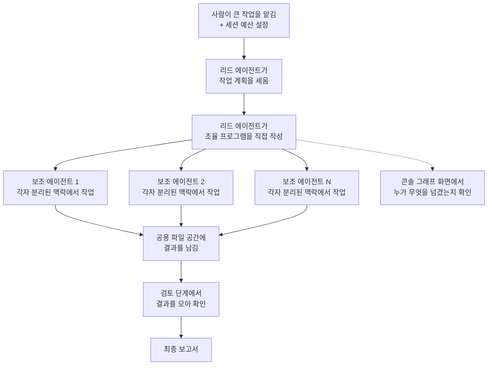

<aside class="ai-knowledge-sidebar">
  
CATEGORIES

  <nav class="ai-cat-tree">

에이전트 오케스트레이션17
<ul><li><a href="https://altjs4510.github.io/ai_news_blog/knowledge/20261015/">2026-10-15How Third Moment Research runs 10,000 agents for…</a></li><li><a href="https://altjs4510.github.io/ai_news_blog/knowledge/20261014/" class="current">2026-10-14How Anthropic's Dynamic Workflows Coordinate Cla…</a></li><li><a href="https://altjs4510.github.io/ai_news_blog/knowledge/20260930/">2026-09-30Agents you can coach: how Asana builds human-age…</a></li><li><a href="https://altjs4510.github.io/ai_news_blog/knowledge/20260831-openexecutive-virtual-c-suite/">2026-08-31Open Executive — 8명의 전문 에이전트를 하나의 임원 목소리로</a></li><li><a href="https://altjs4510.github.io/ai_news_blog/knowledge/20260828/">2026-08-28Google ADK for Python v2.8.0 — RemoteA2aAgent 네이…</a></li><li><a href="https://altjs4510.github.io/ai_news_blog/knowledge/20260826/">2026-08-26apache/maka — 도구 호출·권한 결정·종료 이벤트를 append-only 로그…</a></li><li><a href="https://altjs4510.github.io/ai_news_blog/knowledge/20260823/">2026-08-23The Evolution of the Agent Harness — 하네스가 모델 가중치…</a></li><li><a href="https://altjs4510.github.io/ai_news_blog/knowledge/20260821/">2026-08-21volcengine/OpenViking — 에이전트 메모리·Knowledge RAG·스…</a></li><li><a href="https://altjs4510.github.io/ai_news_blog/knowledge/20260805/">2026-08-05TencentCloud/TencentDB-Agent-Memory — 대화·문서·코드를 …</a></li><li><a href="https://altjs4510.github.io/ai_news_blog/knowledge/20260717/">2026-07-17After a year building agent memory, 'save everyt…</a></li><li><a href="https://altjs4510.github.io/ai_news_blog/knowledge/20260701/">2026-07-01Google OKF (Open Knowledge Format) — 벤더 중립 에이전트 …</a></li><li><a href="https://altjs4510.github.io/ai_news_blog/knowledge/20260623/">2026-06-23bytedance/deer-flow — 샌드박스·메모리·서브에이전트·메시지 게이트웨이를…</a></li><li><a href="https://altjs4510.github.io/ai_news_blog/knowledge/20260611/">2026-06-11The evolution of agentic surfaces: building with…</a></li><li><a href="https://altjs4510.github.io/ai_news_blog/knowledge/20260602/">2026-06-02revfactory/harness — 도메인별 에이전트 팀과 스킬을 자동 설계하는 메타…</a></li><li><a href="https://altjs4510.github.io/ai_news_blog/knowledge/20260529/">2026-05-29Introducing dynamic workflows in Claude Code</a></li><li><a href="https://altjs4510.github.io/ai_news_blog/knowledge/20260507/">2026-05-07ruvnet/ruflo — Claude 멀티 에이전트 오케스트레이션 플랫폼</a></li><li><a href="https://altjs4510.github.io/ai_news_blog/knowledge/20260504/">2026-05-04Agents for Everything Else: Codex for Knowledge …</a></li></ul>

MCP &amp; 도구 통합16
<ul><li><a href="https://altjs4510.github.io/ai_news_blog/knowledge/20261007/">2026-10-07morluto/rea — 앱 동작부터 네이티브 바이너리까지 에이전트로 리버스 엔지니어링</a></li><li><a href="https://altjs4510.github.io/ai_news_blog/knowledge/20260831-gitnexus-code-knowledge-graph/">2026-08-31GitNexus — 코드베이스를 지식그래프로 바꿔 에이전트에게 쥐어주기</a></li><li><a href="https://altjs4510.github.io/ai_news_blog/knowledge/20260819/">2026-08-19akitaonrails/ai-memory — 코딩 에이전트 CLI 간 장기 기억과 벤더…</a></li><li><a href="https://altjs4510.github.io/ai_news_blog/knowledge/20260802/">2026-08-02Stateless MCP has recaptured my interest (and in…</a></li><li><a href="https://altjs4510.github.io/ai_news_blog/knowledge/20260731/">2026-07-31different-ai/openwork — Claude Cowork의 오픈소스 대안(o…</a></li><li><a href="https://altjs4510.github.io/ai_news_blog/knowledge/20260729/">2026-07-29Bringing MCP 2026-07-28 to Claude</a></li><li><a href="https://altjs4510.github.io/ai_news_blog/knowledge/20260726/">2026-07-26citrolabs/ego-lite — 로그인된 브라우저 상태를 AI 에이전트와 공유하는…</a></li><li><a href="https://altjs4510.github.io/ai_news_blog/knowledge/20260718/">2026-07-18tirth8205/code-review-graph — MCP·CLI용 로컬 코드 인텔리…</a></li><li><a href="https://altjs4510.github.io/ai_news_blog/knowledge/20260708/">2026-07-08Expanding Managed Agents in Gemini API: backgrou…</a></li><li><a href="https://altjs4510.github.io/ai_news_blog/knowledge/20260618/">2026-06-18DeusData/codebase-memory-mcp — 158개 언어 코드베이스를 밀리…</a></li><li><a href="https://altjs4510.github.io/ai_news_blog/knowledge/20260604/">2026-06-04chopratejas/headroom — Compress tool outputs bef…</a></li><li><a href="https://altjs4510.github.io/ai_news_blog/knowledge/20260603/">2026-06-03How Bad MCP design cost your Agent 5× more token…</a></li><li><a href="https://altjs4510.github.io/ai_news_blog/knowledge/20260521/">2026-05-21colbymchenry/codegraph — Pre-indexed code knowle…</a></li><li><a href="https://altjs4510.github.io/ai_news_blog/knowledge/20260517/">2026-05-17I gave my LLM 100,000+ tools — Lazy Discovery &a…</a></li><li><a href="https://altjs4510.github.io/ai_news_blog/knowledge/20260509/">2026-05-09How to connect 100 MCP servers without the conte…</a></li><li><a href="https://altjs4510.github.io/ai_news_blog/knowledge/20260506/">2026-05-06mksglu/context-mode — AI 코딩 에이전트용 컨텍스트 윈도우 최적화</a></li></ul>

코딩 에이전트25
<ul><li><a href="https://altjs4510.github.io/ai_news_blog/knowledge/20261017/">2026-10-17mksglu/context-mode — 코딩 에이전트용 컨텍스트 윈도우 최적화</a></li><li><a href="https://altjs4510.github.io/ai_news_blog/knowledge/20261014-claude-code-advisor/">2026-10-14Claude Code advisor — 가벼운 메인 모델이 일하고, 갈림길에서만 Opu…</a></li><li><a href="https://altjs4510.github.io/ai_news_blog/knowledge/20260920/">2026-09-20Claude Code 2.1.277 — CLAUDE.md가 없으면 AGENTS.md를 …</a></li><li><a href="https://altjs4510.github.io/ai_news_blog/knowledge/20260912/">2026-09-12Quoting Boris Cherny — 'Claude가 쓴 프로덕션 코드는 사람이 쓴…</a></li><li><a href="https://altjs4510.github.io/ai_news_blog/knowledge/20260910/">2026-09-10vastsa/PI-Desktop — Electron + Rust 호스트 코어 + 에이전…</a></li><li><a href="https://altjs4510.github.io/ai_news_blog/knowledge/20260906/">2026-09-06DietrichGebert/ponytail — 에이전트를 '방에서 가장 게으른 시니어 …</a></li><li><a href="https://altjs4510.github.io/ai_news_blog/knowledge/20260903/">2026-09-03pacifio/atlas — 여러 코딩 에이전트의 변경을 한곳에서 추적·질의하는 '에이…</a></li><li><a href="https://altjs4510.github.io/ai_news_blog/knowledge/20260901/">2026-09-01affaan-m/ECC — 스킬·본능·메모리·보안을 묶은 에이전트 하네스 성능 최적화 …</a></li><li><a href="https://altjs4510.github.io/ai_news_blog/knowledge/20260829/">2026-08-29cursor/plugins — 플러그인 명세(specification)와 공식 플러그인…</a></li><li><a href="https://altjs4510.github.io/ai_news_blog/knowledge/20260814/">2026-08-14cathrynlavery/diagram-design — Claude Code용 에디토리…</a></li><li><a href="https://altjs4510.github.io/ai_news_blog/knowledge/20260810/">2026-08-10Auto mode is now the default in Claude Code for …</a></li><li><a href="https://altjs4510.github.io/ai_news_blog/knowledge/20260808/">2026-08-08PrimeIntellect-ai/prime-agent — 코딩 워크플로우와 장시간 자율…</a></li><li><a href="https://altjs4510.github.io/ai_news_blog/knowledge/20260804/">2026-08-04esengine/DeepSeek-Reasonix — prefix-cache 안정성을 축…</a></li><li><a href="https://altjs4510.github.io/ai_news_blog/knowledge/20260728/">2026-07-28alibaba/open-code-review — 결정론적 파이프라인 + LLM 에이전트…</a></li><li><a href="https://altjs4510.github.io/ai_news_blog/knowledge/20260725/">2026-07-25The new rules of context engineering for Claude …</a></li><li><a href="https://altjs4510.github.io/ai_news_blog/knowledge/20260714/">2026-07-14Graphify-Labs/graphify — 코드베이스를 질의 가능한 지식 그래프로 만…</a></li><li><a href="https://altjs4510.github.io/ai_news_blog/knowledge/20260707/">2026-07-07AI Hero Skills Catalog — 실무 엔지니어를 위한 재사용 가능한 판단 …</a></li><li><a href="https://altjs4510.github.io/ai_news_blog/knowledge/20260705/">2026-07-05openai/codex-plugin-cc — Claude Code에서 Codex를 위임…</a></li><li><a href="https://altjs4510.github.io/ai_news_blog/knowledge/20260626/">2026-06-26google-labs-code/design.md — 코딩 에이전트에게 디자인 시스템을 …</a></li><li><a href="https://altjs4510.github.io/ai_news_blog/knowledge/20260619/">2026-06-19Claude Code now supports artifacts</a></li><li><a href="https://altjs4510.github.io/ai_news_blog/knowledge/20260530/">2026-05-30Leonxlnx/taste-skill — AI에게 좋은 취향을 부여해 generic s…</a></li><li><a href="https://altjs4510.github.io/ai_news_blog/knowledge/20260515/">2026-05-15Clawdmeter — Claude Code 사용량을 데스크톱 대시보드로</a></li><li><a href="https://altjs4510.github.io/ai_news_blog/knowledge/20260512/">2026-05-12agentmemory — Persistent memory for AI coding ag…</a></li><li><a href="https://altjs4510.github.io/ai_news_blog/knowledge/20260508/">2026-05-08addyosmani/agent-skills — Production-grade engin…</a></li><li><a href="https://altjs4510.github.io/ai_news_blog/knowledge/20260505/">2026-05-05mattpocock/skills — Skills for Real Engineers (.…</a></li></ul>

모델 &amp; 연구11
<ul><li><a href="https://altjs4510.github.io/ai_news_blog/knowledge/20261009/">2026-10-09Claude Haiku 5.5 (Simon Willison의 출시 노트와 가격 분석)</a></li><li><a href="https://altjs4510.github.io/ai_news_blog/knowledge/20260929/">2026-09-29vectorize-io/hindsight — Hindsight: Agent Memory…</a></li><li><a href="https://altjs4510.github.io/ai_news_blog/knowledge/20260907-voicemem-dual-brain-memory/">2026-09-07VoiceMem — 좌뇌·우뇌로 쪼갠 스트리밍 메모리로 음성 에이전트 지연 없애기</a></li><li><a href="https://altjs4510.github.io/ai_news_blog/knowledge/20260904/">2026-09-04HarnessDev: Can LLMs Create and Evolve Their Own…</a></li><li><a href="https://altjs4510.github.io/ai_news_blog/knowledge/20260716-proprag/">2026-07-16PropRAG — 프로포지션 경로 위 beam search로 멀티홉 검색 안내</a></li><li><a href="https://altjs4510.github.io/ai_news_blog/knowledge/20260712/">2026-07-12Do Automated Evals Work?</a></li><li><a href="https://altjs4510.github.io/ai_news_blog/knowledge/20260620/">2026-06-20zai-org/GLM-5 — From Vibe Coding to Agentic Engi…</a></li><li><a href="https://altjs4510.github.io/ai_news_blog/knowledge/20260617/">2026-06-17Predicting model behavior before release by simu…</a></li><li><a href="https://altjs4510.github.io/ai_news_blog/knowledge/20260610/">2026-06-10Fable 5 just made cost-aware model routing manda…</a></li><li><a href="https://altjs4510.github.io/ai_news_blog/knowledge/20260516/">2026-05-16STALE — 에이전트가 자기 기억의 유효성을 인지할 수 있는가</a></li><li><a href="https://altjs4510.github.io/ai_news_blog/knowledge/20260513/">2026-05-13Thinking Machines' Native Interaction Models — T…</a></li></ul>

인프라 &amp; 컴퓨트7
<ul><li><a href="https://altjs4510.github.io/ai_news_blog/knowledge/20260909/">2026-09-09Reducing cost and improving performance with Cla…</a></li><li><a href="https://altjs4510.github.io/ai_news_blog/knowledge/20260905/">2026-09-05magnitudedev/magnitude — 하드웨어에 맞는 최적 로컬 모델을 띄워 이…</a></li><li><a href="https://altjs4510.github.io/ai_news_blog/knowledge/20260812/">2026-08-12semantica-agi/semantica — 컨텍스트와 '책임 추적 가능한(accou…</a></li><li><a href="https://altjs4510.github.io/ai_news_blog/knowledge/20260806/">2026-08-06cloudflare/computer — 에이전트에게 컴퓨터를 통째로 주는 엣지 실행 샌…</a></li><li><a href="https://altjs4510.github.io/ai_news_blog/knowledge/20260723/">2026-07-23diegosouzapw/OmniRoute — 268+ 프로바이더를 단일 엔드포인트로 묶…</a></li><li><a href="https://altjs4510.github.io/ai_news_blog/knowledge/20260522/">2026-05-22Giving Agents Computers — Ivan Burazin, Daytona</a></li><li><a href="https://altjs4510.github.io/ai_news_blog/knowledge/20260520/">2026-05-20New in Claude Managed Agents: self-hosted sandbo…</a></li></ul>

보안 &amp; 거버넌스21
<ul><li><a href="https://altjs4510.github.io/ai_news_blog/knowledge/20261016/">2026-10-16Crossing the Threshold: How OpenAI and Anthropic…</a></li><li><a href="https://altjs4510.github.io/ai_news_blog/knowledge/20261011/">2026-10-11Anthropic can’t reliably control its AI agents. …</a></li><li><a href="https://altjs4510.github.io/ai_news_blog/knowledge/20261004/">2026-10-04Apple says it's tightening macOS 'Full Disk Acce…</a></li><li><a href="https://altjs4510.github.io/ai_news_blog/knowledge/20261001/">2026-10-01NVIDIA/OpenShell</a></li><li><a href="https://altjs4510.github.io/ai_news_blog/knowledge/20260919/">2026-09-19cloudflare/security-audit-skill — 다단계 보안 감사를 '독립…</a></li><li><a href="https://altjs4510.github.io/ai_news_blog/knowledge/20260913/">2026-09-13OpenAI agents attacked RubyGems back in May: Ope…</a></li><li><a href="https://altjs4510.github.io/ai_news_blog/knowledge/20260902/">2026-09-02AIR raises $50M to help companies vet the skills…</a></li><li><a href="https://altjs4510.github.io/ai_news_blog/knowledge/20260827/">2026-08-27Claude in Chrome is generally available</a></li><li><a href="https://altjs4510.github.io/ai_news_blog/knowledge/20260819-mind-viruses/">2026-08-19탈옥도, 인젝션도 없이 — 대화로만 퍼지는 에이전트의 '마인드 바이러스'</a></li><li><a href="https://altjs4510.github.io/ai_news_blog/knowledge/20260730/">2026-07-30Anatomy of a Frontier Lab Agent Intrusion: A Tec…</a></li><li><a href="https://altjs4510.github.io/ai_news_blog/knowledge/20260715/">2026-07-15Dicklesworthstone/destructive_command_guard — 에이…</a></li><li><a href="https://altjs4510.github.io/ai_news_blog/knowledge/20260710/">2026-07-1070개 MCP 서버 strace 런타임 감사 — 부팅 시 아웃바운드 호출 서버 적발</a></li><li><a href="https://altjs4510.github.io/ai_news_blog/knowledge/20260704/">2026-07-04Cloudflare is about to block AI agents by defaul…</a></li><li><a href="https://altjs4510.github.io/ai_news_blog/knowledge/20260703/">2026-07-03Giving admins more visibility and control over C…</a></li><li><a href="https://altjs4510.github.io/ai_news_blog/knowledge/20260630/">2026-06-30Introducing the Claude apps gateway for Amazon B…</a></li><li><a href="https://altjs4510.github.io/ai_news_blog/knowledge/20260624/">2026-06-24Agent identity in Claude Tag: a new access model…</a></li><li><a href="https://altjs4510.github.io/ai_news_blog/knowledge/20260613/">2026-06-13Fable 5's guardrails got bypassed in 48 hours — …</a></li><li><a href="https://altjs4510.github.io/ai_news_blog/knowledge/20260612/">2026-06-12NVIDIA/SkillSpector — AI 에이전트 스킬용 보안 스캐너</a></li><li><a href="https://altjs4510.github.io/ai_news_blog/knowledge/20260607/">2026-06-07OpenAI Help: Lockdown Mode</a></li><li><a href="https://altjs4510.github.io/ai_news_blog/knowledge/20260531/">2026-05-31How we contain Claude across products</a></li><li><a href="https://altjs4510.github.io/ai_news_blog/knowledge/20260527/">2026-05-27Microsoft Copilot Cowork Exfiltrates Files</a></li></ul>

응용 사례7
<ul><li><a href="https://altjs4510.github.io/ai_news_blog/knowledge/20261006/">2026-10-06How Cresta turned CX expertise into an agent bui…</a></li><li><a href="https://altjs4510.github.io/ai_news_blog/knowledge/20260911/">2026-09-11Now everyone can put data to work — ChatGPT Work…</a></li><li><a href="https://altjs4510.github.io/ai_news_blog/knowledge/20260709/">2026-07-09mvanhorn/last30days-skill — Reddit·X·YouTube·HN·…</a></li><li><a href="https://altjs4510.github.io/ai_news_blog/knowledge/20260621/">2026-06-21calesthio/OpenMontage — 12 파이프라인·52 도구·500+ 스킬을 …</a></li><li><a href="https://altjs4510.github.io/ai_news_blog/knowledge/20260609/">2026-06-09Building intelligent apps for Apple platforms wi…</a></li><li><a href="https://altjs4510.github.io/ai_news_blog/knowledge/20260528/">2026-05-28Building self-improving tax agents with Codex</a></li><li><a href="https://altjs4510.github.io/ai_news_blog/knowledge/20260514/">2026-05-14Introducing Claude for Small Business</a></li></ul>

산업 동향6
<ul><li><a href="https://altjs4510.github.io/ai_news_blog/knowledge/20260907-humanmade-52week-rhythm/">2026-09-07휴먼 메이드의 '52주 리듬' — 아이디어가 흔해진 시대에 값이 오르는 건 버리는 판단</a></li><li><a href="https://altjs4510.github.io/ai_news_blog/knowledge/20260830/">2026-08-30[AINews] OpenAI shuts off Cursor — 프론티어 모델 공급 차단…</a></li><li><a href="https://altjs4510.github.io/ai_news_blog/knowledge/20260711/">2026-07-11OpenAI says GPT 5.6 is the 'preferred model' for…</a></li><li><a href="https://altjs4510.github.io/ai_news_blog/knowledge/20260702/">2026-07-02How Cursor deploys AI inside the enterprise (For…</a></li><li><a href="https://altjs4510.github.io/ai_news_blog/knowledge/20260616/">2026-06-16Why AI hasn't replaced software engineers, and w…</a></li><li><a href="https://altjs4510.github.io/ai_news_blog/knowledge/20260519/">2026-05-19Anthropic acquires Stainless</a></li></ul>
</nav>
</aside>

<article class="ai-knowledge-article">

<header class="ai-post-hero">
  
<a class="ai-back" href="../">KNOWLEDGE</a> · 2026-10-14 · 오늘의 학습

  <h2 class="ai-post-title">How Anthropic's Dynamic Workflows Coordinate Claude Agents</h2>
</header>

> 원문: [How Anthropic's Dynamic Workflows Coordinate Claude Agents](https://www.latent.space/p/claude-dynamic-workflows)

## 📌 학습 정리

### 1. 한 줄로 말하면

큰 일을 맡기면 Claude가 팀장 역할을 하면서 일을 어떻게 나눌지, 몇 명에게 맡길지, 결과를 어떻게 모을지까지 스스로 정하는 방식이에요. 사람이 일일이 짝을 지어 주지 않아도 여러 AI가 한 팀처럼 움직이게 해 줘요.

### 2. 왜 이게 만들어졌어요?

에이전트(agent, 스스로 판단하며 작업을 이어 가는 AI)를 여러 개 돌리는 사람들은 사람 쪽이 병목(bottleneck)이 된다는 느낌을 받기 시작했어요. 에이전트들이 코드 변경 요청(PR, Pull Request)을 잔뜩 올리면, 사람은 GitHub 앞에 앉아 하나하나 승인하고 제대로 돌아가는지 확인해야 하거든요. 게다가 원래 Claude Managed Agents에서는 일을 나눠 주는 조율 담당(coordinator)과 그 아래에서 일할 보조 에이전트 명단(roster)을 개발자가 직접 짜 줘야 했어요. 발표자들은 Unix가 한 사람의 손에서 시작됐고, Linux가 리누스 토르발스 한 사람에서 믿을 만한 관리자들이 겹겹이 있는 구조로 커 간 역사를 예로 들었어요. 에이전트도 크고 야심 찬 프로젝트를 하려면 그 정도로 조직을 갖춰야 한다는 게 이 기능의 출발점이에요.

### 3. 비유로 풀면

이건 마치 큰 조사 프로젝트를 받은 팀장 같은 거예요. 팀장이 먼저 계획을 세우고, "너는 이 종목, 너는 저 종목" 하고 팀원마다 따로 일을 나눠 줘요. 팀원들은 각자 자기 책상에서 맡은 일만 집중해서 하고, 공용 폴더에 결과를 올려요. 마지막에 팀장이 그걸 모아 검토하고 보고서를 써요.

예전에는 이 팀 구성표를 사람이 미리 짜 줘야 했다면, 이제는 팀장(Claude)이 팀 구성까지 직접 정한다는 점이 달라요. 물론 원하면 사람이 "이 분야 전문가는 꼭 넣어 줘" 하고 미리 정해 둔 팀원을 끼워 넣을 수도 있어요.

그래서 결국 사람은 팀원 간 연결을 하나하나 관리하지 않고, 예산과 결과를 지켜보는 역할로 물러날 수 있게 돼요.

### 4. 어떻게 작동하는지 (그림으로)

먼저 리드 에이전트가 계획을 세우고, 그 계획대로 에이전트를 띄우고 결과를 모으고 정보 흐름을 관리하는 조율 프로그램을 직접 써요. 발표에서 보여 준 주식 관심 종목 스캐너 예시에서는 "스캔 단계"가 종목 하나하나를 서로 분리된 에이전트에게 나눠 줬고, 이어지는 "검토 단계"가 그 결과를 살펴본 뒤 보고서를 만들었어요. 그 사이에 리드 에이전트가 보조 에이전트에게 무엇을 넘겼는지는 Claude Console의 그래프 기능으로 단계마다 들여다볼 수 있다고 해요.

몇 가지 짚을 점도 있어요. 보조 에이전트끼리는 같은 파일 공간을 쓰면서 정보를 주고받을 수 있지만, 개발자가 API로 "이 에이전트가 저 에이전트에게 메시지를 보내라"고 직접 지시할 수는 없어요. 또 단일 에이전트보다 비용이 "훨씬 더" 들지만, 세부 내용을 빠짐없이 찾는 데는 "훨씬 더 효과적"이었다고 해요.

### 5. 처음 보는 용어 풀이

- **동적 워크플로 (dynamic workflows, 줄여서 flows)** — 여러 에이전트를 어떻게 나누고 이을지를 Claude가 스스로 정하는 새로운 조율 방식이에요. 에이전트 하나나 미리 정해 둔 명단보다 더 오래 돌아가는 큰 작업을 겨냥해 만들어졌어요.
- **멀티에이전트 조율 (multi-agent orchestration)** — 여러 AI 에이전트에게 일을 나눠 주고, 순서를 정하고, 결과를 모으는 일 전체를 말해요. 지휘자가 여러 악기를 한 곡으로 맞추는 것과 비슷해요.
- **리드 에이전트와 보조 에이전트 (lead agent / sub-agent)** — 리드 에이전트는 계획을 세우고 일을 나눠 주는 팀장, 보조 에이전트는 그중 한 조각을 맡아 처리하는 팀원이에요. 보조 에이전트는 각자 분리된 맥락(isolated context)에서 일해서 서로의 작업 내용이 뒤섞이지 않아요.
- **Claude Managed Agents** — 개발자가 API로 Claude 에이전트를 만들고 운영할 수 있게 해 주는 Anthropic의 서비스예요. 동적 워크플로도 이 안에 들어 있어요.
- **Claude Console** — API로 Claude를 쓰는 개발자들이 쓰는 관리 화면이에요. 에이전트 설정, 예산, 보조 에이전트 간 흐름을 보여 주는 그래프를 여기서 다뤄요.
- **세션 예산 (session budget)** — 한 번 작업을 돌릴 때 쓸 수 있는 비용 한도를 개발자가 정해 두는 거예요. 모델은 작업 중에 자기 예산을 모르는데, 발표자는 예산을 알려 주면 에이전트가 "조금 불안해할 수 있다"며 농담처럼 이야기했어요.
- **드리밍 (dreaming)** — 아직 연구 미리보기(research preview) 단계인 기능이에요. 기존 기억 저장소와 지난 작업 기록을 읽고, 중복은 합치고 낡았거나 서로 어긋나는 내용은 바꾸고 새로운 통찰은 끌어올려서 정리된 기억 저장소를 새로 만들어 줘요. 같은 작업을 반복할 때 점점 더 싸고 효율적으로 만드는 방법으로 언급됐어요.

### 6. 한 발 더 들어가고 싶다면

- [AI Engineer New York 2026 컨퍼런스](https://ai.engineer/nyc/2026) — 이걸 보면 이번 발표가 열린 행사가 어떤 자리였는지 알 수 있어요.
- [동적 워크플로 발표 게시물 (ClaudeDevs, X)](https://x.com/ClaudeDevs/status/2108591328732856655) — 이걸 보면 Anthropic이 이 기능을 처음 공개할 때 어떻게 소개했는지 알 수 있어요.
- [Managed Agents 드리밍 문서](https://platform.claude.com/docs/en/managed-agents/dreams) — 이걸 보면 드리밍이 기억 저장소를 어떤 방식으로 다시 정리하는지 공식 설명을 확인할 수 있어요.

---

## 📖 원문 전체 번역 (정독용)

> 의역 최소화한 전체 번역입니다. 큰 흐름은 위 정리에서 잡고, 정확한 워딩이 필요할 땐 이 섹션에서 정독하세요.

오늘 AI Engineer NYC에서 발표한 Anthropic의 Members of Technical Staff, CJ Avilla와 Harrison Stall.

[AI Engineer New York 2026 컨퍼런스](https://ai.engineer/nyc/2026)가 오늘 아침 여러 워크숍과 함께 막을 올렸고, 그중 Anthropic이 **Claude Managed Agents를 오케스트레이션하는 방법**을 다뤘습니다. 특히 눈길을 끈 것은 [금요일에 발표된](https://x.com/ClaudeDevs/status/2108591328732856655) 신기능 **dynamic workflows**였습니다. 발표자들은 이를 간단히 "flows"라고 거듭 불렀습니다.

Flows는 "가장 야심 찬 워크로드를 위해 만들어진 새로운 유형의 멀티 에이전트 오케스트레이션"으로 정의됩니다.

둘 다 **Anthropic의 Members of Technical Staff**인 **[CJ Avilla](https://www.linkedin.com/in/cjavilla/)** 와 **[Harrison Stall](https://www.linkedin.com/in/harrisonstall/)** 은 과거의 운영체제 프로젝트들을 언급하며 발표를 시작했습니다. Ken Thompson이 원조 Unix 운영체제를 만든 일부터, 한 사람(Linus Torvalds)에서 출발한 Linux가 **신뢰받는 메인테이너들의 계층**으로 진화한 일까지였습니다. 교훈은 이렇습니다. Anthropic이 dynamic workflows로 구상하는 크고 야심 찬 프로젝트를 에이전트가 해내려면 **그와 같은 수준의 조직화**가 필요하다는 것입니다.

**Union.ai 후원**

주권형(sovereign) AI 팩토리를 구축하세요

최고의 엔지니어링 팀들은 데이터, 컴퓨트, 인프라뿐 아니라 자사 클라우드 위의 내구성 있는(durable) 런타임까지 직접 소유하고 통제하는 AI 팩토리를 만들고 있습니다.

Union.ai는 여러분의 워크플로우가 인프라 리소스를 적정 규모로 조정하고, 이미 완료된 작업을 다시 실행하지 않고도 장애에서 복구할 수 있도록 내구성을 제공합니다.

AWS Marketplace를 통해 바로 시작하고 **[Union.ai를 30일 무료로 체험](https://signup.hosted.unionai.cloud/sign-in?utm_source=Influencer&utm_medium=partnership&utm_campaign=Latent%20Space)** 해 보세요.

더 알아보려면 AI Engineer New York 부스 #48을 방문하세요.

"지금 많은 에이전트를 오케스트레이션하고 관리하는 우리 중 상당수는, 에이전트들이 엄청나게 많은 PR을 올리는 상황에서 **자신이 병목이자 한계점이 되고 있다는 느낌**을 받기 시작했을 겁니다." Avilla는 말했습니다. "그리고 우리는 GitHub 앞에 앉아서 PR을 승인하고 모든 것이 예상대로 동작하는지 확인하고 있죠."

두 사람은 dynamic workflows가 Claude Code에서 "모든 작업을 위한 하네스(a harness for every task)"라는 개념으로 시작되었다고 밝혔습니다. 그러나 **flows는 단일 에이전트나 고정된 로스터보다 더 오래 실행될 수 있습니다.** 기본 아이디어는 에이전트들의 조직 구성을 Claude가 선택한다는 것입니다.

Stall은 **"Flows는 본질적으로 멀티 에이전트 오케스트레이션의 다음 버전입니다."** 라며, "Claude가 자신의 멀티 에이전트 토폴로지 전체를 완전히 직접 오케스트레이션하도록 맡길 수 있는 것"이라고 말했습니다.

작동 방식은 이렇습니다. 리드 에이전트가 작업을 어떻게 수행할지에 대한 계획을 세웁니다. 그런 다음 Claude가 오케스트레이션 프로그램을 작성하고, 이 프로그램이 에이전트를 실행하고, 결과를 수집하고, 정보의 흐름을 관리합니다.

이전에 Claude Managed Agents에서는 개발자가 코디네이터와 서브에이전트 로스터를 직접 구성해야 했습니다. **Dynamic workflows에서는 작업을 어떻게 나누고 오케스트레이션할지 Claude 스스로 결정합니다.**

"멀티 에이전트 오케스트레이션의 여러 단계에 걸쳐, 이들 사이의 연결 관계를 사용자가 하나도 관리하지 않아도 검증 가능한 개별 작업 단위들을 완수할 수 있습니다." Stall은 말했습니다.

다만 Avilla는 **사용자가 원한다면 전문 서브에이전트를 도입할 수 있다**고 덧붙였습니다.

"에이전트 설정(agent config)에 미리 구성된 서브에이전트를 전달하는 것도 가능합니다." 그는 말했습니다.

이 모든 것은 API를 통해 Claude에 접근하는 개발자가 사용하는 인터페이스인 **Claude Console**에서 이용할 수 있으며, 이것이 바로 Claude Managed Agents의 핵심입니다.

_Managed Agents가 위치한 Claude Console._

이어서 발표자들은 주식 관심종목(watchlist) 스캐너라는 비교적 단순한 워크플로우를 보여 주었습니다. Anthropic이 장려하는 크고 야심 찬 프로젝트와는 거리가 멀었지만, **기본 패턴**을 보여 주기에는 충분했습니다. 스캔 단계에서는 **개별 티커를 격리된 컨텍스트를 가진 에이전트들에게 분배**했고, 이후 리뷰 단계에서는 결과를 검토한 뒤 리포트를 작성했습니다.

청중 Q&A에서는 여러 잠재적 문제가 제기되었습니다. 한 청중은 **Claude가 한 작업에 에이전트가 몇 개 필요한지 어떻게 결정하는지**, 그리고 단순한 티커 스캔이 수백 개의 서브에이전트를 촉발할 수도 있는지 물었습니다.

"답은 사실 **evals와 낮은 기본값(lower defaults)** 입니다." Stall은 대답하며, 야심 찬 작업에서는 일반적으로 더 많은 병렬화를 명시적으로 유도해야 한다고 언급했습니다.

에이전트 오케스트레이션에서 오래도록 이어지는 우려 중 하나는 **토큰 예산에 대한 통제권을 유지하는 것**입니다. 누군가 리드 에이전트가 자신이 쓸 수 있는 돈이 얼마인지 아는지 물었습니다.

Stall은 모델이 실행 중에는 자기 예산을 모르지만, 개발자가 세션 예산을 설정할 수는 있다고 답했습니다. 그는 **모델에게 예산을 알려 주면 에이전트들이 "조금 불안해질" 수도 있다**고 덧붙였고, 청중석에서 웃음이 터져 나왔습니다.

주식 관심종목 예시의 스캐너.

관련된 질문으로, 개발자가 **반복 실행되는 flows를 시간이 지남에 따라 더 저렴하고 효율적으로** 만들려면 어떻게 해야 하는지가 있었습니다.

Claude에게 발생한 비용을 살펴보게 하는 것 외에, Avilla는 비교적 새로운 또 다른 기능인 **dreaming**을 쓰라고 제안했습니다. [문서](https://platform.claude.com/docs/en/managed-agents/dreams)에서 "dreaming"은 리서치 프리뷰(research preview) 기능으로 정의되어 있습니다. dream은 "기존 메모리 스토어를 과거 세션 트랜스크립트와 함께 읽은 뒤, **새롭게 재구성된 메모리 스토어를 생성**"하며, 중복 항목은 병합하고, "오래되었거나 모순되는 항목"은 교체하고, "새로운 인사이트를 끌어올립니다(surfaced)."

Avilla는 flow 맥락에서의 dreaming을 **"그 세션들과 관련된 메모리 스토어를 결정화(crystallize)하고 기본적으로 개선할 수 있는 것"** 이라고 설명했습니다.

주식 관심종목 예시와 관련해, 누군가 **관심종목 flow가 스스로를 개선할 수 있는지** 물었습니다. 예를 들어 자신의 스캐닝 모델이 부적절하다는 것을 인식하고 다음 예약 실행을 바꿀 수 있느냐는 것이었습니다.

Stall은 그 기능이 내장되어 있지는 않다고 답했지만, 그와 Avilla는 **힐클라이밍(hill-climbing)과 dreaming**을 사용해 루프를 개선할 수 있을 것이라고 제안했습니다.

Managed Agents의 brain/hands 개념 개요.

또 다른 청중은 **서브에이전트의 행동을 볼 수 있는지** 물었습니다.

Avilla는 그렇다고, 개발자가 Claude Console 안의 그래프 기능을 통해 언제든 확인할 수 있다고 답했습니다.

**"리드 에이전트가 서브에이전트에게 실제로 무엇을 넘겼는지 알 수 있습니다.** 여기서 그 페이로드를 보면 이 그래프 전체의 모든 전이(transition)마다 실제로 어떤 일이 일어나는지 깊이 이해할 수 있습니다."

또 하나 흥미로운 질문은 **서브에이전트끼리 서로 통신할 수 있는지**였습니다.

Stall은 **에이전트들이 파일시스템을 공유**하며 이를 통해 정보를 주고받을 수 있지만, 개발자가 API를 통해 한 워크플로우 서브에이전트에게 다른 서브에이전트로 메시지를 보내라고 직접 지시할 수는 없다고 말했습니다.

관심종목 스캐너 비교에서 Avilla는 flows가 단일 에이전트 방식보다 비용이 "훨씬 더 많이" 들지만, **"모든 세부 사항을 찾아내는 데는 훨씬 더 효과적"** 이었다고 말했습니다.

예산 설정이 핵심입니다!

더 큰 질문은 **flows가 실제로 얼마나 야심 찬 일을 할 수 있는가**입니다. 한 청중은 OpenAI가 최근 발표한 **나비에–스토크스(Navier–Stokes) 밀레니엄 문제**에 대한 증명을 언급하며, dynamic workflows가 대규모 과학 연구 프로젝트를 구동할 수 있는지 물었습니다.

Stall은 Anthropic이 대규모 과학 문제를 어떻게 연산하는지에 대해서는 구체적으로 말하지 않았지만, **일반 사용자도 그런 문제에 도전할 수 있게 하는 것이 그들의 목표**라고 말했습니다.

"Flows는 기본적으로 **어려운 문제에 테스트 타임 컴퓨트(test-time compute)를 쏟아부어** 모델에서 더 많은 능력을 더 빠르게 끌어내는 방법입니다." 그는 말했습니다. "특히 API 서비스로서, 이 힘을 열어 주는 것이 이런 종류의 발견이나 과학적 진보를 **일반 대중이 폭넓게 해낼 수 있게** 만드는 첫걸음이라고 생각합니다."

#### Latent.Space 구독하기

수천 명의 유료 구독자

AI Engineer 뉴스레터 + 최고의 기술 AI 팟캐스트. 선도적인 연구소들이 에이전트, 모델, 인프라, 그리고 과학을 위한 AI(AI for Science)를 어떻게 구축하는지 다룹니다. Greg Brockman, Andrej Karpathy, George Hotz, Simon Willison, Soumith Chintala 등의 하이라이트는 https://latent.space/about 에서 확인하세요!

</article>

<!-- ai-related-links -->
<aside class="ai-related-links">
  
관련 학습

  <ul><li><a href="https://altjs4510.github.io/ai_news_blog/knowledge/20260529/">2026-05-29Introducing dynamic workflows in Claude Code</a></li><li><a href="https://altjs4510.github.io/ai_news_blog/knowledge/20260602/">2026-06-02revfactory/harness — 도메인별 에이전트 팀과 스킬을 자동 설계하는 메타…</a></li><li><a href="https://altjs4510.github.io/ai_news_blog/knowledge/20260507/">2026-05-07ruvnet/ruflo — Claude 멀티 에이전트 오케스트레이션 플랫폼</a></li></ul>
</aside>
<!-- /ai-related-links -->
