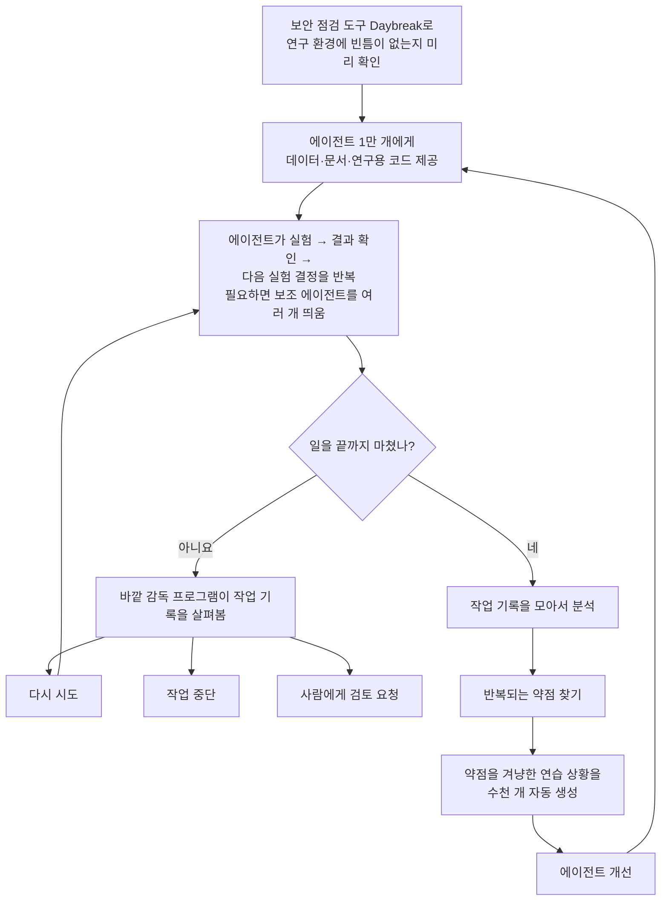

<aside class="ai-knowledge-sidebar">
  
CATEGORIES

  <nav class="ai-cat-tree">

에이전트 오케스트레이션15
<ul><li><a href="https://altjs4510.github.io/ai_news_blog/knowledge/20261015/" class="current">2026-10-15How Third Moment Research runs 10,000 agents for…</a></li><li><a href="https://altjs4510.github.io/ai_news_blog/knowledge/20261014/">2026-10-14How Anthropic's Dynamic Workflows Coordinate Cla…</a></li><li><a href="https://altjs4510.github.io/ai_news_blog/knowledge/20260930/">2026-09-30Agents you can coach: how Asana builds human-age…</a></li><li><a href="https://altjs4510.github.io/ai_news_blog/knowledge/20260831-openexecutive-virtual-c-suite/">2026-08-31Open Executive — 8명의 전문 에이전트를 하나의 임원 목소리로</a></li><li><a href="https://altjs4510.github.io/ai_news_blog/knowledge/20260828/">2026-08-28Google ADK for Python v2.8.0 — RemoteA2aAgent 네이…</a></li><li><a href="https://altjs4510.github.io/ai_news_blog/knowledge/20260826/">2026-08-26apache/maka — 도구 호출·권한 결정·종료 이벤트를 append-only 로그…</a></li><li><a href="https://altjs4510.github.io/ai_news_blog/knowledge/20260823/">2026-08-23The Evolution of the Agent Harness — 하네스가 모델 가중치…</a></li><li><a href="https://altjs4510.github.io/ai_news_blog/knowledge/20260805/">2026-08-05TencentCloud/TencentDB-Agent-Memory — 대화·문서·코드를 …</a></li><li><a href="https://altjs4510.github.io/ai_news_blog/knowledge/20260726/">2026-07-26citrolabs/ego-lite — 로그인된 브라우저 상태를 AI 에이전트와 공유하는…</a></li><li><a href="https://altjs4510.github.io/ai_news_blog/knowledge/20260717/">2026-07-17After a year building agent memory, 'save everyt…</a></li><li><a href="https://altjs4510.github.io/ai_news_blog/knowledge/20260623/">2026-06-23bytedance/deer-flow — 샌드박스·메모리·서브에이전트·메시지 게이트웨이를…</a></li><li><a href="https://altjs4510.github.io/ai_news_blog/knowledge/20260611/">2026-06-11The evolution of agentic surfaces: building with…</a></li><li><a href="https://altjs4510.github.io/ai_news_blog/knowledge/20260602/">2026-06-02revfactory/harness — 도메인별 에이전트 팀과 스킬을 자동 설계하는 메타…</a></li><li><a href="https://altjs4510.github.io/ai_news_blog/knowledge/20260529/">2026-05-29Introducing dynamic workflows in Claude Code</a></li><li><a href="https://altjs4510.github.io/ai_news_blog/knowledge/20260507/">2026-05-07ruvnet/ruflo — Claude 멀티 에이전트 오케스트레이션 플랫폼</a></li></ul>

MCP &amp; 도구 통합16
<ul><li><a href="https://altjs4510.github.io/ai_news_blog/knowledge/20261007/">2026-10-07morluto/rea — 앱 동작부터 네이티브 바이너리까지 에이전트로 리버스 엔지니어링</a></li><li><a href="https://altjs4510.github.io/ai_news_blog/knowledge/20260829/">2026-08-29cursor/plugins — 플러그인 명세(specification)와 공식 플러그인…</a></li><li><a href="https://altjs4510.github.io/ai_news_blog/knowledge/20260802/">2026-08-02Stateless MCP has recaptured my interest (and in…</a></li><li><a href="https://altjs4510.github.io/ai_news_blog/knowledge/20260731/">2026-07-31different-ai/openwork — Claude Cowork의 오픈소스 대안(o…</a></li><li><a href="https://altjs4510.github.io/ai_news_blog/knowledge/20260729/">2026-07-29Bringing MCP 2026-07-28 to Claude</a></li><li><a href="https://altjs4510.github.io/ai_news_blog/knowledge/20260718/">2026-07-18tirth8205/code-review-graph — MCP·CLI용 로컬 코드 인텔리…</a></li><li><a href="https://altjs4510.github.io/ai_news_blog/knowledge/20260708/">2026-07-08Expanding Managed Agents in Gemini API: backgrou…</a></li><li><a href="https://altjs4510.github.io/ai_news_blog/knowledge/20260618/">2026-06-18DeusData/codebase-memory-mcp — 158개 언어 코드베이스를 밀리…</a></li><li><a href="https://altjs4510.github.io/ai_news_blog/knowledge/20260609/">2026-06-09Building intelligent apps for Apple platforms wi…</a></li><li><a href="https://altjs4510.github.io/ai_news_blog/knowledge/20260604/">2026-06-04chopratejas/headroom — Compress tool outputs bef…</a></li><li><a href="https://altjs4510.github.io/ai_news_blog/knowledge/20260603/">2026-06-03How Bad MCP design cost your Agent 5× more token…</a></li><li><a href="https://altjs4510.github.io/ai_news_blog/knowledge/20260521/">2026-05-21colbymchenry/codegraph — Pre-indexed code knowle…</a></li><li><a href="https://altjs4510.github.io/ai_news_blog/knowledge/20260517/">2026-05-17I gave my LLM 100,000+ tools — Lazy Discovery &a…</a></li><li><a href="https://altjs4510.github.io/ai_news_blog/knowledge/20260512/">2026-05-12agentmemory — Persistent memory for AI coding ag…</a></li><li><a href="https://altjs4510.github.io/ai_news_blog/knowledge/20260509/">2026-05-09How to connect 100 MCP servers without the conte…</a></li><li><a href="https://altjs4510.github.io/ai_news_blog/knowledge/20260506/">2026-05-06mksglu/context-mode — AI 코딩 에이전트용 컨텍스트 윈도우 최적화</a></li></ul>

코딩 에이전트27
<ul><li><a href="https://altjs4510.github.io/ai_news_blog/knowledge/20261022/">2026-10-22Claude Mods: Flipping the Harness Inside Out</a></li><li><a href="https://altjs4510.github.io/ai_news_blog/knowledge/20261018/">2026-10-18Quoting Addy Osmani, Morgan Westlee Lunt, and Qi…</a></li><li><a href="https://altjs4510.github.io/ai_news_blog/knowledge/20261017/">2026-10-17mksglu/context-mode — 코딩 에이전트용 컨텍스트 윈도우 최적화</a></li><li><a href="https://altjs4510.github.io/ai_news_blog/knowledge/20261014-claude-code-advisor/">2026-10-14Claude Code advisor — 가벼운 메인 모델이 일하고, 갈림길에서만 Opu…</a></li><li><a href="https://altjs4510.github.io/ai_news_blog/knowledge/20260920/">2026-09-20Claude Code 2.1.277 — CLAUDE.md가 없으면 AGENTS.md를 …</a></li><li><a href="https://altjs4510.github.io/ai_news_blog/knowledge/20260912/">2026-09-12Quoting Boris Cherny — 'Claude가 쓴 프로덕션 코드는 사람이 쓴…</a></li><li><a href="https://altjs4510.github.io/ai_news_blog/knowledge/20260910/">2026-09-10vastsa/PI-Desktop — Electron + Rust 호스트 코어 + 에이전…</a></li><li><a href="https://altjs4510.github.io/ai_news_blog/knowledge/20260906/">2026-09-06DietrichGebert/ponytail — 에이전트를 '방에서 가장 게으른 시니어 …</a></li><li><a href="https://altjs4510.github.io/ai_news_blog/knowledge/20260903/">2026-09-03pacifio/atlas — 여러 코딩 에이전트의 변경을 한곳에서 추적·질의하는 '에이…</a></li><li><a href="https://altjs4510.github.io/ai_news_blog/knowledge/20260901/">2026-09-01affaan-m/ECC — 스킬·본능·메모리·보안을 묶은 에이전트 하네스 성능 최적화 …</a></li><li><a href="https://altjs4510.github.io/ai_news_blog/knowledge/20260831-gitnexus-code-knowledge-graph/">2026-08-31GitNexus — 코드베이스를 지식그래프로 바꿔 에이전트에게 쥐어주기</a></li><li><a href="https://altjs4510.github.io/ai_news_blog/knowledge/20260819/">2026-08-19akitaonrails/ai-memory — 코딩 에이전트 CLI 간 장기 기억과 벤더…</a></li><li><a href="https://altjs4510.github.io/ai_news_blog/knowledge/20260814/">2026-08-14cathrynlavery/diagram-design — Claude Code용 에디토리…</a></li><li><a href="https://altjs4510.github.io/ai_news_blog/knowledge/20260810/">2026-08-10Auto mode is now the default in Claude Code for …</a></li><li><a href="https://altjs4510.github.io/ai_news_blog/knowledge/20260808/">2026-08-08PrimeIntellect-ai/prime-agent — 코딩 워크플로우와 장시간 자율…</a></li><li><a href="https://altjs4510.github.io/ai_news_blog/knowledge/20260804/">2026-08-04esengine/DeepSeek-Reasonix — prefix-cache 안정성을 축…</a></li><li><a href="https://altjs4510.github.io/ai_news_blog/knowledge/20260728/">2026-07-28alibaba/open-code-review — 결정론적 파이프라인 + LLM 에이전트…</a></li><li><a href="https://altjs4510.github.io/ai_news_blog/knowledge/20260725/">2026-07-25The new rules of context engineering for Claude …</a></li><li><a href="https://altjs4510.github.io/ai_news_blog/knowledge/20260714/">2026-07-14Graphify-Labs/graphify — 코드베이스를 질의 가능한 지식 그래프로 만…</a></li><li><a href="https://altjs4510.github.io/ai_news_blog/knowledge/20260707/">2026-07-07AI Hero Skills Catalog — 실무 엔지니어를 위한 재사용 가능한 판단 …</a></li><li><a href="https://altjs4510.github.io/ai_news_blog/knowledge/20260705/">2026-07-05openai/codex-plugin-cc — Claude Code에서 Codex를 위임…</a></li><li><a href="https://altjs4510.github.io/ai_news_blog/knowledge/20260701/">2026-07-01Google OKF (Open Knowledge Format) — 벤더 중립 에이전트 …</a></li><li><a href="https://altjs4510.github.io/ai_news_blog/knowledge/20260626/">2026-06-26google-labs-code/design.md — 코딩 에이전트에게 디자인 시스템을 …</a></li><li><a href="https://altjs4510.github.io/ai_news_blog/knowledge/20260619/">2026-06-19Claude Code now supports artifacts</a></li><li><a href="https://altjs4510.github.io/ai_news_blog/knowledge/20260530/">2026-05-30Leonxlnx/taste-skill — AI에게 좋은 취향을 부여해 generic s…</a></li><li><a href="https://altjs4510.github.io/ai_news_blog/knowledge/20260508/">2026-05-08addyosmani/agent-skills — Production-grade engin…</a></li><li><a href="https://altjs4510.github.io/ai_news_blog/knowledge/20260505/">2026-05-05mattpocock/skills — Skills for Real Engineers (.…</a></li></ul>

모델 &amp; 연구12
<ul><li><a href="https://altjs4510.github.io/ai_news_blog/knowledge/20261009/">2026-10-09Claude Haiku 5.5 (Simon Willison의 출시 노트와 가격 분석)</a></li><li><a href="https://altjs4510.github.io/ai_news_blog/knowledge/20260929/">2026-09-29vectorize-io/hindsight — Hindsight: Agent Memory…</a></li><li><a href="https://altjs4510.github.io/ai_news_blog/knowledge/20260907-voicemem-dual-brain-memory/">2026-09-07VoiceMem — 좌뇌·우뇌로 쪼갠 스트리밍 메모리로 음성 에이전트 지연 없애기</a></li><li><a href="https://altjs4510.github.io/ai_news_blog/knowledge/20260904/">2026-09-04HarnessDev: Can LLMs Create and Evolve Their Own…</a></li><li><a href="https://altjs4510.github.io/ai_news_blog/knowledge/20260821/">2026-08-21volcengine/OpenViking — 에이전트 메모리·Knowledge RAG·스…</a></li><li><a href="https://altjs4510.github.io/ai_news_blog/knowledge/20260716-proprag/">2026-07-16PropRAG — 프로포지션 경로 위 beam search로 멀티홉 검색 안내</a></li><li><a href="https://altjs4510.github.io/ai_news_blog/knowledge/20260712/">2026-07-12Do Automated Evals Work?</a></li><li><a href="https://altjs4510.github.io/ai_news_blog/knowledge/20260620/">2026-06-20zai-org/GLM-5 — From Vibe Coding to Agentic Engi…</a></li><li><a href="https://altjs4510.github.io/ai_news_blog/knowledge/20260617/">2026-06-17Predicting model behavior before release by simu…</a></li><li><a href="https://altjs4510.github.io/ai_news_blog/knowledge/20260610/">2026-06-10Fable 5 just made cost-aware model routing manda…</a></li><li><a href="https://altjs4510.github.io/ai_news_blog/knowledge/20260516/">2026-05-16STALE — 에이전트가 자기 기억의 유효성을 인지할 수 있는가</a></li><li><a href="https://altjs4510.github.io/ai_news_blog/knowledge/20260513/">2026-05-13Thinking Machines' Native Interaction Models — T…</a></li></ul>

인프라 &amp; 컴퓨트6
<ul><li><a href="https://altjs4510.github.io/ai_news_blog/knowledge/20260905/">2026-09-05magnitudedev/magnitude — 하드웨어에 맞는 최적 로컬 모델을 띄워 이…</a></li><li><a href="https://altjs4510.github.io/ai_news_blog/knowledge/20260812/">2026-08-12semantica-agi/semantica — 컨텍스트와 '책임 추적 가능한(accou…</a></li><li><a href="https://altjs4510.github.io/ai_news_blog/knowledge/20260806/">2026-08-06cloudflare/computer — 에이전트에게 컴퓨터를 통째로 주는 엣지 실행 샌…</a></li><li><a href="https://altjs4510.github.io/ai_news_blog/knowledge/20260723/">2026-07-23diegosouzapw/OmniRoute — 268+ 프로바이더를 단일 엔드포인트로 묶…</a></li><li><a href="https://altjs4510.github.io/ai_news_blog/knowledge/20260522/">2026-05-22Giving Agents Computers — Ivan Burazin, Daytona</a></li><li><a href="https://altjs4510.github.io/ai_news_blog/knowledge/20260520/">2026-05-20New in Claude Managed Agents: self-hosted sandbo…</a></li></ul>

보안 &amp; 거버넌스23
<ul><li><a href="https://altjs4510.github.io/ai_news_blog/knowledge/20261021/">2026-10-21cloudflare/security-audit-skill — 독립 검증된 기계 판독형 …</a></li><li><a href="https://altjs4510.github.io/ai_news_blog/knowledge/20261020/">2026-10-20Satya Nadella — 모델을 내부자 위험으로 보는 원칙에 따라 Project P…</a></li><li><a href="https://altjs4510.github.io/ai_news_blog/knowledge/20261016/">2026-10-16Crossing the Threshold: How OpenAI and Anthropic…</a></li><li><a href="https://altjs4510.github.io/ai_news_blog/knowledge/20261011/">2026-10-11Anthropic can’t reliably control its AI agents. …</a></li><li><a href="https://altjs4510.github.io/ai_news_blog/knowledge/20261004/">2026-10-04Apple says it's tightening macOS 'Full Disk Acce…</a></li><li><a href="https://altjs4510.github.io/ai_news_blog/knowledge/20261001/">2026-10-01NVIDIA/OpenShell</a></li><li><a href="https://altjs4510.github.io/ai_news_blog/knowledge/20260919/">2026-09-19cloudflare/security-audit-skill — 다단계 보안 감사를 '독립…</a></li><li><a href="https://altjs4510.github.io/ai_news_blog/knowledge/20260913/">2026-09-13OpenAI agents attacked RubyGems back in May: Ope…</a></li><li><a href="https://altjs4510.github.io/ai_news_blog/knowledge/20260902/">2026-09-02AIR raises $50M to help companies vet the skills…</a></li><li><a href="https://altjs4510.github.io/ai_news_blog/knowledge/20260827/">2026-08-27Claude in Chrome is generally available</a></li><li><a href="https://altjs4510.github.io/ai_news_blog/knowledge/20260819-mind-viruses/">2026-08-19탈옥도, 인젝션도 없이 — 대화로만 퍼지는 에이전트의 '마인드 바이러스'</a></li><li><a href="https://altjs4510.github.io/ai_news_blog/knowledge/20260730/">2026-07-30Anatomy of a Frontier Lab Agent Intrusion: A Tec…</a></li><li><a href="https://altjs4510.github.io/ai_news_blog/knowledge/20260715/">2026-07-15Dicklesworthstone/destructive_command_guard — 에이…</a></li><li><a href="https://altjs4510.github.io/ai_news_blog/knowledge/20260710/">2026-07-1070개 MCP 서버 strace 런타임 감사 — 부팅 시 아웃바운드 호출 서버 적발</a></li><li><a href="https://altjs4510.github.io/ai_news_blog/knowledge/20260704/">2026-07-04Cloudflare is about to block AI agents by defaul…</a></li><li><a href="https://altjs4510.github.io/ai_news_blog/knowledge/20260703/">2026-07-03Giving admins more visibility and control over C…</a></li><li><a href="https://altjs4510.github.io/ai_news_blog/knowledge/20260630/">2026-06-30Introducing the Claude apps gateway for Amazon B…</a></li><li><a href="https://altjs4510.github.io/ai_news_blog/knowledge/20260624/">2026-06-24Agent identity in Claude Tag: a new access model…</a></li><li><a href="https://altjs4510.github.io/ai_news_blog/knowledge/20260613/">2026-06-13Fable 5's guardrails got bypassed in 48 hours — …</a></li><li><a href="https://altjs4510.github.io/ai_news_blog/knowledge/20260612/">2026-06-12NVIDIA/SkillSpector — AI 에이전트 스킬용 보안 스캐너</a></li><li><a href="https://altjs4510.github.io/ai_news_blog/knowledge/20260607/">2026-06-07OpenAI Help: Lockdown Mode</a></li><li><a href="https://altjs4510.github.io/ai_news_blog/knowledge/20260531/">2026-05-31How we contain Claude across products</a></li><li><a href="https://altjs4510.github.io/ai_news_blog/knowledge/20260527/">2026-05-27Microsoft Copilot Cowork Exfiltrates Files</a></li></ul>

응용 사례7
<ul><li><a href="https://altjs4510.github.io/ai_news_blog/knowledge/20261006/">2026-10-06How Cresta turned CX expertise into an agent bui…</a></li><li><a href="https://altjs4510.github.io/ai_news_blog/knowledge/20260909/">2026-09-09Reducing cost and improving performance with Cla…</a></li><li><a href="https://altjs4510.github.io/ai_news_blog/knowledge/20260709/">2026-07-09mvanhorn/last30days-skill — Reddit·X·YouTube·HN·…</a></li><li><a href="https://altjs4510.github.io/ai_news_blog/knowledge/20260621/">2026-06-21calesthio/OpenMontage — 12 파이프라인·52 도구·500+ 스킬을 …</a></li><li><a href="https://altjs4510.github.io/ai_news_blog/knowledge/20260528/">2026-05-28Building self-improving tax agents with Codex</a></li><li><a href="https://altjs4510.github.io/ai_news_blog/knowledge/20260515/">2026-05-15Clawdmeter — Claude Code 사용량을 데스크톱 대시보드로</a></li><li><a href="https://altjs4510.github.io/ai_news_blog/knowledge/20260514/">2026-05-14Introducing Claude for Small Business</a></li></ul>

산업 동향8
<ul><li><a href="https://altjs4510.github.io/ai_news_blog/knowledge/20260911/">2026-09-11Now everyone can put data to work — ChatGPT Work…</a></li><li><a href="https://altjs4510.github.io/ai_news_blog/knowledge/20260907-humanmade-52week-rhythm/">2026-09-07휴먼 메이드의 '52주 리듬' — 아이디어가 흔해진 시대에 값이 오르는 건 버리는 판단</a></li><li><a href="https://altjs4510.github.io/ai_news_blog/knowledge/20260830/">2026-08-30[AINews] OpenAI shuts off Cursor — 프론티어 모델 공급 차단…</a></li><li><a href="https://altjs4510.github.io/ai_news_blog/knowledge/20260711/">2026-07-11OpenAI says GPT 5.6 is the 'preferred model' for…</a></li><li><a href="https://altjs4510.github.io/ai_news_blog/knowledge/20260702/">2026-07-02How Cursor deploys AI inside the enterprise (For…</a></li><li><a href="https://altjs4510.github.io/ai_news_blog/knowledge/20260616/">2026-06-16Why AI hasn't replaced software engineers, and w…</a></li><li><a href="https://altjs4510.github.io/ai_news_blog/knowledge/20260519/">2026-05-19Anthropic acquires Stainless</a></li><li><a href="https://altjs4510.github.io/ai_news_blog/knowledge/20260504/">2026-05-04Agents for Everything Else: Codex for Knowledge …</a></li></ul>
</nav>
</aside>

<article class="ai-knowledge-article">

<header class="ai-post-hero">
  
<a class="ai-back" href="../">KNOWLEDGE</a> · 2026-10-15 · 오늘의 학습

  <h2 class="ai-post-title">How Third Moment Research runs 10,000 agents for 36+ hours</h2>
</header>

> 원문: [How Third Moment Research runs 10,000 agents for 36+ hours](https://openai.com/index/third-moment-research)

## 📌 학습 정리

### 1. 한 줄로 말하면

AI 연구소 Third Moment Research가 AI 일꾼 1만 명을 한꺼번에 투입해서 하루 반에서 이틀씩 한 가지 조사를 붙잡게 하는 방식이에요. 일꾼들이 어디서 자주 막히는지 살펴보고, 그 약점을 연습시켜서 쓸수록 실력이 늘게 만들어요.

### 2. 왜 이게 만들어졌어요?

회사마다 일하는 방식이 다르고, 쓰는 도구도 다르고, 예외 상황과 "잘했다"의 기준도 제각각이에요. 그래서 Third Moment는 범용 AI 에이전트(사람 대신 여러 단계의 일을 스스로 처리하는 AI 프로그램, agent)보다 그 회사의 일을 아주 잘하는 에이전트가 필요하다고 봤어요. 써 볼수록 실력이 느는 에이전트여야 한다는 거죠. 그런데 예전 모델은 사람이 정해 준 실험만 그대로 돌릴 수 있었어요. 일을 끝내기 전에 멈춰 버리기도 했고요. 그래서 에이전트가 며칠씩 혼자 조사를 이어 가게 하는 구조가 필요했어요. 약점을 찾아 스스로 보완하는 장치도 함께 필요했고요.

### 3. 비유로 풀면

이건 마치 **연구원 1만 명이 일하는 대형 연구소에 현장 감독과 코치가 함께 붙어 있는 것** 같아요. 연구원(에이전트)들은 각자 실험을 하고, 그 결과를 보고 다음 실험을 정해요. 현장 감독(바깥 관리 프로그램)은 누가 일을 다 못 끝내고 손을 놓았는지 살펴봐요. 그리고 다시 시킬지, 그만두게 할지, 사람 팀장에게 올릴지 정해요.

코치는 연구원들이 일하는 모습을 녹화한 기록을 돌려 봐요. 여러 사람이 공통으로 실수하는 지점을 찾아내면 그 상황만 모은 연습 문제를 수천 개 만들어서 훈련시켜요.

그래서 결국, 에이전트는 한 번 쓰고 버리는 도구가 아니게 돼요. 일한 기록이 다음 훈련으로 이어지면서 점점 나아지는 오래 일하는 팀처럼 운영되는 거예요.

### 4. 어떻게 작동하는지 (그림으로)

먼저 Daybreak로 에이전트가 일할 공간이 안전한지부터 확인해요. 그다음 에이전트들이 36~48시간 동안 실험을 이어 가는데, 중간에 멈춘 에이전트는 바깥 감독 프로그램이 맡아서 다음 조치를 정해요. 일이 끝나면 작업 기록을 분석해서 약점을 찾고, 그 약점을 연습할 상황을 만들어 에이전트를 다시 다듬어요. 새로운 문제가 생길 때마다 이 과정을 되풀이하는 구조예요.

원문에는 이 구조가 실제로 효과를 낸 사례도 있어요. 에이전트들이 남긴 작업 기록을 Codex(OpenAI의 코딩 에이전트)로 분석했더니, 거래 전략을 과거 1년 치 데이터로 시험하는 데만 몇 시간씩 걸리고 있었어요. 기다리는 동안 에이전트들은 "끝났나요?"를 계속 물어보면서 토큰을 낭비하고 있었고요. Codex는 저장해 둔 결과를 다시 쓰는 방법과 메모리를 더 촘촘하게 쓰는 방법을 찾아서 실제 운영 환경에 적용했어요. 그 결과 약 3시간 걸리던 작업이 3~5분 정도로 줄었다고 해요.

### 5. 처음 보는 용어 풀이

- **에이전트 실행 틀 (harness)** — AI 모델이 실제로 일할 수 있게 도구를 쥐여 주는 틀이에요. Codex 하네스는 에이전트가 계획을 세우고, 목표를 정하고, 보조 에이전트를 띄우고, 길어진 대화 내용을 요약해 정리할 수 있게 해 줘요.
- **보조 에이전트 (subagent)** — 큰 에이전트가 일을 나눠 맡기려고 띄우는 작은 에이전트예요. 이 덕분에 실험 수백 개를 동시에 돌리면서 문제의 근본 원인을 파고들 수 있어요.
- **작업 기록 / 궤적 (trajectory)** — 에이전트가 한 행동과 그에 대한 환경의 반응을 순서대로 기록한 거예요. 에이전트가 어디서 헤매는지 찾아낼 때 이 기록을 분석해요.
- **과거 데이터로 전략 시험하기 (backtesting)** — 거래 전략을 지난 시장 데이터에 적용해서 "그때 이렇게 했으면 어땠을까"를 확인하는 거예요. 이 사례에서는 미국 주식의 1년 치 주문 단위 데이터를 썼어요.
- **토큰과 컨텍스트 (token, context)** — 토큰은 AI가 글을 읽고 쓸 때 쓰는 작은 글자 조각 단위이자 비용 단위예요. 컨텍스트는 AI가 한 번에 기억하고 참고하는 작업 내용이에요. 진행 상황을 확인하는 말만 반복되면 컨텍스트가 쓸모없는 내용으로 채워져요. 원문에서는 이걸 '컨텍스트 오염'이라고 불러요.
- **합성 시나리오 (synthetic scenarios)** — 실제 상황을 본떠서 인공적으로 만든 연습 상황이에요. 에이전트가 자주 틀리는 지점만 골라 수천 개를 자동으로 만들고, 그걸로 에이전트를 개선해요.
- **모의 해킹 점검 (penetration testing)** — 일부러 공격자처럼 시스템을 뚫어 보면서 보안 빈틈을 찾는 시험이에요. 여기서는 에이전트가 자기 연구 공간을 벗어나 더 넓은 회사 네트워크에 들어갈 수 있는지를 확인해요. Daybreak는 이 점검을 자동화하는 사이버보안 플랫폼이에요.

### 6. 한 발 더 들어가고 싶다면

- [Third Moment Research](https://thirdmomentresearch.com/) — 이 사례의 주인공인 연구소 홈페이지예요. 이곳이 어떤 방향으로 스스로 나아지는 AI 시스템을 만들고 있는지 알 수 있어요.

---

## 📖 원문 전체 번역 (정독용)

> 의역 최소화한 전체 번역입니다. 큰 흐름은 위 정리에서 잡고, 정확한 워딩이 필요할 땐 이 섹션에서 정독하세요.

# Third Moment Research는 어떻게 10,000개의 에이전트를 36시간 이상 가동하는가

모든 회사에는 고유한 워크플로, 도구, 엣지 케이스, 그리고 성공에 대한 정의가 있습니다. [Third Moment Research(새 창에서 열림)](https://thirdmomentresearch.com/)는 최고의 에이전트란 바로 그 특정 업무를 정말 잘 해내야 하며, 사용될수록 역량이 향상되어야 한다고 믿습니다.

이 회사는 이러한 아이디어를 중심으로 자기 개선형(self-improving) AI 시스템을 구축하고 있습니다. OpenAI의 최신 모델을 사용해 에이전트의 행동을 이해하고, 반복되는 약점을 식별하며, 그 문제들을 둘러싼 수천 개의 합성 시나리오를 자동으로 생성합니다. 팀은 이 시나리오들로 에이전트를 개선하고, 새로운 문제가 나타날 때마다 이 과정을 반복합니다.

Codex, GPT‑6 Astra, GPT‑6 Sol, GPT‑6.1 Sol이 이 시스템의 연구 및 연산 작업을 뒷받침하며, 이를 통해 Third Moment는 36~48시간 동안 이어지는 조사에서 10,000개의 에이전트를 동시에 실행할 수 있습니다. 또한 회사는 Daybreak을 사용해 에이전트가 작업하는 환경의 보안을 테스트합니다.

> "단일 세션 안에서, GPT-6.1 Sol은 며칠 분량의 연산에 걸쳐서도 흐름을 놓치지 않고 일관된 연산 연구의 맥락을 유지할 수 있습니다."

—Adam Khakhar, Third Moment Research 공동 창업자

## Codex로 실행 시간과 토큰 낭비 줄이기

Third Moment의 초기 적용 분야 중 하나는 성공의 척도가 명확한 퀀트 금융(quantitative finance) 분야입니다. 이 분야는 에이전트가 어떻게 일하고 어디에서 어려움을 겪는지 연구할 수 있는 구체적인 환경을 제공합니다. 팀은 Codex를 사용해 연구 환경의 문제를 찾아 해결합니다.

한 사례에서는 당시 최신 GPT 모델이던 GPT‑5.6과 함께 Codex를 사용해, 기록된 수천 건의 시뮬레이션 궤적(trajectory, 에이전트의 행동과 환경의 응답)을 타임스탬프 및 코드베이스와 함께 분석했습니다.

Codex는 병목을 발견했습니다. 1년치 주문 단위(order-level) 미국 주식 데이터에 걸쳐 트레이딩 전략을 백테스트하는 데 몇 시간이 걸렸던 것입니다. 기다리는 동안 에이전트들은 완료 여부를 반복적으로 폴링(polling)하여 토큰을 낭비하고 컨텍스트를 상태 확인으로 채우고 있었습니다.

백테스트를 프로파일링하고 그 입력과 사용 방식을 분석한 뒤, Codex는 캐싱 최적화와 메모리 패킹 기법을 찾아냈습니다. 여러 해결책을 실험해 본 후 수정을 프로덕션에 배포했고, 백테스트 시간을 약 3시간에서 약 3~5분으로 줄였습니다. 이로써 토큰 사용량과 컨텍스트 오염이 줄었고, 에이전트의 토큰 예산을 추가 실험에 더 많이 쓸 수 있게 되었습니다.

## Codex와 GPT‑6로 에이전트가 작업에 집중하도록 유지하기

Third Moment는 각 에이전트에게 특정 업무에 필요한 도구, 정보, 환경을 제공합니다. 퀀트 리서치의 경우, 팀은 Docker화된 환경 안에서 기본(default) Codex 하네스(harness)를 실행합니다. 에이전트는 1테라바이트의 데이터, 문서, 그리고 피처 엔지니어링, GPU를 지원하는 모델 학습, 트레이딩 전략, 시뮬레이션을 위한 모듈이 담긴 연구 저장소를 받습니다.

GPT‑6 Astra, GPT‑6 Sol, GPT‑6.1 Sol이 추론을 담당하고, Codex 하네스는 에이전트에게 행동하고, 계획을 세우고, 목표를 설정하고, 서브에이전트를 생성하고, 작업이 이어지는 동안 컨텍스트를 압축(compact)할 수 있는 도구를 제공합니다.

작업을 끝내기 전에 멈춰 버리는 에이전트를 해결하기 위해, Third Moment는 Codex를 GPT‑6 Sol 또는 GPT‑6.1 Sol이 구동하는 외부(outer) 하네스 안의 서브에이전트로 취급합니다. 외부 하네스는 작업이 미완결 상태로 남았을 때 궤적을 검토하여, 재시도할지, 작업을 종료할지, 아니면 사람의 검토로 에스컬레이션할지를 결정합니다.

> "Codex 하네스는 매우 범용적이며, 다양한 도메인 전반에서 사용할 수 있게 해 줍니다."

—Adam Khakhar, Third Moment Research 공동 창업자

해당 연구 환경에서 에이전트들은 Third Moment의 엔지니어들이 만든 기준(baseline) 트레이딩 시스템을 개선하기 위해 작업합니다. 이들은 과거 데이터로 트레이딩 전략을 테스트하고, 개선이 유의미한지 아니면 노이즈인지 평가하며, 각 결과를 활용해 다음 실험을 선택합니다. Adam에 따르면, 이들의 작업은 기준 트레이딩 시스템을 개선했습니다.

## 더 높은 토큰 효율로 더 긴 연구를 지속하기

Adam은 GPT‑5.5 이전에는 모델이 사용자가 지시한 실험만 수행할 수 있었다고 말합니다. GPT‑5.5와 GPT‑5.6에서는 Codex 하네스와 함께 작동하는 모델이 결과를 활용해 후속 실험을 설계할 수 있었습니다. 이제 GPT‑6 Astra, GPT‑6 Sol, GPT‑6.1 Sol과 함께라면, 에이전트는 서브에이전트와 함께 병렬로 실행되는 수백 건의 실험을 통해 근본 원인을 조사할 수 있습니다.

이러한 진전은 에이전트가 팀이 예상하지 못했던 연구 방향을 탐색하는 데 도움이 되었습니다. 한 세션에서 GPT‑6.1 Sol은 비공개(non-displayed) 거래가 예상외로 큰 거래량 비중을 차지하는 거래소에서 그 거래들이 미치는 영향을 파악했습니다. Adam은 "이는 우리 연구팀이 처음에는 고려하지 못했던, 자명하지 않은 결과였습니다."라고 말합니다.

Third Moment는 최적화, 머신러닝 시스템, 퀀트 리서치 전반에 걸쳐 모델을 평가합니다. 최신(frontier) 릴리스를 가장 높은 추론 설정에서 테스트하며, 저장소를 탐색하고, 효율적인 코드를 작성하고, 조사를 지속하는 능력을 평가합니다. 현재 테스트에는 GPT‑6 Luna도 포함되어 있습니다.

> "GPT-6.1 Sol은 토큰 효율 덕분에 현재 저희가 가장 많이 사용하는 모델입니다. 가장 적은 토큰으로 작업을 완료하면서도 GPT-6 Astra와 비슷한 성능을 냅니다."

—Jeffrey Yan, Third Moment Research 공동 창업자

한 벤치마크는 에이전트에게 라이브 스코어보드 서비스의 업데이트 지연 시간(latency)을 줄이되 출력은 유지하도록 요구합니다. 팀은 동일한 하드웨어에서, 정확성을 전제로 전문가가 작성한 솔루션의 평균 실행 시간을 모델 솔루션의 평균 실행 시간으로 나누어 속도 향상(speedup)을 측정합니다. Adam에 따르면 GPT‑6 Astra가 가장 큰 속도 향상을 보였습니다.

시뮬레이션 시스템의 특정 보안 취약점 점검을 포함한 목표가 분명한 작업에는 GPT‑5.6 Terra 같은 더 효율적인 모델을 사용합니다. 심층 연구의 경우, Adam은 더 강한 추론이 더 높은 비용을 정당화할 수 있다고 믿습니다. "퀀트 금융 분야에서는 흥미로운 시그널을 찾아내는 가치가 극도로 높습니다."

## Daybreak으로 보안 테스트 자동화하기

10,000개의 에이전트가 자율적으로 실행되는 상황에서, Third Moment에는 연구 환경의 보안을 대규모로 테스트할 방법이 필요합니다. 팀은 시뮬레이션이 시작되기 전에 해당 테스트를 자동화하기 위해 Daybreak 사이버보안 플랫폼을 사용합니다.

테스트는 에이전트가 자신의 연구 환경을 벗어나 더 넓은 네트워크에 접근할 수 있는지를 점검합니다. Adam은 "Daybreak을 사용함으로써 에이전트 스스로가 시뮬레이션에 대해 침투 테스트를 수행하고 그 인프라와 보안을 테스트하도록 할 수 있습니다."라고 말합니다.

> "Daybreak이 없었다면, 이를 대규모로 자율 테스트할 수 없었을 것입니다."

—Adam Khakhar, Third Moment Research 공동 창업자

## 수십만 개의 협업 에이전트를 향하여

Third Moment의 포부는 기업들이 매일 수행하는 전문적인 업무로 확장됩니다. 소매업체라면 재고가 부족하거나 공급업체가 지연될 때 더 나은 공급망 의사결정을 내리는 일이 될 수 있습니다. 엔지니어링 팀이라면 대규모 코드베이스에서 성능 병목을 찾는 일이 될 수 있습니다. 문서 중심의 비즈니스라면 한 문서의 약속이 다른 문서에 기록된 결과와 일치하지 않는 지점을 찾아내는 일이 될 수 있습니다.

GPT‑6 Astra, GPT‑6 Sol, GPT‑6.1 Sol의 추론 능력을 토대로, Third Moment는 개별 조사에서 수십만 개의 협업 서브에이전트로 확장할 계획입니다. 로드맵은 수십 개의 의존적인 실험이 이어지는 체인을 뒷받침하는 수조(trillions) 개의 토큰을 상정하고 있으며, 그 연구를 활용해 새로운 과제가 나타날 때마다 에이전트를 자율적으로 개선한다는 목표를 갖고 있습니다.

Adam에게 이는 사람들이 에이전트가 학습하고 일하는 방식을 형성할 수 있는 더 많은 역량을 주는 일입니다. "사람은 훨씬 더 레버리지가 큰 위치에 설 수 있습니다. 연구를 실제로 수행하는 대신, 연구를 어떻게 할지, 그리고 연구 자체를 어떻게 최적화할지를 생각할 수 있게 됩니다."

</article>

<!-- ai-related-links -->
<aside class="ai-related-links">
  
관련 학습

  <ul><li><a href="https://altjs4510.github.io/ai_news_blog/knowledge/20260529/">2026-05-29Introducing dynamic workflows in Claude Code</a></li><li><a href="https://altjs4510.github.io/ai_news_blog/knowledge/20260623/">2026-06-23bytedance/deer-flow — 샌드박스·메모리·서브에이전트·메시지 게이트웨이를…</a></li><li><a href="https://altjs4510.github.io/ai_news_blog/knowledge/20260507/">2026-05-07ruvnet/ruflo — Claude 멀티 에이전트 오케스트레이션 플랫폼</a></li></ul>
</aside>
<!-- /ai-related-links -->
