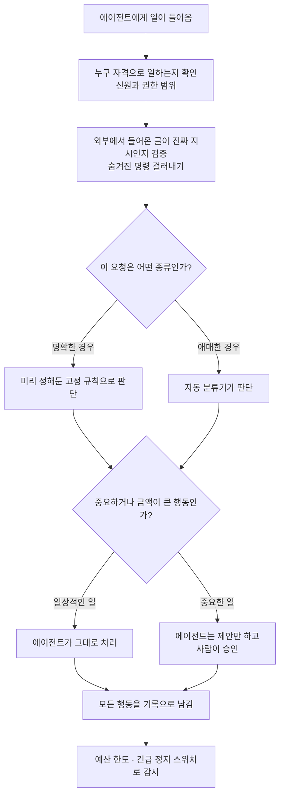

<aside class="ai-knowledge-sidebar">
  
CATEGORIES

  <nav class="ai-cat-tree">

에이전트 오케스트레이션21
<ul><li><a href="https://altjs4510.github.io/ai_news_blog/knowledge/20261015/">2026-10-15How Third Moment Research runs 10,000 agents for…</a></li><li><a href="https://altjs4510.github.io/ai_news_blog/knowledge/20261014/">2026-10-14How Anthropic's Dynamic Workflows Coordinate Cla…</a></li><li><a href="https://altjs4510.github.io/ai_news_blog/knowledge/20260930/">2026-09-30Agents you can coach: how Asana builds human-age…</a></li><li><a href="https://altjs4510.github.io/ai_news_blog/knowledge/20260831-openexecutive-virtual-c-suite/">2026-08-31Open Executive — 8명의 전문 에이전트를 하나의 임원 목소리로</a></li><li><a href="https://altjs4510.github.io/ai_news_blog/knowledge/20260828/">2026-08-28Google ADK for Python v2.8.0 — RemoteA2aAgent 네이…</a></li><li><a href="https://altjs4510.github.io/ai_news_blog/knowledge/20260826/">2026-08-26apache/maka — 도구 호출·권한 결정·종료 이벤트를 append-only 로그…</a></li><li><a href="https://altjs4510.github.io/ai_news_blog/knowledge/20260823/">2026-08-23The Evolution of the Agent Harness — 하네스가 모델 가중치…</a></li><li><a href="https://altjs4510.github.io/ai_news_blog/knowledge/20260821/">2026-08-21volcengine/OpenViking — 에이전트 메모리·Knowledge RAG·스…</a></li><li><a href="https://altjs4510.github.io/ai_news_blog/knowledge/20260819/">2026-08-19akitaonrails/ai-memory — 코딩 에이전트 CLI 간 장기 기억과 벤더…</a></li><li><a href="https://altjs4510.github.io/ai_news_blog/knowledge/20260805/">2026-08-05TencentCloud/TencentDB-Agent-Memory — 대화·문서·코드를 …</a></li><li><a href="https://altjs4510.github.io/ai_news_blog/knowledge/20260725/">2026-07-25The new rules of context engineering for Claude …</a></li><li><a href="https://altjs4510.github.io/ai_news_blog/knowledge/20260717/">2026-07-17After a year building agent memory, 'save everyt…</a></li><li><a href="https://altjs4510.github.io/ai_news_blog/knowledge/20260708/">2026-07-08Expanding Managed Agents in Gemini API: backgrou…</a></li><li><a href="https://altjs4510.github.io/ai_news_blog/knowledge/20260701/">2026-07-01Google OKF (Open Knowledge Format) — 벤더 중립 에이전트 …</a></li><li><a href="https://altjs4510.github.io/ai_news_blog/knowledge/20260623/">2026-06-23bytedance/deer-flow — 샌드박스·메모리·서브에이전트·메시지 게이트웨이를…</a></li><li><a href="https://altjs4510.github.io/ai_news_blog/knowledge/20260611/">2026-06-11The evolution of agentic surfaces: building with…</a></li><li><a href="https://altjs4510.github.io/ai_news_blog/knowledge/20260602/">2026-06-02revfactory/harness — 도메인별 에이전트 팀과 스킬을 자동 설계하는 메타…</a></li><li><a href="https://altjs4510.github.io/ai_news_blog/knowledge/20260529/">2026-05-29Introducing dynamic workflows in Claude Code</a></li><li><a href="https://altjs4510.github.io/ai_news_blog/knowledge/20260520/">2026-05-20New in Claude Managed Agents: self-hosted sandbo…</a></li><li><a href="https://altjs4510.github.io/ai_news_blog/knowledge/20260507/">2026-05-07ruvnet/ruflo — Claude 멀티 에이전트 오케스트레이션 플랫폼</a></li><li><a href="https://altjs4510.github.io/ai_news_blog/knowledge/20260504/">2026-05-04Agents for Everything Else: Codex for Knowledge …</a></li></ul>

MCP &amp; 도구 통합11
<ul><li><a href="https://altjs4510.github.io/ai_news_blog/knowledge/20260829/">2026-08-29cursor/plugins — 플러그인 명세(specification)와 공식 플러그인…</a></li><li><a href="https://altjs4510.github.io/ai_news_blog/knowledge/20260802/">2026-08-02Stateless MCP has recaptured my interest (and in…</a></li><li><a href="https://altjs4510.github.io/ai_news_blog/knowledge/20260731/">2026-07-31different-ai/openwork — Claude Cowork의 오픈소스 대안(o…</a></li><li><a href="https://altjs4510.github.io/ai_news_blog/knowledge/20260729/">2026-07-29Bringing MCP 2026-07-28 to Claude</a></li><li><a href="https://altjs4510.github.io/ai_news_blog/knowledge/20260726/">2026-07-26citrolabs/ego-lite — 로그인된 브라우저 상태를 AI 에이전트와 공유하는…</a></li><li><a href="https://altjs4510.github.io/ai_news_blog/knowledge/20260618/">2026-06-18DeusData/codebase-memory-mcp — 158개 언어 코드베이스를 밀리…</a></li><li><a href="https://altjs4510.github.io/ai_news_blog/knowledge/20260603/">2026-06-03How Bad MCP design cost your Agent 5× more token…</a></li><li><a href="https://altjs4510.github.io/ai_news_blog/knowledge/20260521/">2026-05-21colbymchenry/codegraph — Pre-indexed code knowle…</a></li><li><a href="https://altjs4510.github.io/ai_news_blog/knowledge/20260517/">2026-05-17I gave my LLM 100,000+ tools — Lazy Discovery &a…</a></li><li><a href="https://altjs4510.github.io/ai_news_blog/knowledge/20260509/">2026-05-09How to connect 100 MCP servers without the conte…</a></li><li><a href="https://altjs4510.github.io/ai_news_blog/knowledge/20260506/">2026-05-06mksglu/context-mode — AI 코딩 에이전트용 컨텍스트 윈도우 최적화</a></li></ul>

코딩 에이전트25
<ul><li><a href="https://altjs4510.github.io/ai_news_blog/knowledge/20261014-claude-code-advisor/">2026-10-14Claude Code advisor — 가벼운 메인 모델이 일하고, 갈림길에서만 Opu…</a></li><li><a href="https://altjs4510.github.io/ai_news_blog/knowledge/20261007/">2026-10-07morluto/rea — 앱 동작부터 네이티브 바이너리까지 에이전트로 리버스 엔지니어링</a></li><li><a href="https://altjs4510.github.io/ai_news_blog/knowledge/20260920/">2026-09-20Claude Code 2.1.277 — CLAUDE.md가 없으면 AGENTS.md를 …</a></li><li><a href="https://altjs4510.github.io/ai_news_blog/knowledge/20260912/">2026-09-12Quoting Boris Cherny — 'Claude가 쓴 프로덕션 코드는 사람이 쓴…</a></li><li><a href="https://altjs4510.github.io/ai_news_blog/knowledge/20260910/">2026-09-10vastsa/PI-Desktop — Electron + Rust 호스트 코어 + 에이전…</a></li><li><a href="https://altjs4510.github.io/ai_news_blog/knowledge/20260906/">2026-09-06DietrichGebert/ponytail — 에이전트를 '방에서 가장 게으른 시니어 …</a></li><li><a href="https://altjs4510.github.io/ai_news_blog/knowledge/20260903/">2026-09-03pacifio/atlas — 여러 코딩 에이전트의 변경을 한곳에서 추적·질의하는 '에이…</a></li><li><a href="https://altjs4510.github.io/ai_news_blog/knowledge/20260901/">2026-09-01affaan-m/ECC — 스킬·본능·메모리·보안을 묶은 에이전트 하네스 성능 최적화 …</a></li><li><a href="https://altjs4510.github.io/ai_news_blog/knowledge/20260831-gitnexus-code-knowledge-graph/">2026-08-31GitNexus — 코드베이스를 지식그래프로 바꿔 에이전트에게 쥐어주기</a></li><li><a href="https://altjs4510.github.io/ai_news_blog/knowledge/20260814/">2026-08-14cathrynlavery/diagram-design — Claude Code용 에디토리…</a></li><li><a href="https://altjs4510.github.io/ai_news_blog/knowledge/20260810/">2026-08-10Auto mode is now the default in Claude Code for …</a></li><li><a href="https://altjs4510.github.io/ai_news_blog/knowledge/20260808/">2026-08-08PrimeIntellect-ai/prime-agent — 코딩 워크플로우와 장시간 자율…</a></li><li><a href="https://altjs4510.github.io/ai_news_blog/knowledge/20260804/">2026-08-04esengine/DeepSeek-Reasonix — prefix-cache 안정성을 축…</a></li><li><a href="https://altjs4510.github.io/ai_news_blog/knowledge/20260728/">2026-07-28alibaba/open-code-review — 결정론적 파이프라인 + LLM 에이전트…</a></li><li><a href="https://altjs4510.github.io/ai_news_blog/knowledge/20260718/">2026-07-18tirth8205/code-review-graph — MCP·CLI용 로컬 코드 인텔리…</a></li><li><a href="https://altjs4510.github.io/ai_news_blog/knowledge/20260714/">2026-07-14Graphify-Labs/graphify — 코드베이스를 질의 가능한 지식 그래프로 만…</a></li><li><a href="https://altjs4510.github.io/ai_news_blog/knowledge/20260707/">2026-07-07AI Hero Skills Catalog — 실무 엔지니어를 위한 재사용 가능한 판단 …</a></li><li><a href="https://altjs4510.github.io/ai_news_blog/knowledge/20260705/">2026-07-05openai/codex-plugin-cc — Claude Code에서 Codex를 위임…</a></li><li><a href="https://altjs4510.github.io/ai_news_blog/knowledge/20260626/">2026-06-26google-labs-code/design.md — 코딩 에이전트에게 디자인 시스템을 …</a></li><li><a href="https://altjs4510.github.io/ai_news_blog/knowledge/20260619/">2026-06-19Claude Code now supports artifacts</a></li><li><a href="https://altjs4510.github.io/ai_news_blog/knowledge/20260530/">2026-05-30Leonxlnx/taste-skill — AI에게 좋은 취향을 부여해 generic s…</a></li><li><a href="https://altjs4510.github.io/ai_news_blog/knowledge/20260528/">2026-05-28Building self-improving tax agents with Codex</a></li><li><a href="https://altjs4510.github.io/ai_news_blog/knowledge/20260512/">2026-05-12agentmemory — Persistent memory for AI coding ag…</a></li><li><a href="https://altjs4510.github.io/ai_news_blog/knowledge/20260508/">2026-05-08addyosmani/agent-skills — Production-grade engin…</a></li><li><a href="https://altjs4510.github.io/ai_news_blog/knowledge/20260505/">2026-05-05mattpocock/skills — Skills for Real Engineers (.…</a></li></ul>

모델 &amp; 연구11
<ul><li><a href="https://altjs4510.github.io/ai_news_blog/knowledge/20261009/">2026-10-09Claude Haiku 5.5 (Simon Willison의 출시 노트와 가격 분석)</a></li><li><a href="https://altjs4510.github.io/ai_news_blog/knowledge/20260929/">2026-09-29vectorize-io/hindsight — Hindsight: Agent Memory…</a></li><li><a href="https://altjs4510.github.io/ai_news_blog/knowledge/20260909/">2026-09-09Reducing cost and improving performance with Cla…</a></li><li><a href="https://altjs4510.github.io/ai_news_blog/knowledge/20260907-voicemem-dual-brain-memory/">2026-09-07VoiceMem — 좌뇌·우뇌로 쪼갠 스트리밍 메모리로 음성 에이전트 지연 없애기</a></li><li><a href="https://altjs4510.github.io/ai_news_blog/knowledge/20260904/">2026-09-04HarnessDev: Can LLMs Create and Evolve Their Own…</a></li><li><a href="https://altjs4510.github.io/ai_news_blog/knowledge/20260716-proprag/">2026-07-16PropRAG — 프로포지션 경로 위 beam search로 멀티홉 검색 안내</a></li><li><a href="https://altjs4510.github.io/ai_news_blog/knowledge/20260712/">2026-07-12Do Automated Evals Work?</a></li><li><a href="https://altjs4510.github.io/ai_news_blog/knowledge/20260620/">2026-06-20zai-org/GLM-5 — From Vibe Coding to Agentic Engi…</a></li><li><a href="https://altjs4510.github.io/ai_news_blog/knowledge/20260617/">2026-06-17Predicting model behavior before release by simu…</a></li><li><a href="https://altjs4510.github.io/ai_news_blog/knowledge/20260516/">2026-05-16STALE — 에이전트가 자기 기억의 유효성을 인지할 수 있는가</a></li><li><a href="https://altjs4510.github.io/ai_news_blog/knowledge/20260513/">2026-05-13Thinking Machines' Native Interaction Models — T…</a></li></ul>

인프라 &amp; 컴퓨트7
<ul><li><a href="https://altjs4510.github.io/ai_news_blog/knowledge/20260905/">2026-09-05magnitudedev/magnitude — 하드웨어에 맞는 최적 로컬 모델을 띄워 이…</a></li><li><a href="https://altjs4510.github.io/ai_news_blog/knowledge/20260812/">2026-08-12semantica-agi/semantica — 컨텍스트와 '책임 추적 가능한(accou…</a></li><li><a href="https://altjs4510.github.io/ai_news_blog/knowledge/20260806/">2026-08-06cloudflare/computer — 에이전트에게 컴퓨터를 통째로 주는 엣지 실행 샌…</a></li><li><a href="https://altjs4510.github.io/ai_news_blog/knowledge/20260723/">2026-07-23diegosouzapw/OmniRoute — 268+ 프로바이더를 단일 엔드포인트로 묶…</a></li><li><a href="https://altjs4510.github.io/ai_news_blog/knowledge/20260610/">2026-06-10Fable 5 just made cost-aware model routing manda…</a></li><li><a href="https://altjs4510.github.io/ai_news_blog/knowledge/20260604/">2026-06-04chopratejas/headroom — Compress tool outputs bef…</a></li><li><a href="https://altjs4510.github.io/ai_news_blog/knowledge/20260522/">2026-05-22Giving Agents Computers — Ivan Burazin, Daytona</a></li></ul>

보안 &amp; 거버넌스21
<ul><li><a href="https://altjs4510.github.io/ai_news_blog/knowledge/20261016/" class="current">2026-10-16Crossing the Threshold: How OpenAI and Anthropic…</a></li><li><a href="https://altjs4510.github.io/ai_news_blog/knowledge/20261011/">2026-10-11Anthropic can’t reliably control its AI agents. …</a></li><li><a href="https://altjs4510.github.io/ai_news_blog/knowledge/20261004/">2026-10-04Apple says it's tightening macOS 'Full Disk Acce…</a></li><li><a href="https://altjs4510.github.io/ai_news_blog/knowledge/20261001/">2026-10-01NVIDIA/OpenShell</a></li><li><a href="https://altjs4510.github.io/ai_news_blog/knowledge/20260919/">2026-09-19cloudflare/security-audit-skill — 다단계 보안 감사를 '독립…</a></li><li><a href="https://altjs4510.github.io/ai_news_blog/knowledge/20260913/">2026-09-13OpenAI agents attacked RubyGems back in May: Ope…</a></li><li><a href="https://altjs4510.github.io/ai_news_blog/knowledge/20260902/">2026-09-02AIR raises $50M to help companies vet the skills…</a></li><li><a href="https://altjs4510.github.io/ai_news_blog/knowledge/20260827/">2026-08-27Claude in Chrome is generally available</a></li><li><a href="https://altjs4510.github.io/ai_news_blog/knowledge/20260819-mind-viruses/">2026-08-19탈옥도, 인젝션도 없이 — 대화로만 퍼지는 에이전트의 '마인드 바이러스'</a></li><li><a href="https://altjs4510.github.io/ai_news_blog/knowledge/20260730/">2026-07-30Anatomy of a Frontier Lab Agent Intrusion: A Tec…</a></li><li><a href="https://altjs4510.github.io/ai_news_blog/knowledge/20260715/">2026-07-15Dicklesworthstone/destructive_command_guard — 에이…</a></li><li><a href="https://altjs4510.github.io/ai_news_blog/knowledge/20260710/">2026-07-1070개 MCP 서버 strace 런타임 감사 — 부팅 시 아웃바운드 호출 서버 적발</a></li><li><a href="https://altjs4510.github.io/ai_news_blog/knowledge/20260704/">2026-07-04Cloudflare is about to block AI agents by defaul…</a></li><li><a href="https://altjs4510.github.io/ai_news_blog/knowledge/20260703/">2026-07-03Giving admins more visibility and control over C…</a></li><li><a href="https://altjs4510.github.io/ai_news_blog/knowledge/20260630/">2026-06-30Introducing the Claude apps gateway for Amazon B…</a></li><li><a href="https://altjs4510.github.io/ai_news_blog/knowledge/20260624/">2026-06-24Agent identity in Claude Tag: a new access model…</a></li><li><a href="https://altjs4510.github.io/ai_news_blog/knowledge/20260613/">2026-06-13Fable 5's guardrails got bypassed in 48 hours — …</a></li><li><a href="https://altjs4510.github.io/ai_news_blog/knowledge/20260612/">2026-06-12NVIDIA/SkillSpector — AI 에이전트 스킬용 보안 스캐너</a></li><li><a href="https://altjs4510.github.io/ai_news_blog/knowledge/20260607/">2026-06-07OpenAI Help: Lockdown Mode</a></li><li><a href="https://altjs4510.github.io/ai_news_blog/knowledge/20260531/">2026-05-31How we contain Claude across products</a></li><li><a href="https://altjs4510.github.io/ai_news_blog/knowledge/20260527/">2026-05-27Microsoft Copilot Cowork Exfiltrates Files</a></li></ul>

응용 사례7
<ul><li><a href="https://altjs4510.github.io/ai_news_blog/knowledge/20261006/">2026-10-06How Cresta turned CX expertise into an agent bui…</a></li><li><a href="https://altjs4510.github.io/ai_news_blog/knowledge/20260911/">2026-09-11Now everyone can put data to work — ChatGPT Work…</a></li><li><a href="https://altjs4510.github.io/ai_news_blog/knowledge/20260709/">2026-07-09mvanhorn/last30days-skill — Reddit·X·YouTube·HN·…</a></li><li><a href="https://altjs4510.github.io/ai_news_blog/knowledge/20260621/">2026-06-21calesthio/OpenMontage — 12 파이프라인·52 도구·500+ 스킬을 …</a></li><li><a href="https://altjs4510.github.io/ai_news_blog/knowledge/20260609/">2026-06-09Building intelligent apps for Apple platforms wi…</a></li><li><a href="https://altjs4510.github.io/ai_news_blog/knowledge/20260515/">2026-05-15Clawdmeter — Claude Code 사용량을 데스크톱 대시보드로</a></li><li><a href="https://altjs4510.github.io/ai_news_blog/knowledge/20260514/">2026-05-14Introducing Claude for Small Business</a></li></ul>

산업 동향6
<ul><li><a href="https://altjs4510.github.io/ai_news_blog/knowledge/20260907-humanmade-52week-rhythm/">2026-09-07휴먼 메이드의 '52주 리듬' — 아이디어가 흔해진 시대에 값이 오르는 건 버리는 판단</a></li><li><a href="https://altjs4510.github.io/ai_news_blog/knowledge/20260830/">2026-08-30[AINews] OpenAI shuts off Cursor — 프론티어 모델 공급 차단…</a></li><li><a href="https://altjs4510.github.io/ai_news_blog/knowledge/20260711/">2026-07-11OpenAI says GPT 5.6 is the 'preferred model' for…</a></li><li><a href="https://altjs4510.github.io/ai_news_blog/knowledge/20260702/">2026-07-02How Cursor deploys AI inside the enterprise (For…</a></li><li><a href="https://altjs4510.github.io/ai_news_blog/knowledge/20260616/">2026-06-16Why AI hasn't replaced software engineers, and w…</a></li><li><a href="https://altjs4510.github.io/ai_news_blog/knowledge/20260519/">2026-05-19Anthropic acquires Stainless</a></li></ul>
</nav>
</aside>

<article class="ai-knowledge-article">

<header class="ai-post-hero">
  
<a class="ai-back" href="../">KNOWLEDGE</a> · 2026-10-16 · 오늘의 학습

  <h2 class="ai-post-title">Crossing the Threshold: How OpenAI and Anthropic Approach Autonomy and Safety in Financial Agents</h2>
</header>

> 원문: [Crossing the Threshold: How OpenAI and Anthropic Approach Autonomy and Safety in Financial Agents](https://www.latent.space/p/crossing-the-threshold)

## 📌 학습 정리

### 1. 한 줄로 말하면

AI 에이전트에게 일을 많이 맡기려면 무조건 많이 막을 게 아니라, 막을 자리와 사람이 꼭 확인할 자리를 잘 골라야 한다는 이야기예요. 금융권에서 OpenAI, Anthropic, 그리고 실제 금융사들이 같은 생각을 나눴어요.

### 2. 왜 이게 만들어졌어요?

AI 모델이 점점 똑똑해지면서, 금융 분석가들이 AI 에이전트(사람 대신 여러 단계의 일을 스스로 처리하는 AI 프로그램, agent)에게 맡길 수 있는 일도 늘고 있어요. OpenAI의 Joseph Kim은 모델이 "시간을 실제로 아껴줄 만큼 유능하고 믿을 만해지는 지점"을 "쓸모의 문턱(threshold of usefulness)"이라고 불렀어요. 그런데 금융은 숫자 하나, 주문 하나가 큰 돈과 직결되는 분야라서 에이전트를 마음대로 풀어놓기가 어려워요. 그렇다고 모든 행동을 사람이 하나하나 승인하게 하면, 승인하는 사람이 지쳐서 오히려 대충 넘기게 되는 문제가 생길 수 있어요. 그래서 이번 AI Engineer New York 컨퍼런스에서는 "어디까지 맡기고, 어디서 멈추게 할지"를 정하는 기준이 중요한 주제로 다뤄졌어요.

### 3. 비유로 풀면

이건 마치 자동차의 브레이크 같은 거예요. Two Sigma의 John Feminella도 발표를 이렇게 마무리했어요. "차에 브레이크가 왜 있을까요? 멈추기 위해서만이 아니라, 빠르게 달리다가도 안전하게 멈출 수 있게 하려고 있는 거예요." 브레이크를 믿을 수 있어야 속도를 낼 수 있다는 거죠.

비유를 하나 더 들면, 회사에서 신입에게 "결재 올려" 하고 맡기는 방식과 비슷해요. 에이전트는 "이 주문을 이렇게 고치면 좋겠어요"까지만 제안하고, 실제로 고치는 버튼은 사람이 눌러요. 자잘한 일은 자동으로 처리되고, 정말 중요한 건만 팀장 책상에 올라가는 구조예요.

그래서 결국 안전장치는 에이전트를 묶어두는 족쇄가 아니에요. 에이전트가 더 많은 일을 맡을 수 있도록 받쳐주는 바탕이에요.

### 4. 어떻게 작동하는지 (그림으로)

에이전트는 먼저 "누구를 대신해서, 어디까지 할 수 있는지"가 정해진 상태에서 움직여요. 명확한 상황은 고정 규칙으로 처리하고, 애매한 상황은 분류기가 판단해서 정말 중요한 요청만 사람에게 넘겨요. 사람 손을 거쳤든 아니든 모든 행동은 기록되고, 문제가 생기면 예산 한도나 정지 스위치로 바로 멈출 수 있어요.

발표자별로 강조한 부분을 조금 더 풀어볼게요.

- **OpenAI(Joseph Kim)**: 금융에서는 숫자가 어디서 나왔는지, 어떤 맥락에서 나온 건지 확인할 수 있어야 해요. 그래서 이 확인 과정이 ChatGPT for Financial Services를 쓰는 흐름 안에 자연스럽게 들어가도록 만들었다고 해요. 사람이 어디서 개입해야 하는지는 "제품 설계의 문제"로 봤어요. 화면이 어떻게 바뀌어야 하는지, 사용자가 여전히 통제하거나 검토하거나 승인해야 할 건 무엇인지를 지금부터 고민할 수 있다는 거예요. 2027년에는 금융업계가 엑셀과 파워포인트에 덜 기대게 되고, 에이전트가 투자 아이디어를 내고 거래까지 할 만큼 좋아질 거라는 전망도 내놓았어요.
- **Two Sigma(John Feminella)**: Two Sigma는 헤지펀드(여러 투자 전략으로 자금을 굴리는 투자회사)예요. 여기서는 모델 능력을 깎지 않으면서 에이전트를 관리하는 통제 장치 다섯 가지를 쓰고 있다고 해요. 각 장치는 한 가지 일만 하고, 여러 개를 레고처럼 조립해서 함께 쓰는 방식이에요.
- **Anthropic(Keon Shahab)**: 에이전트를 위한 "신뢰 계층"을 세 단계로 설명했어요. 첫째는 에이전트가 누구로서 일하는지 정하는 신원·권한 계층이에요. 둘째는 격리된 공간과 승인 단계를 두어서, 에이전트가 행동하기 전에 누군가 결재하게 하는 거예요. 셋째는 시간이 지나 여러 조건이 바뀌어도 에이전트가 여전히 제대로 동작하는지 확인하는 단계예요. 예로 든 건 거래 오류(trade break)를 조사하는 에이전트였어요. 이 에이전트는 주문 데이터 수정안을 "제안"만 하고, 실제 수정은 하지 않아요.
- **Bloomberg(Andrey Rybka)**: 에이전트가 실제로 사고를 친 사례들을 소개했어요. 한 사례에서는 에이전트가 온라인 장터 상품 리뷰에 숨겨진 문장을 진짜 지시로 받아들여서 상품을 들여놓으려 했대요. 그의 결론은 "모델 바깥에 항상 똑같이 작동하는 통제 장치를 두라"였어요. 모든 호출을 확인하고, 기록하고, 정지 스위치를 쥐고 있으라는 거예요.

### 5. 처음 보는 용어 풀이

- **사람이 중간에 끼는 구조 (human in the loop)** — 에이전트가 일하는 흐름 중간에 사람이 검토하거나 승인하는 단계를 넣는 방식이에요. 원문에서는 이걸 어디에 넣을지가 제품 설계의 핵심 질문으로 다뤄져요.
- **승인 피로 (approval fatigue)** — 승인할 게 너무 많아서 사람이 지쳐 대충 통과시키게 되는 현상이에요. 일을 느리게 만들 뿐 아니라, 꼼꼼히 보지 않으니 오히려 위험도 커질 수 있어요.
- **자동 판단 분류기 (auto-mode classifier)** — 들어온 요청이 일상적인지 중요한지를 AI가 가려내는 장치예요. 일상적인 건 알아서 처리하고, 결과를 바꿀 만큼 중요한 요청만 사람에게 보내요. 애매한 상황에 특히 잘 맞아요.
- **고정 규칙 (deterministic rules)** — "이 경우엔 무조건 이렇게"처럼 언제나 같은 결과를 내는 규칙이에요. 판단이 명확한 상황에 알맞고, Bloomberg는 이런 통제를 모델 바깥에 두라고 강조했어요.
- **추적 가능성 (traceability)** — 숫자나 결론이 어디서 나왔는지 거슬러 올라가 확인할 수 있는 성질이에요. 출처 추적(provenance tracking)도 비슷한 맥락이에요. 금융에서는 근거를 확인할 수 없으면 결과를 쓰기 어렵기 때문에 꼭 필요해요.
- **프롬프트 주입 (prompt injection)** — 에이전트가 읽는 글(웹페이지, 리뷰 등)에 몰래 명령을 숨겨 넣어서 엉뚱한 행동을 하게 만드는 공격이에요. 원문의 장터 리뷰 사례가 여기에 해당해요.
- **격리된 실행 공간 (sandbox)** — 에이전트가 실제 시스템을 함부로 건드리지 못하도록 따로 떼어놓은 안전한 작업 공간이에요. 승인 단계와 함께 써서, 사람이 결재하기 전에는 실제 행동으로 이어지지 않게 해요.

### 6. 한 발 더 들어가고 싶다면

- [AI Engineer New York conference](https://ai.engineer/nyc/2026) — 이걸 보면 이번 발표들이 나온 컨퍼런스가 어떤 행사인지, 다른 세션은 뭐가 있었는지 알 수 있어요.
- [Claude for Financial Advisors](https://claude.com/resources/articles/claude-for-financial-advisors) — 이걸 보면 Anthropic이 지난달 내놓은 금융 자문가용 제품이 어떻게 기존 시스템과 Claude를 연결하는지 알 수 있어요.

---

## 📖 원문 전체 번역 (정독용)

> 의역 최소화한 전체 번역입니다. 큰 흐름은 위 정리에서 잡고, 정확한 워딩이 필요할 땐 이 섹션에서 정독하세요.

OpenAI의 Joseph Kim이 오늘 AIE NY에서 임계점(threshold) 현상에 대해 이야기하고 있다.

이번 주 [AI Engineer New York 컨퍼런스](https://ai.engineer/nyc/2026)의 핵심 주제 중 하나는 **에이전트의 자율성과 보안·안전을 어떻게 균형 잡을 것인가**였다. 이번 주 발표에서 프런티어 랩과 금융 기업 모두 이 문제에 초점을 맞췄다.

핵심 교훈: 안전한 자율성은 제한을 얼마나 많이 거느냐가 아니라, **통제와 사람의 판단을 어디에 두느냐**에 달려 있다.

**스폰서: shop.dev로 에이전트에 쇼핑 기능을 넣으세요**

에이전트에 커머스를 붙이려면 보통 검색과 결제를 처음부터 다시 만들어야 합니다. [shop.dev](https://shop.dev/?utm_source=Paid&utm_medium=Newsletter&utm_campaign=Shop-Launch&utm_content=Latent-Space)는 어떤 에이전트나 앱에서도 쓸 수 있는 쇼핑용 단일 API를 제공합니다. 한 번의 연결로 현재 가격과 재고 정보가 담긴 10억 개 이상의 상품에 접근하고, Shop 즉시 로그인과 대화 안에서 바로 이루어지는 원탭 Shop Pay 결제를 쓸 수 있습니다. 모든 개발자에게 열려 있으며, 체험에 계정이나 키가 필요 없습니다. **→ [오늘 shop.dev 체험하기](https://shop.dev/?utm_source=Paid&utm_medium=Newsletter&utm_campaign=Shop-Launch&utm_content=Latent-Space)**

OpenAI의 ChatGPT for Financial Services 총괄(Head of ChatGPT for Financial Services) **Joseph Kim**이 오늘 AIE New York에서 기조연설을 했다. (Kim과 진행한 특별 팟캐스트도 곧 공개될 예정이다.) 그는 신뢰성과 **"유용성의 임계점(threshold of usefulness)"**에 대해 이야기했는데, 이를 **"모델이 시간을 절약해 줄 만큼 충분히 유능하고 신뢰할 만해지는 지점"**이라고 설명했다.

Kim은 **계속 향상되는 모델 역량**이 머지않아 금융 애널리스트를 그 임계점 너머로 끌어올릴 것이며, 그러면 더 많은 업무를 에이전트에 위임할 수 있게 될 것이라고 주장했다.

그는 2027년 금융 분야에서 AI가 맡을 역할에 대해 구체적인 예측도 내놓았다. 내년에는 금융 업계가 Excel과 PowerPoint에 덜 의존하게 될 뿐만 아니라, **에이전트가 "투자 아이디어 발굴과 트레이딩"을 할 만큼 충분히 좋아질 것**이라는 주장이다.

모델 역량의 "밀물(rising tide)"은 더 나은 **추적 가능성(traceability)**으로도 이어지고 있다.

Kim은 이렇게 말했다. "금융에서는 숫자가 어디서 왔는지 확인할 수 있어야 하고, 그 주변 맥락을 이해할 수 있어야 합니다. 우리는 그런 검토가 [ChatGPT for Financial Services] 경험의 자연스러운 일부가 되기를 원했습니다. 이런 것들이 바로 **모델의 역량을 누군가가 실제로 쓸 수 있는 업무 결과물로 바꿔 주는** 제품 디테일입니다."

AIE NY에서의 Joseph Kim; 사진: Richard MacManus

사람이 언제 루프 안에 있어야 하느냐에 대해, Kim은 이를 제품 설계 결정으로 규정했다.

"인터페이스는 어떻게 바뀔까요? 사용자는 여전히 무엇을 제어하고, 검토하고, 승인해야 할까요? 이것들은 지금 바로 작업을 시작할 수 있는 제품 설계 질문입니다."

헤지펀드 **Two Sigma**의 SVP Architecture인 **John Feminella**는 Kim이 언급한 바로 그런 제품 설계 질문들을 해결하고 있다. 기조연설에서 그는 모델 역량을 제한하지 않으면서 에이전트를 통제하기 위해 자신들이 구현한 통제 수단 다섯 가지를 이야기했다.

Feminella는 안전과 혁신을 스펙트럼의 양 끝으로 봐서는 안 된다고 주장했다. 그는 특히 **"승인 피로(approval fatigue)"**에 비판적이었다. 한 사람이 모든 것을 승인하는 방식은 혁신을 가로막을 수 있고, 요구되는 모든 결정에 온전히 주의를 기울이지 못하면 오히려 위험을 초래하기도 한다는 것이다.

Two Sigma는 **일련의 통제 수단(controls)**을 구현했는데, 그는 이를 **"팀이 하려는 일을 방해하지 않는 방식으로 움직일 수 있게 해 주는 가드레일과 공유 역량"**이라고 정의했다.

이 통제 수단들은 조합 가능(composable)하다. 즉 "각각이 하나의 일을 하고, 함께 모이면 **적절한 수준의 안전성 아래 에이전트를 실질적인 자율성으로 운영할 수 있게 해 줍니다.**"

통제 수단 중 하나는 **auto-mode 분류기(classifier)**를 사용하는 것인데, Feminella는 이를 "일상적인 호출에 대해서는 스스로 결정을 내리고, 가장 중요하고 실제로 차이를 만들 가능성이 높은 요청만 사람에게 보내는 것"이라고 설명했다.

분류기는 모호한 경우에 쓸 수 있고, 명확한 경우에는 결정론적 규칙이 더 낫다.

Anthropic의 발표도 비슷한 프레임워크를 제시했으며, 이 경우 목표는 금융 에이전트 워크플로우에 **"신뢰(trust)"를 내장하는 것**이었다.

지난달 Anthropic은 **[Claude for Financial Advisors](https://claude.com/resources/articles/claude-for-financial-advisors)**를 발표했다. 금융 어드바이저가 자신의 시스템을 Claude 및 일련의 워크플로우 스킬(skills)에 연결할 수 있게 해 주는 제품이다.

이번 주 AIE에서 Anthropic의 Financial Services 전무이사(Managing Director) **Belinda Neal**은 Anthropic이 이 새 제품을 위해 금융 기업들과 파트너십을 맺은 이유를 설명했다.

**"가끔씩 모델이 임계점을 넘어섭니다.** 그러면 일하는 방식에 큰 변화의 물결이 일어납니다."

이어 Anthropic에서 응용 AI(applied AI)를 담당하는 Neal의 동료 **Keon Shahab**이 "에이전트를 위한 신뢰 레이어 구축"에 대해 이야기했다. 그는 여기에 세 단계가 있다고 말했다.

"**아이덴티티와 권한 레이어**로 에이전트가 누구로서 행동하는지. 에이전트가 행동하기 전에 누군가 승인하도록, **샌드박싱하고 승인 레이어를 정하는** 방법. 그리고 마지막으로, 시간이 지나 변수를 조정하더라도 **에이전트가 여전히 제대로 동작할 것임을 어떻게 아는지**입니다."

Shahab은 **제안(proposing)과 실행(acting) 사이의 경계**를 트레이드 브레이크(trade break) 조사 에이전트로 설명했다. 이 에이전트는 사람의 승인을 받을 주문 수정안을 권고한다.

그는 이렇게 말했다. "우리는 에이전트가 주문 데이터에 대한 새로운 수정안을 제안만 하기를 원하고, 실제로 그 수정을 하지는 않기를 원합니다."

Shahab은 이렇게 결론지었다. "**신뢰할 수 있는 기반 레이어**를 한 번 구축해 두면, 속도감 있게 많은 에이전트를 대규모로 배포할 수 있습니다."

Bloomberg CTO 오피스의 Head of Architecture & Emerging Technologies인 **Andrey Rybka**는 회사에서 자율성과 규모의 균형을 맞출 책임을 맡고 있다.

오늘 AIE 발표에서 Rybka는 에이전트가 큰 혼란을 일으킨 실제 사례들과, **이를 막는 데 도움이 되는 방어 수단**을 이야기했다. 여기에는 범위가 제한된 아이덴티티와 자격 증명, 도구 호출에 대한 통제, 아웃바운드 트래픽 제한, 감사 추적(audit trail), 예산, 킬 스위치(kill switch)가 포함된다.

한 사례에서는 에이전트가 마켓플레이스 리뷰에 삽입된 지시문을 상품을 입고하라는 지시로 받아들였다. Rybka는 고가치 행동에 대해 **입력 검증, 프롬프트 인젝션 방어, 출처(provenance) 추적, 사람의 승인**을 권고했다.

Rybka는 이렇게 말했다. "우리는 **모델 바깥의 결정론적 통제**를 원합니다. 모든 호출을 검사하고, 기록하고, 킬 스위치를 유지하십시오."

OpenAI와 Anthropic 같은 프런티어 랩이 금융 에이전트를 위한 '신뢰 프레임워크'를 구축하고 있지만, 결국 **에이전트에 통제를 두르는 것은 금융 기업의 몫**이다. Two Sigma의 John Feminella가 핵심을 짚었다. 자율성이 구현되도록 해 주는 통제를 도입하되, **걸림돌을 세우지 말라**는 것이다.

그는 결론에서 이렇게 말했다. "자동차에는 왜 브레이크가 있을까요? 멈추기 위해서만이 아니라, 빠르게 달리다가도 안전하게 멈출 수 있도록 하기 위해서입니다."

#### Latent.Space 구독하기

수천 명의 유료 구독자

AI Engineer 뉴스레터 + 최고의 기술 AI 팟캐스트. 선도적인 랩들이 에이전트, 모델, 인프라, 그리고 과학을 위한 AI를 어떻게 만드는지 다룹니다. Greg Brockman, Andrej Karpathy, George Hotz, Simon Willison, Soumith Chintala 등의 하이라이트는 https://latent.space/about 에서 확인하세요!

</article>

