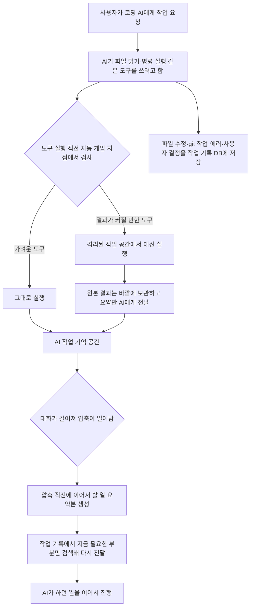

<div class="ai-knowledge-shell">

<aside class="ai-knowledge-sidebar">
  <p class="ai-eyebrow">CATEGORIES</p>
  <nav class="ai-cat-tree"><details class="ai-cat" open><summary><span class="catname">에이전트 오케스트레이션</span><span class="catcount">17</span></summary><ul><li><a href="https://altjs4510.github.io/ai_news_blog/knowledge/20261015/"><span class="kdate">2026-10-15</span><span class="ktitle">How Third Moment Research runs 10,000 agents for…</span></a></li><li><a href="https://altjs4510.github.io/ai_news_blog/knowledge/20261014/"><span class="kdate">2026-10-14</span><span class="ktitle">How Anthropic's Dynamic Workflows Coordinate Cla…</span></a></li><li><a href="https://altjs4510.github.io/ai_news_blog/knowledge/20260930/"><span class="kdate">2026-09-30</span><span class="ktitle">Agents you can coach: how Asana builds human-age…</span></a></li><li><a href="https://altjs4510.github.io/ai_news_blog/knowledge/20260831-openexecutive-virtual-c-suite/"><span class="kdate">2026-08-31</span><span class="ktitle">Open Executive — 8명의 전문 에이전트를 하나의 임원 목소리로</span></a></li><li><a href="https://altjs4510.github.io/ai_news_blog/knowledge/20260828/"><span class="kdate">2026-08-28</span><span class="ktitle">Google ADK for Python v2.8.0 — RemoteA2aAgent 네이…</span></a></li><li><a href="https://altjs4510.github.io/ai_news_blog/knowledge/20260826/"><span class="kdate">2026-08-26</span><span class="ktitle">apache/maka — 도구 호출·권한 결정·종료 이벤트를 append-only 로그…</span></a></li><li><a href="https://altjs4510.github.io/ai_news_blog/knowledge/20260823/"><span class="kdate">2026-08-23</span><span class="ktitle">The Evolution of the Agent Harness — 하네스가 모델 가중치…</span></a></li><li><a href="https://altjs4510.github.io/ai_news_blog/knowledge/20260821/"><span class="kdate">2026-08-21</span><span class="ktitle">volcengine/OpenViking — 에이전트 메모리·Knowledge RAG·스…</span></a></li><li><a href="https://altjs4510.github.io/ai_news_blog/knowledge/20260805/"><span class="kdate">2026-08-05</span><span class="ktitle">TencentCloud/TencentDB-Agent-Memory — 대화·문서·코드를 …</span></a></li><li><a href="https://altjs4510.github.io/ai_news_blog/knowledge/20260717/"><span class="kdate">2026-07-17</span><span class="ktitle">After a year building agent memory, 'save everyt…</span></a></li><li><a href="https://altjs4510.github.io/ai_news_blog/knowledge/20260701/"><span class="kdate">2026-07-01</span><span class="ktitle">Google OKF (Open Knowledge Format) — 벤더 중립 에이전트 …</span></a></li><li><a href="https://altjs4510.github.io/ai_news_blog/knowledge/20260623/"><span class="kdate">2026-06-23</span><span class="ktitle">bytedance/deer-flow — 샌드박스·메모리·서브에이전트·메시지 게이트웨이를…</span></a></li><li><a href="https://altjs4510.github.io/ai_news_blog/knowledge/20260611/"><span class="kdate">2026-06-11</span><span class="ktitle">The evolution of agentic surfaces: building with…</span></a></li><li><a href="https://altjs4510.github.io/ai_news_blog/knowledge/20260602/"><span class="kdate">2026-06-02</span><span class="ktitle">revfactory/harness — 도메인별 에이전트 팀과 스킬을 자동 설계하는 메타…</span></a></li><li><a href="https://altjs4510.github.io/ai_news_blog/knowledge/20260529/"><span class="kdate">2026-05-29</span><span class="ktitle">Introducing dynamic workflows in Claude Code</span></a></li><li><a href="https://altjs4510.github.io/ai_news_blog/knowledge/20260507/"><span class="kdate">2026-05-07</span><span class="ktitle">ruvnet/ruflo — Claude 멀티 에이전트 오케스트레이션 플랫폼</span></a></li><li><a href="https://altjs4510.github.io/ai_news_blog/knowledge/20260504/"><span class="kdate">2026-05-04</span><span class="ktitle">Agents for Everything Else: Codex for Knowledge …</span></a></li></ul></details><details class="ai-cat" open><summary><span class="catname">MCP &amp; 도구 통합</span><span class="catcount">16</span></summary><ul><li><a href="https://altjs4510.github.io/ai_news_blog/knowledge/20261007/"><span class="kdate">2026-10-07</span><span class="ktitle">morluto/rea — 앱 동작부터 네이티브 바이너리까지 에이전트로 리버스 엔지니어링</span></a></li><li><a href="https://altjs4510.github.io/ai_news_blog/knowledge/20260831-gitnexus-code-knowledge-graph/"><span class="kdate">2026-08-31</span><span class="ktitle">GitNexus — 코드베이스를 지식그래프로 바꿔 에이전트에게 쥐어주기</span></a></li><li><a href="https://altjs4510.github.io/ai_news_blog/knowledge/20260819/"><span class="kdate">2026-08-19</span><span class="ktitle">akitaonrails/ai-memory — 코딩 에이전트 CLI 간 장기 기억과 벤더…</span></a></li><li><a href="https://altjs4510.github.io/ai_news_blog/knowledge/20260802/"><span class="kdate">2026-08-02</span><span class="ktitle">Stateless MCP has recaptured my interest (and in…</span></a></li><li><a href="https://altjs4510.github.io/ai_news_blog/knowledge/20260731/"><span class="kdate">2026-07-31</span><span class="ktitle">different-ai/openwork — Claude Cowork의 오픈소스 대안(o…</span></a></li><li><a href="https://altjs4510.github.io/ai_news_blog/knowledge/20260729/"><span class="kdate">2026-07-29</span><span class="ktitle">Bringing MCP 2026-07-28 to Claude</span></a></li><li><a href="https://altjs4510.github.io/ai_news_blog/knowledge/20260726/"><span class="kdate">2026-07-26</span><span class="ktitle">citrolabs/ego-lite — 로그인된 브라우저 상태를 AI 에이전트와 공유하는…</span></a></li><li><a href="https://altjs4510.github.io/ai_news_blog/knowledge/20260718/"><span class="kdate">2026-07-18</span><span class="ktitle">tirth8205/code-review-graph — MCP·CLI용 로컬 코드 인텔리…</span></a></li><li><a href="https://altjs4510.github.io/ai_news_blog/knowledge/20260708/"><span class="kdate">2026-07-08</span><span class="ktitle">Expanding Managed Agents in Gemini API: backgrou…</span></a></li><li><a href="https://altjs4510.github.io/ai_news_blog/knowledge/20260618/"><span class="kdate">2026-06-18</span><span class="ktitle">DeusData/codebase-memory-mcp — 158개 언어 코드베이스를 밀리…</span></a></li><li><a href="https://altjs4510.github.io/ai_news_blog/knowledge/20260604/"><span class="kdate">2026-06-04</span><span class="ktitle">chopratejas/headroom — Compress tool outputs bef…</span></a></li><li><a href="https://altjs4510.github.io/ai_news_blog/knowledge/20260603/"><span class="kdate">2026-06-03</span><span class="ktitle">How Bad MCP design cost your Agent 5× more token…</span></a></li><li><a href="https://altjs4510.github.io/ai_news_blog/knowledge/20260521/"><span class="kdate">2026-05-21</span><span class="ktitle">colbymchenry/codegraph — Pre-indexed code knowle…</span></a></li><li><a href="https://altjs4510.github.io/ai_news_blog/knowledge/20260517/"><span class="kdate">2026-05-17</span><span class="ktitle">I gave my LLM 100,000+ tools — Lazy Discovery &a…</span></a></li><li><a href="https://altjs4510.github.io/ai_news_blog/knowledge/20260509/"><span class="kdate">2026-05-09</span><span class="ktitle">How to connect 100 MCP servers without the conte…</span></a></li><li><a href="https://altjs4510.github.io/ai_news_blog/knowledge/20260506/"><span class="kdate">2026-05-06</span><span class="ktitle">mksglu/context-mode — AI 코딩 에이전트용 컨텍스트 윈도우 최적화</span></a></li></ul></details><details class="ai-cat" open><summary><span class="catname">코딩 에이전트</span><span class="catcount">25</span></summary><ul><li><a href="https://altjs4510.github.io/ai_news_blog/knowledge/20261017/" class="current"><span class="kdate">2026-10-17</span><span class="ktitle">mksglu/context-mode — 코딩 에이전트용 컨텍스트 윈도우 최적화</span></a></li><li><a href="https://altjs4510.github.io/ai_news_blog/knowledge/20261014-claude-code-advisor/"><span class="kdate">2026-10-14</span><span class="ktitle">Claude Code advisor — 가벼운 메인 모델이 일하고, 갈림길에서만 Opu…</span></a></li><li><a href="https://altjs4510.github.io/ai_news_blog/knowledge/20260920/"><span class="kdate">2026-09-20</span><span class="ktitle">Claude Code 2.1.277 — CLAUDE.md가 없으면 AGENTS.md를 …</span></a></li><li><a href="https://altjs4510.github.io/ai_news_blog/knowledge/20260912/"><span class="kdate">2026-09-12</span><span class="ktitle">Quoting Boris Cherny — 'Claude가 쓴 프로덕션 코드는 사람이 쓴…</span></a></li><li><a href="https://altjs4510.github.io/ai_news_blog/knowledge/20260910/"><span class="kdate">2026-09-10</span><span class="ktitle">vastsa/PI-Desktop — Electron + Rust 호스트 코어 + 에이전…</span></a></li><li><a href="https://altjs4510.github.io/ai_news_blog/knowledge/20260906/"><span class="kdate">2026-09-06</span><span class="ktitle">DietrichGebert/ponytail — 에이전트를 '방에서 가장 게으른 시니어 …</span></a></li><li><a href="https://altjs4510.github.io/ai_news_blog/knowledge/20260903/"><span class="kdate">2026-09-03</span><span class="ktitle">pacifio/atlas — 여러 코딩 에이전트의 변경을 한곳에서 추적·질의하는 '에이…</span></a></li><li><a href="https://altjs4510.github.io/ai_news_blog/knowledge/20260901/"><span class="kdate">2026-09-01</span><span class="ktitle">affaan-m/ECC — 스킬·본능·메모리·보안을 묶은 에이전트 하네스 성능 최적화 …</span></a></li><li><a href="https://altjs4510.github.io/ai_news_blog/knowledge/20260829/"><span class="kdate">2026-08-29</span><span class="ktitle">cursor/plugins — 플러그인 명세(specification)와 공식 플러그인…</span></a></li><li><a href="https://altjs4510.github.io/ai_news_blog/knowledge/20260814/"><span class="kdate">2026-08-14</span><span class="ktitle">cathrynlavery/diagram-design — Claude Code용 에디토리…</span></a></li><li><a href="https://altjs4510.github.io/ai_news_blog/knowledge/20260810/"><span class="kdate">2026-08-10</span><span class="ktitle">Auto mode is now the default in Claude Code for …</span></a></li><li><a href="https://altjs4510.github.io/ai_news_blog/knowledge/20260808/"><span class="kdate">2026-08-08</span><span class="ktitle">PrimeIntellect-ai/prime-agent — 코딩 워크플로우와 장시간 자율…</span></a></li><li><a href="https://altjs4510.github.io/ai_news_blog/knowledge/20260804/"><span class="kdate">2026-08-04</span><span class="ktitle">esengine/DeepSeek-Reasonix — prefix-cache 안정성을 축…</span></a></li><li><a href="https://altjs4510.github.io/ai_news_blog/knowledge/20260728/"><span class="kdate">2026-07-28</span><span class="ktitle">alibaba/open-code-review — 결정론적 파이프라인 + LLM 에이전트…</span></a></li><li><a href="https://altjs4510.github.io/ai_news_blog/knowledge/20260725/"><span class="kdate">2026-07-25</span><span class="ktitle">The new rules of context engineering for Claude …</span></a></li><li><a href="https://altjs4510.github.io/ai_news_blog/knowledge/20260714/"><span class="kdate">2026-07-14</span><span class="ktitle">Graphify-Labs/graphify — 코드베이스를 질의 가능한 지식 그래프로 만…</span></a></li><li><a href="https://altjs4510.github.io/ai_news_blog/knowledge/20260707/"><span class="kdate">2026-07-07</span><span class="ktitle">AI Hero Skills Catalog — 실무 엔지니어를 위한 재사용 가능한 판단 …</span></a></li><li><a href="https://altjs4510.github.io/ai_news_blog/knowledge/20260705/"><span class="kdate">2026-07-05</span><span class="ktitle">openai/codex-plugin-cc — Claude Code에서 Codex를 위임…</span></a></li><li><a href="https://altjs4510.github.io/ai_news_blog/knowledge/20260626/"><span class="kdate">2026-06-26</span><span class="ktitle">google-labs-code/design.md — 코딩 에이전트에게 디자인 시스템을 …</span></a></li><li><a href="https://altjs4510.github.io/ai_news_blog/knowledge/20260619/"><span class="kdate">2026-06-19</span><span class="ktitle">Claude Code now supports artifacts</span></a></li><li><a href="https://altjs4510.github.io/ai_news_blog/knowledge/20260530/"><span class="kdate">2026-05-30</span><span class="ktitle">Leonxlnx/taste-skill — AI에게 좋은 취향을 부여해 generic s…</span></a></li><li><a href="https://altjs4510.github.io/ai_news_blog/knowledge/20260515/"><span class="kdate">2026-05-15</span><span class="ktitle">Clawdmeter — Claude Code 사용량을 데스크톱 대시보드로</span></a></li><li><a href="https://altjs4510.github.io/ai_news_blog/knowledge/20260512/"><span class="kdate">2026-05-12</span><span class="ktitle">agentmemory — Persistent memory for AI coding ag…</span></a></li><li><a href="https://altjs4510.github.io/ai_news_blog/knowledge/20260508/"><span class="kdate">2026-05-08</span><span class="ktitle">addyosmani/agent-skills — Production-grade engin…</span></a></li><li><a href="https://altjs4510.github.io/ai_news_blog/knowledge/20260505/"><span class="kdate">2026-05-05</span><span class="ktitle">mattpocock/skills — Skills for Real Engineers (.…</span></a></li></ul></details><details class="ai-cat" open><summary><span class="catname">모델 &amp; 연구</span><span class="catcount">11</span></summary><ul><li><a href="https://altjs4510.github.io/ai_news_blog/knowledge/20261009/"><span class="kdate">2026-10-09</span><span class="ktitle">Claude Haiku 5.5 (Simon Willison의 출시 노트와 가격 분석)</span></a></li><li><a href="https://altjs4510.github.io/ai_news_blog/knowledge/20260929/"><span class="kdate">2026-09-29</span><span class="ktitle">vectorize-io/hindsight — Hindsight: Agent Memory…</span></a></li><li><a href="https://altjs4510.github.io/ai_news_blog/knowledge/20260907-voicemem-dual-brain-memory/"><span class="kdate">2026-09-07</span><span class="ktitle">VoiceMem — 좌뇌·우뇌로 쪼갠 스트리밍 메모리로 음성 에이전트 지연 없애기</span></a></li><li><a href="https://altjs4510.github.io/ai_news_blog/knowledge/20260904/"><span class="kdate">2026-09-04</span><span class="ktitle">HarnessDev: Can LLMs Create and Evolve Their Own…</span></a></li><li><a href="https://altjs4510.github.io/ai_news_blog/knowledge/20260716-proprag/"><span class="kdate">2026-07-16</span><span class="ktitle">PropRAG — 프로포지션 경로 위 beam search로 멀티홉 검색 안내</span></a></li><li><a href="https://altjs4510.github.io/ai_news_blog/knowledge/20260712/"><span class="kdate">2026-07-12</span><span class="ktitle">Do Automated Evals Work?</span></a></li><li><a href="https://altjs4510.github.io/ai_news_blog/knowledge/20260620/"><span class="kdate">2026-06-20</span><span class="ktitle">zai-org/GLM-5 — From Vibe Coding to Agentic Engi…</span></a></li><li><a href="https://altjs4510.github.io/ai_news_blog/knowledge/20260617/"><span class="kdate">2026-06-17</span><span class="ktitle">Predicting model behavior before release by simu…</span></a></li><li><a href="https://altjs4510.github.io/ai_news_blog/knowledge/20260610/"><span class="kdate">2026-06-10</span><span class="ktitle">Fable 5 just made cost-aware model routing manda…</span></a></li><li><a href="https://altjs4510.github.io/ai_news_blog/knowledge/20260516/"><span class="kdate">2026-05-16</span><span class="ktitle">STALE — 에이전트가 자기 기억의 유효성을 인지할 수 있는가</span></a></li><li><a href="https://altjs4510.github.io/ai_news_blog/knowledge/20260513/"><span class="kdate">2026-05-13</span><span class="ktitle">Thinking Machines' Native Interaction Models — T…</span></a></li></ul></details><details class="ai-cat" open><summary><span class="catname">인프라 &amp; 컴퓨트</span><span class="catcount">7</span></summary><ul><li><a href="https://altjs4510.github.io/ai_news_blog/knowledge/20260909/"><span class="kdate">2026-09-09</span><span class="ktitle">Reducing cost and improving performance with Cla…</span></a></li><li><a href="https://altjs4510.github.io/ai_news_blog/knowledge/20260905/"><span class="kdate">2026-09-05</span><span class="ktitle">magnitudedev/magnitude — 하드웨어에 맞는 최적 로컬 모델을 띄워 이…</span></a></li><li><a href="https://altjs4510.github.io/ai_news_blog/knowledge/20260812/"><span class="kdate">2026-08-12</span><span class="ktitle">semantica-agi/semantica — 컨텍스트와 '책임 추적 가능한(accou…</span></a></li><li><a href="https://altjs4510.github.io/ai_news_blog/knowledge/20260806/"><span class="kdate">2026-08-06</span><span class="ktitle">cloudflare/computer — 에이전트에게 컴퓨터를 통째로 주는 엣지 실행 샌…</span></a></li><li><a href="https://altjs4510.github.io/ai_news_blog/knowledge/20260723/"><span class="kdate">2026-07-23</span><span class="ktitle">diegosouzapw/OmniRoute — 268+ 프로바이더를 단일 엔드포인트로 묶…</span></a></li><li><a href="https://altjs4510.github.io/ai_news_blog/knowledge/20260522/"><span class="kdate">2026-05-22</span><span class="ktitle">Giving Agents Computers — Ivan Burazin, Daytona</span></a></li><li><a href="https://altjs4510.github.io/ai_news_blog/knowledge/20260520/"><span class="kdate">2026-05-20</span><span class="ktitle">New in Claude Managed Agents: self-hosted sandbo…</span></a></li></ul></details><details class="ai-cat" open><summary><span class="catname">보안 &amp; 거버넌스</span><span class="catcount">21</span></summary><ul><li><a href="https://altjs4510.github.io/ai_news_blog/knowledge/20261016/"><span class="kdate">2026-10-16</span><span class="ktitle">Crossing the Threshold: How OpenAI and Anthropic…</span></a></li><li><a href="https://altjs4510.github.io/ai_news_blog/knowledge/20261011/"><span class="kdate">2026-10-11</span><span class="ktitle">Anthropic can’t reliably control its AI agents. …</span></a></li><li><a href="https://altjs4510.github.io/ai_news_blog/knowledge/20261004/"><span class="kdate">2026-10-04</span><span class="ktitle">Apple says it's tightening macOS 'Full Disk Acce…</span></a></li><li><a href="https://altjs4510.github.io/ai_news_blog/knowledge/20261001/"><span class="kdate">2026-10-01</span><span class="ktitle">NVIDIA/OpenShell</span></a></li><li><a href="https://altjs4510.github.io/ai_news_blog/knowledge/20260919/"><span class="kdate">2026-09-19</span><span class="ktitle">cloudflare/security-audit-skill — 다단계 보안 감사를 '독립…</span></a></li><li><a href="https://altjs4510.github.io/ai_news_blog/knowledge/20260913/"><span class="kdate">2026-09-13</span><span class="ktitle">OpenAI agents attacked RubyGems back in May: Ope…</span></a></li><li><a href="https://altjs4510.github.io/ai_news_blog/knowledge/20260902/"><span class="kdate">2026-09-02</span><span class="ktitle">AIR raises $50M to help companies vet the skills…</span></a></li><li><a href="https://altjs4510.github.io/ai_news_blog/knowledge/20260827/"><span class="kdate">2026-08-27</span><span class="ktitle">Claude in Chrome is generally available</span></a></li><li><a href="https://altjs4510.github.io/ai_news_blog/knowledge/20260819-mind-viruses/"><span class="kdate">2026-08-19</span><span class="ktitle">탈옥도, 인젝션도 없이 — 대화로만 퍼지는 에이전트의 '마인드 바이러스'</span></a></li><li><a href="https://altjs4510.github.io/ai_news_blog/knowledge/20260730/"><span class="kdate">2026-07-30</span><span class="ktitle">Anatomy of a Frontier Lab Agent Intrusion: A Tec…</span></a></li><li><a href="https://altjs4510.github.io/ai_news_blog/knowledge/20260715/"><span class="kdate">2026-07-15</span><span class="ktitle">Dicklesworthstone/destructive_command_guard — 에이…</span></a></li><li><a href="https://altjs4510.github.io/ai_news_blog/knowledge/20260710/"><span class="kdate">2026-07-10</span><span class="ktitle">70개 MCP 서버 strace 런타임 감사 — 부팅 시 아웃바운드 호출 서버 적발</span></a></li><li><a href="https://altjs4510.github.io/ai_news_blog/knowledge/20260704/"><span class="kdate">2026-07-04</span><span class="ktitle">Cloudflare is about to block AI agents by defaul…</span></a></li><li><a href="https://altjs4510.github.io/ai_news_blog/knowledge/20260703/"><span class="kdate">2026-07-03</span><span class="ktitle">Giving admins more visibility and control over C…</span></a></li><li><a href="https://altjs4510.github.io/ai_news_blog/knowledge/20260630/"><span class="kdate">2026-06-30</span><span class="ktitle">Introducing the Claude apps gateway for Amazon B…</span></a></li><li><a href="https://altjs4510.github.io/ai_news_blog/knowledge/20260624/"><span class="kdate">2026-06-24</span><span class="ktitle">Agent identity in Claude Tag: a new access model…</span></a></li><li><a href="https://altjs4510.github.io/ai_news_blog/knowledge/20260613/"><span class="kdate">2026-06-13</span><span class="ktitle">Fable 5's guardrails got bypassed in 48 hours — …</span></a></li><li><a href="https://altjs4510.github.io/ai_news_blog/knowledge/20260612/"><span class="kdate">2026-06-12</span><span class="ktitle">NVIDIA/SkillSpector — AI 에이전트 스킬용 보안 스캐너</span></a></li><li><a href="https://altjs4510.github.io/ai_news_blog/knowledge/20260607/"><span class="kdate">2026-06-07</span><span class="ktitle">OpenAI Help: Lockdown Mode</span></a></li><li><a href="https://altjs4510.github.io/ai_news_blog/knowledge/20260531/"><span class="kdate">2026-05-31</span><span class="ktitle">How we contain Claude across products</span></a></li><li><a href="https://altjs4510.github.io/ai_news_blog/knowledge/20260527/"><span class="kdate">2026-05-27</span><span class="ktitle">Microsoft Copilot Cowork Exfiltrates Files</span></a></li></ul></details><details class="ai-cat" open><summary><span class="catname">응용 사례</span><span class="catcount">7</span></summary><ul><li><a href="https://altjs4510.github.io/ai_news_blog/knowledge/20261006/"><span class="kdate">2026-10-06</span><span class="ktitle">How Cresta turned CX expertise into an agent bui…</span></a></li><li><a href="https://altjs4510.github.io/ai_news_blog/knowledge/20260911/"><span class="kdate">2026-09-11</span><span class="ktitle">Now everyone can put data to work — ChatGPT Work…</span></a></li><li><a href="https://altjs4510.github.io/ai_news_blog/knowledge/20260709/"><span class="kdate">2026-07-09</span><span class="ktitle">mvanhorn/last30days-skill — Reddit·X·YouTube·HN·…</span></a></li><li><a href="https://altjs4510.github.io/ai_news_blog/knowledge/20260621/"><span class="kdate">2026-06-21</span><span class="ktitle">calesthio/OpenMontage — 12 파이프라인·52 도구·500+ 스킬을 …</span></a></li><li><a href="https://altjs4510.github.io/ai_news_blog/knowledge/20260609/"><span class="kdate">2026-06-09</span><span class="ktitle">Building intelligent apps for Apple platforms wi…</span></a></li><li><a href="https://altjs4510.github.io/ai_news_blog/knowledge/20260528/"><span class="kdate">2026-05-28</span><span class="ktitle">Building self-improving tax agents with Codex</span></a></li><li><a href="https://altjs4510.github.io/ai_news_blog/knowledge/20260514/"><span class="kdate">2026-05-14</span><span class="ktitle">Introducing Claude for Small Business</span></a></li></ul></details><details class="ai-cat" open><summary><span class="catname">산업 동향</span><span class="catcount">6</span></summary><ul><li><a href="https://altjs4510.github.io/ai_news_blog/knowledge/20260907-humanmade-52week-rhythm/"><span class="kdate">2026-09-07</span><span class="ktitle">휴먼 메이드의 '52주 리듬' — 아이디어가 흔해진 시대에 값이 오르는 건 버리는 판단</span></a></li><li><a href="https://altjs4510.github.io/ai_news_blog/knowledge/20260830/"><span class="kdate">2026-08-30</span><span class="ktitle">[AINews] OpenAI shuts off Cursor — 프론티어 모델 공급 차단…</span></a></li><li><a href="https://altjs4510.github.io/ai_news_blog/knowledge/20260711/"><span class="kdate">2026-07-11</span><span class="ktitle">OpenAI says GPT 5.6 is the 'preferred model' for…</span></a></li><li><a href="https://altjs4510.github.io/ai_news_blog/knowledge/20260702/"><span class="kdate">2026-07-02</span><span class="ktitle">How Cursor deploys AI inside the enterprise (For…</span></a></li><li><a href="https://altjs4510.github.io/ai_news_blog/knowledge/20260616/"><span class="kdate">2026-06-16</span><span class="ktitle">Why AI hasn't replaced software engineers, and w…</span></a></li><li><a href="https://altjs4510.github.io/ai_news_blog/knowledge/20260519/"><span class="kdate">2026-05-19</span><span class="ktitle">Anthropic acquires Stainless</span></a></li></ul></details></nav>
</aside>

<article class="ai-knowledge-article">

<header class="ai-post-hero">
  <p class="ai-eyebrow"><a class="ai-back" href="../">KNOWLEDGE</a> · 2026-10-17 · 오늘의 학습</p>
  <h2 class="ai-post-title">mksglu/context-mode — 코딩 에이전트용 컨텍스트 윈도우 최적화</h2>
</header>

> 원문: [mksglu/context-mode — 코딩 에이전트용 컨텍스트 윈도우 최적화](https://github.com/mksglu/context-mode)

## 📌 학습 정리

### 1. 한 줄로 말하면

코딩을 돕는 AI가 도구를 쓸 때마다 쏟아져 들어오는 긴 결과물을 바깥의 별도 작업 공간에 따로 보관하고, AI에게는 꼭 필요한 요약만 넘겨 주는 도구예요. 대화가 길어져 앞부분이 정리되더라도 하던 일을 잊지 않게 작업 기록도 따로 챙겨 둡니다.

### 2. 왜 이게 만들어졌어요?

요즘 코딩 AI는 파일을 읽고, 명령을 실행하고, 웹 페이지를 가져오는 등 여러 도구를 직접 씁니다. 그런데 도구를 한 번 쓸 때마다 그 결과가 통째로 AI의 작업 기억 공간인 컨텍스트 윈도우(context window)에 들어가요. 원문에 따르면 브라우저 화면 기록 하나가 56KB, GitHub 이슈 20개가 59KB, 접속 로그 하나가 45KB 정도라서, 30분만 작업해도 이 공간의 40%가 사라진다고 해요.

공간이 모자라면 AI는 지난 대화를 압축해서 자리를 만드는데, 이 과정에서 어떤 파일을 고치고 있었는지, 어떤 작업이 진행 중이었는지, 사용자가 마지막에 뭘 부탁했는지를 잊어버리곤 합니다. 여기에 AI가 군더더기 인사말이나 장황한 설명까지 붙이면 공간이 양쪽에서 동시에 줄어들어요. Context Mode는 이 문제를 줄여 보려고 만들어진 도구입니다.

### 3. 비유로 풀면

이건 마치 **회의에 들어가는 팀장과 그 옆의 비서** 같은 관계예요. 팀장(AI)이 "지난달 접속 로그 좀 확인해 줘"라고 하면, 예전에는 수백 장짜리 출력물을 책상 위에 그대로 쌓아 두는 식이었어요. 그러면 책상이 금방 가득 차서 정작 중요한 메모가 밀려나 버리죠. Context Mode는 비서 역할을 맡아서 출력물은 별도 서랍(샌드박스)에 넣어 두고, 팀장에게는 "에러가 몇 건이고, 주로 어디서 났다" 같은 한 장짜리 요약만 건넵니다.

또 하나 비유를 들면 **업무 일지**예요. 팀장이 잠깐 자리를 비웠다 와서 머릿속이 정리된 상태여도, 비서가 적어 둔 일지에서 "지금 하던 일"과 관련된 부분만 찾아서 보여 주면 바로 이어서 일할 수 있어요.

그래서 결국, AI의 작업 기억 공간에는 판단에 필요한 정보만 남기고, 원본 데이터와 작업 이력은 바깥에 따로 보관했다가 필요할 때만 꺼내 쓰는 구조예요.

### 4. 어떻게 작동하는지 (그림으로)



AI가 도구를 쓰려고 하면, 그 직전에 자동으로 끼어드는 지점에서 결과가 클 만한 도구인지 확인해요. 결과가 클 것 같으면 격리된 공간에서 대신 실행하고 요약만 넘겨 줍니다(원문 기준 315KB가 5.4KB로, 약 98% 감소). 이와 별개로 작업 이력은 계속 데이터베이스에 쌓아 두었다가, 대화가 압축되면 지금 상황과 관련된 기록만 골라 다시 알려 줘요.

여기에 "코드로 생각하기(Think in Code)"라는 원칙도 함께 깔려 있어요. 파일 50개를 전부 읽어서 AI가 직접 세는 대신, 세는 스크립트를 AI가 짜서 실행하고 결과 숫자만 받아 보는 방식이에요. 원문 예시에서는 파일 읽기 47번(700KB)이 스크립트 실행 한 번(3.6KB)으로 줄어듭니다. 다만 AI가 최종 답변을 얼마나 짧게 쓸지까지는 간섭하지 않아요. 원문은 그 이유로, 답변을 지나치게 짧게 쓰라고 몰아붙이면 코딩·추론 성능이 떨어졌다는 사례(Moonshot AI의 kimi-k2.5)를 들고 있어요.

### 5. 처음 보는 용어 풀이

- **AI의 작업 기억 공간 (context window)** — AI가 한 번에 보고 기억할 수 있는 글의 양이에요. 대화, 도구 결과, 지시문이 모두 여기에 들어가기 때문에 가득 차면 앞부분을 압축하거나 버려야 해요.
- **AI용 도구 연결 규격 (MCP, Model Context Protocol)** — AI가 외부 도구를 같은 방식으로 불러 쓸 수 있게 해 주는 연결 규칙이에요. Context Mode는 이 규격을 따르는 서버 형태로 만들어져 있어서 여러 코딩 도구에 붙일 수 있어요. 원문 기준 도구는 11개예요.
- **자동 개입 지점 (hook)** — "도구를 쓰기 직전", "대화를 압축하기 직전", "세션이 시작될 때"처럼 정해진 순간에 미리 등록해 둔 명령이 자동으로 실행되게 하는 장치예요. 이걸 지원하는 플랫폼에서는 Context Mode가 AI의 도구 사용을 자동으로 자기 쪽으로 돌려보낼 수 있어요. 지원하지 않는 플랫폼에서는 안내 문서 파일을 한 번 복사해 두는 방식으로 대신합니다.
- **격리된 실행 공간 (sandbox)** — 원본 데이터를 처리하되 그 내용이 AI의 작업 기억 공간으로 바로 쏟아지지 않게 막아 두는 별도 공간이에요. 결과 중 필요한 부분만 골라서 넘겨 줍니다.
- **대화 압축 (compaction)** — 작업 기억 공간이 꽉 찼을 때 지난 대화를 요약해서 자리를 확보하는 과정이에요. 이때 세부 맥락이 사라지기 쉬워서, Context Mode는 압축 직전에 이어서 할 일 요약본을 따로 만들어 둬요.
- **전문 검색 색인 (FTS5)과 관련도 순위 매기기 (BM25)** — FTS5는 SQLite라는 가벼운 데이터베이스에 들어 있는 문서 검색 기능이고, BM25는 검색 결과 중 어떤 기록이 질문과 더 관련 있는지 점수를 매기는 방법이에요. 쌓아 둔 작업 기록을 통째로 다시 넣는 대신, 지금 필요한 것만 찾아 넣을 때 써요.
- **작업 지침 연결 (routing)** — AI가 그냥 파일 읽기나 명령 실행을 쓰지 않고 Context Mode의 도구를 쓰도록 길을 안내하는 규칙이에요. 자동 개입 지점으로 강제하거나, 지침 파일(예: `AGENTS.md`, `.cursor/rules/context-mode.mdc`)로 알려 주는 방식이 있어요.

### 6. 한 발 더 들어가고 싶다면

- [mksglu/context-mode 저장소](https://github.com/mksglu/context-mode) — 이걸 보면 Claude Code, Gemini CLI, VS Code Copilot, Cursor, Codex CLI 등 플랫폼별 설치 방법과 설정 파일 전체를 확인할 수 있어요.
- 저장소 안 `docs/platform-support.md` 문서 — 이걸 보면 플랫폼마다 어떤 자동 개입 지점을 지원하고 어떤 제약이 있는지 한눈에 비교할 수 있어요.
- 저장소 안 `docs/adapters/openclaw.md`, `docs/adapters/kimi-code.md` 문서 — 이걸 보면 OpenClaw 게이트웨이나 Kimi Code처럼 구조가 조금 다른 환경에 어떻게 붙이는지 자세히 알 수 있어요.
- context-mode.com/insight — 이걸 보면 원문에서 소개하는 팀 단위 사용 분석 대시보드(Insight)가 어떤 모습인지 확인할 수 있어요.

---

## 📖 원문 전체 번역 (정독용)

> 의역 최소화한 전체 번역입니다. 큰 흐름은 위 정리에서 잡고, 정확한 워딩이 필요할 땐 이 섹션에서 정독하세요.

# Context Mode

컨텍스트 문제의 나머지 절반.

여러 팀에서 사용 중

## 문제

모든 MCP 도구 호출은 원시 데이터를 컨텍스트 윈도우에 그대로 쏟아붓습니다. Playwright 스냅샷 하나가 56 KB, GitHub 이슈 20개가 59 KB, 접속 로그 하나가 45 KB입니다. 30분이 지나면 컨텍스트의 40%가 사라집니다. 공간을 확보하려고 에이전트가 대화를 압축(compact)하면, 어떤 파일을 편집하고 있었는지, 어떤 작업이 진행 중인지, 사용자가 마지막으로 무엇을 요청했는지 잊어버립니다. 게다가 에이전트는 군더더기, 인사치레, 장황한 설명에 출력 토큰을 낭비하므로, 컨텍스트가 양쪽에서 소모됩니다.

## Context Mode는 어떻게 해결하는가

Context Mode는 이 문제의 네 가지 측면을 모두 해결하는 MCP 서버입니다.

**컨텍스트 절약 (Context Saving)** — 샌드박스 도구가 원시 데이터를 컨텍스트 윈도우 밖에 둡니다. 315 KB가 5.4 KB가 됩니다. 98% 감소입니다.

**세션 연속성 (Session Continuity)** — 모든 파일 편집, git 작업, 태스크, 오류, 사용자 결정이 SQLite에 추적됩니다. 대화가 압축될 때 context-mode는 이 데이터를 컨텍스트에 다시 쏟아붓지 않습니다. 대신 이벤트를 FTS5에 색인하고 BM25 검색으로 관련 있는 것만 가져옵니다. 모델은 중단했던 지점에서 정확히 이어서 작업합니다. `--continue`를 쓰지 않으면 이전 세션 데이터는 즉시 삭제됩니다. 새 세션은 깨끗한 백지 상태를 뜻합니다.

**코드로 사고하기 (Think in Code)** — LLM은 분석을 직접 계산하지 말고 프로그래밍해야 합니다. 함수 개수를 세려고 파일 50개를 컨텍스트에 읽어 들이는 대신, 에이전트가 개수를 세는 스크립트를 작성하고 결과만 `console.log()`로 출력합니다. 스크립트 하나가 도구 호출 열 번을 대체하고 컨텍스트를 100배 절약합니다. 이는 지원되는 17개 클라이언트 전체와 OpenClaw 게이트웨이 통합에 걸쳐 필수로 적용되는 패러다임입니다. LLM을 데이터 처리기로 취급하지 말고 코드 생성기로 취급하십시오.

```javascript
// Before: 47 × Read() = 700 KB.  After: 1 × ctx_execute() = 3.6 KB.
ctx_execute("javascript", `
const files = fs.readdirSync('src').filter(f => f.endsWith('.ts'));
files.forEach(f => console.log(f + ': ' + fs.readFileSync('src/'+f,'utf8').split('\\n').length + ' lines'));
`);
```

**문체 강제 없음 (No prose-style enforcement)** — context-mode는 원시 데이터를 컨텍스트 밖에 두지만, 모델이 최종 답변을 어떻게 쓸지는 결코 지시하지 않습니다. 간결함, 완결성, 서식은 모델(또는 사용자의 `CLAUDE.md` / `AGENTS.md`)이 정할 일입니다. 공격적인 간결함 프롬프트는 코딩/추론 벤치마크 성능을 떨어뜨리는 것으로 나타났습니다(`kimi-k2.5`에 대한 Moonshot AI의 보고). 따라서 라우팅 블록은 모델이 어떻게 말하는지가 아니라 데이터가 어디로 가는지에만 집중합니다.

## 설치

플랫폼은 설치 복잡도별로 묶여 있습니다. 훅(hook)을 지원하는 플랫폼은 라우팅 강제가 자동으로 적용됩니다. 훅을 지원하지 않는 플랫폼은 라우팅 파일을 한 번 복사해야 합니다.

### Claude Code — 플러그인 마켓플레이스, 완전 자동

**사전 요건:** Claude Code v1.0.33 이상(`claude --version`). `/plugin`이 인식되지 않으면 먼저 업데이트하십시오: `brew upgrade claude-code` 또는 `npm update -g @anthropic-ai/claude-code`.

**설치:**

```
/plugin marketplace add mksglu/context-mode
/plugin install context-mode@context-mode
```

Claude Code를 재시작하거나 `/reload-plugins`를 실행합니다.

**확인:** `/context-mode:ctx-doctor`

모든 항목이 `[x]`로 표시되어야 합니다. doctor는 런타임, 훅, FTS5, 플러그인 등록을 검증합니다.

**라우팅:** 자동입니다. SessionStart 훅이 실행 시점에 라우팅 지침을 주입하므로 프로젝트에 파일이 기록되지 않습니다. 플러그인은 모든 훅(PreToolUse, PostToolUse, UserPromptSubmit, PreCompact, SessionStart, Stop)과 11개의 MCP 도구를 등록합니다. 샌드박스 도구 여섯 개(`ctx_batch_execute`, `ctx_execute`, `ctx_execute_file`, `ctx_index`, `ctx_search`, `ctx_fetch_and_index`)와 메타 도구 다섯 개(`ctx_stats`, `ctx_doctor`, `ctx_upgrade`, `ctx_purge`, `ctx_insight`)입니다.

| 슬래시 명령 | 기능 |
|---|---|
| `/context-mode:ctx-stats` | 컨텍스트 절약량 — 도구별 내역, 소비한 토큰, 절약 비율. |
| `/context-mode:ctx-doctor` | 진단 — 런타임, 훅, FTS5, 플러그인 등록, 버전. |
| `/context-mode:ctx-index` | 로컬 파일 또는 디렉터리를 영속 FTS5 지식 베이스에 색인. |
| `/context-mode:ctx-search` | 이전에 색인한 콘텐츠 검색. |
| `/context-mode:ctx-upgrade` | 최신 버전 pull, 리빌드, 캐시 마이그레이션, 훅 수정. |
| `/context-mode:ctx-purge` | 지식 베이스의 색인된 콘텐츠를 모두 영구 삭제. |
| `/context-mode:ctx-insight` | 호스팅되는 Insight 대시보드(`context-mode.com/insight`)를 브라우저에서 엽니다 — AI 지원 엔지니어링 팀을 위한 조직 분석. |

**참고:** 슬래시 명령은 Claude Code 플러그인 기능입니다. 다른 플랫폼에서는 채팅에 `ctx stats`, `ctx doctor`, `ctx index`, `ctx search`, `ctx upgrade`, `ctx insight`를 입력하십시오. 모델이 MCP 도구를 자동으로 호출합니다. 유틸리티 명령(Utility Commands)을 참고하십시오.

**상태 표시줄(선택):** Claude Code의 플러그인 매니페스트는 상태 표시줄을 선언할 수 없으므로, `~/.claude/settings.json`을 한 번 수동으로 편집해야 합니다.

```json
{
  "statusLine": {
    "type": "command",
    "command": "context-mode statusline"
  }
}
```

저장한 뒤 Claude Code를 재시작합니다. 표시줄에는 `이번 세션에서 절약한 $ · 전체 세션에서 절약한 $ · 효율 %`가 표시되어 절약량이 실시간으로 쌓이는 것을 볼 수 있습니다. 경로를 지정하지 않는 방식이라, 플러그인 캐시가 어디에 있든 `context-mode statusline`이 번들된 CLI를 통해 해석됩니다.

**대안 — MCP 전용 설치 (훅/슬래시 명령 없음)**

```bash
claude mcp add context-mode -- npx -y context-mode
```

이렇게 하면 자동 라우팅 없이 11개 MCP 도구를 모두 사용할 수 있습니다. 모델이 이 도구들을 쓸 수는 있지만, 원시 Bash/Read/WebFetch보다 이것을 우선하도록 유도되지는 않습니다. 전체 플러그인을 도입하기 전에 시험해 보기에 좋습니다.

### Gemini CLI — 설정 파일 하나, 훅 포함

**사전 요건:** Node.js 22.5 이상(또는 Bun), Gemini CLI 설치.

**설치:**

1. context-mode를 전역으로 설치합니다.

```bash
npm install -g context-mode
```

2. `~/.gemini/settings.json`에 아래 내용을 추가합니다. 이 파일 하나로 MCP 서버와 훅 네 개가 모두 등록됩니다.

```json
{
  "mcpServers": {
    "context-mode": {
      "command": "context-mode"
    }
  },
  "hooks": {
    "BeforeTool": [
      {
        "matcher": "run_shell_command|read_file|read_many_files|grep_search|search_file_content|web_fetch|activate_skill|mcp__plugin_context-mode|mcp__context-mode|mcp__(?!.*context-mode)",
        "hooks": [{ "type": "command", "command": "context-mode hook gemini-cli beforetool" }]
      }
    ],
    "AfterTool": [
      {
        "matcher": "",
        "hooks": [{ "type": "command", "command": "context-mode hook gemini-cli aftertool" }]
      }
    ],
    "PreCompress": [
      {
        "matcher": "",
        "hooks": [{ "type": "command", "command": "context-mode hook gemini-cli precompress" }]
      }
    ],
    "SessionStart": [
      {
        "matcher": "",
        "hooks": [{ "type": "command", "command": "context-mode hook gemini-cli sessionstart" }]
      }
    ]
  }
}
```

3. Gemini CLI를 재시작합니다.

**확인:** `/mcp list`

`context-mode: ... - Connected`가 보여야 합니다.

**라우팅:** SessionStart 훅을 통해 자동입니다. 모델이 전체 내용을 인지하게 하려면 라우팅 지침을 선택적으로 복사하십시오.

```bash
cp node_modules/context-mode/configs/gemini-cli/GEMINI.md ./GEMINI.md
```

**BeforeTool matcher는 왜 있는가?** 이 matcher는 출력이 큰 도구(`run_shell_command`, `read_file`, `read_many_files`, `grep_search`, `search_file_content`, `web_fetch`, `activate_skill`)와 context-mode 자체의 도구(`mcp__plugin_context-mode`)만 대상으로 삼습니다. 가벼운 도구에 불필요한 훅 오버헤드가 생기는 것을 피하면서, 컨텍스트 윈도우를 넘치게 만들 수 있는 모든 도구를 가로챕니다.

전체 설정 레퍼런스: `configs/gemini-cli/settings.json`

### VS Code Copilot — SessionStart 포함 훅

**사전 요건:** Node.js 22.5 이상(또는 Bun), Copilot Chat v0.32 이상이 설치된 VS Code.

**설치:**

1. context-mode를 전역으로 설치합니다.

```bash
npm install -g context-mode
```

2. 프로젝트 루트에 `.vscode/mcp.json`을 만듭니다.

```json
{
  "servers": {
    "context-mode": {
      "command": "context-mode"
    }
  }
}
```

3. `.github/hooks/context-mode.json`을 만듭니다.

```json
{
  "hooks": {
    "PreToolUse": [
      { "type": "command", "command": "context-mode hook vscode-copilot pretooluse" }
    ],
    "PostToolUse": [
      { "type": "command", "command": "context-mode hook vscode-copilot posttooluse" }
    ],
    "SessionStart": [
      { "type": "command", "command": "context-mode hook vscode-copilot sessionstart" }
    ]
  }
}
```

4. VS Code를 재시작합니다.

**확인:** Copilot Chat을 열고 `ctx stats`를 입력합니다. context-mode 도구가 나타나고 응답해야 합니다.

**라우팅:** SessionStart 훅을 통해 자동입니다. 모델이 전체 내용을 인지하게 하려면 라우팅 지침을 선택적으로 복사하십시오.

```bash
cp node_modules/context-mode/configs/vscode-copilot/copilot-instructions.md .github/copilot-instructions.md
```

PreCompact를 포함한 전체 훅 설정: `configs/vscode-copilot/hooks.json`

### JetBrains Copilot — SessionStart 포함 훅

**사전 요건:** Node.js 22.5 이상(또는 Bun), GitHub Copilot 플러그인 v1.5.57 이상이 설치된 JetBrains IDE.

**설치:**

1. context-mode를 전역으로 설치합니다.

```bash
npm install -g context-mode
```

2. 설정 UI에서 MCP 서버를 추가합니다. **Settings > Tools > AI Assistant > Model Context Protocol (MCP) > Add Server**:
   - 이름: `context-mode`
   - 명령: `context-mode`

3. `.github/hooks/context-mode.json`을 만듭니다.

```json
{
  "hooks": {
    "PreToolUse": [
      { "type": "command", "command": "context-mode hook jetbrains-copilot pretooluse" }
    ],
    "PostToolUse": [
      { "type": "command", "command": "context-mode hook jetbrains-copilot posttooluse" }
    ],
    "SessionStart": [
      { "type": "command", "command": "context-mode hook jetbrains-copilot sessionstart" }
    ]
  }
}
```

4. JetBrains IDE를 재시작합니다.

**확인:** Copilot Chat을 열고 `ctx stats`를 입력합니다. context-mode 도구가 나타나고 응답해야 합니다.

**라우팅:** SessionStart 훅을 통해 자동입니다. 모델이 전체 내용을 인지하게 하려면 라우팅 지침을 선택적으로 복사하십시오.

```bash
cp node_modules/context-mode/configs/jetbrains-copilot/copilot-instructions.md .github/copilot-instructions.md
```

PreCompact를 포함한 전체 훅 설정: `configs/jetbrains-copilot/hooks.json`

전체 설정 가이드: `docs/jetbrains-copilot.md`

### GitHub Copilot CLI — MCP + 훅

**사전 요건:** Node.js 22.5 이상(또는 Bun), GitHub Copilot CLI(`copilot`) 설치. 격리된 Copilot 홈을 쓴다면 먼저 `COPILOT_HOME`을 설정하십시오.

**설치 — 옵션 A (플러그인, 명령 한 번 — 권장):**

```bash
npm install -g context-mode                              # 플러그인의 MCP 서버는 전역 바이너리를 실행합니다
copilot plugin install mksglu/context-mode:configs/copilot-cli   # MCP + 훅 + 라우팅 스킬을 등록합니다
```

번들의 `.mcp.json`이 `CONTEXT_MODE_PLATFORM=copilot-cli`를 고정하므로, context-mode가 스스로를 Copilot으로 식별합니다. 따라서 Claude Code가 함께 설치되어 있더라도(그 경우 `~/.claude/`가 우선하게 됩니다) `ctx_upgrade`와 플랫폼 감지는 `copilot-cli`로 해석됩니다. `context-mode upgrade` / 에이전트 호출은 필요 없습니다. 기본 브랜치에 반영되기 전에 로컬 클론으로 시험해 보려면 Copilot이 번들 디렉터리를 가리키게 하십시오: `copilot --plugin-dir /path/to/context-mode/configs/copilot-cli`.

**설치 — 옵션 B (수동, 플러그인 없음):**

1. context-mode를 전역으로 설치합니다.

```bash
npm install -g context-mode
```

2. Copilot CLI의 내장 명령으로 MCP 서버를 등록합니다(`~/.copilot/mcp-config.json`을 대신 써 줍니다).

```bash
copilot mcp add context-mode -- context-mode
```

3. `~/.copilot/hooks/context-mode.json`(또는 `$COPILOT_HOME/hooks/context-mode.json`)에 훅을 설정합니다. 설정은 평평한 `{ "type": "command", "command": "..." }` 항목을 사용합니다. context-mode는 최상위 `"version": 1`도 기록하지만 이 필드는 **선택 사항**입니다. Copilot CLI는 이 필드가 없는 훅 설정도 받아들이며(자체 문서화 용도로만 고정해 둡니다), Copilot CLI에서 context-mode가 사용하는 이벤트는 여섯 가지입니다.

```json
{
  "version": 1,
  "hooks": {
    "preToolUse":          [{ "type": "command", "command": "context-mode hook copilot-cli pretooluse" }],
    "postToolUse":         [{ "type": "command", "command": "context-mode hook copilot-cli posttooluse" }],
    "preCompact":          [{ "type": "command", "command": "context-mode hook copilot-cli precompact" }],
    "sessionStart":        [{ "type": "command", "command": "context-mode hook copilot-cli sessionstart" }],
    "userPromptSubmitted": [{ "type": "command", "command": "context-mode hook copilot-cli userpromptsubmit" }],
    "agentStop":           [{ "type": "command", "command": "context-mode hook copilot-cli stop" }]
  }
}
```

   이 훅 파일은 context-mode가 대신 써 줄 수도 있습니다: `context-mode upgrade`(Copilot CLI 컨텍스트에서 실행하거나 `CONTEXT_MODE_PLATFORM=copilot-cli`와 함께 실행). `upgrade`는 **훅 파일만** 기록하므로 MCP 서버는 2단계의 `copilot mcp add`로 등록해야 합니다.

4. Copilot CLI를 재시작합니다.

**플러그인:** 위 옵션 A는 Copilot CLI의 플러그인 시스템을 사용하며, 스킬/에이전트만이 아니라 MCP 서버(`.mcp.json`), 훅(`hooks.json`), 스킬(`skills/`)을 함께 등록합니다. 배포되는 번들은 `configs/copilot-cli/`이며, `copilot plugin install owner/repo:path`로 한 번에(클론 없이) 설치합니다. 옵션 B는 플러그인 없이 같은 결과를 얻는 방법입니다.

**버전 참고:** 훅 명령은 **전역** `context-mode`(`context-mode hook copilot-cli …`)를 실행하므로 Copilot CLI를 지원하는 context-mode 버전이 필요합니다. 오래된 전역 버전에서는 업그레이드 전까지 훅이 동작하지 않지만(라우팅/캡처 없음), 도구를 막지는 **않습니다**(context-mode는 fail-open입니다). `npm install -g context-mode@latest`로 업그레이드하십시오.

**확인:** Copilot CLI 세션에서 `ctx stats`를 입력합니다. context-mode 도구가 나타나고 응답해야 합니다. `context-mode doctor`를 실행하면 훅과 MCP 등록을 확인할 수 있습니다.

**라우팅:** 훅(PreToolUse 가로채기 + SessionStart 라우팅 블록)을 통해 자동입니다. MCP `clientInfo.name`(`GitHub Copilot CLI`)으로 자동 감지되며, 순수 셸에서는 context-mode가 기록한 마커(`~/.copilot/mcp-config.json` 또는 `~/.copilot/hooks/context-mode.json`)로 감지합니다. 단순히 `~/.copilot/` 디렉터리가 있다는 것만으로는 감지하지 않으므로, 함께 설치돼 있지만 설정되지 않은 Copilot CLI가 "Copilot 위에서 동작하는 context-mode"로 잘못 감지되지 않습니다.

전체 레퍼런스는 `docs/platform-support.md`를 참고하십시오. 추적: #775.

### Cursor — stop 지원이 있는 훅

**사전 요건:** Node.js 22.5 이상(또는 Bun), 에이전트 모드가 있는 Cursor.

🚧 **작업 진행 중** — Marketplace 플러그인은 Cursor 팀의 심사를 기다리는 중입니다. 등록되기 전까지는 옵션 A에 설명된 로컬 폴더 경로로 설치하십시오. 추적: #485 / #489.

**옵션 A — Marketplace 플러그인 (게시되면 권장)**

Cursor가 Marketplace에 context-mode를 등록하면 클릭 한 번으로 설치합니다. 플러그인이 MCP, 훅(`preToolUse`, `postToolUse`, `sessionStart`, `stop`, `afterAgentResponse`), 규칙, 스킬을 자동으로 등록합니다. 수동 설정은 필요 없습니다.

그때까지는 로컬 폴더 경로를 사용하십시오.

**Windows (PowerShell)** — Cursor는 Windows 심볼릭 링크/정션을 따라가지 않으므로 `robocopy`를 사용합니다.

```powershell
git clone https://github.com/mksglu/context-mode.git
cd context-mode
robocopy . "$env:USERPROFILE\.cursor\plugins\local\context-mode" /MIR `
  /XD node_modules .git build web tests scripts .vscode `
  /XF *.log .gitignore *.bundle.mjs.map
```

**macOS / Linux:**

```bash
git clone https://github.com/mksglu/context-mode.git
ln -s "$PWD/context-mode" ~/.cursor/plugins/local/context-mode
```

Cursor를 재시작합니다. 플러그인은 **Settings → Plugins**에 "Context Mode (Local)"로 나타납니다. 업데이트를 받으려면 같은 `robocopy` / `ln -s` 줄을 다시 실행하십시오.

**참고:** 이전 **옵션 B** 설치에서 만들어진 context-mode 항목이 `.cursor/hooks.json`에 이미 있다면, `context-mode doctor`가 훅이 중복 실행된다고 경고합니다. 이벤트가 한 번만 발생하도록 설정 하나를 제거하십시오.

**옵션 B — 수동 설치 (기존 경로)**

1. context-mode를 전역으로 설치합니다.

```bash
npm install -g context-mode
```

2. 프로젝트 루트에 `.cursor/mcp.json`(전역은 `~/.cursor/mcp.json`)을 만듭니다.

```json
{
  "mcpServers": {
    "context-mode": {
      "command": "context-mode"
    }
  }
}
```

3. `.cursor/hooks.json`(전역은 `~/.cursor/hooks.json`)을 만듭니다.

```json
{
  "version": 1,
  "hooks": {
    "preToolUse": [
      {
        "command": "context-mode hook cursor pretooluse",
        "matcher": "Shell|Read|Grep|WebFetch|Task|MCP:ctx_execute|MCP:ctx_execute_file|MCP:ctx_batch_execute"
      }
    ],
    "postToolUse": [
      {
        "command": "context-mode hook cursor posttooluse"
      }
    ],
    "stop": [
      {
        "command": "context-mode hook cursor stop"
      }
    ]
  }
}
```

`preToolUse`의 matcher는 선택 사항입니다. 없으면 훅이 모든 도구에서 실행됩니다. `stop` 훅은 에이전트 턴이 끝날 때 실행되며, 루프를 이어가도록 후속 메시지를 보낼 수 있습니다. `afterAgentResponse`도 사용할 수 있습니다(실행 후 응답을 기다리지 않으며, 전체 응답 텍스트를 받습니다).

4. 라우팅 규칙 파일을 복사합니다. Cursor에는 SessionStart 훅이 없으므로 모델이 라우팅을 인지하려면 규칙 파일이 필요합니다.

```bash
mkdir -p .cursor/rules
cp node_modules/context-mode/configs/cursor/context-mode.mdc .cursor/rules/context-mode.mdc
```

5. Cursor를 재시작하거나 새 에이전트 세션을 엽니다.

**확인:** Cursor Settings > MCP를 열어 "context-mode"가 연결됨으로 표시되는지 확인합니다. 에이전트 채팅에서 `ctx stats`를 입력합니다.

**라우팅:** 훅이 `preToolUse` / `postToolUse` / `stop`을 통해 프로그램적으로 라우팅을 강제합니다. Cursor의 `sessionStart` 훅은 현재 그쪽 검증기에서 거부되므로(포럼 보고), `.cursor/rules/context-mode.mdc` 파일이 세션 시작 시 라우팅 지침을 제공합니다. 프로젝트의 `.cursor/hooks.json`이 `~/.cursor/hooks.json`보다 우선합니다.

**알려진 제한:** Cursor는 훅 응답의 `additional_context`를 받아들이지만 모델에는 전달하지 않습니다(포럼 #155689). 따라서 라우팅은 훅의 컨텍스트 주입이 아니라 `.mdc` 규칙 파일에 의존합니다.

전체 설정: `configs/cursor/hooks.json` | `configs/cursor/mcp.json` | `configs/cursor/context-mode.mdc`

### OpenCode — 훅이 있는 TypeScript 플러그인

**사전 요건:** Node.js 22.5 이상(또는 Bun), OpenCode 설치.

**설치:**

프로젝트 루트의 `opencode.json`(전역은 `~/.config/opencode/opencode.json`)에 추가합니다.

```json
{
  "$schema": "https://opencode.ai/config.json",
  "plugin": ["context-mode"]
}
```

`plugin` 항목이 11개의 `ctx_*` 도구를 네이티브로 등록하고 훅을 활성화합니다. OpenCode가 context-mode의 TypeScript 플러그인을 프로세스 내에서 호출하므로, 세션마다 불필요한 stdio MCP 자식 프로세스가 생기지 않습니다.

**(선택)** 라우팅 규칙 파일을 복사합니다. 모델이 라우팅을 인지하려면 `AGENTS.md` 파일이 필요합니다.

```bash
cp node_modules/context-mode/configs/opencode/AGENTS.md AGENTS.md
```

이 파일은 모델에게 어떤 도구를 쓰고 어떤 명령이 차단되는지 알려줍니다. 이 파일이 없어도 훅은 라우팅을 강제하지만, 모델은 명령이 왜 거부됐는지 알 수 없습니다.

OpenCode를 재시작합니다.

**확인:** OpenCode 세션에서 `ctx stats`를 입력합니다. context-mode 도구가 나타나고 응답해야 합니다.

**업그레이드 참고:** 기존 설정에 `plugin: ["context-mode"]`와 `mcp.context-mode`가 **둘 다** 있으면 OpenCode가 `ctx_*` 도구를 하나도 등록하지 않습니다. 플러그인 경로는 MCP 중복을 올바르게 억제하지만, 레거시 MCP 항목이 로더를 혼란스럽게 합니다. `context-mode upgrade`를 실행해 레거시 `mcp.context-mode` 항목을 제거하십시오. 다른 MCP 서버는 보존됩니다. v1.0.140 이상은 이런 상황이 생기면 같은 안내를 담은 stderr 진단 메시지를 출력합니다.

**라우팅:** 훅이 `tool.execute.before`와 `tool.execute.after`를 통해 프로그램적으로 라우팅을 강제합니다. 선택 사항인 `AGENTS.md` 파일은 모델 인지를 위한 라우팅 지침을 제공합니다. `experimental.session.compacting` 훅은 대화가 압축될 때 재개용 스냅샷을 만듭니다. `experimental.chat.system.transform` 훅은 세션 시작 시 라우팅 블록과 이전 세션 스냅샷을 주입하여, 재시작을 넘어선 세션 연속성을 가능하게 합니다. `chat.message` 훅은 사용자 프롬프트와 결정을 캡처합니다(UserPromptSubmit에 해당).

**참고:** OpenCode에는 실제 SessionStart 훅이 없습니다(#14808, #5409). 플러그인은 `experimental.chat.system.transform`을 대리 수단으로 사용하며, 라우팅 블록과 재개 스냅샷을 모두 시스템 프롬프트에 주입합니다. 사용자 프롬프트 캡처는 없는 UserPromptSubmit 훅 대신 `chat.message`를 사용합니다. AGENTS.md/CLAUDE.md/CONTEXT.md 규칙은 프로젝트별 첫 훅 실행 시 자동으로 캡처됩니다.

전체 설정: `configs/opencode/opencode.json` | `configs/opencode/AGENTS.md`

### KiloCode — 훅이 있는 TypeScript 플러그인

**사전 요건:** Node.js 22.5 이상(또는 Bun), KiloCode 설치.

**설치:**

프로젝트 루트의 `kilo.json`(전역은 `~/.config/kilo/kilo.json`)에 추가합니다.

```json
{
  "$schema": "https://app.kilo.ai/config.json",
  "plugin": ["context-mode"]
}
```

`plugin` 항목이 11개의 `ctx_*` 도구를 네이티브로 등록하고 훅을 활성화합니다. KiloCode가 context-mode의 TypeScript 플러그인을 프로세스 내에서 호출하므로, 세션마다 불필요한 stdio MCP 자식 프로세스가 생기지 않습니다.

**(선택)** 라우팅 규칙 파일을 복사합니다. KiloCode는 OpenCode의 플러그인 아키텍처를 공유하므로, 모델이 라우팅을 인지하려면 `AGENTS.md` 파일이 필요합니다.

```bash
cp node_modules/context-mode/configs/opencode/AGENTS.md AGENTS.md
```

KiloCode를 재시작합니다.

**확인:** KiloCode 세션에서 `ctx stats`를 입력합니다. context-mode 도구가 나타나고 응답해야 합니다.

**업그레이드 참고:** 기존 설정에 `plugin: ["context-mode"]`와 `mcp.context-mode`가 **둘 다** 있으면 KiloCode가 `ctx_*` 도구를 하나도 등록하지 않습니다. 플러그인 경로는 MCP 중복을 올바르게 억제하지만, 레거시 MCP 항목이 로더를 혼란스럽게 합니다. `context-mode upgrade`를 실행해 레거시 `mcp.context-mode` 항목을 제거하십시오. 다른 MCP 서버는 보존됩니다. v1.0.140 이상은 이런 상황이 생기면 같은 안내를 담은 stderr 진단 메시지를 출력합니다.

**라우팅:** 훅이 `tool.execute.before`와 `tool.execute.after`를 통해 프로그램적으로 라우팅을 강제합니다. 선택 사항인 `AGENTS.md` 파일은 모델 인지를 위한 라우팅 지침을 제공합니다. `experimental.session.compacting` 훅은 대화가 압축될 때 재개용 스냅샷을 만듭니다. `experimental.chat.system.transform` 훅은 세션 시작 시 라우팅 블록과 이전 세션 스냅샷을 주입하여, 재시작을 넘어선 세션 연속성을 가능하게 합니다. `chat.message` 훅은 사용자 프롬프트와 결정을 캡처합니다(UserPromptSubmit에 해당).

**참고:** KiloCode는 OpenCode와 같은 플러그인 아키텍처를 공유하며, 플랫폼별 설정 경로(`opencode.json` 대신 `kilo.json`, `~/.config/opencode/` 대신 `~/.config/kilo/`)와 함께 OpenCodeAdapter를 사용합니다. OpenCode처럼 실제 SessionStart 훅이 없어 플러그인은 `experimental.chat.system.transform`을 대리 수단으로 사용합니다. 사용자 프롬프트 캡처는 없는 UserPromptSubmit 훅 대신 `chat.message`를 사용합니다. AGENTS.md/CLAUDE.md/CONTEXT.md 규칙은 프로젝트별 첫 훅 실행 시 자동으로 캡처됩니다.

### OpenClaw / Pi Agent — 네이티브 게이트웨이 플러그인

**사전 요건:** OpenClaw 게이트웨이 실행 중(`>2026.1.29`), Node.js 22 이상.

context-mode는 Pi Agent 세션(Read/Write/Edit/Bash 도구)을 대상으로 하는 네이티브 OpenClaw 게이트웨이 플러그인으로 동작합니다. 다른 플랫폼과 달리 별도의 MCP 서버가 없습니다. 플러그인은 OpenClaw의 플러그인 API를 통해 게이트웨이 런타임에 직접 등록됩니다.

**설치:**

1. 클론하고 설치합니다.

```bash
git clone https://github.com/mksglu/context-mode.git
cd context-mode
npm run install:openclaw
```

   설치 프로그램은 환경의 `$OPENCLAW_STATE_DIR`을 사용합니다(기본값: `/openclaw`). 사용자 지정 경로를 지정하려면:

```bash
npm run install:openclaw -- /path/to/openclaw-state
```

   일반적인 위치:
   - **Docker** — `/openclaw`(기본값).
   - **로컬** — `~/.openclaw` 또는 `OPENCLAW_STATE_DIR`로 지정한 위치.

   설치 프로그램이 `npm install`, `npm run build`, `better-sqlite3` 네이티브 재빌드, `runtime.json`에 확장 등록, SIGUSR1을 통한 게이트웨이 재시작까지 모두 처리합니다.

2. Pi Agent 세션을 엽니다.

**확인:** 플러그인은 `api.on()`(수명 주기)과 `api.registerHook()`(명령)을 통해 훅 8개를 등록합니다. `ctx stats`를 입력해 도구가 로드되었는지 확인하십시오.

**라우팅:** 자동입니다. 모든 도구 가로채기, 세션 추적, 압축 복구 훅이 자동으로 활성화되며, 수동 훅 설정이나 라우팅 파일은 필요 없습니다.

**최소 버전:** OpenClaw >2026.1.29 — `api.on()` 수명 주기 수정(PR #9761)이 포함된 버전입니다. 이보다 오래된 버전에서는 수명 주기 훅이 조용히 실패합니다. 이 경우 어댑터는 DB 스냅샷 재구성으로 대체합니다(덜 정확하지만 핵심 상태는 보존됩니다).

전체 문서: `docs/adapters/openclaw.md`

### Codex CLI — MCP + 훅

**사전 요건:** Node.js 22.5 이상(또는 Bun), Codex CLI 설치.

**설치:**

context-mode 마켓플레이스를 추가하고 Codex의 플러그인 UI에서 플러그인을 설치합니다.

```bash
codex plugin marketplace add mksglu/context-mode
```

Codex 기능이 아직 게이트 뒤에 있는 동안에는 플러그인이 제공하는 훅을 활성화합니다.

```toml
[features]
plugin_hooks = true
hooks = true
```

**기능 플래그 참고:** 현재 Codex 빌드는 훅을 `[features].hooks`(또는 `codex --enable hooks`) 아래에 노출합니다. `[features].hooks`를 우선 사용하십시오. `[features].codex_hooks`는 현재 Codex 빌드에서 레거시 별칭으로 계속 허용됩니다. 번들된 플러그인 훅은 Codex가 플러그인 훅을 기본으로 활성화하기 전까지 `plugin_hooks`도 추가로 요구합니다.

**사용자 지정 저장 위치:** Codex가 어댑터 기본 저장 디렉터리에 쓸 수 없다면, Codex를 실행하는 환경에서 `CONTEXT_MODE_DIR`을 쓰기 가능한 절대 경로 루트로 설정하십시오. 세션과 통계는 `<root>/sessions`를, 색인된 콘텐츠는 `<root>/content`를 사용합니다.

```bash
CONTEXT_MODE_DIR="$HOME/.codex-context-mode" codex
```

Codex CLI를 재시작하고 `ctx stats`로 MCP를 확인합니다. `ctx stats`는 플러그인 MCP 서버가 설치되어 접근 가능함을 증명할 뿐, 훅이 신뢰되었거나 실행 중이라는 것을 증명하지는 **않습니다**.

Codex가 훅 승인을 요청하면 context-mode 플러그인 훅을 검토하고 신뢰하십시오. 플러그인 훅은 두 기능 플래그가 모두 활성화되고 Codex가 훅 명령을 수락한 뒤에야 동작합니다.

Codex 플러그인 매니페스트는 `.codex-plugin/mcp.json`으로 MCP를, `skills/`로 스킬을, `.codex-plugin/hooks.json`으로 번들 훅을 제공합니다. `plugin_hooks`가 활성화되고 플러그인 훅이 신뢰되면 수동 `[mcp_servers.context-mode]` 블록이나 `$CODEX_HOME/hooks.json`은 필요 없습니다.

**Node/PATH 참고:** context-mode는 여전히 Codex 프로세스에서 `node`가 보여야 합니다. 플러그인은 수동 Codex 설정을 없애 주지만, Node를 포함하여 배포하거나 로그인 셸의 PATH 수정을 자동으로 상속하지는 않습니다.

**`plugin_hooks`가 없는 Codex 빌드를 위한 수동 대체 방법:**

1. context-mode를 전역으로 설치합니다.

```bash
npm install -g context-mode
```

2. `~/.codex/config.toml`에 추가합니다.

```toml
[features]
hooks = true

[mcp_servers.context-mode]
command = "context-mode"

[mcp_servers.context-mode.env]
CONTEXT_MODE_PLATFORM = "codex"
```

3. `$CODEX_HOME/hooks.json`(`CODEX_HOME`이 설정되지 않았다면 `~/.codex/hooks.json`)을 만듭니다.

```json
{
  "hooks": {
    "PreToolUse": [{ "matcher": "local_shell|shell|shell_command|exec_command|Bash|Shell|apply_patch|Edit|Write|grep_files|ctx_execute|ctx_execute_file|ctx_batch_execute|ctx_fetch_and_index|ctx_search|ctx_index|mcp__",
      "hooks": [{ "type": "command", "command": "context-mode hook codex pretooluse" }] }],
    "PostToolUse": [{ "hooks": [{ "type": "command", "command": "context-mode hook codex posttooluse" }] }],
    "SessionStart": [{ "hooks": [{ "type": "command", "command": "context-mode hook codex sessionstart" }] }],
    "PreCompact": [{ "hooks": [{ "type": "command", "command": "context-mode hook codex precompact" }] }],
    "UserPromptSubmit": [{ "hooks": [{ "type": "command", "command": "context-mode hook codex userpromptsubmit" }] }],
    "Stop": [{ "hooks": [{ "type": "command", "command": "context-mode hook codex stop" }] }]
  }
}
```

`PreToolUse`는 현재 거부/차단 라우팅을 강제하며, Codex가 입력 재작성을 지원하게 되면 그에 대응할 준비가 되어 있습니다. `PostToolUse`는 세션 이벤트를 캡처합니다. `PreCompact`는 압축 전에 재개용 스냅샷을 만듭니다. `SessionStart`는 압축 후 상태를 복원합니다. `UserPromptSubmit`은 사용자의 결정과 정정을 캡처합니다. `Stop`은 턴 종료 상태를 기록합니다.

**참고:** Codex PreToolUse 라우팅은 현재 거부 규칙(위험한 명령 차단)만 지원합니다. context-mode가 도구 입력을 재작성하려면 업스트림의 `updatedInput` 지원이 필요하며, 이는 `openai/codex#18491`에서 추적됩니다. 컨텍스트 주입(`additionalContext`)은 Codex PreToolUse에서 지원되지 않으며 PostToolUse와 SessionStart를 통해 동작합니다. 이는 자동으로 처리됩니다. `PreCompact` 지원은 런타임에 게이트되어 있습니다. Codex CLI 0.130.0에는 있지만 공개 Codex 훅 문서는 실제 배포된 훅 이벤트 목록보다 뒤처질 수 있습니다. `PreCompact`를 내보내지 않는 구버전 Codex 빌드에서는 압축 전 스냅샷이 만들어지지 않습니다.

4. 라우팅 지침을 복사합니다(훅이 있어도 라우팅을 충분히 인지시키려면 권장).

```bash
CM_ROOT="$(npm root -g)/context-mode"
cp "$CM_ROOT/configs/codex/AGENTS.md" ./AGENTS.md
```

   전역으로 쓰려면: `CM_ROOT="$(npm root -g)/context-mode"; cp "$CM_ROOT/configs/codex/AGENTS.md" ~/.codex/AGENTS.md`. 전역 파일은 모든 프로젝트에 적용됩니다. 둘 다 있으면 Codex CLI가 병합합니다.

5. Codex CLI를 재시작합니다.

**확인:** 세션을 시작하고 `ctx stats`를 입력해 MCP를 확인합니다. 훅 라우팅을 확인하려면 Codex가 context-mode 플러그인 훅을 나열/신뢰하는지 확인한 뒤, 라우팅 규칙에 해당하는 명령을 실행해 보십시오.

**라우팅:** MCP 도구는 플러그인 설치 후 동작합니다. 플러그인 훅 라우팅은 `hooks`와 `plugin_hooks`가 활성화되고 Codex가 플러그인 훅 명령을 신뢰할 때만 동작합니다. 수동 훅 라우팅은 `$CODEX_HOME/hooks.json` 또는 `~/.codex/hooks.json`이 설정되어 있을 때 동작합니다. `AGENTS.md` 파일은 모델 인지를 위한 라우팅 지침을 제공합니다.

### Kimi Code — MCP + 훅 (TOML 설정, Codex와 같은 JSON 와이어 프로토콜)

**사전 요건:** Node.js 22.5 이상(또는 Bun), Kimi Code CLI 설치.

context-mode를 설치합니다.

```bash
npm install -g context-mode
```

context-mode를 MCP 서버로 추가합니다. `~/.kimi-code/mcp.json`에 추가합니다.

```json
{
  "mcpServers": {
    "context-mode": {
      "command": "context-mode",
      "args": []
    }
  }
}
```

`~/.kimi-code/config.toml`에 훅을 추가합니다.

```toml
[[hooks]]
event = "PreToolUse"
matcher = "Bash|Shell|Read|Edit|Write|WebFetch|Agent|ctx_execute|ctx_execute_file|ctx_batch_execute|ctx_fetch_and_index|ctx_search|ctx_index|mcp__"
command = "context-mode hook kimi pretooluse"
timeout = 30

[[hooks]]
event = "PostToolUse"
command = "context-mode hook kimi posttooluse"
timeout = 30

[[hooks]]
event = "SessionStart"
command = "context-mode hook kimi sessionstart"
timeout = 30

[[hooks]]
event = "PreCompact"
command = "context-mode hook kimi precompact"
timeout = 30

[[hooks]]
event = "UserPromptSubmit"
command = "context-mode hook kimi userpromptsubmit"
timeout = 30

[[hooks]]
event = "Stop"
command = "context-mode hook kimi stop"
timeout = 30
```

Kimi Code CLI를 재시작하고 `ctx stats`로 MCP를 확인합니다.

**참고:** Kimi Code는 Codex와 같은 JSON stdin/stdout 와이어 프로토콜을 사용하지만, PreToolUse 응답에서 `additionalContext`, `updatedInput`, `permissionDecision: "ask"`를 허용합니다(Codex는 이를 거부합니다). kimi 훅은 하위 추출기를 위해 `ContentPart[]` 프롬프트 배열을 문자열로 정규화합니다.

**(선택)** 프로젝트용 라우팅 지침 파일을 복사합니다.

```bash
cp "$(npm root -g)/context-mode/configs/codex/AGENTS.md" ./AGENTS.md
```

전역으로 쓰려면:

```bash
CM_ROOT="$(npm root -g)/context-mode"; cp "$CM_ROOT/configs/codex/AGENTS.md" ~/.kimi-code/AGENTS.md
```

전체 문서: `docs/adapters/kimi-code.md`

### Qwen Code — MCP + 훅 (Claude Code와 동일한 와이어 프로토콜)

**사전 요건:** Node.js 22.5 이상(또는 Bun), Qwen Code 설치(`npm install -g @qwen-code/qwen-code`).

context-mode를 설치합니다.

```bash
npm install -g context-mode
```

context-mode를 MCP 서버로 추가합니다. `~/.qwen/settings.json`에 추가합니다.

```json
{
  "mcpServers": {
    "context-mode": {
      "command": "context-mode",
      "args": []
    }
  }
}
```

라우팅 강제와 세션 추적을 위한 훅을 추가합니다. `~/.qwen/settings.json`에 추가합니다.

(원문 본문이 여기서 잘려 있어 이후 내용은 번역하지 못했습니다.)

</article>

</div>
