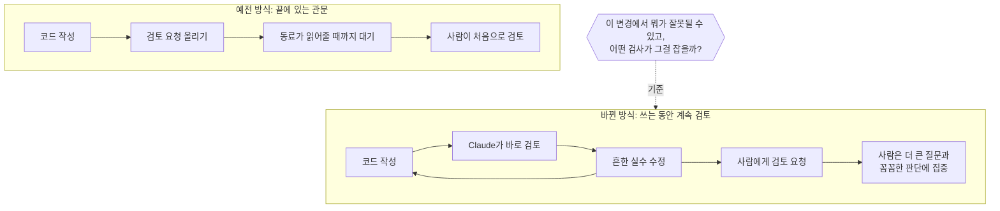

<aside class="ai-knowledge-sidebar">
  
CATEGORIES

  <nav class="ai-cat-tree">

에이전트 오케스트레이션15
<ul><li><a href="https://altjs4510.github.io/ai_news_blog/knowledge/20261015/">2026-10-15How Third Moment Research runs 10,000 agents for…</a></li><li><a href="https://altjs4510.github.io/ai_news_blog/knowledge/20261014/">2026-10-14How Anthropic's Dynamic Workflows Coordinate Cla…</a></li><li><a href="https://altjs4510.github.io/ai_news_blog/knowledge/20260930/">2026-09-30Agents you can coach: how Asana builds human-age…</a></li><li><a href="https://altjs4510.github.io/ai_news_blog/knowledge/20260831-openexecutive-virtual-c-suite/">2026-08-31Open Executive — 8명의 전문 에이전트를 하나의 임원 목소리로</a></li><li><a href="https://altjs4510.github.io/ai_news_blog/knowledge/20260828/">2026-08-28Google ADK for Python v2.8.0 — RemoteA2aAgent 네이…</a></li><li><a href="https://altjs4510.github.io/ai_news_blog/knowledge/20260826/">2026-08-26apache/maka — 도구 호출·권한 결정·종료 이벤트를 append-only 로그…</a></li><li><a href="https://altjs4510.github.io/ai_news_blog/knowledge/20260823/">2026-08-23The Evolution of the Agent Harness — 하네스가 모델 가중치…</a></li><li><a href="https://altjs4510.github.io/ai_news_blog/knowledge/20260805/">2026-08-05TencentCloud/TencentDB-Agent-Memory — 대화·문서·코드를 …</a></li><li><a href="https://altjs4510.github.io/ai_news_blog/knowledge/20260726/">2026-07-26citrolabs/ego-lite — 로그인된 브라우저 상태를 AI 에이전트와 공유하는…</a></li><li><a href="https://altjs4510.github.io/ai_news_blog/knowledge/20260717/">2026-07-17After a year building agent memory, 'save everyt…</a></li><li><a href="https://altjs4510.github.io/ai_news_blog/knowledge/20260623/">2026-06-23bytedance/deer-flow — 샌드박스·메모리·서브에이전트·메시지 게이트웨이를…</a></li><li><a href="https://altjs4510.github.io/ai_news_blog/knowledge/20260611/">2026-06-11The evolution of agentic surfaces: building with…</a></li><li><a href="https://altjs4510.github.io/ai_news_blog/knowledge/20260602/">2026-06-02revfactory/harness — 도메인별 에이전트 팀과 스킬을 자동 설계하는 메타…</a></li><li><a href="https://altjs4510.github.io/ai_news_blog/knowledge/20260529/">2026-05-29Introducing dynamic workflows in Claude Code</a></li><li><a href="https://altjs4510.github.io/ai_news_blog/knowledge/20260507/">2026-05-07ruvnet/ruflo — Claude 멀티 에이전트 오케스트레이션 플랫폼</a></li></ul>

MCP &amp; 도구 통합16
<ul><li><a href="https://altjs4510.github.io/ai_news_blog/knowledge/20261007/">2026-10-07morluto/rea — 앱 동작부터 네이티브 바이너리까지 에이전트로 리버스 엔지니어링</a></li><li><a href="https://altjs4510.github.io/ai_news_blog/knowledge/20260829/">2026-08-29cursor/plugins — 플러그인 명세(specification)와 공식 플러그인…</a></li><li><a href="https://altjs4510.github.io/ai_news_blog/knowledge/20260802/">2026-08-02Stateless MCP has recaptured my interest (and in…</a></li><li><a href="https://altjs4510.github.io/ai_news_blog/knowledge/20260731/">2026-07-31different-ai/openwork — Claude Cowork의 오픈소스 대안(o…</a></li><li><a href="https://altjs4510.github.io/ai_news_blog/knowledge/20260729/">2026-07-29Bringing MCP 2026-07-28 to Claude</a></li><li><a href="https://altjs4510.github.io/ai_news_blog/knowledge/20260718/">2026-07-18tirth8205/code-review-graph — MCP·CLI용 로컬 코드 인텔리…</a></li><li><a href="https://altjs4510.github.io/ai_news_blog/knowledge/20260708/">2026-07-08Expanding Managed Agents in Gemini API: backgrou…</a></li><li><a href="https://altjs4510.github.io/ai_news_blog/knowledge/20260618/">2026-06-18DeusData/codebase-memory-mcp — 158개 언어 코드베이스를 밀리…</a></li><li><a href="https://altjs4510.github.io/ai_news_blog/knowledge/20260609/">2026-06-09Building intelligent apps for Apple platforms wi…</a></li><li><a href="https://altjs4510.github.io/ai_news_blog/knowledge/20260604/">2026-06-04chopratejas/headroom — Compress tool outputs bef…</a></li><li><a href="https://altjs4510.github.io/ai_news_blog/knowledge/20260603/">2026-06-03How Bad MCP design cost your Agent 5× more token…</a></li><li><a href="https://altjs4510.github.io/ai_news_blog/knowledge/20260521/">2026-05-21colbymchenry/codegraph — Pre-indexed code knowle…</a></li><li><a href="https://altjs4510.github.io/ai_news_blog/knowledge/20260517/">2026-05-17I gave my LLM 100,000+ tools — Lazy Discovery &a…</a></li><li><a href="https://altjs4510.github.io/ai_news_blog/knowledge/20260512/">2026-05-12agentmemory — Persistent memory for AI coding ag…</a></li><li><a href="https://altjs4510.github.io/ai_news_blog/knowledge/20260509/">2026-05-09How to connect 100 MCP servers without the conte…</a></li><li><a href="https://altjs4510.github.io/ai_news_blog/knowledge/20260506/">2026-05-06mksglu/context-mode — AI 코딩 에이전트용 컨텍스트 윈도우 최적화</a></li></ul>

코딩 에이전트27
<ul><li><a href="https://altjs4510.github.io/ai_news_blog/knowledge/20261022/">2026-10-22Claude Mods: Flipping the Harness Inside Out</a></li><li><a href="https://altjs4510.github.io/ai_news_blog/knowledge/20261018/" class="current">2026-10-18Quoting Addy Osmani, Morgan Westlee Lunt, and Qi…</a></li><li><a href="https://altjs4510.github.io/ai_news_blog/knowledge/20261017/">2026-10-17mksglu/context-mode — 코딩 에이전트용 컨텍스트 윈도우 최적화</a></li><li><a href="https://altjs4510.github.io/ai_news_blog/knowledge/20261014-claude-code-advisor/">2026-10-14Claude Code advisor — 가벼운 메인 모델이 일하고, 갈림길에서만 Opu…</a></li><li><a href="https://altjs4510.github.io/ai_news_blog/knowledge/20260920/">2026-09-20Claude Code 2.1.277 — CLAUDE.md가 없으면 AGENTS.md를 …</a></li><li><a href="https://altjs4510.github.io/ai_news_blog/knowledge/20260912/">2026-09-12Quoting Boris Cherny — 'Claude가 쓴 프로덕션 코드는 사람이 쓴…</a></li><li><a href="https://altjs4510.github.io/ai_news_blog/knowledge/20260910/">2026-09-10vastsa/PI-Desktop — Electron + Rust 호스트 코어 + 에이전…</a></li><li><a href="https://altjs4510.github.io/ai_news_blog/knowledge/20260906/">2026-09-06DietrichGebert/ponytail — 에이전트를 '방에서 가장 게으른 시니어 …</a></li><li><a href="https://altjs4510.github.io/ai_news_blog/knowledge/20260903/">2026-09-03pacifio/atlas — 여러 코딩 에이전트의 변경을 한곳에서 추적·질의하는 '에이…</a></li><li><a href="https://altjs4510.github.io/ai_news_blog/knowledge/20260901/">2026-09-01affaan-m/ECC — 스킬·본능·메모리·보안을 묶은 에이전트 하네스 성능 최적화 …</a></li><li><a href="https://altjs4510.github.io/ai_news_blog/knowledge/20260831-gitnexus-code-knowledge-graph/">2026-08-31GitNexus — 코드베이스를 지식그래프로 바꿔 에이전트에게 쥐어주기</a></li><li><a href="https://altjs4510.github.io/ai_news_blog/knowledge/20260819/">2026-08-19akitaonrails/ai-memory — 코딩 에이전트 CLI 간 장기 기억과 벤더…</a></li><li><a href="https://altjs4510.github.io/ai_news_blog/knowledge/20260814/">2026-08-14cathrynlavery/diagram-design — Claude Code용 에디토리…</a></li><li><a href="https://altjs4510.github.io/ai_news_blog/knowledge/20260810/">2026-08-10Auto mode is now the default in Claude Code for …</a></li><li><a href="https://altjs4510.github.io/ai_news_blog/knowledge/20260808/">2026-08-08PrimeIntellect-ai/prime-agent — 코딩 워크플로우와 장시간 자율…</a></li><li><a href="https://altjs4510.github.io/ai_news_blog/knowledge/20260804/">2026-08-04esengine/DeepSeek-Reasonix — prefix-cache 안정성을 축…</a></li><li><a href="https://altjs4510.github.io/ai_news_blog/knowledge/20260728/">2026-07-28alibaba/open-code-review — 결정론적 파이프라인 + LLM 에이전트…</a></li><li><a href="https://altjs4510.github.io/ai_news_blog/knowledge/20260725/">2026-07-25The new rules of context engineering for Claude …</a></li><li><a href="https://altjs4510.github.io/ai_news_blog/knowledge/20260714/">2026-07-14Graphify-Labs/graphify — 코드베이스를 질의 가능한 지식 그래프로 만…</a></li><li><a href="https://altjs4510.github.io/ai_news_blog/knowledge/20260707/">2026-07-07AI Hero Skills Catalog — 실무 엔지니어를 위한 재사용 가능한 판단 …</a></li><li><a href="https://altjs4510.github.io/ai_news_blog/knowledge/20260705/">2026-07-05openai/codex-plugin-cc — Claude Code에서 Codex를 위임…</a></li><li><a href="https://altjs4510.github.io/ai_news_blog/knowledge/20260701/">2026-07-01Google OKF (Open Knowledge Format) — 벤더 중립 에이전트 …</a></li><li><a href="https://altjs4510.github.io/ai_news_blog/knowledge/20260626/">2026-06-26google-labs-code/design.md — 코딩 에이전트에게 디자인 시스템을 …</a></li><li><a href="https://altjs4510.github.io/ai_news_blog/knowledge/20260619/">2026-06-19Claude Code now supports artifacts</a></li><li><a href="https://altjs4510.github.io/ai_news_blog/knowledge/20260530/">2026-05-30Leonxlnx/taste-skill — AI에게 좋은 취향을 부여해 generic s…</a></li><li><a href="https://altjs4510.github.io/ai_news_blog/knowledge/20260508/">2026-05-08addyosmani/agent-skills — Production-grade engin…</a></li><li><a href="https://altjs4510.github.io/ai_news_blog/knowledge/20260505/">2026-05-05mattpocock/skills — Skills for Real Engineers (.…</a></li></ul>

모델 &amp; 연구12
<ul><li><a href="https://altjs4510.github.io/ai_news_blog/knowledge/20261009/">2026-10-09Claude Haiku 5.5 (Simon Willison의 출시 노트와 가격 분석)</a></li><li><a href="https://altjs4510.github.io/ai_news_blog/knowledge/20260929/">2026-09-29vectorize-io/hindsight — Hindsight: Agent Memory…</a></li><li><a href="https://altjs4510.github.io/ai_news_blog/knowledge/20260907-voicemem-dual-brain-memory/">2026-09-07VoiceMem — 좌뇌·우뇌로 쪼갠 스트리밍 메모리로 음성 에이전트 지연 없애기</a></li><li><a href="https://altjs4510.github.io/ai_news_blog/knowledge/20260904/">2026-09-04HarnessDev: Can LLMs Create and Evolve Their Own…</a></li><li><a href="https://altjs4510.github.io/ai_news_blog/knowledge/20260821/">2026-08-21volcengine/OpenViking — 에이전트 메모리·Knowledge RAG·스…</a></li><li><a href="https://altjs4510.github.io/ai_news_blog/knowledge/20260716-proprag/">2026-07-16PropRAG — 프로포지션 경로 위 beam search로 멀티홉 검색 안내</a></li><li><a href="https://altjs4510.github.io/ai_news_blog/knowledge/20260712/">2026-07-12Do Automated Evals Work?</a></li><li><a href="https://altjs4510.github.io/ai_news_blog/knowledge/20260620/">2026-06-20zai-org/GLM-5 — From Vibe Coding to Agentic Engi…</a></li><li><a href="https://altjs4510.github.io/ai_news_blog/knowledge/20260617/">2026-06-17Predicting model behavior before release by simu…</a></li><li><a href="https://altjs4510.github.io/ai_news_blog/knowledge/20260610/">2026-06-10Fable 5 just made cost-aware model routing manda…</a></li><li><a href="https://altjs4510.github.io/ai_news_blog/knowledge/20260516/">2026-05-16STALE — 에이전트가 자기 기억의 유효성을 인지할 수 있는가</a></li><li><a href="https://altjs4510.github.io/ai_news_blog/knowledge/20260513/">2026-05-13Thinking Machines' Native Interaction Models — T…</a></li></ul>

인프라 &amp; 컴퓨트6
<ul><li><a href="https://altjs4510.github.io/ai_news_blog/knowledge/20260905/">2026-09-05magnitudedev/magnitude — 하드웨어에 맞는 최적 로컬 모델을 띄워 이…</a></li><li><a href="https://altjs4510.github.io/ai_news_blog/knowledge/20260812/">2026-08-12semantica-agi/semantica — 컨텍스트와 '책임 추적 가능한(accou…</a></li><li><a href="https://altjs4510.github.io/ai_news_blog/knowledge/20260806/">2026-08-06cloudflare/computer — 에이전트에게 컴퓨터를 통째로 주는 엣지 실행 샌…</a></li><li><a href="https://altjs4510.github.io/ai_news_blog/knowledge/20260723/">2026-07-23diegosouzapw/OmniRoute — 268+ 프로바이더를 단일 엔드포인트로 묶…</a></li><li><a href="https://altjs4510.github.io/ai_news_blog/knowledge/20260522/">2026-05-22Giving Agents Computers — Ivan Burazin, Daytona</a></li><li><a href="https://altjs4510.github.io/ai_news_blog/knowledge/20260520/">2026-05-20New in Claude Managed Agents: self-hosted sandbo…</a></li></ul>

보안 &amp; 거버넌스23
<ul><li><a href="https://altjs4510.github.io/ai_news_blog/knowledge/20261021/">2026-10-21cloudflare/security-audit-skill — 독립 검증된 기계 판독형 …</a></li><li><a href="https://altjs4510.github.io/ai_news_blog/knowledge/20261020/">2026-10-20Satya Nadella — 모델을 내부자 위험으로 보는 원칙에 따라 Project P…</a></li><li><a href="https://altjs4510.github.io/ai_news_blog/knowledge/20261016/">2026-10-16Crossing the Threshold: How OpenAI and Anthropic…</a></li><li><a href="https://altjs4510.github.io/ai_news_blog/knowledge/20261011/">2026-10-11Anthropic can’t reliably control its AI agents. …</a></li><li><a href="https://altjs4510.github.io/ai_news_blog/knowledge/20261004/">2026-10-04Apple says it's tightening macOS 'Full Disk Acce…</a></li><li><a href="https://altjs4510.github.io/ai_news_blog/knowledge/20261001/">2026-10-01NVIDIA/OpenShell</a></li><li><a href="https://altjs4510.github.io/ai_news_blog/knowledge/20260919/">2026-09-19cloudflare/security-audit-skill — 다단계 보안 감사를 '독립…</a></li><li><a href="https://altjs4510.github.io/ai_news_blog/knowledge/20260913/">2026-09-13OpenAI agents attacked RubyGems back in May: Ope…</a></li><li><a href="https://altjs4510.github.io/ai_news_blog/knowledge/20260902/">2026-09-02AIR raises $50M to help companies vet the skills…</a></li><li><a href="https://altjs4510.github.io/ai_news_blog/knowledge/20260827/">2026-08-27Claude in Chrome is generally available</a></li><li><a href="https://altjs4510.github.io/ai_news_blog/knowledge/20260819-mind-viruses/">2026-08-19탈옥도, 인젝션도 없이 — 대화로만 퍼지는 에이전트의 '마인드 바이러스'</a></li><li><a href="https://altjs4510.github.io/ai_news_blog/knowledge/20260730/">2026-07-30Anatomy of a Frontier Lab Agent Intrusion: A Tec…</a></li><li><a href="https://altjs4510.github.io/ai_news_blog/knowledge/20260715/">2026-07-15Dicklesworthstone/destructive_command_guard — 에이…</a></li><li><a href="https://altjs4510.github.io/ai_news_blog/knowledge/20260710/">2026-07-1070개 MCP 서버 strace 런타임 감사 — 부팅 시 아웃바운드 호출 서버 적발</a></li><li><a href="https://altjs4510.github.io/ai_news_blog/knowledge/20260704/">2026-07-04Cloudflare is about to block AI agents by defaul…</a></li><li><a href="https://altjs4510.github.io/ai_news_blog/knowledge/20260703/">2026-07-03Giving admins more visibility and control over C…</a></li><li><a href="https://altjs4510.github.io/ai_news_blog/knowledge/20260630/">2026-06-30Introducing the Claude apps gateway for Amazon B…</a></li><li><a href="https://altjs4510.github.io/ai_news_blog/knowledge/20260624/">2026-06-24Agent identity in Claude Tag: a new access model…</a></li><li><a href="https://altjs4510.github.io/ai_news_blog/knowledge/20260613/">2026-06-13Fable 5's guardrails got bypassed in 48 hours — …</a></li><li><a href="https://altjs4510.github.io/ai_news_blog/knowledge/20260612/">2026-06-12NVIDIA/SkillSpector — AI 에이전트 스킬용 보안 스캐너</a></li><li><a href="https://altjs4510.github.io/ai_news_blog/knowledge/20260607/">2026-06-07OpenAI Help: Lockdown Mode</a></li><li><a href="https://altjs4510.github.io/ai_news_blog/knowledge/20260531/">2026-05-31How we contain Claude across products</a></li><li><a href="https://altjs4510.github.io/ai_news_blog/knowledge/20260527/">2026-05-27Microsoft Copilot Cowork Exfiltrates Files</a></li></ul>

응용 사례7
<ul><li><a href="https://altjs4510.github.io/ai_news_blog/knowledge/20261006/">2026-10-06How Cresta turned CX expertise into an agent bui…</a></li><li><a href="https://altjs4510.github.io/ai_news_blog/knowledge/20260909/">2026-09-09Reducing cost and improving performance with Cla…</a></li><li><a href="https://altjs4510.github.io/ai_news_blog/knowledge/20260709/">2026-07-09mvanhorn/last30days-skill — Reddit·X·YouTube·HN·…</a></li><li><a href="https://altjs4510.github.io/ai_news_blog/knowledge/20260621/">2026-06-21calesthio/OpenMontage — 12 파이프라인·52 도구·500+ 스킬을 …</a></li><li><a href="https://altjs4510.github.io/ai_news_blog/knowledge/20260528/">2026-05-28Building self-improving tax agents with Codex</a></li><li><a href="https://altjs4510.github.io/ai_news_blog/knowledge/20260515/">2026-05-15Clawdmeter — Claude Code 사용량을 데스크톱 대시보드로</a></li><li><a href="https://altjs4510.github.io/ai_news_blog/knowledge/20260514/">2026-05-14Introducing Claude for Small Business</a></li></ul>

산업 동향8
<ul><li><a href="https://altjs4510.github.io/ai_news_blog/knowledge/20260911/">2026-09-11Now everyone can put data to work — ChatGPT Work…</a></li><li><a href="https://altjs4510.github.io/ai_news_blog/knowledge/20260907-humanmade-52week-rhythm/">2026-09-07휴먼 메이드의 '52주 리듬' — 아이디어가 흔해진 시대에 값이 오르는 건 버리는 판단</a></li><li><a href="https://altjs4510.github.io/ai_news_blog/knowledge/20260830/">2026-08-30[AINews] OpenAI shuts off Cursor — 프론티어 모델 공급 차단…</a></li><li><a href="https://altjs4510.github.io/ai_news_blog/knowledge/20260711/">2026-07-11OpenAI says GPT 5.6 is the 'preferred model' for…</a></li><li><a href="https://altjs4510.github.io/ai_news_blog/knowledge/20260702/">2026-07-02How Cursor deploys AI inside the enterprise (For…</a></li><li><a href="https://altjs4510.github.io/ai_news_blog/knowledge/20260616/">2026-06-16Why AI hasn't replaced software engineers, and w…</a></li><li><a href="https://altjs4510.github.io/ai_news_blog/knowledge/20260519/">2026-05-19Anthropic acquires Stainless</a></li><li><a href="https://altjs4510.github.io/ai_news_blog/knowledge/20260504/">2026-05-04Agents for Everything Else: Codex for Knowledge …</a></li></ul>
</nav>
</aside>

<article class="ai-knowledge-article">

<header class="ai-post-hero">
  
<a class="ai-back" href="../">KNOWLEDGE</a> · 2026-10-18 · 오늘의 학습

  <h2 class="ai-post-title">Quoting Addy Osmani, Morgan Westlee Lunt, and Qing Wang (코드 리뷰 재정의)</h2>
</header>

> 원문: [Quoting Addy Osmani, Morgan Westlee Lunt, and Qing Wang (코드 리뷰 재정의)](https://simonwillison.net/2026/Oct/16/code-review/)

## 📌 학습 정리

### 1. 한 줄로 말하면

"사람이 코드를 한 번 읽었느냐"를 따지기보다 "이 변경에서 뭐가 잘못될 수 있고, 그걸 잡기에 맞는 검사는 무엇이냐"를 따지자는 이야기예요. 그렇게 보면 검토는 마지막에 한 번 통과하는 관문이 아니게 돼요. 글을 쓰는 동안 계속 돌아가는 맞춤법 검사처럼 바뀌어요.

### 2. 왜 이게 만들어졌어요?

원래 코드 검토(code review)는 길 끝에 있는 관문이었어요. 코드를 다 쓰고, 동료에게 "이거 합쳐도 될까요?" 하고 검토 요청(PR, pull request)을 올린 다음, 동료가 읽어줄 때까지 기다리는 식이었죠. 이 방식은 "사람이 읽었다"는 사실을 안전하다는 표시로 여겨요. 그런데 글쓴이들은 그게 정확한 기준이 아니라고 봐요. 사람이 읽었다고 해서 정말 위험한 부분을 제대로 걸러냈다는 보장은 없으니까요. 그래서 질문을 바꿨고, 질문이 바뀌자 검토가 *언제* 일어나는지도 함께 바뀌었다고 해요.

### 3. 비유로 풀면

이건 마치 **보고서를 다 쓰고 나서 팀장님께 한 번 검사받던 방식에서, 쓰는 동안 맞춤법 검사기가 빨간 줄을 계속 그어주는 방식으로 바뀐 것** 같아요. 오타나 띄어쓰기 같은 자잘한 실수는 쓰는 동안 이미 다 고쳐져 있어요. 그래서 팀장님은 "이 결론이 맞나?", "방향이 괜찮나?" 같은 큰 질문에만 시간을 쓸 수 있어요.

공항 보안 검색으로 생각해 볼 수도 있어요. 모든 가방을 사람이 하나하나 열어보지 않잖아요. 엑스레이 기계가 대부분을 거르고, 사람은 기계가 표시한 가방이나 판단이 필요한 상황에 집중해요. 중요한 건 "사람이 봤냐"가 아니라 "어떤 위험을 어떤 검사가 잡느냐"예요.

그래서 결국, 반복되는 흔한 실수는 자동 검사가 먼저 걸러내요. 사람의 주의력은 더 높은 수준의 질문과 꼼꼼한 판단에 아껴 쓰자는 거예요.

### 4. 어떻게 작동하는지 (그림으로)

예전에는 코드를 다 쓴 뒤에야 사람이 처음 들여다봤어요. 바뀐 방식에서는 쓰는 동안 Claude(Anthropic이 만든 AI 모델)가 계속 검토하고, 고치는 과정이 반복돼요. 원문에 따르면 대부분의 변경은 사람에게 가기 전에 Claude가 최소 한 번은 검토하고 고쳐둔 상태예요. 이렇게 하면 흔한 실수는 대부분 미리 걸러지고, 팀의 주의력은 더 높은 수준의 질문과 꼼꼼한 검토에 쓸 수 있다고 해요.

### 5. 처음 보는 용어 풀이

- **코드 검토 (code review)** — 누군가 쓴 코드를 실제로 합치기 전에 다른 사람이나 도구가 살펴보는 과정이에요. 실수나 위험을 미리 잡는 게 목적이에요.
- **검토 요청 (PR, pull request)** — "제가 이렇게 바꿨는데 합쳐도 될까요?" 하고 동료에게 보내는 요청이에요. 보통 이 단계에서 사람의 검토가 이뤄져요.
- **대리 지표 (proxy)** — 진짜 알고 싶은 걸 직접 재기 어려울 때 대신 쓰는 기준이에요. 이 글에서는 "사람이 읽었다"가 "이 변경이 안전하다"의 대리 지표로 쓰여 왔는데, 그게 부정확하다고 말해요.
- **자동 검사 (automated check)** — 사람이 아니라 프로그램이 정해진 방식으로 코드를 확인하는 거예요. 반복적이고 흔한 실수를 빠르게 잡는 데 강해요.
- **관문 (gate)** — 통과해야 다음 단계로 갈 수 있는 지점이에요. 예전 코드 검토는 맨 끝에 한 번 있는 관문 역할을 했어요.
- **맞춤법 검사 (spellcheck)** — 글을 쓰는 동안 틀린 부분을 바로바로 표시해주는 기능이에요. 원문은 바뀐 검토 방식을 이것에 빗대어 설명해요.
- **Claude Code** — Anthropic이 만든 코딩용 AI 도구예요. 이 글은 이 도구를 만드는 팀이 코드 검토를 어떻게 하는지 소개한 글에서 인용됐어요.

### 6. 한 발 더 들어가고 싶다면

- [How the Claude Code team does code review](https://claude.dev/blog/solving-code-review-at-anthropic/) — 인용문의 원래 출처인 글이에요. 이걸 보면 Claude Code 팀이 "어떤 검사가 무엇을 잡을지"를 기준으로 검토 흐름을 실제로 어떻게 짰는지 더 자세히 알 수 있어요.

---

## 📖 원문 전체 번역 (정독용)

> 의역 최소화한 전체 번역입니다. 큰 흐름은 위 정리에서 잡고, 정확한 워딩이 필요할 땐 이 섹션에서 정독하세요.

2026년 10월 16일

> 우리는 "사람이 코드를 읽었는가?"가 "이 변경에서 무엇이 잘못될 수 있으며, 그것을 잡아내기에 적합한 검사는 (자동이든 사람이든) 무엇인가?"를 나타내기에는 부정확한 대용물(proxy)이라고 생각합니다.
>
>
> 이 질문을 던지자 리뷰가 이루어지는 _시점_ 도 달라졌습니다. 예전에 리뷰는 길 끝에 놓인 관문(gate)이었습니다. 코드를 쓰고, PR을 열고, 동료를 기다리는 방식이었죠.
>
>
> 이제 리뷰는 글을 쓰는 동안 돌아가는 맞춤법 검사처럼 계속 실행됩니다. 대부분의 변경은 사람에게 확인을 요청하기 전에 Claude가 최소 한 번은 리뷰하고 수정합니다. 이렇게 하면 대부분의 일상적인 실수를 잡아내고, 팀의 주의력은 더 높은 수준의 질문과 면밀한 검토에 아껴 둘 수 있습니다.

— [Addy Osmani, Morgan Westlee Lunt, Qing Wang](https://claude.dev/blog/solving-code-review-at-anthropic/), How the Claude Code team does code review

</article>

<!-- ai-related-links -->
<aside class="ai-related-links">
  
관련 학습

  <ul><li><a href="https://altjs4510.github.io/ai_news_blog/knowledge/20260728/">2026-07-28alibaba/open-code-review — 결정론적 파이프라인 + LLM 에이전트…</a></li><li><a href="https://altjs4510.github.io/ai_news_blog/knowledge/20260616/">2026-06-16Why AI hasn't replaced software engineers, and w…</a></li><li><a href="https://altjs4510.github.io/ai_news_blog/knowledge/20260712/">2026-07-12Do Automated Evals Work?</a></li></ul>
</aside>
<!-- /ai-related-links -->
