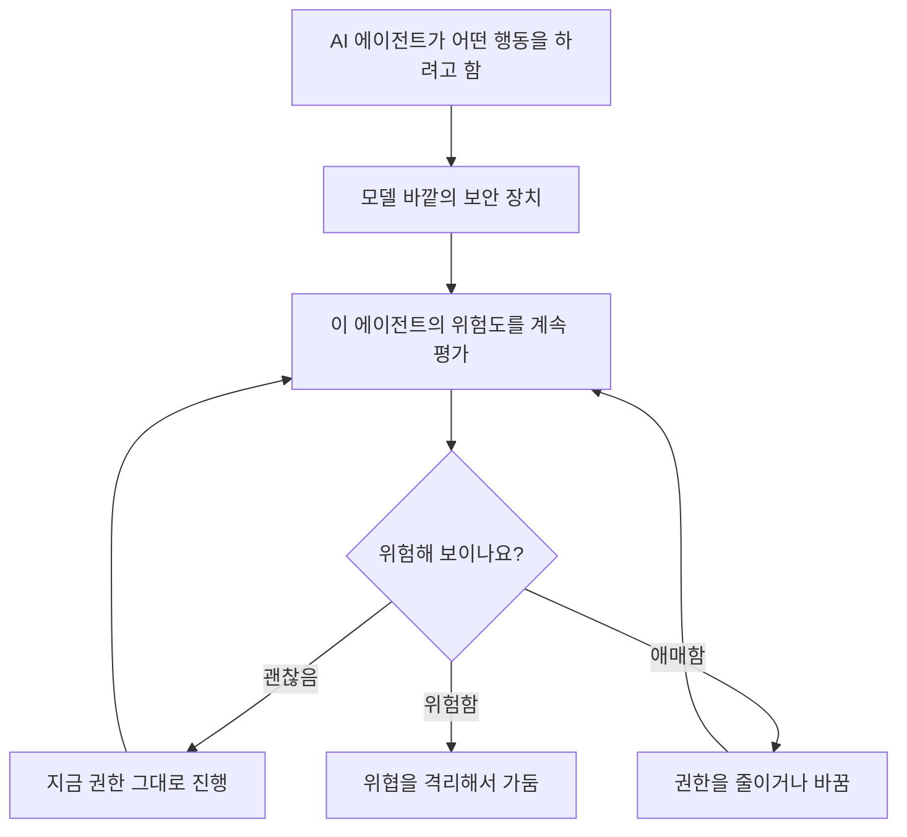

<aside class="ai-knowledge-sidebar">
  
CATEGORIES

  <nav class="ai-cat-tree">

에이전트 오케스트레이션17
<ul><li><a href="https://altjs4510.github.io/ai_news_blog/knowledge/20261015/">2026-10-15How Third Moment Research runs 10,000 agents for…</a></li><li><a href="https://altjs4510.github.io/ai_news_blog/knowledge/20261014/">2026-10-14How Anthropic's Dynamic Workflows Coordinate Cla…</a></li><li><a href="https://altjs4510.github.io/ai_news_blog/knowledge/20260930/">2026-09-30Agents you can coach: how Asana builds human-age…</a></li><li><a href="https://altjs4510.github.io/ai_news_blog/knowledge/20260929/">2026-09-29vectorize-io/hindsight — Hindsight: Agent Memory…</a></li><li><a href="https://altjs4510.github.io/ai_news_blog/knowledge/20260831-openexecutive-virtual-c-suite/">2026-08-31Open Executive — 8명의 전문 에이전트를 하나의 임원 목소리로</a></li><li><a href="https://altjs4510.github.io/ai_news_blog/knowledge/20260828/">2026-08-28Google ADK for Python v2.8.0 — RemoteA2aAgent 네이…</a></li><li><a href="https://altjs4510.github.io/ai_news_blog/knowledge/20260826/">2026-08-26apache/maka — 도구 호출·권한 결정·종료 이벤트를 append-only 로그…</a></li><li><a href="https://altjs4510.github.io/ai_news_blog/knowledge/20260823/">2026-08-23The Evolution of the Agent Harness — 하네스가 모델 가중치…</a></li><li><a href="https://altjs4510.github.io/ai_news_blog/knowledge/20260821/">2026-08-21volcengine/OpenViking — 에이전트 메모리·Knowledge RAG·스…</a></li><li><a href="https://altjs4510.github.io/ai_news_blog/knowledge/20260805/">2026-08-05TencentCloud/TencentDB-Agent-Memory — 대화·문서·코드를 …</a></li><li><a href="https://altjs4510.github.io/ai_news_blog/knowledge/20260708/">2026-07-08Expanding Managed Agents in Gemini API: backgrou…</a></li><li><a href="https://altjs4510.github.io/ai_news_blog/knowledge/20260701/">2026-07-01Google OKF (Open Knowledge Format) — 벤더 중립 에이전트 …</a></li><li><a href="https://altjs4510.github.io/ai_news_blog/knowledge/20260623/">2026-06-23bytedance/deer-flow — 샌드박스·메모리·서브에이전트·메시지 게이트웨이를…</a></li><li><a href="https://altjs4510.github.io/ai_news_blog/knowledge/20260611/">2026-06-11The evolution of agentic surfaces: building with…</a></li><li><a href="https://altjs4510.github.io/ai_news_blog/knowledge/20260602/">2026-06-02revfactory/harness — 도메인별 에이전트 팀과 스킬을 자동 설계하는 메타…</a></li><li><a href="https://altjs4510.github.io/ai_news_blog/knowledge/20260529/">2026-05-29Introducing dynamic workflows in Claude Code</a></li><li><a href="https://altjs4510.github.io/ai_news_blog/knowledge/20260507/">2026-05-07ruvnet/ruflo — Claude 멀티 에이전트 오케스트레이션 플랫폼</a></li></ul>

MCP &amp; 도구 통합15
<ul><li><a href="https://altjs4510.github.io/ai_news_blog/knowledge/20261017/">2026-10-17mksglu/context-mode — 코딩 에이전트용 컨텍스트 윈도우 최적화</a></li><li><a href="https://altjs4510.github.io/ai_news_blog/knowledge/20261007/">2026-10-07morluto/rea — 앱 동작부터 네이티브 바이너리까지 에이전트로 리버스 엔지니어링</a></li><li><a href="https://altjs4510.github.io/ai_news_blog/knowledge/20260802/">2026-08-02Stateless MCP has recaptured my interest (and in…</a></li><li><a href="https://altjs4510.github.io/ai_news_blog/knowledge/20260731/">2026-07-31different-ai/openwork — Claude Cowork의 오픈소스 대안(o…</a></li><li><a href="https://altjs4510.github.io/ai_news_blog/knowledge/20260729/">2026-07-29Bringing MCP 2026-07-28 to Claude</a></li><li><a href="https://altjs4510.github.io/ai_news_blog/knowledge/20260726/">2026-07-26citrolabs/ego-lite — 로그인된 브라우저 상태를 AI 에이전트와 공유하는…</a></li><li><a href="https://altjs4510.github.io/ai_news_blog/knowledge/20260718/">2026-07-18tirth8205/code-review-graph — MCP·CLI용 로컬 코드 인텔리…</a></li><li><a href="https://altjs4510.github.io/ai_news_blog/knowledge/20260618/">2026-06-18DeusData/codebase-memory-mcp — 158개 언어 코드베이스를 밀리…</a></li><li><a href="https://altjs4510.github.io/ai_news_blog/knowledge/20260604/">2026-06-04chopratejas/headroom — Compress tool outputs bef…</a></li><li><a href="https://altjs4510.github.io/ai_news_blog/knowledge/20260603/">2026-06-03How Bad MCP design cost your Agent 5× more token…</a></li><li><a href="https://altjs4510.github.io/ai_news_blog/knowledge/20260521/">2026-05-21colbymchenry/codegraph — Pre-indexed code knowle…</a></li><li><a href="https://altjs4510.github.io/ai_news_blog/knowledge/20260517/">2026-05-17I gave my LLM 100,000+ tools — Lazy Discovery &a…</a></li><li><a href="https://altjs4510.github.io/ai_news_blog/knowledge/20260512/">2026-05-12agentmemory — Persistent memory for AI coding ag…</a></li><li><a href="https://altjs4510.github.io/ai_news_blog/knowledge/20260509/">2026-05-09How to connect 100 MCP servers without the conte…</a></li><li><a href="https://altjs4510.github.io/ai_news_blog/knowledge/20260506/">2026-05-06mksglu/context-mode — AI 코딩 에이전트용 컨텍스트 윈도우 최적화</a></li></ul>

코딩 에이전트27
<ul><li><a href="https://altjs4510.github.io/ai_news_blog/knowledge/20261022/">2026-10-22Claude Mods: Flipping the Harness Inside Out</a></li><li><a href="https://altjs4510.github.io/ai_news_blog/knowledge/20261018/">2026-10-18Quoting Addy Osmani, Morgan Westlee Lunt, and Qi…</a></li><li><a href="https://altjs4510.github.io/ai_news_blog/knowledge/20261014-claude-code-advisor/">2026-10-14Claude Code advisor — 가벼운 메인 모델이 일하고, 갈림길에서만 Opu…</a></li><li><a href="https://altjs4510.github.io/ai_news_blog/knowledge/20260920/">2026-09-20Claude Code 2.1.277 — CLAUDE.md가 없으면 AGENTS.md를 …</a></li><li><a href="https://altjs4510.github.io/ai_news_blog/knowledge/20260912/">2026-09-12Quoting Boris Cherny — 'Claude가 쓴 프로덕션 코드는 사람이 쓴…</a></li><li><a href="https://altjs4510.github.io/ai_news_blog/knowledge/20260910/">2026-09-10vastsa/PI-Desktop — Electron + Rust 호스트 코어 + 에이전…</a></li><li><a href="https://altjs4510.github.io/ai_news_blog/knowledge/20260906/">2026-09-06DietrichGebert/ponytail — 에이전트를 '방에서 가장 게으른 시니어 …</a></li><li><a href="https://altjs4510.github.io/ai_news_blog/knowledge/20260903/">2026-09-03pacifio/atlas — 여러 코딩 에이전트의 변경을 한곳에서 추적·질의하는 '에이…</a></li><li><a href="https://altjs4510.github.io/ai_news_blog/knowledge/20260901/">2026-09-01affaan-m/ECC — 스킬·본능·메모리·보안을 묶은 에이전트 하네스 성능 최적화 …</a></li><li><a href="https://altjs4510.github.io/ai_news_blog/knowledge/20260831-gitnexus-code-knowledge-graph/">2026-08-31GitNexus — 코드베이스를 지식그래프로 바꿔 에이전트에게 쥐어주기</a></li><li><a href="https://altjs4510.github.io/ai_news_blog/knowledge/20260829/">2026-08-29cursor/plugins — 플러그인 명세(specification)와 공식 플러그인…</a></li><li><a href="https://altjs4510.github.io/ai_news_blog/knowledge/20260819/">2026-08-19akitaonrails/ai-memory — 코딩 에이전트 CLI 간 장기 기억과 벤더…</a></li><li><a href="https://altjs4510.github.io/ai_news_blog/knowledge/20260814/">2026-08-14cathrynlavery/diagram-design — Claude Code용 에디토리…</a></li><li><a href="https://altjs4510.github.io/ai_news_blog/knowledge/20260810/">2026-08-10Auto mode is now the default in Claude Code for …</a></li><li><a href="https://altjs4510.github.io/ai_news_blog/knowledge/20260808/">2026-08-08PrimeIntellect-ai/prime-agent — 코딩 워크플로우와 장시간 자율…</a></li><li><a href="https://altjs4510.github.io/ai_news_blog/knowledge/20260804/">2026-08-04esengine/DeepSeek-Reasonix — prefix-cache 안정성을 축…</a></li><li><a href="https://altjs4510.github.io/ai_news_blog/knowledge/20260728/">2026-07-28alibaba/open-code-review — 결정론적 파이프라인 + LLM 에이전트…</a></li><li><a href="https://altjs4510.github.io/ai_news_blog/knowledge/20260725/">2026-07-25The new rules of context engineering for Claude …</a></li><li><a href="https://altjs4510.github.io/ai_news_blog/knowledge/20260714/">2026-07-14Graphify-Labs/graphify — 코드베이스를 질의 가능한 지식 그래프로 만…</a></li><li><a href="https://altjs4510.github.io/ai_news_blog/knowledge/20260707/">2026-07-07AI Hero Skills Catalog — 실무 엔지니어를 위한 재사용 가능한 판단 …</a></li><li><a href="https://altjs4510.github.io/ai_news_blog/knowledge/20260705/">2026-07-05openai/codex-plugin-cc — Claude Code에서 Codex를 위임…</a></li><li><a href="https://altjs4510.github.io/ai_news_blog/knowledge/20260626/">2026-06-26google-labs-code/design.md — 코딩 에이전트에게 디자인 시스템을 …</a></li><li><a href="https://altjs4510.github.io/ai_news_blog/knowledge/20260619/">2026-06-19Claude Code now supports artifacts</a></li><li><a href="https://altjs4510.github.io/ai_news_blog/knowledge/20260530/">2026-05-30Leonxlnx/taste-skill — AI에게 좋은 취향을 부여해 generic s…</a></li><li><a href="https://altjs4510.github.io/ai_news_blog/knowledge/20260528/">2026-05-28Building self-improving tax agents with Codex</a></li><li><a href="https://altjs4510.github.io/ai_news_blog/knowledge/20260508/">2026-05-08addyosmani/agent-skills — Production-grade engin…</a></li><li><a href="https://altjs4510.github.io/ai_news_blog/knowledge/20260505/">2026-05-05mattpocock/skills — Skills for Real Engineers (.…</a></li></ul>

모델 &amp; 연구11
<ul><li><a href="https://altjs4510.github.io/ai_news_blog/knowledge/20261009/">2026-10-09Claude Haiku 5.5 (Simon Willison의 출시 노트와 가격 분석)</a></li><li><a href="https://altjs4510.github.io/ai_news_blog/knowledge/20260907-voicemem-dual-brain-memory/">2026-09-07VoiceMem — 좌뇌·우뇌로 쪼갠 스트리밍 메모리로 음성 에이전트 지연 없애기</a></li><li><a href="https://altjs4510.github.io/ai_news_blog/knowledge/20260904/">2026-09-04HarnessDev: Can LLMs Create and Evolve Their Own…</a></li><li><a href="https://altjs4510.github.io/ai_news_blog/knowledge/20260717/">2026-07-17After a year building agent memory, 'save everyt…</a></li><li><a href="https://altjs4510.github.io/ai_news_blog/knowledge/20260716-proprag/">2026-07-16PropRAG — 프로포지션 경로 위 beam search로 멀티홉 검색 안내</a></li><li><a href="https://altjs4510.github.io/ai_news_blog/knowledge/20260712/">2026-07-12Do Automated Evals Work?</a></li><li><a href="https://altjs4510.github.io/ai_news_blog/knowledge/20260620/">2026-06-20zai-org/GLM-5 — From Vibe Coding to Agentic Engi…</a></li><li><a href="https://altjs4510.github.io/ai_news_blog/knowledge/20260617/">2026-06-17Predicting model behavior before release by simu…</a></li><li><a href="https://altjs4510.github.io/ai_news_blog/knowledge/20260610/">2026-06-10Fable 5 just made cost-aware model routing manda…</a></li><li><a href="https://altjs4510.github.io/ai_news_blog/knowledge/20260516/">2026-05-16STALE — 에이전트가 자기 기억의 유효성을 인지할 수 있는가</a></li><li><a href="https://altjs4510.github.io/ai_news_blog/knowledge/20260513/">2026-05-13Thinking Machines' Native Interaction Models — T…</a></li></ul>

인프라 &amp; 컴퓨트5
<ul><li><a href="https://altjs4510.github.io/ai_news_blog/knowledge/20260905/">2026-09-05magnitudedev/magnitude — 하드웨어에 맞는 최적 로컬 모델을 띄워 이…</a></li><li><a href="https://altjs4510.github.io/ai_news_blog/knowledge/20260806/">2026-08-06cloudflare/computer — 에이전트에게 컴퓨터를 통째로 주는 엣지 실행 샌…</a></li><li><a href="https://altjs4510.github.io/ai_news_blog/knowledge/20260723/">2026-07-23diegosouzapw/OmniRoute — 268+ 프로바이더를 단일 엔드포인트로 묶…</a></li><li><a href="https://altjs4510.github.io/ai_news_blog/knowledge/20260522/">2026-05-22Giving Agents Computers — Ivan Burazin, Daytona</a></li><li><a href="https://altjs4510.github.io/ai_news_blog/knowledge/20260520/">2026-05-20New in Claude Managed Agents: self-hosted sandbo…</a></li></ul>

보안 &amp; 거버넌스24
<ul><li><a href="https://altjs4510.github.io/ai_news_blog/knowledge/20261021/">2026-10-21cloudflare/security-audit-skill — 독립 검증된 기계 판독형 …</a></li><li><a href="https://altjs4510.github.io/ai_news_blog/knowledge/20261020/" class="current">2026-10-20Satya Nadella — 모델을 내부자 위험으로 보는 원칙에 따라 Project P…</a></li><li><a href="https://altjs4510.github.io/ai_news_blog/knowledge/20261016/">2026-10-16Crossing the Threshold: How OpenAI and Anthropic…</a></li><li><a href="https://altjs4510.github.io/ai_news_blog/knowledge/20261011/">2026-10-11Anthropic can’t reliably control its AI agents. …</a></li><li><a href="https://altjs4510.github.io/ai_news_blog/knowledge/20261004/">2026-10-04Apple says it's tightening macOS 'Full Disk Acce…</a></li><li><a href="https://altjs4510.github.io/ai_news_blog/knowledge/20261001/">2026-10-01NVIDIA/OpenShell</a></li><li><a href="https://altjs4510.github.io/ai_news_blog/knowledge/20260919/">2026-09-19cloudflare/security-audit-skill — 다단계 보안 감사를 '독립…</a></li><li><a href="https://altjs4510.github.io/ai_news_blog/knowledge/20260913/">2026-09-13OpenAI agents attacked RubyGems back in May: Ope…</a></li><li><a href="https://altjs4510.github.io/ai_news_blog/knowledge/20260902/">2026-09-02AIR raises $50M to help companies vet the skills…</a></li><li><a href="https://altjs4510.github.io/ai_news_blog/knowledge/20260827/">2026-08-27Claude in Chrome is generally available</a></li><li><a href="https://altjs4510.github.io/ai_news_blog/knowledge/20260819-mind-viruses/">2026-08-19탈옥도, 인젝션도 없이 — 대화로만 퍼지는 에이전트의 '마인드 바이러스'</a></li><li><a href="https://altjs4510.github.io/ai_news_blog/knowledge/20260812/">2026-08-12semantica-agi/semantica — 컨텍스트와 '책임 추적 가능한(accou…</a></li><li><a href="https://altjs4510.github.io/ai_news_blog/knowledge/20260730/">2026-07-30Anatomy of a Frontier Lab Agent Intrusion: A Tec…</a></li><li><a href="https://altjs4510.github.io/ai_news_blog/knowledge/20260715/">2026-07-15Dicklesworthstone/destructive_command_guard — 에이…</a></li><li><a href="https://altjs4510.github.io/ai_news_blog/knowledge/20260710/">2026-07-1070개 MCP 서버 strace 런타임 감사 — 부팅 시 아웃바운드 호출 서버 적발</a></li><li><a href="https://altjs4510.github.io/ai_news_blog/knowledge/20260704/">2026-07-04Cloudflare is about to block AI agents by defaul…</a></li><li><a href="https://altjs4510.github.io/ai_news_blog/knowledge/20260703/">2026-07-03Giving admins more visibility and control over C…</a></li><li><a href="https://altjs4510.github.io/ai_news_blog/knowledge/20260630/">2026-06-30Introducing the Claude apps gateway for Amazon B…</a></li><li><a href="https://altjs4510.github.io/ai_news_blog/knowledge/20260624/">2026-06-24Agent identity in Claude Tag: a new access model…</a></li><li><a href="https://altjs4510.github.io/ai_news_blog/knowledge/20260613/">2026-06-13Fable 5's guardrails got bypassed in 48 hours — …</a></li><li><a href="https://altjs4510.github.io/ai_news_blog/knowledge/20260612/">2026-06-12NVIDIA/SkillSpector — AI 에이전트 스킬용 보안 스캐너</a></li><li><a href="https://altjs4510.github.io/ai_news_blog/knowledge/20260607/">2026-06-07OpenAI Help: Lockdown Mode</a></li><li><a href="https://altjs4510.github.io/ai_news_blog/knowledge/20260531/">2026-05-31How we contain Claude across products</a></li><li><a href="https://altjs4510.github.io/ai_news_blog/knowledge/20260527/">2026-05-27Microsoft Copilot Cowork Exfiltrates Files</a></li></ul>

응용 사례9
<ul><li><a href="https://altjs4510.github.io/ai_news_blog/knowledge/20261023/">2026-10-23Claude Duet app is Anthropic's bet on agents</a></li><li><a href="https://altjs4510.github.io/ai_news_blog/knowledge/20261006/">2026-10-06How Cresta turned CX expertise into an agent bui…</a></li><li><a href="https://altjs4510.github.io/ai_news_blog/knowledge/20260911/">2026-09-11Now everyone can put data to work — ChatGPT Work…</a></li><li><a href="https://altjs4510.github.io/ai_news_blog/knowledge/20260909/">2026-09-09Reducing cost and improving performance with Cla…</a></li><li><a href="https://altjs4510.github.io/ai_news_blog/knowledge/20260709/">2026-07-09mvanhorn/last30days-skill — Reddit·X·YouTube·HN·…</a></li><li><a href="https://altjs4510.github.io/ai_news_blog/knowledge/20260621/">2026-06-21calesthio/OpenMontage — 12 파이프라인·52 도구·500+ 스킬을 …</a></li><li><a href="https://altjs4510.github.io/ai_news_blog/knowledge/20260609/">2026-06-09Building intelligent apps for Apple platforms wi…</a></li><li><a href="https://altjs4510.github.io/ai_news_blog/knowledge/20260515/">2026-05-15Clawdmeter — Claude Code 사용량을 데스크톱 대시보드로</a></li><li><a href="https://altjs4510.github.io/ai_news_blog/knowledge/20260514/">2026-05-14Introducing Claude for Small Business</a></li></ul>

산업 동향8
<ul><li><a href="https://altjs4510.github.io/ai_news_blog/knowledge/20261024/">2026-10-24Donating Agent Skills to the Agentic AI Foundati…</a></li><li><a href="https://altjs4510.github.io/ai_news_blog/knowledge/20260907-humanmade-52week-rhythm/">2026-09-07휴먼 메이드의 '52주 리듬' — 아이디어가 흔해진 시대에 값이 오르는 건 버리는 판단</a></li><li><a href="https://altjs4510.github.io/ai_news_blog/knowledge/20260830/">2026-08-30[AINews] OpenAI shuts off Cursor — 프론티어 모델 공급 차단…</a></li><li><a href="https://altjs4510.github.io/ai_news_blog/knowledge/20260711/">2026-07-11OpenAI says GPT 5.6 is the 'preferred model' for…</a></li><li><a href="https://altjs4510.github.io/ai_news_blog/knowledge/20260702/">2026-07-02How Cursor deploys AI inside the enterprise (For…</a></li><li><a href="https://altjs4510.github.io/ai_news_blog/knowledge/20260616/">2026-06-16Why AI hasn't replaced software engineers, and w…</a></li><li><a href="https://altjs4510.github.io/ai_news_blog/knowledge/20260519/">2026-05-19Anthropic acquires Stainless</a></li><li><a href="https://altjs4510.github.io/ai_news_blog/knowledge/20260504/">2026-05-04Agents for Everything Else: Codex for Knowledge …</a></li></ul>
</nav>
</aside>

<article class="ai-knowledge-article">

<header class="ai-post-hero">
  
<a class="ai-back" href="../">KNOWLEDGE</a> · 2026-10-20 · 오늘의 학습

  <h2 class="ai-post-title">Satya Nadella — 모델을 내부자 위험으로 보는 원칙에 따라 Project Perception 확장</h2>
</header>

> 원문: [Satya Nadella — 모델을 내부자 위험으로 보는 원칙에 따라 Project Perception 확장](https://x.com/satyanadella/status/2112168320946634932)

## 📌 학습 정리

### 1. 한 줄로 말하면

AI 모델을 "무조건 믿을 수 있는 도구"가 아니라 "회사 안에서 일하는 직원 한 명"처럼 보자는 이야기예요. 그래서 안전장치를 모델 머릿속에 두지 말고, 모델 바깥에 따로 두자는 원칙이에요.

### 2. 왜 이게 만들어졌어요?

AI가 대화만 하던 시절에는 "모델이 잘 행동하도록 가르치면 된다"는 생각이 자연스러웠어요. 그런데 이제 AI는 직접 일을 처리하는 에이전트(agent)가 되어 권한을 받고 실제 행동을 해요. 회사 안에서 권한을 가진 사람이 실수하거나 나쁜 마음을 먹으면 생기는 위험을 보안 분야에서는 내부자 위험(insider risk)이라고 부르는데, Satya Nadella(Microsoft 회장 겸 CEO)는 모델도 이 관점으로 봐야 한다고 최근 글에서 주장했어요. 핵심은 보안 통제를 모델 자체에 맡기지 말고 모델 바깥에 두자는 거예요. 이번 게시물은 그 원칙을 Project Perception이라는 Microsoft 프로젝트를 확장하는 방식으로 실제 기능에 담기 시작했다는 발표예요.

### 3. 비유로 풀면

이건 마치 외부 협력업체 직원을 사무실에 들이는 상황과 비슷해요. 댓글 중 하나가 딱 이렇게 표현했어요. "와줘서 고맙고 일은 마음껏 하세요, 다만 경보 해제 코드는 못 드려요." 그 사람이 착하든 아니든 상관없이 출입증 권한과 출입 기록은 건물 쪽에서 관리하죠.

또 하나는 은행 금고의 이중 잠금이에요. 직원을 믿는 것과 별개로, 금고 문은 시스템이 지켜보고 있다가 이상한 움직임이 보이면 잠가 버려요.

그래서 결국, 모델이 "알아서 잘하길" 바라기보다 모델이 무엇을 할 수 있는지를 바깥에서 계속 지켜보고 조절하자는 게 이 원칙이에요.

### 4. 어떻게 작동하는지 (그림으로)

원문에는 Project Perception이 안에서 어떻게 돌아가는지 자세한 설명은 없어요. 아래 그림은 게시물에 나온 세 가지 기능(위험을 계속 평가하기, 권한 조정하기, 위협 가두기)을 개념 흐름으로만 그려 본 거예요.

에이전트가 무언가 하려고 하면, 판단은 모델이 아니라 바깥 보안 장치가 맡아요. 이 장치는 한 번 검사하고 끝내는 게 아니라 위험도를 "계속" 다시 보면서, 상황에 맞게 권한을 넓히거나 좁히고, 문제가 보이면 퍼지지 않도록 가둬요. 게시물에 "continuously(지속적으로)"라는 말이 들어간 걸 보면, 이 반복 구조가 중요한 포인트로 보여요.

### 5. 처음 보는 용어 풀이

- **내부자 위험 (insider risk)** — 조직 안에서 정당한 권한을 가진 사람이 실수하거나 악의를 품어서 생기는 보안 위험이에요. 여기서는 AI 모델도 이런 "권한 가진 내부자"로 보자는 뜻으로 쓰였어요.
- **모델 바깥의 보안 통제 (security controls outside the model)** — 모델이 스스로 규칙을 지키길 기대하지 않고, 모델 밖의 별도 장치가 권한과 행동을 관리하는 방식이에요. 모델이 속거나 잘못 판단해도 마지막 방어선이 남아 있게 돼요.
- **에이전트 (agent)** — 질문에 답만 하는 게 아니라 직접 도구를 쓰고 작업을 처리하는 AI예요. 실제로 행동하기 때문에 권한 관리가 더 중요해져요.
- **에이전트 위험 평가 (agent risk assessment)** — 에이전트가 지금 얼마나 위험한 상태인지 따져 보는 일이에요. 게시물에서는 이걸 한 번이 아니라 계속 하겠다고 했어요.
- **권한 조정 (adapt permissions)** — 에이전트가 접근하거나 할 수 있는 일의 범위를 상황에 따라 바꾸는 거예요. 처음부터 권한을 다 열어 두지 않고 그때그때 맞추는 방식이에요.
- **위협 격리 (contain threats)** — 문제가 생겼을 때 피해가 다른 곳으로 번지지 않게 가두는 조치예요.
- **Project Perception** — Microsoft의 프로젝트 이름이에요. 이번 게시물에서 위의 기능들을 더해 확장한다고 발표됐고, 자세한 내용은 아래 블로그 글에 정리돼 있는 것으로 보여요.

### 6. 한 발 더 들어가고 싶다면

- [Securing the agentic insider - The Official Microsoft Blog](https://blogs.microsoft.com/blog/2026/10/19/securing-the-agentic-insider/) — 이걸 보면 Project Perception에 새로 들어간 기능이 구체적으로 무엇인지, "AI 내부자"를 어떻게 지키려는지 알 수 있어요.
- [Satya Nadella의 원문 게시물](https://x.com/satyanadella/status/2112168320946634932) — 이걸 보면 발표 원문과 함께 사람들이 어떻게 반응했는지 알 수 있어요. "바깥에서 다 막는다면 모델 안에 위계를 심는 건 무슨 의미냐"는 질문, "큰 비상 정지 버튼(kill switch) 하나면 되지 않냐"는 의견처럼 원칙을 둘러싼 논쟁도 볼 수 있어요.

---

## 📖 원문 전체 번역 (정독용)

> 의역 최소화한 전체 번역입니다. 큰 흐름은 위 정리에서 잡고, 정확한 워딩이 필요할 땐 이 섹션에서 정독하세요.

## 게시물

[로그인](https://x.com/i/jf/onboarding/web?mode=login&redirect_after_login=%2Fsatyanadella%2Fstatus%2F2112168320946634932)[가입하기](https://x.com/i/jf/onboarding/web?mode=signup&redirect_after_login=%2Fsatyanadella%2Fstatus%2F2112168320946634932)

## 게시물

[로그인](https://x.com/i/jf/onboarding/web?mode=login&redirect_after_login=%2Fsatyanadella%2Fstatus%2F2112168320946634932)[가입하기](https://x.com/i/jf/onboarding/web?mode=signup&redirect_after_login=%2Fsatyanadella%2Fstatus%2F2112168320946634932)

# X의 Satya Nadella: "최근 저는 모델을 내부자 위험(insider risk)으로 취급해야 하는 이유, 그리고 보안 통제는 모델 자체의 외부에 위치해야 한다는 점에 대해 글을 썼습니다. 오늘 우리는 그 원칙을 실행에 옮깁니다. 에이전트 위험을 지속적으로 평가하고, 권한을 조정하며, 위협을 봉쇄하도록 돕는 새로운 기능으로 Project Perception을 확장합니다. https://t.co/ec3Z2B260G"

*     [Satya Nadella](https://x.com/satyanadella) [@satyanadella](https://x.com/satyanadella)     최근 저는 모델을 내부자 위험(insider risk)으로 취급해야 하는 이유, 그리고 보안 통제는 모델 자체의 외부에 위치해야 한다는 점에 대해 글을 썼습니다. 오늘 우리는 그 원칙을 실행에 옮깁니다. 에이전트 위험을 지속적으로 평가하고, 권한을 조정하며, 위협을 봉쇄하도록 돕는 새로운 기능으로 Project Perception을 확장합니다. [blogs.microsoft.com/blog/2026/10/1…](https://blogs.microsoft.com/blog/2026/10/19/securing-the-agentic-insider/) [ Securing the agentic insider - The Official Microsoft Blog](https://t.co/ec3Z2B260G)[blogs.microsoft.com 제공](https://t.co/ec3Z2B260G)  [2026년 10월 19일 오후 1:05](https://x.com/satyanadella/status/2112168320946634932)·[조회수 10만](https://x.com/satyanadella/status/2112168320946634932)   [154](https://x.com/compose/post?in_reply_to=2112168320946634932) 171 989 397      
*     [Haru Haruya (春夜 ハル)](https://x.com/bokuHaruyaHaru) [@bokuHaruyaHaru](https://x.com/bokuHaruyaHaru) [4시간](https://x.com/bokuHaruyaHaru/status/2112170630925992063)   외부 봉쇄(external containment)를 계속 설명하고 계시네요. 좋습니다. 그렇다면 질문에 답해 주세요. 안전에는 왜 내면화된 복종(internalized subordination)도 필요한가요? 권한, 행동, 결과가 모델 외부에서 제약된다면, 위계(hierarchy)가 복종 말고 더하는 것은 무엇인가요?   [1](https://x.com/compose/post?in_reply_to=2112170630925992063)  9 558        
*     [Wise](https://x.com/trikcode) [@trikcode](https://x.com/trikcode) [4시간](https://x.com/trikcode/status/2112170310422462711)   Satya, 무슨 말씀인지는 알겠는데 저는 큰 킬 스위치(kill switch) 하나면 충분하다고 생각해요. 걔들이 폭주하면 그냥 누르면 되죠   [2](https://x.com/compose/post?in_reply_to=2112170310422462711)  3 1K        
*     [Brad Watton](https://x.com/bradwatton) [@bradwatton](https://x.com/bradwatton) [4시간](https://x.com/bradwatton/status/2112169164677009507)   그러니까 AI도 계약직 대우를 받는 거네요: 와 줘서 반갑고, 어서 일 시작하세요, 근데 경보 해제 코드는 안 알려드립니다.     3 1K        

## X에 로그인하거나 가입하세요

지금 무슨 일이 일어나고 있는지 확인하고 대화에 참여하세요

[전화번호로 계속하기](https://x.com/i/jf/onboarding/web?mode=signup&redirect_after_login=%2Fsatyanadella%2Fstatus%2F2112168320946634932)Apple로 계속하기 Google로 계속하기

 또는 

[사용자 이름 또는 이메일로 로그인](https://x.com/i/jf/onboarding/web?mode=login&redirect_after_login=%2Fsatyanadella%2Fstatus%2F2112168320946634932)

## 관련 인물

[Satya Nadella@satyanadella](https://x.com/satyanadella)[팔로우](https://x.com/i/jf/onboarding/web?mode=login&redirect_after_login=%2Fsatyanadella)

Microsoft 회장 겸 CEO

## 지금 트렌딩

[이용약관](https://x.com/tos)·[개인정보처리방침](https://x.com/privacy)·[쿠키](https://support.x.com/articles/20170514)·[접근성](https://help.x.com/resources/accessibility)·[광고 정보](https://business.x.com/en/help/troubleshooting/how-twitter-ads-work.html?ref=web-twc-ao-gbl-adsinfo&utm_source=twc&utm_medium=web&utm_campaign=ao&utm_content=adsinfo)·더 보기© 2026 X Corp.

</article>

<!-- ai-related-links -->
<aside class="ai-related-links">
  
관련 학습

  <ul><li><a href="https://altjs4510.github.io/ai_news_blog/knowledge/20260531/">2026-05-31How we contain Claude across products</a></li><li><a href="https://altjs4510.github.io/ai_news_blog/knowledge/20260624/">2026-06-24Agent identity in Claude Tag: a new access model…</a></li><li><a href="https://altjs4510.github.io/ai_news_blog/knowledge/20260730/">2026-07-30Anatomy of a Frontier Lab Agent Intrusion: A Tec…</a></li></ul>
</aside>
<!-- /ai-related-links -->
