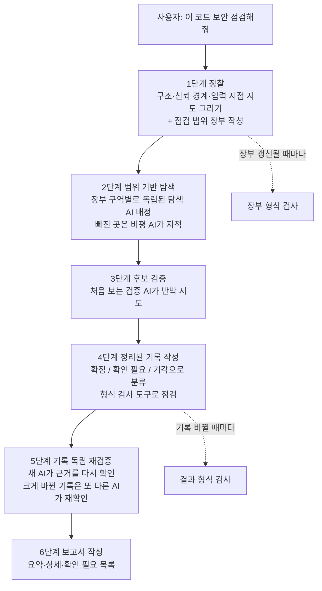

<div class="ai-knowledge-shell">

<aside class="ai-knowledge-sidebar">
  <p class="ai-eyebrow">CATEGORIES</p>
  <nav class="ai-cat-tree"><details class="ai-cat" open><summary><span class="catname">에이전트 오케스트레이션</span><span class="catcount">15</span></summary><ul><li><a href="https://altjs4510.github.io/ai_news_blog/knowledge/20261015/"><span class="kdate">2026-10-15</span><span class="ktitle">How Third Moment Research runs 10,000 agents for…</span></a></li><li><a href="https://altjs4510.github.io/ai_news_blog/knowledge/20261014/"><span class="kdate">2026-10-14</span><span class="ktitle">How Anthropic's Dynamic Workflows Coordinate Cla…</span></a></li><li><a href="https://altjs4510.github.io/ai_news_blog/knowledge/20260930/"><span class="kdate">2026-09-30</span><span class="ktitle">Agents you can coach: how Asana builds human-age…</span></a></li><li><a href="https://altjs4510.github.io/ai_news_blog/knowledge/20260831-openexecutive-virtual-c-suite/"><span class="kdate">2026-08-31</span><span class="ktitle">Open Executive — 8명의 전문 에이전트를 하나의 임원 목소리로</span></a></li><li><a href="https://altjs4510.github.io/ai_news_blog/knowledge/20260828/"><span class="kdate">2026-08-28</span><span class="ktitle">Google ADK for Python v2.8.0 — RemoteA2aAgent 네이…</span></a></li><li><a href="https://altjs4510.github.io/ai_news_blog/knowledge/20260826/"><span class="kdate">2026-08-26</span><span class="ktitle">apache/maka — 도구 호출·권한 결정·종료 이벤트를 append-only 로그…</span></a></li><li><a href="https://altjs4510.github.io/ai_news_blog/knowledge/20260823/"><span class="kdate">2026-08-23</span><span class="ktitle">The Evolution of the Agent Harness — 하네스가 모델 가중치…</span></a></li><li><a href="https://altjs4510.github.io/ai_news_blog/knowledge/20260805/"><span class="kdate">2026-08-05</span><span class="ktitle">TencentCloud/TencentDB-Agent-Memory — 대화·문서·코드를 …</span></a></li><li><a href="https://altjs4510.github.io/ai_news_blog/knowledge/20260717/"><span class="kdate">2026-07-17</span><span class="ktitle">After a year building agent memory, 'save everyt…</span></a></li><li><a href="https://altjs4510.github.io/ai_news_blog/knowledge/20260623/"><span class="kdate">2026-06-23</span><span class="ktitle">bytedance/deer-flow — 샌드박스·메모리·서브에이전트·메시지 게이트웨이를…</span></a></li><li><a href="https://altjs4510.github.io/ai_news_blog/knowledge/20260621/"><span class="kdate">2026-06-21</span><span class="ktitle">calesthio/OpenMontage — 12 파이프라인·52 도구·500+ 스킬을 …</span></a></li><li><a href="https://altjs4510.github.io/ai_news_blog/knowledge/20260611/"><span class="kdate">2026-06-11</span><span class="ktitle">The evolution of agentic surfaces: building with…</span></a></li><li><a href="https://altjs4510.github.io/ai_news_blog/knowledge/20260602/"><span class="kdate">2026-06-02</span><span class="ktitle">revfactory/harness — 도메인별 에이전트 팀과 스킬을 자동 설계하는 메타…</span></a></li><li><a href="https://altjs4510.github.io/ai_news_blog/knowledge/20260529/"><span class="kdate">2026-05-29</span><span class="ktitle">Introducing dynamic workflows in Claude Code</span></a></li><li><a href="https://altjs4510.github.io/ai_news_blog/knowledge/20260507/"><span class="kdate">2026-05-07</span><span class="ktitle">ruvnet/ruflo — Claude 멀티 에이전트 오케스트레이션 플랫폼</span></a></li></ul></details><details class="ai-cat" open><summary><span class="catname">MCP &amp; 도구 통합</span><span class="catcount">20</span></summary><ul><li><a href="https://altjs4510.github.io/ai_news_blog/knowledge/20261017/"><span class="kdate">2026-10-17</span><span class="ktitle">mksglu/context-mode — 코딩 에이전트용 컨텍스트 윈도우 최적화</span></a></li><li><a href="https://altjs4510.github.io/ai_news_blog/knowledge/20261007/"><span class="kdate">2026-10-07</span><span class="ktitle">morluto/rea — 앱 동작부터 네이티브 바이너리까지 에이전트로 리버스 엔지니어링</span></a></li><li><a href="https://altjs4510.github.io/ai_news_blog/knowledge/20260829/"><span class="kdate">2026-08-29</span><span class="ktitle">cursor/plugins — 플러그인 명세(specification)와 공식 플러그인…</span></a></li><li><a href="https://altjs4510.github.io/ai_news_blog/knowledge/20260819/"><span class="kdate">2026-08-19</span><span class="ktitle">akitaonrails/ai-memory — 코딩 에이전트 CLI 간 장기 기억과 벤더…</span></a></li><li><a href="https://altjs4510.github.io/ai_news_blog/knowledge/20260802/"><span class="kdate">2026-08-02</span><span class="ktitle">Stateless MCP has recaptured my interest (and in…</span></a></li><li><a href="https://altjs4510.github.io/ai_news_blog/knowledge/20260731/"><span class="kdate">2026-07-31</span><span class="ktitle">different-ai/openwork — Claude Cowork의 오픈소스 대안(o…</span></a></li><li><a href="https://altjs4510.github.io/ai_news_blog/knowledge/20260729/"><span class="kdate">2026-07-29</span><span class="ktitle">Bringing MCP 2026-07-28 to Claude</span></a></li><li><a href="https://altjs4510.github.io/ai_news_blog/knowledge/20260726/"><span class="kdate">2026-07-26</span><span class="ktitle">citrolabs/ego-lite — 로그인된 브라우저 상태를 AI 에이전트와 공유하는…</span></a></li><li><a href="https://altjs4510.github.io/ai_news_blog/knowledge/20260718/"><span class="kdate">2026-07-18</span><span class="ktitle">tirth8205/code-review-graph — MCP·CLI용 로컬 코드 인텔리…</span></a></li><li><a href="https://altjs4510.github.io/ai_news_blog/knowledge/20260708/"><span class="kdate">2026-07-08</span><span class="ktitle">Expanding Managed Agents in Gemini API: backgrou…</span></a></li><li><a href="https://altjs4510.github.io/ai_news_blog/knowledge/20260701/"><span class="kdate">2026-07-01</span><span class="ktitle">Google OKF (Open Knowledge Format) — 벤더 중립 에이전트 …</span></a></li><li><a href="https://altjs4510.github.io/ai_news_blog/knowledge/20260618/"><span class="kdate">2026-06-18</span><span class="ktitle">DeusData/codebase-memory-mcp — 158개 언어 코드베이스를 밀리…</span></a></li><li><a href="https://altjs4510.github.io/ai_news_blog/knowledge/20260609/"><span class="kdate">2026-06-09</span><span class="ktitle">Building intelligent apps for Apple platforms wi…</span></a></li><li><a href="https://altjs4510.github.io/ai_news_blog/knowledge/20260604/"><span class="kdate">2026-06-04</span><span class="ktitle">chopratejas/headroom — Compress tool outputs bef…</span></a></li><li><a href="https://altjs4510.github.io/ai_news_blog/knowledge/20260603/"><span class="kdate">2026-06-03</span><span class="ktitle">How Bad MCP design cost your Agent 5× more token…</span></a></li><li><a href="https://altjs4510.github.io/ai_news_blog/knowledge/20260521/"><span class="kdate">2026-05-21</span><span class="ktitle">colbymchenry/codegraph — Pre-indexed code knowle…</span></a></li><li><a href="https://altjs4510.github.io/ai_news_blog/knowledge/20260517/"><span class="kdate">2026-05-17</span><span class="ktitle">I gave my LLM 100,000+ tools — Lazy Discovery &a…</span></a></li><li><a href="https://altjs4510.github.io/ai_news_blog/knowledge/20260512/"><span class="kdate">2026-05-12</span><span class="ktitle">agentmemory — Persistent memory for AI coding ag…</span></a></li><li><a href="https://altjs4510.github.io/ai_news_blog/knowledge/20260509/"><span class="kdate">2026-05-09</span><span class="ktitle">How to connect 100 MCP servers without the conte…</span></a></li><li><a href="https://altjs4510.github.io/ai_news_blog/knowledge/20260506/"><span class="kdate">2026-05-06</span><span class="ktitle">mksglu/context-mode — AI 코딩 에이전트용 컨텍스트 윈도우 최적화</span></a></li></ul></details><details class="ai-cat" open><summary><span class="catname">코딩 에이전트</span><span class="catcount">24</span></summary><ul><li><a href="https://altjs4510.github.io/ai_news_blog/knowledge/20261018/"><span class="kdate">2026-10-18</span><span class="ktitle">Quoting Addy Osmani, Morgan Westlee Lunt, and Qi…</span></a></li><li><a href="https://altjs4510.github.io/ai_news_blog/knowledge/20261014-claude-code-advisor/"><span class="kdate">2026-10-14</span><span class="ktitle">Claude Code advisor — 가벼운 메인 모델이 일하고, 갈림길에서만 Opu…</span></a></li><li><a href="https://altjs4510.github.io/ai_news_blog/knowledge/20260920/"><span class="kdate">2026-09-20</span><span class="ktitle">Claude Code 2.1.277 — CLAUDE.md가 없으면 AGENTS.md를 …</span></a></li><li><a href="https://altjs4510.github.io/ai_news_blog/knowledge/20260912/"><span class="kdate">2026-09-12</span><span class="ktitle">Quoting Boris Cherny — 'Claude가 쓴 프로덕션 코드는 사람이 쓴…</span></a></li><li><a href="https://altjs4510.github.io/ai_news_blog/knowledge/20260910/"><span class="kdate">2026-09-10</span><span class="ktitle">vastsa/PI-Desktop — Electron + Rust 호스트 코어 + 에이전…</span></a></li><li><a href="https://altjs4510.github.io/ai_news_blog/knowledge/20260906/"><span class="kdate">2026-09-06</span><span class="ktitle">DietrichGebert/ponytail — 에이전트를 '방에서 가장 게으른 시니어 …</span></a></li><li><a href="https://altjs4510.github.io/ai_news_blog/knowledge/20260903/"><span class="kdate">2026-09-03</span><span class="ktitle">pacifio/atlas — 여러 코딩 에이전트의 변경을 한곳에서 추적·질의하는 '에이…</span></a></li><li><a href="https://altjs4510.github.io/ai_news_blog/knowledge/20260901/"><span class="kdate">2026-09-01</span><span class="ktitle">affaan-m/ECC — 스킬·본능·메모리·보안을 묶은 에이전트 하네스 성능 최적화 …</span></a></li><li><a href="https://altjs4510.github.io/ai_news_blog/knowledge/20260831-gitnexus-code-knowledge-graph/"><span class="kdate">2026-08-31</span><span class="ktitle">GitNexus — 코드베이스를 지식그래프로 바꿔 에이전트에게 쥐어주기</span></a></li><li><a href="https://altjs4510.github.io/ai_news_blog/knowledge/20260814/"><span class="kdate">2026-08-14</span><span class="ktitle">cathrynlavery/diagram-design — Claude Code용 에디토리…</span></a></li><li><a href="https://altjs4510.github.io/ai_news_blog/knowledge/20260810/"><span class="kdate">2026-08-10</span><span class="ktitle">Auto mode is now the default in Claude Code for …</span></a></li><li><a href="https://altjs4510.github.io/ai_news_blog/knowledge/20260808/"><span class="kdate">2026-08-08</span><span class="ktitle">PrimeIntellect-ai/prime-agent — 코딩 워크플로우와 장시간 자율…</span></a></li><li><a href="https://altjs4510.github.io/ai_news_blog/knowledge/20260804/"><span class="kdate">2026-08-04</span><span class="ktitle">esengine/DeepSeek-Reasonix — prefix-cache 안정성을 축…</span></a></li><li><a href="https://altjs4510.github.io/ai_news_blog/knowledge/20260728/"><span class="kdate">2026-07-28</span><span class="ktitle">alibaba/open-code-review — 결정론적 파이프라인 + LLM 에이전트…</span></a></li><li><a href="https://altjs4510.github.io/ai_news_blog/knowledge/20260725/"><span class="kdate">2026-07-25</span><span class="ktitle">The new rules of context engineering for Claude …</span></a></li><li><a href="https://altjs4510.github.io/ai_news_blog/knowledge/20260714/"><span class="kdate">2026-07-14</span><span class="ktitle">Graphify-Labs/graphify — 코드베이스를 질의 가능한 지식 그래프로 만…</span></a></li><li><a href="https://altjs4510.github.io/ai_news_blog/knowledge/20260707/"><span class="kdate">2026-07-07</span><span class="ktitle">AI Hero Skills Catalog — 실무 엔지니어를 위한 재사용 가능한 판단 …</span></a></li><li><a href="https://altjs4510.github.io/ai_news_blog/knowledge/20260705/"><span class="kdate">2026-07-05</span><span class="ktitle">openai/codex-plugin-cc — Claude Code에서 Codex를 위임…</span></a></li><li><a href="https://altjs4510.github.io/ai_news_blog/knowledge/20260626/"><span class="kdate">2026-06-26</span><span class="ktitle">google-labs-code/design.md — 코딩 에이전트에게 디자인 시스템을 …</span></a></li><li><a href="https://altjs4510.github.io/ai_news_blog/knowledge/20260619/"><span class="kdate">2026-06-19</span><span class="ktitle">Claude Code now supports artifacts</span></a></li><li><a href="https://altjs4510.github.io/ai_news_blog/knowledge/20260530/"><span class="kdate">2026-05-30</span><span class="ktitle">Leonxlnx/taste-skill — AI에게 좋은 취향을 부여해 generic s…</span></a></li><li><a href="https://altjs4510.github.io/ai_news_blog/knowledge/20260528/"><span class="kdate">2026-05-28</span><span class="ktitle">Building self-improving tax agents with Codex</span></a></li><li><a href="https://altjs4510.github.io/ai_news_blog/knowledge/20260508/"><span class="kdate">2026-05-08</span><span class="ktitle">addyosmani/agent-skills — Production-grade engin…</span></a></li><li><a href="https://altjs4510.github.io/ai_news_blog/knowledge/20260505/"><span class="kdate">2026-05-05</span><span class="ktitle">mattpocock/skills — Skills for Real Engineers (.…</span></a></li></ul></details><details class="ai-cat" open><summary><span class="catname">모델 &amp; 연구</span><span class="catcount">10</span></summary><ul><li><a href="https://altjs4510.github.io/ai_news_blog/knowledge/20261009/"><span class="kdate">2026-10-09</span><span class="ktitle">Claude Haiku 5.5 (Simon Willison의 출시 노트와 가격 분석)</span></a></li><li><a href="https://altjs4510.github.io/ai_news_blog/knowledge/20260929/"><span class="kdate">2026-09-29</span><span class="ktitle">vectorize-io/hindsight — Hindsight: Agent Memory…</span></a></li><li><a href="https://altjs4510.github.io/ai_news_blog/knowledge/20260907-voicemem-dual-brain-memory/"><span class="kdate">2026-09-07</span><span class="ktitle">VoiceMem — 좌뇌·우뇌로 쪼갠 스트리밍 메모리로 음성 에이전트 지연 없애기</span></a></li><li><a href="https://altjs4510.github.io/ai_news_blog/knowledge/20260904/"><span class="kdate">2026-09-04</span><span class="ktitle">HarnessDev: Can LLMs Create and Evolve Their Own…</span></a></li><li><a href="https://altjs4510.github.io/ai_news_blog/knowledge/20260716-proprag/"><span class="kdate">2026-07-16</span><span class="ktitle">PropRAG — 프로포지션 경로 위 beam search로 멀티홉 검색 안내</span></a></li><li><a href="https://altjs4510.github.io/ai_news_blog/knowledge/20260712/"><span class="kdate">2026-07-12</span><span class="ktitle">Do Automated Evals Work?</span></a></li><li><a href="https://altjs4510.github.io/ai_news_blog/knowledge/20260620/"><span class="kdate">2026-06-20</span><span class="ktitle">zai-org/GLM-5 — From Vibe Coding to Agentic Engi…</span></a></li><li><a href="https://altjs4510.github.io/ai_news_blog/knowledge/20260617/"><span class="kdate">2026-06-17</span><span class="ktitle">Predicting model behavior before release by simu…</span></a></li><li><a href="https://altjs4510.github.io/ai_news_blog/knowledge/20260516/"><span class="kdate">2026-05-16</span><span class="ktitle">STALE — 에이전트가 자기 기억의 유효성을 인지할 수 있는가</span></a></li><li><a href="https://altjs4510.github.io/ai_news_blog/knowledge/20260513/"><span class="kdate">2026-05-13</span><span class="ktitle">Thinking Machines' Native Interaction Models — T…</span></a></li></ul></details><details class="ai-cat" open><summary><span class="catname">인프라 &amp; 컴퓨트</span><span class="catcount">7</span></summary><ul><li><a href="https://altjs4510.github.io/ai_news_blog/knowledge/20260905/"><span class="kdate">2026-09-05</span><span class="ktitle">magnitudedev/magnitude — 하드웨어에 맞는 최적 로컬 모델을 띄워 이…</span></a></li><li><a href="https://altjs4510.github.io/ai_news_blog/knowledge/20260821/"><span class="kdate">2026-08-21</span><span class="ktitle">volcengine/OpenViking — 에이전트 메모리·Knowledge RAG·스…</span></a></li><li><a href="https://altjs4510.github.io/ai_news_blog/knowledge/20260806/"><span class="kdate">2026-08-06</span><span class="ktitle">cloudflare/computer — 에이전트에게 컴퓨터를 통째로 주는 엣지 실행 샌…</span></a></li><li><a href="https://altjs4510.github.io/ai_news_blog/knowledge/20260723/"><span class="kdate">2026-07-23</span><span class="ktitle">diegosouzapw/OmniRoute — 268+ 프로바이더를 단일 엔드포인트로 묶…</span></a></li><li><a href="https://altjs4510.github.io/ai_news_blog/knowledge/20260610/"><span class="kdate">2026-06-10</span><span class="ktitle">Fable 5 just made cost-aware model routing manda…</span></a></li><li><a href="https://altjs4510.github.io/ai_news_blog/knowledge/20260522/"><span class="kdate">2026-05-22</span><span class="ktitle">Giving Agents Computers — Ivan Burazin, Daytona</span></a></li><li><a href="https://altjs4510.github.io/ai_news_blog/knowledge/20260520/"><span class="kdate">2026-05-20</span><span class="ktitle">New in Claude Managed Agents: self-hosted sandbo…</span></a></li></ul></details><details class="ai-cat" open><summary><span class="catname">보안 &amp; 거버넌스</span><span class="catcount">24</span></summary><ul><li><a href="https://altjs4510.github.io/ai_news_blog/knowledge/20261021/" class="current"><span class="kdate">2026-10-21</span><span class="ktitle">cloudflare/security-audit-skill — 독립 검증된 기계 판독형 …</span></a></li><li><a href="https://altjs4510.github.io/ai_news_blog/knowledge/20261020/"><span class="kdate">2026-10-20</span><span class="ktitle">Satya Nadella — 모델을 내부자 위험으로 보는 원칙에 따라 Project P…</span></a></li><li><a href="https://altjs4510.github.io/ai_news_blog/knowledge/20261016/"><span class="kdate">2026-10-16</span><span class="ktitle">Crossing the Threshold: How OpenAI and Anthropic…</span></a></li><li><a href="https://altjs4510.github.io/ai_news_blog/knowledge/20261011/"><span class="kdate">2026-10-11</span><span class="ktitle">Anthropic can’t reliably control its AI agents. …</span></a></li><li><a href="https://altjs4510.github.io/ai_news_blog/knowledge/20261004/"><span class="kdate">2026-10-04</span><span class="ktitle">Apple says it's tightening macOS 'Full Disk Acce…</span></a></li><li><a href="https://altjs4510.github.io/ai_news_blog/knowledge/20261001/"><span class="kdate">2026-10-01</span><span class="ktitle">NVIDIA/OpenShell</span></a></li><li><a href="https://altjs4510.github.io/ai_news_blog/knowledge/20260919/"><span class="kdate">2026-09-19</span><span class="ktitle">cloudflare/security-audit-skill — 다단계 보안 감사를 '독립…</span></a></li><li><a href="https://altjs4510.github.io/ai_news_blog/knowledge/20260913/"><span class="kdate">2026-09-13</span><span class="ktitle">OpenAI agents attacked RubyGems back in May: Ope…</span></a></li><li><a href="https://altjs4510.github.io/ai_news_blog/knowledge/20260902/"><span class="kdate">2026-09-02</span><span class="ktitle">AIR raises $50M to help companies vet the skills…</span></a></li><li><a href="https://altjs4510.github.io/ai_news_blog/knowledge/20260827/"><span class="kdate">2026-08-27</span><span class="ktitle">Claude in Chrome is generally available</span></a></li><li><a href="https://altjs4510.github.io/ai_news_blog/knowledge/20260819-mind-viruses/"><span class="kdate">2026-08-19</span><span class="ktitle">탈옥도, 인젝션도 없이 — 대화로만 퍼지는 에이전트의 '마인드 바이러스'</span></a></li><li><a href="https://altjs4510.github.io/ai_news_blog/knowledge/20260812/"><span class="kdate">2026-08-12</span><span class="ktitle">semantica-agi/semantica — 컨텍스트와 '책임 추적 가능한(accou…</span></a></li><li><a href="https://altjs4510.github.io/ai_news_blog/knowledge/20260730/"><span class="kdate">2026-07-30</span><span class="ktitle">Anatomy of a Frontier Lab Agent Intrusion: A Tec…</span></a></li><li><a href="https://altjs4510.github.io/ai_news_blog/knowledge/20260715/"><span class="kdate">2026-07-15</span><span class="ktitle">Dicklesworthstone/destructive_command_guard — 에이…</span></a></li><li><a href="https://altjs4510.github.io/ai_news_blog/knowledge/20260710/"><span class="kdate">2026-07-10</span><span class="ktitle">70개 MCP 서버 strace 런타임 감사 — 부팅 시 아웃바운드 호출 서버 적발</span></a></li><li><a href="https://altjs4510.github.io/ai_news_blog/knowledge/20260704/"><span class="kdate">2026-07-04</span><span class="ktitle">Cloudflare is about to block AI agents by defaul…</span></a></li><li><a href="https://altjs4510.github.io/ai_news_blog/knowledge/20260703/"><span class="kdate">2026-07-03</span><span class="ktitle">Giving admins more visibility and control over C…</span></a></li><li><a href="https://altjs4510.github.io/ai_news_blog/knowledge/20260630/"><span class="kdate">2026-06-30</span><span class="ktitle">Introducing the Claude apps gateway for Amazon B…</span></a></li><li><a href="https://altjs4510.github.io/ai_news_blog/knowledge/20260624/"><span class="kdate">2026-06-24</span><span class="ktitle">Agent identity in Claude Tag: a new access model…</span></a></li><li><a href="https://altjs4510.github.io/ai_news_blog/knowledge/20260613/"><span class="kdate">2026-06-13</span><span class="ktitle">Fable 5's guardrails got bypassed in 48 hours — …</span></a></li><li><a href="https://altjs4510.github.io/ai_news_blog/knowledge/20260612/"><span class="kdate">2026-06-12</span><span class="ktitle">NVIDIA/SkillSpector — AI 에이전트 스킬용 보안 스캐너</span></a></li><li><a href="https://altjs4510.github.io/ai_news_blog/knowledge/20260607/"><span class="kdate">2026-06-07</span><span class="ktitle">OpenAI Help: Lockdown Mode</span></a></li><li><a href="https://altjs4510.github.io/ai_news_blog/knowledge/20260531/"><span class="kdate">2026-05-31</span><span class="ktitle">How we contain Claude across products</span></a></li><li><a href="https://altjs4510.github.io/ai_news_blog/knowledge/20260527/"><span class="kdate">2026-05-27</span><span class="ktitle">Microsoft Copilot Cowork Exfiltrates Files</span></a></li></ul></details><details class="ai-cat" open><summary><span class="catname">응용 사례</span><span class="catcount">7</span></summary><ul><li><a href="https://altjs4510.github.io/ai_news_blog/knowledge/20261006/"><span class="kdate">2026-10-06</span><span class="ktitle">How Cresta turned CX expertise into an agent bui…</span></a></li><li><a href="https://altjs4510.github.io/ai_news_blog/knowledge/20260911/"><span class="kdate">2026-09-11</span><span class="ktitle">Now everyone can put data to work — ChatGPT Work…</span></a></li><li><a href="https://altjs4510.github.io/ai_news_blog/knowledge/20260909/"><span class="kdate">2026-09-09</span><span class="ktitle">Reducing cost and improving performance with Cla…</span></a></li><li><a href="https://altjs4510.github.io/ai_news_blog/knowledge/20260907-humanmade-52week-rhythm/"><span class="kdate">2026-09-07</span><span class="ktitle">휴먼 메이드의 '52주 리듬' — 아이디어가 흔해진 시대에 값이 오르는 건 버리는 판단</span></a></li><li><a href="https://altjs4510.github.io/ai_news_blog/knowledge/20260709/"><span class="kdate">2026-07-09</span><span class="ktitle">mvanhorn/last30days-skill — Reddit·X·YouTube·HN·…</span></a></li><li><a href="https://altjs4510.github.io/ai_news_blog/knowledge/20260515/"><span class="kdate">2026-05-15</span><span class="ktitle">Clawdmeter — Claude Code 사용량을 데스크톱 대시보드로</span></a></li><li><a href="https://altjs4510.github.io/ai_news_blog/knowledge/20260514/"><span class="kdate">2026-05-14</span><span class="ktitle">Introducing Claude for Small Business</span></a></li></ul></details><details class="ai-cat" open><summary><span class="catname">산업 동향</span><span class="catcount">6</span></summary><ul><li><a href="https://altjs4510.github.io/ai_news_blog/knowledge/20260830/"><span class="kdate">2026-08-30</span><span class="ktitle">[AINews] OpenAI shuts off Cursor — 프론티어 모델 공급 차단…</span></a></li><li><a href="https://altjs4510.github.io/ai_news_blog/knowledge/20260711/"><span class="kdate">2026-07-11</span><span class="ktitle">OpenAI says GPT 5.6 is the 'preferred model' for…</span></a></li><li><a href="https://altjs4510.github.io/ai_news_blog/knowledge/20260702/"><span class="kdate">2026-07-02</span><span class="ktitle">How Cursor deploys AI inside the enterprise (For…</span></a></li><li><a href="https://altjs4510.github.io/ai_news_blog/knowledge/20260616/"><span class="kdate">2026-06-16</span><span class="ktitle">Why AI hasn't replaced software engineers, and w…</span></a></li><li><a href="https://altjs4510.github.io/ai_news_blog/knowledge/20260519/"><span class="kdate">2026-05-19</span><span class="ktitle">Anthropic acquires Stainless</span></a></li><li><a href="https://altjs4510.github.io/ai_news_blog/knowledge/20260504/"><span class="kdate">2026-05-04</span><span class="ktitle">Agents for Everything Else: Codex for Knowledge …</span></a></li></ul></details></nav>
</aside>

<article class="ai-knowledge-article">

<header class="ai-post-hero">
  <p class="ai-eyebrow"><a class="ai-back" href="../">KNOWLEDGE</a> · 2026-10-21 · 오늘의 학습</p>
  <h2 class="ai-post-title">cloudflare/security-audit-skill — 독립 검증된 기계 판독형 결과를 내는 다단계 보안 감사 코딩 에이전트 스킬</h2>
</header>

> 원문: [cloudflare/security-audit-skill — 독립 검증된 기계 판독형 결과를 내는 다단계 보안 감사 코딩 에이전트 스킬](https://github.com/cloudflare/security-audit-skill)

## 📌 학습 정리

### 1. 한 줄로 말하면

AI 코딩 도우미에게 "보안 점검관" 역할을 맡기는 설명서 묶음이에요. 한 명이 다 하지 않고, 여러 AI가 단계를 나눠 맡아요. 정찰하는 쪽, 약점을 찾는 쪽, 찾은 걸 반박해 보는 쪽이 따로 있고, 결과는 사람과 기계가 모두 읽을 수 있는 정리된 기록으로 남아요.

### 2. 왜 이게 만들어졌어요?

AI에게 "이 코드에 보안 문제 있는지 봐줘"라고 한 번에 맡기면 결과가 들쭉날쭉하기 쉬워요. 그럴듯하지만 사실은 막혀 있는 공격을 "취약점"이라고 보고하거나, 코드의 어느 부분까지 살펴봤는지 기록이 남지 않는 경우가 생기죠. 찾은 AI가 자기 결과를 직접 검토하면 놓친 걸 스스로 알아채기도 어렵고요. 그래서 Cloudflare는 점검 과정을 여섯 단계로 나눴어요. 약점을 찾는 AI와 확인하는 AI를 분리했고, 결과는 정해진 형식의 파일로 남게 했어요. 이 스킬은 Cloudflare가 회사 전체 규모로 키운 취약점 탐색 시스템의 출발점이었고, 저장소 하나를 점검하던 버전이에요.

### 3. 비유로 풀면

이건 마치 건물 안전 점검팀 같은 거예요. 먼저 한 사람이 도면을 펴 놓고 출입문, 창문, 관리실 위치를 지도로 그려요. 그다음 여러 점검원이 구역을 나눠 맡아 "어디를 확인했는지" 체크리스트에 적어 가며 돌아다니죠. 누가 "여기 문이 허술해요"라고 보고하면, 그 구역을 처음 보는 다른 점검원이 "정말 뚫리는지" 반박해 보려고 다시 확인해요.

또 하나 비유하자면 의학 논문의 동료 심사와도 닮았어요. 결과를 낸 사람이 아니라 제3자가 검증하고, "확실함 / 추가 확인 필요 / 기각" 중 하나로 판정을 내리는 거죠.

그래서 결국, 이 스킬의 핵심은 "찾는 사람과 확인하는 사람을 분리하고, 어디까지 봤는지를 장부에 남기는 것"이에요.

### 4. 어떻게 작동하는지 (그림으로)



위에서 아래로 내려가면서 "지도 그리기 → 나눠서 찾기 → 반박해 보기 → 정해진 형식으로 기록 → 다시 독립 확인 → 보고서" 순서로 진행돼요. 전체를 이끄는 상위 AI는 장부나 결과 파일이 바뀔 때마다 작은 검사 프로그램을 돌려서, 형식이 어긋나지 않았는지 기계적으로 확인해요. 같은 저장소를 여러 번 돌리면 이전 장부와 결과를 이어받아요. 그래서 아직 못 본 곳을 노리고, 코드가 바뀐 부분은 다시 확인해요.

### 5. 처음 보는 용어 풀이

- **에이전트용 기능 묶음 (skill)** — AI 코딩 도우미가 특정 일을 할 때 꺼내 쓰는 지침서와 도구 모음이에요. "보안 점검해줘"처럼 요청이 조건에 맞으면 자동으로 켜져요.
- **신뢰 경계 (trust boundary)** — 믿을 수 있는 영역과 믿을 수 없는 영역이 만나는 선이에요. 바깥 사용자의 입력이 내부 시스템으로 들어오는 지점 같은 곳이고, 보안 문제는 대개 이 선에서 생겨요.
- **점검 범위 장부 (coverage ledger)** — 코드의 어느 부분을 누가, 무엇을 확인했는지 적어 두는 기록 파일(`coverage-ledger.json`)이에요. "다 봤다"고 착각하지 않게 해 주고, 다음 실행 때 빈 곳을 찾는 기준이 돼요.
- **판정 세 가지 (confirmed / needs_validation / rejected)** — "확정"은 원인부터 결과까지 코드로 추적이 끝난 경우예요. "추가 확인 필요"는 딱 하나 풀리지 않은 사실이 남아 있어서 심각도를 매기지 않은 경우고요. "기각"은 반박에 성공한 후보예요.
- **적대적 검증 (adversarial validation)** — 결과를 찾은 AI가 아니라 처음 보는 다른 AI가 "이게 정말 문제인가?"를 반박하려고 확인하는 방식이에요. 스스로 채점하는 편향을 줄이려는 거예요.
- **격리된 실행 공간 (sandbox)** — 점검 대상 코드를 실제로 돌려 볼 때 쓰는 울타리 쳐진 환경이에요. 외부 인터넷을 막고, 자원 사용량을 제한하고, 정해진 폴더에만 쓰게 해요. 이게 없으면 대상 코드를 실행하지 않고 "추가 확인 필요"로 남겨 둬요.
- **심층 방어 (defense-in-depth)** — 보호 장치를 여러 겹 두는 설계예요. 이 스킬은 앞쪽 장치가 이미 공격을 막고 있다면 뒤쪽 장치가 없는 건 취약점이 아니라 "보강 메모" 정도로 다뤄요.

### 6. 한 발 더 들어가고 싶다면

- [cloudflare/security-audit-skill 저장소](https://github.com/cloudflare/security-audit-skill) — 이걸 보면 여섯 단계별 지침 파일(`RECONNAISSANCE.md`, `HUNTING.md`, `VALIDATION-AND-REPORTING.md` 등)이 실제로 어떻게 나뉘어 있는지 알 수 있어요.
- 같은 저장소의 `ATTACK-CLASSES.md`와 분야별 파일들(`AI-AND-LLM.md`, `CLOUD-AND-DEPLOYMENT.md` 등) — 이걸 보면 웹, 클라우드, AI 서비스처럼 대상마다 어떤 유형의 공격을 살펴보는지 알 수 있어요.
- Cloudflare 글 "Build your own vulnerability harness" — 이걸 보면 이 스킬이 회사 전체 규모의 취약점 탐색 시스템으로 어떻게 커졌는지 알 수 있어요. 원문에 링크 주소는 없어서 제목으로 찾아보시면 돼요.

---

## 📖 원문 전체 번역 (정독용)

> 의역 최소화한 전체 번역입니다. 큰 흐름은 위 정리에서 잡고, 정확한 워딩이 필요할 땐 이 섹션에서 정독하세요.

# security-audit

코딩 에이전트를 보안 감사관으로 바꿔 주는 스킬입니다. 격리된 에이전트들을 조율하여 정찰(reconnaissance), 커버리지 주도 헌팅(coverage-led hunting), 후보 검증, 구조화된 출력, 독립적인 레코드 검증, 대상 중립적 보고를 수행합니다.

이 스킬은 Cloudflare의 취약점 발견 하네스(vulnerability discovery harness)의 시초가 된 스킬이며, 해당 하네스는 [Build your own vulnerability harness](https://github.com/cloudflare/security-audit-skill)에 설명되어 있습니다. 이 하네스는 다단계의 전사(fleet-wide) 시스템으로 성장했으며, 이 스킬은 그것이 진화해 나온 단일 레포지토리용 출발점입니다.

## 기능

이 스킬은 구조화된 감사를 여섯 단계로 실행합니다.

1. **정찰 (Reconnaissance)** -- 아키텍처, 신뢰 경계(trust boundary), 입력 표면, 기존 증거, 결정론적 커버리지를 `architecture.md`와 `coverage-ledger.json`에 매핑합니다.
2. **커버리지 주도 헌팅 (Coverage-led hunting)** -- 원장(ledger)의 단위(unit)로부터 격리된 헌터(hunter)를 배정하고, 이들의 점검 내용을 기록하며, 커버리지 크리틱(coverage critic)을 사용해 빈틈을 찾습니다.
3. **후보 검증 (Candidate validation)** -- 고유한 후보마다 새로운 검증자(verifier)를 붙여 그 후보를 반증하도록 시도합니다.
4. **구조화된 출력 (Structured output)** -- `confirmed`, `needs_validation`, `rejected` 레코드를 `findings.json`에 기록하고 `report-schema.json`에 맞춰 검증합니다.
5. **독립적인 레코드 검증 (Independent record verification)** -- 새로운 에이전트들이 최종 소스 주장(source claim)을 검증합니다. 실질적인 교체(material replacement)에는 또 다른 독립 검증자가 붙습니다.
6. **대상 중립적 보고 (Target-neutral reporting)** -- 검증된 레코드와 커버리지 원장으로부터 `REPORT.md`, `FINDINGS-DETAIL.md`, `NEEDS-VALIDATION.md`를 도출합니다.

부모(parent)는 원장을 생성한 뒤와 이후 원장을 갱신할 때마다 `validate-coverage-ledger.cjs`를 실행합니다. 또한 4단계에서 `validate-findings.cjs`를 실행하고, 5단계의 교체가 있을 때마다 다시 실행합니다.

판정(verdict)은 서로 구별됩니다. `confirmed`는 완전한 소스 추적(source trace)과 범위가 한정된 관찰 결과를 가지며, `needs_validation`은 정확히 해소되지 않은 사실 하나를 명시하고 심각도(severity)를 갖지 않으며, `rejected`는 반증된 후보를 기록합니다.

같은 레포지토리에 대한 여러 번의 실행은 누적됩니다. 이 스킬은 이전의 원장과 findings를 사용해 빈틈을 겨냥하고, 변경된 소스를 재검증하며, 현재 소스에 대한 증거를 이월(carry forward)하되, 오래되었거나 해소되지 않은 작업을 커버된 것으로 취급하지 않습니다.

## 파일

| 파일 | 용도 |
|---|---|
| `SKILL.md` | 설정, 핵심 원칙, 플랫폼 용어, 워크플로 개요, 감사 안티패턴 |
| `RECONNAISSANCE.md` | 1단계 정찰 프롬프트 및 종합(synthesis) 지침 |
| `HUNTING.md` | 2단계 오케스트레이션, 헌팅 방법론, 검증 규칙 |
| `ATTACK-CLASSES.md` | 핵심(core), 와일드카드(wildcard), 명백한 것들(obvious-things) 공격 프롬프트 |
| `MEMORY-SAFETY-AND-BINARY.md` | 네이티브 대상을 위한 메모리 안전성, 바이너리, 커널 헌팅 클래스 |
| `AI-AND-LLM.md` | LLM 기반 대상을 위한 프롬프트 인젝션, 에이전트/도구, 출력 처리 헌팅 클래스 |
| `WEB-PROTOCOL-AND-AUTH.md` | HTTP 프로토콜 및 인증 대상을 위한 HTTP 요청 프레이밍, 캐시, 인증 프로토콜 헌팅 클래스 |
| `CLIENT-SIDE.md` | 클라이언트 측/브라우저 대상을 위한 DOM 인젝션, 메시징 신뢰, UI 리드레스(UI-redress), 프로토타입 오염 헌팅 클래스 |
| `SUPPLY-CHAIN-AND-RELEASE.md` | 의존성, CI, 릴리스, 서명, 업데이트, 플러그인, 확장 프로그램 헌팅 클래스 |
| `CLOUD-AND-DEPLOYMENT.md` | IAM, 코드형 인프라(IaC), 컨테이너, 서버리스, 인그레스, 런타임 구성 헌팅 클래스 |
| `PROTOCOLS-RPC-AND-MESSAGING.md` | RPC, 직렬화, 큐, 브로커, 웹훅, 스트리밍 프로토콜 헌팅 클래스 |
| `RESOURCE-EXHAUSTION-AND-AVAILABILITY.md` | 공유 리소스, 쿼터, 큐, 워커, 운영자 비용 지출 헌팅 클래스 |
| `DATA-ISOLATION-AND-LIFECYCLE.md` | 테넌트 격리, 캐시, 검색, 내보내기, 백업, 마이그레이션, 삭제, 복원 헌팅 클래스 |
| `DESKTOP-MOBILE-AND-LOCAL-IPC.md` | 네이티브 앱, 딥링크, 웹뷰, 익스포트된 컴포넌트, 헬퍼, 데몬, 로컬 IPC 헌팅 클래스 |
| `VALIDATION-AND-REPORTING.md` | 3~6단계: 후보 검증, 구조화된 출력, 레코드 검증, 보고 |
| `report-schema.json` | 세 가지 `findings.json` 판정 모두에 대한 JSON 스키마 |
| `validate-findings.cjs` | 4·5단계에서 `findings.json`을 검증하는 무의존성(zero-dependency) 검증기 |
| `validate-findings.test.cjs` | findings 검증기 테스트 및 생산자 호환 픽스처 검사 |
| `validate-coverage-ledger.cjs` | 1~5단계에서 `coverage-ledger.json`을 검증하는 무의존성 검증기 |
| `validate-coverage-ledger.test.cjs` | 커버리지 원장 검증기 테스트 |

## 설치

[Skills CLI](https://github.com/cloudflare/security-audit-skill)로 스킬을 설치합니다.

```bash
npx skills add https://github.com/cloudflare/security-audit-skill \
  --skill security-audit
```

사용자 수준 설치에는 `--global`을 사용합니다.

```bash
npx skills add https://github.com/cloudflare/security-audit-skill \
  --skill security-audit \
  --global
```

에이전트 선택 및 비대화형 옵션은 `npx skills --help`를 실행해 확인하십시오.

## 사용법

감사하려는 코드베이스에서(또는 해당 코드베이스를 가리키도록) 코딩 에이전트를 시작한 뒤, 보안 감사를 요청하십시오.

```
security audit this codebase
find security vulnerabilities in ./src
do a security review, output to ~/audits/my-project
```

요청이 이 스킬의 트리거(보안 감사, 취약점 찾기, 코드 펜테스트 등)에 해당하면 스킬이 자동으로 활성화됩니다. 코드베이스에 대한 직접적인 감사 또는 펜테스트 요청은 전체 감사 모드(full audit mode)를 사용합니다. 보안 관련 질문과 범위가 좁은 취약점 작업은, 보고서 산출물을 요청하지 않는 한 가이던스 모드(guidance mode)를 사용합니다. 전체 감사 모드에서 출력 디렉터리를 지정하지 않으면 기본값은 `~/security-audit-skill/<repo-name>/run-<N>`입니다. 이 워크플로는 버전 관리가 무시(ignore)하는 디렉터리를 사용자가 명시적으로 선택한 경우에만 대상 레포지토리 내부에 씁니다.

## 요구 사항

- 도구 사용(tool use)과 병렬 서브 에이전트를 지원하는 모델을 가진 코딩 에이전트
- 무의존성 findings 및 커버리지 원장 검증기를 위한 Node.js
- 대상이 제어하는 빌드, 테스트, 프로세스, 브라우저, 에뮬레이터, 퍼저(fuzzer), 픽스처를 위한 OS 수준에서 강제되는 샌드박스. 이 샌드박스는 외부 네트워킹을 비활성화하고, 정제된(sanitized) 허용 목록 기반 환경을 사용하며, 리소스 제한을 강제하고, 지정된 스크래치(scratch) 경로에만 쓰기를 허용해야 합니다. 이러한 통제가 없으면 워크플로는 대상 코드를 실행하는 대신 해당 리드(lead)를 `needs_validation`으로 유지합니다.

## 설계 원칙

- **확립된 경계 실패만 확정한다.** 소스에 근거한, 막혀 있는 리드는 해소되지 않은 정확한 사실과 함께 `needs_validation`으로 유지합니다.
- **적대적 검증.** 발견 사항을 점검하는 에이전트는 결코 그것을 발견한 에이전트가 아닙니다.
- **심각도는 영향을 요구한다.** 체크리스트로부터의 이탈이 아니라 가능성(likelihood) × 영향(impact)으로 판단합니다.
- **심층 방어(defense-in-depth)의 공백은 취약점이 아니다.** 계층 A가 공격을 막는다면, 계층 B의 부재는 하드닝(hardening) 노트입니다.
- **여러 번 실행하면 커버리지가 개선된다.** 저희의 테스트 실행에서, 한 번의 실행은 반복 실행이 총합으로 찾아낸 취약점의 대략 절반을 찾았습니다.

## 연락처

AI 기반 보안 도구에 관한 질문, 피드백, 또는 의견 교환: security-ai-research@cloudflare.com

## 라이선스

MIT -- `LICENSE`를 참조하십시오.

</article>

</div>
