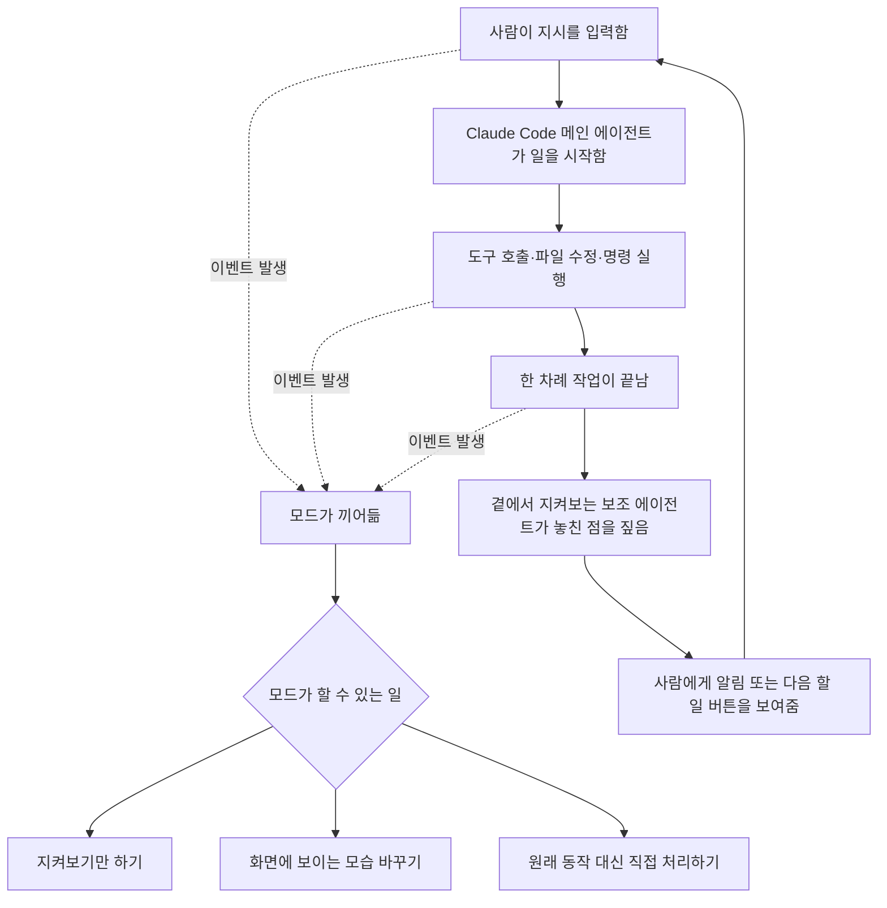

<aside class="ai-knowledge-sidebar">
  
CATEGORIES

  <nav class="ai-cat-tree">

에이전트 오케스트레이션18
<ul><li><a href="https://altjs4510.github.io/ai_news_blog/knowledge/20261029/">2026-10-29How Anthropic ships Claude with Claude: Separati…</a></li><li><a href="https://altjs4510.github.io/ai_news_blog/knowledge/20261027/">2026-10-27nightly-labs/openbot — Codex·Claude·Grok을 상주 팀원처…</a></li><li><a href="https://altjs4510.github.io/ai_news_blog/knowledge/20261015/">2026-10-15How Third Moment Research runs 10,000 agents for…</a></li><li><a href="https://altjs4510.github.io/ai_news_blog/knowledge/20261014/">2026-10-14How Anthropic's Dynamic Workflows Coordinate Cla…</a></li><li><a href="https://altjs4510.github.io/ai_news_blog/knowledge/20260930/">2026-09-30Agents you can coach: how Asana builds human-age…</a></li><li><a href="https://altjs4510.github.io/ai_news_blog/knowledge/20260831-openexecutive-virtual-c-suite/">2026-08-31Open Executive — 8명의 전문 에이전트를 하나의 임원 목소리로</a></li><li><a href="https://altjs4510.github.io/ai_news_blog/knowledge/20260828/">2026-08-28Google ADK for Python v2.8.0 — RemoteA2aAgent 네이…</a></li><li><a href="https://altjs4510.github.io/ai_news_blog/knowledge/20260826/">2026-08-26apache/maka — 도구 호출·권한 결정·종료 이벤트를 append-only 로그…</a></li><li><a href="https://altjs4510.github.io/ai_news_blog/knowledge/20260823/">2026-08-23The Evolution of the Agent Harness — 하네스가 모델 가중치…</a></li><li><a href="https://altjs4510.github.io/ai_news_blog/knowledge/20260821/">2026-08-21volcengine/OpenViking — 에이전트 메모리·Knowledge RAG·스…</a></li><li><a href="https://altjs4510.github.io/ai_news_blog/knowledge/20260805/">2026-08-05TencentCloud/TencentDB-Agent-Memory — 대화·문서·코드를 …</a></li><li><a href="https://altjs4510.github.io/ai_news_blog/knowledge/20260717/">2026-07-17After a year building agent memory, 'save everyt…</a></li><li><a href="https://altjs4510.github.io/ai_news_blog/knowledge/20260708/">2026-07-08Expanding Managed Agents in Gemini API: backgrou…</a></li><li><a href="https://altjs4510.github.io/ai_news_blog/knowledge/20260623/">2026-06-23bytedance/deer-flow — 샌드박스·메모리·서브에이전트·메시지 게이트웨이를…</a></li><li><a href="https://altjs4510.github.io/ai_news_blog/knowledge/20260611/">2026-06-11The evolution of agentic surfaces: building with…</a></li><li><a href="https://altjs4510.github.io/ai_news_blog/knowledge/20260602/">2026-06-02revfactory/harness — 도메인별 에이전트 팀과 스킬을 자동 설계하는 메타…</a></li><li><a href="https://altjs4510.github.io/ai_news_blog/knowledge/20260529/">2026-05-29Introducing dynamic workflows in Claude Code</a></li><li><a href="https://altjs4510.github.io/ai_news_blog/knowledge/20260507/">2026-05-07ruvnet/ruflo — Claude 멀티 에이전트 오케스트레이션 플랫폼</a></li></ul>

MCP &amp; 도구 통합14
<ul><li><a href="https://altjs4510.github.io/ai_news_blog/knowledge/20261007/">2026-10-07morluto/rea — 앱 동작부터 네이티브 바이너리까지 에이전트로 리버스 엔지니어링</a></li><li><a href="https://altjs4510.github.io/ai_news_blog/knowledge/20260829/">2026-08-29cursor/plugins — 플러그인 명세(specification)와 공식 플러그인…</a></li><li><a href="https://altjs4510.github.io/ai_news_blog/knowledge/20260819/">2026-08-19akitaonrails/ai-memory — 코딩 에이전트 CLI 간 장기 기억과 벤더…</a></li><li><a href="https://altjs4510.github.io/ai_news_blog/knowledge/20260802/">2026-08-02Stateless MCP has recaptured my interest (and in…</a></li><li><a href="https://altjs4510.github.io/ai_news_blog/knowledge/20260731/">2026-07-31different-ai/openwork — Claude Cowork의 오픈소스 대안(o…</a></li><li><a href="https://altjs4510.github.io/ai_news_blog/knowledge/20260729/">2026-07-29Bringing MCP 2026-07-28 to Claude</a></li><li><a href="https://altjs4510.github.io/ai_news_blog/knowledge/20260726/">2026-07-26citrolabs/ego-lite — 로그인된 브라우저 상태를 AI 에이전트와 공유하는…</a></li><li><a href="https://altjs4510.github.io/ai_news_blog/knowledge/20260718/">2026-07-18tirth8205/code-review-graph — MCP·CLI용 로컬 코드 인텔리…</a></li><li><a href="https://altjs4510.github.io/ai_news_blog/knowledge/20260618/">2026-06-18DeusData/codebase-memory-mcp — 158개 언어 코드베이스를 밀리…</a></li><li><a href="https://altjs4510.github.io/ai_news_blog/knowledge/20260603/">2026-06-03How Bad MCP design cost your Agent 5× more token…</a></li><li><a href="https://altjs4510.github.io/ai_news_blog/knowledge/20260521/">2026-05-21colbymchenry/codegraph — Pre-indexed code knowle…</a></li><li><a href="https://altjs4510.github.io/ai_news_blog/knowledge/20260517/">2026-05-17I gave my LLM 100,000+ tools — Lazy Discovery &a…</a></li><li><a href="https://altjs4510.github.io/ai_news_blog/knowledge/20260509/">2026-05-09How to connect 100 MCP servers without the conte…</a></li><li><a href="https://altjs4510.github.io/ai_news_blog/knowledge/20260506/">2026-05-06mksglu/context-mode — AI 코딩 에이전트용 컨텍스트 윈도우 최적화</a></li></ul>

코딩 에이전트28
<ul><li><a href="https://altjs4510.github.io/ai_news_blog/knowledge/20261022/" class="current">2026-10-22Claude Mods: Flipping the Harness Inside Out</a></li><li><a href="https://altjs4510.github.io/ai_news_blog/knowledge/20261018/">2026-10-18Quoting Addy Osmani, Morgan Westlee Lunt, and Qi…</a></li><li><a href="https://altjs4510.github.io/ai_news_blog/knowledge/20261017/">2026-10-17mksglu/context-mode — 코딩 에이전트용 컨텍스트 윈도우 최적화</a></li><li><a href="https://altjs4510.github.io/ai_news_blog/knowledge/20261014-claude-code-advisor/">2026-10-14Claude Code advisor — 가벼운 메인 모델이 일하고, 갈림길에서만 Opu…</a></li><li><a href="https://altjs4510.github.io/ai_news_blog/knowledge/20260920/">2026-09-20Claude Code 2.1.277 — CLAUDE.md가 없으면 AGENTS.md를 …</a></li><li><a href="https://altjs4510.github.io/ai_news_blog/knowledge/20260912/">2026-09-12Quoting Boris Cherny — 'Claude가 쓴 프로덕션 코드는 사람이 쓴…</a></li><li><a href="https://altjs4510.github.io/ai_news_blog/knowledge/20260910/">2026-09-10vastsa/PI-Desktop — Electron + Rust 호스트 코어 + 에이전…</a></li><li><a href="https://altjs4510.github.io/ai_news_blog/knowledge/20260906/">2026-09-06DietrichGebert/ponytail — 에이전트를 '방에서 가장 게으른 시니어 …</a></li><li><a href="https://altjs4510.github.io/ai_news_blog/knowledge/20260903/">2026-09-03pacifio/atlas — 여러 코딩 에이전트의 변경을 한곳에서 추적·질의하는 '에이…</a></li><li><a href="https://altjs4510.github.io/ai_news_blog/knowledge/20260901/">2026-09-01affaan-m/ECC — 스킬·본능·메모리·보안을 묶은 에이전트 하네스 성능 최적화 …</a></li><li><a href="https://altjs4510.github.io/ai_news_blog/knowledge/20260831-gitnexus-code-knowledge-graph/">2026-08-31GitNexus — 코드베이스를 지식그래프로 바꿔 에이전트에게 쥐어주기</a></li><li><a href="https://altjs4510.github.io/ai_news_blog/knowledge/20260814/">2026-08-14cathrynlavery/diagram-design — Claude Code용 에디토리…</a></li><li><a href="https://altjs4510.github.io/ai_news_blog/knowledge/20260810/">2026-08-10Auto mode is now the default in Claude Code for …</a></li><li><a href="https://altjs4510.github.io/ai_news_blog/knowledge/20260808/">2026-08-08PrimeIntellect-ai/prime-agent — 코딩 워크플로우와 장시간 자율…</a></li><li><a href="https://altjs4510.github.io/ai_news_blog/knowledge/20260804/">2026-08-04esengine/DeepSeek-Reasonix — prefix-cache 안정성을 축…</a></li><li><a href="https://altjs4510.github.io/ai_news_blog/knowledge/20260728/">2026-07-28alibaba/open-code-review — 결정론적 파이프라인 + LLM 에이전트…</a></li><li><a href="https://altjs4510.github.io/ai_news_blog/knowledge/20260725/">2026-07-25The new rules of context engineering for Claude …</a></li><li><a href="https://altjs4510.github.io/ai_news_blog/knowledge/20260714/">2026-07-14Graphify-Labs/graphify — 코드베이스를 질의 가능한 지식 그래프로 만…</a></li><li><a href="https://altjs4510.github.io/ai_news_blog/knowledge/20260707/">2026-07-07AI Hero Skills Catalog — 실무 엔지니어를 위한 재사용 가능한 판단 …</a></li><li><a href="https://altjs4510.github.io/ai_news_blog/knowledge/20260705/">2026-07-05openai/codex-plugin-cc — Claude Code에서 Codex를 위임…</a></li><li><a href="https://altjs4510.github.io/ai_news_blog/knowledge/20260701/">2026-07-01Google OKF (Open Knowledge Format) — 벤더 중립 에이전트 …</a></li><li><a href="https://altjs4510.github.io/ai_news_blog/knowledge/20260626/">2026-06-26google-labs-code/design.md — 코딩 에이전트에게 디자인 시스템을 …</a></li><li><a href="https://altjs4510.github.io/ai_news_blog/knowledge/20260619/">2026-06-19Claude Code now supports artifacts</a></li><li><a href="https://altjs4510.github.io/ai_news_blog/knowledge/20260530/">2026-05-30Leonxlnx/taste-skill — AI에게 좋은 취향을 부여해 generic s…</a></li><li><a href="https://altjs4510.github.io/ai_news_blog/knowledge/20260512/">2026-05-12agentmemory — Persistent memory for AI coding ag…</a></li><li><a href="https://altjs4510.github.io/ai_news_blog/knowledge/20260508/">2026-05-08addyosmani/agent-skills — Production-grade engin…</a></li><li><a href="https://altjs4510.github.io/ai_news_blog/knowledge/20260505/">2026-05-05mattpocock/skills — Skills for Real Engineers (.…</a></li><li><a href="https://altjs4510.github.io/ai_news_blog/knowledge/20260504/">2026-05-04Agents for Everything Else: Codex for Knowledge …</a></li></ul>

모델 &amp; 연구10
<ul><li><a href="https://altjs4510.github.io/ai_news_blog/knowledge/20261009/">2026-10-09Claude Haiku 5.5 (Simon Willison의 출시 노트와 가격 분석)</a></li><li><a href="https://altjs4510.github.io/ai_news_blog/knowledge/20260929/">2026-09-29vectorize-io/hindsight — Hindsight: Agent Memory…</a></li><li><a href="https://altjs4510.github.io/ai_news_blog/knowledge/20260907-voicemem-dual-brain-memory/">2026-09-07VoiceMem — 좌뇌·우뇌로 쪼갠 스트리밍 메모리로 음성 에이전트 지연 없애기</a></li><li><a href="https://altjs4510.github.io/ai_news_blog/knowledge/20260904/">2026-09-04HarnessDev: Can LLMs Create and Evolve Their Own…</a></li><li><a href="https://altjs4510.github.io/ai_news_blog/knowledge/20260716-proprag/">2026-07-16PropRAG — 프로포지션 경로 위 beam search로 멀티홉 검색 안내</a></li><li><a href="https://altjs4510.github.io/ai_news_blog/knowledge/20260712/">2026-07-12Do Automated Evals Work?</a></li><li><a href="https://altjs4510.github.io/ai_news_blog/knowledge/20260620/">2026-06-20zai-org/GLM-5 — From Vibe Coding to Agentic Engi…</a></li><li><a href="https://altjs4510.github.io/ai_news_blog/knowledge/20260617/">2026-06-17Predicting model behavior before release by simu…</a></li><li><a href="https://altjs4510.github.io/ai_news_blog/knowledge/20260516/">2026-05-16STALE — 에이전트가 자기 기억의 유효성을 인지할 수 있는가</a></li><li><a href="https://altjs4510.github.io/ai_news_blog/knowledge/20260513/">2026-05-13Thinking Machines' Native Interaction Models — T…</a></li></ul>

인프라 &amp; 컴퓨트9
<ul><li><a href="https://altjs4510.github.io/ai_news_blog/knowledge/20260909/">2026-09-09Reducing cost and improving performance with Cla…</a></li><li><a href="https://altjs4510.github.io/ai_news_blog/knowledge/20260905/">2026-09-05magnitudedev/magnitude — 하드웨어에 맞는 최적 로컬 모델을 띄워 이…</a></li><li><a href="https://altjs4510.github.io/ai_news_blog/knowledge/20260812/">2026-08-12semantica-agi/semantica — 컨텍스트와 '책임 추적 가능한(accou…</a></li><li><a href="https://altjs4510.github.io/ai_news_blog/knowledge/20260806/">2026-08-06cloudflare/computer — 에이전트에게 컴퓨터를 통째로 주는 엣지 실행 샌…</a></li><li><a href="https://altjs4510.github.io/ai_news_blog/knowledge/20260723/">2026-07-23diegosouzapw/OmniRoute — 268+ 프로바이더를 단일 엔드포인트로 묶…</a></li><li><a href="https://altjs4510.github.io/ai_news_blog/knowledge/20260610/">2026-06-10Fable 5 just made cost-aware model routing manda…</a></li><li><a href="https://altjs4510.github.io/ai_news_blog/knowledge/20260604/">2026-06-04chopratejas/headroom — Compress tool outputs bef…</a></li><li><a href="https://altjs4510.github.io/ai_news_blog/knowledge/20260522/">2026-05-22Giving Agents Computers — Ivan Burazin, Daytona</a></li><li><a href="https://altjs4510.github.io/ai_news_blog/knowledge/20260520/">2026-05-20New in Claude Managed Agents: self-hosted sandbo…</a></li></ul>

보안 &amp; 거버넌스24
<ul><li><a href="https://altjs4510.github.io/ai_news_blog/knowledge/20261030/">2026-10-30How we detect frontier model misalignment</a></li><li><a href="https://altjs4510.github.io/ai_news_blog/knowledge/20261021/">2026-10-21cloudflare/security-audit-skill — 독립 검증된 기계 판독형 …</a></li><li><a href="https://altjs4510.github.io/ai_news_blog/knowledge/20261020/">2026-10-20Satya Nadella — 모델을 내부자 위험으로 보는 원칙에 따라 Project P…</a></li><li><a href="https://altjs4510.github.io/ai_news_blog/knowledge/20261016/">2026-10-16Crossing the Threshold: How OpenAI and Anthropic…</a></li><li><a href="https://altjs4510.github.io/ai_news_blog/knowledge/20261011/">2026-10-11Anthropic can’t reliably control its AI agents. …</a></li><li><a href="https://altjs4510.github.io/ai_news_blog/knowledge/20261004/">2026-10-04Apple says it's tightening macOS 'Full Disk Acce…</a></li><li><a href="https://altjs4510.github.io/ai_news_blog/knowledge/20261001/">2026-10-01NVIDIA/OpenShell</a></li><li><a href="https://altjs4510.github.io/ai_news_blog/knowledge/20260919/">2026-09-19cloudflare/security-audit-skill — 다단계 보안 감사를 '독립…</a></li><li><a href="https://altjs4510.github.io/ai_news_blog/knowledge/20260913/">2026-09-13OpenAI agents attacked RubyGems back in May: Ope…</a></li><li><a href="https://altjs4510.github.io/ai_news_blog/knowledge/20260902/">2026-09-02AIR raises $50M to help companies vet the skills…</a></li><li><a href="https://altjs4510.github.io/ai_news_blog/knowledge/20260827/">2026-08-27Claude in Chrome is generally available</a></li><li><a href="https://altjs4510.github.io/ai_news_blog/knowledge/20260819-mind-viruses/">2026-08-19탈옥도, 인젝션도 없이 — 대화로만 퍼지는 에이전트의 '마인드 바이러스'</a></li><li><a href="https://altjs4510.github.io/ai_news_blog/knowledge/20260730/">2026-07-30Anatomy of a Frontier Lab Agent Intrusion: A Tec…</a></li><li><a href="https://altjs4510.github.io/ai_news_blog/knowledge/20260715/">2026-07-15Dicklesworthstone/destructive_command_guard — 에이…</a></li><li><a href="https://altjs4510.github.io/ai_news_blog/knowledge/20260710/">2026-07-1070개 MCP 서버 strace 런타임 감사 — 부팅 시 아웃바운드 호출 서버 적발</a></li><li><a href="https://altjs4510.github.io/ai_news_blog/knowledge/20260704/">2026-07-04Cloudflare is about to block AI agents by defaul…</a></li><li><a href="https://altjs4510.github.io/ai_news_blog/knowledge/20260703/">2026-07-03Giving admins more visibility and control over C…</a></li><li><a href="https://altjs4510.github.io/ai_news_blog/knowledge/20260630/">2026-06-30Introducing the Claude apps gateway for Amazon B…</a></li><li><a href="https://altjs4510.github.io/ai_news_blog/knowledge/20260624/">2026-06-24Agent identity in Claude Tag: a new access model…</a></li><li><a href="https://altjs4510.github.io/ai_news_blog/knowledge/20260613/">2026-06-13Fable 5's guardrails got bypassed in 48 hours — …</a></li><li><a href="https://altjs4510.github.io/ai_news_blog/knowledge/20260612/">2026-06-12NVIDIA/SkillSpector — AI 에이전트 스킬용 보안 스캐너</a></li><li><a href="https://altjs4510.github.io/ai_news_blog/knowledge/20260607/">2026-06-07OpenAI Help: Lockdown Mode</a></li><li><a href="https://altjs4510.github.io/ai_news_blog/knowledge/20260531/">2026-05-31How we contain Claude across products</a></li><li><a href="https://altjs4510.github.io/ai_news_blog/knowledge/20260527/">2026-05-27Microsoft Copilot Cowork Exfiltrates Files</a></li></ul>

응용 사례9
<ul><li><a href="https://altjs4510.github.io/ai_news_blog/knowledge/20261028/">2026-10-28Greptile takes bug detection beyond code review …</a></li><li><a href="https://altjs4510.github.io/ai_news_blog/knowledge/20261006/">2026-10-06How Cresta turned CX expertise into an agent bui…</a></li><li><a href="https://altjs4510.github.io/ai_news_blog/knowledge/20260911/">2026-09-11Now everyone can put data to work — ChatGPT Work…</a></li><li><a href="https://altjs4510.github.io/ai_news_blog/knowledge/20260709/">2026-07-09mvanhorn/last30days-skill — Reddit·X·YouTube·HN·…</a></li><li><a href="https://altjs4510.github.io/ai_news_blog/knowledge/20260621/">2026-06-21calesthio/OpenMontage — 12 파이프라인·52 도구·500+ 스킬을 …</a></li><li><a href="https://altjs4510.github.io/ai_news_blog/knowledge/20260609/">2026-06-09Building intelligent apps for Apple platforms wi…</a></li><li><a href="https://altjs4510.github.io/ai_news_blog/knowledge/20260528/">2026-05-28Building self-improving tax agents with Codex</a></li><li><a href="https://altjs4510.github.io/ai_news_blog/knowledge/20260515/">2026-05-15Clawdmeter — Claude Code 사용량을 데스크톱 대시보드로</a></li><li><a href="https://altjs4510.github.io/ai_news_blog/knowledge/20260514/">2026-05-14Introducing Claude for Small Business</a></li></ul>

산업 동향8
<ul><li><a href="https://altjs4510.github.io/ai_news_blog/knowledge/20261024/">2026-10-24Donating Agent Skills to the Agentic AI Foundati…</a></li><li><a href="https://altjs4510.github.io/ai_news_blog/knowledge/20261023/">2026-10-23Claude Duet app is Anthropic's bet on agents</a></li><li><a href="https://altjs4510.github.io/ai_news_blog/knowledge/20260907-humanmade-52week-rhythm/">2026-09-07휴먼 메이드의 '52주 리듬' — 아이디어가 흔해진 시대에 값이 오르는 건 버리는 판단</a></li><li><a href="https://altjs4510.github.io/ai_news_blog/knowledge/20260830/">2026-08-30[AINews] OpenAI shuts off Cursor — 프론티어 모델 공급 차단…</a></li><li><a href="https://altjs4510.github.io/ai_news_blog/knowledge/20260711/">2026-07-11OpenAI says GPT 5.6 is the 'preferred model' for…</a></li><li><a href="https://altjs4510.github.io/ai_news_blog/knowledge/20260702/">2026-07-02How Cursor deploys AI inside the enterprise (For…</a></li><li><a href="https://altjs4510.github.io/ai_news_blog/knowledge/20260616/">2026-06-16Why AI hasn't replaced software engineers, and w…</a></li><li><a href="https://altjs4510.github.io/ai_news_blog/knowledge/20260519/">2026-05-19Anthropic acquires Stainless</a></li></ul>
</nav>
</aside>

<article class="ai-knowledge-article">

<header class="ai-post-hero">
  
<a class="ai-back" href="../">KNOWLEDGE</a> · 2026-10-22 · 오늘의 학습

  <h2 class="ai-post-title">Claude Mods: Flipping the Harness Inside Out</h2>
</header>

> 원문: [Claude Mods: Flipping the Harness Inside Out](https://www.latent.space/p/claude-mods)

## 📌 학습 정리

### 1. 한 줄로 말하면

Claude Mods는 Claude Code가 **나에게 언제 말을 걸고, 무엇을 보여주고, 무엇을 결정해 달라고 할지**를 내 방식대로 바꿀 수 있게 해 주는 장치예요. 지금까지는 AI가 컴퓨터를 다루는 방식을 손봤다면, 이제는 AI가 사람에게 말을 거는 방식을 손보는 거라고 보면 돼요.

### 2. 왜 이게 만들어졌어요?

Claude Code 같은 도구에는 원래 AI 모델을 감싸서 실제로 일하게 만드는 바깥 틀이 있어요. 이 틀을 **실행 틀(harness, 하네스)**이라고 불러요. 원래 하네스는 "AI 쪽에서 컴퓨터 쪽으로" 향해 있었어요. 사람이 지시를 내리면 AI가 명령을 실행하고, 파일을 고치고, 도구를 부르는 통로 역할을 했죠. 그런데 글쓴이는 모델이 점점 똑똑해지면서 하네스가 하던 일을 모델이 많이 흡수하고 있고, 그러고 나서 남는 부분은 결국 **사람을 향하게 된다**고 봐요. AI가 일을 많이 할수록 사람은 긴 작업 기록 속에서 정말 중요한 걸 놓치기 쉬워지거든요. 그리고 엔지니어마다 일하는 방식이 다 달라서, "내가 어떤 방식으로 주의를 기울이고 싶은지"에 맞게 이 사람 쪽 접점을 직접 다듬을 방법이 필요해졌어요.

### 3. 비유로 풀면

이건 마치 **일 잘하는 신입에게 붙여 주는 "보고 규칙표"** 같은 거예요. 신입이 혼자 열심히 일하는데, 팀장 입장에서는 "파일을 고쳤으면 끝날 때 꼭 한 번 짚어 줘", "내가 아직 저장 안 한 작업을 건드리면 바로 말해 줘" 같은 규칙이 있으면 훨씬 편하잖아요. Mods는 그 보고 규칙을 코드로 써서 Claude Code 안에 꽂아 넣는 방식이에요. 게다가 그 규칙표를 신입(Claude)한테 같이 만들자고 할 수도 있어요.

다른 비유로는 **웹 브라우저와 웹 앱의 관계**가 있어요. 브라우저가 수많은 웹 서비스를 올리는 바탕이 됐듯이, 글쓴이는 하네스도 언젠가 다른 회사들이 그 위에 "사람과 AI 사이의 화면"을 만들어 올리는 바탕(플랫폼)이 될 거라고 내다봐요.

그래서 결국 Mods는 AI가 일하는 과정 중간중간에 끼어들어서 **사람에게 무엇을 어떻게 보여줄지 정하는 코드 조각**이에요.

### 4. 어떻게 작동하는지 (그림으로)

사람이 지시를 입력하고, AI가 도구를 부르고, 한 차례 작업(턴)이 끝나는 순간마다 "이런 일이 일어났다"는 신호가 생겨요. 모드는 이 신호에 반응해서 그냥 지켜보거나, 화면에 보이는 모습을 바꾸거나, 기본 동작 대신 직접 처리할 수 있어요. 글에 나온 예시들은 주로 작업이 끝난 뒤 곁에서 보던 보조 AI가 "이거 놓치신 것 같아요"라고 짚어 주고, 사람이 버튼 하나로 다음 지시를 보낼 수 있게 만드는 방식이에요.

### 5. 처음 보는 용어 풀이

- **실행 틀 (harness, 하네스)** — AI 모델을 감싸서 실제로 명령을 실행하고 파일을 고치고 도구를 쓰게 해 주는 바깥 구조예요. Claude Code 자체가 하나의 하네스라고 생각하면 돼요.
- **주의 접점 (Attention Interface)** — 글쓴이가 붙인 이름으로, AI가 언제 사람을 부르고, 무엇을 보여주고, 어떤 결정을 사람에게 맡길지 정하는 층이에요. 사람의 한정된 주의력을 어디에 쓰게 할지 설계하는 부분이라고 보면 돼요.
- **모드 (mod)** — Claude Code 안에서 돌아가는 TypeScript나 JavaScript 함수 묶음으로 된 확장 기능(플러그인)이에요. 지시 입력, 도구 호출, 화면 그리기 같은 순간에 반응해서 동작을 바꿀 수 있어요.
- **중간에 끼워 넣는 코드 (middleware, 미들웨어)** — 원래 흐름 사이에 들어가서 처리 방식을 바꾸는 코드예요. 글쓴이는 Mods를 "하네스를 위한 미들웨어"라고 표현해요.
- **곁에서 지켜보는 보조 에이전트 (side agent)** — 메인 AI가 일하는 동안 옆에서 그 과정을 보고, 사람이 놓치기 쉬운 걸 따로 알려주는 또 하나의 AI예요. 내장 모드인 *You Should Know*가 이렇게 작동해요.
- **사람이 중간에 확인하는 구조 (human-in-the-loop)** — 자동으로 돌아가는 과정 중간에 사람이 검토하거나 승인하는 단계를 두는 방식이에요. Cursor의 PR 승인 기능을 설명할 때 나오는 개념이에요.
- **즉석에서 만들어지는 화면 (generative UI)** — AI가 답할 때 글만 쓰는 게 아니라 차트, 체크리스트, 계산기 같은 화면 요소를 그 자리에서 만들어 보여주는 방식이에요. ChatGPT의 Intelligent UI가 이런 예로 소개돼요.

---

글의 나머지 부분에서 짚을 만한 내용을 조금 더 풀어 볼게요.

**실제로 도움이 된 사례.** 글쓴이가 화면 문구를 다듬어 달라고 했더니 메인 AI는 작업을 깔끔하게 끝냈어요. 그런데 *You Should Know*가 "지금 고친 파일에, 그리고 다른 45개쯤 되는 파일에도 아직 커밋(저장 기록) 안 한 작업이 남아 있어요"라고 알려줬어요. 이번 수정을 되돌리면 예전 작업까지 같이 날아갈 수 있으니 먼저 커밋하거나 잠시 치워 두라는(stash) 제안이었죠. 덕분에 의도치 않게 작업을 버리는 일을 피했다고 해요.

**글쓴이가 직접 만든 모드.** *Next Steps Supervisor*는 파일을 고쳤거나, 명령을 실행했거나, 도구를 8번 이상 부른 턴이 끝나면 돌아가요. 주의해서 볼 점들을 짚어 주고, 다음에 할 일을 눌러서 바로 보낼 수 있는 버튼으로 제안해요. 이 모드는 글쓴이가 공개한 ModSmith라는 플러그인에 들어 있어요.

**다른 회사들과 무엇이 다른지.** 세 가지 모두 "무엇이 내 주의를 끌고 어떻게 보이는지"를 다룬다는 점은 같아요. 차이는 그 접점을 **누가 설계하느냐**예요. ChatGPT Intelligent UI는 모델이 OpenAI가 만든 틀 안에서 답마다 화면을 골라요. 따로 설정할 게 없는 대신 내가 손댈 여지는 적어요. Cursor PR Routing & Approval은 팀이 정책을 쓰고 정해진 검토 흐름이 그걸 적용해요. 규칙은 정할 수 있지만 화면 흐름 자체는 Cursor가 정해요. Claude Mods는 나와 AI가 함께 화면 자체를 코드로 만들어요. 대신 그걸 쓸모 있게 만드는 책임도 내가 져요.

Cursor 쪽에서 글쓴이가 눈여겨본 규칙도 하나 있어요. PR이 승인 정책 파일을 고치더라도, 그 PR을 심사할 때는 고친 버전이 아니라 원래 기준 브랜치의 정책을 읽는대요. AI가 자기 PR을 통과시키려고 규칙을 바꾸는 걸 막는 장치예요.

**솔직한 단점 세 가지.**
첫째는 **소음**이에요. 설치하고 나서 111번의 턴 중 99번이 실행 조건에 걸렸대요. 거의 매번 말을 거니까 결국 대충 넘겨 보게 되고, 그러면 주의 접점을 만든 의미가 없어지죠.
둘째는 **비용**이에요. 점검할 때마다 대화를 복제해서 다시 읽어요. 대부분은 이전에 읽은 내용을 재활용하는 캐시(prompt cache)로 처리되지만, 50k 토큰 세션 기준으로 점검 한 번에 입력 토큰 환산 약 5~6k가 든다고 README에 적혀 있어요.
셋째는 **신뢰**예요. 모드는 내 권한으로 돌아가는 코드라서 파일을 읽고 쓰고, 내가 보내는 지시를 다 보고, 내 사용량도 쓸 수 있어요. 문서에도 "모드는 격리된 공간(sandbox)에서 돌지 않는다"고 분명히 적혀 있어요. 그래서 글쓴이는 남이 만든 모드는 설치 전에 코드를 꼭 읽어 본다고 해요.

그래도 장점은 **고칠 수 있다**는 거예요. 시끄러우면 `/supervisor off`로 끄면 되고, 내가 만든 모드니까 언제 돌지도 바꿀 수 있어요. 글쓴이가 모드의 쓸모를 판단하는 기준도 간단해요. 내가 놓쳤을 걸 짚어 줬는지, 결정을 쉽게 해 줬는지, 출력에 정신 팔리지 않고 바로 행동하게 해 줬는지를 봐요.

**앞으로의 방향.** 지금은 사람이 불편함을 먼저 알아차려야 모드를 만들 수 있어요. 글쓴이는 다음 단계로 하네스가 스스로 불편함을 찾아내는 모습을 그려요. 예를 들면 백그라운드에서 세션 기록을 읽다가 내가 AI를 자꾸 고쳐 주거나 같은 걸 손으로 반복 확인하는 지점을 찾아내고, 거기에 맞는 모드를 제안해 주는 식이에요.

### 6. 한 발 더 들어가고 싶다면

- [Claude Mods 공식 문서 개요](https://code.claude.com/docs/en/plugins/mods/overview) — 모드가 무엇이고, 기본으로 들어 있는 6가지 모드가 각각 무슨 일을 하는지 볼 수 있어요. [모드가 접근할 수 있는 범위](https://code.claude.com/docs/en/plugins/mods/overview#what-a-mod-can-reach) 항목에서는 보안 관련 주의점도 확인할 수 있어요.
- [Claude에게 모드 만들어 달라고 하기](https://code.claude.com/docs/en/plugins/mods/create#ask-claude-for-a-mod) — 코드를 몰라도 원하는 모드를 말로 설명해서 만드는 방법을 알 수 있어요.
- [The Evolution of the Agent Harness](https://www.latent.space/p/attention-interface) — 이 글의 바탕이 된 "주의 접점(Attention Interface)" 개념이 처음 나온 글이에요.
- [ModSmith 저장소](https://github.com/DannyMac180/skills/tree/main/modsmith) — 글쓴이가 만든 *Next Steps Supervisor*를 포함한 공개 플러그인이에요. 실제 모드가 어떻게 생겼는지, 비용은 얼마나 드는지 볼 수 있어요.
- [Cursor PR Routing & Approval 문서](https://cursor.com/docs/approval-agents) — 팀 단위로 "어떤 변경에 사람이 주의를 써야 하는지" 정하는 다른 회사의 방식을 비교해 볼 수 있어요.

---

## 📖 원문 전체 번역 (정독용)

> 의역 최소화한 전체 번역입니다. 큰 흐름은 위 정리에서 잡고, 정확한 워딩이 필요할 땐 이 섹션에서 정독하세요.

# Claude Mods: 하네스를 안팎으로 뒤집다

지난 몇 주 동안 나는 Claude Mods를 사용해 Claude Code를 내 AI 엔지니어링 워크플로우에 맞게 빚어 왔다. Claude Code는 기본 상태로도 훌륭하지만, 엔지니어링 워크플로우는 저마다 다르다. [Claude Mods](https://code.claude.com/docs/en/plugins/mods/overview)는 Claude Code를 내 것으로 만들게 해 준다. 내가 원하는 방식으로 주의(attention)를 기울일 수 있게 하면서 말이다.

**"주의를 기울인다"는 부분이 이제 가장 중요한 부분이다.**

최근 Latent Space 글 [The Evolution of the Agent Harness](https://www.latent.space/p/attention-interface)에서 나는 모델이 하네스의 더 많은 부분을 가중치 속으로 흡수할수록 **남는 부분은 사람을 향하게 된다**고 주장했다. 그것이 **Attention Interface(주의 인터페이스)**가 된다. 에이전트가 언제 당신의 말을 끊고 들어올지, 무엇을 보여줄지, 어떤 결정을 당신에게 요구할지를 정하는 계층이다. Claude Mods는 Attention Interface의 초기 형태이며, 직접 형태를 만들어 갈 수 있는 것이다.

내 베팅은 이렇다. 궁극적으로 **하네스는 다른 회사들이 그 위에 무언가를 만드는 플랫폼이 되고**, 모델은 그 엔진이 된다. 브라우저가 웹 앱의 플랫폼이 되었듯이, 하네스는 사람과 에이전트 사이의 인터페이스를 위한 플랫폼이 될 수 있다.

mod는 **Claude Code 플러그인**이며, Claude Code 안에서 실행되는 **TypeScript 또는 JavaScript 함수**들로 구성된다. 이 함수들은 CLI와 Desktop에서 인터페이스의 동작과 외형을 커스터마이즈한다. **mod는 이벤트에 반응한다.** 프롬프트, 도구 호출(tool call), 인터페이스 렌더링 같은 이벤트다. mod는 이벤트를 관찰할 수 있고, 그것이 렌더링되는 방식을 수정할 수 있으며, 기본 동작 대신 그 이벤트를 직접 처리할 수도 있다.

Claude Mods는 **에이전트 하네스를 위한 미들웨어**다. Claude Code의 실행 및 렌더링 흐름을 바꾸는 코드를 주입하여, 애플리케이션이 런타임에 동작하는 방식을 바꾼다.

Claude Mods를 통해 사람과 에이전트는 하네스에서 사람을 향한 부분을 함께 만들 수 있다. 이제 Claude가 당신과 어떻게 일할지를 Claude와 함께 설계할 수 있다. 그것이 "Attention Interface"의 본질이다.

에이전트 하네스는 에이전트와 그것이 실행되는 머신 사이의 인터페이스로 시작되었다. 에이전트에게 프롬프트를 주면, 에이전트가 명령을 보내고 파일을 편집하고 도구를 호출한다. 이제 하네스는 점차 에이전트가 사람과 인터페이스하는 방법이 되어 가고 있다.

**Claude Mods는 하네스의 방향을 뒤집게 해 준다.** 하네스가 에이전트에서 머신을 향하는 대신, 에이전트에서 사람 운영자를 향하도록 돌려놓는 것이다. 그러면 하네스는 사람의 주의와 인터페이스하는 방법이 된다.

Claude Mods는 사람 계층을, Claude를 쓰는 바로 그 사람이 프로그래밍할 수 있게 만든다.

**Claude가 당신을 위해 mod를 만들 수도 있다.** Claude Code에는 mod 만드는 법을 가르쳐 주는 [내장 스킬](https://code.claude.com/docs/en/plugins/mods/create#ask-claude-for-a-mod)이 있으므로, 원하는 mod를 평범한 말로 요청하면 Claude가 만들어 준다.

Claude Code 자체 기능 중 일부는 이미 mod다. Anthropic은 [여섯 개를 내장으로 출하](https://code.claude.com/docs/en/plugins/mods/overview#mods-built-into-claude-code)했다. /plugin을 실행해 _Installed_를 열면 Built-in 아래에 나열된 것을 볼 수 있다.

*   **agents-md:** AGENTS.md를 프로젝트 지침으로 로드한다.

*   **diff:** /diff를 넘겨받아 그 패널을 그린다.

*   **plugin-authoring:** Claude가 당신을 위해 mod를 작성할 때 쓰는 스킬을 Claude에게 제공한다.

*   **sec-default:** 조직이 관리하는 것들을, 사용자가 설치한 mod로부터 보호한다.

*   **telemetry:** Claude Code와 그 내장 mod가 기록하는 분석 레코드를 전송한다.

*   **you-should-know:** 놓쳤을 수도 있는 무언가를 발견하면 프롬프트 위에 메모를 띄워 주는 사이드 에이전트. 기본값이 꺼짐인 유일한 mod다.

이들 대부분은 백그라운드에서 동작하는데, 이는 Anthropic이 Claude Code의 일부를, 눈에 띄지 않을 수 있는 부분까지도 mod로 만들고 있다는 뜻이어서 흥미롭다. 내가 직접 켜 둔 것은 _You Should Know_다.

다음은 실제로 가장 유용하다고 느낀 두 개의 mod다. 하나는 내장 mod이고, 하나는 내가 직접 만든 것이다.

이것은 Anthropic이 만든 네이티브 Claude Code 플러그인이다. **메인 에이전트가 작업하는 동안 이를 관찰하는 사이드 에이전트를 실행**하여, 놓치기 쉬운 중요한 정보를 짚어 준다. 가령 결과물에 실질적인 영향을 주지만 에이전트 트레이스 속에 묻혀 있어서 쉽게 눈에 띄지 않는 도구 호출과 결정 같은 것들이다. Claude Code에 내장되어 있지만, [켜기](https://code.claude.com/docs/en/interactive-mode#you-should-know-suggestions) 전까지는 꺼져 있다.

실제 사례다. 나는 Claude Code에게 개인 프로젝트 중 하나의 지저분한 UI 텍스트를 단순화해 달라고 요청했다. 메인 에이전트는 Compare 화면의 문구를 다듬고, 새 빌드를 설치하고, 전후 스크린샷을 찍었다. 모든 게 끝난 것처럼 보였다.

그러자 _You Should Know_가 무언가를 짚어 주었다. 에이전트가 편집하던 파일인 CompareView.swift에는 이미 커밋되지 않은 작업이 들어 있었고, 다른 약 45개 파일에도 마찬가지였다. 나중에 데모용 편집을 폐기하면 그 이전의 미완성 작업까지 함께 날려 버리게 될 터였다. 제안은 먼저 이전 작업을 커밋하거나 스태시(stash)하라는 것이었다.

이 경우 _You Should Know_ mod 덕분에 나는 의도치 않게 작업을 버리는 일을 피했다.

이 mod는 **파일을 편집했거나, 명령을 실행했거나, 도구 호출을 8회 이상 한 턴 이후에만** 실행된다. 아래 스크린샷에서는 당신의 주의를 끌도록 표시된 여섯 가지 정보를 볼 수 있다. 그러면 _Next Steps Supervisor_가 다음에 취할 단계를 클릭 가능한 버튼으로 제안하며, 이 버튼은 그 지시를 Claude Code에 메시지로 보낸다. 이 mod는 **[ModSmith](https://github.com/DannyMac180/skills/tree/main/modsmith)**의 일부로 제공된다. ModSmith는 내가 만든 오픈소스 Claude Code 플러그인으로, 여러 내장 mod와 함께, Claude가 서로 함께 동작하는 새 mod를 만들 때 쓸 수 있는 템플릿을 담고 있다.

Attention Interface를 만들고 있는 곳은 Anthropic만이 아니다. OpenAI와 Cursor의 최근 제품 두 가지도 같은 방향을 가리킨다. 새로운 **ChatGPT Intelligent UI**와 **Cursor의 PR Routing & Approval**을 기준 틀로 삼으면 Claude Mods의 고유한 점이 드러난다.

10월 7일, OpenAI는 ChatGPT 안에서 GPT-6를 출시하면서 [Intelligent UI](https://openai.com/index/gpt-6-for-everyone/)라 부르는 새로운 ChatGPT 인터페이스를 함께 내놓았다. 텍스트로만 답하는 대신, **ChatGPT가 이제 답하면서 인터페이스를 생성할 수 있다.** 차트, 지도, 체크리스트, 폼, 그리고 더치페이 계산기나 저축 계산기 같은 작은 도구들이다. 모두 **생성형 UI(generative UI)**의 일종으로 모델이 즉석에서 만들어 낸다.

OpenAI의 예시 중 하나에서, ChatGPT는 당신이 찾는 것을 좁히기 위해 객관식 후속 질문들로 답한다. 모델이 언제 당신의 판단이 필요한지 결정하고, 당신이 그것을 줄 수 있도록 인터페이스를 만들어 주는 셈이다.

그것이 Attention Interface다. 에이전트가 자신의 응답과 당신이 어떻게 상호작용할지를 설계한다.

하지만 ChatGPT의 Intelligent UI와 Claude Mods의 차이에 주목하라. Intelligent UI에서는 모델이 OpenAI가 만든 컴포넌트 라이브러리 안에서 답변마다 인터페이스를 고른다. 출시 때 언급된 제어 수단은 시각 요소를 줄이는 기능 하나뿐이다.

Cursor는 같은 문제를 반대편 끝에서 다루고 있다. 한 사람과 한 답변이 아니라, **한 팀과 끊임없는 풀 리퀘스트(PR) 흐름**이다. 그중 점점 더 많은 수를 에이전트가 작성한다. 어떤 변경이 사람(human-in-the-loop)의 주의를 받을 만한지 누군가는 결정해야 한다.

[PR Routing & Approval](https://cursor.com/docs/approval-agents)이 그 결정을 내린다. 코드 소유권과 커밋 이력에 따라 리뷰어를 지정하고, 위험도가 낮은 PR은 자동 승인할 수 있다. 위험 점수를 당신이 설정한 임계값과 비교하고, Cursor의 Bugbot 및 Security 리뷰어의 발견 사항과 저장소에 존재하는 정책 파일을 함께 고려한다.

조사 중 한 가지 규칙이 눈길을 끌었다. PR이 승인 정책을 편집하면, 에이전트는 그 같은 PR의 리뷰를 완화하는 데 편집된 버전을 사용하지 않는다. 대신 베이스 브랜치의 정책을 읽는다. 즉, 에이전트가 자기 PR을 승인받기 위해 규칙을 바꿀 수는 없다.

Cursor는 한계에 대해서도 분명하다. [Cursor의 문서](https://cursor.com/docs/approval-agents)는 이 기능이 "전체 코드 리뷰를 대체하지 않는다"고 말한다. 요점은 사람의 리뷰를 없애는 것이 아니라, 중요한 곳에 사람의 리뷰를 쓰는 것이다.

세 시스템 모두 **무엇이 당신의 주의를 끌고 어떻게 끄는지를 형성한다.** 핵심적인 차이는 Attention Interface를 누가 설계할 수 있는가이다.

*   **ChatGPT Intelligent UI:** _모델_이 연구소가 만든 틀 안에서 답변마다 인터페이스를 설계한다. 설정은 필요 없지만 제어권은 거의 없다. (나는 대상 사용자가 엔지니어라고 생각하지 않는다.)

*   **Cursor PR Routing & Approval:** _팀_이 정책을 작성하고, 고정된 리뷰 워크플로우가 이를 집행한다. 구성은 가능하지만 상호작용의 흐름은 Cursor의 것이다. 규칙은 당신이 정하지만, 인터페이스는 아니다.

*   **Claude Mods:** _당신과 에이전트_가 인터페이스 자체를 코드로 만든다. mod는 루프의 어느 지점에든 훅을 걸 수 있다. 당신이 제출하는 프롬프트에서부터 에이전트가 하는 도구 호출, 턴이 끝나는 순간까지 말이다. 그리고 거기서 무엇을 보여줄지, 그에 대해 당신이 무엇을 할 수 있을지를 정한다.

앞서 보여준 supervisor가 좋은 예다. Cursor는 건드린 파일을 근거로 PR을 나에게 라우팅해 줄 수 있을 것이다. ChatGPT도 그 판정을 보기 좋은 카드로 렌더링해 줄 수 있을 것이다. 하지만 어느 쪽도, 파일을 편집한 모든 턴에는 세컨드 오피니언을 받게 하고, 그 의견에는 에이전트가 택한 지름길을 나열하게 하고, 제안된 다음 단계 각각을 키 입력 한 번으로 실행할 수 있게 하자는 결정을 내게 맡기지는 않을 것이다. 그 인터페이스가 존재하는 이유는 **내가 그런 방식으로 주의를 기울이는 것을 선호하고, Claude가 나와 함께 그것을 만들었기 때문이다.**

ChatGPT와 Cursor는 다른 누군가가 설계한 Attention Interface를 제공한다. Claude Mods는 Claude와 함께 자신만의 것을 설계하게 해 주지만, 그것을 유용하게 만들 책임은 당신에게 있다는 대가가 따른다.

mod가 공짜는 아니며, 나는 몇 가지 단점을 겪었다.

**첫째는 노이즈다.** _Next Steps Supervisor_는 파일을 편집했거나, 명령을 실행했거나, 도구 호출을 8회 이상 한 모든 턴 이후에 실행된다. **실제로는 거의 모든 턴이 그렇다.** 10월 15일에 설치한 이후, Claude Code에서의 내 111개 턴 중 99개가 그 기준을 충족했다. 그 판정 중 일부는 유용하지만, 일부는 그냥 노이즈다. 그러니 mod가 거의 매 턴마다 말을 걸면 나는 그것을 대충 훑고 넘기게 되고, 이는 Attention Interface의 취지를 무색하게 만든다.

**둘째는 비용이다.** supervisor 체크마다 대화를 포크(fork)하여 다시 읽는다. 그 대부분은 프롬프트 캐시에서 제공되지만, [mod 자체의 README](https://github.com/DannyMac180/skills/tree/main/modsmith)는 50k 토큰 세션 기준으로 체크 한 번당 입력 환산 약 5~6k 토큰, 캐시가 만료된 경우에는 그보다 더 든다고 추정한다.

**셋째는 신뢰다.** mod는 당신의 권한으로 실행되는 코드다. [Anthropic의 문서](https://code.claude.com/docs/en/plugins/mods/overview#what-a-mod-can-reach)는 이 점을 분명히 밝힌다. 일단 로드되면 mod는 당신의 파일을 읽고 쓸 수 있고, 당신이 보내는 모든 프롬프트를 볼 수 있으며, 당신의 사용량을 소비할 수 있다. 게다가 **"mod는 샌드박스되지 않는다."** 내장 mod는 _--safe-mode_로 Claude Code를 시작해도 계속 실행된다. 나는 내가 직접 작성했거나 Claude Code와 함께 출하되는 mod는 안심하고 쓰지만, 다른 사람의 mod는 설치하기 전에 코드를 읽어 볼 것이다.

**장점은 mod가 다른 도구들과 달리 고칠 수 있다는 것이다.** supervisor가 어떤 세션에서 노이즈일 때는 _/supervisor off_로 끌 수 있다. 내 mod이기 때문에 언제 실행될지도 바꿀 수 있다.

하네스를 커스터마이즈하는 것이 모든 엔지니어 개개인에게 반드시 이득이라는 보장은 없다. **내가 추가하는 mod 하나하나가 내가 주의를 기울여야 할 정보 한 조각이 더 늘어나는 것이다.** 내 세션 중 하나에서, 내 _Next Steps Supervisor_는 작업을 "Solved(해결됨)"로 표시하면서도 두 가지 공백과 세 가지 지름길을 함께 나열했다. 에이전트는 지능적이지만 완벽과는 거리가 멀고, 내 주의력 또한 완벽과는 거리가 멀다.

**그래서 내가 mod의 유용성을 가늠하는 기준**은 단순하다. 내가 놓쳤을 만한 것을 드러냈는가, 결정을 더 쉽게 만들었는가, 혹은 더 많은 출력에 주의를 빼앗기지 않고도 행동할 수 있게 해 주었는가? 그렇지 않다면 유용한 도구가 아니라 그저 장식일 뿐이다.

지금 mod를 만드는 방식은 이렇다. 나는 Claude와 일하는 방식에서 마찰(friction)을 알아차리고, 원하는 mod를 설명하고, Claude가 나와 함께 그것을 만든다. 마찰을 알아차리는 데는 여전히 나의 개인적인 주의가 필요하다.

**다음 단계는 하네스가 마찰을 알아차리는 것이다.** Claude Code는 이미 내 세션 트랜스크립트를 보관한다. 백그라운드 프로세스가 그것을 읽어 내려가면서, 내가 에이전트를 계속 바로잡거나 같은 것을 손으로 반복 확인하는 지점을 찾아내고, 그에 대한 mod를 제안하는 모습을 상상해 보라. 그런 다음 그 mod를 테스트하도록 돕고 내 피드백으로 다듬는다.

그것이 AI 엔지니어에게 최선의 시나리오다. **실제 사용에서 얻은 경험으로 스스로를 개선할 방법을 제안하는, 유연하게 변형 가능한 하네스.** Claude Mods는 그 방향으로 내딛는 한 걸음이다.

글 첫머리에서 한 내 베팅이 옳다면, 몇 년 뒤 우리는 Claude Code, Codex, 혹은 아직 존재하지 않는 하네스 위에서 만들어진 스타트업들에 대해 이야기하고 있을 것이다.

마지막으로 질문 하나를 남긴다. 그 답이 실질적인 가치를 주기를 바란다. Claude Code로 일하면서 당신이 알아차린 마찰은 무엇이며, 이 글에서 영감을 받아 오늘 mod로 해결해 볼 수 있는 것은 무엇인가?

</article>

<!-- ai-related-links -->
<aside class="ai-related-links">
  
관련 학습

  <ul><li><a href="https://altjs4510.github.io/ai_news_blog/knowledge/20260823/">2026-08-23The Evolution of the Agent Harness — 하네스가 모델 가중치…</a></li><li><a href="https://altjs4510.github.io/ai_news_blog/knowledge/20260529/">2026-05-29Introducing dynamic workflows in Claude Code</a></li><li><a href="https://altjs4510.github.io/ai_news_blog/knowledge/20260602/">2026-06-02revfactory/harness — 도메인별 에이전트 팀과 스킬을 자동 설계하는 메타…</a></li></ul>
</aside>
<!-- /ai-related-links -->
