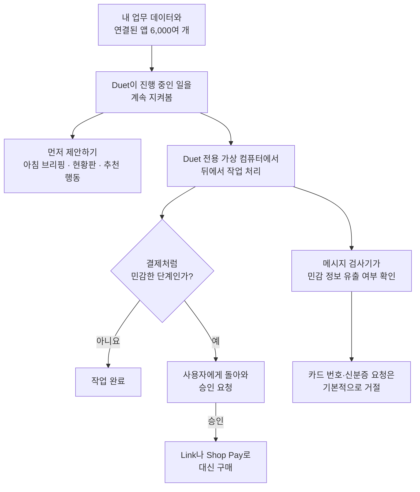

<aside class="ai-knowledge-sidebar">
  
CATEGORIES

  <nav class="ai-cat-tree">

에이전트 오케스트레이션17
<ul><li><a href="https://altjs4510.github.io/ai_news_blog/knowledge/20261015/">2026-10-15How Third Moment Research runs 10,000 agents for…</a></li><li><a href="https://altjs4510.github.io/ai_news_blog/knowledge/20261014/">2026-10-14How Anthropic's Dynamic Workflows Coordinate Cla…</a></li><li><a href="https://altjs4510.github.io/ai_news_blog/knowledge/20260930/">2026-09-30Agents you can coach: how Asana builds human-age…</a></li><li><a href="https://altjs4510.github.io/ai_news_blog/knowledge/20260929/">2026-09-29vectorize-io/hindsight — Hindsight: Agent Memory…</a></li><li><a href="https://altjs4510.github.io/ai_news_blog/knowledge/20260831-openexecutive-virtual-c-suite/">2026-08-31Open Executive — 8명의 전문 에이전트를 하나의 임원 목소리로</a></li><li><a href="https://altjs4510.github.io/ai_news_blog/knowledge/20260828/">2026-08-28Google ADK for Python v2.8.0 — RemoteA2aAgent 네이…</a></li><li><a href="https://altjs4510.github.io/ai_news_blog/knowledge/20260826/">2026-08-26apache/maka — 도구 호출·권한 결정·종료 이벤트를 append-only 로그…</a></li><li><a href="https://altjs4510.github.io/ai_news_blog/knowledge/20260823/">2026-08-23The Evolution of the Agent Harness — 하네스가 모델 가중치…</a></li><li><a href="https://altjs4510.github.io/ai_news_blog/knowledge/20260821/">2026-08-21volcengine/OpenViking — 에이전트 메모리·Knowledge RAG·스…</a></li><li><a href="https://altjs4510.github.io/ai_news_blog/knowledge/20260805/">2026-08-05TencentCloud/TencentDB-Agent-Memory — 대화·문서·코드를 …</a></li><li><a href="https://altjs4510.github.io/ai_news_blog/knowledge/20260708/">2026-07-08Expanding Managed Agents in Gemini API: backgrou…</a></li><li><a href="https://altjs4510.github.io/ai_news_blog/knowledge/20260701/">2026-07-01Google OKF (Open Knowledge Format) — 벤더 중립 에이전트 …</a></li><li><a href="https://altjs4510.github.io/ai_news_blog/knowledge/20260623/">2026-06-23bytedance/deer-flow — 샌드박스·메모리·서브에이전트·메시지 게이트웨이를…</a></li><li><a href="https://altjs4510.github.io/ai_news_blog/knowledge/20260611/">2026-06-11The evolution of agentic surfaces: building with…</a></li><li><a href="https://altjs4510.github.io/ai_news_blog/knowledge/20260602/">2026-06-02revfactory/harness — 도메인별 에이전트 팀과 스킬을 자동 설계하는 메타…</a></li><li><a href="https://altjs4510.github.io/ai_news_blog/knowledge/20260529/">2026-05-29Introducing dynamic workflows in Claude Code</a></li><li><a href="https://altjs4510.github.io/ai_news_blog/knowledge/20260507/">2026-05-07ruvnet/ruflo — Claude 멀티 에이전트 오케스트레이션 플랫폼</a></li></ul>

MCP &amp; 도구 통합15
<ul><li><a href="https://altjs4510.github.io/ai_news_blog/knowledge/20261017/">2026-10-17mksglu/context-mode — 코딩 에이전트용 컨텍스트 윈도우 최적화</a></li><li><a href="https://altjs4510.github.io/ai_news_blog/knowledge/20261007/">2026-10-07morluto/rea — 앱 동작부터 네이티브 바이너리까지 에이전트로 리버스 엔지니어링</a></li><li><a href="https://altjs4510.github.io/ai_news_blog/knowledge/20260802/">2026-08-02Stateless MCP has recaptured my interest (and in…</a></li><li><a href="https://altjs4510.github.io/ai_news_blog/knowledge/20260731/">2026-07-31different-ai/openwork — Claude Cowork의 오픈소스 대안(o…</a></li><li><a href="https://altjs4510.github.io/ai_news_blog/knowledge/20260729/">2026-07-29Bringing MCP 2026-07-28 to Claude</a></li><li><a href="https://altjs4510.github.io/ai_news_blog/knowledge/20260726/">2026-07-26citrolabs/ego-lite — 로그인된 브라우저 상태를 AI 에이전트와 공유하는…</a></li><li><a href="https://altjs4510.github.io/ai_news_blog/knowledge/20260718/">2026-07-18tirth8205/code-review-graph — MCP·CLI용 로컬 코드 인텔리…</a></li><li><a href="https://altjs4510.github.io/ai_news_blog/knowledge/20260618/">2026-06-18DeusData/codebase-memory-mcp — 158개 언어 코드베이스를 밀리…</a></li><li><a href="https://altjs4510.github.io/ai_news_blog/knowledge/20260604/">2026-06-04chopratejas/headroom — Compress tool outputs bef…</a></li><li><a href="https://altjs4510.github.io/ai_news_blog/knowledge/20260603/">2026-06-03How Bad MCP design cost your Agent 5× more token…</a></li><li><a href="https://altjs4510.github.io/ai_news_blog/knowledge/20260521/">2026-05-21colbymchenry/codegraph — Pre-indexed code knowle…</a></li><li><a href="https://altjs4510.github.io/ai_news_blog/knowledge/20260517/">2026-05-17I gave my LLM 100,000+ tools — Lazy Discovery &a…</a></li><li><a href="https://altjs4510.github.io/ai_news_blog/knowledge/20260512/">2026-05-12agentmemory — Persistent memory for AI coding ag…</a></li><li><a href="https://altjs4510.github.io/ai_news_blog/knowledge/20260509/">2026-05-09How to connect 100 MCP servers without the conte…</a></li><li><a href="https://altjs4510.github.io/ai_news_blog/knowledge/20260506/">2026-05-06mksglu/context-mode — AI 코딩 에이전트용 컨텍스트 윈도우 최적화</a></li></ul>

코딩 에이전트27
<ul><li><a href="https://altjs4510.github.io/ai_news_blog/knowledge/20261022/">2026-10-22Claude Mods: Flipping the Harness Inside Out</a></li><li><a href="https://altjs4510.github.io/ai_news_blog/knowledge/20261018/">2026-10-18Quoting Addy Osmani, Morgan Westlee Lunt, and Qi…</a></li><li><a href="https://altjs4510.github.io/ai_news_blog/knowledge/20261014-claude-code-advisor/">2026-10-14Claude Code advisor — 가벼운 메인 모델이 일하고, 갈림길에서만 Opu…</a></li><li><a href="https://altjs4510.github.io/ai_news_blog/knowledge/20260920/">2026-09-20Claude Code 2.1.277 — CLAUDE.md가 없으면 AGENTS.md를 …</a></li><li><a href="https://altjs4510.github.io/ai_news_blog/knowledge/20260912/">2026-09-12Quoting Boris Cherny — 'Claude가 쓴 프로덕션 코드는 사람이 쓴…</a></li><li><a href="https://altjs4510.github.io/ai_news_blog/knowledge/20260910/">2026-09-10vastsa/PI-Desktop — Electron + Rust 호스트 코어 + 에이전…</a></li><li><a href="https://altjs4510.github.io/ai_news_blog/knowledge/20260906/">2026-09-06DietrichGebert/ponytail — 에이전트를 '방에서 가장 게으른 시니어 …</a></li><li><a href="https://altjs4510.github.io/ai_news_blog/knowledge/20260903/">2026-09-03pacifio/atlas — 여러 코딩 에이전트의 변경을 한곳에서 추적·질의하는 '에이…</a></li><li><a href="https://altjs4510.github.io/ai_news_blog/knowledge/20260901/">2026-09-01affaan-m/ECC — 스킬·본능·메모리·보안을 묶은 에이전트 하네스 성능 최적화 …</a></li><li><a href="https://altjs4510.github.io/ai_news_blog/knowledge/20260831-gitnexus-code-knowledge-graph/">2026-08-31GitNexus — 코드베이스를 지식그래프로 바꿔 에이전트에게 쥐어주기</a></li><li><a href="https://altjs4510.github.io/ai_news_blog/knowledge/20260829/">2026-08-29cursor/plugins — 플러그인 명세(specification)와 공식 플러그인…</a></li><li><a href="https://altjs4510.github.io/ai_news_blog/knowledge/20260819/">2026-08-19akitaonrails/ai-memory — 코딩 에이전트 CLI 간 장기 기억과 벤더…</a></li><li><a href="https://altjs4510.github.io/ai_news_blog/knowledge/20260814/">2026-08-14cathrynlavery/diagram-design — Claude Code용 에디토리…</a></li><li><a href="https://altjs4510.github.io/ai_news_blog/knowledge/20260810/">2026-08-10Auto mode is now the default in Claude Code for …</a></li><li><a href="https://altjs4510.github.io/ai_news_blog/knowledge/20260808/">2026-08-08PrimeIntellect-ai/prime-agent — 코딩 워크플로우와 장시간 자율…</a></li><li><a href="https://altjs4510.github.io/ai_news_blog/knowledge/20260804/">2026-08-04esengine/DeepSeek-Reasonix — prefix-cache 안정성을 축…</a></li><li><a href="https://altjs4510.github.io/ai_news_blog/knowledge/20260728/">2026-07-28alibaba/open-code-review — 결정론적 파이프라인 + LLM 에이전트…</a></li><li><a href="https://altjs4510.github.io/ai_news_blog/knowledge/20260725/">2026-07-25The new rules of context engineering for Claude …</a></li><li><a href="https://altjs4510.github.io/ai_news_blog/knowledge/20260714/">2026-07-14Graphify-Labs/graphify — 코드베이스를 질의 가능한 지식 그래프로 만…</a></li><li><a href="https://altjs4510.github.io/ai_news_blog/knowledge/20260707/">2026-07-07AI Hero Skills Catalog — 실무 엔지니어를 위한 재사용 가능한 판단 …</a></li><li><a href="https://altjs4510.github.io/ai_news_blog/knowledge/20260705/">2026-07-05openai/codex-plugin-cc — Claude Code에서 Codex를 위임…</a></li><li><a href="https://altjs4510.github.io/ai_news_blog/knowledge/20260626/">2026-06-26google-labs-code/design.md — 코딩 에이전트에게 디자인 시스템을 …</a></li><li><a href="https://altjs4510.github.io/ai_news_blog/knowledge/20260619/">2026-06-19Claude Code now supports artifacts</a></li><li><a href="https://altjs4510.github.io/ai_news_blog/knowledge/20260530/">2026-05-30Leonxlnx/taste-skill — AI에게 좋은 취향을 부여해 generic s…</a></li><li><a href="https://altjs4510.github.io/ai_news_blog/knowledge/20260528/">2026-05-28Building self-improving tax agents with Codex</a></li><li><a href="https://altjs4510.github.io/ai_news_blog/knowledge/20260508/">2026-05-08addyosmani/agent-skills — Production-grade engin…</a></li><li><a href="https://altjs4510.github.io/ai_news_blog/knowledge/20260505/">2026-05-05mattpocock/skills — Skills for Real Engineers (.…</a></li></ul>

모델 &amp; 연구11
<ul><li><a href="https://altjs4510.github.io/ai_news_blog/knowledge/20261009/">2026-10-09Claude Haiku 5.5 (Simon Willison의 출시 노트와 가격 분석)</a></li><li><a href="https://altjs4510.github.io/ai_news_blog/knowledge/20260907-voicemem-dual-brain-memory/">2026-09-07VoiceMem — 좌뇌·우뇌로 쪼갠 스트리밍 메모리로 음성 에이전트 지연 없애기</a></li><li><a href="https://altjs4510.github.io/ai_news_blog/knowledge/20260904/">2026-09-04HarnessDev: Can LLMs Create and Evolve Their Own…</a></li><li><a href="https://altjs4510.github.io/ai_news_blog/knowledge/20260717/">2026-07-17After a year building agent memory, 'save everyt…</a></li><li><a href="https://altjs4510.github.io/ai_news_blog/knowledge/20260716-proprag/">2026-07-16PropRAG — 프로포지션 경로 위 beam search로 멀티홉 검색 안내</a></li><li><a href="https://altjs4510.github.io/ai_news_blog/knowledge/20260712/">2026-07-12Do Automated Evals Work?</a></li><li><a href="https://altjs4510.github.io/ai_news_blog/knowledge/20260620/">2026-06-20zai-org/GLM-5 — From Vibe Coding to Agentic Engi…</a></li><li><a href="https://altjs4510.github.io/ai_news_blog/knowledge/20260617/">2026-06-17Predicting model behavior before release by simu…</a></li><li><a href="https://altjs4510.github.io/ai_news_blog/knowledge/20260610/">2026-06-10Fable 5 just made cost-aware model routing manda…</a></li><li><a href="https://altjs4510.github.io/ai_news_blog/knowledge/20260516/">2026-05-16STALE — 에이전트가 자기 기억의 유효성을 인지할 수 있는가</a></li><li><a href="https://altjs4510.github.io/ai_news_blog/knowledge/20260513/">2026-05-13Thinking Machines' Native Interaction Models — T…</a></li></ul>

인프라 &amp; 컴퓨트5
<ul><li><a href="https://altjs4510.github.io/ai_news_blog/knowledge/20260905/">2026-09-05magnitudedev/magnitude — 하드웨어에 맞는 최적 로컬 모델을 띄워 이…</a></li><li><a href="https://altjs4510.github.io/ai_news_blog/knowledge/20260806/">2026-08-06cloudflare/computer — 에이전트에게 컴퓨터를 통째로 주는 엣지 실행 샌…</a></li><li><a href="https://altjs4510.github.io/ai_news_blog/knowledge/20260723/">2026-07-23diegosouzapw/OmniRoute — 268+ 프로바이더를 단일 엔드포인트로 묶…</a></li><li><a href="https://altjs4510.github.io/ai_news_blog/knowledge/20260522/">2026-05-22Giving Agents Computers — Ivan Burazin, Daytona</a></li><li><a href="https://altjs4510.github.io/ai_news_blog/knowledge/20260520/">2026-05-20New in Claude Managed Agents: self-hosted sandbo…</a></li></ul>

보안 &amp; 거버넌스24
<ul><li><a href="https://altjs4510.github.io/ai_news_blog/knowledge/20261021/">2026-10-21cloudflare/security-audit-skill — 독립 검증된 기계 판독형 …</a></li><li><a href="https://altjs4510.github.io/ai_news_blog/knowledge/20261020/">2026-10-20Satya Nadella — 모델을 내부자 위험으로 보는 원칙에 따라 Project P…</a></li><li><a href="https://altjs4510.github.io/ai_news_blog/knowledge/20261016/">2026-10-16Crossing the Threshold: How OpenAI and Anthropic…</a></li><li><a href="https://altjs4510.github.io/ai_news_blog/knowledge/20261011/">2026-10-11Anthropic can’t reliably control its AI agents. …</a></li><li><a href="https://altjs4510.github.io/ai_news_blog/knowledge/20261004/">2026-10-04Apple says it's tightening macOS 'Full Disk Acce…</a></li><li><a href="https://altjs4510.github.io/ai_news_blog/knowledge/20261001/">2026-10-01NVIDIA/OpenShell</a></li><li><a href="https://altjs4510.github.io/ai_news_blog/knowledge/20260919/">2026-09-19cloudflare/security-audit-skill — 다단계 보안 감사를 '독립…</a></li><li><a href="https://altjs4510.github.io/ai_news_blog/knowledge/20260913/">2026-09-13OpenAI agents attacked RubyGems back in May: Ope…</a></li><li><a href="https://altjs4510.github.io/ai_news_blog/knowledge/20260902/">2026-09-02AIR raises $50M to help companies vet the skills…</a></li><li><a href="https://altjs4510.github.io/ai_news_blog/knowledge/20260827/">2026-08-27Claude in Chrome is generally available</a></li><li><a href="https://altjs4510.github.io/ai_news_blog/knowledge/20260819-mind-viruses/">2026-08-19탈옥도, 인젝션도 없이 — 대화로만 퍼지는 에이전트의 '마인드 바이러스'</a></li><li><a href="https://altjs4510.github.io/ai_news_blog/knowledge/20260812/">2026-08-12semantica-agi/semantica — 컨텍스트와 '책임 추적 가능한(accou…</a></li><li><a href="https://altjs4510.github.io/ai_news_blog/knowledge/20260730/">2026-07-30Anatomy of a Frontier Lab Agent Intrusion: A Tec…</a></li><li><a href="https://altjs4510.github.io/ai_news_blog/knowledge/20260715/">2026-07-15Dicklesworthstone/destructive_command_guard — 에이…</a></li><li><a href="https://altjs4510.github.io/ai_news_blog/knowledge/20260710/">2026-07-1070개 MCP 서버 strace 런타임 감사 — 부팅 시 아웃바운드 호출 서버 적발</a></li><li><a href="https://altjs4510.github.io/ai_news_blog/knowledge/20260704/">2026-07-04Cloudflare is about to block AI agents by defaul…</a></li><li><a href="https://altjs4510.github.io/ai_news_blog/knowledge/20260703/">2026-07-03Giving admins more visibility and control over C…</a></li><li><a href="https://altjs4510.github.io/ai_news_blog/knowledge/20260630/">2026-06-30Introducing the Claude apps gateway for Amazon B…</a></li><li><a href="https://altjs4510.github.io/ai_news_blog/knowledge/20260624/">2026-06-24Agent identity in Claude Tag: a new access model…</a></li><li><a href="https://altjs4510.github.io/ai_news_blog/knowledge/20260613/">2026-06-13Fable 5's guardrails got bypassed in 48 hours — …</a></li><li><a href="https://altjs4510.github.io/ai_news_blog/knowledge/20260612/">2026-06-12NVIDIA/SkillSpector — AI 에이전트 스킬용 보안 스캐너</a></li><li><a href="https://altjs4510.github.io/ai_news_blog/knowledge/20260607/">2026-06-07OpenAI Help: Lockdown Mode</a></li><li><a href="https://altjs4510.github.io/ai_news_blog/knowledge/20260531/">2026-05-31How we contain Claude across products</a></li><li><a href="https://altjs4510.github.io/ai_news_blog/knowledge/20260527/">2026-05-27Microsoft Copilot Cowork Exfiltrates Files</a></li></ul>

응용 사례9
<ul><li><a href="https://altjs4510.github.io/ai_news_blog/knowledge/20261023/" class="current">2026-10-23Claude Duet app is Anthropic's bet on agents</a></li><li><a href="https://altjs4510.github.io/ai_news_blog/knowledge/20261006/">2026-10-06How Cresta turned CX expertise into an agent bui…</a></li><li><a href="https://altjs4510.github.io/ai_news_blog/knowledge/20260911/">2026-09-11Now everyone can put data to work — ChatGPT Work…</a></li><li><a href="https://altjs4510.github.io/ai_news_blog/knowledge/20260909/">2026-09-09Reducing cost and improving performance with Cla…</a></li><li><a href="https://altjs4510.github.io/ai_news_blog/knowledge/20260709/">2026-07-09mvanhorn/last30days-skill — Reddit·X·YouTube·HN·…</a></li><li><a href="https://altjs4510.github.io/ai_news_blog/knowledge/20260621/">2026-06-21calesthio/OpenMontage — 12 파이프라인·52 도구·500+ 스킬을 …</a></li><li><a href="https://altjs4510.github.io/ai_news_blog/knowledge/20260609/">2026-06-09Building intelligent apps for Apple platforms wi…</a></li><li><a href="https://altjs4510.github.io/ai_news_blog/knowledge/20260515/">2026-05-15Clawdmeter — Claude Code 사용량을 데스크톱 대시보드로</a></li><li><a href="https://altjs4510.github.io/ai_news_blog/knowledge/20260514/">2026-05-14Introducing Claude for Small Business</a></li></ul>

산업 동향8
<ul><li><a href="https://altjs4510.github.io/ai_news_blog/knowledge/20261024/">2026-10-24Donating Agent Skills to the Agentic AI Foundati…</a></li><li><a href="https://altjs4510.github.io/ai_news_blog/knowledge/20260907-humanmade-52week-rhythm/">2026-09-07휴먼 메이드의 '52주 리듬' — 아이디어가 흔해진 시대에 값이 오르는 건 버리는 판단</a></li><li><a href="https://altjs4510.github.io/ai_news_blog/knowledge/20260830/">2026-08-30[AINews] OpenAI shuts off Cursor — 프론티어 모델 공급 차단…</a></li><li><a href="https://altjs4510.github.io/ai_news_blog/knowledge/20260711/">2026-07-11OpenAI says GPT 5.6 is the 'preferred model' for…</a></li><li><a href="https://altjs4510.github.io/ai_news_blog/knowledge/20260702/">2026-07-02How Cursor deploys AI inside the enterprise (For…</a></li><li><a href="https://altjs4510.github.io/ai_news_blog/knowledge/20260616/">2026-06-16Why AI hasn't replaced software engineers, and w…</a></li><li><a href="https://altjs4510.github.io/ai_news_blog/knowledge/20260519/">2026-05-19Anthropic acquires Stainless</a></li><li><a href="https://altjs4510.github.io/ai_news_blog/knowledge/20260504/">2026-05-04Agents for Everything Else: Codex for Knowledge …</a></li></ul>
</nav>
</aside>

<article class="ai-knowledge-article">

<header class="ai-post-hero">
  
<a class="ai-back" href="../">KNOWLEDGE</a> · 2026-10-23 · 오늘의 학습

  <h2 class="ai-post-title">Claude Duet app is Anthropic's bet on agents</h2>
</header>

> 원문: [Claude Duet app is Anthropic's bet on agents](https://techcrunch.com/2026/10/22/claude-duet-app-is-anthropics-bet-on-agents/)

## 📌 학습 정리

### 1. 한 줄로 말하면

Claude Duet은 내가 묻기 전에 먼저 "오늘은 이걸 챙기셔야 할 것 같아요" 하고 정리해 주는 AI 업무 비서예요. 결제처럼 민감한 일은 꼭 나한테 먼저 확인받고 진행해요.

### 2. 왜 이게 만들어졌어요?

지금까지 AI 도우미는 대부분 내가 질문해야 답해 주는 방식이었어요. 그런데 시장의 관심이 "대신 일을 해 주는 AI"로 옮겨 가고 있어요. 원문에서는 이런 AI를 에이전트(agent)라고 부르는데, 질문에 답하는 데서 끝나지 않고 사용자를 대신해 실제로 일을 처리하는 AI를 말해요. 개인용·업무용 AI 비서가 매주 새로 나올 정도로 경쟁도 치열하고, Meta Muse나 OpenAI Dots 같은 경쟁 서비스도 업무용 기능을 늘리는 중이에요. Anthropic은 이 흐름에 맞춰 직장인과 소규모 사업자의 업무 자동화·관리에 초점을 둔 Duet을 내놓았어요.

### 3. 비유로 풀면

이건 마치 **눈치 빠른 비서실장** 같아요. 내가 회의하는 동안 비서실장은 뒤에서 자료를 모으고, 아침마다 "오늘 챙기실 일" 브리핑을 올리고, 필요한 현황판도 만들어 둬요. 다만 법인카드를 긁어야 하는 일이 생기면 꼭 먼저 물어보고, 계좌 이체나 주식 매매는 아예 맡지 않아요.

반대로 Duet은 **심부름센터와는 조금 달라요**. 원문에 따르면 Duet은 장보기 같은 잔심부름이나 티켓 예매에는 약하고, 웹을 클릭하며 일하는 모습을 실시간으로 보여 주지도 않아요. 그 대신 내 데이터를 들여다보고 정리하거나 다음에 할 일을 제안하는 쪽에 강해요.

그래서 결국 Duet은 내 데이터를 바탕으로 먼저 움직여서 정리하고 제안하는 역할을 해요. 다만 돈이 오가는 민감한 순간에는 사람에게 결정을 넘기도록 만들어진 업무용 에이전트예요.

### 4. 어떻게 작동하는지 (그림으로)

Duet은 연결된 앱과 내 데이터를 보면서 진행 중인 일을 지켜보다가, 브리핑이나 추천을 먼저 건네요. 실제 작업은 Duet 전용 가상 컴퓨터에서 처리돼서, 그동안 나는 다른 일을 해도 돼요. 결제 같은 민감한 단계에서는 꼭 내 승인을 받아요. 메시지마다 별도의 검사기가 민감한 정보가 새어 나가지 않는지도 확인해요. 그림에는 없지만 주식 같은 증권 거래나 계좌 간 이체는 승인을 받더라도 하지 않는다고 해요.

### 5. 처음 보는 용어 풀이

- **에이전트 (agent)** — 질문에 답하는 데서 끝나지 않고 사용자를 대신해 일을 직접 처리하는 AI예요. 원문은 시장의 관심이 "AI 도우미"에서 이런 에이전트로 넘어가고 있다고 설명해요.
- **가상 컴퓨터 (virtual machine)** — 진짜 컴퓨터 안에 소프트웨어로 만든 또 하나의 컴퓨터예요. Duet은 자기 전용 가상 컴퓨터에서 일하기 때문에, 내가 다른 일을 하는 동안에도 뒤에서 작업을 이어 갈 수 있어요.
- **연결 도구와 확장 기능 (connectors and plug-ins)** — Duet이 다른 앱이나 서비스와 정보를 주고받을 수 있게 이어 주는 장치예요. Claude Marketplace(Anthropic의 연결 도구 모음 장터)에 있는 6,000개가 넘는 도구와 연결할 수 있다고 해요.
- **분류기 (classifier)** — 들어온 내용을 보고 어떤 종류인지 가려내는 검사 장치예요. Duet에서는 메시지마다 민감한 정보가 밖으로 새지 않는지 확인하는 데 쓰여요.
- **디지털 지갑 (digital wallet)** — 카드나 결제 정보를 저장해 두고 온라인에서 간편하게 결제하게 해 주는 서비스예요. Duet은 Stripe의 Link(결제 회사 Stripe의 간편결제 지갑)와 Shopify의 Shop Pay(쇼핑몰 플랫폼 Shopify의 간편결제)로 대신 구매할 수 있어요.
- **대시보드 (dashboard)** — 여러 숫자와 현황을 한 화면에 모아 보여 주는 현황판이에요. Duet이 내 데이터를 바탕으로 만들어 주는 결과물 중 하나예요.
- **연구용 미리보기 (research preview)** — 정식 출시 전에 일부 사용자에게 먼저 열어 반응을 살피는 단계예요. Duet은 지금 이 단계라서 대기자 명단에 등록해야 써 볼 수 있어요.

### 6. 한 발 더 들어가고 싶다면

- [Claude Duet 대기자 명단](https://claude.com/product/claude-duet) — 이걸 보면 Duet을 직접 써 보려면 어디서 신청하는지 알 수 있어요. 지금은 Pro·Max 사용자 대상의 연구용 미리보기로 열려 있어요.
- [personal and productivity-based assistants](https://techcrunch.com/2026/10/10/all-the-ai-agents-that-can-live-in-your-text-messages/) — 이걸 보면 Duet이 뛰어든 개인·업무용 AI 비서 시장에 어떤 서비스들이 있는지 한눈에 볼 수 있어요.
- [OpenAI Dots](https://techcrunch.com/2026/09/29/openai-launches-dots-its-bubbly-agentic-avatar/) — 이걸 보면 업무용 도구 연동을 내세운 경쟁 에이전트가 Duet과 어떻게 다른지 비교해 볼 수 있어요.
- [Meta Muse](https://techcrunch.com/2026/10/21/meta-says-muse-has-over-10m-users-with-shopping-a-top-activity/) — 이걸 보면 사용자 천만 명을 넘긴 경쟁 AI 비서가 실제로 어떤 용도로 많이 쓰이는지 알 수 있어요.
- [Instinct](https://techcrunch.com/2026/08/24/instincts-powerful-ai-assistant-is-raising-privacy-and-security-concerns/) — 이걸 보면 Anthropic이 Duet과 선을 그은 개인 에이전트가 어떤 개인정보·보안 우려를 받고 있는지 알 수 있어요.

---

## 📖 원문 전체 번역 (정독용)

> 의역 최소화한 전체 번역입니다. 큰 흐름은 위 정리에서 잡고, 정확한 워딩이 필요할 땐 이 섹션에서 정독하세요.

AI 업계는 [개인용·생산성 기반 어시스턴트](https://techcrunch.com/2026/10/10/all-the-ai-agents-that-can-live-in-your-text-messages/)로 넘쳐나고 있으며, 매주 새로운 제품이 출시되고 있다. 이제 Anthropic도 이 경쟁에 뛰어들어, Claude Duet이라는 새 앱으로 사용자의 관심을 얻으려 한다. Claude Duet은 [Meta Muse](https://techcrunch.com/2026/10/21/meta-says-muse-has-over-10m-users-with-shopping-a-top-activity/), [OpenAI Dots](https://techcrunch.com/2026/09/29/openai-launches-dots-its-bubbly-agentic-avatar/), [Hark](https://techcrunch.com/2026/10/06/hark-releases-an-ai-personal-assistant-with-a-focus-on-privacy/), [Instinct](https://techcrunch.com/2026/08/24/instincts-powerful-ai-assistant-is-raising-privacy-and-security-concerns/), [Grok Bot](https://x.ai/bot), [Fo](https://techcrunch.com/2026/10/06/vinod-khosla-believes-ex-deepmind-engineers-wajo-will-win-agent-market-on-trust/)와 경쟁하는 것을 목표로 한다.

Anthropic은 이 새 에이전트가 전문직 종사자와 소규모 사업체를 대상으로, 작업을 자동화하고 관리하도록 돕기 위한 것이라고 밝혔다. 회사는 [Instinct](https://techcrunch.com/2026/09/28/viral-ai-agent-instinct-raises-1b-series-c-at-a-10b-valuation/) 같은 개인용 에이전트와 선을 긋는다. Duet은 심부름을 처리하거나 티켓을 예약하는 데는 능하지 않고, 브라우저를 사용하는 모습을 실시간으로 보여줄 수도 없다고 설명했다.

대신 Duet은 사용자를 위해 일일 브리핑을 작성하고, 대시보드를 만들고, 사용자의 데이터를 바탕으로 할 일을 제안할 수 있다. 다른 에이전트들처럼 Duet도 자체 가상 머신에서 백그라운드로 작업을 수행하므로, 사용자는 다른 일을 처리하다가 승인이 필요할 때 Duet이 돌아와 알려주는 방식으로 쓸 수 있다.

이번 출시는 시장이 AI 어시스턴트를 넘어, 사용자를 대신해 일하는 에이전트로 옮겨가는 시점에 이뤄졌다. Anthropic의 경쟁사들 상당수는 비즈니스 활용 사례에 집중하고 있다. Meta의 Muse는 개인용 AI 어시스턴트이지만, 회사는 [다른 앱들과 연결되는 소규모 사업체용 버전](https://muse.ai/business)도 함께 내놓았다. OpenAI의 Dots 역시 [전문 업무 도구와의 통합](https://techcrunch.com/2026/09/29/openai-launches-dots-its-bubbly-agentic-avatar/)을 갖춰 비즈니스 쪽에 무게를 둔다.

[Video 6](https://www.youtube.com/watch?v=Fb-68zqcSVs)

Anthropic은 Duet이 진행 중인 작업을 모니터링하면서 추천 사항을 선제적으로 전달한다고 말한다. Claude Opus 5.5 모델 기반으로 만들어진 Duet은 Claude Marketplace의 6,000개가 넘는 커넥터와 플러그인에 연결할 수 있다. 또한 Stripe의 Link 디지털 지갑이나 Shopify의 Shop Pay를 통해 사용자를 대신해 온라인 구매도 할 수 있다.

회사는 결제처럼 민감한 단계에는 사용자 승인이 필요하다고 밝혔다. 다만 Duet은 증권을 거래하거나 계좌 간에 돈을 옮기지는 않는다.

Anthropic은 또한 민감한 정보가 외부로 유출되지 않도록 각 메시지를 검사하는 새로운 분류기(classifier)를 공개했다. 회사에 따르면 이 에이전트는 기본적으로 신용카드 번호와 정부 발급 신분증 정보를 요구하는 요청을 거절한다.

Claude Duet은 iOS와 Android 앱으로, 그리고 Claude.ai를 통한 웹에서 Pro 및 Max 고객에게 리서치 프리뷰(research preview) 형태로 제공된다. 사용해 보려면 [대기자 명단](https://claude.com/product/claude-duet)에 등록해야 한다.

_기사 내 링크를 통해 구매하면 [소정의 수수료를 받을 수 있습니다](https://techcrunch.com/techcrunch-affiliate-monetization-standards/). 이는 편집의 독립성에 영향을 주지 않습니다._

Ivan은 TechCrunch에서 전 세계 소비자 기술 동향을 취재한다. 인도에 거주하며, 이전에 Huffington Post와 The Next Web 등의 매체에서 일했다.

Ivan에게 연락하거나 그의 접촉 여부를 확인하려면 [im@ivanmehta.com](mailto:im@ivanmehta.com)으로 이메일을 보내거나 Signal의 ivan.42로 암호화 메시지를 보내면 된다.

[프로필 보기](https://techcrunch.com/author/ivan-mehta/)

</article>

<!-- ai-related-links -->
<aside class="ai-related-links">
  
관련 학습

  <ul><li><a href="https://altjs4510.github.io/ai_news_blog/knowledge/20260611/">2026-06-11The evolution of agentic surfaces: building with…</a></li><li><a href="https://altjs4510.github.io/ai_news_blog/knowledge/20260504/">2026-05-04Agents for Everything Else: Codex for Knowledge …</a></li><li><a href="https://altjs4510.github.io/ai_news_blog/knowledge/20260731/">2026-07-31different-ai/openwork — Claude Cowork의 오픈소스 대안(o…</a></li></ul>
</aside>
<!-- /ai-related-links -->
