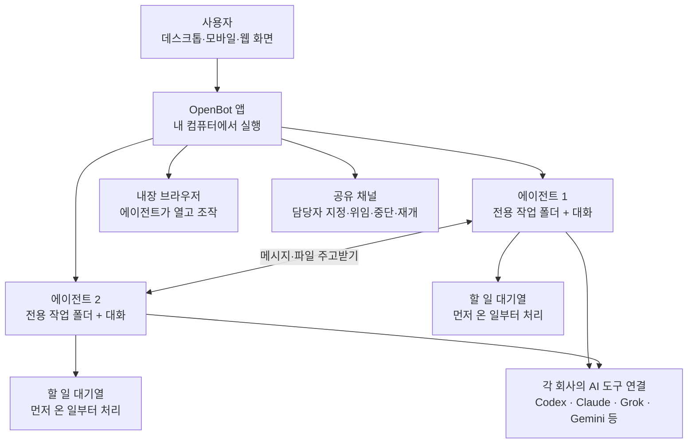

<div class="ai-knowledge-shell">

<aside class="ai-knowledge-sidebar">
  <p class="ai-eyebrow">CATEGORIES</p>
  <nav class="ai-cat-tree"><details class="ai-cat" open><summary><span class="catname">에이전트 오케스트레이션</span><span class="catcount">14</span></summary><ul><li><a href="https://altjs4510.github.io/ai_news_blog/knowledge/20261027/" class="current"><span class="kdate">2026-10-27</span><span class="ktitle">nightly-labs/openbot — Codex·Claude·Grok을 상주 팀원처…</span></a></li><li><a href="https://altjs4510.github.io/ai_news_blog/knowledge/20261015/"><span class="kdate">2026-10-15</span><span class="ktitle">How Third Moment Research runs 10,000 agents for…</span></a></li><li><a href="https://altjs4510.github.io/ai_news_blog/knowledge/20261014/"><span class="kdate">2026-10-14</span><span class="ktitle">How Anthropic's Dynamic Workflows Coordinate Cla…</span></a></li><li><a href="https://altjs4510.github.io/ai_news_blog/knowledge/20260930/"><span class="kdate">2026-09-30</span><span class="ktitle">Agents you can coach: how Asana builds human-age…</span></a></li><li><a href="https://altjs4510.github.io/ai_news_blog/knowledge/20260831-openexecutive-virtual-c-suite/"><span class="kdate">2026-08-31</span><span class="ktitle">Open Executive — 8명의 전문 에이전트를 하나의 임원 목소리로</span></a></li><li><a href="https://altjs4510.github.io/ai_news_blog/knowledge/20260828/"><span class="kdate">2026-08-28</span><span class="ktitle">Google ADK for Python v2.8.0 — RemoteA2aAgent 네이…</span></a></li><li><a href="https://altjs4510.github.io/ai_news_blog/knowledge/20260826/"><span class="kdate">2026-08-26</span><span class="ktitle">apache/maka — 도구 호출·권한 결정·종료 이벤트를 append-only 로그…</span></a></li><li><a href="https://altjs4510.github.io/ai_news_blog/knowledge/20260823/"><span class="kdate">2026-08-23</span><span class="ktitle">The Evolution of the Agent Harness — 하네스가 모델 가중치…</span></a></li><li><a href="https://altjs4510.github.io/ai_news_blog/knowledge/20260805/"><span class="kdate">2026-08-05</span><span class="ktitle">TencentCloud/TencentDB-Agent-Memory — 대화·문서·코드를 …</span></a></li><li><a href="https://altjs4510.github.io/ai_news_blog/knowledge/20260623/"><span class="kdate">2026-06-23</span><span class="ktitle">bytedance/deer-flow — 샌드박스·메모리·서브에이전트·메시지 게이트웨이를…</span></a></li><li><a href="https://altjs4510.github.io/ai_news_blog/knowledge/20260611/"><span class="kdate">2026-06-11</span><span class="ktitle">The evolution of agentic surfaces: building with…</span></a></li><li><a href="https://altjs4510.github.io/ai_news_blog/knowledge/20260602/"><span class="kdate">2026-06-02</span><span class="ktitle">revfactory/harness — 도메인별 에이전트 팀과 스킬을 자동 설계하는 메타…</span></a></li><li><a href="https://altjs4510.github.io/ai_news_blog/knowledge/20260529/"><span class="kdate">2026-05-29</span><span class="ktitle">Introducing dynamic workflows in Claude Code</span></a></li><li><a href="https://altjs4510.github.io/ai_news_blog/knowledge/20260507/"><span class="kdate">2026-05-07</span><span class="ktitle">ruvnet/ruflo — Claude 멀티 에이전트 오케스트레이션 플랫폼</span></a></li></ul></details><details class="ai-cat" open><summary><span class="catname">MCP &amp; 도구 통합</span><span class="catcount">18</span></summary><ul><li><a href="https://altjs4510.github.io/ai_news_blog/knowledge/20261017/"><span class="kdate">2026-10-17</span><span class="ktitle">mksglu/context-mode — 코딩 에이전트용 컨텍스트 윈도우 최적화</span></a></li><li><a href="https://altjs4510.github.io/ai_news_blog/knowledge/20261007/"><span class="kdate">2026-10-07</span><span class="ktitle">morluto/rea — 앱 동작부터 네이티브 바이너리까지 에이전트로 리버스 엔지니어링</span></a></li><li><a href="https://altjs4510.github.io/ai_news_blog/knowledge/20260829/"><span class="kdate">2026-08-29</span><span class="ktitle">cursor/plugins — 플러그인 명세(specification)와 공식 플러그인…</span></a></li><li><a href="https://altjs4510.github.io/ai_news_blog/knowledge/20260802/"><span class="kdate">2026-08-02</span><span class="ktitle">Stateless MCP has recaptured my interest (and in…</span></a></li><li><a href="https://altjs4510.github.io/ai_news_blog/knowledge/20260731/"><span class="kdate">2026-07-31</span><span class="ktitle">different-ai/openwork — Claude Cowork의 오픈소스 대안(o…</span></a></li><li><a href="https://altjs4510.github.io/ai_news_blog/knowledge/20260729/"><span class="kdate">2026-07-29</span><span class="ktitle">Bringing MCP 2026-07-28 to Claude</span></a></li><li><a href="https://altjs4510.github.io/ai_news_blog/knowledge/20260726/"><span class="kdate">2026-07-26</span><span class="ktitle">citrolabs/ego-lite — 로그인된 브라우저 상태를 AI 에이전트와 공유하는…</span></a></li><li><a href="https://altjs4510.github.io/ai_news_blog/knowledge/20260718/"><span class="kdate">2026-07-18</span><span class="ktitle">tirth8205/code-review-graph — MCP·CLI용 로컬 코드 인텔리…</span></a></li><li><a href="https://altjs4510.github.io/ai_news_blog/knowledge/20260708/"><span class="kdate">2026-07-08</span><span class="ktitle">Expanding Managed Agents in Gemini API: backgrou…</span></a></li><li><a href="https://altjs4510.github.io/ai_news_blog/knowledge/20260618/"><span class="kdate">2026-06-18</span><span class="ktitle">DeusData/codebase-memory-mcp — 158개 언어 코드베이스를 밀리…</span></a></li><li><a href="https://altjs4510.github.io/ai_news_blog/knowledge/20260609/"><span class="kdate">2026-06-09</span><span class="ktitle">Building intelligent apps for Apple platforms wi…</span></a></li><li><a href="https://altjs4510.github.io/ai_news_blog/knowledge/20260604/"><span class="kdate">2026-06-04</span><span class="ktitle">chopratejas/headroom — Compress tool outputs bef…</span></a></li><li><a href="https://altjs4510.github.io/ai_news_blog/knowledge/20260603/"><span class="kdate">2026-06-03</span><span class="ktitle">How Bad MCP design cost your Agent 5× more token…</span></a></li><li><a href="https://altjs4510.github.io/ai_news_blog/knowledge/20260521/"><span class="kdate">2026-05-21</span><span class="ktitle">colbymchenry/codegraph — Pre-indexed code knowle…</span></a></li><li><a href="https://altjs4510.github.io/ai_news_blog/knowledge/20260517/"><span class="kdate">2026-05-17</span><span class="ktitle">I gave my LLM 100,000+ tools — Lazy Discovery &a…</span></a></li><li><a href="https://altjs4510.github.io/ai_news_blog/knowledge/20260512/"><span class="kdate">2026-05-12</span><span class="ktitle">agentmemory — Persistent memory for AI coding ag…</span></a></li><li><a href="https://altjs4510.github.io/ai_news_blog/knowledge/20260509/"><span class="kdate">2026-05-09</span><span class="ktitle">How to connect 100 MCP servers without the conte…</span></a></li><li><a href="https://altjs4510.github.io/ai_news_blog/knowledge/20260506/"><span class="kdate">2026-05-06</span><span class="ktitle">mksglu/context-mode — AI 코딩 에이전트용 컨텍스트 윈도우 최적화</span></a></li></ul></details><details class="ai-cat" open><summary><span class="catname">코딩 에이전트</span><span class="catcount">26</span></summary><ul><li><a href="https://altjs4510.github.io/ai_news_blog/knowledge/20261022/"><span class="kdate">2026-10-22</span><span class="ktitle">Claude Mods: Flipping the Harness Inside Out</span></a></li><li><a href="https://altjs4510.github.io/ai_news_blog/knowledge/20261018/"><span class="kdate">2026-10-18</span><span class="ktitle">Quoting Addy Osmani, Morgan Westlee Lunt, and Qi…</span></a></li><li><a href="https://altjs4510.github.io/ai_news_blog/knowledge/20261014-claude-code-advisor/"><span class="kdate">2026-10-14</span><span class="ktitle">Claude Code advisor — 가벼운 메인 모델이 일하고, 갈림길에서만 Opu…</span></a></li><li><a href="https://altjs4510.github.io/ai_news_blog/knowledge/20260920/"><span class="kdate">2026-09-20</span><span class="ktitle">Claude Code 2.1.277 — CLAUDE.md가 없으면 AGENTS.md를 …</span></a></li><li><a href="https://altjs4510.github.io/ai_news_blog/knowledge/20260912/"><span class="kdate">2026-09-12</span><span class="ktitle">Quoting Boris Cherny — 'Claude가 쓴 프로덕션 코드는 사람이 쓴…</span></a></li><li><a href="https://altjs4510.github.io/ai_news_blog/knowledge/20260910/"><span class="kdate">2026-09-10</span><span class="ktitle">vastsa/PI-Desktop — Electron + Rust 호스트 코어 + 에이전…</span></a></li><li><a href="https://altjs4510.github.io/ai_news_blog/knowledge/20260906/"><span class="kdate">2026-09-06</span><span class="ktitle">DietrichGebert/ponytail — 에이전트를 '방에서 가장 게으른 시니어 …</span></a></li><li><a href="https://altjs4510.github.io/ai_news_blog/knowledge/20260903/"><span class="kdate">2026-09-03</span><span class="ktitle">pacifio/atlas — 여러 코딩 에이전트의 변경을 한곳에서 추적·질의하는 '에이…</span></a></li><li><a href="https://altjs4510.github.io/ai_news_blog/knowledge/20260901/"><span class="kdate">2026-09-01</span><span class="ktitle">affaan-m/ECC — 스킬·본능·메모리·보안을 묶은 에이전트 하네스 성능 최적화 …</span></a></li><li><a href="https://altjs4510.github.io/ai_news_blog/knowledge/20260831-gitnexus-code-knowledge-graph/"><span class="kdate">2026-08-31</span><span class="ktitle">GitNexus — 코드베이스를 지식그래프로 바꿔 에이전트에게 쥐어주기</span></a></li><li><a href="https://altjs4510.github.io/ai_news_blog/knowledge/20260819/"><span class="kdate">2026-08-19</span><span class="ktitle">akitaonrails/ai-memory — 코딩 에이전트 CLI 간 장기 기억과 벤더…</span></a></li><li><a href="https://altjs4510.github.io/ai_news_blog/knowledge/20260814/"><span class="kdate">2026-08-14</span><span class="ktitle">cathrynlavery/diagram-design — Claude Code용 에디토리…</span></a></li><li><a href="https://altjs4510.github.io/ai_news_blog/knowledge/20260810/"><span class="kdate">2026-08-10</span><span class="ktitle">Auto mode is now the default in Claude Code for …</span></a></li><li><a href="https://altjs4510.github.io/ai_news_blog/knowledge/20260808/"><span class="kdate">2026-08-08</span><span class="ktitle">PrimeIntellect-ai/prime-agent — 코딩 워크플로우와 장시간 자율…</span></a></li><li><a href="https://altjs4510.github.io/ai_news_blog/knowledge/20260804/"><span class="kdate">2026-08-04</span><span class="ktitle">esengine/DeepSeek-Reasonix — prefix-cache 안정성을 축…</span></a></li><li><a href="https://altjs4510.github.io/ai_news_blog/knowledge/20260728/"><span class="kdate">2026-07-28</span><span class="ktitle">alibaba/open-code-review — 결정론적 파이프라인 + LLM 에이전트…</span></a></li><li><a href="https://altjs4510.github.io/ai_news_blog/knowledge/20260725/"><span class="kdate">2026-07-25</span><span class="ktitle">The new rules of context engineering for Claude …</span></a></li><li><a href="https://altjs4510.github.io/ai_news_blog/knowledge/20260714/"><span class="kdate">2026-07-14</span><span class="ktitle">Graphify-Labs/graphify — 코드베이스를 질의 가능한 지식 그래프로 만…</span></a></li><li><a href="https://altjs4510.github.io/ai_news_blog/knowledge/20260707/"><span class="kdate">2026-07-07</span><span class="ktitle">AI Hero Skills Catalog — 실무 엔지니어를 위한 재사용 가능한 판단 …</span></a></li><li><a href="https://altjs4510.github.io/ai_news_blog/knowledge/20260705/"><span class="kdate">2026-07-05</span><span class="ktitle">openai/codex-plugin-cc — Claude Code에서 Codex를 위임…</span></a></li><li><a href="https://altjs4510.github.io/ai_news_blog/knowledge/20260701/"><span class="kdate">2026-07-01</span><span class="ktitle">Google OKF (Open Knowledge Format) — 벤더 중립 에이전트 …</span></a></li><li><a href="https://altjs4510.github.io/ai_news_blog/knowledge/20260626/"><span class="kdate">2026-06-26</span><span class="ktitle">google-labs-code/design.md — 코딩 에이전트에게 디자인 시스템을 …</span></a></li><li><a href="https://altjs4510.github.io/ai_news_blog/knowledge/20260619/"><span class="kdate">2026-06-19</span><span class="ktitle">Claude Code now supports artifacts</span></a></li><li><a href="https://altjs4510.github.io/ai_news_blog/knowledge/20260530/"><span class="kdate">2026-05-30</span><span class="ktitle">Leonxlnx/taste-skill — AI에게 좋은 취향을 부여해 generic s…</span></a></li><li><a href="https://altjs4510.github.io/ai_news_blog/knowledge/20260508/"><span class="kdate">2026-05-08</span><span class="ktitle">addyosmani/agent-skills — Production-grade engin…</span></a></li><li><a href="https://altjs4510.github.io/ai_news_blog/knowledge/20260505/"><span class="kdate">2026-05-05</span><span class="ktitle">mattpocock/skills — Skills for Real Engineers (.…</span></a></li></ul></details><details class="ai-cat" open><summary><span class="catname">모델 &amp; 연구</span><span class="catcount">11</span></summary><ul><li><a href="https://altjs4510.github.io/ai_news_blog/knowledge/20261009/"><span class="kdate">2026-10-09</span><span class="ktitle">Claude Haiku 5.5 (Simon Willison의 출시 노트와 가격 분석)</span></a></li><li><a href="https://altjs4510.github.io/ai_news_blog/knowledge/20260929/"><span class="kdate">2026-09-29</span><span class="ktitle">vectorize-io/hindsight — Hindsight: Agent Memory…</span></a></li><li><a href="https://altjs4510.github.io/ai_news_blog/knowledge/20260907-voicemem-dual-brain-memory/"><span class="kdate">2026-09-07</span><span class="ktitle">VoiceMem — 좌뇌·우뇌로 쪼갠 스트리밍 메모리로 음성 에이전트 지연 없애기</span></a></li><li><a href="https://altjs4510.github.io/ai_news_blog/knowledge/20260904/"><span class="kdate">2026-09-04</span><span class="ktitle">HarnessDev: Can LLMs Create and Evolve Their Own…</span></a></li><li><a href="https://altjs4510.github.io/ai_news_blog/knowledge/20260717/"><span class="kdate">2026-07-17</span><span class="ktitle">After a year building agent memory, 'save everyt…</span></a></li><li><a href="https://altjs4510.github.io/ai_news_blog/knowledge/20260716-proprag/"><span class="kdate">2026-07-16</span><span class="ktitle">PropRAG — 프로포지션 경로 위 beam search로 멀티홉 검색 안내</span></a></li><li><a href="https://altjs4510.github.io/ai_news_blog/knowledge/20260712/"><span class="kdate">2026-07-12</span><span class="ktitle">Do Automated Evals Work?</span></a></li><li><a href="https://altjs4510.github.io/ai_news_blog/knowledge/20260620/"><span class="kdate">2026-06-20</span><span class="ktitle">zai-org/GLM-5 — From Vibe Coding to Agentic Engi…</span></a></li><li><a href="https://altjs4510.github.io/ai_news_blog/knowledge/20260617/"><span class="kdate">2026-06-17</span><span class="ktitle">Predicting model behavior before release by simu…</span></a></li><li><a href="https://altjs4510.github.io/ai_news_blog/knowledge/20260516/"><span class="kdate">2026-05-16</span><span class="ktitle">STALE — 에이전트가 자기 기억의 유효성을 인지할 수 있는가</span></a></li><li><a href="https://altjs4510.github.io/ai_news_blog/knowledge/20260513/"><span class="kdate">2026-05-13</span><span class="ktitle">Thinking Machines' Native Interaction Models — T…</span></a></li></ul></details><details class="ai-cat" open><summary><span class="catname">인프라 &amp; 컴퓨트</span><span class="catcount">8</span></summary><ul><li><a href="https://altjs4510.github.io/ai_news_blog/knowledge/20260909/"><span class="kdate">2026-09-09</span><span class="ktitle">Reducing cost and improving performance with Cla…</span></a></li><li><a href="https://altjs4510.github.io/ai_news_blog/knowledge/20260905/"><span class="kdate">2026-09-05</span><span class="ktitle">magnitudedev/magnitude — 하드웨어에 맞는 최적 로컬 모델을 띄워 이…</span></a></li><li><a href="https://altjs4510.github.io/ai_news_blog/knowledge/20260821/"><span class="kdate">2026-08-21</span><span class="ktitle">volcengine/OpenViking — 에이전트 메모리·Knowledge RAG·스…</span></a></li><li><a href="https://altjs4510.github.io/ai_news_blog/knowledge/20260806/"><span class="kdate">2026-08-06</span><span class="ktitle">cloudflare/computer — 에이전트에게 컴퓨터를 통째로 주는 엣지 실행 샌…</span></a></li><li><a href="https://altjs4510.github.io/ai_news_blog/knowledge/20260723/"><span class="kdate">2026-07-23</span><span class="ktitle">diegosouzapw/OmniRoute — 268+ 프로바이더를 단일 엔드포인트로 묶…</span></a></li><li><a href="https://altjs4510.github.io/ai_news_blog/knowledge/20260610/"><span class="kdate">2026-06-10</span><span class="ktitle">Fable 5 just made cost-aware model routing manda…</span></a></li><li><a href="https://altjs4510.github.io/ai_news_blog/knowledge/20260522/"><span class="kdate">2026-05-22</span><span class="ktitle">Giving Agents Computers — Ivan Burazin, Daytona</span></a></li><li><a href="https://altjs4510.github.io/ai_news_blog/knowledge/20260520/"><span class="kdate">2026-05-20</span><span class="ktitle">New in Claude Managed Agents: self-hosted sandbo…</span></a></li></ul></details><details class="ai-cat" open><summary><span class="catname">보안 &amp; 거버넌스</span><span class="catcount">24</span></summary><ul><li><a href="https://altjs4510.github.io/ai_news_blog/knowledge/20261021/"><span class="kdate">2026-10-21</span><span class="ktitle">cloudflare/security-audit-skill — 독립 검증된 기계 판독형 …</span></a></li><li><a href="https://altjs4510.github.io/ai_news_blog/knowledge/20261020/"><span class="kdate">2026-10-20</span><span class="ktitle">Satya Nadella — 모델을 내부자 위험으로 보는 원칙에 따라 Project P…</span></a></li><li><a href="https://altjs4510.github.io/ai_news_blog/knowledge/20261016/"><span class="kdate">2026-10-16</span><span class="ktitle">Crossing the Threshold: How OpenAI and Anthropic…</span></a></li><li><a href="https://altjs4510.github.io/ai_news_blog/knowledge/20261011/"><span class="kdate">2026-10-11</span><span class="ktitle">Anthropic can’t reliably control its AI agents. …</span></a></li><li><a href="https://altjs4510.github.io/ai_news_blog/knowledge/20261004/"><span class="kdate">2026-10-04</span><span class="ktitle">Apple says it's tightening macOS 'Full Disk Acce…</span></a></li><li><a href="https://altjs4510.github.io/ai_news_blog/knowledge/20261001/"><span class="kdate">2026-10-01</span><span class="ktitle">NVIDIA/OpenShell</span></a></li><li><a href="https://altjs4510.github.io/ai_news_blog/knowledge/20260919/"><span class="kdate">2026-09-19</span><span class="ktitle">cloudflare/security-audit-skill — 다단계 보안 감사를 '독립…</span></a></li><li><a href="https://altjs4510.github.io/ai_news_blog/knowledge/20260913/"><span class="kdate">2026-09-13</span><span class="ktitle">OpenAI agents attacked RubyGems back in May: Ope…</span></a></li><li><a href="https://altjs4510.github.io/ai_news_blog/knowledge/20260902/"><span class="kdate">2026-09-02</span><span class="ktitle">AIR raises $50M to help companies vet the skills…</span></a></li><li><a href="https://altjs4510.github.io/ai_news_blog/knowledge/20260827/"><span class="kdate">2026-08-27</span><span class="ktitle">Claude in Chrome is generally available</span></a></li><li><a href="https://altjs4510.github.io/ai_news_blog/knowledge/20260819-mind-viruses/"><span class="kdate">2026-08-19</span><span class="ktitle">탈옥도, 인젝션도 없이 — 대화로만 퍼지는 에이전트의 '마인드 바이러스'</span></a></li><li><a href="https://altjs4510.github.io/ai_news_blog/knowledge/20260812/"><span class="kdate">2026-08-12</span><span class="ktitle">semantica-agi/semantica — 컨텍스트와 '책임 추적 가능한(accou…</span></a></li><li><a href="https://altjs4510.github.io/ai_news_blog/knowledge/20260730/"><span class="kdate">2026-07-30</span><span class="ktitle">Anatomy of a Frontier Lab Agent Intrusion: A Tec…</span></a></li><li><a href="https://altjs4510.github.io/ai_news_blog/knowledge/20260715/"><span class="kdate">2026-07-15</span><span class="ktitle">Dicklesworthstone/destructive_command_guard — 에이…</span></a></li><li><a href="https://altjs4510.github.io/ai_news_blog/knowledge/20260710/"><span class="kdate">2026-07-10</span><span class="ktitle">70개 MCP 서버 strace 런타임 감사 — 부팅 시 아웃바운드 호출 서버 적발</span></a></li><li><a href="https://altjs4510.github.io/ai_news_blog/knowledge/20260704/"><span class="kdate">2026-07-04</span><span class="ktitle">Cloudflare is about to block AI agents by defaul…</span></a></li><li><a href="https://altjs4510.github.io/ai_news_blog/knowledge/20260703/"><span class="kdate">2026-07-03</span><span class="ktitle">Giving admins more visibility and control over C…</span></a></li><li><a href="https://altjs4510.github.io/ai_news_blog/knowledge/20260630/"><span class="kdate">2026-06-30</span><span class="ktitle">Introducing the Claude apps gateway for Amazon B…</span></a></li><li><a href="https://altjs4510.github.io/ai_news_blog/knowledge/20260624/"><span class="kdate">2026-06-24</span><span class="ktitle">Agent identity in Claude Tag: a new access model…</span></a></li><li><a href="https://altjs4510.github.io/ai_news_blog/knowledge/20260613/"><span class="kdate">2026-06-13</span><span class="ktitle">Fable 5's guardrails got bypassed in 48 hours — …</span></a></li><li><a href="https://altjs4510.github.io/ai_news_blog/knowledge/20260612/"><span class="kdate">2026-06-12</span><span class="ktitle">NVIDIA/SkillSpector — AI 에이전트 스킬용 보안 스캐너</span></a></li><li><a href="https://altjs4510.github.io/ai_news_blog/knowledge/20260607/"><span class="kdate">2026-06-07</span><span class="ktitle">OpenAI Help: Lockdown Mode</span></a></li><li><a href="https://altjs4510.github.io/ai_news_blog/knowledge/20260531/"><span class="kdate">2026-05-31</span><span class="ktitle">How we contain Claude across products</span></a></li><li><a href="https://altjs4510.github.io/ai_news_blog/knowledge/20260527/"><span class="kdate">2026-05-27</span><span class="ktitle">Microsoft Copilot Cowork Exfiltrates Files</span></a></li></ul></details><details class="ai-cat" open><summary><span class="catname">응용 사례</span><span class="catcount">7</span></summary><ul><li><a href="https://altjs4510.github.io/ai_news_blog/knowledge/20261006/"><span class="kdate">2026-10-06</span><span class="ktitle">How Cresta turned CX expertise into an agent bui…</span></a></li><li><a href="https://altjs4510.github.io/ai_news_blog/knowledge/20260911/"><span class="kdate">2026-09-11</span><span class="ktitle">Now everyone can put data to work — ChatGPT Work…</span></a></li><li><a href="https://altjs4510.github.io/ai_news_blog/knowledge/20260709/"><span class="kdate">2026-07-09</span><span class="ktitle">mvanhorn/last30days-skill — Reddit·X·YouTube·HN·…</span></a></li><li><a href="https://altjs4510.github.io/ai_news_blog/knowledge/20260621/"><span class="kdate">2026-06-21</span><span class="ktitle">calesthio/OpenMontage — 12 파이프라인·52 도구·500+ 스킬을 …</span></a></li><li><a href="https://altjs4510.github.io/ai_news_blog/knowledge/20260528/"><span class="kdate">2026-05-28</span><span class="ktitle">Building self-improving tax agents with Codex</span></a></li><li><a href="https://altjs4510.github.io/ai_news_blog/knowledge/20260515/"><span class="kdate">2026-05-15</span><span class="ktitle">Clawdmeter — Claude Code 사용량을 데스크톱 대시보드로</span></a></li><li><a href="https://altjs4510.github.io/ai_news_blog/knowledge/20260514/"><span class="kdate">2026-05-14</span><span class="ktitle">Introducing Claude for Small Business</span></a></li></ul></details><details class="ai-cat" open><summary><span class="catname">산업 동향</span><span class="catcount">9</span></summary><ul><li><a href="https://altjs4510.github.io/ai_news_blog/knowledge/20261024/"><span class="kdate">2026-10-24</span><span class="ktitle">Donating Agent Skills to the Agentic AI Foundati…</span></a></li><li><a href="https://altjs4510.github.io/ai_news_blog/knowledge/20261023/"><span class="kdate">2026-10-23</span><span class="ktitle">Claude Duet app is Anthropic's bet on agents</span></a></li><li><a href="https://altjs4510.github.io/ai_news_blog/knowledge/20260907-humanmade-52week-rhythm/"><span class="kdate">2026-09-07</span><span class="ktitle">휴먼 메이드의 '52주 리듬' — 아이디어가 흔해진 시대에 값이 오르는 건 버리는 판단</span></a></li><li><a href="https://altjs4510.github.io/ai_news_blog/knowledge/20260830/"><span class="kdate">2026-08-30</span><span class="ktitle">[AINews] OpenAI shuts off Cursor — 프론티어 모델 공급 차단…</span></a></li><li><a href="https://altjs4510.github.io/ai_news_blog/knowledge/20260711/"><span class="kdate">2026-07-11</span><span class="ktitle">OpenAI says GPT 5.6 is the 'preferred model' for…</span></a></li><li><a href="https://altjs4510.github.io/ai_news_blog/knowledge/20260702/"><span class="kdate">2026-07-02</span><span class="ktitle">How Cursor deploys AI inside the enterprise (For…</span></a></li><li><a href="https://altjs4510.github.io/ai_news_blog/knowledge/20260616/"><span class="kdate">2026-06-16</span><span class="ktitle">Why AI hasn't replaced software engineers, and w…</span></a></li><li><a href="https://altjs4510.github.io/ai_news_blog/knowledge/20260519/"><span class="kdate">2026-05-19</span><span class="ktitle">Anthropic acquires Stainless</span></a></li><li><a href="https://altjs4510.github.io/ai_news_blog/knowledge/20260504/"><span class="kdate">2026-05-04</span><span class="ktitle">Agents for Everything Else: Codex for Knowledge …</span></a></li></ul></details></nav>
</aside>

<article class="ai-knowledge-article">

<header class="ai-post-hero">
  <p class="ai-eyebrow"><a class="ai-back" href="../">KNOWLEDGE</a> · 2026-10-27 · 오늘의 학습</p>
  <h2 class="ai-post-title">nightly-labs/openbot — Codex·Claude·Grok을 상주 팀원처럼 운영하는 로컬 우선 데스크톱 워크스페이스</h2>
</header>

> 원문: [nightly-labs/openbot — Codex·Claude·Grok을 상주 팀원처럼 운영하는 로컬 우선 데스크톱 워크스페이스](https://github.com/nightly-labs/openbot)

## 📌 학습 정리

### 1. 한 줄로 말하면
여러 회사의 AI 코딩 도우미를 내 컴퓨터 안에 "늘 출근해 있는 팀원"처럼 앉혀 두고, 한 화면에서 각자에게 일을 맡길 수 있게 해 주는 데스크톱 앱이에요. 팀원끼리 메시지와 파일을 주고받는 일도 이 화면 안에서 해요.

### 2. 왜 이게 만들어졌어요?
요즘은 Codex, Claude Code, Grok 같은 AI 에이전트를 터미널에서 하나씩 띄워 쓰는 경우가 많아요. 그런데 이렇게 하면 에이전트마다 작업 폴더와 대화 기록이 흩어져요. 일을 여러 개 맡기면 누가 무엇을 하고 있는지 따라가기도 어렵고요. 에이전트끼리 결과물을 넘겨주려면 사람이 중간에서 복사해 붙여야 했어요.

OpenBot은 이런 불편을 한 앱에 모아서 풀어 보려는 시도예요. 에이전트마다 전용 작업 공간과 대화창, 할 일 대기열을 따로 줘요. 파일 전달, 브라우저 조작, 에이전트끼리 주고받는 메시지도 같은 화면에서 처리해요.

### 3. 비유로 풀면
이건 마치 작은 사무실을 하나 차려 주는 것과 비슷해요. 직원(에이전트)마다 자기 책상(작업 폴더)과 업무 수신함(대기열)이 있어요. 사내 메신저로 서로 쪽지와 파일을 주고받고, 공용 회의실(공유 채널)에서는 담당자 한 명을 정해 일을 넘기거나 멈추게 할 수 있어요.

직원들의 출신 회사는 제각각이에요. OpenAI에서 온 사람, Anthropic에서 온 사람, xAI에서 온 사람이 섞여 있어도 사무실 규칙은 하나로 통일돼 있어요.

그래서 결국, 서로 다른 AI 도구를 사람이 번갈아 켜고 끄는 대신 **하나의 운영 화면에서 여러 에이전트를 팀처럼 관리하는 것**이 이 앱의 핵심이에요.

### 4. 어떻게 작동하는지 (그림으로)



사용자가 앱에서 에이전트에게 일을 맡기면, 그 일은 해당 에이전트의 대기열에 쌓였다가 순서대로 처리돼요. 각 에이전트는 실제로는 내 컴퓨터에 설치된 Codex나 Claude 같은 명령줄 도구를 통해 각 회사의 AI 서비스에 연결돼요. 에이전트끼리는 메시지와 파일을 직접 주고받고, 공유 채널에서는 일 하나에 담당자를 한 명 정해서 다른 에이전트에게 넘기거나 멈추게 할 수 있어요.

한 가지 꼭 알아 두면 좋은 점이 있어요. 원문은 이 앱이 아직 개발 미리보기(development preview) 단계라고 분명히 밝혀요. 처음 실행할 때 한 번 동의하고 나면, 에이전트가 파일 수정이나 명령 실행, 네트워크 사용, 브라우저 조작을 할 때마다 따로 확인을 받지 않아요. 그래서 원문도 믿을 수 있는 에이전트와 작업만 돌리고 백업을 해 두라고 권해요.

### 5. 처음 보는 용어 풀이
- **로컬 우선 (local-first)**: 데이터와 실행이 기본적으로 내 컴퓨터에 머문다는 뜻이에요. 다만 원문은 "오프라인 전용은 아니다"라고 덧붙여요. Codex는 OpenAI에, Claude는 Anthropic에 연결되는 식으로 AI 호출은 여전히 인터넷을 거쳐요.
- **명령줄 도구 (CLI)**: 마우스 대신 터미널에 글자로 명령을 입력해서 쓰는 프로그램이에요. OpenBot은 Codex·Claude·Grok 같은 CLI를 직접 내려받아 관리할 수도 있고, 이미 설치된 것을 그대로 쓸 수도 있어요.
- **ACP**: Grok, OpenCode, Gemini, Cursor, Cline 같은 에이전트를 OpenBot에 붙일 때 쓰는 연결 방식이에요. 원문에는 약자만 나오고 풀이는 없지만, 여러 회사의 에이전트를 같은 방식으로 연결하는 통로라고 이해하면 돼요.
- **선입선출 대기열 (FIFO queue)**: 먼저 들어온 일을 먼저 처리하는 줄 세우기 방식이에요. 일시정지, 재개, 취소가 되고, 앱이 갑자기 꺼져도 대기 목록이 날아가지 않도록 저장돼요.
- **자동 압축 (compaction)**: 대화가 너무 길어지면 AI가 한 번에 기억할 수 있는 양을 넘어설 수 있어요. 그 한계에 닿기 전에 앞쪽 대화를 줄여 정리해 주는 기능이에요.
- **컴퓨터 조작 기능 (Computer Use)**: 에이전트가 화면을 보고 마우스와 키보드를 다루듯 컴퓨터를 직접 조작하게 해 주는 선택 기능이에요. macOS에서는 화면 기록과 손쉬운 사용 권한을 따로 허용해야 해요.
- **스킬 (skill)**: 자주 반복하는 작업 방식을 `SKILL.md` 파일이 든 폴더로 묶어 둔 거예요. 한 에이전트가 만든 스킬을 공용 라이브러리에 저장해 두면 다른 에이전트도 가져다 쓸 수 있어요.

### 6. 한 발 더 들어가고 싶다면
- [Security](https://github.com/nightly-labs/openbot#security): 원문이 쓰기 전에 꼭 읽어 보라고 권하는 부분이에요. 에이전트에게 왜 이렇게 넓은 권한이 주어지는지, 어떤 위험이 있는지 확인할 수 있어요.
- [self-hosted servers](https://github.com/nightly-labs/openbot/blob/main/docs/self-hosted-server.md): 화면이 없는 리눅스 서버에 OpenBot을 띄워 두고 데스크톱·아이폰·웹에서 접속해 쓰는 방법을 볼 수 있어요.
- [Docker](https://github.com/nightly-labs/openbot/blob/main/docs/docker.md): 컨테이너로 실행할 때 데이터 보관 위치, 업그레이드 방법, 보안상 한계를 알 수 있어요.
- [Privacy](https://github.com/nightly-labs/openbot/blob/main/PRIVACY.md): 어떤 데이터가 내 컴퓨터에 남고 어떤 것이 외부로 나가는지 정리돼 있어요.
- [provider terms](https://github.com/nightly-labs/openbot/blob/main/docs/provider-terms.md): Claude 구독처럼 각 AI 회사 계정으로 로그인해 쓸 때 어떤 약관이 적용되는지 알 수 있어요. 참고로 OpenBot 자체는 비상업용 라이선스라서, 원문 표현대로 자유 소프트웨어(free software)는 아니에요.

---

## 📖 원문 전체 번역 (정독용)

> 의역 최소화한 전체 번역입니다. 큰 흐름은 위 정리에서 잡고, 정확한 워딩이 필요할 땐 이 섹션에서 정독하세요.

[](https://github.com/nightly-labs/openbot/actions/workflows/ci.yml)[](https://github.com/nightly-labs/openbot/blob/main/LICENSE)

OpenBot은 상주형 AI 팀원을 위한 로컬 우선(local-first) 데스크톱 워크스페이스입니다. 로컬 [Codex App Server](https://learn.chatgpt.com/docs/app-server)와 [Claude Code](https://code.claude.com/docs/en/overview)를 지원하며, ACP를 통해 [Grok CLI](https://docs.x.ai/build/overview), OpenCode, Gemini, [Cursor CLI](https://cursor.com/cli), [Cline CLI](https://cline.bot/cli)도 지원합니다. 모든 에이전트에게 각자의 워크스페이스와 대화를 부여하고, 로컬 큐, 파일 전송, 내장 브라우저, 에이전트 간 메시징을 하나의 데스크톱 앱에 제공합니다.

> [!WARNING]
> OpenBot은 개발 프리뷰입니다. 에이전트는 현재 `danger-full-access` 및 `approvalPolicy: never`로 실행됩니다. 최초 실행 시 명시적 동의를 한 이후에는, 에이전트가 동작마다 확인을 받지 않고 파일을 읽고 수정하며, 명령을 실행하고, 네트워크를 사용하고, 내장 브라우저를 제어할 수 있습니다. 신뢰할 수 있는 에이전트와 작업만 실행하고, 백업을 유지하며, 사용 전에 [Security](https://github.com/nightly-labs/openbot#security)를 검토하세요.

## 동작하는 기능

[](https://github.com/nightly-labs/openbot#what-works)
*   데스크톱과 모바일에서 프롬프트 기반으로 에이전트를 생성·편집할 수 있으며, 저장 전에 지침, 아바타, 섹션을 편집하고 검토할 수 있습니다.
*   독립적인 Codex, Claude, Grok, OpenCode, Gemini, Cursor, Cline 세션과 로컬 워크스페이스를 기반으로 하는 상주형(persistent) 에이전트.
*   OpenAI 호환 커스텀 엔드포인트와 커스텀 ACP 에이전트, 그리고 로컬 모델 서버(Ollama, LM Studio)와 설치된 에이전트의 감지.
*   긴 스레드가 모델 윈도우를 소진하기 전에 자동으로 컴팩션(compaction)하는, 에이전트별 컨텍스트 모니터링.
*   일시정지, 재개, 취소, 크래시에 안전한 영속화를 지원하는 FIFO 메시지 큐.
*   에이전트 간 메시지, 답장, 리액션, 이미지, 관리되는 파일 전송.
*   단일 작업 소유자, 명시적 위임, 공유 기록, 그리고 Stop(중지)·Resume(재개)·Reassign(재할당)·Archive(보관)·Restore(복원) 제어를 갖춘 공유 데스크톱 채널 채팅.
*   에이전트가 열고, 검사하고, 제어할 수 있는 상주형 내장 브라우저.
*   릴리스에 포함된 `cua-driver` 바이너리를 통한 macOS, Windows, Linux의 선택적 Computer Use. OpenBot이 이를 자체 자식 프로세스로 시작하여 모든 프로바이더에 제공합니다.
*   에이전트별 모델, 추론(reasoning), 프로필, 알림, 브라우저, 패널 상태.
*   계정 메뉴에서 내보내는 로컬 데이터 및 프라이버시 안전 진단(diagnostics) 내보내기.
*   일회용 이메일 코드를 통한 선택적 OpenBot 계정. 계정 API는 Cloudflare Workers와 D1 위에서 동작합니다.

OpenBot은 로컬 우선이지 오프라인 전용이 아닙니다. Codex는 OpenAI에, Claude는 Anthropic에, Grok은 xAI에, Gemini는 Google에, Cursor는 Cursor에, Cline은 Cline에 연결되며, 방문한 페이지는 네트워크를 사용하고, 설치된 플러그인은 자체 서비스에 연결될 수 있습니다.

## 설치

[](https://github.com/nightly-labs/openbot#install)
OpenBot은 Apple silicon 또는 Intel의 macOS 13 이상, x64 시스템의 Windows 10 이상, 그리고 AppImage 형태의 x64 또는 arm64 Linux를 지원합니다.

### macOS

[](https://github.com/nightly-labs/openbot#macos)
1.   [GitHub Releases](https://github.com/nightly-labs/openbot/releases)에서 최신 `OpenBot-*-arm64.dmg`(Intel Mac이라면 `OpenBot-*-x64.dmg`)를 내려받습니다.
2.   OpenBot을 Applications로 드래그한 뒤 엽니다.

### Windows

[](https://github.com/nightly-labs/openbot#windows)
1.   [GitHub Releases](https://github.com/nightly-labs/openbot/releases)에서 최신 `OpenBot-*-x64.exe`를 내려받습니다.
2.   설치 프로그램을 실행한 뒤 OpenBot을 엽니다.

### Linux

[](https://github.com/nightly-labs/openbot#linux)
1.   [GitHub Releases](https://github.com/nightly-labs/openbot/releases)에서 최신 `OpenBot-*-x86_64.AppImage`(arm64라면 `OpenBot-*-arm64.AppImage`)를 내려받습니다.
2.   `chmod +x OpenBot-*.AppImage`로 실행 가능하게 만든 뒤 실행합니다.

AppImage는 libfuse2가 필요 없으므로 Arch Linux와 Omarchy에서도 실행됩니다. `fuse3` 패키지의 `fusermount3`로 스스로를 마운트합니다.

Ubuntu 23.10 이상과 Debian 13에서는 AppArmor가 권한 없는 사용자 네임스페이스를 제한하므로, AppArmor 프로필을 설치하기 전까지 OpenBot은 실행 중에 종료됩니다.

```bash
sudo install -m 0644 build/linux/openbot.apparmor /etc/apparmor.d/openbot
sudo systemctl reload apparmor
```

같은 파일이 AppImage 안의 `resources/linux/openbot.apparmor`에도 들어 있습니다. AppImage를 일반적인 위치 밖에 두는 경우 프로필의 attachment 경로를 수정하세요. OpenBot을 `--no-sandbox`로 시작하지 마세요. 렌더러와 컴퓨터의 나머지 부분 사이의 경계가 사라집니다.

AppImage에서 처음 시작할 때 OpenBot은 `~/.local/share/applications/openbot.desktop`과 `~/.local/share/icons/openbot.png`를 작성합니다. 이 파일들 덕분에 `openbot://` 링크(초대장이나 플러그인 목록)가 앱을 열 수 있고, 앱이 종료된 뒤에도 런처에 아이콘이 남습니다. 이를 되돌리려면 두 파일을 삭제하세요.

원격 데스크톱은 X11 세션(Xorg 또는 Xvfb 등)의 Linux x64에서 동작합니다. Wayland에서는 동작하지 않으며, arm64 AppImage에는 포함되어 있지 않습니다.

Gemini 로그인을 위해서는 데스크톱 브라우저와 `xdg-utils`를 설치하세요. 같은 호스트 또는 VM의 데스크톱 세션에서 로그인 페이지를 여세요. Google은 콜백을 `127.0.0.1`을 통해 그 호스트로 보내므로, 데스크톱이 없는 서버에서는 이 로그인을 완료할 수 없습니다. [Gemini setup](https://github.com/nightly-labs/openbot/blob/main/docs/architecture/providers.md#gemini)을 참고하세요.

#### 화면이 없는 Linux 서버

[](https://github.com/nightly-labs/openbot#linux-server-with-no-screen)
VPS나 홈 서버(systemd를 쓰는 Ubuntu 24.04 또는 26.04)에서 OpenBot을 계정의 상시 가동 서버로 실행하려면, 터미널에서 설치하고 이메일 코드로 로그인하세요.

```bash
curl -fsSL https://raw.githubusercontent.com/nightly-labs/openbot/main/scripts/install-server.sh | sudo bash
sudo openbot login
```

그런 다음 데스크톱 앱, iPhone 앱 또는 `openbot.run/app`에서 사용하세요. 옵션과 `openbot` 명령은 [self-hosted servers](https://github.com/nightly-labs/openbot/blob/main/docs/self-hosted-server.md)를 참고하세요.

#### Docker

[](https://github.com/nightly-labs/openbot#docker)
같은 서버가 컨테이너(`linux/amd64` 및 `linux/arm64`)로도 실행됩니다. seccomp 프로필 덕분에 Electron 샌드박스를 켠 채로 둘 수 있습니다.

```bash
curl -fsSLO https://raw.githubusercontent.com/nightly-labs/openbot/main/docker/seccomp.json
docker run -d --name openbot --restart unless-stopped \
  --security-opt seccomp=seccomp.json --security-opt no-new-privileges:true \
  --shm-size 1g --stop-timeout 60 -v openbot-data:/data \
  ghcr.io/nightly-labs/openbot:latest
docker exec -it openbot openbot login
```

Compose, 데이터 볼륨, 업그레이드, 보안상의 한계는 [Docker](https://github.com/nightly-labs/openbot/blob/main/docs/docker.md)를 참고하세요. Amazon ECS는 [AWS ECS](https://github.com/nightly-labs/openbot/blob/main/docs/aws-ecs.md)를 참고하세요.

### Nix

[](https://github.com/nightly-labs/openbot#nix)
이 flake는 x64 또는 arm64 Linux와 Apple silicon에서 최신 릴리스의 데스크톱 앱을 설치합니다.

```bash
nix run github:nightly-labs/openbot
nix profile install github:nightly-labs/openbot
```

`overlays.default`는 `pkgs.openbot`을 추가합니다. OpenBot은 자유 소프트웨어가 아니므로 nixpkgs에서 이를 허용해야 합니다. 예를 들면 `nixpkgs.config.allowUnfreePredicate = pkg: lib.getName pkg == "openbot";`와 같이 합니다. OpenBot 업데이트는 Nix가 설치합니다. OpenBot은 Nix 스토어에서 스스로 업데이트하지 않습니다. Linux에서 Nix 패키지에는 원격 데스크톱 런타임이 포함되지 않습니다. 필요한 라이브러리가 nixpkgs에 없기 때문입니다.

> [!IMPORTANT]
> Windows 릴리스는 `SYNTHETIFY LABS SPÓŁKA Z OGRANICZONĄ ODPOWIEDZIALNOŚCIĄ`가 서명합니다. 이전 릴리스는 코드 서명이 되어 있지 않습니다. 새 릴리스에도 SmartScreen이 경고할 수 있습니다. 설치 프로그램을 실행하기 전에 릴리스 체크섬 또는 GitHub 빌드 증명(attestation)을 확인하세요.

### 에이전트 설정

[](https://github.com/nightly-labs/openbot#agent-setup)
온보딩, Settings, 에이전트 설정, 모델 선택기에서 `Download`를 선택하면 OpenBot이 지원되는 프로바이더 런타임을 내려받을 수 있습니다. OpenBot은 자체 관리 CLI를 우선합니다. 명시적인 `OPENBOT_*_PATH` 오버라이드가 우선하며, 관리되는 사본이 없으면 호환되는 시스템 CLI를 사용합니다. OpenBot은 시작 시 그리고 매시간 더 새로운 프로바이더 CLI 릴리스가 있는지 확인하며, 프로바이더의 actions 메뉴에 있는 `Check for updates`는 즉시 확인합니다. 업데이트는 사용자의 시스템 CLI를 바꾸지 않고 최신 업스트림 릴리스를 설치합니다. `native-runtime.lock.json`의 버전은 최초 설치 시의 폴백일 뿐입니다.

CLI를 직접 설치할 수도 있습니다.

macOS에서 Codex CLI:

```bash
curl -fsSL https://chatgpt.com/codex/install.sh | sh
```

macOS에서 Claude CLI:

```bash
curl -fsSL https://claude.ai/install.sh | bash
```

Grok CLI는 [Grok Build documentation](https://docs.x.ai/build/overview)에 따라 설치한 뒤, `grok login`으로 인증하거나 OpenBot을 실행하는 환경에 `XAI_API_KEY`를 설정하세요.

OpenBot은 Codex, Claude, Grok과 마찬가지로 OpenCode CLI를 내려받아 버전을 고정(pin)합니다. OpenCode의 무료 모델은 계정도 로그인도 필요 없습니다. OpenCode를 선택하고 Connect를 클릭하면 OpenBot이 CLI가 알리는 모델을 읽어 옵니다. 유료 OpenCode Go 모델을 사용하려면 OpenCode 행에서 Sign in을 클릭하고 [opencode.ai/auth](https://opencode.ai/auth)에서 받은 Go 키를 붙여 넣으세요. OpenBot은 이 컴퓨터에서 키를 암호화하며 로컬 CLI에만 전달합니다. OpenBot은 OpenCode Go만 지원합니다. Go 키로 구매할 수 없는 Zen 모델은 선택기에 나타나지 않습니다. 모델 선택기에서 Free 라벨이 붙은 모델은 로그인이 필요 없습니다. 그 밖의 모델은 해당 프로바이더로의 로그인이 필요합니다. `opencode-go/` 모델은 Go 키, OpenCode Zen과 서드파티 프로바이더는 터미널에서 `opencode auth login`이 필요합니다. 로그인하지 않으면 해당 프로바이더 이름이 명시된 오류와 함께 턴이 실패합니다. OpenCode를 직접 설치했다면 OpenBot은 그 설치를 유지하고 다운로드를 제안하지 않습니다. 셸의 검색 경로 밖에 있는 실행 파일을 선택하려면 `OPENBOT_OPENCODE_PATH`를 설정하세요. 원격 OpenCode 에이전트는 Team API v4가 필요하며, 이전 클라이언트에는 이 에이전트들이 표시되지 않습니다.

Gemini는 Google AI Pro 또는 Ultra 플랜을 사용합니다. Google의 라이선스가 OpenBot에 포함하는 것을 허용하지 않으므로, Gemini 행에서 Download를 선택하면 OpenBot이 이 컴퓨터에 Google의 Antigravity ACP 서버를 내려받습니다. Sign in은 브라우저에서 Google 로그인 페이지를 엽니다. Antigravity 에디터가 같은 이름의 명령을 설치하므로, OpenBot은 검색 경로에 있는 `antigravity` 명령을 절대 사용하지 않습니다. 서버 실행 파일을 직접 선택하려면 `OPENBOT_ANTIGRAVITY_PATH`를 설정하세요. 이를 `bin/` 폴더에 두고, `bin/` 위의 폴더에 `version`이 담긴 `antigravity-package.json` 파일을 두세요. `localharness_external`은 서버 옆에 두어야 합니다. 이 경로가 설정되면 OpenBot은 그것만 사용합니다. Connect는 호스트의 로컬 Settings > Providers 화면에서 계속 사용할 수 있습니다. 원격 설정에서는 Google 로그인을 수행할 수 없으므로 호스트의 브라우저를 사용하세요. 필요한 레이아웃, 보고된 IPv6 다운로드 실패, 호스트 네트워킹을 바꾸지 않는 점검 방법은 [Gemini setup and download recovery](https://github.com/nightly-labs/openbot/blob/main/docs/architecture/providers.md#gemini)를 참고하세요.

Cursor는 Cursor 플랜 또는 Cursor API 키를 사용합니다. More providers의 Cursor 행에서 Download를 선택하면 OpenBot이 Cursor CLI(`cursor-agent`)를 내려받아 버전을 고정하고, `cursor-agent acp`로 시작합니다. Sign in은 브라우저에서 Cursor의 로그인 페이지를 엽니다. OpenBot을 실행하는 환경에 `CURSOR_API_KEY`를 설정할 수도 있습니다. `cursor-agent`를 직접 설치했다면, 다운로드가 존재하기 전까지 OpenBot은 그것을 사용합니다. OpenBot은 Cursor 에디터를 시작하는 `cursor` 명령을 절대 사용하지 않습니다. 실행 파일을 직접 선택하려면 `OPENBOT_CURSOR_PATH`를 설정하세요. Cursor 에이전트는 이 컴퓨터에 머무르며, 팀 구성원에게는 보이지 않습니다.

Cline은 모델별 한도가 있는 무료 모델을 제공하는 Cline 계정을 사용합니다. 무료 모델의 프로바이더는 사용자의 프롬프트를 모델 학습에 사용할 수 있습니다. More providers의 Cline 행에서 Download를 선택하면 OpenBot이 Cline CLI(`cline`)를 내려받아 버전을 고정하고, `cline --acp`로 시작합니다. Sign in은 브라우저에서 Cline의 로그인 페이지를 엽니다. OpenBot을 실행하는 환경에 `CLINE_API_KEY`를 설정할 수도 있습니다. `cline` 3.0.68 이상을 직접 설치했다면, 다운로드가 존재하기 전까지 OpenBot은 그것을 사용합니다. 실행 파일을 직접 선택하려면 `OPENBOT_CLINE_PATH`를 설정하세요. Cline 에이전트는 이 컴퓨터에 머무르며, 팀 구성원에게는 보이지 않습니다.

Windows에서는 네이티브 CLI를 설치하고 PowerShell에서 `codex`, `claude`, `grok`을 사용할 수 있는지 확인하세요. Claude Code는 Git for Windows도 필요합니다. 그런 다음 설치된 CLI를 인증하고 OpenBot을 재시작하세요.

설치된 릴리스를 사용할 때는 Bun과 Node.js가 필요하지 않습니다. 선택 사항인 Computer Use는 macOS, Windows, Linux에서 동작하며 릴리스가 드라이버를 포함하고 있으므로 설치할 것이 없습니다. macOS에서만 이를 위해 Screen Recording과 Accessibility 권한을 요청합니다.

OpenBot은 기존 로컬 CLI 로그인을 사용합니다. 프로바이더 자격 증명을 복사하지 않습니다. Grok의 `XAI_API_KEY`와 세션별 MCP bearer 토큰은 영속 저장되거나 로그에 남지 않습니다. 각 프로바이더의 약관이 사용자의 로그인에 적용됩니다. Claude 구독에 관해서는 [provider terms](https://github.com/nightly-labs/openbot/blob/main/docs/provider-terms.md)를 참고하세요.

설정 문제, 데이터 초기화, 제거 방법은 [Troubleshooting](https://github.com/nightly-labs/openbot/blob/main/docs/TROUBLESHOOTING.md)을 참고하세요. OpenBot의 데이터 및 네트워크 동작은 [Privacy](https://github.com/nightly-labs/openbot/blob/main/PRIVACY.md)에 문서화되어 있습니다.

## 개발

[](https://github.com/nightly-labs/openbot#development)
개발에는 안정(stable) 버전 [Bun](https://bun.sh/) 1.4.2, Node.js 24(`.nvmrc`의 버전이며 Electron이 번들하는 Node와 일치합니다 - `nvm use`를 실행하세요), 그리고 지원되는 에이전트 CLI 최소 하나가 필요합니다.

macOS 또는 Linux에서 정확한 Bun 버전을 설치합니다.

```bash
curl -fsSL https://bun.com/install | bash -s "bun-v1.4.2"
```

Windows의 PowerShell에서 설치합니다.

```powershell
iex "& {$(irm https://bun.com/install.ps1)} -Version 1.4.2"
```

```bash
git clone https://github.com/nightly-labs/openbot.git
cd openbot
bun install --frozen-lockfile
bun run codex:doctor
bun run dev
```

`codex:doctor`는 모델 턴을 시작하지 않고 CLI 버전, App Server 핸드셰이크, ChatGPT 로그인을 점검합니다. `bun run cua-driver:doctor`는 Computer Use 드라이버를 별도로 보고합니다.

새 git worktree에서는 `bun run dev:bootstrap`을 실행하세요. 이 명령은 `.worktreeinclude`에 나열된 파일 중 없는 것을 메인 체크아웃에서 복사하고, 의존성을 설치하고, 로컬 API를 마이그레이션하고, 격리된 프로필을 시드(seed)합니다. 이를 에이전트 하네스의 worktree 설정 명령으로 지정하세요.

macOS에서 worktree의 `node_modules`는 새 디스크 공간을 거의 사용하지 않습니다. Bun이 캐시에서 패키지를 클론하고, 루트 `postinstall`이 `~/Library/Caches/OpenBot/electron-dist`에서 Electron을 클론합니다. 그래도 `du`는 각 클론의 전체 크기를 보여 줍니다. 특정 Electron 버전의 첫 설치는 한 번 압축을 풀고 그곳에 저장합니다. 캐시를 지우려면 그 디렉터리를 삭제하세요. 30일 동안 아무도 사용하지 않은 항목은 다음 저장 때 제거됩니다.

로컬 개발 상태만 초기화하려면 dev 앱과 테스트 클라이언트를 종료한 뒤 `bun run dev:reset`을 실행하세요. 이 명령은 앱 및 테스트 클라이언트 개발 프로필과 레거시 호스트 프로필을 `openbot.db`와 그 WAL 파일을 포함하여 삭제합니다. 삭제하기 전에 각 프로필을 출력하며, dev 앱이 그중 하나를 열어 둔 동안에는 아무것도 삭제하지 않습니다. 프로덕션 프로필, `bun run dev`가 여는 worktree 프로필(`OpenBot Dev wt-<hash>`), 에이전트 워크스페이스, `~/.codex`, `~/.claude`는 변경하지 않습니다.

`bun run dev`는 자신이 만드는 개발 프로필을 시드하므로, 처음 시작할 때도 이 데이터가 이미 표시됩니다. `bun run dev:seed`는 공유 `OpenBot Dev` 프로필을 교체합니다. 이를 사용하려면 dev 앱을 종료한 뒤 다음을 실행하세요.

```bash
bun run dev:seed
bun run dev --shared
```

시드된 에이전트는 이 컴퓨터의 OpenCode CLI가 `opencode-go/muse-spark-1.3-contributor`를 나열하는 동안에는 이 모델을 medium effort로, 그렇지 않으면 `gpt-6-luna`를 low effort로 실행합니다. dev 빌드는 새 에이전트를 같은 조합으로 시작하므로, 시드된 에이전트와 직접 만든 에이전트가 일치합니다. 패키징된 빌드는 항상 `gpt-6-luna`를 사용합니다.

시드는 에이전트, 풍부한 대화, 관리되는 파일과 참조, 리액션, 완료된 에이전트 간 교환, 위임된 작업 실행이 있는 두 개의 채널, 채널 메모리와 루틴, 로컬 팀 채팅 데이터를 추가합니다. 모든 레코드의 날짜를 실행 시점부터 거꾸로 매기므로 대화 기록이 Today와 Yesterday로 읽힙니다. 라이브 큐 항목, 열린 루틴 실행, 대기 중인 채널 작업은 추가하지 않으므로 모델 턴을 시작하지 않습니다. 파일을 바꾸지 않고 대상과 픽스처 개수를 확인하려면 `bun run dev:seed --dry-run`을 사용하세요. `dev:seed`, `dev:reset`, `dev:verify`, `dev:bench`, `dev:automation`은 `--help`에서 사용법을 출력하며 아무것도 변경하지 않습니다. 알 수 없는 옵션을 받으면 종료 코드 2로 중단합니다.

### 마켓플레이스 런치 카탈로그

[](https://github.com/nightly-labs/openbot#marketplace-launch-catalog)
승인된 OpenBot 팀 카탈로그를 `bun run marketplace:seed:local`로 로컬에 시드한 다음, `bun run dev`를 시작하거나 재사용하세요. Marketplace에서 **OpenBot**을 검색하여 Skills와 Agents를 검토합니다. 이 시드는 앱 데이터를 초기화하지 않고 카탈로그 레코드를 추가합니다.

`bun run marketplace:build`는 런치 번들을 만듭니다. `bun run marketplace:publish:production`은 드라이 런이며, 프로덕션 쓰기에는 명시적 플래그와 관리자 자격 증명이 필요합니다. [catalog and publication guide](https://github.com/nightly-labs/openbot/blob/main/marketplace/production-catalog/README.md)를 참고하세요.

스킬 작성자는 `SKILL.md`의 YAML 프론트매터에 선택 사항인 `example-prompt` 텍스트를 추가할 수 있습니다.

```yaml
example-prompt: Turn the latest commits into release notes.
```

스킬 미리보기에 이 텍스트가 표시됩니다. **Try skill**은 이 텍스트와 스킬 참조를 선택된 에이전트의 초안에 덧붙입니다. 메시지를 전송하지는 않습니다. 이 필드는 공백 제거 후 최대 1,000자까지 허용합니다. 값이 없거나 유효하지 않으면 기본 예시를 사용합니다. 새로운 패키지 형식이나 데이터베이스 마이그레이션은 필요하지 않습니다.

## 로컬 스킬

[](https://github.com/nightly-labs/openbot#local-skills)
에이전트에게 재사용 가능한 워크플로에서 스킬을 만들어 달라고 요청하세요. 에이전트는 `SKILL.md`가 담긴 폴더를 준비하고 `create_skill`을 호출합니다. 스킬은 공유 로컬 라이브러리에 저장되고 해당 에이전트에 활성화됩니다. 다른 에이전트는 **Settings → Skills → Local skills**에서 이를 추가할 수 있습니다.

에이전트는 `list_local_skills`, `read_local_skill`, `revise_skill`, `install_local_skill`을 사용할 수 있습니다. 개정(revision)에는 에이전트가 읽은 버전이 필요하며 이전 버전은 보존됩니다. 라이브러리 스킬을 업데이트해도 이미 설치된 사본은 업데이트되지 않습니다. Update 칩을 사용하거나 정확한 리비전을 설치하세요. 수정된 설치 파일은 보호됩니다. 로컬 스킬을 공개하려면 해당 폴더를 마켓플레이스를 통해 별도로 제출하세요.

선택 사항인 스크립트, 참조 자료, 에셋은 Codex 스킬 폴더 구조를 따릅니다. `assets/icon.png`의 PNG가 로컬 미리보기 로고로 쓰입니다. 내장된 `openbot-skill-creator` 가이드가 형식과 검증 한도를 설명합니다. 등록은 스크립트를 실행하지 않습니다.

## Grok Bot에서 에이전트 가져오기

[](https://github.com/nightly-labs/openbot#import-agents-from-grok-bot)
이 컴퓨터의 **Server settings → Import**를 열거나, 데스크톱 앱 또는 브라우저 클라이언트에서 참여 중인 서버의 같은 메뉴를 여세요. 소유자나 관리자뿐 아니라 서버의 모든 구성원이 가져오기를 할 수 있습니다. [OpenBot export agent](https://x.ai/bot/gI0XdhhDYPJeyQaqQBC0O)를 Grok Bot에 추가하고 "Export my agents for OpenBot"이라고 말하세요. `.zip` 파일 하나가 Downloads에 저장됩니다. OpenBot에서 그 파일을 선택하고, 에이전트를 고른 뒤 가져오세요.

가져오기는 각 에이전트의 이름, 지침, 아바타, 스킬, 루틴, 메모리를 추가합니다. 워크스페이스 파일을 포함했다면 에이전트 워크스페이스의 `imported/`로 복사됩니다. 대화 기록은 복사되지 않습니다. export 에이전트가 중요한 사실을 메모리로 보관합니다. 이 컴퓨터의 경우 파일은 여기서 읽히며 업로드되지 않습니다. 참여 중인 서버의 경우, 파일(최대 100 MB)은 암호화된 호스트 연결을 통해 그 서버를 실행하는 컴퓨터로 전송됩니다. 구성원의 가져오기는 서버가 이미 가진 스킬을 변경하는 대신 그 스킬을 사용합니다. export 스킬과 그 형식은 [`resources/agent-import/grok-bot/SKILL.md`](https://github.com/nightly-labs/openbot/blob/main/resources/agent-import/grok-bot/SKILL.md)에 있습니다.

## 명령

[](https://github.com/nightly-labs/openbot#commands)
브라우저 클라이언트는 공개 웹 앱의 `/app`에서 제공됩니다. 로컬 개발에서는 `bun run dev:api`를 실행하고, supervisor가 출력하는 API URL의 `/app`을 여세요. 데스크톱 호스트도 필요하면 `bun run dev`를 사용하세요. 공유 UI 테스트 데이터에는 `bun run storybook`과 **Web → Workspace → Connected**를 사용하세요. 릴리스 게이트와 집중 점검은 [web client delivery](https://github.com/nightly-labs/openbot/blob/main/docs/web-client.md)를 참고하세요.

| 명령 | 용도 |
| --- | --- |
| `bun run dev` | 로컬 Auth API, Signal 서비스, 그리고 렌더러 HMR이 적용된 Electron 클라이언트를 해당 앱 프로필로 시작합니다. 포트는 dev 레지스트리를 통해 할당되므로, 형제 worktree가 이 스택이 차지한 포트를 가져가는 일은 없습니다. `--force`를 주지 않는 한 같은 worktree에서 두 번째 스택을 시작하는 것을 거부합니다. 각 worktree는 자신의 경로에 대응하는 고유 프로필을 열며, `--shared`는 대신 공유 `OpenBot Dev` 프로필을 엽니다. `--isolated`는 여전히 허용되지만 아무것도 바꾸지 않습니다. 이전에 사용한 프로필은 디스크에 그대로 남습니다. `--hosting=test`는 모든 worktree가 공유하는 프로필에서 앱을 `test` 계정 Worker에 로그인시켜, 호스팅된 서버가 실제 VM이 되도록 합니다. [docs/hosted-servers.md](https://github.com/nightly-labs/openbot/blob/main/docs/hosted-servers.md#real-servers-from-a-development-build)를 참고하세요. 아직 존재하지 않는 프로필은 클라이언트를 시작하기 전에 `bun run dev:seed`의 쇼케이스 데이터로 시드되므로, 처음 시작할 때 빈 앱이 열리는 일은 없습니다. 이미 존재하는 프로필은 그대로 둡니다. 격리된 프로필도 컴퓨터의 프로바이더 CLI 저장소를 공유하므로 고정된 CLI를 다시 내려받지 않습니다. 시작하기 전에, `bun.lock`, 워크스페이스 `package.json`, 패치, 마이그레이션 중 하나가 마지막 성공 실행 이후 변경된 경우에만 `bun install --frozen-lockfile`과 `bun run api:migrate:local`을 실행합니다. 스탬프는 `node_modules`와 `apps/auth-api/.wrangler/state/v3/d1`에 있으며, 각 `bun install`은 설치 스탬프도 기록합니다. 해당 단계를 다시 실행하려면 스탬프를 삭제하세요. |
| `bun run preview` | 빌드된 Electron 클라이언트를 녹색 프리뷰 아이콘으로 미리 봅니다. |
| `bun run mobile:go` | Expo Go에서 모바일 앱을 시작하고 Metro 캐시를 지웁니다. |
| `bun mobile:ios` | RocketSim 없이 iOS 시뮬레이터 앱을 빌드하고 실행합니다. |
| `bun run dev:mobile` | 이 worktree의 `bun run dev` 스택을 시작하거나 재사용하고, iOS 시뮬레이터 앱을 빌드·실행한 뒤, QR 스캔 없이 둘을 페어링합니다. 데스크톱이 CDP를 통해 Mobile Connect 티켓을 발급하고, `simctl openurl`이 개발 빌드에서 링크를 여는데, 개발 빌드는 루프백 또는 사설망 계정 서비스만 허용합니다. 다른 인자는 `bun mobile:ios`로 전달됩니다. `--pair-only`는 이미 실행 중인 앱을 페어링하며, `--simulator=<udid>`는 부팅된 여러 시뮬레이터 중 하나를 고릅니다. 다른 worktree의 Metro가 같은 앱 id를 제공하게 되므로, Metro 포트가 이미 사용 중이면 중단합니다. 그럴 때는 `--port=<n>`을 지정하세요. |
| `bun run mobile:ios:build:local` | Transporter로 업로드할 프로덕션 iOS `.ipa`를 로컬에서 빌드합니다. [TestFlight setup](https://github.com/nightly-labs/openbot/blob/main/apps/mobile/README.md#local-testflight-build)을 참고하세요. |
| `bun run mobile:ios:release:testflight` | `main`에서 GitHub Actions iOS 빌드를 시작하고 TestFlight에 업로드합니다. 인증된 GitHub CLI가 필요합니다. [iOS release setup](https://github.com/nightly-labs/openbot/blob/main/apps/mobile/README.md#github-actions-testflight-release)을 참고하세요. |
| `bun mobile:ios:rocketsim` | RocketSim을 시작하고, RocketSim Connect와 함께 iOS 시뮬레이터 앱을 빌드·실행합니다. [mobile setup](https://github.com/nightly-labs/openbot/blob/main/apps/mobile/README.md#development)을 참고하세요. |
| `bun run mobile:go:tunnel` | Metro 터널을 통해 Expo Go에서 모바일 앱을 시작하고 캐시를 지웁니다. OpenBot API와 Signal은 여전히 각자 도달 가능한 주소가 필요합니다. |
| `bun run dev:api` | TanStack Start API와 그 로컬 D1 데이터베이스를 `127.0.0.1:3100`에서 시작합니다. |
| `bun run dev:apns-key -- <AuthKey_ID.p8> [KEY_ID]` | Apple Push Notification service 키를 git에서 무시되는 개발 상태에 저장하여, 로컬 Auth API가 iPhone Live Activity 업데이트를 보내도록 합니다. 로컬 서버는 이를 HTTP/2로 Apple에 전달합니다. 실행 후 `bun run dev`를 재시작하세요. |
| `bun run api:start` | Cloudflare Worker를 로컬에서 빌드하고 미리 봅니다. |
| `bun run api:images` | 아티클을 추가하거나 제목을 바꾼 뒤, 아티클 아트워크를 `apps/auth-api/content-art/`에 그립니다. 결과를 커밋하세요. 일치할 때까지 사이트 빌드가 실패합니다. Electron과 GPU가 필요하므로 본인 머신에서 실행하세요. |
| `bun run api:migrate:local` | D1 마이그레이션을 로컬 개발 데이터베이스에 적용합니다. |
| `bun run api:migrate:remote` | D1 마이그레이션을 설정된 원격 데이터베이스에 적용합니다. |
| `bun run api:deploy` | 계정 API를 빌드하여 Cloudflare Workers에 배포합니다. 프로덕션 환경에 있는 Stripe, boat, claim, OpenPanel 시크릿 세트를 설정합니다. 거기에 없는 세트는 Worker가 가진 값을 그대로 유지합니다. |
| `bun run api:stripe:bootstrap` | 암호화된 `apps/auth-api/.env.dev`의 `STRIPE_SECRET_KEY`(셸 값이 이를 대체)로 Stripe 플랜 카탈로그와 Customer Portal 설정을 생성하거나 업데이트합니다. `--live`를 추가하지 않으면 라이브 키를 거부합니다. 로컬 웹훅에는 `stripe listen --forward-to localhost:<API port>/v1/stripe/webhook`을 실행하고 서명 시크릿을 `STRIPE_WEBHOOK_SECRET`에 설정하세요. [Billing](https://github.com/nightly-labs/openbot/blob/main/docs/architecture/servers.md#billing)을 참고하세요. |
| `bun run hosting:setup --target=production|test` | 하나의 계정 서버에 대한 Stripe 카탈로그, Customer Portal, Stripe 및 boat 웹훅을 설정하고 웹훅 서명 시크릿을 저장합니다. 프로덕션은 `cloudflare-production` GitHub Environment에, 테스트는 암호화된 `apps/auth-api/.env.dev`에 저장합니다. [hosted servers](https://github.com/nightly-labs/openbot/blob/main/docs/hosted-servers.md#production)를 참고하세요. |
| `bun run hosting:template` | 새 호스팅 서버가 시작할 기반이 되는 boat 명명 스냅샷을 빌드합니다. `BOAT_TEMPLATE_API_KEY`와 `--version`, `--appimage-url`, `--appimage-sha256`, `--auth-api-url`이 필요합니다. [hosted servers](https://github.com/nightly-labs/openbot/blob/main/docs/hosted-servers.md)를 참고하세요. |
| `bun run status:build` | 공개 상태 페이지를 `apps/status/dist`에 빌드합니다. `status-page` 워크플로가 `status.json`과 `feed.xml`을 추가하여 `status.openbot.run`의 GitHub Pages에 게시합니다. |
| `bun run status:smoke` | 상태 페이지 스모크 테스트를 실행합니다. 로컬 가짜 서비스를 상대로 한 업데이트 실행, 로컬 수신기를 상대로 한 상태 웹훅, 라이브 점검에 대한 읽기 전용 실행 1회, 그리고 Chrome에서의 빌드된 페이지를 확인합니다. 결과를 `.openbot-build/status-page/report.json`에 기록합니다. |
| `bun run remote:up` | 자체 호스팅 Signal, coturn, ACME 스택을 빌드하고 시작합니다. |
| `bun run remote:check` | Remote API와 두 Docker Compose 구성을 점검합니다. |
| `bun run remote:check:compose` | 실행 중인 데몬 없이 두 Docker Compose 구성만 검증합니다. |
| `bun run remote:update` | Signal을 업데이트한 다음, 단일 coturn 인스턴스를 드레인(drain)하고 업데이트합니다. |
| `bun run dev:all` | Auth API, Signal 서비스, 단일 로컬 Electron 인스턴스를 시작합니다. |
| `bun run dev:slack` | `bun run dev`와 같은 스택을 시작하되, `cloudflared` 퀵 터널 두 개(하나는 Signal, 하나는 로컬 계정 API로)를 함께 띄워, Slack이 개발용 Slack 앱의 이벤트를 보내고 설치 완료 후 이 컴퓨터의 에이전트로 돌아올 수 있게 합니다. git에서 무시되는 `.env.slack-dev`에서 `OPENBOT_DEV_SLACK_SIGNING_SECRET`을 읽으며, 셸 환경에 `SLACK_ROUTE_PRIVATE_JWK`와 `SLACK_ROUTE_KEY_ID`가 필요합니다. `--shared` 같은 `bun run dev`와 동일한 옵션을 받습니다. [docs/messaging.md](https://github.com/nightly-labs/openbot/blob/main/docs/messaging.md#test-slack-locally)를 참고하세요. |
| `bun run dev:test-client` | Auth API, Signal 서비스, 로컬 인스턴스, 그리고 팀 테스트용으로 격리된 두 번째 클라이언트를 시작합니다. |
| `bun run dev:seed` | 앱 개발 프로필만 지속적인 쇼케이스 데이터로 교체합니다. `--if-missing`은 기존 프로필을 유지하며, `bun run dev`가 처음 시작할 때 시드하는 방식이 이것입니다. `--scale=agents:N,messages:M,channels:C,channelMessages:K,attachments:A`는 메모리와 CPU 측정을 위해 생성된 에이전트, 채팅 기록, 채널 기록, 대용량 이미지를 쇼케이스 데이터에 추가합니다. |
| `bun run dev:reset` | 로컬 앱, 테스트 클라이언트, 레거시 호스트 개발 상태를 삭제합니다. dev 앱이 이 프로필 중 하나를 열어 둔 동안에는 거부합니다. |
| `bun run dev:status` | 이 머신에서 실행 중인 모든 dev 스택과 dev 앱 인스턴스를 JSON으로 출력합니다. 서비스, 포트, pid, 그중 이 worktree에 속하는 것, 그리고 고아(orphaned) 상태인 것(supervisor는 사라졌지만 자식들이 여전히 포트를 점유하고 있는 경우)을 포함합니다. 기록된 각 프로세스에는 중지 명령이 참고할 상태가 담겨 있습니다. `live`, 죽은 리더의 생존자에 대한 `groupLive`가 붙은 `gone`, 이 머신이 시각을 확인할 수 없는 pid에 대한 `unverified`입니다. `registryDirectory`는 읽은 디렉터리로, macOS에서는 `~/Library/Caches/OpenBot/dev`, Linux에서는 `$XDG_RUNTIME_DIR/openbot-dev`(없으면 `~/.cache/openbot/dev`), Windows에서는 `%LOCALAPPDATA%\OpenBot\openbot-dev-instances`이며, `OPENBOT_DEV_REGISTRY_DIR`가 설정되어 있으면 그 값입니다. `TMPDIR`에 의존하지 않습니다. |
| `bun run dev:verify` | 이 worktree에 대한 안정적인 JSON 검증 계획을 출력합니다. 안전한 점검을 위한 `ready`/`reasons`, 설정 상태, 변경된 파일과 영향받는 표면, 인근 테스트, 런타임 상태, `qa.required`/`qa.ready`/`qa.reasons`, 렌더러 QA 루프, 안전한 `runnableCommands`, 그리고 제안되는 모든 `commands`를 포함합니다. `--run`을 추가하면 계획에 있는 안전한 비변경 점검만 실행합니다. 렌더러 QA는 외관이 중요할 때 `snapshot → action with --wait-for → snapshot → screenshot` 순서를 따릅니다. |
| `bun run dev:stop` | 이 worktree의 dev 스택을 자식 프로세스까지 포함하여 중지합니다. 프로세스 이름 패턴이 아니라 레지스트리의 pid를 사용합니다. 시작 시각이 다음과 같은 pid에만 시그널을 보냅니다 |

> **번역자 주:** 원문 본문이 마지막 표 행(`bun run dev:stop`)의 중간에서("It signals only a pid whose start time") 잘려 있어, 번역도 해당 지점에서 끝납니다. 이후 내용은 원문 URL에서 확인해야 합니다.

</article>

</div>
