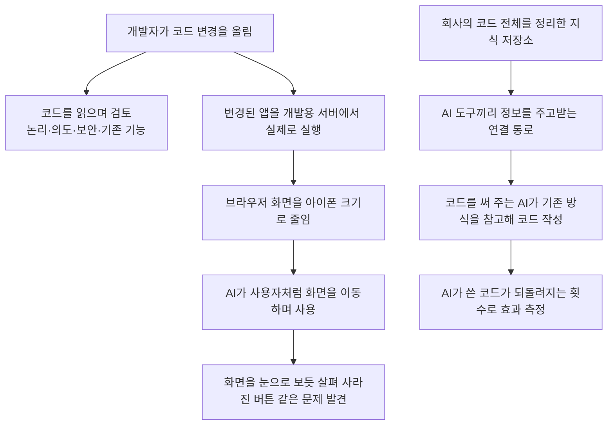

<aside class="ai-knowledge-sidebar">
  
CATEGORIES

  <nav class="ai-cat-tree">

에이전트 오케스트레이션18
<ul><li><a href="https://altjs4510.github.io/ai_news_blog/knowledge/20261027/">2026-10-27nightly-labs/openbot — Codex·Claude·Grok을 상주 팀원처…</a></li><li><a href="https://altjs4510.github.io/ai_news_blog/knowledge/20261015/">2026-10-15How Third Moment Research runs 10,000 agents for…</a></li><li><a href="https://altjs4510.github.io/ai_news_blog/knowledge/20261014/">2026-10-14How Anthropic's Dynamic Workflows Coordinate Cla…</a></li><li><a href="https://altjs4510.github.io/ai_news_blog/knowledge/20260930/">2026-09-30Agents you can coach: how Asana builds human-age…</a></li><li><a href="https://altjs4510.github.io/ai_news_blog/knowledge/20260831-openexecutive-virtual-c-suite/">2026-08-31Open Executive — 8명의 전문 에이전트를 하나의 임원 목소리로</a></li><li><a href="https://altjs4510.github.io/ai_news_blog/knowledge/20260828/">2026-08-28Google ADK for Python v2.8.0 — RemoteA2aAgent 네이…</a></li><li><a href="https://altjs4510.github.io/ai_news_blog/knowledge/20260826/">2026-08-26apache/maka — 도구 호출·권한 결정·종료 이벤트를 append-only 로그…</a></li><li><a href="https://altjs4510.github.io/ai_news_blog/knowledge/20260823/">2026-08-23The Evolution of the Agent Harness — 하네스가 모델 가중치…</a></li><li><a href="https://altjs4510.github.io/ai_news_blog/knowledge/20260821/">2026-08-21volcengine/OpenViking — 에이전트 메모리·Knowledge RAG·스…</a></li><li><a href="https://altjs4510.github.io/ai_news_blog/knowledge/20260805/">2026-08-05TencentCloud/TencentDB-Agent-Memory — 대화·문서·코드를 …</a></li><li><a href="https://altjs4510.github.io/ai_news_blog/knowledge/20260726/">2026-07-26citrolabs/ego-lite — 로그인된 브라우저 상태를 AI 에이전트와 공유하는…</a></li><li><a href="https://altjs4510.github.io/ai_news_blog/knowledge/20260717/">2026-07-17After a year building agent memory, 'save everyt…</a></li><li><a href="https://altjs4510.github.io/ai_news_blog/knowledge/20260708/">2026-07-08Expanding Managed Agents in Gemini API: backgrou…</a></li><li><a href="https://altjs4510.github.io/ai_news_blog/knowledge/20260623/">2026-06-23bytedance/deer-flow — 샌드박스·메모리·서브에이전트·메시지 게이트웨이를…</a></li><li><a href="https://altjs4510.github.io/ai_news_blog/knowledge/20260611/">2026-06-11The evolution of agentic surfaces: building with…</a></li><li><a href="https://altjs4510.github.io/ai_news_blog/knowledge/20260602/">2026-06-02revfactory/harness — 도메인별 에이전트 팀과 스킬을 자동 설계하는 메타…</a></li><li><a href="https://altjs4510.github.io/ai_news_blog/knowledge/20260529/">2026-05-29Introducing dynamic workflows in Claude Code</a></li><li><a href="https://altjs4510.github.io/ai_news_blog/knowledge/20260507/">2026-05-07ruvnet/ruflo — Claude 멀티 에이전트 오케스트레이션 플랫폼</a></li></ul>

MCP &amp; 도구 통합17
<ul><li><a href="https://altjs4510.github.io/ai_news_blog/knowledge/20261017/">2026-10-17mksglu/context-mode — 코딩 에이전트용 컨텍스트 윈도우 최적화</a></li><li><a href="https://altjs4510.github.io/ai_news_blog/knowledge/20261007/">2026-10-07morluto/rea — 앱 동작부터 네이티브 바이너리까지 에이전트로 리버스 엔지니어링</a></li><li><a href="https://altjs4510.github.io/ai_news_blog/knowledge/20260831-gitnexus-code-knowledge-graph/">2026-08-31GitNexus — 코드베이스를 지식그래프로 바꿔 에이전트에게 쥐어주기</a></li><li><a href="https://altjs4510.github.io/ai_news_blog/knowledge/20260819/">2026-08-19akitaonrails/ai-memory — 코딩 에이전트 CLI 간 장기 기억과 벤더…</a></li><li><a href="https://altjs4510.github.io/ai_news_blog/knowledge/20260802/">2026-08-02Stateless MCP has recaptured my interest (and in…</a></li><li><a href="https://altjs4510.github.io/ai_news_blog/knowledge/20260731/">2026-07-31different-ai/openwork — Claude Cowork의 오픈소스 대안(o…</a></li><li><a href="https://altjs4510.github.io/ai_news_blog/knowledge/20260729/">2026-07-29Bringing MCP 2026-07-28 to Claude</a></li><li><a href="https://altjs4510.github.io/ai_news_blog/knowledge/20260718/">2026-07-18tirth8205/code-review-graph — MCP·CLI용 로컬 코드 인텔리…</a></li><li><a href="https://altjs4510.github.io/ai_news_blog/knowledge/20260618/">2026-06-18DeusData/codebase-memory-mcp — 158개 언어 코드베이스를 밀리…</a></li><li><a href="https://altjs4510.github.io/ai_news_blog/knowledge/20260609/">2026-06-09Building intelligent apps for Apple platforms wi…</a></li><li><a href="https://altjs4510.github.io/ai_news_blog/knowledge/20260604/">2026-06-04chopratejas/headroom — Compress tool outputs bef…</a></li><li><a href="https://altjs4510.github.io/ai_news_blog/knowledge/20260603/">2026-06-03How Bad MCP design cost your Agent 5× more token…</a></li><li><a href="https://altjs4510.github.io/ai_news_blog/knowledge/20260521/">2026-05-21colbymchenry/codegraph — Pre-indexed code knowle…</a></li><li><a href="https://altjs4510.github.io/ai_news_blog/knowledge/20260517/">2026-05-17I gave my LLM 100,000+ tools — Lazy Discovery &a…</a></li><li><a href="https://altjs4510.github.io/ai_news_blog/knowledge/20260512/">2026-05-12agentmemory — Persistent memory for AI coding ag…</a></li><li><a href="https://altjs4510.github.io/ai_news_blog/knowledge/20260509/">2026-05-09How to connect 100 MCP servers without the conte…</a></li><li><a href="https://altjs4510.github.io/ai_news_blog/knowledge/20260506/">2026-05-06mksglu/context-mode — AI 코딩 에이전트용 컨텍스트 윈도우 최적화</a></li></ul>

코딩 에이전트24
<ul><li><a href="https://altjs4510.github.io/ai_news_blog/knowledge/20261022/">2026-10-22Claude Mods: Flipping the Harness Inside Out</a></li><li><a href="https://altjs4510.github.io/ai_news_blog/knowledge/20261018/">2026-10-18Quoting Addy Osmani, Morgan Westlee Lunt, and Qi…</a></li><li><a href="https://altjs4510.github.io/ai_news_blog/knowledge/20261014-claude-code-advisor/">2026-10-14Claude Code advisor — 가벼운 메인 모델이 일하고, 갈림길에서만 Opu…</a></li><li><a href="https://altjs4510.github.io/ai_news_blog/knowledge/20260920/">2026-09-20Claude Code 2.1.277 — CLAUDE.md가 없으면 AGENTS.md를 …</a></li><li><a href="https://altjs4510.github.io/ai_news_blog/knowledge/20260912/">2026-09-12Quoting Boris Cherny — 'Claude가 쓴 프로덕션 코드는 사람이 쓴…</a></li><li><a href="https://altjs4510.github.io/ai_news_blog/knowledge/20260910/">2026-09-10vastsa/PI-Desktop — Electron + Rust 호스트 코어 + 에이전…</a></li><li><a href="https://altjs4510.github.io/ai_news_blog/knowledge/20260906/">2026-09-06DietrichGebert/ponytail — 에이전트를 '방에서 가장 게으른 시니어 …</a></li><li><a href="https://altjs4510.github.io/ai_news_blog/knowledge/20260903/">2026-09-03pacifio/atlas — 여러 코딩 에이전트의 변경을 한곳에서 추적·질의하는 '에이…</a></li><li><a href="https://altjs4510.github.io/ai_news_blog/knowledge/20260901/">2026-09-01affaan-m/ECC — 스킬·본능·메모리·보안을 묶은 에이전트 하네스 성능 최적화 …</a></li><li><a href="https://altjs4510.github.io/ai_news_blog/knowledge/20260829/">2026-08-29cursor/plugins — 플러그인 명세(specification)와 공식 플러그인…</a></li><li><a href="https://altjs4510.github.io/ai_news_blog/knowledge/20260814/">2026-08-14cathrynlavery/diagram-design — Claude Code용 에디토리…</a></li><li><a href="https://altjs4510.github.io/ai_news_blog/knowledge/20260810/">2026-08-10Auto mode is now the default in Claude Code for …</a></li><li><a href="https://altjs4510.github.io/ai_news_blog/knowledge/20260808/">2026-08-08PrimeIntellect-ai/prime-agent — 코딩 워크플로우와 장시간 자율…</a></li><li><a href="https://altjs4510.github.io/ai_news_blog/knowledge/20260804/">2026-08-04esengine/DeepSeek-Reasonix — prefix-cache 안정성을 축…</a></li><li><a href="https://altjs4510.github.io/ai_news_blog/knowledge/20260728/">2026-07-28alibaba/open-code-review — 결정론적 파이프라인 + LLM 에이전트…</a></li><li><a href="https://altjs4510.github.io/ai_news_blog/knowledge/20260714/">2026-07-14Graphify-Labs/graphify — 코드베이스를 질의 가능한 지식 그래프로 만…</a></li><li><a href="https://altjs4510.github.io/ai_news_blog/knowledge/20260707/">2026-07-07AI Hero Skills Catalog — 실무 엔지니어를 위한 재사용 가능한 판단 …</a></li><li><a href="https://altjs4510.github.io/ai_news_blog/knowledge/20260705/">2026-07-05openai/codex-plugin-cc — Claude Code에서 Codex를 위임…</a></li><li><a href="https://altjs4510.github.io/ai_news_blog/knowledge/20260701/">2026-07-01Google OKF (Open Knowledge Format) — 벤더 중립 에이전트 …</a></li><li><a href="https://altjs4510.github.io/ai_news_blog/knowledge/20260626/">2026-06-26google-labs-code/design.md — 코딩 에이전트에게 디자인 시스템을 …</a></li><li><a href="https://altjs4510.github.io/ai_news_blog/knowledge/20260619/">2026-06-19Claude Code now supports artifacts</a></li><li><a href="https://altjs4510.github.io/ai_news_blog/knowledge/20260530/">2026-05-30Leonxlnx/taste-skill — AI에게 좋은 취향을 부여해 generic s…</a></li><li><a href="https://altjs4510.github.io/ai_news_blog/knowledge/20260508/">2026-05-08addyosmani/agent-skills — Production-grade engin…</a></li><li><a href="https://altjs4510.github.io/ai_news_blog/knowledge/20260505/">2026-05-05mattpocock/skills — Skills for Real Engineers (.…</a></li></ul>

모델 &amp; 연구11
<ul><li><a href="https://altjs4510.github.io/ai_news_blog/knowledge/20261009/">2026-10-09Claude Haiku 5.5 (Simon Willison의 출시 노트와 가격 분석)</a></li><li><a href="https://altjs4510.github.io/ai_news_blog/knowledge/20260929/">2026-09-29vectorize-io/hindsight — Hindsight: Agent Memory…</a></li><li><a href="https://altjs4510.github.io/ai_news_blog/knowledge/20260907-voicemem-dual-brain-memory/">2026-09-07VoiceMem — 좌뇌·우뇌로 쪼갠 스트리밍 메모리로 음성 에이전트 지연 없애기</a></li><li><a href="https://altjs4510.github.io/ai_news_blog/knowledge/20260904/">2026-09-04HarnessDev: Can LLMs Create and Evolve Their Own…</a></li><li><a href="https://altjs4510.github.io/ai_news_blog/knowledge/20260725/">2026-07-25The new rules of context engineering for Claude …</a></li><li><a href="https://altjs4510.github.io/ai_news_blog/knowledge/20260716-proprag/">2026-07-16PropRAG — 프로포지션 경로 위 beam search로 멀티홉 검색 안내</a></li><li><a href="https://altjs4510.github.io/ai_news_blog/knowledge/20260712/">2026-07-12Do Automated Evals Work?</a></li><li><a href="https://altjs4510.github.io/ai_news_blog/knowledge/20260620/">2026-06-20zai-org/GLM-5 — From Vibe Coding to Agentic Engi…</a></li><li><a href="https://altjs4510.github.io/ai_news_blog/knowledge/20260617/">2026-06-17Predicting model behavior before release by simu…</a></li><li><a href="https://altjs4510.github.io/ai_news_blog/knowledge/20260516/">2026-05-16STALE — 에이전트가 자기 기억의 유효성을 인지할 수 있는가</a></li><li><a href="https://altjs4510.github.io/ai_news_blog/knowledge/20260513/">2026-05-13Thinking Machines' Native Interaction Models — T…</a></li></ul>

인프라 &amp; 컴퓨트8
<ul><li><a href="https://altjs4510.github.io/ai_news_blog/knowledge/20260909/">2026-09-09Reducing cost and improving performance with Cla…</a></li><li><a href="https://altjs4510.github.io/ai_news_blog/knowledge/20260905/">2026-09-05magnitudedev/magnitude — 하드웨어에 맞는 최적 로컬 모델을 띄워 이…</a></li><li><a href="https://altjs4510.github.io/ai_news_blog/knowledge/20260812/">2026-08-12semantica-agi/semantica — 컨텍스트와 '책임 추적 가능한(accou…</a></li><li><a href="https://altjs4510.github.io/ai_news_blog/knowledge/20260806/">2026-08-06cloudflare/computer — 에이전트에게 컴퓨터를 통째로 주는 엣지 실행 샌…</a></li><li><a href="https://altjs4510.github.io/ai_news_blog/knowledge/20260723/">2026-07-23diegosouzapw/OmniRoute — 268+ 프로바이더를 단일 엔드포인트로 묶…</a></li><li><a href="https://altjs4510.github.io/ai_news_blog/knowledge/20260610/">2026-06-10Fable 5 just made cost-aware model routing manda…</a></li><li><a href="https://altjs4510.github.io/ai_news_blog/knowledge/20260522/">2026-05-22Giving Agents Computers — Ivan Burazin, Daytona</a></li><li><a href="https://altjs4510.github.io/ai_news_blog/knowledge/20260520/">2026-05-20New in Claude Managed Agents: self-hosted sandbo…</a></li></ul>

보안 &amp; 거버넌스23
<ul><li><a href="https://altjs4510.github.io/ai_news_blog/knowledge/20261021/">2026-10-21cloudflare/security-audit-skill — 독립 검증된 기계 판독형 …</a></li><li><a href="https://altjs4510.github.io/ai_news_blog/knowledge/20261020/">2026-10-20Satya Nadella — 모델을 내부자 위험으로 보는 원칙에 따라 Project P…</a></li><li><a href="https://altjs4510.github.io/ai_news_blog/knowledge/20261016/">2026-10-16Crossing the Threshold: How OpenAI and Anthropic…</a></li><li><a href="https://altjs4510.github.io/ai_news_blog/knowledge/20261011/">2026-10-11Anthropic can’t reliably control its AI agents. …</a></li><li><a href="https://altjs4510.github.io/ai_news_blog/knowledge/20261004/">2026-10-04Apple says it's tightening macOS 'Full Disk Acce…</a></li><li><a href="https://altjs4510.github.io/ai_news_blog/knowledge/20261001/">2026-10-01NVIDIA/OpenShell</a></li><li><a href="https://altjs4510.github.io/ai_news_blog/knowledge/20260919/">2026-09-19cloudflare/security-audit-skill — 다단계 보안 감사를 '독립…</a></li><li><a href="https://altjs4510.github.io/ai_news_blog/knowledge/20260913/">2026-09-13OpenAI agents attacked RubyGems back in May: Ope…</a></li><li><a href="https://altjs4510.github.io/ai_news_blog/knowledge/20260902/">2026-09-02AIR raises $50M to help companies vet the skills…</a></li><li><a href="https://altjs4510.github.io/ai_news_blog/knowledge/20260827/">2026-08-27Claude in Chrome is generally available</a></li><li><a href="https://altjs4510.github.io/ai_news_blog/knowledge/20260819-mind-viruses/">2026-08-19탈옥도, 인젝션도 없이 — 대화로만 퍼지는 에이전트의 '마인드 바이러스'</a></li><li><a href="https://altjs4510.github.io/ai_news_blog/knowledge/20260730/">2026-07-30Anatomy of a Frontier Lab Agent Intrusion: A Tec…</a></li><li><a href="https://altjs4510.github.io/ai_news_blog/knowledge/20260715/">2026-07-15Dicklesworthstone/destructive_command_guard — 에이…</a></li><li><a href="https://altjs4510.github.io/ai_news_blog/knowledge/20260710/">2026-07-1070개 MCP 서버 strace 런타임 감사 — 부팅 시 아웃바운드 호출 서버 적발</a></li><li><a href="https://altjs4510.github.io/ai_news_blog/knowledge/20260704/">2026-07-04Cloudflare is about to block AI agents by defaul…</a></li><li><a href="https://altjs4510.github.io/ai_news_blog/knowledge/20260703/">2026-07-03Giving admins more visibility and control over C…</a></li><li><a href="https://altjs4510.github.io/ai_news_blog/knowledge/20260630/">2026-06-30Introducing the Claude apps gateway for Amazon B…</a></li><li><a href="https://altjs4510.github.io/ai_news_blog/knowledge/20260624/">2026-06-24Agent identity in Claude Tag: a new access model…</a></li><li><a href="https://altjs4510.github.io/ai_news_blog/knowledge/20260613/">2026-06-13Fable 5's guardrails got bypassed in 48 hours — …</a></li><li><a href="https://altjs4510.github.io/ai_news_blog/knowledge/20260612/">2026-06-12NVIDIA/SkillSpector — AI 에이전트 스킬용 보안 스캐너</a></li><li><a href="https://altjs4510.github.io/ai_news_blog/knowledge/20260607/">2026-06-07OpenAI Help: Lockdown Mode</a></li><li><a href="https://altjs4510.github.io/ai_news_blog/knowledge/20260531/">2026-05-31How we contain Claude across products</a></li><li><a href="https://altjs4510.github.io/ai_news_blog/knowledge/20260527/">2026-05-27Microsoft Copilot Cowork Exfiltrates Files</a></li></ul>

응용 사례8
<ul><li><a href="https://altjs4510.github.io/ai_news_blog/knowledge/20261028/" class="current">2026-10-28Greptile takes bug detection beyond code review …</a></li><li><a href="https://altjs4510.github.io/ai_news_blog/knowledge/20261006/">2026-10-06How Cresta turned CX expertise into an agent bui…</a></li><li><a href="https://altjs4510.github.io/ai_news_blog/knowledge/20260911/">2026-09-11Now everyone can put data to work — ChatGPT Work…</a></li><li><a href="https://altjs4510.github.io/ai_news_blog/knowledge/20260709/">2026-07-09mvanhorn/last30days-skill — Reddit·X·YouTube·HN·…</a></li><li><a href="https://altjs4510.github.io/ai_news_blog/knowledge/20260621/">2026-06-21calesthio/OpenMontage — 12 파이프라인·52 도구·500+ 스킬을 …</a></li><li><a href="https://altjs4510.github.io/ai_news_blog/knowledge/20260528/">2026-05-28Building self-improving tax agents with Codex</a></li><li><a href="https://altjs4510.github.io/ai_news_blog/knowledge/20260515/">2026-05-15Clawdmeter — Claude Code 사용량을 데스크톱 대시보드로</a></li><li><a href="https://altjs4510.github.io/ai_news_blog/knowledge/20260514/">2026-05-14Introducing Claude for Small Business</a></li></ul>

산업 동향9
<ul><li><a href="https://altjs4510.github.io/ai_news_blog/knowledge/20261024/">2026-10-24Donating Agent Skills to the Agentic AI Foundati…</a></li><li><a href="https://altjs4510.github.io/ai_news_blog/knowledge/20261023/">2026-10-23Claude Duet app is Anthropic's bet on agents</a></li><li><a href="https://altjs4510.github.io/ai_news_blog/knowledge/20260907-humanmade-52week-rhythm/">2026-09-07휴먼 메이드의 '52주 리듬' — 아이디어가 흔해진 시대에 값이 오르는 건 버리는 판단</a></li><li><a href="https://altjs4510.github.io/ai_news_blog/knowledge/20260830/">2026-08-30[AINews] OpenAI shuts off Cursor — 프론티어 모델 공급 차단…</a></li><li><a href="https://altjs4510.github.io/ai_news_blog/knowledge/20260711/">2026-07-11OpenAI says GPT 5.6 is the 'preferred model' for…</a></li><li><a href="https://altjs4510.github.io/ai_news_blog/knowledge/20260702/">2026-07-02How Cursor deploys AI inside the enterprise (For…</a></li><li><a href="https://altjs4510.github.io/ai_news_blog/knowledge/20260616/">2026-06-16Why AI hasn't replaced software engineers, and w…</a></li><li><a href="https://altjs4510.github.io/ai_news_blog/knowledge/20260519/">2026-05-19Anthropic acquires Stainless</a></li><li><a href="https://altjs4510.github.io/ai_news_blog/knowledge/20260504/">2026-05-04Agents for Everything Else: Codex for Knowledge …</a></li></ul>
</nav>
</aside>

<article class="ai-knowledge-article">

<header class="ai-post-hero">
  
<a class="ai-back" href="../">KNOWLEDGE</a> · 2026-10-28 · 오늘의 학습

  <h2 class="ai-post-title">Greptile takes bug detection beyond code review with GPT-6 Astra</h2>
</header>

> 원문: [Greptile takes bug detection beyond code review with GPT-6 Astra](https://openai.com/index/greptile-code-review-codex-astra)

## 📌 학습 정리

### 1. 한 줄로 말하면

Greptile은 코드를 눈으로 읽기만 하던 검토 작업을 한 단계 넓힌 회사예요. AI가 직접 앱을 켜고 사용자처럼 이리저리 눌러 보면서, 코드만 봐서는 안 보이는 버그를 찾아내요.

### 2. 왜 이게 만들어졌어요?

개발자가 코드 변경을 올리면 보통 누군가 그 코드를 읽어 보며 검토해요. 확인할 건 몇 가지예요. 논리가 맞는지, 의도한 대로 동작하는지, 보안상 문제는 없는지, 원래 잘 되던 기능을 망가뜨리지는 않는지요. 그런데 어떤 문제는 코드를 아무리 읽어도 보이지 않고, 앱을 실제로 돌려 봐야 드러나요. 예전에는 이런 확인을 품질 검사 전문 업체(QA firm)에 맡기기도 했어요. 하지만 Greptile 공동창업자 겸 CEO인 Daksh Gupta는 AI 모델 덕분에 코드가 나오는 속도가 너무 빨라져서, 변경마다 사람이 일일이 테스트하는 방식은 현실적으로 따라가기 어렵다고 말해요.

### 3. 비유로 풀면

이건 마치 새로 지은 집을 점검할 때 설계도만 들여다보는 게 아니라, 점검원이 직접 들어가서 문을 여닫고 불도 켜 보는 것과 같아요. 설계도에는 아무 문제가 없어 보여도, 실제로 걸어 다녀 봐야 "작은 방에 들어가니 스위치가 가구 뒤에 숨어 있네" 같은 문제가 보이거든요.

비유를 하나 더 들자면, Greptile의 지식 저장소(Knowledge Base)는 이 집의 "시공 매뉴얼"에 가까워요. 새로 온 작업자(AI 코딩 도구)가 이 매뉴얼을 먼저 읽으면 기존 집과 어울리는 방식으로 공사하게 되고, 다시 뜯어고칠 일도 줄어들어요.

그래서 결국 Greptile은 두 방향에서 버그를 줄여요. 하나는 AI가 직접 앱을 돌려 보며 확인하는 것이고, 다른 하나는 코드를 쓰는 AI에게 미리 맥락을 알려 줘서 처음부터 덜 틀리게 만드는 거예요.

### 4. 어떻게 작동하는지 (그림으로)

위쪽 흐름은 검토 쪽 이야기예요. 코드 변경이 올라오면 코드를 읽는 검토와 함께 앱을 실제로 띄워 보는 검토가 같이 진행돼요. 원문의 예시처럼 아이폰 화면에서만 버튼이 사라지는 문제는 AI가 화면 크기를 바꿔 직접 보면서 잡아내요. 아래쪽 흐름은 코드를 쓰는 쪽 이야기예요. 미리 정리해 둔 회사 코드 지식을 AI 코딩 도구에 연결해 주면, 그 결과는 "나중에 되돌린 코드가 얼마나 줄었나"로 확인해요.

### 5. 처음 보는 용어 풀이

- **코드 변경 요청 (pull request)** — 개발자가 "이렇게 고쳤으니 검토하고 합쳐 주세요" 하고 올리는 변경 묶음이에요. Greptile은 이 단위로 검토와 테스트를 돌려요.
- **컴퓨터 조작 기능 (computer use)** — AI가 사람처럼 화면을 보고, 클릭하고, 창 크기를 바꾸는 등 컴퓨터를 직접 다루는 능력이에요. GPT‑6 Astra의 이 기능 덕분에 앱 테스트를 사람 손 없이 자동으로 돌릴 수 있게 됐다고 해요.
- **GPT‑6 Astra** — 원문에 나오는 OpenAI의 AI 모델이에요. 원문에서는 컴퓨터 조작 기능과 화면을 보고 이해하는 능력이 핵심으로 소개돼요.
- **개발용 서버 (development server)** — 실제 서비스에 내보내기 전에 변경된 앱을 시험 삼아 띄워 보는 임시 실행 환경이에요. 여기서 앱을 돌려 봐야 실제 동작을 확인할 수 있어요.
- **화면 표시 영역 (viewport)** — 브라우저에서 웹페이지가 실제로 보이는 영역의 크기예요. 이 크기를 아이폰만 하게 줄이면 휴대폰에서만 생기는 문제를 재현할 수 있어요.
- **모델 맥락 프로토콜 (Model Context Protocol, MCP)** — AI 도구가 외부 자료나 도구와 정보를 주고받을 수 있게 해 주는 연결 규격이에요. Greptile은 이걸로 자기 지식 저장소를 코드 작성 AI인 Codex에 연결해요.
- **되돌림 (revert)** — 이미 반영한 코드 변경을 취소하고 이전 상태로 돌리는 일이에요. Greptile은 AI가 쓴 코드가 얼마나 자주 되돌려지는지를 재작업이 줄었는지 보는 지표로 써요.

그 밖에 원문에는 **Daybreak**(Greptile이 고객사의 보안 방어를 강화하는 데 쓴다고 소개된 것)와 **Ultrafast**(개발 속도를 높이는 수단으로 기대한다고 언급된 것)도 나와요. 다만 원문에는 이 둘이 구체적으로 무엇인지, 어떻게 작동하는지는 자세히 나와 있지 않아요. 이 정도로만 알아 두면 충분해요.

### 6. 한 발 더 들어가고 싶다면

- [Greptile](https://www.greptile.com/) — 이걸 보면 코드 변경을 검토하고 테스트하는 Greptile의 AI 에이전트가 어떤 서비스인지 직접 확인할 수 있어요.
- [Greptile takes bug detection beyond code review with GPT-6 Astra](https://openai.com/index/greptile-code-review-codex-astra) — 이걸 보면 이번 사례 원문 전체와 Daksh Gupta의 인터뷰 맥락을 그대로 읽어 볼 수 있어요.

---

## 📖 원문 전체 번역 (정독용)

> 의역 최소화한 전체 번역입니다. 큰 흐름은 위 정리에서 잡고, 정확한 워딩이 필요할 땐 이 섹션에서 정독하세요.

[Greptile⁠(새 창에서 열기)](https://www.greptile.com/)은 코드베이스의 전체 맥락을 갖고 코드 변경 사항을 리뷰하고 테스트하는 AI 에이전트를 만든다. 공동 창업자 겸 CEO인 Daksh Gupta는 "우리는 버그를 줄이고 세상의 소프트웨어를 더 신뢰할 수 있게 만드는 일을 하고 있습니다"라고 말한다.

Daksh에게 이 사명을 이루려면 코드를 읽는 것뿐 아니라 애플리케이션의 동작을 테스트해야 하며, GPT‑6 Astra의 computer use는 Greptile에 테스트를 대규모로 자동화할 방법을 제공한다.

## GPT‑6 Astra로 애플리케이션을 대규모로 테스트하기

풀 리퀘스트(pull request)를 검증하려면 코드가 논리적으로 올바른지, 개발자가 의도한 대로 동작하는지, 안전한지, 기존 기능을 깨뜨리지 않는지를 확인해야 한다. 이 테스트 중 일부는 애플리케이션을 실제로 실행해야 한다. 코드를 읽는 것만으로는 문제가 드러나지 않을 수 있기 때문이다.

Daksh는 웹사이트를 iPhone에서 볼 때 버튼이 사라지는 경우를 예로 든다. GPT‑6 Astra를 쓰면 Greptile은 풀 리퀘스트용 개발 서버를 시작하고, 브라우저를 iPhone 크기의 뷰포트로 조정하고, 사용자가 애플리케이션 안을 이동하는 모습을 시뮬레이션할 수 있다. 이 모델의 시각적 이해 능력 덕분에 화면을 살펴보고 숨겨진 버튼을 찾아낼 수 있다.

그는 "이 모델들로 코드를 얼마나 빠르게 배포할 수 있는지를 생각하면, QA 업체가 여러분의 모든 변경 사항을 테스트하는 방식은 비현실적으로 느립니다"라고 말한다. GPT‑6 Astra를 쓰면 Greptile은 이런 종류의 애플리케이션 테스트를 대규모로 자동화할 수 있다.

## Daybreak으로 고객의 방어력 강화하기

Daksh는 더 강력한 모델이 공격자가 애플리케이션을 악용하기도 더 쉽게 만들어, 이전에는 전형적인 표적이 아니었던 기업까지 위험에 빠뜨린다고 말한다.

Daksh는 "우리는 스타트업조차 시스템을 매우 쉽게 보호할 수 있게 만들고 싶습니다"라며, "Daybreak을 쓰면 아주 안전한 방식으로 이를 할 수 있고, 고객이 공격자의 공격 수단보다 더 정교한 방어 수단을 갖추도록 보장할 수 있습니다"라고 말한다.

## Codex로 버그와 재작업 줄이기

Greptile의 Knowledge Base는 회사의 코드베이스를 인덱싱하고, 그 코드베이스가 어떻게 동작하는지를 사람과 에이전트가 읽을 수 있는 형태로 문서화한다. Greptile은 이 문서를 Model Context Protocol(MCP) 서버를 통해 Codex에서 쓸 수 있게 제공한다.

이를 통해 Codex는 고객의 기존 패턴을 따르는 코드를 작성할 수 있으며, Daksh에 따르면 수천 곳의 고객이 Codex를 Greptile의 knowledge base에 연결했다.

영향을 측정하기 위해 팀은 AI가 생성한 코드가 얼마나 자주 되돌려지는지(revert)를 추적한다. Daksh는 "에이전트에 컨텍스트를 제공하면 revert가 줄어들고, 고객은 시간과 추론(inference) 비용을 절약합니다"라고 말한다. 고객은 이렇게 아낀 자원을 같은 변경 사항을 다시 작업하는 데 쓰는 대신 새로운 작업에 쓸 수 있다.

Greptile은 자사 소프트웨어와 에이전트를 만드는 데도 Codex를 쓴다. Daksh는 "우리는 Codex를 엄청나게 많이 쓰는 사용자입니다"라며, "특히 엔지니어링을 비롯해 모든 직무에 걸쳐 방대한 양을 사용하고 있습니다"라고 말한다.

## Ultrafast로 더 빠른 개발을 내다보며

Daksh는 Greptile에게 진짜 병목은 팀이 아이디어를 동작하는 소프트웨어로 얼마나 빨리 바꿀 수 있느냐뿐이라고 설명한다. 그는 많은 작업에서 모델의 지능은 이미 충분하다고 말하며, 그래서 Ultrafast를 개발 속도를 높이는 방법으로 본다.

그의 장기 목표는 핵심 엔터프라이즈 소프트웨어를 변경하고 배포하는 일을 사이드 프로젝트를 배포하는 것만큼 쉽게 만드는 것이며, 이를 위해 필요한 검증(validation)을 Greptile이 구축하는 데 OpenAI가 도움을 주고 있다.

</article>

<!-- ai-related-links -->
<aside class="ai-related-links">
  
관련 학습

  <ul><li><a href="https://altjs4510.github.io/ai_news_blog/knowledge/20260728/">2026-07-28alibaba/open-code-review — 결정론적 파이프라인 + LLM 에이전트…</a></li><li><a href="https://altjs4510.github.io/ai_news_blog/knowledge/20260718/">2026-07-18tirth8205/code-review-graph — MCP·CLI용 로컬 코드 인텔리…</a></li><li><a href="https://altjs4510.github.io/ai_news_blog/knowledge/20260712/">2026-07-12Do Automated Evals Work?</a></li></ul>
</aside>
<!-- /ai-related-links -->
