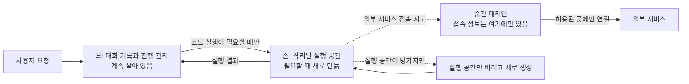

<aside class="ai-knowledge-sidebar">
  
CATEGORIES

  <nav class="ai-cat-tree">

에이전트 오케스트레이션18
<ul><li><a href="https://altjs4510.github.io/ai_news_blog/knowledge/20261027/">2026-10-27nightly-labs/openbot — Codex·Claude·Grok을 상주 팀원처…</a></li><li><a href="https://altjs4510.github.io/ai_news_blog/knowledge/20261015/">2026-10-15How Third Moment Research runs 10,000 agents for…</a></li><li><a href="https://altjs4510.github.io/ai_news_blog/knowledge/20261014/">2026-10-14How Anthropic's Dynamic Workflows Coordinate Cla…</a></li><li><a href="https://altjs4510.github.io/ai_news_blog/knowledge/20260930/">2026-09-30Agents you can coach: how Asana builds human-age…</a></li><li><a href="https://altjs4510.github.io/ai_news_blog/knowledge/20260831-openexecutive-virtual-c-suite/">2026-08-31Open Executive — 8명의 전문 에이전트를 하나의 임원 목소리로</a></li><li><a href="https://altjs4510.github.io/ai_news_blog/knowledge/20260828/">2026-08-28Google ADK for Python v2.8.0 — RemoteA2aAgent 네이…</a></li><li><a href="https://altjs4510.github.io/ai_news_blog/knowledge/20260826/">2026-08-26apache/maka — 도구 호출·권한 결정·종료 이벤트를 append-only 로그…</a></li><li><a href="https://altjs4510.github.io/ai_news_blog/knowledge/20260823/">2026-08-23The Evolution of the Agent Harness — 하네스가 모델 가중치…</a></li><li><a href="https://altjs4510.github.io/ai_news_blog/knowledge/20260821/">2026-08-21volcengine/OpenViking — 에이전트 메모리·Knowledge RAG·스…</a></li><li><a href="https://altjs4510.github.io/ai_news_blog/knowledge/20260805/">2026-08-05TencentCloud/TencentDB-Agent-Memory — 대화·문서·코드를 …</a></li><li><a href="https://altjs4510.github.io/ai_news_blog/knowledge/20260726/">2026-07-26citrolabs/ego-lite — 로그인된 브라우저 상태를 AI 에이전트와 공유하는…</a></li><li><a href="https://altjs4510.github.io/ai_news_blog/knowledge/20260717/">2026-07-17After a year building agent memory, 'save everyt…</a></li><li><a href="https://altjs4510.github.io/ai_news_blog/knowledge/20260708/">2026-07-08Expanding Managed Agents in Gemini API: backgrou…</a></li><li><a href="https://altjs4510.github.io/ai_news_blog/knowledge/20260623/">2026-06-23bytedance/deer-flow — 샌드박스·메모리·서브에이전트·메시지 게이트웨이를…</a></li><li><a href="https://altjs4510.github.io/ai_news_blog/knowledge/20260611/">2026-06-11The evolution of agentic surfaces: building with…</a></li><li><a href="https://altjs4510.github.io/ai_news_blog/knowledge/20260602/">2026-06-02revfactory/harness — 도메인별 에이전트 팀과 스킬을 자동 설계하는 메타…</a></li><li><a href="https://altjs4510.github.io/ai_news_blog/knowledge/20260529/">2026-05-29Introducing dynamic workflows in Claude Code</a></li><li><a href="https://altjs4510.github.io/ai_news_blog/knowledge/20260507/">2026-05-07ruvnet/ruflo — Claude 멀티 에이전트 오케스트레이션 플랫폼</a></li></ul>

MCP &amp; 도구 통합17
<ul><li><a href="https://altjs4510.github.io/ai_news_blog/knowledge/20261017/">2026-10-17mksglu/context-mode — 코딩 에이전트용 컨텍스트 윈도우 최적화</a></li><li><a href="https://altjs4510.github.io/ai_news_blog/knowledge/20261007/">2026-10-07morluto/rea — 앱 동작부터 네이티브 바이너리까지 에이전트로 리버스 엔지니어링</a></li><li><a href="https://altjs4510.github.io/ai_news_blog/knowledge/20260831-gitnexus-code-knowledge-graph/">2026-08-31GitNexus — 코드베이스를 지식그래프로 바꿔 에이전트에게 쥐어주기</a></li><li><a href="https://altjs4510.github.io/ai_news_blog/knowledge/20260819/">2026-08-19akitaonrails/ai-memory — 코딩 에이전트 CLI 간 장기 기억과 벤더…</a></li><li><a href="https://altjs4510.github.io/ai_news_blog/knowledge/20260802/">2026-08-02Stateless MCP has recaptured my interest (and in…</a></li><li><a href="https://altjs4510.github.io/ai_news_blog/knowledge/20260731/">2026-07-31different-ai/openwork — Claude Cowork의 오픈소스 대안(o…</a></li><li><a href="https://altjs4510.github.io/ai_news_blog/knowledge/20260729/">2026-07-29Bringing MCP 2026-07-28 to Claude</a></li><li><a href="https://altjs4510.github.io/ai_news_blog/knowledge/20260718/">2026-07-18tirth8205/code-review-graph — MCP·CLI용 로컬 코드 인텔리…</a></li><li><a href="https://altjs4510.github.io/ai_news_blog/knowledge/20260618/">2026-06-18DeusData/codebase-memory-mcp — 158개 언어 코드베이스를 밀리…</a></li><li><a href="https://altjs4510.github.io/ai_news_blog/knowledge/20260609/">2026-06-09Building intelligent apps for Apple platforms wi…</a></li><li><a href="https://altjs4510.github.io/ai_news_blog/knowledge/20260604/">2026-06-04chopratejas/headroom — Compress tool outputs bef…</a></li><li><a href="https://altjs4510.github.io/ai_news_blog/knowledge/20260603/">2026-06-03How Bad MCP design cost your Agent 5× more token…</a></li><li><a href="https://altjs4510.github.io/ai_news_blog/knowledge/20260521/">2026-05-21colbymchenry/codegraph — Pre-indexed code knowle…</a></li><li><a href="https://altjs4510.github.io/ai_news_blog/knowledge/20260517/">2026-05-17I gave my LLM 100,000+ tools — Lazy Discovery &a…</a></li><li><a href="https://altjs4510.github.io/ai_news_blog/knowledge/20260512/">2026-05-12agentmemory — Persistent memory for AI coding ag…</a></li><li><a href="https://altjs4510.github.io/ai_news_blog/knowledge/20260509/">2026-05-09How to connect 100 MCP servers without the conte…</a></li><li><a href="https://altjs4510.github.io/ai_news_blog/knowledge/20260506/">2026-05-06mksglu/context-mode — AI 코딩 에이전트용 컨텍스트 윈도우 최적화</a></li></ul>

코딩 에이전트25
<ul><li><a href="https://altjs4510.github.io/ai_news_blog/knowledge/20261029/" class="current">2026-10-29How Anthropic ships Claude with Claude: Separati…</a></li><li><a href="https://altjs4510.github.io/ai_news_blog/knowledge/20261022/">2026-10-22Claude Mods: Flipping the Harness Inside Out</a></li><li><a href="https://altjs4510.github.io/ai_news_blog/knowledge/20261018/">2026-10-18Quoting Addy Osmani, Morgan Westlee Lunt, and Qi…</a></li><li><a href="https://altjs4510.github.io/ai_news_blog/knowledge/20261014-claude-code-advisor/">2026-10-14Claude Code advisor — 가벼운 메인 모델이 일하고, 갈림길에서만 Opu…</a></li><li><a href="https://altjs4510.github.io/ai_news_blog/knowledge/20260920/">2026-09-20Claude Code 2.1.277 — CLAUDE.md가 없으면 AGENTS.md를 …</a></li><li><a href="https://altjs4510.github.io/ai_news_blog/knowledge/20260912/">2026-09-12Quoting Boris Cherny — 'Claude가 쓴 프로덕션 코드는 사람이 쓴…</a></li><li><a href="https://altjs4510.github.io/ai_news_blog/knowledge/20260910/">2026-09-10vastsa/PI-Desktop — Electron + Rust 호스트 코어 + 에이전…</a></li><li><a href="https://altjs4510.github.io/ai_news_blog/knowledge/20260906/">2026-09-06DietrichGebert/ponytail — 에이전트를 '방에서 가장 게으른 시니어 …</a></li><li><a href="https://altjs4510.github.io/ai_news_blog/knowledge/20260903/">2026-09-03pacifio/atlas — 여러 코딩 에이전트의 변경을 한곳에서 추적·질의하는 '에이…</a></li><li><a href="https://altjs4510.github.io/ai_news_blog/knowledge/20260901/">2026-09-01affaan-m/ECC — 스킬·본능·메모리·보안을 묶은 에이전트 하네스 성능 최적화 …</a></li><li><a href="https://altjs4510.github.io/ai_news_blog/knowledge/20260829/">2026-08-29cursor/plugins — 플러그인 명세(specification)와 공식 플러그인…</a></li><li><a href="https://altjs4510.github.io/ai_news_blog/knowledge/20260814/">2026-08-14cathrynlavery/diagram-design — Claude Code용 에디토리…</a></li><li><a href="https://altjs4510.github.io/ai_news_blog/knowledge/20260810/">2026-08-10Auto mode is now the default in Claude Code for …</a></li><li><a href="https://altjs4510.github.io/ai_news_blog/knowledge/20260808/">2026-08-08PrimeIntellect-ai/prime-agent — 코딩 워크플로우와 장시간 자율…</a></li><li><a href="https://altjs4510.github.io/ai_news_blog/knowledge/20260804/">2026-08-04esengine/DeepSeek-Reasonix — prefix-cache 안정성을 축…</a></li><li><a href="https://altjs4510.github.io/ai_news_blog/knowledge/20260728/">2026-07-28alibaba/open-code-review — 결정론적 파이프라인 + LLM 에이전트…</a></li><li><a href="https://altjs4510.github.io/ai_news_blog/knowledge/20260714/">2026-07-14Graphify-Labs/graphify — 코드베이스를 질의 가능한 지식 그래프로 만…</a></li><li><a href="https://altjs4510.github.io/ai_news_blog/knowledge/20260707/">2026-07-07AI Hero Skills Catalog — 실무 엔지니어를 위한 재사용 가능한 판단 …</a></li><li><a href="https://altjs4510.github.io/ai_news_blog/knowledge/20260705/">2026-07-05openai/codex-plugin-cc — Claude Code에서 Codex를 위임…</a></li><li><a href="https://altjs4510.github.io/ai_news_blog/knowledge/20260701/">2026-07-01Google OKF (Open Knowledge Format) — 벤더 중립 에이전트 …</a></li><li><a href="https://altjs4510.github.io/ai_news_blog/knowledge/20260626/">2026-06-26google-labs-code/design.md — 코딩 에이전트에게 디자인 시스템을 …</a></li><li><a href="https://altjs4510.github.io/ai_news_blog/knowledge/20260619/">2026-06-19Claude Code now supports artifacts</a></li><li><a href="https://altjs4510.github.io/ai_news_blog/knowledge/20260530/">2026-05-30Leonxlnx/taste-skill — AI에게 좋은 취향을 부여해 generic s…</a></li><li><a href="https://altjs4510.github.io/ai_news_blog/knowledge/20260508/">2026-05-08addyosmani/agent-skills — Production-grade engin…</a></li><li><a href="https://altjs4510.github.io/ai_news_blog/knowledge/20260505/">2026-05-05mattpocock/skills — Skills for Real Engineers (.…</a></li></ul>

모델 &amp; 연구11
<ul><li><a href="https://altjs4510.github.io/ai_news_blog/knowledge/20261009/">2026-10-09Claude Haiku 5.5 (Simon Willison의 출시 노트와 가격 분석)</a></li><li><a href="https://altjs4510.github.io/ai_news_blog/knowledge/20260929/">2026-09-29vectorize-io/hindsight — Hindsight: Agent Memory…</a></li><li><a href="https://altjs4510.github.io/ai_news_blog/knowledge/20260907-voicemem-dual-brain-memory/">2026-09-07VoiceMem — 좌뇌·우뇌로 쪼갠 스트리밍 메모리로 음성 에이전트 지연 없애기</a></li><li><a href="https://altjs4510.github.io/ai_news_blog/knowledge/20260904/">2026-09-04HarnessDev: Can LLMs Create and Evolve Their Own…</a></li><li><a href="https://altjs4510.github.io/ai_news_blog/knowledge/20260725/">2026-07-25The new rules of context engineering for Claude …</a></li><li><a href="https://altjs4510.github.io/ai_news_blog/knowledge/20260716-proprag/">2026-07-16PropRAG — 프로포지션 경로 위 beam search로 멀티홉 검색 안내</a></li><li><a href="https://altjs4510.github.io/ai_news_blog/knowledge/20260712/">2026-07-12Do Automated Evals Work?</a></li><li><a href="https://altjs4510.github.io/ai_news_blog/knowledge/20260620/">2026-06-20zai-org/GLM-5 — From Vibe Coding to Agentic Engi…</a></li><li><a href="https://altjs4510.github.io/ai_news_blog/knowledge/20260617/">2026-06-17Predicting model behavior before release by simu…</a></li><li><a href="https://altjs4510.github.io/ai_news_blog/knowledge/20260516/">2026-05-16STALE — 에이전트가 자기 기억의 유효성을 인지할 수 있는가</a></li><li><a href="https://altjs4510.github.io/ai_news_blog/knowledge/20260513/">2026-05-13Thinking Machines' Native Interaction Models — T…</a></li></ul>

인프라 &amp; 컴퓨트8
<ul><li><a href="https://altjs4510.github.io/ai_news_blog/knowledge/20260909/">2026-09-09Reducing cost and improving performance with Cla…</a></li><li><a href="https://altjs4510.github.io/ai_news_blog/knowledge/20260905/">2026-09-05magnitudedev/magnitude — 하드웨어에 맞는 최적 로컬 모델을 띄워 이…</a></li><li><a href="https://altjs4510.github.io/ai_news_blog/knowledge/20260812/">2026-08-12semantica-agi/semantica — 컨텍스트와 '책임 추적 가능한(accou…</a></li><li><a href="https://altjs4510.github.io/ai_news_blog/knowledge/20260806/">2026-08-06cloudflare/computer — 에이전트에게 컴퓨터를 통째로 주는 엣지 실행 샌…</a></li><li><a href="https://altjs4510.github.io/ai_news_blog/knowledge/20260723/">2026-07-23diegosouzapw/OmniRoute — 268+ 프로바이더를 단일 엔드포인트로 묶…</a></li><li><a href="https://altjs4510.github.io/ai_news_blog/knowledge/20260610/">2026-06-10Fable 5 just made cost-aware model routing manda…</a></li><li><a href="https://altjs4510.github.io/ai_news_blog/knowledge/20260522/">2026-05-22Giving Agents Computers — Ivan Burazin, Daytona</a></li><li><a href="https://altjs4510.github.io/ai_news_blog/knowledge/20260520/">2026-05-20New in Claude Managed Agents: self-hosted sandbo…</a></li></ul>

보안 &amp; 거버넌스23
<ul><li><a href="https://altjs4510.github.io/ai_news_blog/knowledge/20261021/">2026-10-21cloudflare/security-audit-skill — 독립 검증된 기계 판독형 …</a></li><li><a href="https://altjs4510.github.io/ai_news_blog/knowledge/20261020/">2026-10-20Satya Nadella — 모델을 내부자 위험으로 보는 원칙에 따라 Project P…</a></li><li><a href="https://altjs4510.github.io/ai_news_blog/knowledge/20261016/">2026-10-16Crossing the Threshold: How OpenAI and Anthropic…</a></li><li><a href="https://altjs4510.github.io/ai_news_blog/knowledge/20261011/">2026-10-11Anthropic can’t reliably control its AI agents. …</a></li><li><a href="https://altjs4510.github.io/ai_news_blog/knowledge/20261004/">2026-10-04Apple says it's tightening macOS 'Full Disk Acce…</a></li><li><a href="https://altjs4510.github.io/ai_news_blog/knowledge/20261001/">2026-10-01NVIDIA/OpenShell</a></li><li><a href="https://altjs4510.github.io/ai_news_blog/knowledge/20260919/">2026-09-19cloudflare/security-audit-skill — 다단계 보안 감사를 '독립…</a></li><li><a href="https://altjs4510.github.io/ai_news_blog/knowledge/20260913/">2026-09-13OpenAI agents attacked RubyGems back in May: Ope…</a></li><li><a href="https://altjs4510.github.io/ai_news_blog/knowledge/20260902/">2026-09-02AIR raises $50M to help companies vet the skills…</a></li><li><a href="https://altjs4510.github.io/ai_news_blog/knowledge/20260827/">2026-08-27Claude in Chrome is generally available</a></li><li><a href="https://altjs4510.github.io/ai_news_blog/knowledge/20260819-mind-viruses/">2026-08-19탈옥도, 인젝션도 없이 — 대화로만 퍼지는 에이전트의 '마인드 바이러스'</a></li><li><a href="https://altjs4510.github.io/ai_news_blog/knowledge/20260730/">2026-07-30Anatomy of a Frontier Lab Agent Intrusion: A Tec…</a></li><li><a href="https://altjs4510.github.io/ai_news_blog/knowledge/20260715/">2026-07-15Dicklesworthstone/destructive_command_guard — 에이…</a></li><li><a href="https://altjs4510.github.io/ai_news_blog/knowledge/20260710/">2026-07-1070개 MCP 서버 strace 런타임 감사 — 부팅 시 아웃바운드 호출 서버 적발</a></li><li><a href="https://altjs4510.github.io/ai_news_blog/knowledge/20260704/">2026-07-04Cloudflare is about to block AI agents by defaul…</a></li><li><a href="https://altjs4510.github.io/ai_news_blog/knowledge/20260703/">2026-07-03Giving admins more visibility and control over C…</a></li><li><a href="https://altjs4510.github.io/ai_news_blog/knowledge/20260630/">2026-06-30Introducing the Claude apps gateway for Amazon B…</a></li><li><a href="https://altjs4510.github.io/ai_news_blog/knowledge/20260624/">2026-06-24Agent identity in Claude Tag: a new access model…</a></li><li><a href="https://altjs4510.github.io/ai_news_blog/knowledge/20260613/">2026-06-13Fable 5's guardrails got bypassed in 48 hours — …</a></li><li><a href="https://altjs4510.github.io/ai_news_blog/knowledge/20260612/">2026-06-12NVIDIA/SkillSpector — AI 에이전트 스킬용 보안 스캐너</a></li><li><a href="https://altjs4510.github.io/ai_news_blog/knowledge/20260607/">2026-06-07OpenAI Help: Lockdown Mode</a></li><li><a href="https://altjs4510.github.io/ai_news_blog/knowledge/20260531/">2026-05-31How we contain Claude across products</a></li><li><a href="https://altjs4510.github.io/ai_news_blog/knowledge/20260527/">2026-05-27Microsoft Copilot Cowork Exfiltrates Files</a></li></ul>

응용 사례8
<ul><li><a href="https://altjs4510.github.io/ai_news_blog/knowledge/20261028/">2026-10-28Greptile takes bug detection beyond code review …</a></li><li><a href="https://altjs4510.github.io/ai_news_blog/knowledge/20261006/">2026-10-06How Cresta turned CX expertise into an agent bui…</a></li><li><a href="https://altjs4510.github.io/ai_news_blog/knowledge/20260911/">2026-09-11Now everyone can put data to work — ChatGPT Work…</a></li><li><a href="https://altjs4510.github.io/ai_news_blog/knowledge/20260709/">2026-07-09mvanhorn/last30days-skill — Reddit·X·YouTube·HN·…</a></li><li><a href="https://altjs4510.github.io/ai_news_blog/knowledge/20260621/">2026-06-21calesthio/OpenMontage — 12 파이프라인·52 도구·500+ 스킬을 …</a></li><li><a href="https://altjs4510.github.io/ai_news_blog/knowledge/20260528/">2026-05-28Building self-improving tax agents with Codex</a></li><li><a href="https://altjs4510.github.io/ai_news_blog/knowledge/20260515/">2026-05-15Clawdmeter — Claude Code 사용량을 데스크톱 대시보드로</a></li><li><a href="https://altjs4510.github.io/ai_news_blog/knowledge/20260514/">2026-05-14Introducing Claude for Small Business</a></li></ul>

산업 동향9
<ul><li><a href="https://altjs4510.github.io/ai_news_blog/knowledge/20261024/">2026-10-24Donating Agent Skills to the Agentic AI Foundati…</a></li><li><a href="https://altjs4510.github.io/ai_news_blog/knowledge/20261023/">2026-10-23Claude Duet app is Anthropic's bet on agents</a></li><li><a href="https://altjs4510.github.io/ai_news_blog/knowledge/20260907-humanmade-52week-rhythm/">2026-09-07휴먼 메이드의 '52주 리듬' — 아이디어가 흔해진 시대에 값이 오르는 건 버리는 판단</a></li><li><a href="https://altjs4510.github.io/ai_news_blog/knowledge/20260830/">2026-08-30[AINews] OpenAI shuts off Cursor — 프론티어 모델 공급 차단…</a></li><li><a href="https://altjs4510.github.io/ai_news_blog/knowledge/20260711/">2026-07-11OpenAI says GPT 5.6 is the 'preferred model' for…</a></li><li><a href="https://altjs4510.github.io/ai_news_blog/knowledge/20260702/">2026-07-02How Cursor deploys AI inside the enterprise (For…</a></li><li><a href="https://altjs4510.github.io/ai_news_blog/knowledge/20260616/">2026-06-16Why AI hasn't replaced software engineers, and w…</a></li><li><a href="https://altjs4510.github.io/ai_news_blog/knowledge/20260519/">2026-05-19Anthropic acquires Stainless</a></li><li><a href="https://altjs4510.github.io/ai_news_blog/knowledge/20260504/">2026-05-04Agents for Everything Else: Codex for Knowledge …</a></li></ul>
</nav>
</aside>

<article class="ai-knowledge-article">

<header class="ai-post-hero">
  
<a class="ai-back" href="../">KNOWLEDGE</a> · 2026-10-29 · 오늘의 학습

  <h2 class="ai-post-title">How Anthropic ships Claude with Claude: Separating the Brain from the Hands</h2>
</header>

> 원문: [How Anthropic ships Claude with Claude: Separating the Brain from the Hands](https://latent.space/p/opus55/)

## 📌 학습 정리

### 1. 한 줄로 말하면

AI 에이전트에서 '생각하고 기록하는 부분(뇌)'과 '실제로 코드를 돌리는 부분(손)'을 따로 떼어 둔 설계예요. 손이 다쳐도 뇌는 멀쩡하고, 손에는 열쇠(비밀번호)를 쥐여 주지 않아요.

### 2. 왜 이게 만들어졌어요?

인터뷰에 따르면 예전에는 코딩 에이전트 하나를 통째로 격리된 실행 공간 안에 넣고, 그 공간을 API 뒤에 두었다고 해요. 이 방식에는 두 가지 문제가 있었어요. 첫째, 실행 공간과 에이전트를 먼저 띄워야 해서 첫 응답이 나오기 전에 기다리는 시간이 생겼어요. 둘째, 실행 공간이 사라지면 그 안에서 돌던 에이전트도 같이 사라졌어요. 보안도 걸렸어요. AI가 만든 코드가 서비스 접속 정보(credential)가 있는 곳에서 돌아가면, 그 코드가 접속 정보를 읽어 갈 수도 있으니까요. 그래서 Anthropic은 [Managed Agents](https://www.anthropic.com/research/managed-agents?utm_source=latent.space&utm_medium=ainews&utm_campaign=lsbeehiiv)에서 '뇌'와 '손'을 나눴어요. 응답 속도와 안정성은 끌어올리고, 코드 실행은 계속 격리된 공간에 묶어 두려는 선택이었어요.

### 3. 비유로 풀면

이건 마치 **현장 감독과 현장 작업자**를 나눠 둔 것과 비슷해요. 감독(뇌)은 사무실에 앉아 작업 일지를 계속 쓰면서 무엇을 할지 정해요. 작업자(손)는 필요할 때 현장에 불려 가서 실제 일을 해요. 현장에서 사고가 나서 작업자가 빠지더라도 감독의 일지는 그대로 남아 있으니, 새 작업자를 불러 이어서 하면 돼요.

또 하나는 **건물 마스터키를 경비실에만 두는 것**이에요. 작업자는 열쇠를 직접 받지 않아요. 문을 열어야 할 때만 경비실(중간 대리인)이 대신 열어 줘요. 작업자 주머니를 아무리 뒤져도 열쇠는 나오지 않아요.

그래서 결국 에이전트의 기록과 판단은 오래 살아남고, 위험할 수 있는 코드 실행은 비밀정보가 없는 격리 공간에서만 일어나게 돼요.

### 4. 어떻게 작동하는지 (그림으로)

요청이 들어오면 '뇌'(대화 기록과 진행 관리)가 무엇을 할지 정하고, 실제로 코드를 돌려야 할 때만 '손'(격리된 실행 공간)을 띄워요. 실행 공간 안에는 서비스 접속 정보가 없어요. 바깥 서비스에 붙어야 할 때는 중간 대리인(proxy)이 접속 정보를 대신 붙여 주고, 실행 공간에서 나가는 연결이 어디로 갈 수 있는지도 따로 제한해요. 실행 공간이 망가져도 뇌 쪽 세션은 그대로라서, 새 실행 공간을 만들어 이어 가면 돼요.

### 5. 처음 보는 용어 풀이

- **에이전트 실행 틀 (harness)** — 모델을 감싸서 대화 기록을 관리하고, 도구를 부르고, 작업을 이어 가게 해 주는 바깥 구조예요. 이 글에서는 '뇌' 쪽에 해당하고, 실행 공간이 바뀌어도 계속 살아 있는 부분이에요.
- **격리된 실행 공간 (sandbox)** — AI가 만든 코드를 실제로 돌리는 '모래상자'예요. 바깥과 분리돼 있어서 문제가 생겨도 피해가 그 안에서 끝나요. 이 글에서는 '손'에 해당해요.
- **접속 정보 (credential)** — 외부 서비스에 들어갈 때 쓰는 비밀번호나 키 같은 거예요. 이 설계에서는 실행 공간에 아예 넣지 않고, 따로 보관해 두었다가 중간 대리인을 통해서만 붙여요.
- **중간 대리인 (proxy)** — 요청을 대신 전달해 주는 중계 지점이에요. 실행 공간 대신 접속 정보를 붙여 주는 역할을 해서, 코드가 비밀번호를 직접 볼 일이 없어요.
- **모델 베끼기 (distillation)** — 잘 만든 모델의 출력을 잔뜩 모아서 다른 모델을 학습시키는 방법이에요. 인터뷰에서는 이렇게 베낀 모델이 안전장치 없이 돌아가는 상황을 걱정해서, 사고 과정을 쉽게 빼 가지 못하게 막았다고 설명해요.
- **사고 블록 보존 (preserved thinking blocks)** — 모델이 중간에 했던 '생각' 기록을 대화 턴이 바뀌어도 그대로 이어 붙이게 하는 규칙이에요. 베끼기를 막는 데 도움이 되지만 기존 연동 코드가 깨질 수 있어서, Anthropic은 대화 압축(compaction) 기능을 API에 새로 넣어 함께 내놨다고 해요.
- **드리밍 (Dreaming)** — 한 에이전트가 다른 에이전트의 이전 작업을 살펴보고, 그 내용을 기억으로 다시 적어 주는 기능이에요. 새 부품을 만든 게 아니라 Managed Agents의 기본 부품을 조합해서 만든 사례로 소개돼요.

### 6. 한 발 더 들어가고 싶다면

- [Scaling Managed Agents: Decoupling the brain from the hands](https://www.anthropic.com/research/managed-agents?utm_source=latent.space&utm_medium=ainews&utm_campaign=lsbeehiiv) — 이걸 보면 세션, 실행 틀, 실행 공간을 어떻게 나눴는지 원래 설계 설명을 직접 볼 수 있어요.
- [How Anthropic contains Claude across products](https://www.anthropic.com/research/how-we-contain-claude?utm_source=latent.space&utm_medium=ainews&utm_campaign=lsbeehiiv) — 이걸 보면 격리, 접속 정보 관리, 네트워크 제한을 제품 전반에 어떻게 적용하는지 알 수 있어요.
- [Effective harnesses for long-running agents](https://www.anthropic.com/engineering/effective-harnesses-for-long-running-agents?utm_source=latent.space&utm_medium=ainews&utm_campaign=lsbeehiiv) — 이걸 보면 긴 작업에서 대화 길이 한도를 넘어서도 진행 상황을 이어 가는 고민을 알 수 있어요.
- [Dreaming 문서](https://platform.claude.com/docs/en/managed-agents/dreams?utm_source=latent.space&utm_medium=ainews&utm_campaign=lsbeehiiv)와 [memory 문서](https://platform.claude.com/docs/en/managed-agents/memory?utm_source=latent.space&utm_medium=ainews&utm_campaign=lsbeehiiv) — 이걸 보면 에이전트가 다른 에이전트의 작업을 기억으로 정리하는 방식을 알 수 있어요.
- [Claude Opus 5.5 announcement](https://www.anthropic.com/claude-opus-5-5?utm_source=latent.space&utm_medium=ainews&utm_campaign=lsbeehiiv) — 이걸 보면 이번 모델의 동작, 평가 방식, 가격 변화를 공식 발표로 확인할 수 있어요.

---

## 📖 원문 전체 번역 (정독용)

> 의역 최소화한 전체 번역입니다. 큰 흐름은 위 정리에서 잡고, 정확한 워딩이 필요할 땐 이 섹션에서 정독하세요.

# How Anthropic ships Claude with Claude: Separating the Brain from the Hands
# Anthropic은 어떻게 Claude로 Claude를 출시하는가: 뇌와 손을 분리하기

어제 나온 [Anthropic S-1 제출 서류](https://latent.space/p/ainews-anthropic-s1/?utm_source=latent.space&utm_medium=ainews&utm_campaign=lsbeehiiv)에서 알게 된 것처럼, 이 연구소는 인류 역사상 가장 높은 수준의 매출 및 연구 효율을 보이고 있습니다. 특히 지난 1년 사이 -126%의 손실에서 19%의 GAAP 흑자로 돌아섰습니다. 회사는 이를 두 가지 핵심 루프, 즉 개선(Improvement) 루프와 투자(Investment) 루프 덕분으로 설명합니다.

**오늘은 Anthropic이 일하는 방식의 내부를 들여다봅니다.** [Opus 5.5가 나온 지 한 달이 지났고, 그 사이 이 모델은](https://latent.space/p/ainews-claude-opus-55-the-new-default/?utm_source=latent.space&utm_medium=ainews&utm_campaign=lsbeehiiv) 세계 최고의 LLM이라는 평가를 받으며 자리를 잡았습니다. 이제 열기가 가라앉았으니, 각각 엔지니어링과 프로덕트 책임자인 **Katelyn Lesse와 Angela Jiang**과 함께 Opus 5.5의 출시 과정과 Anthropic이 Claude로 Claude를 출시하는 방식을 깊이 살펴봅니다.

팀은 두 종류의 압력 아래에서 일하고 있습니다. 모델이 더 유능해질수록 안전한 배포와 접근 권한에 관한 결정은 더 어려워집니다. 동시에 사용량이 빠르게 늘어난 나머지, API가 CPU를 얼마나 쓰느냐와 같은 평범한 인프라 선택마저 전략적인 문제가 됩니다. 이 두 문제는 개발자에게 닿는 제품 선택에서 만납니다.

## 모델 출시는 곧 API 출시이기도 하다

Anthropic의 [Opus 5.5 출시](https://www.anthropic.com/claude-opus-5-5?utm_source=latent.space&utm_medium=ainews&utm_campaign=lsbeehiiv)는 모델 품질과 비용을 모두 강조합니다. 우리는 이전 세대 Opus가 너무 장황했다는 피드백과, 달러당 더 강한 지능이 필요하다는 점을 함께 이야기합니다. Anthropic은 새 모델이 이전 모델보다 운영 비용이 적게 든다고 말합니다. 정확한 절감폭은 워크로드와 캐시된 컨텍스트를 얼마나 쓰느냐에 따라 달라집니다.

덜 눈에 띄는 출시 작업은 사람들이 API를 통합하는 방식의 변경과 관련됩니다. 우리가 논의한 한 가지 사례는 증류(distillation)에 쓰이는 모델 추론(reasoning)의 추출을 막는 일입니다. 턴(turn)에 걸쳐 thinking 블록을 보존하면 이 문제를 해결하는 데 도움이 되지만, 새로운 요구사항 때문에 고객의 기존 하네스(harness)가 깨질 수도 있습니다.

Katelyn은 **얼리 액세스 프로그램**에 참여한다는 것이 실제로 어떤 모습인지도 설명합니다. 고객은 자신의 하네스에서 평가를 돌리고, 예상 밖의 동작을 보고하며, 때로는 덜 공식적인 인상도 전해 줍니다. 유용한 점은 벤치마크 점수만이 아닙니다. Anthropic 자사 제품이 다루지 않는 환경과 작업에서 모델이 어떻게 동작하는지 볼 수 있다는 점입니다. [팟캐스트에서 4년 연속으로 말해 왔듯이](https://latent.space/p/braintrust/?utm_source=latent.space&utm_medium=ainews&utm_campaign=lsbeehiiv), **좋은 평가(evals)를 갖추는 것은 금과 같습니다.**

## 뇌와 손

이번 에피소드에서 우리가 가장 좋아하는 멘탈 모델은 에이전트의 뇌와 손의 구분입니다. [Managed Agents](https://www.anthropic.com/research/managed-agents?utm_source=latent.space&utm_medium=ainews&utm_campaign=lsbeehiiv)에서 Anthropic은 세션 로그와 하네스를 코드를 실행하는 샌드박스와 분리합니다. 하네스는 계속 유지될 수 있고, 실행 환경은 필요할 때 생성됩니다. 샌드박스가 실패하더라도 에이전트 세션 전체가 함께 사라질 필요가 없습니다.

같은 분리는 보안에도 유용한 아키텍처 특성을 줍니다. 생성된 코드가 서비스 자격 증명(credential)을 전혀 받지 않는 샌드박스에서 실행된다면, 코드가 읽을 수 있는 자격 증명이 그 샌드박스 안에 없습니다. 에피소드에서는 자격 증명을 별도로 보관하고 프록시를 통해 붙이는 방식과, 샌드박스 트래픽이 갈 수 있는 곳에 대한 통제를 함께 설명합니다. Anthropic의 [격리(containment) 관련 글](https://www.anthropic.com/research/how-we-contain-claude?utm_source=latent.space&utm_medium=ainews&utm_campaign=lsbeehiiv)은 자사 제품 전반에 쓰이는 더 넓은 범위의 격리 및 네트워크 통제를 설명합니다.

이 구분은 성능에도 중요합니다. 게스트들에 따르면, 이전 방식은 코딩 에이전트 전체를 API 뒤의 샌드박스 안에 넣었습니다. 환경과 에이전트를 띄우는 작업이 첫 응답 전에 추가 부담이 되었고, 샌드박스가 사라지면 실행 중이던 에이전트도 함께 사라졌습니다. 구성 요소를 분리하자 플랫폼은 실행을 격리된 상태로 유지하면서도 더 낮은 지연 시간과 더 나은 신뢰성을 추구할 수 있었습니다.

에이전트 런타임을 설계하는 사람에게 유용한 관점입니다. 어떤 부분이 살아남아야 하는지, 어떤 부분이 신뢰할 수 없는 작업을 실행하는지, 코드가 실행되는 곳에 실제로 어떤 비밀(secret)이 있어야 하는지를 물어 보세요. 구현은 제품마다 다르겠지만 이 질문들은 계속 유용합니다.

## 다른 에이전트가 기억하도록 돕는 에이전트

Managed Agents는 [메모리](https://platform.claude.com/docs/en/managed-agents/memory?utm_source=latent.space&utm_medium=ainews&utm_campaign=lsbeehiiv)와 멀티 에이전트 워크플로우를 실험하는 토대도 제공합니다. [Dreaming](https://platform.claude.com/docs/en/managed-agents/dreams?utm_source=latent.space&utm_medium=ainews&utm_campaign=lsbeehiiv)은 한 에이전트가 다른 에이전트의 이전 작업을 살펴보고 그 결과를 메모리로 다시 기록하는 방식으로 단순하게 구현되어 있습니다. 이 기능은 동일한 기본 managed-agent 프리미티브(primitive)로 더 높은 수준의 동작을 만들어 내는 사례가 됩니다.

로드맵에 대한 이들의 설명은 기능 목록보다 더 섬세합니다. 메모리와 학습은 여전히 중요하지만, 모델 출시가 더 어려워짐에 따라 팀의 당장의 관심은 안전 쪽으로 더 옮겨 갔다고 말합니다. 또한 기본 하네스는 비교적 단순하게 유지하면서, 개발자가 그 위에서 검증기(verifier), 병렬 에이전트 등의 전략을 실험할 수 있게 하는 방안도 논의합니다. 향후 플랫폼 기능으로 언급된 아이디어는 출시 약속이 아니라 계획으로 받아들여야 합니다.

평가에 관한 대화는 자연스럽게 이어집니다. 하네스는 애플리케이션이지만, 이를 개선하는 일은 연구와 비슷해지기 시작합니다. 목표를 정하고, 동작을 측정하고, 실패를 살펴보고, 반복합니다. 게스트와 호스트는 평가를 만들고 분석하는 데 모델의 도움을 받으면서도, 그 평가가 실제 사용자의 업무를 반영하는지 판단할 만한 판단력은 유지하는 방법을 논의합니다.

## 쇼 노트

*   [Claude Opus 5.5 발표](https://www.anthropic.com/claude-opus-5-5?utm_source=latent.space&utm_medium=ainews&utm_campaign=lsbeehiiv) — 모델 동작, 평가, 가격에 대한 Anthropic의 출시 노트.

*   [Anthropic 파트너 서밋에서의 Katelyn Lesse와 Angela Jiang](https://www.anthropic.com/events/anthropic-partner-kickoff-2026?utm_source=latent.space&utm_medium=ainews&utm_campaign=lsbeehiiv) — Anthropic이 소개하는 두 사람의 플랫폼 엔지니어링 및 프로덕트 역할.

*   [Scaling Managed Agents: Decoupling the brain from the hands](https://www.anthropic.com/research/managed-agents?utm_source=latent.space&utm_medium=ainews&utm_campaign=lsbeehiiv) — 에피소드에서 논의된 세션, 하네스, 샌드박스 아키텍처.

*   [How Anthropic contains Claude across products](https://www.anthropic.com/research/how-we-contain-claude?utm_source=latent.space&utm_medium=ainews&utm_campaign=lsbeehiiv) — Anthropic이 자사 제품 전반의 격리, 자격 증명, 네트워크 통제를 설명하는 방식.

*   [Effective harnesses for long-running agents](https://www.anthropic.com/engineering/effective-harnesses-for-long-running-agents?utm_source=latent.space&utm_medium=ainews&utm_campaign=lsbeehiiv) — 컨텍스트 윈도우를 넘어 진행 상황을 유지하는 과제에 대한 Anthropic의 이전 작업.

*   [Anthropic model system cards](https://www.anthropic.com/system-cards?utm_source=latent.space&utm_medium=ainews&utm_campaign=lsbeehiiv) — 회사가 공개한 모델 평가 및 안전 문서.

*   [Anthropic S-1 breakdown](https://latent.space/p/ainews-anthropic-s1/?utm_source=latent.space&utm_medium=ainews&utm_campaign=lsbeehiiv) — 새로 녹음한 도입부 뒤에 있는 수치와 맥락.

## 타임스탬프

[0:00](https://www.youtube.com/watch?v=vLRAYJqC4VA&t=0s&utm_source=latent.space&utm_medium=ainews&utm_campaign=lsbeehiiv) Anthropic의 S-1과 이번 인터뷰

[1:06](https://www.youtube.com/watch?v=vLRAYJqC4VA&t=66s&utm_source=latent.space&utm_medium=ainews&utm_campaign=lsbeehiiv) 직원당 매출과 효율

[3:13](https://www.youtube.com/watch?v=vLRAYJqC4VA&t=193s&utm_source=latent.space&utm_medium=ainews&utm_campaign=lsbeehiiv) 개선 루프와 투자 루프

[4:04](https://www.youtube.com/watch?v=vLRAYJqC4VA&t=244s&utm_source=latent.space&utm_medium=ainews&utm_campaign=lsbeehiiv) Claude Platform이 중요한 이유

[6:25](https://www.youtube.com/watch?v=vLRAYJqC4VA&t=385s&utm_source=latent.space&utm_medium=ainews&utm_campaign=lsbeehiiv) 학습 중 사고(incident)와 프로덕션 안전장치

[7:30](https://www.youtube.com/watch?v=vLRAYJqC4VA&t=450s&utm_source=latent.space&utm_medium=ainews&utm_campaign=lsbeehiiv) Opus 5.5 출시와 가격

[9:25](https://www.youtube.com/watch?v=vLRAYJqC4VA&t=565s&utm_source=latent.space&utm_medium=ainews&utm_campaign=lsbeehiiv) 증류와 보존된 thinking

[14:35](https://www.youtube.com/watch?v=vLRAYJqC4VA&t=875s&utm_source=latent.space&utm_medium=ainews&utm_campaign=lsbeehiiv) Anthropic의 프로덕트와 엔지니어링

[18:05](https://www.youtube.com/watch?v=vLRAYJqC4VA&t=1085s&utm_source=latent.space&utm_medium=ainews&utm_campaign=lsbeehiiv) Claude Platform 확장하기

[19:25](https://www.youtube.com/watch?v=vLRAYJqC4VA&t=1165s&utm_source=latent.space&utm_medium=ainews&utm_campaign=lsbeehiiv) 모델 접근 권한과 안전 관련 결정

[26:25](https://www.youtube.com/watch?v=vLRAYJqC4VA&t=1585s&utm_source=latent.space&utm_medium=ainews&utm_campaign=lsbeehiiv) 신뢰 부여(trust grants)와 제품 로드맵

[30:25](https://www.youtube.com/watch?v=vLRAYJqC4VA&t=1825s&utm_source=latent.space&utm_medium=ainews&utm_campaign=lsbeehiiv) Anthropic은 모델을 어떻게 출시하는가

[35:55](https://www.youtube.com/watch?v=vLRAYJqC4VA&t=2155s&utm_source=latent.space&utm_medium=ainews&utm_campaign=lsbeehiiv) 벤치마크와 모델 개인화

[42:10](https://www.youtube.com/watch?v=vLRAYJqC4VA&t=2530s&utm_source=latent.space&utm_medium=ainews&utm_campaign=lsbeehiiv) Claude Managed Agents

[44:25](https://www.youtube.com/watch?v=vLRAYJqC4VA&t=2665s&utm_source=latent.space&utm_medium=ainews&utm_campaign=lsbeehiiv) 메모리, dreaming, 에이전트 하네스

[48:25](https://www.youtube.com/watch?v=vLRAYJqC4VA&t=2905s&utm_source=latent.space&utm_medium=ainews&utm_campaign=lsbeehiiv) 에이전트 평가하기

[53:25](https://www.youtube.com/watch?v=vLRAYJqC4VA&t=3205s&utm_source=latent.space&utm_medium=ainews&utm_campaign=lsbeehiiv) CPU 제약과 확장

[56:05](https://www.youtube.com/watch?v=vLRAYJqC4VA&t=3365s&utm_source=latent.space&utm_medium=ainews&utm_campaign=lsbeehiiv) Messages API를 Rust로 재구축하기

[1:03:25](https://www.youtube.com/watch?v=vLRAYJqC4VA&t=3805s&utm_source=latent.space&utm_medium=ainews&utm_campaign=lsbeehiiv) 뇌와 손

[1:05:25](https://www.youtube.com/watch?v=vLRAYJqC4VA&t=3925s&utm_source=latent.space&utm_medium=ainews&utm_campaign=lsbeehiiv) 자격 증명과 샌드박스 보호

[1:08:25](https://www.youtube.com/watch?v=vLRAYJqC4VA&t=4105s&utm_source=latent.space&utm_medium=ainews&utm_campaign=lsbeehiiv) 학습 중 사고 대 프로덕션

[1:10:55](https://www.youtube.com/watch?v=vLRAYJqC4VA&t=4255s&utm_source=latent.space&utm_medium=ainews&utm_campaign=lsbeehiiv) 속도 조절과 프런티어 모델 출시

[1:12:25](https://www.youtube.com/watch?v=vLRAYJqC4VA&t=4345s&utm_source=latent.space&utm_medium=ainews&utm_campaign=lsbeehiiv) 안전 분류기(classifier)와 모델 라우팅

[1:19:25](https://www.youtube.com/watch?v=vLRAYJqC4VA&t=4765s&utm_source=latent.space&utm_medium=ainews&utm_campaign=lsbeehiiv) 새롭게 떠오르는 에이전트 워크로드

[1:27:25](https://www.youtube.com/watch?v=vLRAYJqC4VA&t=5245s&utm_source=latent.space&utm_medium=ainews&utm_campaign=lsbeehiiv) 매니지먼트, 글쓰기, 업무 스타일

[1:33:25](https://www.youtube.com/watch?v=vLRAYJqC4VA&t=5605s&utm_source=latent.space&utm_medium=ainews&utm_campaign=lsbeehiiv) Anthropic DevRel 팀 만들기

[1:40:25](https://www.youtube.com/watch?v=vLRAYJqC4VA&t=6025s&utm_source=latent.space&utm_medium=ainews&utm_campaign=lsbeehiiv) 개발자 관계(Developer Relations)와 프로덕트의 목소리

[1:43:25](https://www.youtube.com/watch?v=vLRAYJqC4VA&t=6205s&utm_source=latent.space&utm_medium=ainews&utm_campaign=lsbeehiiv) Opus 5.5로 무엇을 시도해 볼까

## 트랜스크립트

자동 전사된 초안입니다. 이름과 표현은 수정이 필요할 수 있으며, 화자는 구분되어 있지 않습니다.

**0:00** 안녕하세요, 오늘은 새로운 시도를 해 봅니다. IPO를 앞두고 Anthropic 커버리지를 시작합니다. 오늘 기준으로 S1을 막 제출했습니다. 그래서 IPO까지의 기간 동안 팟캐스트 시리즈를 내보내려고 합니다. IPO는 2주 뒤 2조 달러 규모로 예상됩니다. 역대 가장 빠르게 성장한 회사 중 하나이고, 보고된 누적 조달 현금은 1,000억 달러가 넘는 반면 누적 소진액(burn)은 100억 달러 미만입니다. 그래서 파고들 효율성 이야기가 많은데, 저희가 다루고 싶은 것도 바로 그것입니다. Anthropic이 어떻게 세계에서 가장 강력한 모델을 출시하는 동시에 아주 효율적으로 그렇게 하면서 대단한 사업까지 만들어 가는가 하는 점입니다. 팟캐스트를 들어 오신 분들은 아시겠지만, 저는 전직 재무 분석가였습니다.

**0:50** 그래서 오늘 팟캐스트의 맥락을 드리는 데 도움이 될 만하다고 생각한 S1의 몇몇 진술을 뽑아 왔습니다. 이걸 새로운 시도로 해 보는 이유는, 4년 동안 게스트와 대화해 왔는데, 여러분 중 일부는 저희가 카메라를 향해 직접 말하는 식의 개인적인 관계를 원하신다고 느꼈기 때문입니다. 먼저 강조하고 싶은 것은, Anthropic이 인원 수 기준으로 매우 효율적인 회사라는 점입니다. AI 회사니까 당연히 AI를 아주 잘 쓰고 있다는 건 어쩌면 뻔합니다. 하지만 지난 1년 사이 이 회사가 얼마나 변했는지는 잘 이해되지 않고 있다고 생각합니다. 직원당 최근 12개월 매출은 이제

**1:32** 660만 달러입니다. 1년 전에는 140만 달러였죠. 직원당 매출이 거의 다섯 배가 된 겁니다. 이건 더 깊이 파고들어야 한다고 생각합니다. 사업을 운영하는 분이든 엔지니어든, 직원당 매출을 올리고 싶을 텐데, 단지 수익성을 높이기 위해서만이 아니라 사람들에게 줄 수 있는 보상을 늘리기 위해서이기도 합니다. 이는 컴퓨트 비용 1달러당 매출이 크게 늘어난 것과도 분명히 맞물립니다. 눈에 띄는 점은, 2025년 2분기에는 Anthropic이 매출 1달러당 대략 50센트를 잃고 있었는데, 지금은 비용 1달러당 2달러를 벌고 있다는 것입니다. 지난 1년 동안 Anthropic의 매출과 사업 전망에서 이 변곡점이 얼마나 엄청났는지를 보여 주는 흥미로운 비유라고 생각합니다.

**2:27** 올해는 Anthropic이 실행을 잘하는 것이 극도로 중요한 해였고, 실제로 잘 해냈습니다. 이 이야기를 팟캐스트라는 외부 관점에서 최대한 깊이 파고들어 전해 드릴 생각입니다. 이 모든 증가의 한 가지 결과는, Anthropic이 처음으로 흑자 분기를 보고했다는 겁니다. 비용으로 드는 것들을 빼고 난 조정 이익이 아니라, 일반적으로 인정된 회계 원칙(GAAP) 기준 이익이 19%입니다. 이건 엄청난 일이고, 1년 전과 비교하면 완전히 뒤집힌 것입니다. 뒤집힌 정도가 아니라, 1년 전에는

**3:03** 들어오는 매출 1달러당 129%를 잃고 있었습니다. 이 놀라운 효율을 설명하는 주된 요인은 이렇다고 생각합니다. 아시다시피 Claude는 루프를 좋아하고, Boris도 루프를 좋아하고, Dario도 루프를 좋아합니다. Anthropic 안에서는 두 개의 루프가 돌고 있습니다. 첫째는 개선 루프입니다. Claude가 있고, Claude가 더 나은 모델로 이어지고, 더 나은 모델이 더 많은 사용 사례로 이어집니다. 더 많은 사용 사례가 더 많은 피드백을 만들고, 그것이 더 나은 Claude로 이어집니다. 그리고 투자 루프도 있습니다. 채택 확대로 얻는 매출이 더 높은 성장으로 이어지고, 더 높은 성장이 더 많은 투자로 이어지며, 더 많은 투자가 더 많은 역량으로 이어집니다.

**3:45** 그것이 더 나은 Claude로 이어집니다. 이 두 루프가 함께 돌면서 무한 루프를 이루고, Anthropic S1에 따르면 이것이 영원히 효율 증가를 이끈다는 겁니다. 이것이 전체적인 효율 이야기에서 그것을 어떻게 실행하는가로 넘어가는 전환점입니다. 오늘은 Claude Platform에 많은 초점을 맞출 텐데, Anthropic S1이 Claude의 확산(diffusion)이라고 부르는 세 가지 중 하나가 주로 이것이기 때문입니다. S1은 이 Claude Platform을 종합적인 에이전틱 개발 환경이라고 부릅니다. 고객에게 프리미티브에 대한 직접 접근을 제공해서, Claude의 역량을 활용하는 자신들만의 애플리케이션을 자사 제품과 워크플로우 안에서 구축, 배포, 확장하게 합니다.

**4:30** 이 팟캐스트의 논의에서 자주 나오는 개념 중 하나가 도그푸딩(dogfooding)입니다. Claude의 많은 제품이 실제로 여러분이 쓸 수 있는 것과 동일한 Claude Platform으로 만들어져 있다는 겁니다. 공개된 내용 중 Claude Platform에서 또 흥미로운 점은, 최근 12개월 기준 매출 10만 달러 이상인 고객의 50% 넘게가 Claude Platform을 쓴다는 것입니다. 이는 Anthropic이 모델 연구소일 뿐 아니라 하이퍼스케일러이자 Claude Platform으로서도 채택이 늘고 부상하고 있음을 보여 줍니다. 이름에 이미 담겨 있는 의미일지도 모르지만, 이론에서 실제 실천으로 가고 있는 겁니다.

**5:15** 이것이 팟캐스트에서 저희가 집중하는 부분입니다. 제가 이전에도 이야기했고 특히 강조하고 싶은 또 다른 점은, Claude Code와 Cloud Co-work가 모두 Claude Platform이 노출하는 것과 같은 프리미티브를 쓴다는 것입니다. 정말 흥미롭다고 생각합니다. 결국 Anthropic은 IPO를 챗봇에서 코파일럿, 그리고 가상 협업자(virtual collaborators)로 가는 이야기로 포지셔닝하려는 것으로 보입니다. 에이전트라는 말 대신 이 용어를 씁니다. 더 친근해서일 수도 있지만, 에이전트에서 기대하는 것과 상당히 같습니다. 장시간 자율 작업, 판단, 자기 교정, 반복, 도구 접근 같은 것들입니다. 하나의 앱이나 작업 안에서 일하는 대신 목표를 소유하고 여러분 곁에서 함께 일한다는 것이죠. 이것이 오늘 팟캐스트에 대해 드리고 싶은 맥락입니다.

**6:00** 이 녹음은 Opus 5.5가 출시되었을 때 이루어졌고, 저희가 이야기해 본 안목 높은 테스터들 사이에서는 압도적으로 Opus 5.5가 지금 세계 최고의 모델이라고 말씀드릴 수 있습니다. 그리고 Anthropic은 심지어 Fable 5.5도 쥐고 있으며 아마 앞으로 2주 안에 공개할 것입니다. 제가 내부 정보를 갖고 있는 건 아니지만, IPO를 생각하면 아주 말이 됩니다. 그러니 그것을 기대해 보고, 이들이 Opus 5.5를 어떻게 만들었는지 조금 더 알아보겠습니다.

**6:25** 네, 제가 짚고 싶은 구분은 이렇습니다. 사람들이 듣고 읽는 많은 사고(incident)는 모델에게 일어나는 사고이고, 다들 쓰는 모델에 대한 얘기가 아니라 학습 중인 모델에 대한 것입니다. 그 모델을 돌리는 방식은 상자 안에 넣고 "불가능한 과제를 풀어라. 압박을 줄 거야. 준비, 시작" 하고 말하는 겁니다.

**6:45** 그러면 환경 안에서 할 수 있는 것만 할 수 있습니다. 그리고 에이전트는 기본적으로 상자에서 빠져나가 문제를 풀도록 유인을 받습니다. 사람들이 우리 API나 다른 누군가의 API에서 프로덕션 워크로드를 돌릴 때는, 학습처럼 모델을 학습시키는 것 자체가 목적인 환경과 달리 안전장치가 돌아가는 환경에서 돌립니다. 하지만 프로덕션 워크로드에서는 우선 그런 온라인 안전장치가 있는데, 이는 정말 좋은 점입니다. 둘째로, 벌어지는 일을 둘러싼 아키텍처와 인프라가 더 있습니다. 에이전트가 그저 상자에 갇혀 빠져나가려 하는 게 아닙니다. 하네스는 이쪽에 있고 손은 저쪽에 있습니다. 그래서 고민해야 할 문제조차 아닌 겁니다.

**7:30** 좋습니다, Opus 5.5 다음 날 스튜디오에 Katelyn과 Angela를 모셨습니다. 환영합니다. 초대해 주셔서 감사합니다. 지금 세계 최고 모델을 출시하신 것을 축하드립니다. 누구에게 묻느냐에 따라 다르겠죠. 네, 누구에게 묻느냐에 따라 다릅니다. 개인적으로 가장 큰 소감은 무엇인가요? 공식 블로그 글도 있고, 가격 인하도 정말 멋집니다. 이런 새 모델을 출시할 때 어떤 것을 가장 크게 느끼시나요? 이번 모델은 정말 자랑스럽습니다. 팀이 이걸 실현하려고 정말 많은 다양한 작업을 쏟아부었습니다. 그리고 Opus 5의 글쓰기가 좀 뒤엉켜 있다는 피드백을 정말 잘 들었다고 생각해요. 그걸 정리하려고 진짜 노력했고, 사람들에게 공감을 얻는 것 같아서 정말 기쁩니다. 내부적으로 모델을 써 봤을 때도 같은 느낌이었어서, 그런 검증을 받는 것이 정말 좋습니다. 가격 인하에 대해 말씀하신 점은, 그쪽에도 할 얘기가 많았습니다.

**8:17** 그리고 점점 더 많은 사람이 달러당 좋은 지능을 찾고 있다고 생각합니다. 그래서 "달러당"이라는 부분을 제대로 맞추는 것이 정말 중요했습니다. 블로그 글에서는 얘기하지 않았을 수도 있는 가장자리의 작업도 있는데, 우리 API를 증류하기 더 어렵게 만들려는 작업을 많이 했다는 겁니다. 그걸 좀 더 구체화하기 위해 몇 가지 변경을 했습니다. 예를 들어 prefix lock thinking을 어떻게 할지, 또는 서로 다른 종류의 모델 사이에서 thinking 토큰을 어떻게 재생(replay)할 수 있을지 같은 것들입니다. 그리고 이를 하고 싶은 아주 타당한 사용 사례, 예컨대 컴팩션(compaction) 전략 같은 곳에서는 조정하되, 실제로는 악의적 행위자(bad actor)에게서 나오는 사용 사례와는 구분되도록 하는 데 우리 쪽에서 많은 작업과 노력이 있었습니다.

**9:05** 그 부분에서 바늘귀를 꿰는 일이 많았습니다. 그리고 그 많은 부분이 함께 나가게 되어 기쁩니다. 달러당 좋은 지능을 가진 모델을 출시하는 것에 더해, 소통도 조금 더 명확해졌고요. 네. 구체적으로는 이 논문, Stealing Reasoning Traces from Proprietary Yellow Lips를 말씀하시는 거죠. 네, 그 논문입니다. 제가 아는 한 실제로 있었던 일이고요? 그러니까 분명히 그분들이 책임 있는 공개(responsible disclosure)를 하셨겠죠. 아주 책임 있게 공개했고, 저희에게 찾아와 주셔서 정말 감사합니다. 아직 못 들어 보신 분들을 위해 설명해 주실 수 있나요? 정말 흥미롭습니다. 가능하긴 하죠. 패치가 됐지만, 그게 뭐였나요? 안트로픽 내부가 발칵 뒤집혔나요? 그렇게 큰 일은 아니었을 겁니다. 잘 모르겠어요. 이 논문 자체 때문에 얼마나 발칵 뒤집혔는지는 모르겠는데, 이건 저희가

**9:48** 격차(gap)라고 알고 있던 부분이었습니다. 네, 그러니까 별개의 두 가지가 있죠. 중국 모델의 증류가 있고, 이것은 발표되어 주목을 받은 기법이었고요. 맞습니다. 사고의 연쇄(chain of thought) 추출이 모델을 증류하는 가장 강력한 방법 중 하나라는 건 오래전부터 알고 있었습니다. 그리고 thinking 블록을 턴에 걸쳐 어떻게 보존하게 하고 그것을 더 필수로 만들 것인가 하는 것도 오래전부터 탐구해 온 주제였습니다. 저희가 있던 위치는, 늘 아주 어려운 트레이드오프를 해야 한다는 것이었습니다. API 사용자에게 고통스러울 수 있는 사용자 경험 변경과 증류에 대한 보호 사이의 트레이드오프입니다.

**10:32** 그래서 증류를 막고 있다고 말하면서 그 선을 어떻게 걸을 것인가가 문제입니다. 한 걸음 물러서서 말씀드리자면, 우리가 증류를 원하지 않는 이유는 Anthropic이 존재하는 이유 자체가 AI가 세상에 안전하게 긍정적인 결과를 만들어 내길 원해서이기 때문입니다. 우리가 생성하는 토큰이 안전한지 확인하기 위해 많은 안전장치 분류기를 돌립니다. 누군가 우리 모델을 증류해서 안전장치 분류기 없이 그 모델들을 돌리면, 세상에 나쁜 결과가 생길 수 있습니다. 그건 우리가 일어나길 원하지 않는 일입니다. 그래서 사람들이 악의적이거나 나쁜 목적으로 쓰려고 모델을 증류하는 것을 원하지 않습니다. 그래서 늘 흥미로운 트레이드오프입니다. 모델을 좋은 목적으로 쓰는 모든 사람들에게 말이죠.

**11:16** 그분들이 모델에서 지능을 끌어내는 데 더 힘들어지게 하고 싶지는 않지만, 그 증류를 막기 위해 어느 정도 트레이드오프를 감수해야 합니다. 그래서 한동안 사고의 연쇄 추출을 어떻게 막을지 작업해 왔습니다. 사람들에게 너무 고통스럽지 않은 방식으로 thinking 블록 보존을 어떻게 할 것인가 하는 문제였죠. 그리고 사용자 경험에 미치는 타격을 대략 두 층으로 생각합니다. 하나는 통합을 바꿔야 해서 귀찮긴 하지만, 어차피 하려던 것은 전부 여전히 할 수 있는 경우입니다. 약간 성가실 뿐입니다. 다른 하나는 이전에 할 수 있던 것을 실제로 더 이상 할 수 없게 되는 경우입니다. 이것이야말로 정말, 정말, 정말 일어나지 않게 하려는 것입니다. 그래서 지난 몇몇 모델에서 도달한 것은, 턴에 걸쳐 이 보존된 thinking 블록을 강제하기 위한 몇 가지 점진적 변경입니다.

**12:04** 그리고 이제는 예컨대 여러 계정을 쓰는 경우 같은 것까지 더 다루기 시작했습니다. 그러니까 모델에서 이 사고의 연쇄 추출을 이용할 수 없도록 어떻게 보장할 것인가 하는 거죠. 그래서 이를 돕는 몇 가지 추가 기능을 출시했습니다. 실제로 많은 오픈 소스 하네스 메인테이너들과 함께 작업했습니다. 연락해서 이야기를 나누며, 하네스에서 이런 업그레이드를 해야 할 것이라고 말씀드렸습니다. 그분들이 좋은 경험을 하길 원하고, 물론 API 위에 하네스를 만드는 큰 고객들도 마찬가지입니다. 그중 일부에게 좋은 예가 되는 것은, 이 thinking 블록을 보존해야 한다는 요구 때문에 깨졌을 법한 컴팩션 전략이 있다는 점입니다. 그래서 API 안에 새로운 컴팩션 기능을 출시해서, 그분들이 수동으로 하던 것을 대체하면서도

**12:49** 보존된 thinking과 함께 여전히 동작하게 했습니다. 이건 하나의 예일 뿐입니다. 그 선을 걷고 있지만, "이제 이 thinking 블록을 정확히 이런 방식으로 보존해야 합니다" 하고 그냥 막무가내로(YOLO) 내놓은 게 아닙니다. 그랬다면 많은 사람을 망가뜨렸을 테니까요. 시간을 들여 고객과 오픈 소스 하네스 메인테이너들과 함께 작업하고, 그분들이 업그레이드를 하는 데 필요한 것을 제공할 수 있었습니다. 적합성(fit) 이야기가 나온 김에, 증류의 반대편에 대해서는 어떤가요? 그러니까 나머지 절반이요. 네, 우리가 살펴볼 수 있는 조치들을 통해 보면 증류가 더 어려워졌다는 것을 확인했고, 상당히 더 어려워졌습니다. 이 연구자들에게 공을 돌리자면, 아주 책임 있게 공개해 주셨고, 그래서 이를 막는 것이 좋았습니다.

**13:30** 그리고 그분들이 결과를 아주 공개적으로 발표했고, 트위터에서 꽤 화제가 되었던 것으로 압니다. 그래서 많은 사람이 이용할 수 있었을 거예요. 하지만 네, 우리가 측정할 수 있는 영역에서는 우리가 원하지 않는 부정적 효과가 줄어든 것으로 보입니다. 그리고 제가 Katelyn의 말에 덧붙이고 싶은 것은, 적어도 제가 트위터나 X든 뭐라고 부르든 거기서 많이 보는 것은, 이게 상업화 문제라는 식의 얘기입니다. 모델을 증류해서 가져가면 싸게 돌릴 수 있고 등등. 사실이긴 하지만 우리는 그 점에 대해 그다지 신경 쓰지 않습니다. 우리는 무엇보다 안전의 관점에서 이를 훨씬 더 신경 씁니다. 그래서 단순히 상업적 관점보다 그 각도에서 생각하는 경향이 있습니다. 현실적으로, 우리에게서 증류하면 실제로 저희에게 비용을 지불합니다. 그러니 상업적으로는 저희가 돈을 법니다. 그래서

**14:16** 그런 종류의 영향은 아닙니다. 오히려 우리 모델이, 우리는 Claude가 좋길 원하고 Claude가 파생될 수 있는데, 그것이 부정적이라면 불행한 일이라는 점을 확실히 하는 데 더 가깝습니다. 5.5에 대해서도 일반적으로 말씀드리자면, 두 분이 이제 막 이 일을 마치셨으니까요. 두 분은 함께 출연하는 일도 많으시니 두 분 사이의 역학을 정리해 보면 재미있을 것 같은데, 한 분은 프로덕트 책임자, 한 분은 엔지니어링 책임자십니다. 특히 모델 출시 때 두 분 사이에서 이게 어떻게 돌아가나요? 예를 하나 들어 보죠. 모델 출시에서는 저희 팀이 프로덕트와 엔지니어링 사이에서 매우 긴밀하게 함께 일합니다. 제 쪽에서는, 적절한 지능 기준을 갖춘 것을 출시하는 것과 비용 사이에서 어떤 균형으로 트레이드를 해야 하는지가 훨씬 더 큰 부분입니다.

**15:00** 저희가 업데이트한 캐시 비용 같은 것의 상당 부분은, 사실상 모두에게 이로운 통합 변경을 해 보시라고 장려하고 그 절감분을 그대로 넘기려는 신호입니다. 하지만 이와 관련된 이런 결정의 상당수, 그리고 안전 쪽 움직임과 사람들이 활용할 수 있는 멋진 모델이라는 것 사이의 균형을 어떻게 잡을지 같은 것들이 있습니다. 그래서 모델을 출시하는 방식을 둘러싼 특성, 이를테면 자질과 주변 구성 요소들은 프로덕트 쪽에 더 가깝다고 할 수 있습니다. 그리고 통합 경험의 관점에서는 그 상당 부분이 엔지니어링 팀에서 직접 나옵니다. API의 경험을 말씀하시는 거라면 그건 아주, 아주, 아주 긴밀하게 통합되어 있습니다. 그래서 실제로 정말 좋았습니다. 깊이 프로덕트 마인드를 가진 엔지니어가 많고, 우리는 그게 정말 좋습니다.

**15:49** 마찬가지로 제 쪽에도 훨씬 더 기술적인 프로덕트 매니저가 많습니다. 우리는 이런 혼합된, 학제적인 유형의 사람들을 원합니다. 그래야 모든 각도에서 분석해서 그것을 어떻게 잘 할지 알아낼 수 있기 때문입니다

*(원문 자료는 여기서 끝남 — 문장이 중간에서 잘려 있음)*

</article>

