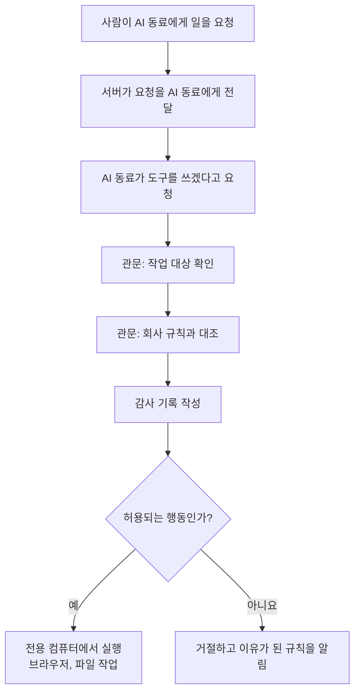

<aside class="ai-knowledge-sidebar">
  
CATEGORIES

  <nav class="ai-cat-tree">

에이전트 오케스트레이션18
<ul><li><a href="https://altjs4510.github.io/ai_news_blog/knowledge/20261029/">2026-10-29How Anthropic ships Claude with Claude: Separati…</a></li><li><a href="https://altjs4510.github.io/ai_news_blog/knowledge/20261027/">2026-10-27nightly-labs/openbot — Codex·Claude·Grok을 상주 팀원처…</a></li><li><a href="https://altjs4510.github.io/ai_news_blog/knowledge/20261015/">2026-10-15How Third Moment Research runs 10,000 agents for…</a></li><li><a href="https://altjs4510.github.io/ai_news_blog/knowledge/20261014/">2026-10-14How Anthropic's Dynamic Workflows Coordinate Cla…</a></li><li><a href="https://altjs4510.github.io/ai_news_blog/knowledge/20260930/">2026-09-30Agents you can coach: how Asana builds human-age…</a></li><li><a href="https://altjs4510.github.io/ai_news_blog/knowledge/20260903/">2026-09-03pacifio/atlas — 여러 코딩 에이전트의 변경을 한곳에서 추적·질의하는 '에이…</a></li><li><a href="https://altjs4510.github.io/ai_news_blog/knowledge/20260831-openexecutive-virtual-c-suite/">2026-08-31Open Executive — 8명의 전문 에이전트를 하나의 임원 목소리로</a></li><li><a href="https://altjs4510.github.io/ai_news_blog/knowledge/20260828/">2026-08-28Google ADK for Python v2.8.0 — RemoteA2aAgent 네이…</a></li><li><a href="https://altjs4510.github.io/ai_news_blog/knowledge/20260826/">2026-08-26apache/maka — 도구 호출·권한 결정·종료 이벤트를 append-only 로그…</a></li><li><a href="https://altjs4510.github.io/ai_news_blog/knowledge/20260823/">2026-08-23The Evolution of the Agent Harness — 하네스가 모델 가중치…</a></li><li><a href="https://altjs4510.github.io/ai_news_blog/knowledge/20260821/">2026-08-21volcengine/OpenViking — 에이전트 메모리·Knowledge RAG·스…</a></li><li><a href="https://altjs4510.github.io/ai_news_blog/knowledge/20260805/">2026-08-05TencentCloud/TencentDB-Agent-Memory — 대화·문서·코드를 …</a></li><li><a href="https://altjs4510.github.io/ai_news_blog/knowledge/20260717/">2026-07-17After a year building agent memory, 'save everyt…</a></li><li><a href="https://altjs4510.github.io/ai_news_blog/knowledge/20260623/">2026-06-23bytedance/deer-flow — 샌드박스·메모리·서브에이전트·메시지 게이트웨이를…</a></li><li><a href="https://altjs4510.github.io/ai_news_blog/knowledge/20260611/">2026-06-11The evolution of agentic surfaces: building with…</a></li><li><a href="https://altjs4510.github.io/ai_news_blog/knowledge/20260602/">2026-06-02revfactory/harness — 도메인별 에이전트 팀과 스킬을 자동 설계하는 메타…</a></li><li><a href="https://altjs4510.github.io/ai_news_blog/knowledge/20260529/">2026-05-29Introducing dynamic workflows in Claude Code</a></li><li><a href="https://altjs4510.github.io/ai_news_blog/knowledge/20260507/">2026-05-07ruvnet/ruflo — Claude 멀티 에이전트 오케스트레이션 플랫폼</a></li></ul>

MCP &amp; 도구 통합17
<ul><li><a href="https://altjs4510.github.io/ai_news_blog/knowledge/20261007/">2026-10-07morluto/rea — 앱 동작부터 네이티브 바이너리까지 에이전트로 리버스 엔지니어링</a></li><li><a href="https://altjs4510.github.io/ai_news_blog/knowledge/20260831-gitnexus-code-knowledge-graph/">2026-08-31GitNexus — 코드베이스를 지식그래프로 바꿔 에이전트에게 쥐어주기</a></li><li><a href="https://altjs4510.github.io/ai_news_blog/knowledge/20260819/">2026-08-19akitaonrails/ai-memory — 코딩 에이전트 CLI 간 장기 기억과 벤더…</a></li><li><a href="https://altjs4510.github.io/ai_news_blog/knowledge/20260802/">2026-08-02Stateless MCP has recaptured my interest (and in…</a></li><li><a href="https://altjs4510.github.io/ai_news_blog/knowledge/20260731/">2026-07-31different-ai/openwork — Claude Cowork의 오픈소스 대안(o…</a></li><li><a href="https://altjs4510.github.io/ai_news_blog/knowledge/20260729/">2026-07-29Bringing MCP 2026-07-28 to Claude</a></li><li><a href="https://altjs4510.github.io/ai_news_blog/knowledge/20260726/">2026-07-26citrolabs/ego-lite — 로그인된 브라우저 상태를 AI 에이전트와 공유하는…</a></li><li><a href="https://altjs4510.github.io/ai_news_blog/knowledge/20260718/">2026-07-18tirth8205/code-review-graph — MCP·CLI용 로컬 코드 인텔리…</a></li><li><a href="https://altjs4510.github.io/ai_news_blog/knowledge/20260708/">2026-07-08Expanding Managed Agents in Gemini API: backgrou…</a></li><li><a href="https://altjs4510.github.io/ai_news_blog/knowledge/20260618/">2026-06-18DeusData/codebase-memory-mcp — 158개 언어 코드베이스를 밀리…</a></li><li><a href="https://altjs4510.github.io/ai_news_blog/knowledge/20260603/">2026-06-03How Bad MCP design cost your Agent 5× more token…</a></li><li><a href="https://altjs4510.github.io/ai_news_blog/knowledge/20260521/">2026-05-21colbymchenry/codegraph — Pre-indexed code knowle…</a></li><li><a href="https://altjs4510.github.io/ai_news_blog/knowledge/20260520/">2026-05-20New in Claude Managed Agents: self-hosted sandbo…</a></li><li><a href="https://altjs4510.github.io/ai_news_blog/knowledge/20260517/">2026-05-17I gave my LLM 100,000+ tools — Lazy Discovery &a…</a></li><li><a href="https://altjs4510.github.io/ai_news_blog/knowledge/20260512/">2026-05-12agentmemory — Persistent memory for AI coding ag…</a></li><li><a href="https://altjs4510.github.io/ai_news_blog/knowledge/20260509/">2026-05-09How to connect 100 MCP servers without the conte…</a></li><li><a href="https://altjs4510.github.io/ai_news_blog/knowledge/20260506/">2026-05-06mksglu/context-mode — AI 코딩 에이전트용 컨텍스트 윈도우 최적화</a></li></ul>

코딩 에이전트25
<ul><li><a href="https://altjs4510.github.io/ai_news_blog/knowledge/20261022/">2026-10-22Claude Mods: Flipping the Harness Inside Out</a></li><li><a href="https://altjs4510.github.io/ai_news_blog/knowledge/20261018/">2026-10-18Quoting Addy Osmani, Morgan Westlee Lunt, and Qi…</a></li><li><a href="https://altjs4510.github.io/ai_news_blog/knowledge/20261017/">2026-10-17mksglu/context-mode — 코딩 에이전트용 컨텍스트 윈도우 최적화</a></li><li><a href="https://altjs4510.github.io/ai_news_blog/knowledge/20261014-claude-code-advisor/">2026-10-14Claude Code advisor — 가벼운 메인 모델이 일하고, 갈림길에서만 Opu…</a></li><li><a href="https://altjs4510.github.io/ai_news_blog/knowledge/20260920/">2026-09-20Claude Code 2.1.277 — CLAUDE.md가 없으면 AGENTS.md를 …</a></li><li><a href="https://altjs4510.github.io/ai_news_blog/knowledge/20260912/">2026-09-12Quoting Boris Cherny — 'Claude가 쓴 프로덕션 코드는 사람이 쓴…</a></li><li><a href="https://altjs4510.github.io/ai_news_blog/knowledge/20260910/">2026-09-10vastsa/PI-Desktop — Electron + Rust 호스트 코어 + 에이전…</a></li><li><a href="https://altjs4510.github.io/ai_news_blog/knowledge/20260906/">2026-09-06DietrichGebert/ponytail — 에이전트를 '방에서 가장 게으른 시니어 …</a></li><li><a href="https://altjs4510.github.io/ai_news_blog/knowledge/20260901/">2026-09-01affaan-m/ECC — 스킬·본능·메모리·보안을 묶은 에이전트 하네스 성능 최적화 …</a></li><li><a href="https://altjs4510.github.io/ai_news_blog/knowledge/20260829/">2026-08-29cursor/plugins — 플러그인 명세(specification)와 공식 플러그인…</a></li><li><a href="https://altjs4510.github.io/ai_news_blog/knowledge/20260814/">2026-08-14cathrynlavery/diagram-design — Claude Code용 에디토리…</a></li><li><a href="https://altjs4510.github.io/ai_news_blog/knowledge/20260810/">2026-08-10Auto mode is now the default in Claude Code for …</a></li><li><a href="https://altjs4510.github.io/ai_news_blog/knowledge/20260808/">2026-08-08PrimeIntellect-ai/prime-agent — 코딩 워크플로우와 장시간 자율…</a></li><li><a href="https://altjs4510.github.io/ai_news_blog/knowledge/20260804/">2026-08-04esengine/DeepSeek-Reasonix — prefix-cache 안정성을 축…</a></li><li><a href="https://altjs4510.github.io/ai_news_blog/knowledge/20260728/">2026-07-28alibaba/open-code-review — 결정론적 파이프라인 + LLM 에이전트…</a></li><li><a href="https://altjs4510.github.io/ai_news_blog/knowledge/20260725/">2026-07-25The new rules of context engineering for Claude …</a></li><li><a href="https://altjs4510.github.io/ai_news_blog/knowledge/20260714/">2026-07-14Graphify-Labs/graphify — 코드베이스를 질의 가능한 지식 그래프로 만…</a></li><li><a href="https://altjs4510.github.io/ai_news_blog/knowledge/20260707/">2026-07-07AI Hero Skills Catalog — 실무 엔지니어를 위한 재사용 가능한 판단 …</a></li><li><a href="https://altjs4510.github.io/ai_news_blog/knowledge/20260705/">2026-07-05openai/codex-plugin-cc — Claude Code에서 Codex를 위임…</a></li><li><a href="https://altjs4510.github.io/ai_news_blog/knowledge/20260701/">2026-07-01Google OKF (Open Knowledge Format) — 벤더 중립 에이전트 …</a></li><li><a href="https://altjs4510.github.io/ai_news_blog/knowledge/20260626/">2026-06-26google-labs-code/design.md — 코딩 에이전트에게 디자인 시스템을 …</a></li><li><a href="https://altjs4510.github.io/ai_news_blog/knowledge/20260619/">2026-06-19Claude Code now supports artifacts</a></li><li><a href="https://altjs4510.github.io/ai_news_blog/knowledge/20260530/">2026-05-30Leonxlnx/taste-skill — AI에게 좋은 취향을 부여해 generic s…</a></li><li><a href="https://altjs4510.github.io/ai_news_blog/knowledge/20260508/">2026-05-08addyosmani/agent-skills — Production-grade engin…</a></li><li><a href="https://altjs4510.github.io/ai_news_blog/knowledge/20260505/">2026-05-05mattpocock/skills — Skills for Real Engineers (.…</a></li></ul>

모델 &amp; 연구10
<ul><li><a href="https://altjs4510.github.io/ai_news_blog/knowledge/20261009/">2026-10-09Claude Haiku 5.5 (Simon Willison의 출시 노트와 가격 분석)</a></li><li><a href="https://altjs4510.github.io/ai_news_blog/knowledge/20260929/">2026-09-29vectorize-io/hindsight — Hindsight: Agent Memory…</a></li><li><a href="https://altjs4510.github.io/ai_news_blog/knowledge/20260907-voicemem-dual-brain-memory/">2026-09-07VoiceMem — 좌뇌·우뇌로 쪼갠 스트리밍 메모리로 음성 에이전트 지연 없애기</a></li><li><a href="https://altjs4510.github.io/ai_news_blog/knowledge/20260904/">2026-09-04HarnessDev: Can LLMs Create and Evolve Their Own…</a></li><li><a href="https://altjs4510.github.io/ai_news_blog/knowledge/20260716-proprag/">2026-07-16PropRAG — 프로포지션 경로 위 beam search로 멀티홉 검색 안내</a></li><li><a href="https://altjs4510.github.io/ai_news_blog/knowledge/20260712/">2026-07-12Do Automated Evals Work?</a></li><li><a href="https://altjs4510.github.io/ai_news_blog/knowledge/20260620/">2026-06-20zai-org/GLM-5 — From Vibe Coding to Agentic Engi…</a></li><li><a href="https://altjs4510.github.io/ai_news_blog/knowledge/20260617/">2026-06-17Predicting model behavior before release by simu…</a></li><li><a href="https://altjs4510.github.io/ai_news_blog/knowledge/20260516/">2026-05-16STALE — 에이전트가 자기 기억의 유효성을 인지할 수 있는가</a></li><li><a href="https://altjs4510.github.io/ai_news_blog/knowledge/20260513/">2026-05-13Thinking Machines' Native Interaction Models — T…</a></li></ul>

인프라 &amp; 컴퓨트7
<ul><li><a href="https://altjs4510.github.io/ai_news_blog/knowledge/20260909/">2026-09-09Reducing cost and improving performance with Cla…</a></li><li><a href="https://altjs4510.github.io/ai_news_blog/knowledge/20260905/">2026-09-05magnitudedev/magnitude — 하드웨어에 맞는 최적 로컬 모델을 띄워 이…</a></li><li><a href="https://altjs4510.github.io/ai_news_blog/knowledge/20260806/">2026-08-06cloudflare/computer — 에이전트에게 컴퓨터를 통째로 주는 엣지 실행 샌…</a></li><li><a href="https://altjs4510.github.io/ai_news_blog/knowledge/20260723/">2026-07-23diegosouzapw/OmniRoute — 268+ 프로바이더를 단일 엔드포인트로 묶…</a></li><li><a href="https://altjs4510.github.io/ai_news_blog/knowledge/20260610/">2026-06-10Fable 5 just made cost-aware model routing manda…</a></li><li><a href="https://altjs4510.github.io/ai_news_blog/knowledge/20260604/">2026-06-04chopratejas/headroom — Compress tool outputs bef…</a></li><li><a href="https://altjs4510.github.io/ai_news_blog/knowledge/20260522/">2026-05-22Giving Agents Computers — Ivan Burazin, Daytona</a></li></ul>

보안 &amp; 거버넌스26
<ul><li><a href="https://altjs4510.github.io/ai_news_blog/knowledge/20261031/" class="current">2026-10-31CopilotKit/OpenBot — AI 동료마다 전용 컴퓨터를 주고 모든 행동을 실…</a></li><li><a href="https://altjs4510.github.io/ai_news_blog/knowledge/20261030/">2026-10-30How we detect frontier model misalignment</a></li><li><a href="https://altjs4510.github.io/ai_news_blog/knowledge/20261021/">2026-10-21cloudflare/security-audit-skill — 독립 검증된 기계 판독형 …</a></li><li><a href="https://altjs4510.github.io/ai_news_blog/knowledge/20261020/">2026-10-20Satya Nadella — 모델을 내부자 위험으로 보는 원칙에 따라 Project P…</a></li><li><a href="https://altjs4510.github.io/ai_news_blog/knowledge/20261016/">2026-10-16Crossing the Threshold: How OpenAI and Anthropic…</a></li><li><a href="https://altjs4510.github.io/ai_news_blog/knowledge/20261011/">2026-10-11Anthropic can’t reliably control its AI agents. …</a></li><li><a href="https://altjs4510.github.io/ai_news_blog/knowledge/20261004/">2026-10-04Apple says it's tightening macOS 'Full Disk Acce…</a></li><li><a href="https://altjs4510.github.io/ai_news_blog/knowledge/20261001/">2026-10-01NVIDIA/OpenShell</a></li><li><a href="https://altjs4510.github.io/ai_news_blog/knowledge/20260919/">2026-09-19cloudflare/security-audit-skill — 다단계 보안 감사를 '독립…</a></li><li><a href="https://altjs4510.github.io/ai_news_blog/knowledge/20260913/">2026-09-13OpenAI agents attacked RubyGems back in May: Ope…</a></li><li><a href="https://altjs4510.github.io/ai_news_blog/knowledge/20260902/">2026-09-02AIR raises $50M to help companies vet the skills…</a></li><li><a href="https://altjs4510.github.io/ai_news_blog/knowledge/20260827/">2026-08-27Claude in Chrome is generally available</a></li><li><a href="https://altjs4510.github.io/ai_news_blog/knowledge/20260819-mind-viruses/">2026-08-19탈옥도, 인젝션도 없이 — 대화로만 퍼지는 에이전트의 '마인드 바이러스'</a></li><li><a href="https://altjs4510.github.io/ai_news_blog/knowledge/20260812/">2026-08-12semantica-agi/semantica — 컨텍스트와 '책임 추적 가능한(accou…</a></li><li><a href="https://altjs4510.github.io/ai_news_blog/knowledge/20260730/">2026-07-30Anatomy of a Frontier Lab Agent Intrusion: A Tec…</a></li><li><a href="https://altjs4510.github.io/ai_news_blog/knowledge/20260715/">2026-07-15Dicklesworthstone/destructive_command_guard — 에이…</a></li><li><a href="https://altjs4510.github.io/ai_news_blog/knowledge/20260710/">2026-07-1070개 MCP 서버 strace 런타임 감사 — 부팅 시 아웃바운드 호출 서버 적발</a></li><li><a href="https://altjs4510.github.io/ai_news_blog/knowledge/20260704/">2026-07-04Cloudflare is about to block AI agents by defaul…</a></li><li><a href="https://altjs4510.github.io/ai_news_blog/knowledge/20260703/">2026-07-03Giving admins more visibility and control over C…</a></li><li><a href="https://altjs4510.github.io/ai_news_blog/knowledge/20260630/">2026-06-30Introducing the Claude apps gateway for Amazon B…</a></li><li><a href="https://altjs4510.github.io/ai_news_blog/knowledge/20260624/">2026-06-24Agent identity in Claude Tag: a new access model…</a></li><li><a href="https://altjs4510.github.io/ai_news_blog/knowledge/20260613/">2026-06-13Fable 5's guardrails got bypassed in 48 hours — …</a></li><li><a href="https://altjs4510.github.io/ai_news_blog/knowledge/20260612/">2026-06-12NVIDIA/SkillSpector — AI 에이전트 스킬용 보안 스캐너</a></li><li><a href="https://altjs4510.github.io/ai_news_blog/knowledge/20260607/">2026-06-07OpenAI Help: Lockdown Mode</a></li><li><a href="https://altjs4510.github.io/ai_news_blog/knowledge/20260531/">2026-05-31How we contain Claude across products</a></li><li><a href="https://altjs4510.github.io/ai_news_blog/knowledge/20260527/">2026-05-27Microsoft Copilot Cowork Exfiltrates Files</a></li></ul>

응용 사례10
<ul><li><a href="https://altjs4510.github.io/ai_news_blog/knowledge/20261028/">2026-10-28Greptile takes bug detection beyond code review …</a></li><li><a href="https://altjs4510.github.io/ai_news_blog/knowledge/20261023/">2026-10-23Claude Duet app is Anthropic's bet on agents</a></li><li><a href="https://altjs4510.github.io/ai_news_blog/knowledge/20261006/">2026-10-06How Cresta turned CX expertise into an agent bui…</a></li><li><a href="https://altjs4510.github.io/ai_news_blog/knowledge/20260911/">2026-09-11Now everyone can put data to work — ChatGPT Work…</a></li><li><a href="https://altjs4510.github.io/ai_news_blog/knowledge/20260709/">2026-07-09mvanhorn/last30days-skill — Reddit·X·YouTube·HN·…</a></li><li><a href="https://altjs4510.github.io/ai_news_blog/knowledge/20260621/">2026-06-21calesthio/OpenMontage — 12 파이프라인·52 도구·500+ 스킬을 …</a></li><li><a href="https://altjs4510.github.io/ai_news_blog/knowledge/20260609/">2026-06-09Building intelligent apps for Apple platforms wi…</a></li><li><a href="https://altjs4510.github.io/ai_news_blog/knowledge/20260528/">2026-05-28Building self-improving tax agents with Codex</a></li><li><a href="https://altjs4510.github.io/ai_news_blog/knowledge/20260515/">2026-05-15Clawdmeter — Claude Code 사용량을 데스크톱 대시보드로</a></li><li><a href="https://altjs4510.github.io/ai_news_blog/knowledge/20260514/">2026-05-14Introducing Claude for Small Business</a></li></ul>

산업 동향8
<ul><li><a href="https://altjs4510.github.io/ai_news_blog/knowledge/20261024/">2026-10-24Donating Agent Skills to the Agentic AI Foundati…</a></li><li><a href="https://altjs4510.github.io/ai_news_blog/knowledge/20260907-humanmade-52week-rhythm/">2026-09-07휴먼 메이드의 '52주 리듬' — 아이디어가 흔해진 시대에 값이 오르는 건 버리는 판단</a></li><li><a href="https://altjs4510.github.io/ai_news_blog/knowledge/20260830/">2026-08-30[AINews] OpenAI shuts off Cursor — 프론티어 모델 공급 차단…</a></li><li><a href="https://altjs4510.github.io/ai_news_blog/knowledge/20260711/">2026-07-11OpenAI says GPT 5.6 is the 'preferred model' for…</a></li><li><a href="https://altjs4510.github.io/ai_news_blog/knowledge/20260702/">2026-07-02How Cursor deploys AI inside the enterprise (For…</a></li><li><a href="https://altjs4510.github.io/ai_news_blog/knowledge/20260616/">2026-06-16Why AI hasn't replaced software engineers, and w…</a></li><li><a href="https://altjs4510.github.io/ai_news_blog/knowledge/20260519/">2026-05-19Anthropic acquires Stainless</a></li><li><a href="https://altjs4510.github.io/ai_news_blog/knowledge/20260504/">2026-05-04Agents for Everything Else: Codex for Knowledge …</a></li></ul>
</nav>
</aside>

<article class="ai-knowledge-article">

<header class="ai-post-hero">
  
<a class="ai-back" href="../">KNOWLEDGE</a> · 2026-10-31 · 오늘의 학습

  <h2 class="ai-post-title">CopilotKit/OpenBot — AI 동료마다 전용 컴퓨터를 주고 모든 행동을 실행 전 결정·실행 후 기록하는 오픈소스</h2>
</header>

> 원문: [CopilotKit/OpenBot — AI 동료마다 전용 컴퓨터를 주고 모든 행동을 실행 전 결정·실행 후 기록하는 오픈소스](https://github.com/CopilotKit/OpenBot)

## 📌 학습 정리

### 1. 한 줄로 말하면

회사가 직접 소유하고 고칠 수 있는 AI 비서의 뼈대예요. AI 동료에게 일할 컴퓨터를 내주되, 모든 행동을 하기 전에 허용 여부를 판단하고 그 내용을 기록으로 남겨요.

### 2. 왜 이게 만들어졌어요?

ChatGPT, Claude, Grok 같은 AI 비서는 쓰기 편하지만, 회사가 내부를 마음대로 고치거나 자기 설비에서 돌리는 데는 한계가 있어요. OpenBot은 쓰는 모습은 비슷하게 두고, 자기 회사 인프라에서 돌리며 무엇이든 바꿀 수 있게 하자는 생각에서 나온 것으로 보여요. 여기에 또 하나의 고민이 있어요. AI에게 브라우저, 파일, 사내 도구를 쥐여 주는 것과 그걸 안심하고 맡기는 것은 다른 문제라는 점이에요. 그래서 AI의 행동이 모두 한 관문을 거치게 해서, "도구를 쓸 수 있는 AI"를 "곁에 둘 수 있는 AI"로 바꾸려는 프로젝트예요.

### 3. 비유로 풀면

이건 마치 **출입 관리가 철저한 사무실에 새 동료를 앉히는 것** 같은 거예요. 동료는 자기 책상과 자기 계정으로 일하지만, 중요한 문을 열 때마다 경비실을 지나야 해요. 경비실은 규칙을 확인하고 출입 장부를 먼저 쓴 다음에야 문을 열어 주고, 거절할 때는 어떤 규칙 때문인지 알려 줘요.

운전 연수 차량에 비유할 수도 있어요. 평소에는 AI가 운전하는 모습을 화면으로 지켜보다가, 로그인 화면이나 2단계 인증처럼 혼자 넘기면 안 되는 곳이 나오면 사람이 핸들을 넘겨받아요. 사람이 운전하는 동안 AI의 행동은 대기열에 쌓이지 않고 거절되며, 처리가 끝나면 다시 AI에게 맡겨요.

그래서 결국, OpenBot의 핵심은 AI가 일을 잘하게 만드는 것 못지않게 "무엇을 해도 되는지 먼저 판단하고, 무엇을 했는지 남기는 구조"를 갖추는 데 있어요.

### 4. 어떻게 작동하는지 (그림으로)

사람의 요청은 서버를 거쳐 AI 동료에게 가고, AI 동료가 도구를 쓰려 하면 그 요청은 다시 관문으로 돌아와요. 관문은 작업 대상을 확인하고 규칙과 대조한 뒤 기록을 남기며, 그다음에야 실행하거나 거절해요. 원문은 기록이 생기기 전에 행동이 실행되는 경로는 없다고 설명해요.

### 5. 처음 보는 용어 풀이

- **자율적으로 일하는 AI 프로그램 (agent)** — 대답만 하지 않고 도구를 써서 실제 작업까지 하는 AI예요. OpenBot에서는 이런 AI를 봇(Bot) 또는 동료(coworker)라고 불러요.
- **AI와 사용자를 잇는 공개 규약 (AG-UI)** — AI와 사용자가 주고받는 방식을 정한 공개 약속이에요. 이 규약만 맞추면 어떤 도구로 만든 AI든, 직접 짠 AI든 OpenBot의 봇으로 데려올 수 있어요.
- **격리된 작업 공간 (container)** — 하나의 컴퓨터 안에 따로 나눠 둔 독립 공간이에요. 기본적으로 사람마다 하나씩 주어지고, 그 안에 봇별 폴더와 브라우저 프로필이 있어요. 봇에 Isolated를 체크하면 그 봇만의 공간을 따로 줄 수 있어요.
- **단일 관문 (gateway)** — 봇이 컴퓨터, 파일, 외부 도구 등에 하는 행동이 모두 지나가는 한 지점이에요. 여기서 허용 여부를 판단하고 기록을 남겨요.
- **감사 기록 (audit trail)** — 무엇이 허용되고, 거절되고, 실패했는지 남긴 기록이에요. 거절 건에는 원인이 된 규칙도 함께 남아서, 나중에 왜 막혔는지 확인할 수 있어요.
- **문제가 생기면 닫아 두는 방식 (fail closed)** — 규칙이 없거나 깨져 있으면 허용하지 않고 거절하는 원칙이에요. 설정 실수가 곧바로 무단 허용으로 이어지는 일을 막아 줘요.
- **외부 앱 연결 서버 (MCP server)** — Google Drive, Notion 같은 외부 앱의 도구를 봇에게 연결하는 통로예요. OpenBot에서는 관리자가 어떤 봇에게 어떤 도구를 줄지 정하고, 이 연결도 같은 관문을 거쳐요.

### 6. 한 발 더 들어가고 싶다면

- [Quick start](https://github.com/CopilotKit/OpenBot#quick-start) — 이걸 보면 내 노트북에서 직접 띄워 보는 순서를 알 수 있어요.
- [AG-UI](https://github.com/ag-ui-protocol/ag-ui) — 이걸 보면 봇과 사용자를 잇는 공개 규약이 무엇인지 알 수 있어요.
- [docs/architecture.md](https://github.com/CopilotKit/OpenBot/blob/main/docs/architecture.md) — 이걸 보면 서버, 관문, 컴퓨터가 어떻게 나뉘어 있는지 더 자세히 알 수 있어요.
- [docs/coworkers.md](https://github.com/CopilotKit/OpenBot/blob/main/docs/coworkers.md) — 이걸 보면 AI 동료를 어떻게 정의하고 추가하는지 알 수 있어요.
- [docs/routines.md](https://github.com/CopilotKit/OpenBot/blob/main/docs/routines.md) — 이걸 보면 봇에게 일정에 맞춰 일을 맡기는 기능을 알 수 있어요.

---

## 📖 원문 전체 번역 (정독용)

> 의역 최소화한 전체 번역입니다. 큰 흐름은 위 정리에서 잡고, 정확한 워딩이 필요할 땐 이 섹션에서 정독하세요.

**당신의 회사가 실제로 소유할 수 있는 AI 어시스턴트.** ChatGPT, Claude, Grok과 같은 형태이지만, 중요한 차이가 하나 있습니다. 당신의 인프라에서 실행되고, 무엇이든 바꿀 수 있다는 점입니다. 어떤 에이전트 스택이든 AG-UI를 통해 연결됩니다.

각 동료(coworker)는 자신만의 로그인, 자신만의 파일, 그리고 당신이 허용한 도구만 갖춘 실제 브라우저를 받습니다. 모든 행동은 일어나기 전에 결정되고, 일어난 뒤에 기록됩니다.

[**엔지니어와 이야기하기**](https://copilotkit.ai/talk-to-an-engineer?ref=openbot_readme) · [**함께 만들어 드립니다**](https://copilotkit.ai/talk-to-an-engineer?ref=openbot_readme) · [**copilotkit.ai/openbot**](https://copilotkit.ai/openbot) · [**빠른 시작**](https://github.com/CopilotKit/OpenBot#quick-start) · [**문서**](https://github.com/CopilotKit/OpenBot/blob/main/docs/README.md)

demo-openbot.mp4[Video 3](https://private-user-images.githubusercontent.com/27702539/638253557-535ef7ee-1631-4a69-b839-564c56cf90b4.mp4?jwt=eyJ0eXAiOiJKV1QiLCJhbGciOiJIUzI1NiJ9.eyJpc3MiOiJnaXRodWIuY29tIiwiYXVkIjoicmF3LmdpdGh1YnVzZXJjb250ZW50LmNvbSIsImtleSI6ImtleTUiLCJleHAiOjE3OTMzODE3ODYsIm5iZiI6MTc5MzM4MTQ4NiwicGF0aCI6Ii8yNzcwMjUzOS82MzgyNTM1NTctNTM1ZWY3ZWUtMTYzMS00YTY5LWI4MzktNTY0YzU2Y2Y5MGI0Lm1wND9YLUFtei1BbGdvcml0aG09QVdTNC1ITUFDLVNIQTI1NiZYLUFtei1DcmVkZW50aWFsPUFLSUFWQ09EWUxTQTUzUFFLNFpBJTJGMjAyNjEwMzAlMkZ1cy1lYXN0LTElMkZzMyUyRmF3czRfcmVxdWVzdCZYLUFtei1EYXRlPTIwMjYxMDMwVDE3MzEyNlomWC1BbXotRXhwaXJlcz0zMDAmWC1BbXotU2lnbmF0dXJlPTFmZmYxNWRlNGE3MWYxYTZhYjdlMzhkNTA2ZDVhMzA2ODZmMGU0ZDk2MmJiZDQ2OTMxN2YwNDM1YzExOWMyNTImWC1BbXotU2lnbmVkSGVhZGVycz1ob3N0JnJlc3BvbnNlLWNvbnRlbnQtdHlwZT12aWRlbyUyRm1wNCJ9.wC8WdNV8Tgs6CRXcWwC6GUK5HMG1x-Lb1SVMhzXubZ4)

프레임워크로 만들었든 직접 손으로 작성했든, 어떤 AG-UI 에이전트든 가져오면 자신만의 채널을 가진 동료로 합류합니다. 에이전트가 자기 화면에서 일하는 모습을 지켜보다가, 혼자 해서는 안 되는 일에 이르면 직접 운전대를 잡고, 끝나면 다시 넘겨줄 수 있습니다. 에이전트는 글(prose)뿐 아니라 컴포넌트로도 답하며, 이 모든 것이 당신의 머신에서 실행됩니다.

> **제품이 아니라 템플릿입니다.** OpenBot은 클론해서 자신의 것으로 만들도록 설계되었습니다. 가입할 호스팅 버전은 없으며, 의존할 패키지로 배포된 것도 없습니다. 이 저장소의 모든 워크스페이스는 비공개(private)입니다. 저장소를 가져와 `examples/` 아래의 예시 테넌트 패키지를 당신의 동료, 채널, 스킬로 교체한 뒤 실행하면 됩니다. 아래 내용은 모두 완성품이 아니라 출발점을 설명한 것이며, 누군가가 대신 운영해 주는 서비스가 아닙니다.

> **베타이며 활발히 개발 중입니다.** OpenBot은 초기 단계입니다. 거친 부분과 버그가 있을 것이고, 변경이 잦을 것으로 예상하세요. 이슈와 풀 리퀘스트를 환영합니다.

> **당신의 머신에서 실행됩니다.** 아래의 모든 내용은 노트북을 기준으로 작성되었습니다. `.env.example`에는 `OPENBOT_SINGLE_USER=true`가 들어 있어 모든 요청을 한 명의 관리자로 받아들이므로, 새로 클론한 직후에도 OAuth 클라이언트를 먼저 등록하지 않고 제품에 접근할 수 있습니다. [로그인](https://github.com/CopilotKit/OpenBot#sign-in)을 설정하면 이 동작이 꺼지며, 다른 누군가가 배포본에 접근하려면 반드시 필요합니다.

> **귀사에서 대신, 혹은 함께 만들어 드릴 수 있습니다.** 저희 엔지니어가 귀사 인프라 안에 OpenBot을 세우고, 귀사의 자체 제품처럼 보이도록 커스터마이징한 다음, 계속 바꿔 나가실 수 있도록 넘겨 드립니다. [**대화 시작하기**](https://copilotkit.ai/talk-to-an-engineer?ref=openbot_readme).
> 
> 
> 그동안에는 Intelligence를 포함한 전체를 노트북에서 실행해 보세요. CopilotKit의 무료 Developer 플랜으로 Mac의 Docker에서 [Intelligence를 로컬로 실행](https://github.com/CopilotKit/OpenBot#intelligence-on-your-own-machine)할 수 있습니다.

## 무엇인가

당신의 인프라 안에서 실행되는 에이전트 플랫폼입니다. Docker Compose가 모든 구성 요소를 띄우고, 데이터는 당신의 PostgreSQL에 저장되며, 모델은 당신이 고릅니다. 모델은 기본 포함되지 않으며, 관리자가 자격 증명을 제공하고 이는 저장 시 암호화되고 로그에 남지 않습니다.

배포 직후에는 두 명의 동료로 시작하며, 이들은 코드가 아니라 설정입니다. 일상 업무를 위한 **General Assistant**와 사내 질문을 위한 **Knowledge**입니다. **Risk Analyst**는 엔드포인트를 설정하면 합류하고, 그 외 열 명은 `examples/fintech/catalog/`에서 대기 중입니다. 각자 한 가지 일을 맡습니다. 경비 청구서를 규정 원문에 비추어 읽기, 회의록을 그 안에 실제로 있는 후속 조치로 바꾸기, 출시된 내용으로 릴리스 노트 초안 쓰기, 티켓 분류(triage), 신규 입사자에게 핸드북을 근거로 답하기, 찾지 못한 것을 명시하는 브리프 작성, 인터뷰 정리, 온콜 교대 인수인계, 갱신 전에 파악된 내용 취합, 고객 피드백을 인용 가능한 주제로 묶기입니다. 하나를 `examples/fintech/agents/`에 복사하면 추가되며, 그곳이나 `agents.yaml`에 직접 작성하거나 UI의 `/bots`에서 만들 수도 있습니다.

Bot이 컴퓨터, 파일, MCP 서버, 컴포넌트에 하는 모든 행동은 이를 결정하고 기록하는 하나의 게이트웨이를 거칩니다. 이것이 당신의 도구를 사용할 수 있는 에이전트와, 당신의 도구 가까이에 두어도 되는 에이전트의 차이입니다.

자세한 내용은 [copilotkit.ai/openbot](https://copilotkit.ai/openbot)에서 볼 수 있습니다.

## AG-UI 기반

Bot은 에이전트와 사용자 간 상호작용을 위한 오픈 프로토콜인 [AG-UI](https://github.com/ag-ui-protocol/ag-ui)를 사용하는 모든 엔드포인트입니다. 따라서 OpenBot은 특정 프레임워크에 묶이지 않으며, 당신도 마찬가지입니다. LangGraph, Mastra, CrewAI, Pydantic AI, Google ADK로 만든 에이전트나 직접 작성한 에이전트 모두 같은 방식으로 합류하며, 거버넌스는 프레임워크가 아니라 프로토콜 위에서 작동합니다.

## 요구 사항

*   Docker: PostgreSQL과 기본 제공 Bot용.
*   [Bun](https://bun.sh/) 1.4+: 앱, API 서버, 테스트용 (일부 테스트는 1.3에서 실패합니다).
*   CopilotKit Intelligence 프로젝트와 라이선스. 무료 플랜이 있으며, Intelligence는 직접 호스팅할 수 있습니다.
*   모델 키. 개념 검증(proof-of-concept) Bot은 OpenAI를 사용하고, LangGraph Bot은 OpenAI, Anthropic, Google을 사용할 수 있습니다.

## 빠른 시작

> **AI 어시스턴트로 설정하시나요?** 먼저 [`prompt.txt`](https://github.com/CopilotKit/OpenBot/blob/main/prompt.txt)를 붙여 넣으세요. 아래와 동일한 단계에 더해, 틀리기 쉬운 부분이 담겨 있습니다. `.env.example`의 빈 키 중 실제로 직접 채워야 하는 것(CopilotKit 키와 모델 키), 시작 스크립트가 채워 주는 것, 그리고 각 시작 거부(start-up refusal)가 무엇을 의미하는지입니다. 그 안의 모든 주장은 이 저장소와 대조해 확인되었습니다.

1.   `.env` 생성:

cp .env.example .env
bun install 
2.   새로운 관리형(managed) Intelligence 프로젝트 연결:

npx --yes copilotkit@latest login
npx --yes copilotkit@latest project select
bun scripts/setup-learning.ts 
이 헬퍼는 선택한 프로젝트의 런타임 키를 프로비저닝하고, 해당 프로젝트의 `openbot` Learning 컨테이너를 생성하거나 재사용한 뒤, 두 설정을 모두 `.env`에 기록합니다. 사용자 지정 컨테이너 할당은 보존하며, 기존 OpenBot 키는 절대 교체하지 않습니다. 키가 이미 설정돼 있으면 해당 키의 프로젝트에 `openbot`이 없을 때에만 생성합니다. 새로운 자체 호스팅 환경을 설정하려면 `INTELLIGENCE_API_URL`을 해당 배포본의 HTTPS API 오리진(로컬이면 `http://localhost`)으로 설정하고, 두 `npx` 명령 없이 헬퍼를 실행하세요. 평소 사용하는 로그인과 프로젝트 선택을 위해 격리된 Chrome 또는 Edge 창이 열리므로 둘 중 하나를 먼저 설치하세요. CLI로 관리되는 로컬 평가용 설치의 경우, 설치되었거나 캐시된 CopilotKit CLI 중 가장 최신 버전으로 일치하는 대시보드를 찾아 로그인과 세션 요청에 그 대시보드를 사용합니다. 탐색은 Bun으로 오프라인에서 수행되며, CLI를 다운로드하거나 PATH에 `npx`가 있을 필요가 없습니다. 사용 가능한 CLI가 없으면, 수동으로 호스팅한 배포본은 로그인에 자체 API 오리진을 사용합니다. 안내가 나오면 브라우저에 표시되는 로컬 인증 승인을 완료하세요. 런타임 API URL은 바뀌지 않습니다. 헬퍼는 API URL, 키, 컨테이너를 기록하지만 `INTELLIGENCE_GATEWAY_WS_URL`은 기록하지 않으므로, 그 값은 같은 배포본으로 직접 설정해야 합니다. `openbot`이 존재하게 되면, [Admin → Automatic Learning](https://github.com/CopilotKit/OpenBot/blob/main/docs/automatic-learning.md)에 저장된 설정이 없는 한 서버가 알아서 이를 기본값으로 할당합니다. 관리형 Intelligence는 별도의 라이선스 토큰이 필요 없습니다.

3.   나머지 필수 값 채우기:

    *   `OPENAI_API_KEY`

Intelligence를 직접 운영하는 경우가 아니라면 `.env.example`의 관리형 Intelligence URL을 그대로 두세요. 예시의 `KEY_ENCRYPTION_KEY`는 공개된 값이며 로컬에서는 사용해도 괜찮습니다. 자신의 키는 다음으로 생성하세요:

openssl rand -base64 32

4.   실행:

bash scripts/start.sh 
5.   [http://localhost:3010](http://localhost:3010/)을 엽니다.

`scripts/start.sh`는 Docker 서비스를 시작하고, 마이그레이션을 적용하고, 3001번 포트에서 API 서버를, 루틴 워커를, 3010번 포트에서 앱을 시작한 뒤, 다음 단계를 출력하기 전에 각 서비스가 자체 헬스 라우트에 응답하는지 확인합니다.

`scripts/stop.sh`는 compose가 관리하지 않는 각 Bot의 컴퓨터를 포함해 같은 것들을 모두 내립니다. `--keep-computers`를 주면 컴퓨터는 계속 실행됩니다. 아무것도 삭제되지 않습니다. 데이터베이스, Bot의 파일, 브라우저 프로필은 볼륨입니다.

### 내 머신에서 Intelligence 실행

관리형 서비스 대신 Mac 한 대에서 Intelligence를 시험해 보려면 [Intelligence 로컬 평가](https://docs.copilotkit.ai/intelligence/self-hosting-local)를 따르세요. 무료 [Developer 플랜](https://www.copilotkit.ai/pricing)이 해당됩니다. 로컬 라이선스는 30일간 유효하며, 계정이 정상 상태인 동안에는 `npx copilotkit@latest local renew`로 필요한 만큼 갱신할 수 있습니다. 이는 Docker Desktop이 있는 macOS용 프리뷰이며 프로덕션 설치가 아닙니다. 해당 문서의 `npx copilotkit@latest local connect`는 `.env`가 있는 OpenBot 루트에서 실행하세요.

이 명령은 `INTELLIGENCE_API_URL`, `INTELLIGENCE_GATEWAY_WS_URL`, `CPK_INTELLIGENCE_API_KEY`를 `.env`에 기록합니다. OpenBot은 이 설정을 직접 읽으므로 키를 복사하거나 이름을 바꿀 필요가 없습니다. 이전 구성을 위해 `INTELLIGENCE_API_KEY`도 계속 지원됩니다. 둘 다 설정된 경우 비어 있지 않은 CLI 키가 우선하므로, 재연결 시 새 프로젝트의 키가 사용됩니다.

해당 스택에서 Bot에게 Learning 컨테이너를 부여하려면 [Automatic Learning](https://github.com/CopilotKit/OpenBot/blob/main/docs/automatic-learning.md)을 참고하세요.

## 배포하기

하나의 이미지에 앱, API, Bot이 조작하는 브라우저, 그리고 선택적으로 PostgreSQL이 들어 있습니다. 같은 `.env`를 쓰며 Kubernetes는 필요 없습니다.

# 공개된 이미지. 클론도 빌드도 필요 없음.
docker run -p 3001:3001 --env-file .env \
  -e EMBEDDED_POSTGRES=on -v openbot-data:/var/lib/postgresql \
  ghcr.io/copilotkit/openbot:latest

# 또는 지금 보고 있는 트리.
docker build -t openbot .
docker run -p 3001:3001 --env-file .env \
  -e EMBEDDED_POSTGRES=on -v openbot-data:/var/lib/postgresql openbot

여기서는 클론 환경의 3010이 아니라, 앱을 포함한 모든 것이 3001에서 제공됩니다. `latest`는 가장 최근 릴리스이며, `:v0.0.9` 같은 버전 태그는 특정 버전을 고정합니다.

`EMBEDDED_POSTGRES`를 끄고 `DATABASE_URL`을 이미 운영 중인 데이터베이스로 지정하세요. [docs/deployment.md](https://github.com/CopilotKit/OpenBot/blob/main/docs/deployment.md)에 최소 사양, 플랫폼별 참고 사항, 그리고 둘 이상의 레플리카 뒤에서의 동작이 설명되어 있습니다.

## 써 보기

*   `/bot`을 열고 질문하세요: `Open news.ycombinator.com and tell me the top story.`
*   Bot에게 [https://httpbin.org/forms/post](https://httpbin.org/forms/post) 양식을 작성하게 한 뒤 `/admin/audit`를 확인하세요.
*   `/admin/boundaries`를 열어 거부(deny) 규칙이나 프리셋을 추가하고, 같은 브라우저 동작을 다시 시도하세요.
*   `/bots`에서 Bot을 만들고, 상시 역할(standing role)을 부여한 뒤, 그 Bot과 채널을 시작하세요.

## 주요 화면

| 경로 | 용도 |
| --- | --- |
| `/` | 채널 시작 및 탐색. |
| `/channel/new` | 대화 시작. To:에 Bot을 둘 이상 넣으면 그룹이 시작됩니다. |
| `/channel/:id` | 한 동료와 대화하고, 그 화면을 지켜보고, 실행한 것을 확인. |
| `/bot` | Bot과 직접 채팅. `?agent=<id>`로 하나를 선택. |
| `/bots` | 접근 가능한 모든 Bot. 하나를 만들 수 있고, 해당 페이지를 열어 변경. |
| `/bots/:id` | Bot 하나: 당신에게 무엇을 기다리는지, 무엇을 하고 있는지, 어떻게 설정되어 있는지. |
| `/bots/:id/responsibilities` | Bot에게 지속적인 목표를 부여하고, 진행 상황을 추적하며, 언제 일할지 결정. |
| `/bots/:id/reach` | Slack, Microsoft Teams, 또는 문자 메시지로 Bot과의 대화를 이어가기. |
| `/bots/:id/memory` | 어떤 연결된 앱이 Bot에게 사실을 공급하는지, 그리고 Bot의 백그라운드 리서치. |
| `/bots/:id/approvals` | Bot이 당신에게 먼저 묻지 않고 해도 되는 일. |
| `/connections` | Bot이 함께 일할 수 있도록 앱을 연결. |
| `/capabilities/skills` | 개인 스킬을 만들고 활성화. |
| `/capabilities/memory` | Bot이 당신에 대해 기억하는 것과, 당신이 알려 주는 사실. |
| `/routines` | 현재 유지되고 있는 루틴을 확인하고, 하나를 중지. |
| `/settings` | 사용자 환경설정. |
| `/settings/passwords` | Bot을 웹사이트에 로그인시킬 때 저장한 로그인 정보. |
| `/settings/notifications` | 업데이트가 가는 곳, 당신의 기기, 최근 전달 내역. |
| `/settings/approvals` | Bot이 행동 전에 묻는지 여부, 그리고 모든 Bot에 적용되는 규칙. |
| `/admin/credentials` | 쓰기 전용(write-only) 암호화 자격 증명 저장. |
| `/admin/approvals` | 팀 승인 설정, 팀 규칙, 공유 계정 요청. |
| `/admin/computers` | Bot 컴퓨터 조회, 중지, 초기화. |
| `/admin/boundaries` | 브라우저/파일/MCP 동작 정책 구성. |
| `/admin/components` | 컴포넌트를 게시하고 어떤 Bot이 사용할 수 있는지 관리. |
| `/admin/playground` | 브라우저에서 샌드박스 컴포넌트를 초안 작성하고 게시. |
| `/admin/plugins` | MCP 서버를 구성하고 그 도구를 Bot에게 부여. |
| `/admin/skills` | 배포 스킬을 작성하고 Bot에게 부여. |
| `/admin/learning` | Bot에게 Learning 컨테이너를 할당하거나 Automatic Learning을 일시 중지. |
| `/admin/people` | 로그인한 사람을 목록 조회, 승격, 강등, 제거. |
| `/admin/identity-providers` | 회사의 SAML 또는 OIDC 제공자를 등록하고 이메일 도메인으로 라우팅. |
| `/admin/enterprise` | 구성원이 사용할 수 있는 것, Bot 컴퓨터가 네트워크에 접근하는 방식, 그에 대해 기록되는 내용. |
| `/admin/audit` | 허용, 거부, 실패한 동작 검토. |

## 기능

*   **사람마다 컴퓨터 한 대**: supervisor가 각 사람에게 전용 컨테이너를 주며, 그 안에 각 Bot별 폴더와 브라우저 프로필이 있습니다. Bot에서 Isolated를 체크하면 그 Bot만의 컨테이너를 받습니다. 호스트가 지원하는 경우 `COMPUTER_RUNTIME=runsc`를 설정하면 gVisor 아래에서 실행합니다.
*   **브라우저만이 아니라 셸도**: Bot은 자신의 워크스페이스에서 명령을 실행하고, 필요한 것을 설치하고, 저장한 파일을 처리할 수 있습니다. 다른 모든 것과 같은 게이트를 거치므로, 규칙으로 셸을 아예 거부하거나 특정 명령만 거부할 수 있고, 어느 쪽이든 명령은 기록에 남습니다. 명령은 PATH, 로케일, 터미널, 프록시 변수를 상속하며, 배포 환경의 나머지 환경 변수는 상속하지 않습니다.
*   **게이트웨이만이 유일한 진입로**: 서버가 보유한 스냅샷에서 대상을 해석하고, 정책을 평가하고, 감사 행을 기록한 뒤에야 컴퓨터를 호출합니다. 기록이 먼저 존재하지 않고 행동하는 경로는 없습니다.
*   **CEL 정책, 실패 시 차단(fail closed)**: 규칙은 `tool.name`, `intent`, `bot.id`, `actor.id`, `page.url`, `page.host`, `element.*`, `key`, `command`, `file.*`, `mcp.*`, `initiator.*`(실행을 시작시킨 주체이며, 사람에게는 허용하는 일을 예약된 루틴에는 거부하는 규칙을 쓸 수 있음)를 검사할 수 있습니다. 거부(deny)가 허용(allow)보다 먼저 평가되고, 정책이 없으면 아무것도 허용되지 않으며, 깨진 규칙은 열어 주지 않고 거부합니다.
*   **무엇을 하는지 지켜보기**: 화면에는 Bot이 보고 있는 것이 나오고, 그 옆의 Activity 탭에는 Bot이 실행하고, 읽고, 저장한 것이 출력과 함께 나옵니다. 대화 기록의 명령줄을 열면 같은 내용이 나옵니다. 저장된 파일은 경로와 크기를 보여 주되 내용은 절대 보여 주지 않습니다.
*   **운전대 잡기**: 로그인 벽이나 2FA 프롬프트를 만난 Bot은 도움을 요청합니다. 같은 패널에서 제어권이 넘어가며 `computer.help_requested`, `computer.control_taken`, `computer.control_released`로 기록됩니다. 사람이 운전하는 동안에는 Bot의 동작이 큐에 쌓이지 않고 거부됩니다.
*   **비밀은 대화 기록에 절대 들어가지 않음**: 기록에는 비밀이 요청되었다는 사실과 그 길이만 남고, 내용은 남지 않습니다.
*   **자신의 에이전트 가져오기**: 프레임워크로 만들었든 손으로 썼든, 어떤 AG-UI 엔드포인트든 Bot이 됩니다. 엔드포인트는 브라우저 탐색에 쓰는 것과 같은 대상 검사로 검증되며, 인증 헤더는 쓰기 전용으로 저장됩니다.
*   **글 대신 컴포넌트**: 컴파일된 React 컴포넌트는 `app/src/components/gallery/`에 있고, 샌드박스 컴포넌트는 `/admin/playground`에서 작성해 배포 없이 게시합니다. 모든 호출은 서버에 그 컴포넌트가 존재하는지, 게시되었는지, 해당 Bot에게 제한(withheld)되지 않았는지 묻습니다. 데이터 함수는 컴포넌트별로 부여됩니다.
*   **거버넌스가 적용된 MCP**: Google Drive, Notion, 그리고 [공개 웹 리서치 제공자](https://github.com/CopilotKit/OpenBot/blob/main/docs/web-research.md)인 Parallel, Exa, Firecrawl이 카탈로그에 포함되어 있고, Composio가 하나의 계정 뒤에서 수백 개의 앱을 중개하며 각각 요청한 사람의 권한으로 접근됩니다. 카탈로그에는 이 배포가 보증하는 벤더만 들어 있으므로, 하나를 추가하는 것은 그 벤더에 대한 검토입니다. 커스텀 서버는 URL 검사를 통과해야 합니다. 알 수 없는 도구와 커스텀 서버의 도구는 쓰기(write)로 취급되며, 서버가 광고하지만 쓰기로 명시하지 않은 카탈로그 도구는 읽기(read)로 분류됩니다. Bot에게는 여기에 어떤 커넥터가 있고 자신이 어떤 것을 보유하는지 알려 주므로, 벤더 웹사이트로 가서 둘러보는 대신 "아직 부여받지 못했다"고 말합니다.
*   **스킬은 능력이 아니라 지침**: 개인 스킬은 작성자가 소유한 Bot에만 붙고, 배포 스킬은 관리자 소유이며, 둘 다 입력창에서 `/`로 호출합니다. 기본 제공 `skill-creator` 스킬을 부여받은 Bot은 대화 중에 당신과 함께 스킬을 작성할 수 있으며, 카드의 버튼을 눌러야만 저장합니다.
*   **회사가 이미 가진 것으로 로그인**: 환경 변수로 설정하는 Google, Microsoft, Okta, 또는 배포가 실행되는 동안 등록하고 이메일 도메인으로 라우팅하는 회사 자체 SAML 또는 OpenID Connect 제공자. 어느 하나만 있어도 로그인이 켜지며, 여러 개를 동시에 구성할 수도 있습니다.
*   **누가 들어올지 결정**: `/admin/people`은 로그인한 모든 사람을 목록으로 보여 주고, 승격·강등하며, 접근 권한을 제거합니다. 제거하면 그 사람이 사용 중인 세션이 종료되고 다음 로그인이 차단됩니다. 모든 변경은 감사 기록에 남습니다.
*   **읽을 수 있는 감사 기록**: `/admin/audit`는 허용된 것, 거부된 것, 실패한 것을 보여 주며, 모든 거부에는 그 원인이 된 규칙이 함께 표시됩니다.
*   **저장 시 암호화되는 자격 증명**: `/admin/credentials`로 저장되며, API가 절대 반환하지 않고, 감사 이벤트에서도 가려집니다(redacted).
*   **기본은 루프백(loopback)**: 컴퓨터는 `127.0.0.1`에 바인딩되고 컨테이너별 토큰을 요구하므로, 포트를 안다고 해서 로그인된 브라우저에 접근할 수 없습니다. supervisor도 같은 곳에 바인딩되는데, Docker 소켓을 쥐고 있고 그 토큰은 네트워크 경계가 아니라 공유 비밀이기 때문입니다.
*   **지속되는 스레드와 메모리**: 대화는 CopilotKit Intelligence를 통해 재시작 후에도 유지되며, 각 배포는 자신이 소유한 스레드에 표식을 남깁니다.
*   **루틴**: Bot에게 일정에 따라 무언가를 하라고 요청하면 그대로 하며, 요청한 채널에서 당신의 권한으로 실행됩니다. 15분의 하한과 활성화된 루틴 20개의 상한이 있어 한 문장이 사람이 의도한 것보다 더 많은 일정을 만들지 못하게 하며, 연속 10회 실패하면 모델 비용을 영원히 태우는 대신 루틴을 끕니다. 워커 프로세스가 필요하며 로컬에서는 `scripts/start.sh`가 시작합니다. [docs/routines.md](https://github.com/CopilotKit/OpenBot/blob/main/docs/routines.md)를 참고하세요.

## 자신의 에이전트 가져오기

어떤 AG-UI 엔드포인트든 Bot이 될 수 있습니다.

`/bots`에서 다음 항목으로 Bot을 만듭니다:

*   이름, 직함, 역할 설명
*   비공개 또는 공개 가시성
*   선택 사항인 AG-UI 엔드포인트
*   선택 사항인 쓰기 전용 인증 헤더

서버는 등록 시점과 엔드포인트가 응답하는 모든 리디렉션마다, 브라우저 탐색에 쓰는 것과 같은 대상 검사로 에이전트 엔드포인트를 검증합니다. 커스텀 엔드포인트가 설정되지 않은 경우, 제품에서 생성된 동료는 `MANAGED_AGENT_AG_UI_URL`이 설정되어 있으면 그것을 사용하고, 설정되어 있지 않으면 거부됩니다.

사설(private) 주소는 `AGENT_ENDPOINT_ALLOWED_HOSTS`에 나열되어 있지 않으면 거부됩니다:

AGENT_ENDPOINT_ALLOWED_HOSTS=agents.internal,10.0.0.42:9000

호스트만 쓰면 그 호스트의 모든 포트가 해당되고, 포트가 붙은 호스트는 그 포트로 고정됩니다. 매칭은 정확 일치입니다. 와일드카드도 접미사 매칭도 없습니다. URL 형태로 쓰였거나 `*`를 포함한 항목은 시작을 중단시키고 그 항목을 지목합니다.

이 목록은 에이전트 엔드포인트에만 적용됩니다. 브라우징에는 영향이 없고, 배포 자체의 클라우드 자격 증명을 보유한 주소는 무엇이 나열되어 있든 거부되며, 주소를 나열하는 것은 그곳에 에이전트를 등록하도록 허용할 뿐 그 에이전트에게 무언가를 부여하는 것이 아닙니다.

테넌트 패키지 에이전트는 `TENANT_PACKAGE_DIR`이 지정하는 디렉터리(기본값 `examples/fintech`)에 있는 패키지 자체의 `agents.yaml`에 선언하거나, 해당 패키지의 `agents/` 디렉터리 아래에 각각 별도 파일로 두며, 다음 중 하나입니다:

*   시스템 프롬프트가 있는 `built-in`, 또는
*   엔드포인트가 있는 `remote-ag-ui`.

[docs/configuration.md](https://github.com/CopilotKit/OpenBot/blob/main/docs/configuration.md)와 [docs/coworkers.md](https://github.com/CopilotKit/OpenBot/blob/main/docs/coworkers.md)를 참고하세요.

## 설정

`.env.example`이 원본 템플릿입니다. API 서버는 다음이 없으면 시작을 거부합니다:

*   `DATABASE_URL`
*   `KEY_ENCRYPTION_KEY`
*   `INTELLIGENCE_API_URL`
*   `INTELLIGENCE_GATEWAY_WS_URL`
*   `INTELLIGENCE_API_KEY`

`COPILOTKIT_LICENSE_TOKEN`은 선택 사항입니다. 자체 라이선스가 있는 자체 호스팅 Intelligence는 여전히 이를 설정할 수 있으며 런타임으로 전달됩니다. 관리형 Intelligence는 이를 발급하지 않으며 시작 시 더 이상 요구하지 않습니다. 자체 호스팅 Intelligence는 자신의 배포에도 라이선스가 있어야 하며, 없으면 메모리를 거부합니다. 이것이 없으면 OpenBot은 부팅 시 `intelligence-entitlement-not-ready`를 로그로 남깁니다.

알아 둘 만한 설정:

| 변수 | 용도 |
| --- | --- |
| `OPENBOT_SINGLE_USER` | 모든 요청을 한 명의 관리자로 받아들입니다. 아이덴티티 제공자가 구성되지 않았을 때 필수이며, `.env.example`에는 켜진 채로 들어 있습니다. |
| `OPENAI_BASE_URL` | OpenAI 형식의 호출을 다른 곳(게이트웨이, 프록시)에서 응답하게 합니다. |
| `ANTHROPIC_BASE_URL`, `GOOGLE_GENERATIVE_AI_BASE_URL` | 위와 같으며, 각각 해당 API용입니다. |
| `COMPUTER_TOKEN` | 모든 Bot 컴퓨터 요청이 제시해야 하는 비밀. `start.sh`는 고정된 개발용 값으로 대체합니다. |
| `SUPERVISOR_TOKEN` | supervisor가 요구하는 비밀. `start.sh`는 고정된 개발용 값으로 대체합니다. |
| `AGENT_TOOL_TOKEN` | Bot이 부여받은 도구를 콜백으로 호출할 때 제시하는 비밀. `start.sh`가 하나 설정합니다. 이것이 없으면 어떤 Bot도 도구를 호출할 수 없습니다. |
| `COMPUTER_SUPERVISOR_URL` | 하나의 공유 컴퓨터 대신 각 사람에게 자신만의 컴퓨터를 부여합니다. |
| `COMPUTER_RUNTIME` | `runsc`로 설정하면 호스트가 지원하는 경우 gVisor 아래에서 컴퓨터를 실행합니다. |
| `COMPUTER_SANDBOX` | `on`으로 설정하면 호스트가 허용하는 경우 Chromium 자체 샌드박스를 사용합니다. |
| `EMBEDDED_POSTGRES` | `on`으로 설정하면 배포 컨테이너 내부의 데이터베이스를 사용합니다. |
| `AGENT_COMPUTER_POLICY` | JSON 동작 정책. 잘못된 JSON은 서버 시작을 중단시킵니다. |
| `AGENT_COMPUTER_ALLOW_PRIVATE_HOSTS` | Bot이 이 머신 자체의 서비스에 접근하도록 허용합니다. 로컬 전용이며 `NODE_ENV=production`에서는 거부됩니다. |
| `AGENT_ENDPOINT_ALLOWED_HOSTS` | 에이전트를 등록할 수 있는 사설 주소(쉼표로 구분). 호스트이며, 선택적으로 포트를 붙입니다. |
| `TENANT_PACKAGE_DIR` | 테넌트 YAML이 들어 있는 디렉터리. 기본값은 `../examples/fintech`. |
| `DEPLOYMENT_ID` | 두 배포가 하나의 Intelligence 프로젝트를 공유할 때 이 배포의 이름을 지정. |
| `OPENBOT_SELF_HOST_BANNER` | `false`로 설정하면 OpenBot 자체 호스팅에 대한 CopilotKit의 지원을 제안하는 바를 숨깁니다. 유료 Intelligence 플랜에서는 절대 표시되지 않습니다. |

전체 레퍼런스: [docs/configuration.md](https://github.com/CopilotKit/OpenBot/blob/main/docs/configuration.md).

## 아키텍처

| 서비스 | 포트 | 용도 |
| --- | --- | --- |
| `app` | 3010 | React/Vite UI. |
| `server` | 3001 | Hono API, CopilotKit 런타임, 인증, 정책, 감사, 플러그인, 컴포넌트, 동료, 채널. |
| `agent-computer` | 4100 | Chromium과 `/workspace`, 브라우저 프로필. |
| `agent-bot` | 4200 | 개념 검증용 AG-UI Bot. |
| `agent-langgraph` | 4201 | LangGraph AG-UI Bot. |
| `supervisor` | 호스트 4500 / 컨테이너 4300 | 사람당 컴퓨터 하나, Isolated Bot당 하나를 생성·관리. |
| `worker` | 없음 | 기한이 된 루틴을 서버에 실행을 넘기는 방식으로 작동시킴. |
| pgvector를 포함한 PostgreSQL | 5432 | 제품 데이터, 정책, 감사, 자격 증명, 권한 부여, 채널, 컴포넌트 메타데이터. |
| CopilotKit Intelligence | 외부 | 지속되는 스레드와 메모리. |

서버 게이트웨이는 Bot의 브라우저 및 파일 도구 호출을 위한 제품/API 경로입니다. 대상을 해석하고, 정책을 평가하고, 감사 행을 기록한 뒤 `agent-computer`를 호출합니다. 컴퓨터는 토큰으로 보호되는 더 낮은 수준의 서비스 엔드포인트도 노출하므로, 이를 비공개로 유지하고 게이트웨이를 우회하는 데 사용하지 마세요.

자세한 내용: [docs/architecture.md](https://github.com/CopilotKit/OpenBot/blob/main/docs/architecture.md).

## 로그인

`.env.example`에는 `OPENBOT_SINGLE_USER=true`가 들어 있으며, 이는 관리자 한 명에 로그인 없음을 뜻합니다. 새로 클론한 직후 OAuth 클라이언트를 먼저 등록하지 않고도 제품에 접근할 수 있는 방식입니다. 다른 누군가가 배포본에 접근하기 전에 그 줄을 삭제하고 Google, Microsoft, Okta 중 **하나라도** 구성하세요. 둘 다 없으면 모든 사람을 관리자로 받아들이는 대신 시작을 거부합니다. 제공자를 둘 이상 구성하면 로그인 화면이 각각을 제시합니다.

어느 것을 고르든 다음 네 가지는 필요합니다:

BETTER_AUTH_URL=http://localhost:3001        # where OAuth callbacks come back to
BETTER_AUTH_SECRET=                          # openssl rand -base64 32
TRUSTED_ORIGINS=http://localhost:3010        # where the app is served from
INITIAL_ADMIN_EMAILS=you@example.com         # comma separated

그다음 제공자를 설정합니다. 옆에 표시된 리디렉션 URI를 등록하세요.

# Google — http://localhost:3001/api/auth/callback/google
GOOGLE_OAUTH_CLIENT_ID=
GOOGLE_OAUTH_CLIENT_SECRET=

# Microsoft — http://localhost:3001/api/auth/callback/microsoft
MICROSOFT_OAUTH_CLIENT_ID=
MICROSOFT_OAUTH_CLIENT_SECRET=
MICROSOFT_OAUTH_TENANT_ID=common             # your directory GUID for staff only

# Okta — http://localhost:3001/api/auth/callback/okta
OKTA_OAUTH_CLIENT_ID=
OKTA_OAUTH_CLIENT_SECRET=
OKTA_OAUTH_ISSUER=https://example.okta.com/oauth2/default

재시작하세요. 계정, 세션, 역할은 다른 모든 것과 같은 PostgreSQL 데이터베이스에 저장됩니다.

회사 자체의 SAML 또는 OpenID Connect 제공자는 배포가 실행되는 동안 Admin → Identity providers에서 등록하며 이메일 도메인으로 라우팅됩니다. OIDC 등록에는 발급자(issuer)뿐 아니라 제공자의 디스커버리 문서에 있는 모든 호스트가 `TRUSTED_ORIGINS`에 나열되어야 합니다.

*   `INITIAL_ADMIN_EMAILS`는 필수입니다. 첫 번째 관리자를 부여하는 것이 이 값이기 때문입니다. 그 이후에는 `/admin/people`에서 다른 사람을 승격할 수 있지만, 여기에 이름이 있는 주소는 계속 관리자로 남으며 해당 화면에서 강등하거나 제거할 수 없습니다. 이 값은 로그인할 때마다 다시 읽히므로, 수정하면 그 사람이 다음에 로그인할 때 적용됩니다.
*   `MICROSOFT_OAUTH_TENANT_ID`의 기본값은 `common`이며, 업무용 계정뿐 아니라 개인 Microsoft 계정도 허용합니다. 멀티 테넌트 앱 등록에서는 Entra가 `email` 클레임을 아예 보내지 않을 수 있으므로, OpenBot은 `upn`, 그다음 `preferred_username`으로 대체합니다. 세 가지 모두 도착하지 않으면 로그인이 거부되고 그 이유가 로그에 남습니다. `email`을 선택적 클레임으로 추가하거나, 여기에 디렉터리 GUID를 사용하세요.
*   A half-conf *(원문이 여기서 잘려 있음)*

</article>

<!-- ai-related-links -->
<aside class="ai-related-links">
  
관련 학습

  <ul><li><a href="https://altjs4510.github.io/ai_news_blog/knowledge/20260826/">2026-08-26apache/maka — 도구 호출·권한 결정·종료 이벤트를 append-only 로그…</a></li><li><a href="https://altjs4510.github.io/ai_news_blog/knowledge/20260806/">2026-08-06cloudflare/computer — 에이전트에게 컴퓨터를 통째로 주는 엣지 실행 샌…</a></li><li><a href="https://altjs4510.github.io/ai_news_blog/knowledge/20260522/">2026-05-22Giving Agents Computers — Ivan Burazin, Daytona</a></li></ul>
</aside>
<!-- /ai-related-links -->
