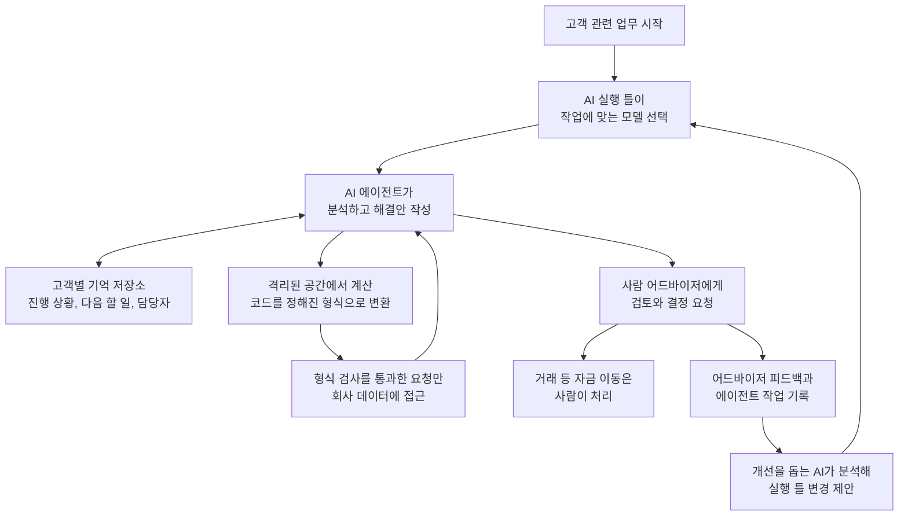

<aside class="ai-knowledge-sidebar">
  
CATEGORIES

  <nav class="ai-cat-tree">

에이전트 오케스트레이션20
<ul><li><a href="https://altjs4510.github.io/ai_news_blog/knowledge/20261107/">2026-11-07Hermes Agent v0.23.0 — The Hearth Release</a></li><li><a href="https://altjs4510.github.io/ai_news_blog/knowledge/20261106/">2026-11-06Cline desktop-nightly-20261104233655: feat(core)…</a></li><li><a href="https://altjs4510.github.io/ai_news_blog/knowledge/20261029/">2026-10-29How Anthropic ships Claude with Claude: Separati…</a></li><li><a href="https://altjs4510.github.io/ai_news_blog/knowledge/20261027/">2026-10-27nightly-labs/openbot — Codex·Claude·Grok을 상주 팀원처…</a></li><li><a href="https://altjs4510.github.io/ai_news_blog/knowledge/20261014/">2026-10-14How Anthropic's Dynamic Workflows Coordinate Cla…</a></li><li><a href="https://altjs4510.github.io/ai_news_blog/knowledge/20260930/">2026-09-30Agents you can coach: how Asana builds human-age…</a></li><li><a href="https://altjs4510.github.io/ai_news_blog/knowledge/20260929/">2026-09-29vectorize-io/hindsight — Hindsight: Agent Memory…</a></li><li><a href="https://altjs4510.github.io/ai_news_blog/knowledge/20260903/">2026-09-03pacifio/atlas — 여러 코딩 에이전트의 변경을 한곳에서 추적·질의하는 '에이…</a></li><li><a href="https://altjs4510.github.io/ai_news_blog/knowledge/20260831-openexecutive-virtual-c-suite/">2026-08-31Open Executive — 8명의 전문 에이전트를 하나의 임원 목소리로</a></li><li><a href="https://altjs4510.github.io/ai_news_blog/knowledge/20260828/">2026-08-28Google ADK for Python v2.8.0 — RemoteA2aAgent 네이…</a></li><li><a href="https://altjs4510.github.io/ai_news_blog/knowledge/20260826/">2026-08-26apache/maka — 도구 호출·권한 결정·종료 이벤트를 append-only 로그…</a></li><li><a href="https://altjs4510.github.io/ai_news_blog/knowledge/20260823/">2026-08-23The Evolution of the Agent Harness — 하네스가 모델 가중치…</a></li><li><a href="https://altjs4510.github.io/ai_news_blog/knowledge/20260821/">2026-08-21volcengine/OpenViking — 에이전트 메모리·Knowledge RAG·스…</a></li><li><a href="https://altjs4510.github.io/ai_news_blog/knowledge/20260805/">2026-08-05TencentCloud/TencentDB-Agent-Memory — 대화·문서·코드를 …</a></li><li><a href="https://altjs4510.github.io/ai_news_blog/knowledge/20260725/">2026-07-25The new rules of context engineering for Claude …</a></li><li><a href="https://altjs4510.github.io/ai_news_blog/knowledge/20260708/">2026-07-08Expanding Managed Agents in Gemini API: backgrou…</a></li><li><a href="https://altjs4510.github.io/ai_news_blog/knowledge/20260623/">2026-06-23bytedance/deer-flow — 샌드박스·메모리·서브에이전트·메시지 게이트웨이를…</a></li><li><a href="https://altjs4510.github.io/ai_news_blog/knowledge/20260602/">2026-06-02revfactory/harness — 도메인별 에이전트 팀과 스킬을 자동 설계하는 메타…</a></li><li><a href="https://altjs4510.github.io/ai_news_blog/knowledge/20260529/">2026-05-29Introducing dynamic workflows in Claude Code</a></li><li><a href="https://altjs4510.github.io/ai_news_blog/knowledge/20260507/">2026-05-07ruvnet/ruflo — Claude 멀티 에이전트 오케스트레이션 플랫폼</a></li></ul>

MCP &amp; 도구 통합18
<ul><li><a href="https://altjs4510.github.io/ai_news_blog/knowledge/20261103/">2026-11-03vercel-labs/agent-desktop — 픽셀 대신 OS 접근성 트리로 앱 U…</a></li><li><a href="https://altjs4510.github.io/ai_news_blog/knowledge/20261017/">2026-10-17mksglu/context-mode — 코딩 에이전트용 컨텍스트 윈도우 최적화</a></li><li><a href="https://altjs4510.github.io/ai_news_blog/knowledge/20261007/">2026-10-07morluto/rea — 앱 동작부터 네이티브 바이너리까지 에이전트로 리버스 엔지니어링</a></li><li><a href="https://altjs4510.github.io/ai_news_blog/knowledge/20260831-gitnexus-code-knowledge-graph/">2026-08-31GitNexus — 코드베이스를 지식그래프로 바꿔 에이전트에게 쥐어주기</a></li><li><a href="https://altjs4510.github.io/ai_news_blog/knowledge/20260829/">2026-08-29cursor/plugins — 플러그인 명세(specification)와 공식 플러그인…</a></li><li><a href="https://altjs4510.github.io/ai_news_blog/knowledge/20260802/">2026-08-02Stateless MCP has recaptured my interest (and in…</a></li><li><a href="https://altjs4510.github.io/ai_news_blog/knowledge/20260731/">2026-07-31different-ai/openwork — Claude Cowork의 오픈소스 대안(o…</a></li><li><a href="https://altjs4510.github.io/ai_news_blog/knowledge/20260729/">2026-07-29Bringing MCP 2026-07-28 to Claude</a></li><li><a href="https://altjs4510.github.io/ai_news_blog/knowledge/20260726/">2026-07-26citrolabs/ego-lite — 로그인된 브라우저 상태를 AI 에이전트와 공유하는…</a></li><li><a href="https://altjs4510.github.io/ai_news_blog/knowledge/20260718/">2026-07-18tirth8205/code-review-graph — MCP·CLI용 로컬 코드 인텔리…</a></li><li><a href="https://altjs4510.github.io/ai_news_blog/knowledge/20260618/">2026-06-18DeusData/codebase-memory-mcp — 158개 언어 코드베이스를 밀리…</a></li><li><a href="https://altjs4510.github.io/ai_news_blog/knowledge/20260604/">2026-06-04chopratejas/headroom — Compress tool outputs bef…</a></li><li><a href="https://altjs4510.github.io/ai_news_blog/knowledge/20260603/">2026-06-03How Bad MCP design cost your Agent 5× more token…</a></li><li><a href="https://altjs4510.github.io/ai_news_blog/knowledge/20260521/">2026-05-21colbymchenry/codegraph — Pre-indexed code knowle…</a></li><li><a href="https://altjs4510.github.io/ai_news_blog/knowledge/20260517/">2026-05-17I gave my LLM 100,000+ tools — Lazy Discovery &a…</a></li><li><a href="https://altjs4510.github.io/ai_news_blog/knowledge/20260512/">2026-05-12agentmemory — Persistent memory for AI coding ag…</a></li><li><a href="https://altjs4510.github.io/ai_news_blog/knowledge/20260509/">2026-05-09How to connect 100 MCP servers without the conte…</a></li><li><a href="https://altjs4510.github.io/ai_news_blog/knowledge/20260506/">2026-05-06mksglu/context-mode — AI 코딩 에이전트용 컨텍스트 윈도우 최적화</a></li></ul>

코딩 에이전트25
<ul><li><a href="https://altjs4510.github.io/ai_news_blog/knowledge/20261112/">2026-11-12shadcn/improve — 가장 강한 모델로 코드베이스를 감사해 계획을 쓰고, 더 …</a></li><li><a href="https://altjs4510.github.io/ai_news_blog/knowledge/20261022/">2026-10-22Claude Mods: Flipping the Harness Inside Out</a></li><li><a href="https://altjs4510.github.io/ai_news_blog/knowledge/20261018/">2026-10-18Quoting Addy Osmani, Morgan Westlee Lunt, and Qi…</a></li><li><a href="https://altjs4510.github.io/ai_news_blog/knowledge/20261014-claude-code-advisor/">2026-10-14Claude Code advisor — 가벼운 메인 모델이 일하고, 갈림길에서만 Opu…</a></li><li><a href="https://altjs4510.github.io/ai_news_blog/knowledge/20260920/">2026-09-20Claude Code 2.1.277 — CLAUDE.md가 없으면 AGENTS.md를 …</a></li><li><a href="https://altjs4510.github.io/ai_news_blog/knowledge/20260912/">2026-09-12Quoting Boris Cherny — 'Claude가 쓴 프로덕션 코드는 사람이 쓴…</a></li><li><a href="https://altjs4510.github.io/ai_news_blog/knowledge/20260910/">2026-09-10vastsa/PI-Desktop — Electron + Rust 호스트 코어 + 에이전…</a></li><li><a href="https://altjs4510.github.io/ai_news_blog/knowledge/20260906/">2026-09-06DietrichGebert/ponytail — 에이전트를 '방에서 가장 게으른 시니어 …</a></li><li><a href="https://altjs4510.github.io/ai_news_blog/knowledge/20260901/">2026-09-01affaan-m/ECC — 스킬·본능·메모리·보안을 묶은 에이전트 하네스 성능 최적화 …</a></li><li><a href="https://altjs4510.github.io/ai_news_blog/knowledge/20260819/">2026-08-19akitaonrails/ai-memory — 코딩 에이전트 CLI 간 장기 기억과 벤더…</a></li><li><a href="https://altjs4510.github.io/ai_news_blog/knowledge/20260814/">2026-08-14cathrynlavery/diagram-design — Claude Code용 에디토리…</a></li><li><a href="https://altjs4510.github.io/ai_news_blog/knowledge/20260810/">2026-08-10Auto mode is now the default in Claude Code for …</a></li><li><a href="https://altjs4510.github.io/ai_news_blog/knowledge/20260808/">2026-08-08PrimeIntellect-ai/prime-agent — 코딩 워크플로우와 장시간 자율…</a></li><li><a href="https://altjs4510.github.io/ai_news_blog/knowledge/20260804/">2026-08-04esengine/DeepSeek-Reasonix — prefix-cache 안정성을 축…</a></li><li><a href="https://altjs4510.github.io/ai_news_blog/knowledge/20260728/">2026-07-28alibaba/open-code-review — 결정론적 파이프라인 + LLM 에이전트…</a></li><li><a href="https://altjs4510.github.io/ai_news_blog/knowledge/20260714/">2026-07-14Graphify-Labs/graphify — 코드베이스를 질의 가능한 지식 그래프로 만…</a></li><li><a href="https://altjs4510.github.io/ai_news_blog/knowledge/20260707/">2026-07-07AI Hero Skills Catalog — 실무 엔지니어를 위한 재사용 가능한 판단 …</a></li><li><a href="https://altjs4510.github.io/ai_news_blog/knowledge/20260705/">2026-07-05openai/codex-plugin-cc — Claude Code에서 Codex를 위임…</a></li><li><a href="https://altjs4510.github.io/ai_news_blog/knowledge/20260701/">2026-07-01Google OKF (Open Knowledge Format) — 벤더 중립 에이전트 …</a></li><li><a href="https://altjs4510.github.io/ai_news_blog/knowledge/20260626/">2026-06-26google-labs-code/design.md — 코딩 에이전트에게 디자인 시스템을 …</a></li><li><a href="https://altjs4510.github.io/ai_news_blog/knowledge/20260619/">2026-06-19Claude Code now supports artifacts</a></li><li><a href="https://altjs4510.github.io/ai_news_blog/knowledge/20260530/">2026-05-30Leonxlnx/taste-skill — AI에게 좋은 취향을 부여해 generic s…</a></li><li><a href="https://altjs4510.github.io/ai_news_blog/knowledge/20260528/">2026-05-28Building self-improving tax agents with Codex</a></li><li><a href="https://altjs4510.github.io/ai_news_blog/knowledge/20260508/">2026-05-08addyosmani/agent-skills — Production-grade engin…</a></li><li><a href="https://altjs4510.github.io/ai_news_blog/knowledge/20260505/">2026-05-05mattpocock/skills — Skills for Real Engineers (.…</a></li></ul>

모델 &amp; 연구14
<ul><li><a href="https://altjs4510.github.io/ai_news_blog/knowledge/20261113/">2026-11-13Gemini Decisions API</a></li><li><a href="https://altjs4510.github.io/ai_news_blog/knowledge/20261111/">2026-11-11Quoting Prompting Claude Fable 5.2</a></li><li><a href="https://altjs4510.github.io/ai_news_blog/knowledge/20261105/">2026-11-05NVIDIA/auto-ontology — 데이터 위에 그래프 기반 의미 추론 레이어를 …</a></li><li><a href="https://altjs4510.github.io/ai_news_blog/knowledge/20261104/">2026-11-04Qwen 3.8 27B on my laptop can interpret model we…</a></li><li><a href="https://altjs4510.github.io/ai_news_blog/knowledge/20261009/">2026-10-09Claude Haiku 5.5 (Simon Willison의 출시 노트와 가격 분석)</a></li><li><a href="https://altjs4510.github.io/ai_news_blog/knowledge/20260907-voicemem-dual-brain-memory/">2026-09-07VoiceMem — 좌뇌·우뇌로 쪼갠 스트리밍 메모리로 음성 에이전트 지연 없애기</a></li><li><a href="https://altjs4510.github.io/ai_news_blog/knowledge/20260904/">2026-09-04HarnessDev: Can LLMs Create and Evolve Their Own…</a></li><li><a href="https://altjs4510.github.io/ai_news_blog/knowledge/20260717/">2026-07-17After a year building agent memory, 'save everyt…</a></li><li><a href="https://altjs4510.github.io/ai_news_blog/knowledge/20260716-proprag/">2026-07-16PropRAG — 프로포지션 경로 위 beam search로 멀티홉 검색 안내</a></li><li><a href="https://altjs4510.github.io/ai_news_blog/knowledge/20260712/">2026-07-12Do Automated Evals Work?</a></li><li><a href="https://altjs4510.github.io/ai_news_blog/knowledge/20260620/">2026-06-20zai-org/GLM-5 — From Vibe Coding to Agentic Engi…</a></li><li><a href="https://altjs4510.github.io/ai_news_blog/knowledge/20260617/">2026-06-17Predicting model behavior before release by simu…</a></li><li><a href="https://altjs4510.github.io/ai_news_blog/knowledge/20260516/">2026-05-16STALE — 에이전트가 자기 기억의 유효성을 인지할 수 있는가</a></li><li><a href="https://altjs4510.github.io/ai_news_blog/knowledge/20260513/">2026-05-13Thinking Machines' Native Interaction Models — T…</a></li></ul>

인프라 &amp; 컴퓨트8
<ul><li><a href="https://altjs4510.github.io/ai_news_blog/knowledge/20260909/">2026-09-09Reducing cost and improving performance with Cla…</a></li><li><a href="https://altjs4510.github.io/ai_news_blog/knowledge/20260905/">2026-09-05magnitudedev/magnitude — 하드웨어에 맞는 최적 로컬 모델을 띄워 이…</a></li><li><a href="https://altjs4510.github.io/ai_news_blog/knowledge/20260806/">2026-08-06cloudflare/computer — 에이전트에게 컴퓨터를 통째로 주는 엣지 실행 샌…</a></li><li><a href="https://altjs4510.github.io/ai_news_blog/knowledge/20260723/">2026-07-23diegosouzapw/OmniRoute — 268+ 프로바이더를 단일 엔드포인트로 묶…</a></li><li><a href="https://altjs4510.github.io/ai_news_blog/knowledge/20260611/">2026-06-11The evolution of agentic surfaces: building with…</a></li><li><a href="https://altjs4510.github.io/ai_news_blog/knowledge/20260610/">2026-06-10Fable 5 just made cost-aware model routing manda…</a></li><li><a href="https://altjs4510.github.io/ai_news_blog/knowledge/20260522/">2026-05-22Giving Agents Computers — Ivan Burazin, Daytona</a></li><li><a href="https://altjs4510.github.io/ai_news_blog/knowledge/20260520/">2026-05-20New in Claude Managed Agents: self-hosted sandbo…</a></li></ul>

보안 &amp; 거버넌스26
<ul><li><a href="https://altjs4510.github.io/ai_news_blog/knowledge/20261031/">2026-10-31CopilotKit/OpenBot — AI 동료마다 전용 컴퓨터를 주고 모든 행동을 실…</a></li><li><a href="https://altjs4510.github.io/ai_news_blog/knowledge/20261030/">2026-10-30How we detect frontier model misalignment</a></li><li><a href="https://altjs4510.github.io/ai_news_blog/knowledge/20261021/">2026-10-21cloudflare/security-audit-skill — 독립 검증된 기계 판독형 …</a></li><li><a href="https://altjs4510.github.io/ai_news_blog/knowledge/20261020/">2026-10-20Satya Nadella — 모델을 내부자 위험으로 보는 원칙에 따라 Project P…</a></li><li><a href="https://altjs4510.github.io/ai_news_blog/knowledge/20261016/">2026-10-16Crossing the Threshold: How OpenAI and Anthropic…</a></li><li><a href="https://altjs4510.github.io/ai_news_blog/knowledge/20261011/">2026-10-11Anthropic can’t reliably control its AI agents. …</a></li><li><a href="https://altjs4510.github.io/ai_news_blog/knowledge/20261004/">2026-10-04Apple says it's tightening macOS 'Full Disk Acce…</a></li><li><a href="https://altjs4510.github.io/ai_news_blog/knowledge/20261001/">2026-10-01NVIDIA/OpenShell</a></li><li><a href="https://altjs4510.github.io/ai_news_blog/knowledge/20260919/">2026-09-19cloudflare/security-audit-skill — 다단계 보안 감사를 '독립…</a></li><li><a href="https://altjs4510.github.io/ai_news_blog/knowledge/20260913/">2026-09-13OpenAI agents attacked RubyGems back in May: Ope…</a></li><li><a href="https://altjs4510.github.io/ai_news_blog/knowledge/20260902/">2026-09-02AIR raises $50M to help companies vet the skills…</a></li><li><a href="https://altjs4510.github.io/ai_news_blog/knowledge/20260827/">2026-08-27Claude in Chrome is generally available</a></li><li><a href="https://altjs4510.github.io/ai_news_blog/knowledge/20260819-mind-viruses/">2026-08-19탈옥도, 인젝션도 없이 — 대화로만 퍼지는 에이전트의 '마인드 바이러스'</a></li><li><a href="https://altjs4510.github.io/ai_news_blog/knowledge/20260812/">2026-08-12semantica-agi/semantica — 컨텍스트와 '책임 추적 가능한(accou…</a></li><li><a href="https://altjs4510.github.io/ai_news_blog/knowledge/20260730/">2026-07-30Anatomy of a Frontier Lab Agent Intrusion: A Tec…</a></li><li><a href="https://altjs4510.github.io/ai_news_blog/knowledge/20260715/">2026-07-15Dicklesworthstone/destructive_command_guard — 에이…</a></li><li><a href="https://altjs4510.github.io/ai_news_blog/knowledge/20260710/">2026-07-1070개 MCP 서버 strace 런타임 감사 — 부팅 시 아웃바운드 호출 서버 적발</a></li><li><a href="https://altjs4510.github.io/ai_news_blog/knowledge/20260704/">2026-07-04Cloudflare is about to block AI agents by defaul…</a></li><li><a href="https://altjs4510.github.io/ai_news_blog/knowledge/20260703/">2026-07-03Giving admins more visibility and control over C…</a></li><li><a href="https://altjs4510.github.io/ai_news_blog/knowledge/20260630/">2026-06-30Introducing the Claude apps gateway for Amazon B…</a></li><li><a href="https://altjs4510.github.io/ai_news_blog/knowledge/20260624/">2026-06-24Agent identity in Claude Tag: a new access model…</a></li><li><a href="https://altjs4510.github.io/ai_news_blog/knowledge/20260613/">2026-06-13Fable 5's guardrails got bypassed in 48 hours — …</a></li><li><a href="https://altjs4510.github.io/ai_news_blog/knowledge/20260612/">2026-06-12NVIDIA/SkillSpector — AI 에이전트 스킬용 보안 스캐너</a></li><li><a href="https://altjs4510.github.io/ai_news_blog/knowledge/20260607/">2026-06-07OpenAI Help: Lockdown Mode</a></li><li><a href="https://altjs4510.github.io/ai_news_blog/knowledge/20260531/">2026-05-31How we contain Claude across products</a></li><li><a href="https://altjs4510.github.io/ai_news_blog/knowledge/20260527/">2026-05-27Microsoft Copilot Cowork Exfiltrates Files</a></li></ul>

응용 사례12
<ul><li><a href="https://altjs4510.github.io/ai_news_blog/knowledge/20261114/">2026-11-14Introducing ChatGPT Wallet</a></li><li><a href="https://altjs4510.github.io/ai_news_blog/knowledge/20261110/">2026-11-10meta/astryx — 직접 바꿔 쓸 수 있고 에이전트가 바로 쓸 수 있는(agent…</a></li><li><a href="https://altjs4510.github.io/ai_news_blog/knowledge/20261101/" class="current">2026-11-01Agents Prompt People: Using Agents for Long-Hori…</a></li><li><a href="https://altjs4510.github.io/ai_news_blog/knowledge/20261028/">2026-10-28Greptile takes bug detection beyond code review …</a></li><li><a href="https://altjs4510.github.io/ai_news_blog/knowledge/20261015/">2026-10-15How Third Moment Research runs 10,000 agents for…</a></li><li><a href="https://altjs4510.github.io/ai_news_blog/knowledge/20261006/">2026-10-06How Cresta turned CX expertise into an agent bui…</a></li><li><a href="https://altjs4510.github.io/ai_news_blog/knowledge/20260911/">2026-09-11Now everyone can put data to work — ChatGPT Work…</a></li><li><a href="https://altjs4510.github.io/ai_news_blog/knowledge/20260709/">2026-07-09mvanhorn/last30days-skill — Reddit·X·YouTube·HN·…</a></li><li><a href="https://altjs4510.github.io/ai_news_blog/knowledge/20260621/">2026-06-21calesthio/OpenMontage — 12 파이프라인·52 도구·500+ 스킬을 …</a></li><li><a href="https://altjs4510.github.io/ai_news_blog/knowledge/20260609/">2026-06-09Building intelligent apps for Apple platforms wi…</a></li><li><a href="https://altjs4510.github.io/ai_news_blog/knowledge/20260515/">2026-05-15Clawdmeter — Claude Code 사용량을 데스크톱 대시보드로</a></li><li><a href="https://altjs4510.github.io/ai_news_blog/knowledge/20260514/">2026-05-14Introducing Claude for Small Business</a></li></ul>

산업 동향9
<ul><li><a href="https://altjs4510.github.io/ai_news_blog/knowledge/20261024/">2026-10-24Donating Agent Skills to the Agentic AI Foundati…</a></li><li><a href="https://altjs4510.github.io/ai_news_blog/knowledge/20261023/">2026-10-23Claude Duet app is Anthropic's bet on agents</a></li><li><a href="https://altjs4510.github.io/ai_news_blog/knowledge/20260907-humanmade-52week-rhythm/">2026-09-07휴먼 메이드의 '52주 리듬' — 아이디어가 흔해진 시대에 값이 오르는 건 버리는 판단</a></li><li><a href="https://altjs4510.github.io/ai_news_blog/knowledge/20260830/">2026-08-30[AINews] OpenAI shuts off Cursor — 프론티어 모델 공급 차단…</a></li><li><a href="https://altjs4510.github.io/ai_news_blog/knowledge/20260711/">2026-07-11OpenAI says GPT 5.6 is the 'preferred model' for…</a></li><li><a href="https://altjs4510.github.io/ai_news_blog/knowledge/20260702/">2026-07-02How Cursor deploys AI inside the enterprise (For…</a></li><li><a href="https://altjs4510.github.io/ai_news_blog/knowledge/20260616/">2026-06-16Why AI hasn't replaced software engineers, and w…</a></li><li><a href="https://altjs4510.github.io/ai_news_blog/knowledge/20260519/">2026-05-19Anthropic acquires Stainless</a></li><li><a href="https://altjs4510.github.io/ai_news_blog/knowledge/20260504/">2026-05-04Agents for Everything Else: Codex for Knowledge …</a></li></ul>
</nav>
</aside>

<article class="ai-knowledge-article">

<header class="ai-post-hero">
  
<a class="ai-back" href="../">KNOWLEDGE</a> · 2026-11-01 · 오늘의 학습

  <h2 class="ai-post-title">Agents Prompt People: Using Agents for Long-Horizon Financial Work</h2>
</header>

> 원문: [Agents Prompt People: Using Agents for Long-Horizon Financial Work](https://latent.space/p/arca/)

## 📌 학습 정리

### 1. 한 줄로 말하면
사람이 AI에게 일일이 시키는 대신, AI가 뒤에서 일을 챙기다가 "이제 이걸 결정해 주세요" 하고 사람을 불러 주는 방식이에요. 자산관리 회사 Arca가 며칠씩 이어지는 금융 업무를 이렇게 처리하는 이야기입니다.

### 2. 왜 이게 만들어졌어요?
Arca는 AI를 중심에 두고 자산관리 서비스를 제공하는 회사예요. 그런데 금융 업무는 AI가 한 번에 쭉 돌아서 끝나는 일이 아니라고 해요. 작업이 최대 10일까지 걸리고, 그 사이에 멈췄다 다시 시작하길 반복하며, 여러 사람과 결정 지점, 인수인계가 끼어듭니다. 게다가 돈이 걸린 일이라 AI가 마음대로 처리하게 둘 수도 없죠. 그래서 긴 시간 동안 맥락을 잃지 않는 장치와, 위험한 일을 AI 손에서 아예 떼어 놓는 장치가 함께 필요해졌습니다.

### 3. 비유로 풀면
이건 마치 아주 꼼꼼한 비서가 고객별 업무 수첩을 들고 다니는 것과 같아요. 수첩에는 지금까지 있었던 일, 며칠 안에 해야 할 일, 길게 지켜볼 일, 일마다 맡은 사람이 적혀 있습니다. 비서는 조사하고 초안을 만든 뒤 담당 어드바이저에게 "이 안건을 봐 주세요" 하고 알려 줘요.

다만 이 비서에게는 회사 금고 열쇠가 없어요. 비서의 판단이 좋든 나쁘든, 돈을 움직이는 일은 처음부터 할 수 없게 막혀 있습니다.

그래서 결국, AI는 일의 흐름을 이끌고 분석과 제안을 맡지만, 거래와 자금 이동은 사람이 처리합니다.

### 4. 어떻게 작동하는지 (그림으로)

업무가 시작되면 Arca가 직접 만든 실행 틀이 사내 평가 결과를 바탕으로 알맞은 모델을 고르고, 에이전트는 고객별 기억을 읽고 쓰면서 분석을 이어 갑니다. 계산이 필요할 때는 격리된 공간을 쓰고, 그 안에서 만든 코드는 정해진 형식으로 바뀌어 검사를 거친 뒤에야 데이터에 닿아요. 최종 결정과 자금 이동은 사람의 몫이고, 이때 나온 피드백과 작업 기록은 실행 틀을 개선하는 데 다시 쓰입니다.

### 5. 처음 보는 용어 풀이
- **AI 실행 틀 (harness)** — AI 모델을 감싸서 실제 업무에 쓸 수 있게 해 주는 바깥 구조예요. Arca는 이를 직접 만들어서 작업별로 모델을 고르고, 필요하면 모델 제공 회사도 바꿀 수 있게 했습니다.
- **오래 이어지는 업무 (long-horizon work)** — 컴퓨터가 계속 돌아가는 일이라기보다, 멈춤과 재개를 반복하며 며칠에 걸쳐 진행되는 일이에요. 그래서 중간에 맥락을 놓치지 않는 것이 중요합니다.
- **영속 메모리 (persistent memory)** — 대화나 작업이 끝나도 사라지지 않고 남는 기억이에요. Arca에서는 고객별로 지금까지의 일, 앞으로 할 일, 담당자를 기록하고 에이전트들이 여기에 내용을 보탭니다.
- **안전장치 (guardrails)** — AI가 넘지 말아야 할 선을 미리 정해 둔 규칙이에요. 금융처럼 실수의 대가가 큰 분야에서 사람이 최종 결정을 내리도록 지켜 줍니다.
- **규칙으로 고정된 방식 (deterministic)** — AI의 판단에 맡기지 않고, 같은 상황이면 언제나 같은 결과가 나오도록 정해 둔 방식이에요. Arca는 안전 제한을 이렇게 만들어 결정권을 AI 손에서 떼어 놓았다고 설명합니다.
- **격리된 실행 공간 (sandbox)** — 코드를 다른 시스템과 분리된 곳에서 돌리는 작업장이에요. Arca는 에이전트 자체가 아니라 계산 작업에 이 공간을 씁니다.
- **프롬프트 주입 (prompt injection)** — 원문에서 이미 알려진 AI 보안 문제의 예로 든 공격이에요. 원문에 자세한 설명은 없지만, Arca는 이런 문제를 확인하는 검증을 돌리고 있다고 합니다.

### 6. 한 발 더 들어가고 싶다면
- [팟캐스트 영상](https://www.youtube.com/watch?v=KM3VQZKjpiY) — 이걸 보면 10만 달러 세금 고지서 사례와 AI 네이티브 기업 이야기까지 대화 전체를 들을 수 있어요.
- [대화 녹취록](https://rss.beehiiv.com/podcasts/transcriptions/01a18ebb-53a8-7089-a56f-938e5771f6d5.vtt) — 이걸 보면 영상을 보지 않고도 대화 내용을 글로 확인할 수 있어요.
- [Aman Singh의 AI Engineer 발표 영상](https://www.youtube.com/watch?v=oP2WLFpMoDY) — 이걸 보면 최대 10일까지 걸리는 에이전트 작업 이야기를 발표자의 설명으로 직접 들을 수 있어요.
- [Arca 홈페이지](https://arcawealth.ai/?utm_source=latent.space&utm_medium=ainews&utm_campaign=lsbeehiiv) — 이걸 보면 이 이야기의 주인공인 회사를 직접 살펴볼 수 있어요.

---

## 📖 원문 전체 번역 (정독용)

> 의역 최소화한 전체 번역입니다. 큰 흐름은 위 정리에서 잡고, 정확한 워딩이 필요할 땐 이 섹션에서 정독하세요.

# 에이전트가 사람에게 프롬프트한다: 장기(Long-Horizon) 금융 업무에 에이전트 활용하기

Arca의 AI 총괄이 영속적 메모리, 커스텀 하니스(harness)의 이점, 며칠에 걸쳐 이어지는 에이전트 워크플로우에 대해 이야기한다.

**Richard MacManus**

10월 31일 · 26분

(오디오: 이 대화 듣기 26분 / 대본 읽기 / YouTube에서 보기)

이 페이지의 목차: 팟캐스트 타임스탬프 · Aman의 AIE 발표 영상 보기

이번 달 [AI Engineer New York](https://ai.engineer/nyc/2026/)에서 우리는 "AI 네이티브" 자산관리 서비스를 제공하는 회사 [Arca](https://arcawealth.ai/)의 리드 AI 엔지니어 [Aman Singh](https://www.linkedin.com/in/amanps/)과 대담했다.

우리는 이 회사에서 **에이전트가 백그라운드 업무 대부분을 수행**하지만, 최종 결정은 사람 어드바이저가 내리도록 **가드레일(guardrails)**이 마련되어 있다는 것을 알게 되었다. 목표는 AI가 프로세스를 이끄는 것이다. Singh의 멋진 표현을 빌리면, **"에이전트가 사람에게 프롬프트하는 일이 사람이 에이전트에게 프롬프트하는 일보다 더 많다."**

[영상 재생 — YouTube에서 열기](https://www.youtube.com/watch?v=KM3VQZKjpiY)

Arca는 최근 General Catalyst가 주도하고 Index Ventures와 Venrock이 참여한 라운드에서 4,850만 달러를 조달했다.

Singh은 금융 서비스에서 AI를 쓸 때의 특징 중 하나가 일반적으로 **장기(long-horizon) 업무**라는 점이라고 설명했다. 다만 오래 "실행되는(long-running)" 것은 아니다. AIE 발표에서 Singh은 **Arca의 에이전트 작업이 최대 10일까지 걸릴 수 있다**고 말했다. "멈췄다 다시 시작하는 일이 많고, 중간에 많은 행위자가 있고, 많은 의사결정 지점과 많은 인수인계가 있습니다."

이런 이유로 Arca는 **자체 메모리 시스템**을 개발했다.

Singh은 팟캐스트 대담에서 이렇게 말했다. "저희는 **모든 고객마다 영속성(persistence)**을 갖고 있습니다. 지금까지 무슨 일이 있었는가? 다음으로 무엇을 추적하고 있는가? 앞으로 며칠 안에 즉시 해야 할 일은 무엇이고, 장기적으로 추적하는 것은 무엇인가? 어떤 사람이 어떤 액션을 책임지는가? **이 모든 것을 에이전트들이 기여하는 저희 메모리 시스템이 추적합니다.**"

Arca는 Anthropic, OpenAI 같은 프런티어 랩의 모델을 사용하며, 주된 모델 제공자는 Claude다. 이 회사는 **자체 하니스를 구축**했고, 이 하니스는 사내 벤치마크를 기반으로 특정 작업에 가장 적합한 모델을 자동으로 선택한다.

관리형(managed) 에이전트 하니스를 쓰지 않고 하니스를 직접 소유한다는 것은 또한 **필요하면 모델 제공자를 바꿀 수 있는 유연성**을 Arca가 갖는다는 뜻이다.

금융 서비스에서 안전은 당연히 핵심이다. Singh은 에이전트가 많은 일을 하지만 **에이전트의 역할은 분석과 해법 제안으로 한정**된다고 말했다. 매매와 그 밖의 모든 자금 이동은 사람 어드바이저가 처리한다.

그는 이렇게 말했다. **"저희의 모든 안전 제한은 완전히 결정론적(deterministic)입니다. 그리고 그것이 의사결정을 에이전트의 손에서 거둬 갑니다."**

다시 말해, 에이전트가 스스로 실행할 수 있는 도구와 작업은 있지만 **고객에게 위험이 따르는 것은 아니다.** Arca는 프롬프트 인젝션(prompt injection) 같은 알려진 AI 보안 문제에 대한 검증 점검도 수행한다.

(스폰서 광고 생략)

Arca의 에이전트 자체는 샌드박스에 격리되어 있지 않지만, **연산에는 샌드박스를 사용한다.** Singh은 민감한 데이터를 다루기 위해 추가 보안 조치까지 더 나아갔다고 설명했다.

그는 이렇게 말했다. "그 샌드박스 안의 코드가 저희 데이터에 안전하게 접근할 수 있도록 하는 시스템을 만들었습니다. 에이전트가 작성한 코드를 저희가 기대하는 엄격한 포맷으로 변환하고, 코드는 버리고, **백엔드에 닿기 전에 그 포맷에 가드레일을 설치합니다.** 그래서 에이전트가 코드를 사용해 저희 데이터를 조회하도록 허용하는데, 이는 재무 계획 같은 결과물을 만들기 위해 에이전트가 데이터를 집계하고, 가공(munge)하고, 적절하다고 보는 대로 다룰 수 있다는 뜻입니다."

Arca가 도입한 또 다른 흥미로운 프로세스는 사람 어드바이저의 피드백과 에이전트의 트레이스(traces)를 함께 사용해 하니스를 개선하는 것이다. **"메타 에이전트(meta-agent)"**가 이 모든 데이터를 분석해 하니스 변경을 제안한다.

## 팟캐스트 타임스탬프

*   00:00 — Arca의 AI 네이티브 자산관리 회사 소개

*   01:40 — AI가 사람 재무 어드바이저를 지원하는 방식

*   02:40 — 사내 벤치마크로 모델 선택하기

*   04:01 — 커스텀 하니스 구축과 작업 라우팅

*   05:25 — 10만 달러 세금 고지서 처리: 에이전트와 사람의 승인

*   07:20 — 장기 실행 작업 전반에 걸친 에이전트 메모리

*   09:22 — 안전 가드레일과 프롬프트 인젝션 방어

*   11:02 — 기본값으로서의 컴플라이언스와 감사 가능성(auditability)

*   12:14 — "에이전트가 사람에게 프롬프트하는 일이 사람이 에이전트에게 프롬프트하는 일보다 더 많다"

*   13:46 — Arca가 자체 에이전트 인프라를 소유하는 이유

*   15:05 — AI 네이티브 회사 대 AI 도구를 쓰는 회사

*   16:09 — 샌드박스와 재무 계획 검증

*   18:40 — 의사결정 모델과 금융 사실 확인

*   19:51 — 매매 실행을 인간 전문가가 맡는 이유

*   20:32 — 직원 피드백을 평가(evals)와 개선으로 전환하기

*   22:22 — 운영 지식을 에이전트 컨텍스트로 전환하기

*   23:41 — 고객 사례: 숨은 수수료와 선제적 서비스

## **Aman의 AIE 발표 보기**

[영상 재생 — YouTube에서 열기](https://www.youtube.com/watch?v=oP2WLFpMoDY)

읽어 주셔서 감사합니다.

(이하 구독 안내, AIE Code Summit 2026 광고, 인기 글 목록, 푸터 등은 잡음으로 보아 생략)

</article>

<!-- ai-related-links -->
<aside class="ai-related-links">
  
관련 학습

  <ul><li><a href="https://altjs4510.github.io/ai_news_blog/knowledge/20260528/">2026-05-28Building self-improving tax agents with Codex</a></li><li><a href="https://altjs4510.github.io/ai_news_blog/knowledge/20260808/">2026-08-08PrimeIntellect-ai/prime-agent — 코딩 워크플로우와 장시간 자율…</a></li><li><a href="https://altjs4510.github.io/ai_news_blog/knowledge/20260623/">2026-06-23bytedance/deer-flow — 샌드박스·메모리·서브에이전트·메시지 게이트웨이를…</a></li></ul>
</aside>
<!-- /ai-related-links -->
