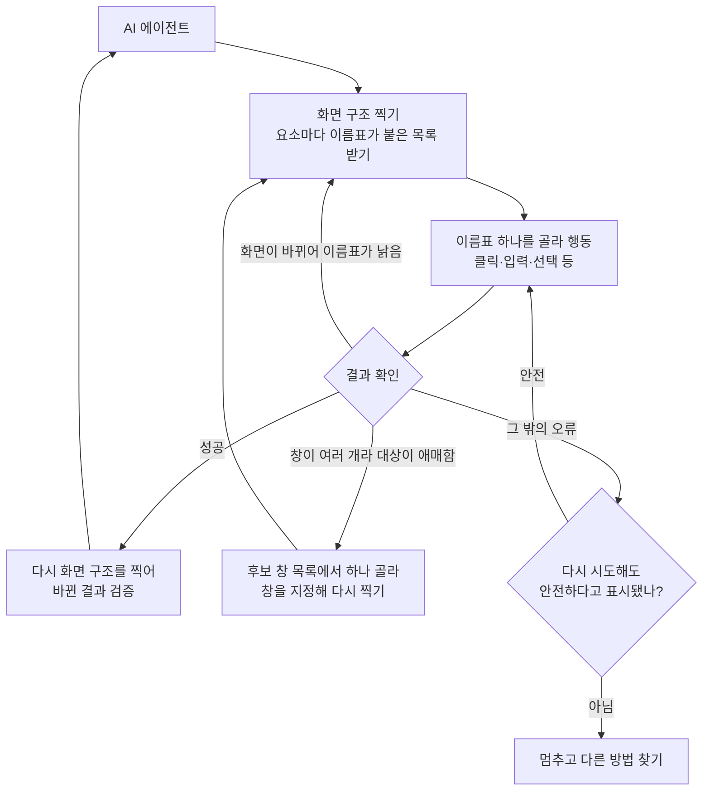

<aside class="ai-knowledge-sidebar">
  
CATEGORIES

  <nav class="ai-cat-tree">

에이전트 오케스트레이션18
<ul><li><a href="https://altjs4510.github.io/ai_news_blog/knowledge/20261029/">2026-10-29How Anthropic ships Claude with Claude: Separati…</a></li><li><a href="https://altjs4510.github.io/ai_news_blog/knowledge/20261027/">2026-10-27nightly-labs/openbot — Codex·Claude·Grok을 상주 팀원처…</a></li><li><a href="https://altjs4510.github.io/ai_news_blog/knowledge/20261015/">2026-10-15How Third Moment Research runs 10,000 agents for…</a></li><li><a href="https://altjs4510.github.io/ai_news_blog/knowledge/20261014/">2026-10-14How Anthropic's Dynamic Workflows Coordinate Cla…</a></li><li><a href="https://altjs4510.github.io/ai_news_blog/knowledge/20260930/">2026-09-30Agents you can coach: how Asana builds human-age…</a></li><li><a href="https://altjs4510.github.io/ai_news_blog/knowledge/20260831-openexecutive-virtual-c-suite/">2026-08-31Open Executive — 8명의 전문 에이전트를 하나의 임원 목소리로</a></li><li><a href="https://altjs4510.github.io/ai_news_blog/knowledge/20260828/">2026-08-28Google ADK for Python v2.8.0 — RemoteA2aAgent 네이…</a></li><li><a href="https://altjs4510.github.io/ai_news_blog/knowledge/20260823/">2026-08-23The Evolution of the Agent Harness — 하네스가 모델 가중치…</a></li><li><a href="https://altjs4510.github.io/ai_news_blog/knowledge/20260821/">2026-08-21volcengine/OpenViking — 에이전트 메모리·Knowledge RAG·스…</a></li><li><a href="https://altjs4510.github.io/ai_news_blog/knowledge/20260805/">2026-08-05TencentCloud/TencentDB-Agent-Memory — 대화·문서·코드를 …</a></li><li><a href="https://altjs4510.github.io/ai_news_blog/knowledge/20260717/">2026-07-17After a year building agent memory, 'save everyt…</a></li><li><a href="https://altjs4510.github.io/ai_news_blog/knowledge/20260708/">2026-07-08Expanding Managed Agents in Gemini API: backgrou…</a></li><li><a href="https://altjs4510.github.io/ai_news_blog/knowledge/20260623/">2026-06-23bytedance/deer-flow — 샌드박스·메모리·서브에이전트·메시지 게이트웨이를…</a></li><li><a href="https://altjs4510.github.io/ai_news_blog/knowledge/20260611/">2026-06-11The evolution of agentic surfaces: building with…</a></li><li><a href="https://altjs4510.github.io/ai_news_blog/knowledge/20260602/">2026-06-02revfactory/harness — 도메인별 에이전트 팀과 스킬을 자동 설계하는 메타…</a></li><li><a href="https://altjs4510.github.io/ai_news_blog/knowledge/20260529/">2026-05-29Introducing dynamic workflows in Claude Code</a></li><li><a href="https://altjs4510.github.io/ai_news_blog/knowledge/20260520/">2026-05-20New in Claude Managed Agents: self-hosted sandbo…</a></li><li><a href="https://altjs4510.github.io/ai_news_blog/knowledge/20260507/">2026-05-07ruvnet/ruflo — Claude 멀티 에이전트 오케스트레이션 플랫폼</a></li></ul>

MCP &amp; 도구 통합16
<ul><li><a href="https://altjs4510.github.io/ai_news_blog/knowledge/20261103/" class="current">2026-11-03vercel-labs/agent-desktop — 픽셀 대신 OS 접근성 트리로 앱 U…</a></li><li><a href="https://altjs4510.github.io/ai_news_blog/knowledge/20261017/">2026-10-17mksglu/context-mode — 코딩 에이전트용 컨텍스트 윈도우 최적화</a></li><li><a href="https://altjs4510.github.io/ai_news_blog/knowledge/20261007/">2026-10-07morluto/rea — 앱 동작부터 네이티브 바이너리까지 에이전트로 리버스 엔지니어링</a></li><li><a href="https://altjs4510.github.io/ai_news_blog/knowledge/20260829/">2026-08-29cursor/plugins — 플러그인 명세(specification)와 공식 플러그인…</a></li><li><a href="https://altjs4510.github.io/ai_news_blog/knowledge/20260802/">2026-08-02Stateless MCP has recaptured my interest (and in…</a></li><li><a href="https://altjs4510.github.io/ai_news_blog/knowledge/20260731/">2026-07-31different-ai/openwork — Claude Cowork의 오픈소스 대안(o…</a></li><li><a href="https://altjs4510.github.io/ai_news_blog/knowledge/20260729/">2026-07-29Bringing MCP 2026-07-28 to Claude</a></li><li><a href="https://altjs4510.github.io/ai_news_blog/knowledge/20260726/">2026-07-26citrolabs/ego-lite — 로그인된 브라우저 상태를 AI 에이전트와 공유하는…</a></li><li><a href="https://altjs4510.github.io/ai_news_blog/knowledge/20260718/">2026-07-18tirth8205/code-review-graph — MCP·CLI용 로컬 코드 인텔리…</a></li><li><a href="https://altjs4510.github.io/ai_news_blog/knowledge/20260618/">2026-06-18DeusData/codebase-memory-mcp — 158개 언어 코드베이스를 밀리…</a></li><li><a href="https://altjs4510.github.io/ai_news_blog/knowledge/20260603/">2026-06-03How Bad MCP design cost your Agent 5× more token…</a></li><li><a href="https://altjs4510.github.io/ai_news_blog/knowledge/20260521/">2026-05-21colbymchenry/codegraph — Pre-indexed code knowle…</a></li><li><a href="https://altjs4510.github.io/ai_news_blog/knowledge/20260517/">2026-05-17I gave my LLM 100,000+ tools — Lazy Discovery &a…</a></li><li><a href="https://altjs4510.github.io/ai_news_blog/knowledge/20260512/">2026-05-12agentmemory — Persistent memory for AI coding ag…</a></li><li><a href="https://altjs4510.github.io/ai_news_blog/knowledge/20260509/">2026-05-09How to connect 100 MCP servers without the conte…</a></li><li><a href="https://altjs4510.github.io/ai_news_blog/knowledge/20260506/">2026-05-06mksglu/context-mode — AI 코딩 에이전트용 컨텍스트 윈도우 최적화</a></li></ul>

코딩 에이전트27
<ul><li><a href="https://altjs4510.github.io/ai_news_blog/knowledge/20261022/">2026-10-22Claude Mods: Flipping the Harness Inside Out</a></li><li><a href="https://altjs4510.github.io/ai_news_blog/knowledge/20261018/">2026-10-18Quoting Addy Osmani, Morgan Westlee Lunt, and Qi…</a></li><li><a href="https://altjs4510.github.io/ai_news_blog/knowledge/20261014-claude-code-advisor/">2026-10-14Claude Code advisor — 가벼운 메인 모델이 일하고, 갈림길에서만 Opu…</a></li><li><a href="https://altjs4510.github.io/ai_news_blog/knowledge/20260920/">2026-09-20Claude Code 2.1.277 — CLAUDE.md가 없으면 AGENTS.md를 …</a></li><li><a href="https://altjs4510.github.io/ai_news_blog/knowledge/20260912/">2026-09-12Quoting Boris Cherny — 'Claude가 쓴 프로덕션 코드는 사람이 쓴…</a></li><li><a href="https://altjs4510.github.io/ai_news_blog/knowledge/20260910/">2026-09-10vastsa/PI-Desktop — Electron + Rust 호스트 코어 + 에이전…</a></li><li><a href="https://altjs4510.github.io/ai_news_blog/knowledge/20260906/">2026-09-06DietrichGebert/ponytail — 에이전트를 '방에서 가장 게으른 시니어 …</a></li><li><a href="https://altjs4510.github.io/ai_news_blog/knowledge/20260903/">2026-09-03pacifio/atlas — 여러 코딩 에이전트의 변경을 한곳에서 추적·질의하는 '에이…</a></li><li><a href="https://altjs4510.github.io/ai_news_blog/knowledge/20260901/">2026-09-01affaan-m/ECC — 스킬·본능·메모리·보안을 묶은 에이전트 하네스 성능 최적화 …</a></li><li><a href="https://altjs4510.github.io/ai_news_blog/knowledge/20260831-gitnexus-code-knowledge-graph/">2026-08-31GitNexus — 코드베이스를 지식그래프로 바꿔 에이전트에게 쥐어주기</a></li><li><a href="https://altjs4510.github.io/ai_news_blog/knowledge/20260826/">2026-08-26apache/maka — 도구 호출·권한 결정·종료 이벤트를 append-only 로그…</a></li><li><a href="https://altjs4510.github.io/ai_news_blog/knowledge/20260819/">2026-08-19akitaonrails/ai-memory — 코딩 에이전트 CLI 간 장기 기억과 벤더…</a></li><li><a href="https://altjs4510.github.io/ai_news_blog/knowledge/20260810/">2026-08-10Auto mode is now the default in Claude Code for …</a></li><li><a href="https://altjs4510.github.io/ai_news_blog/knowledge/20260808/">2026-08-08PrimeIntellect-ai/prime-agent — 코딩 워크플로우와 장시간 자율…</a></li><li><a href="https://altjs4510.github.io/ai_news_blog/knowledge/20260804/">2026-08-04esengine/DeepSeek-Reasonix — prefix-cache 안정성을 축…</a></li><li><a href="https://altjs4510.github.io/ai_news_blog/knowledge/20260728/">2026-07-28alibaba/open-code-review — 결정론적 파이프라인 + LLM 에이전트…</a></li><li><a href="https://altjs4510.github.io/ai_news_blog/knowledge/20260725/">2026-07-25The new rules of context engineering for Claude …</a></li><li><a href="https://altjs4510.github.io/ai_news_blog/knowledge/20260714/">2026-07-14Graphify-Labs/graphify — 코드베이스를 질의 가능한 지식 그래프로 만…</a></li><li><a href="https://altjs4510.github.io/ai_news_blog/knowledge/20260707/">2026-07-07AI Hero Skills Catalog — 실무 엔지니어를 위한 재사용 가능한 판단 …</a></li><li><a href="https://altjs4510.github.io/ai_news_blog/knowledge/20260705/">2026-07-05openai/codex-plugin-cc — Claude Code에서 Codex를 위임…</a></li><li><a href="https://altjs4510.github.io/ai_news_blog/knowledge/20260701/">2026-07-01Google OKF (Open Knowledge Format) — 벤더 중립 에이전트 …</a></li><li><a href="https://altjs4510.github.io/ai_news_blog/knowledge/20260626/">2026-06-26google-labs-code/design.md — 코딩 에이전트에게 디자인 시스템을 …</a></li><li><a href="https://altjs4510.github.io/ai_news_blog/knowledge/20260619/">2026-06-19Claude Code now supports artifacts</a></li><li><a href="https://altjs4510.github.io/ai_news_blog/knowledge/20260530/">2026-05-30Leonxlnx/taste-skill — AI에게 좋은 취향을 부여해 generic s…</a></li><li><a href="https://altjs4510.github.io/ai_news_blog/knowledge/20260515/">2026-05-15Clawdmeter — Claude Code 사용량을 데스크톱 대시보드로</a></li><li><a href="https://altjs4510.github.io/ai_news_blog/knowledge/20260508/">2026-05-08addyosmani/agent-skills — Production-grade engin…</a></li><li><a href="https://altjs4510.github.io/ai_news_blog/knowledge/20260505/">2026-05-05mattpocock/skills — Skills for Real Engineers (.…</a></li></ul>

모델 &amp; 연구11
<ul><li><a href="https://altjs4510.github.io/ai_news_blog/knowledge/20261009/">2026-10-09Claude Haiku 5.5 (Simon Willison의 출시 노트와 가격 분석)</a></li><li><a href="https://altjs4510.github.io/ai_news_blog/knowledge/20260929/">2026-09-29vectorize-io/hindsight — Hindsight: Agent Memory…</a></li><li><a href="https://altjs4510.github.io/ai_news_blog/knowledge/20260907-voicemem-dual-brain-memory/">2026-09-07VoiceMem — 좌뇌·우뇌로 쪼갠 스트리밍 메모리로 음성 에이전트 지연 없애기</a></li><li><a href="https://altjs4510.github.io/ai_news_blog/knowledge/20260904/">2026-09-04HarnessDev: Can LLMs Create and Evolve Their Own…</a></li><li><a href="https://altjs4510.github.io/ai_news_blog/knowledge/20260716-proprag/">2026-07-16PropRAG — 프로포지션 경로 위 beam search로 멀티홉 검색 안내</a></li><li><a href="https://altjs4510.github.io/ai_news_blog/knowledge/20260712/">2026-07-12Do Automated Evals Work?</a></li><li><a href="https://altjs4510.github.io/ai_news_blog/knowledge/20260620/">2026-06-20zai-org/GLM-5 — From Vibe Coding to Agentic Engi…</a></li><li><a href="https://altjs4510.github.io/ai_news_blog/knowledge/20260617/">2026-06-17Predicting model behavior before release by simu…</a></li><li><a href="https://altjs4510.github.io/ai_news_blog/knowledge/20260610/">2026-06-10Fable 5 just made cost-aware model routing manda…</a></li><li><a href="https://altjs4510.github.io/ai_news_blog/knowledge/20260516/">2026-05-16STALE — 에이전트가 자기 기억의 유효성을 인지할 수 있는가</a></li><li><a href="https://altjs4510.github.io/ai_news_blog/knowledge/20260513/">2026-05-13Thinking Machines' Native Interaction Models — T…</a></li></ul>

인프라 &amp; 컴퓨트7
<ul><li><a href="https://altjs4510.github.io/ai_news_blog/knowledge/20260909/">2026-09-09Reducing cost and improving performance with Cla…</a></li><li><a href="https://altjs4510.github.io/ai_news_blog/knowledge/20260905/">2026-09-05magnitudedev/magnitude — 하드웨어에 맞는 최적 로컬 모델을 띄워 이…</a></li><li><a href="https://altjs4510.github.io/ai_news_blog/knowledge/20260812/">2026-08-12semantica-agi/semantica — 컨텍스트와 '책임 추적 가능한(accou…</a></li><li><a href="https://altjs4510.github.io/ai_news_blog/knowledge/20260806/">2026-08-06cloudflare/computer — 에이전트에게 컴퓨터를 통째로 주는 엣지 실행 샌…</a></li><li><a href="https://altjs4510.github.io/ai_news_blog/knowledge/20260723/">2026-07-23diegosouzapw/OmniRoute — 268+ 프로바이더를 단일 엔드포인트로 묶…</a></li><li><a href="https://altjs4510.github.io/ai_news_blog/knowledge/20260604/">2026-06-04chopratejas/headroom — Compress tool outputs bef…</a></li><li><a href="https://altjs4510.github.io/ai_news_blog/knowledge/20260522/">2026-05-22Giving Agents Computers — Ivan Burazin, Daytona</a></li></ul>

보안 &amp; 거버넌스25
<ul><li><a href="https://altjs4510.github.io/ai_news_blog/knowledge/20261031/">2026-10-31CopilotKit/OpenBot — AI 동료마다 전용 컴퓨터를 주고 모든 행동을 실…</a></li><li><a href="https://altjs4510.github.io/ai_news_blog/knowledge/20261030/">2026-10-30How we detect frontier model misalignment</a></li><li><a href="https://altjs4510.github.io/ai_news_blog/knowledge/20261021/">2026-10-21cloudflare/security-audit-skill — 독립 검증된 기계 판독형 …</a></li><li><a href="https://altjs4510.github.io/ai_news_blog/knowledge/20261020/">2026-10-20Satya Nadella — 모델을 내부자 위험으로 보는 원칙에 따라 Project P…</a></li><li><a href="https://altjs4510.github.io/ai_news_blog/knowledge/20261016/">2026-10-16Crossing the Threshold: How OpenAI and Anthropic…</a></li><li><a href="https://altjs4510.github.io/ai_news_blog/knowledge/20261011/">2026-10-11Anthropic can’t reliably control its AI agents. …</a></li><li><a href="https://altjs4510.github.io/ai_news_blog/knowledge/20261004/">2026-10-04Apple says it's tightening macOS 'Full Disk Acce…</a></li><li><a href="https://altjs4510.github.io/ai_news_blog/knowledge/20261001/">2026-10-01NVIDIA/OpenShell</a></li><li><a href="https://altjs4510.github.io/ai_news_blog/knowledge/20260919/">2026-09-19cloudflare/security-audit-skill — 다단계 보안 감사를 '독립…</a></li><li><a href="https://altjs4510.github.io/ai_news_blog/knowledge/20260913/">2026-09-13OpenAI agents attacked RubyGems back in May: Ope…</a></li><li><a href="https://altjs4510.github.io/ai_news_blog/knowledge/20260902/">2026-09-02AIR raises $50M to help companies vet the skills…</a></li><li><a href="https://altjs4510.github.io/ai_news_blog/knowledge/20260827/">2026-08-27Claude in Chrome is generally available</a></li><li><a href="https://altjs4510.github.io/ai_news_blog/knowledge/20260819-mind-viruses/">2026-08-19탈옥도, 인젝션도 없이 — 대화로만 퍼지는 에이전트의 '마인드 바이러스'</a></li><li><a href="https://altjs4510.github.io/ai_news_blog/knowledge/20260730/">2026-07-30Anatomy of a Frontier Lab Agent Intrusion: A Tec…</a></li><li><a href="https://altjs4510.github.io/ai_news_blog/knowledge/20260715/">2026-07-15Dicklesworthstone/destructive_command_guard — 에이…</a></li><li><a href="https://altjs4510.github.io/ai_news_blog/knowledge/20260710/">2026-07-1070개 MCP 서버 strace 런타임 감사 — 부팅 시 아웃바운드 호출 서버 적발</a></li><li><a href="https://altjs4510.github.io/ai_news_blog/knowledge/20260704/">2026-07-04Cloudflare is about to block AI agents by defaul…</a></li><li><a href="https://altjs4510.github.io/ai_news_blog/knowledge/20260703/">2026-07-03Giving admins more visibility and control over C…</a></li><li><a href="https://altjs4510.github.io/ai_news_blog/knowledge/20260630/">2026-06-30Introducing the Claude apps gateway for Amazon B…</a></li><li><a href="https://altjs4510.github.io/ai_news_blog/knowledge/20260624/">2026-06-24Agent identity in Claude Tag: a new access model…</a></li><li><a href="https://altjs4510.github.io/ai_news_blog/knowledge/20260613/">2026-06-13Fable 5's guardrails got bypassed in 48 hours — …</a></li><li><a href="https://altjs4510.github.io/ai_news_blog/knowledge/20260612/">2026-06-12NVIDIA/SkillSpector — AI 에이전트 스킬용 보안 스캐너</a></li><li><a href="https://altjs4510.github.io/ai_news_blog/knowledge/20260607/">2026-06-07OpenAI Help: Lockdown Mode</a></li><li><a href="https://altjs4510.github.io/ai_news_blog/knowledge/20260531/">2026-05-31How we contain Claude across products</a></li><li><a href="https://altjs4510.github.io/ai_news_blog/knowledge/20260527/">2026-05-27Microsoft Copilot Cowork Exfiltrates Files</a></li></ul>

응용 사례11
<ul><li><a href="https://altjs4510.github.io/ai_news_blog/knowledge/20261101/">2026-11-01Agents Prompt People: Using Agents for Long-Hori…</a></li><li><a href="https://altjs4510.github.io/ai_news_blog/knowledge/20261028/">2026-10-28Greptile takes bug detection beyond code review …</a></li><li><a href="https://altjs4510.github.io/ai_news_blog/knowledge/20261023/">2026-10-23Claude Duet app is Anthropic's bet on agents</a></li><li><a href="https://altjs4510.github.io/ai_news_blog/knowledge/20261006/">2026-10-06How Cresta turned CX expertise into an agent bui…</a></li><li><a href="https://altjs4510.github.io/ai_news_blog/knowledge/20260911/">2026-09-11Now everyone can put data to work — ChatGPT Work…</a></li><li><a href="https://altjs4510.github.io/ai_news_blog/knowledge/20260814/">2026-08-14cathrynlavery/diagram-design — Claude Code용 에디토리…</a></li><li><a href="https://altjs4510.github.io/ai_news_blog/knowledge/20260709/">2026-07-09mvanhorn/last30days-skill — Reddit·X·YouTube·HN·…</a></li><li><a href="https://altjs4510.github.io/ai_news_blog/knowledge/20260621/">2026-06-21calesthio/OpenMontage — 12 파이프라인·52 도구·500+ 스킬을 …</a></li><li><a href="https://altjs4510.github.io/ai_news_blog/knowledge/20260609/">2026-06-09Building intelligent apps for Apple platforms wi…</a></li><li><a href="https://altjs4510.github.io/ai_news_blog/knowledge/20260528/">2026-05-28Building self-improving tax agents with Codex</a></li><li><a href="https://altjs4510.github.io/ai_news_blog/knowledge/20260514/">2026-05-14Introducing Claude for Small Business</a></li></ul>

산업 동향8
<ul><li><a href="https://altjs4510.github.io/ai_news_blog/knowledge/20261024/">2026-10-24Donating Agent Skills to the Agentic AI Foundati…</a></li><li><a href="https://altjs4510.github.io/ai_news_blog/knowledge/20260907-humanmade-52week-rhythm/">2026-09-07휴먼 메이드의 '52주 리듬' — 아이디어가 흔해진 시대에 값이 오르는 건 버리는 판단</a></li><li><a href="https://altjs4510.github.io/ai_news_blog/knowledge/20260830/">2026-08-30[AINews] OpenAI shuts off Cursor — 프론티어 모델 공급 차단…</a></li><li><a href="https://altjs4510.github.io/ai_news_blog/knowledge/20260711/">2026-07-11OpenAI says GPT 5.6 is the 'preferred model' for…</a></li><li><a href="https://altjs4510.github.io/ai_news_blog/knowledge/20260702/">2026-07-02How Cursor deploys AI inside the enterprise (For…</a></li><li><a href="https://altjs4510.github.io/ai_news_blog/knowledge/20260616/">2026-06-16Why AI hasn't replaced software engineers, and w…</a></li><li><a href="https://altjs4510.github.io/ai_news_blog/knowledge/20260519/">2026-05-19Anthropic acquires Stainless</a></li><li><a href="https://altjs4510.github.io/ai_news_blog/knowledge/20260504/">2026-05-04Agents for Everything Else: Codex for Knowledge …</a></li></ul>
</nav>
</aside>

<article class="ai-knowledge-article">

<header class="ai-post-hero">
  
<a class="ai-back" href="../">KNOWLEDGE</a> · 2026-11-03 · 오늘의 학습

  <h2 class="ai-post-title">vercel-labs/agent-desktop — 픽셀 대신 OS 접근성 트리로 앱 UI를 읽어 데스크톱을 조작하는 Rust 기반 computer use</h2>
</header>

> 원문: [vercel-labs/agent-desktop — 픽셀 대신 OS 접근성 트리로 앱 UI를 읽어 데스크톱을 조작하는 Rust 기반 computer use](https://github.com/vercel-labs/agent-desktop)

## 📌 학습 정리

### 1. 한 줄로 말하면

AI가 데스크톱 앱 화면을 "눈으로 보고 짐작"하는 대신, 운영체제가 이미 갖고 있는 "화면 속 버튼·메뉴 목록표"를 읽어서 앱을 조작하게 해 주는 도구예요.

### 2. 왜 이게 만들어졌어요?

AI가 사람처럼 컴퓨터를 직접 조작하는 기능을 흔히 컴퓨터 사용(computer use)이라고 불러요. 이걸 하려면 먼저 AI가 화면에 뭐가 있는지 알아야 하는데, 화면 사진의 점 하나하나(픽셀)를 보고 "여기쯤이 버튼이겠지" 하고 맞춰 보는 방법으로는 위치를 잘못 짚기 쉬워요. agent-desktop은 다른 길을 택했어요. 운영체제에는 원래 화면 낭독기 같은 보조 기술을 위해 만들어 둔 화면 구조 정보가 있는데, 이 정보를 그대로 읽어 오는 방식이에요. 화면의 각 요소에는 고유한 이름표가 붙고, AI는 그 이름표를 지정해서 클릭하거나 글자를 입력해요. 원문 표현을 빌리면 "픽셀 매칭 없이" 동작하고, 화면을 보고 판단하며 반복하는 과정은 이 도구가 아니라 AI 쪽에 그대로 남겨 둬요.

### 3. 비유로 풀면

이건 마치 처음 가 본 건물에서 눈대중으로 방을 찾는 대신, 안내 데스크에서 **층별 안내도와 방 번호표**를 받아서 움직이는 것과 비슷해요. "3층 오른쪽 두 번째 문쯤"이 아니라 "302호"라고 정확히 말할 수 있으니까요.

여기서 한 가지가 더 있어요. 안내도에는 **발급 시각**이 찍혀 있어서, 공사로 방 배치가 바뀌면 예전 안내도의 방 번호는 "이 안내도는 만료됐어요"라는 답과 함께 거절돼요. 엉뚱한 방에 들어가는 대신 새 안내도를 받으라는 안내를 듣게 되는 셈이에요.

그래서 결국, AI는 매번 "안내도 받기 → 방 번호로 행동하기 → 다시 안내도 받아 확인하기"를 반복하고, 화면이 바뀌었을 때도 엉뚱한 곳을 누르지 않고 "다시 보세요"라는 신호를 받게 돼요.

### 4. 어떻게 작동하는지 (그림으로)

AI는 먼저 앱의 화면 구조를 한 번 찍고, 그 결과에 들어 있는 이름표 하나를 골라 행동한 뒤, 다시 찍어서 결과가 맞는지 확인해요. 화면이 바뀌어서 이름표가 더 이상 맞지 않거나 대상이 애매하면 도구가 오류 종류로 알려 주고, AI는 새로 찍어서 다시 시작해요. 다시 시도해도 되는지는 오류 안에 따로 표시되어 있어서, 원문은 "안전(safe)"이라고 표시된 경우에만 재시도하라고 안내해요.

### 5. 처음 보는 용어 풀이

- **접근성 트리 (accessibility tree)** — 운영체제가 화면의 창·버튼·목록 같은 요소를 나무 모양 계층으로 정리해 둔 정보예요. 원래 화면 낭독 같은 보조 기술을 위한 것인데, 이 도구는 이걸 읽어서 AI가 화면 구조를 파악하게 해요. 리눅스에서는 AT-SPI라는 이름의 체계를 써요.
- **스냅샷 (snapshot)** — 지금 이 순간 앱 화면 구조를 한 번 찍어 둔 결과예요. 결과는 JSON(정해진 형식의 데이터 텍스트)으로 나오고, 고유한 스냅샷 번호가 붙어요.
- **요소 참조 (ref)** — 스냅샷 안의 요소 하나하나에 붙는 이름표예요. `@s8f3k2p9:e8`처럼 "어느 스냅샷의 몇 번 요소"인지가 함께 들어 있어서, 스냅샷 번호 없이 `@e8`만 쓰면 거절돼요.
- **낡은 참조 (STALE_REF)** — 화면이 바뀌어서 예전 스냅샷의 이름표가 더 이상 맞지 않을 때 돌아오는 오류예요. 이걸 받으면 새로 스냅샷을 찍어서 새 이름표를 써야 해요.
- **헤드리스 (headless)** — 화면에 보이는 마우스 포인터를 움직이거나 창을 앞으로 끌어오지 않고, 보이지 않는 곳에서 조작하는 방식이에요. 이 도구는 기본값이 헤드리스이고, 실제 마우스·키보드 입력을 쓰려면 `--headed` 옵션을 줘야 해요.
- **응답 봉투 (envelope)** — 모든 명령이 똑같은 모양으로 돌려주는 결과 묶음이에요. 성공 여부(`ok`)와 함께 데이터나 오류가 들어 있고, 오류에는 코드·재시도 가능 여부·해결 제안이 담겨요.
- **C 라이브러리 바인딩 (FFI)** — 명령어를 매번 따로 실행하지 않고, 다른 프로그램 안에서 이 도구 기능을 직접 불러 쓸 수 있게 해 주는 연결 방식이에요. 원문에서는 파이썬에서 불러 쓰는 예시를 보여 줘요.

### 6. 한 발 더 들어가고 싶다면

- [CONCEPTS.md](https://github.com/vercel-labs/agent-desktop/blob/main/CONCEPTS.md) — 이걸 보면 참조·스냅샷·세션 같은 기본 용어를 정리해서 볼 수 있어요.
- [docs/json-output.md](https://github.com/vercel-labs/agent-desktop/blob/main/docs/json-output.md) — 이걸 보면 응답 봉투의 구조, 오류 코드, 언제 다시 시도해도 되는지에 대한 규칙을 알 수 있어요.
- [docs/install.md](https://github.com/vercel-labs/agent-desktop/blob/main/docs/install.md) — 이걸 보면 운영체제별 설치 방법, 권한을 주는 방법, 직접 빌드하는 방법을 알 수 있어요.
- [privacy and data handling](https://github.com/vercel-labs/agent-desktop/blob/main/docs/faq.md#what-data-can-contain-private-information) — 이걸 보면 스냅샷·스크린샷·클립보드에 어떤 개인 정보가 섞일 수 있는지, 왜 공개 로그에 올리면 안 되는지 알 수 있어요.
- [skills.sh의 agent-desktop 스킬](https://skills.sh/vercel-labs/agent-desktop/agent-desktop) — 이걸 보면 AI 에이전트 환경에 이 도구 사용법을 어떻게 설치해 넣는지 알 수 있어요.

---

## 📖 원문 전체 번역 (정독용)

> 의역 최소화한 전체 번역입니다. 큰 흐름은 위 정리에서 잡고, 정확한 워딩이 필요할 땐 이 섹션에서 정독하세요.

# vercel-labs/agent-desktop

AI 에이전트를 위한 computer use: OS 접근성 트리(accessibility tree)를 통해 데스크톱 앱을 읽고 조작합니다.

macOS, Windows, Linux용 CLI이자 C 라이브러리입니다. 스냅샷(snapshot)은 에이전트가 조작할 수 있는 모든 요소에 대해 ref를 담은 JSON을 반환합니다. 에이전트는 ref에 대해 동작을 수행하고, 다시 스냅샷을 찍어 확인합니다. 픽셀 매칭은 없으며, 이 루프는 여러분의 에이전트 안에 남아 있습니다.

macOS에서는 CLI 호출이 스냅샷 네임스페이스와 바이너리 빌드마다 전용(private) 명령 호스트를 재사용합니다. 이 호스트는 네이티브 접근성 객체를 유지하므로, 제거된 행(row)이 같은 식별자를 가진 다른 행으로 조용히 해석되는 일이 없습니다. 호스트는 15분간 유휴 상태이면 종료됩니다. `TMPDIR`은 현재 사용자 소유이면서 모드 `0700`이어야 하며, macOS 표준 사용자별 임시 디렉터리가 이 요건을 충족합니다. Headless 호출은 여전히 포그라운드 활성화와 합성(synthesized) 입력을 금지합니다.

스냅샷, 클립보드 읽기, 스크린샷, 명령 출력, 디버그 산출물에는 비공개 데스크톱 내용이 담길 수 있습니다. 이를 공개 로그나 업로드에 포함하지 마세요. 선택 사항인 [JEV helper](https://github.com/vercel-labs/agent-desktop/blob/main/skills/jev-desktop/SKILL.md)는 화면 설명을 설정된 모델 제공자에게 전송하며, 네이티브 CLI와는 별개입니다. [개인정보 및 데이터 처리](https://github.com/vercel-labs/agent-desktop/blob/main/docs/faq.md#what-data-can-contain-private-information)를 참고하세요.

## 설치 (Installation)

macOS, Windows, Linux에서 npm으로 설치합니다:

npm install -g agent-desktop
agent-desktop version

Bun, Yarn, pnpm으로도 같은 패키지를 설치할 수 있습니다. 이 패키지에는 x64와 ARM64용 네이티브 바이너리와 플랫폼 helper가 포함되어 있습니다. JavaScript 런처 없이 직접 실행하려면 [GitHub Releases](https://github.com/vercel-labs/agent-desktop/releases)에서 해당하는 네이티브 아카이브를 내려받고, helper를 실행 파일 옆에 두세요.

공식 Homebrew 및 Scoop 패키지는 제출 중이며, 아직 기본 카탈로그에서는 제공되지 않습니다. 이 저장소는 더 이상 자체 Homebrew tap이나 Scoop bucket을 유지하지 않습니다.

*   **macOS**는 손쉬운 사용(Accessibility) 권한이 필요합니다: `agent-desktop permissions --guide`.
*   **Windows**는 터미널과 동일한 무결성 수준(integrity level)의 앱에 대해서는 별도 권한 부여가 필요 없습니다.
*   **Linux**는 `at-spi2-core`가 설치된 사용자의 그래픽 세션이 필요합니다.

패키지 매니저 동작, 릴리스 아카이브, 소스 빌드는 [설치 및 권한](https://github.com/vercel-labs/agent-desktop/blob/main/docs/install.md)을 참고하세요.

## 빠른 시작 (Quick start)

관찰하고, ref에 대해 동작하고, 다시 관찰합니다. `agent-desktop list-apps`에 나오는 어떤 앱 이름이든 사용할 수 있으며, Finder는 macOS 예시입니다. 각 명령은 JSON 봉투(envelope) 하나를 출력하며, 명령 뒤에 축약한 스냅샷이 이어집니다.

agent-desktop snapshot --app Finder -i      # interactive elements, each with a ref
agent-desktop click @s8f3k2p9:e8            # act on a ref from that snapshot
agent-desktop snapshot --app Finder -i      # observe again to verify

{
  "version": "2.5",
  "ok": true,
  "command": "snapshot",
  "data": {
    "app": "Finder",
    "window": { "id": "w-204749", "title": "Downloads" },
    "snapshot_id": "s8f3k2p9",
    "ref_count": 59,
    "complete": true,
    "tree": {
      "role": "window",
      "name": "Downloads",
      "children": [
        { "role": "treeitem", "name": "Documents", "ref_id": "@s8f3k2p9:e8", "available_actions": ["Click"] }
      ]
    }
  }
}

*   **ref는 자신의 스냅샷에 속합니다.** 스냅샷 표시가 없는 `@e8`만 쓰면 `INVALID_ARGS`로 거부됩니다. UI가 바뀌면 동작은 `STALE_REF` 또는 `AMBIGUOUS_TARGET`을 반환합니다. 이때는 새 스냅샷을 찍고 그 ref를 사용하세요.
*   **창이 여러 개**이면 `AMBIGUOUS_TARGET`이 반환되며, `snapshot`이 후보 창 id를 `error.details`에 나열합니다. 그중 하나를 `--window-id`로 전달하세요.
*   **밀집된 앱(Dense apps):** 먼저 `snapshot --skeleton --app Slack -i --compact`로 전체 구조를 파악한 다음, `snapshot --root @s8f3k2p9:e3 -i --compact`로 한 영역만 깊이 들어갑니다.
*   **기본값은 Headless입니다.** ref 동작은 포인터를 움직이거나 포커스를 가져가지 않고 접근성 API를 통해 수행됩니다. 전역 `--headed` 플래그는 물리적 입력을 허용합니다.
*   **PowerShell.** 모든 ref를 따옴표로 감싸세요(`'@s8f3k2p9:e8'`). 따옴표 없는 `@token`은 splatting 연산자이기 때문입니다.

## AI 에이전트를 위해 (For AI agents)

바이너리는 자신의 버전에 맞는 문서를 직접 포함하고 있습니다:

agent-desktop skills get desktop      # the loop, refs, verification and retry rules
agent-desktop skills get platform     # what differs on the OS you run on
agent-desktop <command> --help        # flags for one command

[skills.sh](https://skills.sh/vercel-labs/agent-desktop/agent-desktop)에서 에이전트 하네스(harness)에 skill을 설치할 수 있습니다:

npx skills add https://github.com/vercel-labs/agent-desktop --skill agent-desktop

또는 `AGENTS.md`에 다음을 추가하세요:

Use `agent-desktop` to see and operate desktop apps. Before the first use, run
`agent-desktop skills get desktop` and `agent-desktop skills get platform`, and follow them.

모든 명령은 `ok`와 함께 `data` 또는 `error` 중 하나를 담은 봉투 하나를 출력합니다. 에러에는 `code`, `disposition`, 그리고 보통 `suggestion`이 포함됩니다. `error.disposition.retry`가 `safe`일 때만 재시도하세요. 계약(contract), 에러 코드, 종료 코드(exit code)는 [docs/json-output.md](https://github.com/vercel-labs/agent-desktop/blob/main/docs/json-output.md)에 있습니다.

## 명령어 (Commands)

명령 이름은 60개이며, 그중 56개가 실제 동작하는 명령입니다. 나머지 네 개(`key-down`, `key-up`, `mouse-down`, `mouse-up`)는 눌린 키나 버튼을 해제할 수 있는 데몬이 생기기 전까지 실행을 거부합니다.

| 그룹 | 명령 |
| --- | --- |
| 관찰 (Observe) | `snapshot`, `find`, `get`, `is`, `screenshot`, `list-surfaces` |
| ref에 대한 동작 (Act on a ref) | `click`, `double-click`, `triple-click`, `right-click`, `type`, `set-value`, `clear`, `focus`, `select`, `toggle`, `check`, `uncheck`, `expand`, `collapse`, `scroll`, `scroll-to` |
| 키보드와 마우스 | `press`, `hover`, `drag`, `mouse-move`, `mouse-click`, `mouse-wheel`, `key-down`, `key-up`, `mouse-down`, `mouse-up` |
| 앱과 창 | `launch`, `close-app`, `list-apps`, `list-windows`, `list-displays`, `focus-window`, `resize-window`, `move-window`, `minimize`, `maximize`, `restore`, `open-system-surface` |
| 알림 (Notifications) | `list-notifications`, `dismiss-notification`, `dismiss-all-notifications`, `notification-action` |
| 클립보드 | `clipboard-get`, `clipboard-set`, `clipboard-clear` |
| 대기 (Wait) | `wait` |
| 세션 (Sessions) | `session`, `trace`, `cursor-overlay` |
| 시스템 | `status`, `permissions`, `version`, `batch`, `skills` |

## 플랫폼 지원 (Platform support)

|  | macOS | Windows | Linux |
| --- | --- | --- | --- |
| 접근성 트리 | Yes | Yes | Yes (AT-SPI) |
| 클릭 / 입력 / 키보드 | Yes | Yes | AT-SPI; X11 / GNOME 키 |
| 마우스 입력 | Yes | Yes | X11, `--headed` |
| 스크린샷 | Yes | Yes | X11 창; Wayland portal |
| 클립보드 | Yes | Yes | Yes; Wayland는 `wl-clipboard` 필요 |
| 앱 및 창 관리 | Yes | Yes | 실행/목록; X11 창 제어 |
| 알림 | Yes | Yes | GNOME Shell |
| 셸 surface (`open-system-surface`) | 예정 | Yes | GNOME 트레이, Action Center |

Windows의 surface 및 `launch` 관련 참고사항과 Linux의 X11 및 Wayland 관련 참고사항은 [docs/install.md](https://github.com/vercel-labs/agent-desktop/blob/main/docs/install.md#platform-notes)에 있습니다.

`agent-desktop skills get platform`은 실행 중인 OS에 대한 전체 기능 표를 출력합니다.

## 언어 바인딩 (Language bindings)

각 릴리스는 macOS, Linux, Windows용 `libagent_desktop_ffi`도 함께 제공하므로, 프로그램이 명령마다 CLI를 시작하지 않고 프로세스 내에서 이 도구를 호출할 수 있습니다. `agent-desktop skills get ffi`는 진입점, 메모리 소유권, 스레딩 규칙을 다룹니다.

import ctypes
lib = ctypes.CDLL("./lib/libagent_desktop_ffi.dylib")
lib.ad_adapter_create.restype = ctypes.c_void_p
lib.ad_adapter_destroy.argtypes = [ctypes.c_void_p]
assert lib.ad_init(6) == 0  # AD_RESULT_OK when the header's AD_ABI_VERSION_MAJOR matches the library
adapter = lib.ad_adapter_create()
lib.ad_adapter_destroy(adapter)

## 개발 (Development)

각 플랫폼 어댑터는 해당 OS에서만 빌드되므로, cargo의 범위를 호스트의 패키지로 한정하세요. macOS에서는:

HOST_PKGS=(-p agent-desktop-core -p agent-desktop-macos -p agent-desktop -p agent-desktop-ffi)
cargo test "${HOST_PKGS[@]}"
cargo clippy "${HOST_PKGS[@]}" --all-targets -- -D warnings

Windows에서는 이 목록의 `agent-desktop-macos`를 `agent-desktop-windows`로, Linux에서는 `agent-desktop-linux`로 바꾸세요. [CONTRIBUTING.md](https://github.com/vercel-labs/agent-desktop/blob/main/CONTRIBUTING.md)에 모든 게이트(gate)가 나열되어 있습니다. 소스 빌드: [docs/install.md](https://github.com/vercel-labs/agent-desktop/blob/main/docs/install.md#from-source).

## 문서 (Documentation)

| 하고 싶은 일 | 읽을 문서 |
| --- | --- |
| 설치 문제 해결, 권한 부여, 다운로드 검증, 소스 빌드 | [docs/install.md](https://github.com/vercel-labs/agent-desktop/blob/main/docs/install.md) |
| JSON 봉투, 에러 코드, 종료 코드 파싱 | [docs/json-output.md](https://github.com/vercel-labs/agent-desktop/blob/main/docs/json-output.md) |
| AI 에이전트로서 도구 구동 | `agent-desktop skills get desktop` ([skills/agent-desktop/](https://github.com/vercel-labs/agent-desktop/blob/main/skills/agent-desktop)) |
| 특정 OS에서 달라지는 점 알아보기 | [macOS](https://github.com/vercel-labs/agent-desktop/blob/main/skills/agent-desktop-macos), [Windows](https://github.com/vercel-labs/agent-desktop/blob/main/skills/agent-desktop-windows), [Linux](https://github.com/vercel-labs/agent-desktop/blob/main/skills/agent-desktop-linux) |
| C 라이브러리 호출 | [skills/agent-desktop-ffi/](https://github.com/vercel-labs/agent-desktop/blob/main/skills/agent-desktop-ffi) |
| 용어 찾아보기: ref, 스냅샷, 세션 | [CONCEPTS.md](https://github.com/vercel-labs/agent-desktop/blob/main/CONCEPTS.md) |
| 기여 및 게이트 통과 | [CONTRIBUTING.md](https://github.com/vercel-labs/agent-desktop/blob/main/CONTRIBUTING.md) |
| 엔지니어링 규칙 읽기 | [AGENTS.md](https://github.com/vercel-labs/agent-desktop/blob/main/AGENTS.md) |
| 과거 버그와 교훈에서 배우기 | [docs/solutions/](https://github.com/vercel-labs/agent-desktop/blob/main/docs/solutions) |
| 자주 묻는 질문의 답 찾기 | [docs/faq.md](https://github.com/vercel-labs/agent-desktop/blob/main/docs/faq.md) |
| 취약점 신고 | [SECURITY.md](https://github.com/vercel-labs/agent-desktop/blob/main/SECURITY.md) |
| 도움 받기 | [SUPPORT.md](https://github.com/vercel-labs/agent-desktop/blob/main/SUPPORT.md) |

## 라이선스 (License)

Apache-2.0

</article>

