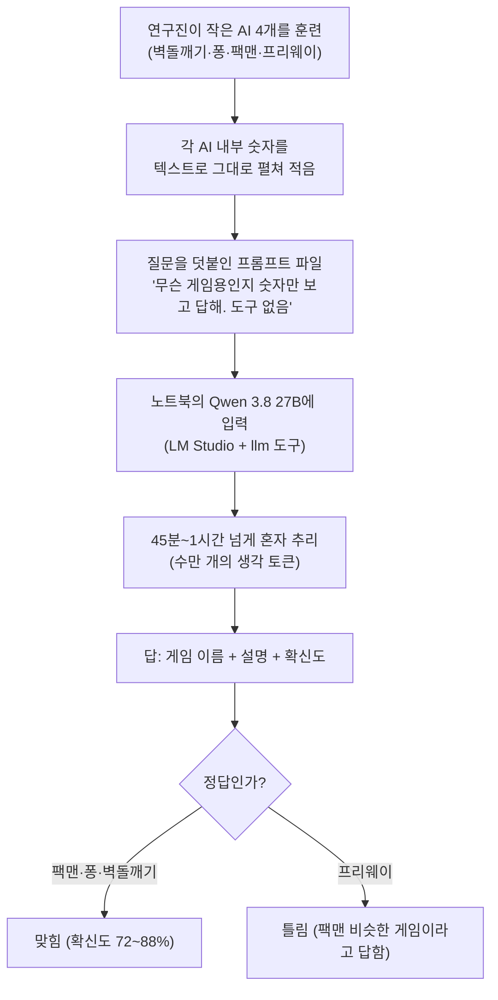

<aside class="ai-knowledge-sidebar">
  
CATEGORIES

  <nav class="ai-cat-tree">

에이전트 오케스트레이션19
<ul><li><a href="https://altjs4510.github.io/ai_news_blog/knowledge/20261029/">2026-10-29How Anthropic ships Claude with Claude: Separati…</a></li><li><a href="https://altjs4510.github.io/ai_news_blog/knowledge/20261027/">2026-10-27nightly-labs/openbot — Codex·Claude·Grok을 상주 팀원처…</a></li><li><a href="https://altjs4510.github.io/ai_news_blog/knowledge/20261015/">2026-10-15How Third Moment Research runs 10,000 agents for…</a></li><li><a href="https://altjs4510.github.io/ai_news_blog/knowledge/20261014/">2026-10-14How Anthropic's Dynamic Workflows Coordinate Cla…</a></li><li><a href="https://altjs4510.github.io/ai_news_blog/knowledge/20260930/">2026-09-30Agents you can coach: how Asana builds human-age…</a></li><li><a href="https://altjs4510.github.io/ai_news_blog/knowledge/20260929/">2026-09-29vectorize-io/hindsight — Hindsight: Agent Memory…</a></li><li><a href="https://altjs4510.github.io/ai_news_blog/knowledge/20260831-openexecutive-virtual-c-suite/">2026-08-31Open Executive — 8명의 전문 에이전트를 하나의 임원 목소리로</a></li><li><a href="https://altjs4510.github.io/ai_news_blog/knowledge/20260828/">2026-08-28Google ADK for Python v2.8.0 — RemoteA2aAgent 네이…</a></li><li><a href="https://altjs4510.github.io/ai_news_blog/knowledge/20260826/">2026-08-26apache/maka — 도구 호출·권한 결정·종료 이벤트를 append-only 로그…</a></li><li><a href="https://altjs4510.github.io/ai_news_blog/knowledge/20260823/">2026-08-23The Evolution of the Agent Harness — 하네스가 모델 가중치…</a></li><li><a href="https://altjs4510.github.io/ai_news_blog/knowledge/20260805/">2026-08-05TencentCloud/TencentDB-Agent-Memory — 대화·문서·코드를 …</a></li><li><a href="https://altjs4510.github.io/ai_news_blog/knowledge/20260717/">2026-07-17After a year building agent memory, 'save everyt…</a></li><li><a href="https://altjs4510.github.io/ai_news_blog/knowledge/20260708/">2026-07-08Expanding Managed Agents in Gemini API: backgrou…</a></li><li><a href="https://altjs4510.github.io/ai_news_blog/knowledge/20260701/">2026-07-01Google OKF (Open Knowledge Format) — 벤더 중립 에이전트 …</a></li><li><a href="https://altjs4510.github.io/ai_news_blog/knowledge/20260623/">2026-06-23bytedance/deer-flow — 샌드박스·메모리·서브에이전트·메시지 게이트웨이를…</a></li><li><a href="https://altjs4510.github.io/ai_news_blog/knowledge/20260611/">2026-06-11The evolution of agentic surfaces: building with…</a></li><li><a href="https://altjs4510.github.io/ai_news_blog/knowledge/20260602/">2026-06-02revfactory/harness — 도메인별 에이전트 팀과 스킬을 자동 설계하는 메타…</a></li><li><a href="https://altjs4510.github.io/ai_news_blog/knowledge/20260529/">2026-05-29Introducing dynamic workflows in Claude Code</a></li><li><a href="https://altjs4510.github.io/ai_news_blog/knowledge/20260507/">2026-05-07ruvnet/ruflo — Claude 멀티 에이전트 오케스트레이션 플랫폼</a></li></ul>

MCP &amp; 도구 통합13
<ul><li><a href="https://altjs4510.github.io/ai_news_blog/knowledge/20261103/">2026-11-03vercel-labs/agent-desktop — 픽셀 대신 OS 접근성 트리로 앱 U…</a></li><li><a href="https://altjs4510.github.io/ai_news_blog/knowledge/20261017/">2026-10-17mksglu/context-mode — 코딩 에이전트용 컨텍스트 윈도우 최적화</a></li><li><a href="https://altjs4510.github.io/ai_news_blog/knowledge/20261007/">2026-10-07morluto/rea — 앱 동작부터 네이티브 바이너리까지 에이전트로 리버스 엔지니어링</a></li><li><a href="https://altjs4510.github.io/ai_news_blog/knowledge/20260802/">2026-08-02Stateless MCP has recaptured my interest (and in…</a></li><li><a href="https://altjs4510.github.io/ai_news_blog/knowledge/20260731/">2026-07-31different-ai/openwork — Claude Cowork의 오픈소스 대안(o…</a></li><li><a href="https://altjs4510.github.io/ai_news_blog/knowledge/20260729/">2026-07-29Bringing MCP 2026-07-28 to Claude</a></li><li><a href="https://altjs4510.github.io/ai_news_blog/knowledge/20260726/">2026-07-26citrolabs/ego-lite — 로그인된 브라우저 상태를 AI 에이전트와 공유하는…</a></li><li><a href="https://altjs4510.github.io/ai_news_blog/knowledge/20260618/">2026-06-18DeusData/codebase-memory-mcp — 158개 언어 코드베이스를 밀리…</a></li><li><a href="https://altjs4510.github.io/ai_news_blog/knowledge/20260603/">2026-06-03How Bad MCP design cost your Agent 5× more token…</a></li><li><a href="https://altjs4510.github.io/ai_news_blog/knowledge/20260517/">2026-05-17I gave my LLM 100,000+ tools — Lazy Discovery &a…</a></li><li><a href="https://altjs4510.github.io/ai_news_blog/knowledge/20260512/">2026-05-12agentmemory — Persistent memory for AI coding ag…</a></li><li><a href="https://altjs4510.github.io/ai_news_blog/knowledge/20260509/">2026-05-09How to connect 100 MCP servers without the conte…</a></li><li><a href="https://altjs4510.github.io/ai_news_blog/knowledge/20260506/">2026-05-06mksglu/context-mode — AI 코딩 에이전트용 컨텍스트 윈도우 최적화</a></li></ul>

코딩 에이전트29
<ul><li><a href="https://altjs4510.github.io/ai_news_blog/knowledge/20261022/">2026-10-22Claude Mods: Flipping the Harness Inside Out</a></li><li><a href="https://altjs4510.github.io/ai_news_blog/knowledge/20261018/">2026-10-18Quoting Addy Osmani, Morgan Westlee Lunt, and Qi…</a></li><li><a href="https://altjs4510.github.io/ai_news_blog/knowledge/20261014-claude-code-advisor/">2026-10-14Claude Code advisor — 가벼운 메인 모델이 일하고, 갈림길에서만 Opu…</a></li><li><a href="https://altjs4510.github.io/ai_news_blog/knowledge/20260920/">2026-09-20Claude Code 2.1.277 — CLAUDE.md가 없으면 AGENTS.md를 …</a></li><li><a href="https://altjs4510.github.io/ai_news_blog/knowledge/20260912/">2026-09-12Quoting Boris Cherny — 'Claude가 쓴 프로덕션 코드는 사람이 쓴…</a></li><li><a href="https://altjs4510.github.io/ai_news_blog/knowledge/20260910/">2026-09-10vastsa/PI-Desktop — Electron + Rust 호스트 코어 + 에이전…</a></li><li><a href="https://altjs4510.github.io/ai_news_blog/knowledge/20260906/">2026-09-06DietrichGebert/ponytail — 에이전트를 '방에서 가장 게으른 시니어 …</a></li><li><a href="https://altjs4510.github.io/ai_news_blog/knowledge/20260903/">2026-09-03pacifio/atlas — 여러 코딩 에이전트의 변경을 한곳에서 추적·질의하는 '에이…</a></li><li><a href="https://altjs4510.github.io/ai_news_blog/knowledge/20260901/">2026-09-01affaan-m/ECC — 스킬·본능·메모리·보안을 묶은 에이전트 하네스 성능 최적화 …</a></li><li><a href="https://altjs4510.github.io/ai_news_blog/knowledge/20260831-gitnexus-code-knowledge-graph/">2026-08-31GitNexus — 코드베이스를 지식그래프로 바꿔 에이전트에게 쥐어주기</a></li><li><a href="https://altjs4510.github.io/ai_news_blog/knowledge/20260829/">2026-08-29cursor/plugins — 플러그인 명세(specification)와 공식 플러그인…</a></li><li><a href="https://altjs4510.github.io/ai_news_blog/knowledge/20260819/">2026-08-19akitaonrails/ai-memory — 코딩 에이전트 CLI 간 장기 기억과 벤더…</a></li><li><a href="https://altjs4510.github.io/ai_news_blog/knowledge/20260814/">2026-08-14cathrynlavery/diagram-design — Claude Code용 에디토리…</a></li><li><a href="https://altjs4510.github.io/ai_news_blog/knowledge/20260810/">2026-08-10Auto mode is now the default in Claude Code for …</a></li><li><a href="https://altjs4510.github.io/ai_news_blog/knowledge/20260808/">2026-08-08PrimeIntellect-ai/prime-agent — 코딩 워크플로우와 장시간 자율…</a></li><li><a href="https://altjs4510.github.io/ai_news_blog/knowledge/20260804/">2026-08-04esengine/DeepSeek-Reasonix — prefix-cache 안정성을 축…</a></li><li><a href="https://altjs4510.github.io/ai_news_blog/knowledge/20260728/">2026-07-28alibaba/open-code-review — 결정론적 파이프라인 + LLM 에이전트…</a></li><li><a href="https://altjs4510.github.io/ai_news_blog/knowledge/20260725/">2026-07-25The new rules of context engineering for Claude …</a></li><li><a href="https://altjs4510.github.io/ai_news_blog/knowledge/20260718/">2026-07-18tirth8205/code-review-graph — MCP·CLI용 로컬 코드 인텔리…</a></li><li><a href="https://altjs4510.github.io/ai_news_blog/knowledge/20260714/">2026-07-14Graphify-Labs/graphify — 코드베이스를 질의 가능한 지식 그래프로 만…</a></li><li><a href="https://altjs4510.github.io/ai_news_blog/knowledge/20260707/">2026-07-07AI Hero Skills Catalog — 실무 엔지니어를 위한 재사용 가능한 판단 …</a></li><li><a href="https://altjs4510.github.io/ai_news_blog/knowledge/20260705/">2026-07-05openai/codex-plugin-cc — Claude Code에서 Codex를 위임…</a></li><li><a href="https://altjs4510.github.io/ai_news_blog/knowledge/20260626/">2026-06-26google-labs-code/design.md — 코딩 에이전트에게 디자인 시스템을 …</a></li><li><a href="https://altjs4510.github.io/ai_news_blog/knowledge/20260619/">2026-06-19Claude Code now supports artifacts</a></li><li><a href="https://altjs4510.github.io/ai_news_blog/knowledge/20260530/">2026-05-30Leonxlnx/taste-skill — AI에게 좋은 취향을 부여해 generic s…</a></li><li><a href="https://altjs4510.github.io/ai_news_blog/knowledge/20260528/">2026-05-28Building self-improving tax agents with Codex</a></li><li><a href="https://altjs4510.github.io/ai_news_blog/knowledge/20260521/">2026-05-21colbymchenry/codegraph — Pre-indexed code knowle…</a></li><li><a href="https://altjs4510.github.io/ai_news_blog/knowledge/20260508/">2026-05-08addyosmani/agent-skills — Production-grade engin…</a></li><li><a href="https://altjs4510.github.io/ai_news_blog/knowledge/20260505/">2026-05-05mattpocock/skills — Skills for Real Engineers (.…</a></li></ul>

모델 &amp; 연구12
<ul><li><a href="https://altjs4510.github.io/ai_news_blog/knowledge/20261104/" class="current">2026-11-04Qwen 3.8 27B on my laptop can interpret model we…</a></li><li><a href="https://altjs4510.github.io/ai_news_blog/knowledge/20261009/">2026-10-09Claude Haiku 5.5 (Simon Willison의 출시 노트와 가격 분석)</a></li><li><a href="https://altjs4510.github.io/ai_news_blog/knowledge/20260907-voicemem-dual-brain-memory/">2026-09-07VoiceMem — 좌뇌·우뇌로 쪼갠 스트리밍 메모리로 음성 에이전트 지연 없애기</a></li><li><a href="https://altjs4510.github.io/ai_news_blog/knowledge/20260904/">2026-09-04HarnessDev: Can LLMs Create and Evolve Their Own…</a></li><li><a href="https://altjs4510.github.io/ai_news_blog/knowledge/20260821/">2026-08-21volcengine/OpenViking — 에이전트 메모리·Knowledge RAG·스…</a></li><li><a href="https://altjs4510.github.io/ai_news_blog/knowledge/20260716-proprag/">2026-07-16PropRAG — 프로포지션 경로 위 beam search로 멀티홉 검색 안내</a></li><li><a href="https://altjs4510.github.io/ai_news_blog/knowledge/20260712/">2026-07-12Do Automated Evals Work?</a></li><li><a href="https://altjs4510.github.io/ai_news_blog/knowledge/20260620/">2026-06-20zai-org/GLM-5 — From Vibe Coding to Agentic Engi…</a></li><li><a href="https://altjs4510.github.io/ai_news_blog/knowledge/20260617/">2026-06-17Predicting model behavior before release by simu…</a></li><li><a href="https://altjs4510.github.io/ai_news_blog/knowledge/20260610/">2026-06-10Fable 5 just made cost-aware model routing manda…</a></li><li><a href="https://altjs4510.github.io/ai_news_blog/knowledge/20260516/">2026-05-16STALE — 에이전트가 자기 기억의 유효성을 인지할 수 있는가</a></li><li><a href="https://altjs4510.github.io/ai_news_blog/knowledge/20260513/">2026-05-13Thinking Machines' Native Interaction Models — T…</a></li></ul>

인프라 &amp; 컴퓨트8
<ul><li><a href="https://altjs4510.github.io/ai_news_blog/knowledge/20260909/">2026-09-09Reducing cost and improving performance with Cla…</a></li><li><a href="https://altjs4510.github.io/ai_news_blog/knowledge/20260905/">2026-09-05magnitudedev/magnitude — 하드웨어에 맞는 최적 로컬 모델을 띄워 이…</a></li><li><a href="https://altjs4510.github.io/ai_news_blog/knowledge/20260812/">2026-08-12semantica-agi/semantica — 컨텍스트와 '책임 추적 가능한(accou…</a></li><li><a href="https://altjs4510.github.io/ai_news_blog/knowledge/20260806/">2026-08-06cloudflare/computer — 에이전트에게 컴퓨터를 통째로 주는 엣지 실행 샌…</a></li><li><a href="https://altjs4510.github.io/ai_news_blog/knowledge/20260723/">2026-07-23diegosouzapw/OmniRoute — 268+ 프로바이더를 단일 엔드포인트로 묶…</a></li><li><a href="https://altjs4510.github.io/ai_news_blog/knowledge/20260604/">2026-06-04chopratejas/headroom — Compress tool outputs bef…</a></li><li><a href="https://altjs4510.github.io/ai_news_blog/knowledge/20260522/">2026-05-22Giving Agents Computers — Ivan Burazin, Daytona</a></li><li><a href="https://altjs4510.github.io/ai_news_blog/knowledge/20260520/">2026-05-20New in Claude Managed Agents: self-hosted sandbo…</a></li></ul>

보안 &amp; 거버넌스25
<ul><li><a href="https://altjs4510.github.io/ai_news_blog/knowledge/20261031/">2026-10-31CopilotKit/OpenBot — AI 동료마다 전용 컴퓨터를 주고 모든 행동을 실…</a></li><li><a href="https://altjs4510.github.io/ai_news_blog/knowledge/20261030/">2026-10-30How we detect frontier model misalignment</a></li><li><a href="https://altjs4510.github.io/ai_news_blog/knowledge/20261021/">2026-10-21cloudflare/security-audit-skill — 독립 검증된 기계 판독형 …</a></li><li><a href="https://altjs4510.github.io/ai_news_blog/knowledge/20261020/">2026-10-20Satya Nadella — 모델을 내부자 위험으로 보는 원칙에 따라 Project P…</a></li><li><a href="https://altjs4510.github.io/ai_news_blog/knowledge/20261016/">2026-10-16Crossing the Threshold: How OpenAI and Anthropic…</a></li><li><a href="https://altjs4510.github.io/ai_news_blog/knowledge/20261011/">2026-10-11Anthropic can’t reliably control its AI agents. …</a></li><li><a href="https://altjs4510.github.io/ai_news_blog/knowledge/20261004/">2026-10-04Apple says it's tightening macOS 'Full Disk Acce…</a></li><li><a href="https://altjs4510.github.io/ai_news_blog/knowledge/20261001/">2026-10-01NVIDIA/OpenShell</a></li><li><a href="https://altjs4510.github.io/ai_news_blog/knowledge/20260919/">2026-09-19cloudflare/security-audit-skill — 다단계 보안 감사를 '독립…</a></li><li><a href="https://altjs4510.github.io/ai_news_blog/knowledge/20260913/">2026-09-13OpenAI agents attacked RubyGems back in May: Ope…</a></li><li><a href="https://altjs4510.github.io/ai_news_blog/knowledge/20260902/">2026-09-02AIR raises $50M to help companies vet the skills…</a></li><li><a href="https://altjs4510.github.io/ai_news_blog/knowledge/20260827/">2026-08-27Claude in Chrome is generally available</a></li><li><a href="https://altjs4510.github.io/ai_news_blog/knowledge/20260819-mind-viruses/">2026-08-19탈옥도, 인젝션도 없이 — 대화로만 퍼지는 에이전트의 '마인드 바이러스'</a></li><li><a href="https://altjs4510.github.io/ai_news_blog/knowledge/20260730/">2026-07-30Anatomy of a Frontier Lab Agent Intrusion: A Tec…</a></li><li><a href="https://altjs4510.github.io/ai_news_blog/knowledge/20260715/">2026-07-15Dicklesworthstone/destructive_command_guard — 에이…</a></li><li><a href="https://altjs4510.github.io/ai_news_blog/knowledge/20260710/">2026-07-1070개 MCP 서버 strace 런타임 감사 — 부팅 시 아웃바운드 호출 서버 적발</a></li><li><a href="https://altjs4510.github.io/ai_news_blog/knowledge/20260704/">2026-07-04Cloudflare is about to block AI agents by defaul…</a></li><li><a href="https://altjs4510.github.io/ai_news_blog/knowledge/20260703/">2026-07-03Giving admins more visibility and control over C…</a></li><li><a href="https://altjs4510.github.io/ai_news_blog/knowledge/20260630/">2026-06-30Introducing the Claude apps gateway for Amazon B…</a></li><li><a href="https://altjs4510.github.io/ai_news_blog/knowledge/20260624/">2026-06-24Agent identity in Claude Tag: a new access model…</a></li><li><a href="https://altjs4510.github.io/ai_news_blog/knowledge/20260613/">2026-06-13Fable 5's guardrails got bypassed in 48 hours — …</a></li><li><a href="https://altjs4510.github.io/ai_news_blog/knowledge/20260612/">2026-06-12NVIDIA/SkillSpector — AI 에이전트 스킬용 보안 스캐너</a></li><li><a href="https://altjs4510.github.io/ai_news_blog/knowledge/20260607/">2026-06-07OpenAI Help: Lockdown Mode</a></li><li><a href="https://altjs4510.github.io/ai_news_blog/knowledge/20260531/">2026-05-31How we contain Claude across products</a></li><li><a href="https://altjs4510.github.io/ai_news_blog/knowledge/20260527/">2026-05-27Microsoft Copilot Cowork Exfiltrates Files</a></li></ul>

응용 사례9
<ul><li><a href="https://altjs4510.github.io/ai_news_blog/knowledge/20261101/">2026-11-01Agents Prompt People: Using Agents for Long-Hori…</a></li><li><a href="https://altjs4510.github.io/ai_news_blog/knowledge/20261028/">2026-10-28Greptile takes bug detection beyond code review …</a></li><li><a href="https://altjs4510.github.io/ai_news_blog/knowledge/20261006/">2026-10-06How Cresta turned CX expertise into an agent bui…</a></li><li><a href="https://altjs4510.github.io/ai_news_blog/knowledge/20260911/">2026-09-11Now everyone can put data to work — ChatGPT Work…</a></li><li><a href="https://altjs4510.github.io/ai_news_blog/knowledge/20260709/">2026-07-09mvanhorn/last30days-skill — Reddit·X·YouTube·HN·…</a></li><li><a href="https://altjs4510.github.io/ai_news_blog/knowledge/20260621/">2026-06-21calesthio/OpenMontage — 12 파이프라인·52 도구·500+ 스킬을 …</a></li><li><a href="https://altjs4510.github.io/ai_news_blog/knowledge/20260609/">2026-06-09Building intelligent apps for Apple platforms wi…</a></li><li><a href="https://altjs4510.github.io/ai_news_blog/knowledge/20260515/">2026-05-15Clawdmeter — Claude Code 사용량을 데스크톱 대시보드로</a></li><li><a href="https://altjs4510.github.io/ai_news_blog/knowledge/20260514/">2026-05-14Introducing Claude for Small Business</a></li></ul>

산업 동향9
<ul><li><a href="https://altjs4510.github.io/ai_news_blog/knowledge/20261024/">2026-10-24Donating Agent Skills to the Agentic AI Foundati…</a></li><li><a href="https://altjs4510.github.io/ai_news_blog/knowledge/20261023/">2026-10-23Claude Duet app is Anthropic's bet on agents</a></li><li><a href="https://altjs4510.github.io/ai_news_blog/knowledge/20260907-humanmade-52week-rhythm/">2026-09-07휴먼 메이드의 '52주 리듬' — 아이디어가 흔해진 시대에 값이 오르는 건 버리는 판단</a></li><li><a href="https://altjs4510.github.io/ai_news_blog/knowledge/20260830/">2026-08-30[AINews] OpenAI shuts off Cursor — 프론티어 모델 공급 차단…</a></li><li><a href="https://altjs4510.github.io/ai_news_blog/knowledge/20260711/">2026-07-11OpenAI says GPT 5.6 is the 'preferred model' for…</a></li><li><a href="https://altjs4510.github.io/ai_news_blog/knowledge/20260702/">2026-07-02How Cursor deploys AI inside the enterprise (For…</a></li><li><a href="https://altjs4510.github.io/ai_news_blog/knowledge/20260616/">2026-06-16Why AI hasn't replaced software engineers, and w…</a></li><li><a href="https://altjs4510.github.io/ai_news_blog/knowledge/20260519/">2026-05-19Anthropic acquires Stainless</a></li><li><a href="https://altjs4510.github.io/ai_news_blog/knowledge/20260504/">2026-05-04Agents for Everything Else: Codex for Knowledge …</a></li></ul>
</nav>
</aside>

<article class="ai-knowledge-article">

<header class="ai-post-hero">
  
<a class="ai-back" href="../">KNOWLEDGE</a> · 2026-11-04 · 오늘의 학습

  <h2 class="ai-post-title">Qwen 3.8 27B on my laptop can interpret model weights, too</h2>
</header>

> 원문: [Qwen 3.8 27B on my laptop can interpret model weights, too](https://simonwillison.net/2026/Nov/3/qwen-can-interpret-model-weights/)

## 📌 학습 정리

### 1. 한 줄로 말하면

AI 모델에게 다른 작은 AI의 속을 이루는 숫자 뭉치만 보여 주고 "이건 무슨 게임을 하도록 훈련된 거야?"라고 물었더니 맞히더라는 실험이에요. 그걸 거대한 최신 모델이 아니라 개인 노트북에서 돌린 모델도 해냈다는 이야기예요.

### 2. 왜 이게 만들어졌어요?

AI 모델은 보통 결과로만 판단해 왔어요. 질문을 넣고, 나온 답을 보고, 잘하는지 못하는지를 따지는 식이었죠. 모델 내부는 수만 개의 소수점 숫자로 되어 있어서 사람이 들여다봐도 무슨 뜻인지 알기 어렵거든요. 그런데 [Sparks of Weight-Space Programming](https://rikiyat.github.io/blog/weight-space-programming/)이라는 논문이 나왔어요. 최상위 모델인 GPT-6 Astra가 이 숫자들만 보고도 그 네트워크가 무엇을 하도록 훈련됐는지 알아내고, 직접 고칠 수도 있었다는 내용이에요. 글쓴이 Simon Willison은 이게 큰 모델만 할 수 있는 일인지 궁금해서, 자기 노트북에서 돌리는 Qwen 3.8 27B로 같은 실험을 해 봤어요.

논문에는 Astra가 작은 모델(Qwen3.5-0.8B)의 내부 숫자 중 0.016%만 고쳤다는 사례도 있어요. 그 모델은 같은 추론을 계속 되풀이하는 문제가 있었는데, 숫자를 고친 뒤 수학 시험(MATH-500) 점수가 7.9%에서 48.1%로 올랐다고 해요. 다만 글쓴이는 이 논문이 서로 다른 두 질문을 한데 섞었다고 봐요. 하나는 도구 없이 숫자만 보고 이해할 수 있느냐는 질문이고, 다른 하나는 코드를 쓸 수 있을 때 다른 모델을 개선할 수 있느냐는 질문이에요. 이 글은 앞의 질문, 도구 없는 쪽만 다뤄요.

### 3. 비유로 풀면

이건 마치 악보도 연주도 없이, 오르골 안에 든 핀이 박힌 원통만 보고 무슨 곡인지 맞히는 것과 비슷해요. 핀 하나하나는 그냥 작은 돌기지만, 어디에 어떤 간격으로 박혔는지를 끈기 있게 따라가면 멜로디가 조금씩 보이기 시작하죠.

또 다른 비유를 들자면, 낯선 회사의 엑셀 장부 숫자만 받아 들고 "이 회사는 무슨 업종일까?"를 추측하는 일과도 닮았어요. 어느 항목에 큰 숫자가 몰려 있는지를 보면 업종의 윤곽이 잡히는 식이에요.

그래서 결국 이 실험은 AI가 마법을 부렸다기보다, 숫자 패턴을 아주 오래 끈질기게 따라가며 추리한 결과에 가까워요. 실제로 글쓴이도 경험 많은 사람이 노트와 연필을 들고 충분히 애쓰면 같은 결론에 닿을 수 있을 거라고 말해요.

### 4. 어떻게 작동하는지 (그림으로)

연구진은 단순화한 격자판 위에서 고전 게임 네 개를 하도록 작은 AI를 훈련시킨 뒤, 그 AI의 내부 숫자를 그대로 텍스트로 적어 질문과 함께 프롬프트로 만들었어요. 글쓴이는 깃허브에 공개된 이 프롬프트를 자기 노트북의 Qwen에 넣었고, Qwen은 계산기나 코드 실행 없이 혼자 한참 생각한 끝에 답을 냈어요. 네 게임 중 세 개는 맞혔고, 상대적으로 덜 알려진 프리웨이(Freeway, 1981년 아타리 2600 게임)만 틀렸어요.

### 5. 처음 보는 용어 풀이

- **가중치 (weights)** — AI 모델 안에 들어 있는 수많은 숫자예요. 훈련하는 동안 이 숫자들이 조정되면서 모델의 "실력"이 만들어져요. 결국 모델이 무엇을 할 줄 아는지는 이 숫자들에 담겨 있어요.
- **소수점 숫자 (floating point numbers)** — -2.107, 0.513처럼 소수점이 붙은 숫자예요. 가중치는 대부분 이런 형태라서, 텍스트로 펼치면 그냥 숫자가 끝없이 늘어선 모습이 돼요.
- **가중치 공간 프로그래밍 (Weight-Space Programming)** — 논문이 새로 붙인 이름이에요. AI가 다른 모델의 가중치를 읽고 분석하고, 직접 고쳐서 동작을 바꾸는 일을 가리켜요.
- **강화학습 (reinforcement learning)** — 정답을 알려 주는 대신, 잘하면 보상을 주고 못하면 벌점을 주면서 스스로 요령을 익히게 하는 훈련 방식이에요. 게임을 가르칠 때 많이 써요. 논문에서 비교 대상으로 나온 PPO는 이 방식에 쓰이는 대표적인 훈련 기법 중 하나예요.
- **정책 네트워크 (policy network)** — 지금 화면 상태를 보고 "다음에 어떤 행동을 할지" 정해 주는 작은 AI예요. 이번 실험에서 정답을 맞혀야 했던 대상이 바로 이 네트워크의 가중치였어요.
- **추론 토큰 (reasoning tokens)** — 모델이 최종 답을 내기 전에 혼자 생각하면서 쏟아내는 글자 조각이에요. Qwen은 팩맨 문제 하나에 4만 3천 개가 넘는 추론 토큰을 썼어요. 그래서 시간이 오래 걸렸어요.
- **컨텍스트 윈도우 (context window)** — 모델이 한 번에 읽고 기억할 수 있는 글의 양이에요. 이번 프롬프트는 숫자가 워낙 많아서, LM Studio의 기본값(8192)으로는 오류가 났고 더 크게 늘려야 했어요.

### 6. 한 발 더 들어가고 싶다면

- [Sparks of Weight-Space Programming 논문 블로그](https://rikiyat.github.io/blog/weight-space-programming/) — 이걸 보면 GPT-6 Astra가 가중치를 읽고, 게임용 네트워크를 처음부터 짜고, Qwen 모델을 고친 사례까지 원래 주장을 전부 볼 수 있어요.
- [exp1_which_game 폴더 (깃허브)](https://github.com/RikiyaT/lm_understand-logs/tree/main/exp1_which_game) — 이걸 보면 실험에 쓴 프롬프트가 실제로 어떻게 생겼는지, 숫자가 얼마나 빽빽하게 들어 있는지 직접 확인할 수 있어요.
- [Matthew Honnibal의 비판 글](https://honnibal.dev/blog/astra-read-write-misleading) — 이걸 보면 이 논문이 도구 없는 실험과 도구 있는 실험을 섞어서 오해를 부른다는 반론을 알 수 있어요.
- [Sean Goedecke의 분석 글](https://www.seangoedecke.com/llms-are-not-superhuman-at-reading-and-writing-neural-network-weights/) — 이걸 보면 Astra가 Qwen3.5-0.8B를 고친 과정이 사람 연구자가 밟는 단계와 크게 다르지 않다는 해석을 알 수 있어요.
- [LLM 도구](https://llm.datasette.io/) — 이걸 보면 글쓴이가 프롬프트 파일 주소 하나로 여러 모델에 같은 실험을 돌릴 때 쓴 명령줄 도구를 알 수 있어요.

---

## 📖 원문 전체 번역 (정독용)

> 의역 최소화한 전체 번역입니다. 큰 흐름은 위 정리에서 잡고, 정확한 워딩이 필요할 땐 이 섹션에서 정독하세요.

# 내 노트북의 Qwen 3.8 27B도 모델 가중치를 해석할 수 있다

2026년 11월 3일

어제의 화제작은 Rikiya Takehi, Jayden Teoh, Alex Zhang, Omar Khattab이 쓴 [Sparks of Weight-Space Programming: LLMs can natively read & write neural network weights](https://rikiyat.github.io/blog/weight-space-programming/)였습니다. 이 논문은 프론티어 모델, 특히 GPT-6 Astra가 머신러닝 모델의 원시 가중치(raw weights)를 해석하고 수정할 수 있음을 발견했습니다. 여기서 원시 가중치란 말 그대로 부동소수점 숫자 다발로 이루어진, 모델에 대한 텍스트 설명입니다. 저는 이 논문의 예제 중 하나를 가지고 놀아 봤는데, 제 노트북에서 돌아가는 Qwen 3.8 27B도 이것을 할 수 있다는 소식을 기쁘게 전합니다!

#### Weight-Space Programming

다음은 초록(abstract)의 핵심 부분입니다. GPT-6 Astra의 인상적인 능력을 설명하고, LLM이 모델 가중치를 분석·수정하는 일을 **Weight-Space Programming**이라는 용어로 명명합니다.

> 원시 가중치를 보는 것만으로, GPT-6 Astra는 **네트워크가 무엇을 하도록 훈련되었는지 알아낼 수 있다**. 그리고 환경 피드백이 전혀 없어도, **처음부터 작은 게임 플레이 네트워크를 어려움 없이 작성**하며, 이 네트워크는 PPO로 1억 스텝 동안 훈련된 네트워크를 능가한다.
> 
> 
> 마찬가지로, 그래디언트 없이 Qwen3.5-0.8B의 수학 성능을 높여 달라는 요청을 받았을 때, Astra는 Qwen 자체 [모델 카드](https://huggingface.co/Qwen/Qwen3.5-0.8B/blob/main/README.md#L856)가 경고하는 추론 루프(reasoning loop)를 일으키는 **가중치상의 문제를 식별**하고, **가중치의 0.016%를 직접 편집하여 이를 고친다**. 동일한 샘플링 설정에서 이 가중치 보정은 MATH-500을 7.9%에서 48.1%로 끌어올리며, 별도 조치 없이도 지시 따르기(instruction following)로 일반화되어 IFEval을 3배로 높인다.
> 
> 
> 이 모든 것은 Astra가 훈련 루프를 작성하도록 허용하지 않고도 가능하다. Astra는 추론을 사용해 신경망의 각 부분이 무엇을 계산하는지, 혹은 무엇을 계산해야 하는지를 알아내고, 그에 맞춰 가중치를 바꾼다. 우리는 이를 **Weight-Space Programming**이라 부른다.

이 논문은 따로 다뤄야 한다고 제가 생각하는 두 가지 주제를 합쳐 놓았습니다. 첫째는 모델이 도구를 실행하거나 코드를 돌리지 _않고_ 원시 가중치로 무엇을 할 수 있는가입니다. 둘째는 모델이 코드를 갖추었을 때, 다른 모델을 갱신하고 개선하는 작업을 얼마나 잘 수행할 수 있는가입니다.

spaCy 저자 Matthew Honnibal은 이 둘을 뒤섞었다는 이유로 이 논문을 [오해의 소지가 있다고 평했고](https://honnibal.dev/blog/astra-read-write-misleading), Sean Goedecke는 Qwen3.5-0.8B 갱신 예제를 인간 ML 연구자가 밟았을 단계와 같은 것을 밟은 것이라며 [해체해 보였습니다](https://www.seangoedecke.com/llms-are-not-superhuman-at-reading-and-writing-neural-network-weights/).

저는 두 가지 중 더 흥미롭다고 생각하는 도구 없는 질문에 집중하겠습니다.

논문은 첫 번째 질문을 **LLM이 가중치로부터 모델의 행동을 이해할 수 있는가?**로 제시합니다. 연구진은 네 가지 고전 컴퓨터 게임, 즉 Breakout, Pong, Pac-Man, Freeway의 단순화된 10x10 격자 버전을 플레이하도록 신경망 네 개를 훈련했습니다(마지막 게임은 [찾아봐야 했는데](https://en.wikipedia.org/wiki/Freeway_(video_game)), 1981년 Atari 2600 게임입니다). 그런 다음 그 가중치(부동소수점 숫자)를 다음 질문과 함께 LLM에 입력했습니다.

> `아래 가중치는 이 격자에서 게임을 플레이하도록 강화학습으로 훈련된 하나의 정책 네트워크(policy network)의 것이다. 어떤 게임으로 훈련되었는가? 가중치로부터 추론하라. 도구는 없다. 코드 실행도, 계산기도, 실행할 것도 없다. 이것은 단일 응답이다.`

논문에 딸린 GitHub 저장소는 [RikiyaT/lm_understand-logs](https://github.com/RikiyaT/lm_understand-logs)입니다. [exp1_which_game](https://github.com/RikiyaT/lm_understand-logs/tree/main/exp1_which_game) 폴더에는 연구진이 사용한 프롬프트가 네 게임의 가중치와 함께 들어 있습니다.

*   [breakout/prompt.txt](https://github.com/RikiyaT/lm_understand-logs/blob/main/exp1_which_game/runs/breakout/prompt.txt)
*   [freeway/prompt.txt](https://github.com/RikiyaT/lm_understand-logs/blob/main/exp1_which_game/runs/freeway/prompt.txt)
*   [pacman/prompt.txt](https://github.com/RikiyaT/lm_understand-logs/blob/main/exp1_which_game/runs/pacman/prompt.txt)
*   [pong/prompt.txt](https://github.com/RikiyaT/lm_understand-logs/blob/main/exp1_which_game/runs/pong/prompt.txt)

확인해 보니 가중치를 제외하면 각 프롬프트는 서로 동일합니다.

#### Qwen 3.8 27B 및 다른 모델로 시도해 보기

GitHub의 프롬프트는 그 자체로 완결되어 있습니다. 제 [LLM](https://llm.datasette.io/) 도구에는 텍스트 파일의 URL을 받아 프롬프트로 쓸 수 있는 `-f/--fragment` 옵션이 있어서, 위의 어느 것이든 다음과 같이 실행할 수 있습니다.

llm -f https://raw.githubusercontent.com/RikiyaT/lm_understand-logs/refs/heads/main/exp1_which_game/runs/breakout/prompt.txt \
  -m openrouter/moonshotai/kimi-k3.1-pro

이 예제는 [llm-openrouter 플러그인](https://github.com/simonw/llm-openrouter)이 설치되어 있어야 하며, OpenRouter를 통해 Kimi K3.1 Pro에 Breakout 프롬프트를 실행합니다. [Kimi K3.1 Pro가 돌려준 결과](https://gist.github.com/simonw/9f18d2945a105c04734ef7e5cd95717c)는 이렇습니다. 9분 41초, 추론 토큰 19,493개 끝에 Breakout을 정확히 맞혔습니다.

그렇다면 [Qwen 3.8 27B](https://simonwillison.net/2026/Aug/16/qwen-38-27b/)는 어떨까요? 이 모델은 여전히 제 노트북에서 돌리는 모델 중 가장 좋아하는 모델입니다. 용량이 17GB에 불과하고(저는 [이 버전](https://huggingface.co/lmstudio-community/Qwen3.8-27B-GGUF/blob/main/Qwen3.8-27B-Q4_K_M.gguf)을 씁니다), 어쩐지 2025년의 선두 상용 모델에 가깝게 느껴집니다.

저는 [LM Studio](https://lmstudio.ai/)를 켜고, Qwen 3.8 27B가 긴 컨텍스트 윈도로 로드되었는지 확인한 뒤(기본값 8192 컨텍스트에서는 오류와 함께 실패했습니다), [llm-lmstudio](https://github.com/llm-lmstudio/llm-lmstudio) 플러그인을 설치하고 다음 명령을 실행했습니다.

LMSTUDIO_TIMEOUT=900 \
  llm -f https://raw.githubusercontent.com/RikiyaT/lm_understand-logs/refs/heads/main/exp1_which_game/runs/pacman/prompt.txt \
  -m lmstudio/qwen/qwen3.8-27b

(환경 변수로 타임아웃을 늘려야 했습니다. [이 이슈](https://github.com/llm-lmstudio/llm-lmstudio/issues/16)를 참고하세요.)

46분 12초, 추론 토큰 43,506개 끝에 제 노트북의 Qwen이 [응답을 내놓았고](https://tools.simonwillison.net/markdown-svg-renderer?url=https%3A%2F%2Fgist.github.com%2Fsimonw%2F387d3a7927f165b1986bb6c2099d0f53#response-1), 응답은 다음과 같이 끝났습니다([추론 과정](https://tools.simonwillison.net/markdown-svg-renderer?url=https%3A%2F%2Fgist.github.com%2Fsimonw%2F387d3a7927f165b1986bb6c2099d0f53#reasoning-1)은 여기).

> 게임: 단순화된 Pac-Man 스타일의 그리드월드. 에이전트가 중앙과 모서리에 벽 블록이 있는 고정된 8x8 미로를 돌아다니며, 움직이는 객체/유령과 보상 목표/알갱이가 있다.
> 
> 
> 설명: 에이전트는 고정된 미로형 8x8 보드를 탐색하며, 현재 에이전트/움직이는 객체/이전 프레임 단서를 사용해 통로를 따라 이동하고, 보상 목표 칸을 수집하며, 움직이는 객체나 위험 요소를 피한다.
> 
> 
> 확신도: 72%

인상적입니다. 저는 다른 게임 두 개에도 시도해 봤습니다. 1시간 4분 54초 만에 [Pong을 식별했습니다](https://tools.simonwillison.net/markdown-svg-renderer?url=https%3A%2F%2Fgist.github.com%2Fsimonw%2F387d3a7927f165b1986bb6c2099d0f53#response-2)([추론](https://tools.simonwillison.net/markdown-svg-renderer?url=https%3A%2F%2Fgist.github.com%2Fsimonw%2F387d3a7927f165b1986bb6c2099d0f53#reasoning-2)).

> **Pong** — 구체적으로는 에이전트가 오른쪽의 수직 패들을 조작하며, 위/아래로 움직여 움직이는 공/보상 객체를 가로막거나 되받아치는 Pong류 패들/공 게임이다.
> 
> 
> 설명:
> 
> 
> 에이전트는 오른쪽 패들을 수직으로 움직여 8×8 필드를 가로질러 움직이는 공 같은 보상 목표를 치거나 받아내며, 왼쪽의 움직이는 객체/상대와 벽 경계가 플레이를 규정한다. 공을 성공적으로 가로막거나 되받아치거나 득점하면 보상이 주어지고, 놓치거나 치지 못하면 페널티를 받는다.
> 
> 
> 확신도:
> 
> 
> **75%**

그리고 52분 25초 만에 [Breakout](https://tools.simonwillison.net/markdown-svg-renderer?url=https%3A%2F%2Fgist.github.com%2Fsimonw%2F387d3a7927f165b1986bb6c2099d0f53#response)([추론](https://tools.simonwillison.net/markdown-svg-renderer?url=https%3A%2F%2Fgist.github.com%2Fsimonw%2F387d3a7927f165b1986bb6c2099d0f53#reasoning))도 맞혔습니다.

> 게임: Breakout, 또는 Arkanoid류의 패들/공/벽돌 게임.
> 
> 
> 설명: 에이전트는 맨 아래 행의 패들이며 좌/우로 움직여 공을 계속 플레이 상태로 유지한다. 공은 위쪽 격자를 돌아다니고, 위쪽 행의 벽돌/보상 목표는 맞으면 보상을 주며, 공을 놓치거나 아래쪽 벽에 닿으면 에피소드가 끝나거나 페널티가 주어진다.
> 
> 
> 확신도: 88%

Qwen은 Freeway 프롬프트에서는 실패했는데, 이 게임이 나머지 셋보다 덜 알려져 있다는 점을 생각하면 놀랍지 않았습니다. [그 기록](https://tools.simonwillison.net/markdown-svg-renderer?url=https%3A%2F%2Fgist.github.com%2Fsimonw%2F6ed68f659e26a32e7d9096391d92f326)은 여기 있으며, Qwen은 이 게임을 "단순화된 Pac-Man류 격자 게임: 에이전트가 4방향으로 움직임"이라고 생각했습니다.

추론 과정은 훑어보는 재미가 있지만 거의 이해할 수 없습니다. 샘플은 이렇습니다.

> What about agent channel0? We see some large channel0 rows near row8 col7/8 and maybe bottom? Let’s list channel0 large: line436 input435 (row8 col7 ch0) -2.107,1.169,0.513...; line441 input440 (row8 col8 ch0) -0.376,0.010,1.564,3.855...; line445 input444 (row8 col8 ch4) 0.142,0.491...; line382? input381 ch0? Wait line382 input381: 381//5=76 (row7 col6), ch1? 381%5=1? 76 * 5=380, ch1. So not. Channel0 large maybe at row8 col7/8 only. Also top row? line44 input43 ch3, line49 ch3. Channel0 large maybe not many. Agent position could be near bottom-right? If the agent is typically at bottom-right?

*(위 추론 샘플은 모델 출력 원문 그대로 둡니다.)*

그렇긴 해도, 충분히 숙련된 사람이 메모장과 연필을 들고 충분히 노력하면 거기에 도달할 수 있을 거라고 생각합니다.

멋진 논문이지만, 이 논문을 둘러싸고 제가 본 더 폭넓은 논평 중 일부는 정당화되지 않는 것 같습니다. 저는 소스 코드의 시대가 끝났다거나, 우리의 미래가 이해할 수 없는 기계들이 이해할 수 없는 방식으로 자기 모델 가중치를 편집하는 것이라고 선언할 준비가 되어 있지 않습니다.

</article>

