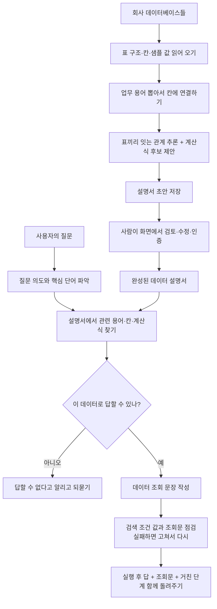

<div class="ai-knowledge-shell">

<aside class="ai-knowledge-sidebar">
  <p class="ai-eyebrow">CATEGORIES</p>
  <nav class="ai-cat-tree"><details class="ai-cat" open><summary><span class="catname">에이전트 오케스트레이션</span><span class="catcount">22</span></summary><ul><li><a href="https://altjs4510.github.io/ai_news_blog/knowledge/20261107/"><span class="kdate">2026-11-07</span><span class="ktitle">Hermes Agent v0.23.0 — The Hearth Release</span></a></li><li><a href="https://altjs4510.github.io/ai_news_blog/knowledge/20261106/"><span class="kdate">2026-11-06</span><span class="ktitle">Cline desktop-nightly-20261104233655: feat(core)…</span></a></li><li><a href="https://altjs4510.github.io/ai_news_blog/knowledge/20261029/"><span class="kdate">2026-10-29</span><span class="ktitle">How Anthropic ships Claude with Claude: Separati…</span></a></li><li><a href="https://altjs4510.github.io/ai_news_blog/knowledge/20261027/"><span class="kdate">2026-10-27</span><span class="ktitle">nightly-labs/openbot — Codex·Claude·Grok을 상주 팀원처…</span></a></li><li><a href="https://altjs4510.github.io/ai_news_blog/knowledge/20261015/"><span class="kdate">2026-10-15</span><span class="ktitle">How Third Moment Research runs 10,000 agents for…</span></a></li><li><a href="https://altjs4510.github.io/ai_news_blog/knowledge/20261014/"><span class="kdate">2026-10-14</span><span class="ktitle">How Anthropic's Dynamic Workflows Coordinate Cla…</span></a></li><li><a href="https://altjs4510.github.io/ai_news_blog/knowledge/20260930/"><span class="kdate">2026-09-30</span><span class="ktitle">Agents you can coach: how Asana builds human-age…</span></a></li><li><a href="https://altjs4510.github.io/ai_news_blog/knowledge/20260929/"><span class="kdate">2026-09-29</span><span class="ktitle">vectorize-io/hindsight — Hindsight: Agent Memory…</span></a></li><li><a href="https://altjs4510.github.io/ai_news_blog/knowledge/20260831-openexecutive-virtual-c-suite/"><span class="kdate">2026-08-31</span><span class="ktitle">Open Executive — 8명의 전문 에이전트를 하나의 임원 목소리로</span></a></li><li><a href="https://altjs4510.github.io/ai_news_blog/knowledge/20260828/"><span class="kdate">2026-08-28</span><span class="ktitle">Google ADK for Python v2.8.0 — RemoteA2aAgent 네이…</span></a></li><li><a href="https://altjs4510.github.io/ai_news_blog/knowledge/20260826/"><span class="kdate">2026-08-26</span><span class="ktitle">apache/maka — 도구 호출·권한 결정·종료 이벤트를 append-only 로그…</span></a></li><li><a href="https://altjs4510.github.io/ai_news_blog/knowledge/20260823/"><span class="kdate">2026-08-23</span><span class="ktitle">The Evolution of the Agent Harness — 하네스가 모델 가중치…</span></a></li><li><a href="https://altjs4510.github.io/ai_news_blog/knowledge/20260821/"><span class="kdate">2026-08-21</span><span class="ktitle">volcengine/OpenViking — 에이전트 메모리·Knowledge RAG·스…</span></a></li><li><a href="https://altjs4510.github.io/ai_news_blog/knowledge/20260805/"><span class="kdate">2026-08-05</span><span class="ktitle">TencentCloud/TencentDB-Agent-Memory — 대화·문서·코드를 …</span></a></li><li><a href="https://altjs4510.github.io/ai_news_blog/knowledge/20260717/"><span class="kdate">2026-07-17</span><span class="ktitle">After a year building agent memory, 'save everyt…</span></a></li><li><a href="https://altjs4510.github.io/ai_news_blog/knowledge/20260708/"><span class="kdate">2026-07-08</span><span class="ktitle">Expanding Managed Agents in Gemini API: backgrou…</span></a></li><li><a href="https://altjs4510.github.io/ai_news_blog/knowledge/20260623/"><span class="kdate">2026-06-23</span><span class="ktitle">bytedance/deer-flow — 샌드박스·메모리·서브에이전트·메시지 게이트웨이를…</span></a></li><li><a href="https://altjs4510.github.io/ai_news_blog/knowledge/20260611/"><span class="kdate">2026-06-11</span><span class="ktitle">The evolution of agentic surfaces: building with…</span></a></li><li><a href="https://altjs4510.github.io/ai_news_blog/knowledge/20260610/"><span class="kdate">2026-06-10</span><span class="ktitle">Fable 5 just made cost-aware model routing manda…</span></a></li><li><a href="https://altjs4510.github.io/ai_news_blog/knowledge/20260602/"><span class="kdate">2026-06-02</span><span class="ktitle">revfactory/harness — 도메인별 에이전트 팀과 스킬을 자동 설계하는 메타…</span></a></li><li><a href="https://altjs4510.github.io/ai_news_blog/knowledge/20260529/"><span class="kdate">2026-05-29</span><span class="ktitle">Introducing dynamic workflows in Claude Code</span></a></li><li><a href="https://altjs4510.github.io/ai_news_blog/knowledge/20260507/"><span class="kdate">2026-05-07</span><span class="ktitle">ruvnet/ruflo — Claude 멀티 에이전트 오케스트레이션 플랫폼</span></a></li></ul></details><details class="ai-cat" open><summary><span class="catname">MCP &amp; 도구 통합</span><span class="catcount">14</span></summary><ul><li><a href="https://altjs4510.github.io/ai_news_blog/knowledge/20261103/"><span class="kdate">2026-11-03</span><span class="ktitle">vercel-labs/agent-desktop — 픽셀 대신 OS 접근성 트리로 앱 U…</span></a></li><li><a href="https://altjs4510.github.io/ai_news_blog/knowledge/20261017/"><span class="kdate">2026-10-17</span><span class="ktitle">mksglu/context-mode — 코딩 에이전트용 컨텍스트 윈도우 최적화</span></a></li><li><a href="https://altjs4510.github.io/ai_news_blog/knowledge/20260802/"><span class="kdate">2026-08-02</span><span class="ktitle">Stateless MCP has recaptured my interest (and in…</span></a></li><li><a href="https://altjs4510.github.io/ai_news_blog/knowledge/20260731/"><span class="kdate">2026-07-31</span><span class="ktitle">different-ai/openwork — Claude Cowork의 오픈소스 대안(o…</span></a></li><li><a href="https://altjs4510.github.io/ai_news_blog/knowledge/20260729/"><span class="kdate">2026-07-29</span><span class="ktitle">Bringing MCP 2026-07-28 to Claude</span></a></li><li><a href="https://altjs4510.github.io/ai_news_blog/knowledge/20260726/"><span class="kdate">2026-07-26</span><span class="ktitle">citrolabs/ego-lite — 로그인된 브라우저 상태를 AI 에이전트와 공유하는…</span></a></li><li><a href="https://altjs4510.github.io/ai_news_blog/knowledge/20260618/"><span class="kdate">2026-06-18</span><span class="ktitle">DeusData/codebase-memory-mcp — 158개 언어 코드베이스를 밀리…</span></a></li><li><a href="https://altjs4510.github.io/ai_news_blog/knowledge/20260609/"><span class="kdate">2026-06-09</span><span class="ktitle">Building intelligent apps for Apple platforms wi…</span></a></li><li><a href="https://altjs4510.github.io/ai_news_blog/knowledge/20260603/"><span class="kdate">2026-06-03</span><span class="ktitle">How Bad MCP design cost your Agent 5× more token…</span></a></li><li><a href="https://altjs4510.github.io/ai_news_blog/knowledge/20260521/"><span class="kdate">2026-05-21</span><span class="ktitle">colbymchenry/codegraph — Pre-indexed code knowle…</span></a></li><li><a href="https://altjs4510.github.io/ai_news_blog/knowledge/20260517/"><span class="kdate">2026-05-17</span><span class="ktitle">I gave my LLM 100,000+ tools — Lazy Discovery &a…</span></a></li><li><a href="https://altjs4510.github.io/ai_news_blog/knowledge/20260512/"><span class="kdate">2026-05-12</span><span class="ktitle">agentmemory — Persistent memory for AI coding ag…</span></a></li><li><a href="https://altjs4510.github.io/ai_news_blog/knowledge/20260509/"><span class="kdate">2026-05-09</span><span class="ktitle">How to connect 100 MCP servers without the conte…</span></a></li><li><a href="https://altjs4510.github.io/ai_news_blog/knowledge/20260506/"><span class="kdate">2026-05-06</span><span class="ktitle">mksglu/context-mode — AI 코딩 에이전트용 컨텍스트 윈도우 최적화</span></a></li></ul></details><details class="ai-cat" open><summary><span class="catname">코딩 에이전트</span><span class="catcount">29</span></summary><ul><li><a href="https://altjs4510.github.io/ai_news_blog/knowledge/20261022/"><span class="kdate">2026-10-22</span><span class="ktitle">Claude Mods: Flipping the Harness Inside Out</span></a></li><li><a href="https://altjs4510.github.io/ai_news_blog/knowledge/20261018/"><span class="kdate">2026-10-18</span><span class="ktitle">Quoting Addy Osmani, Morgan Westlee Lunt, and Qi…</span></a></li><li><a href="https://altjs4510.github.io/ai_news_blog/knowledge/20261014-claude-code-advisor/"><span class="kdate">2026-10-14</span><span class="ktitle">Claude Code advisor — 가벼운 메인 모델이 일하고, 갈림길에서만 Opu…</span></a></li><li><a href="https://altjs4510.github.io/ai_news_blog/knowledge/20260920/"><span class="kdate">2026-09-20</span><span class="ktitle">Claude Code 2.1.277 — CLAUDE.md가 없으면 AGENTS.md를 …</span></a></li><li><a href="https://altjs4510.github.io/ai_news_blog/knowledge/20260912/"><span class="kdate">2026-09-12</span><span class="ktitle">Quoting Boris Cherny — 'Claude가 쓴 프로덕션 코드는 사람이 쓴…</span></a></li><li><a href="https://altjs4510.github.io/ai_news_blog/knowledge/20260910/"><span class="kdate">2026-09-10</span><span class="ktitle">vastsa/PI-Desktop — Electron + Rust 호스트 코어 + 에이전…</span></a></li><li><a href="https://altjs4510.github.io/ai_news_blog/knowledge/20260906/"><span class="kdate">2026-09-06</span><span class="ktitle">DietrichGebert/ponytail — 에이전트를 '방에서 가장 게으른 시니어 …</span></a></li><li><a href="https://altjs4510.github.io/ai_news_blog/knowledge/20260903/"><span class="kdate">2026-09-03</span><span class="ktitle">pacifio/atlas — 여러 코딩 에이전트의 변경을 한곳에서 추적·질의하는 '에이…</span></a></li><li><a href="https://altjs4510.github.io/ai_news_blog/knowledge/20260901/"><span class="kdate">2026-09-01</span><span class="ktitle">affaan-m/ECC — 스킬·본능·메모리·보안을 묶은 에이전트 하네스 성능 최적화 …</span></a></li><li><a href="https://altjs4510.github.io/ai_news_blog/knowledge/20260831-gitnexus-code-knowledge-graph/"><span class="kdate">2026-08-31</span><span class="ktitle">GitNexus — 코드베이스를 지식그래프로 바꿔 에이전트에게 쥐어주기</span></a></li><li><a href="https://altjs4510.github.io/ai_news_blog/knowledge/20260829/"><span class="kdate">2026-08-29</span><span class="ktitle">cursor/plugins — 플러그인 명세(specification)와 공식 플러그인…</span></a></li><li><a href="https://altjs4510.github.io/ai_news_blog/knowledge/20260819/"><span class="kdate">2026-08-19</span><span class="ktitle">akitaonrails/ai-memory — 코딩 에이전트 CLI 간 장기 기억과 벤더…</span></a></li><li><a href="https://altjs4510.github.io/ai_news_blog/knowledge/20260814/"><span class="kdate">2026-08-14</span><span class="ktitle">cathrynlavery/diagram-design — Claude Code용 에디토리…</span></a></li><li><a href="https://altjs4510.github.io/ai_news_blog/knowledge/20260810/"><span class="kdate">2026-08-10</span><span class="ktitle">Auto mode is now the default in Claude Code for …</span></a></li><li><a href="https://altjs4510.github.io/ai_news_blog/knowledge/20260808/"><span class="kdate">2026-08-08</span><span class="ktitle">PrimeIntellect-ai/prime-agent — 코딩 워크플로우와 장시간 자율…</span></a></li><li><a href="https://altjs4510.github.io/ai_news_blog/knowledge/20260804/"><span class="kdate">2026-08-04</span><span class="ktitle">esengine/DeepSeek-Reasonix — prefix-cache 안정성을 축…</span></a></li><li><a href="https://altjs4510.github.io/ai_news_blog/knowledge/20260728/"><span class="kdate">2026-07-28</span><span class="ktitle">alibaba/open-code-review — 결정론적 파이프라인 + LLM 에이전트…</span></a></li><li><a href="https://altjs4510.github.io/ai_news_blog/knowledge/20260725/"><span class="kdate">2026-07-25</span><span class="ktitle">The new rules of context engineering for Claude …</span></a></li><li><a href="https://altjs4510.github.io/ai_news_blog/knowledge/20260718/"><span class="kdate">2026-07-18</span><span class="ktitle">tirth8205/code-review-graph — MCP·CLI용 로컬 코드 인텔리…</span></a></li><li><a href="https://altjs4510.github.io/ai_news_blog/knowledge/20260714/"><span class="kdate">2026-07-14</span><span class="ktitle">Graphify-Labs/graphify — 코드베이스를 질의 가능한 지식 그래프로 만…</span></a></li><li><a href="https://altjs4510.github.io/ai_news_blog/knowledge/20260707/"><span class="kdate">2026-07-07</span><span class="ktitle">AI Hero Skills Catalog — 실무 엔지니어를 위한 재사용 가능한 판단 …</span></a></li><li><a href="https://altjs4510.github.io/ai_news_blog/knowledge/20260705/"><span class="kdate">2026-07-05</span><span class="ktitle">openai/codex-plugin-cc — Claude Code에서 Codex를 위임…</span></a></li><li><a href="https://altjs4510.github.io/ai_news_blog/knowledge/20260701/"><span class="kdate">2026-07-01</span><span class="ktitle">Google OKF (Open Knowledge Format) — 벤더 중립 에이전트 …</span></a></li><li><a href="https://altjs4510.github.io/ai_news_blog/knowledge/20260626/"><span class="kdate">2026-06-26</span><span class="ktitle">google-labs-code/design.md — 코딩 에이전트에게 디자인 시스템을 …</span></a></li><li><a href="https://altjs4510.github.io/ai_news_blog/knowledge/20260619/"><span class="kdate">2026-06-19</span><span class="ktitle">Claude Code now supports artifacts</span></a></li><li><a href="https://altjs4510.github.io/ai_news_blog/knowledge/20260530/"><span class="kdate">2026-05-30</span><span class="ktitle">Leonxlnx/taste-skill — AI에게 좋은 취향을 부여해 generic s…</span></a></li><li><a href="https://altjs4510.github.io/ai_news_blog/knowledge/20260528/"><span class="kdate">2026-05-28</span><span class="ktitle">Building self-improving tax agents with Codex</span></a></li><li><a href="https://altjs4510.github.io/ai_news_blog/knowledge/20260508/"><span class="kdate">2026-05-08</span><span class="ktitle">addyosmani/agent-skills — Production-grade engin…</span></a></li><li><a href="https://altjs4510.github.io/ai_news_blog/knowledge/20260505/"><span class="kdate">2026-05-05</span><span class="ktitle">mattpocock/skills — Skills for Real Engineers (.…</span></a></li></ul></details><details class="ai-cat" open><summary><span class="catname">모델 &amp; 연구</span><span class="catcount">11</span></summary><ul><li><a href="https://altjs4510.github.io/ai_news_blog/knowledge/20261105/" class="current"><span class="kdate">2026-11-05</span><span class="ktitle">NVIDIA/auto-ontology — 데이터 위에 그래프 기반 의미 추론 레이어를 …</span></a></li><li><a href="https://altjs4510.github.io/ai_news_blog/knowledge/20261104/"><span class="kdate">2026-11-04</span><span class="ktitle">Qwen 3.8 27B on my laptop can interpret model we…</span></a></li><li><a href="https://altjs4510.github.io/ai_news_blog/knowledge/20261009/"><span class="kdate">2026-10-09</span><span class="ktitle">Claude Haiku 5.5 (Simon Willison의 출시 노트와 가격 분석)</span></a></li><li><a href="https://altjs4510.github.io/ai_news_blog/knowledge/20260907-voicemem-dual-brain-memory/"><span class="kdate">2026-09-07</span><span class="ktitle">VoiceMem — 좌뇌·우뇌로 쪼갠 스트리밍 메모리로 음성 에이전트 지연 없애기</span></a></li><li><a href="https://altjs4510.github.io/ai_news_blog/knowledge/20260904/"><span class="kdate">2026-09-04</span><span class="ktitle">HarnessDev: Can LLMs Create and Evolve Their Own…</span></a></li><li><a href="https://altjs4510.github.io/ai_news_blog/knowledge/20260716-proprag/"><span class="kdate">2026-07-16</span><span class="ktitle">PropRAG — 프로포지션 경로 위 beam search로 멀티홉 검색 안내</span></a></li><li><a href="https://altjs4510.github.io/ai_news_blog/knowledge/20260712/"><span class="kdate">2026-07-12</span><span class="ktitle">Do Automated Evals Work?</span></a></li><li><a href="https://altjs4510.github.io/ai_news_blog/knowledge/20260620/"><span class="kdate">2026-06-20</span><span class="ktitle">zai-org/GLM-5 — From Vibe Coding to Agentic Engi…</span></a></li><li><a href="https://altjs4510.github.io/ai_news_blog/knowledge/20260617/"><span class="kdate">2026-06-17</span><span class="ktitle">Predicting model behavior before release by simu…</span></a></li><li><a href="https://altjs4510.github.io/ai_news_blog/knowledge/20260516/"><span class="kdate">2026-05-16</span><span class="ktitle">STALE — 에이전트가 자기 기억의 유효성을 인지할 수 있는가</span></a></li><li><a href="https://altjs4510.github.io/ai_news_blog/knowledge/20260513/"><span class="kdate">2026-05-13</span><span class="ktitle">Thinking Machines' Native Interaction Models — T…</span></a></li></ul></details><details class="ai-cat" open><summary><span class="catname">인프라 &amp; 컴퓨트</span><span class="catcount">8</span></summary><ul><li><a href="https://altjs4510.github.io/ai_news_blog/knowledge/20260909/"><span class="kdate">2026-09-09</span><span class="ktitle">Reducing cost and improving performance with Cla…</span></a></li><li><a href="https://altjs4510.github.io/ai_news_blog/knowledge/20260905/"><span class="kdate">2026-09-05</span><span class="ktitle">magnitudedev/magnitude — 하드웨어에 맞는 최적 로컬 모델을 띄워 이…</span></a></li><li><a href="https://altjs4510.github.io/ai_news_blog/knowledge/20260812/"><span class="kdate">2026-08-12</span><span class="ktitle">semantica-agi/semantica — 컨텍스트와 '책임 추적 가능한(accou…</span></a></li><li><a href="https://altjs4510.github.io/ai_news_blog/knowledge/20260806/"><span class="kdate">2026-08-06</span><span class="ktitle">cloudflare/computer — 에이전트에게 컴퓨터를 통째로 주는 엣지 실행 샌…</span></a></li><li><a href="https://altjs4510.github.io/ai_news_blog/knowledge/20260723/"><span class="kdate">2026-07-23</span><span class="ktitle">diegosouzapw/OmniRoute — 268+ 프로바이더를 단일 엔드포인트로 묶…</span></a></li><li><a href="https://altjs4510.github.io/ai_news_blog/knowledge/20260604/"><span class="kdate">2026-06-04</span><span class="ktitle">chopratejas/headroom — Compress tool outputs bef…</span></a></li><li><a href="https://altjs4510.github.io/ai_news_blog/knowledge/20260522/"><span class="kdate">2026-05-22</span><span class="ktitle">Giving Agents Computers — Ivan Burazin, Daytona</span></a></li><li><a href="https://altjs4510.github.io/ai_news_blog/knowledge/20260520/"><span class="kdate">2026-05-20</span><span class="ktitle">New in Claude Managed Agents: self-hosted sandbo…</span></a></li></ul></details><details class="ai-cat" open><summary><span class="catname">보안 &amp; 거버넌스</span><span class="catcount">26</span></summary><ul><li><a href="https://altjs4510.github.io/ai_news_blog/knowledge/20261031/"><span class="kdate">2026-10-31</span><span class="ktitle">CopilotKit/OpenBot — AI 동료마다 전용 컴퓨터를 주고 모든 행동을 실…</span></a></li><li><a href="https://altjs4510.github.io/ai_news_blog/knowledge/20261030/"><span class="kdate">2026-10-30</span><span class="ktitle">How we detect frontier model misalignment</span></a></li><li><a href="https://altjs4510.github.io/ai_news_blog/knowledge/20261021/"><span class="kdate">2026-10-21</span><span class="ktitle">cloudflare/security-audit-skill — 독립 검증된 기계 판독형 …</span></a></li><li><a href="https://altjs4510.github.io/ai_news_blog/knowledge/20261020/"><span class="kdate">2026-10-20</span><span class="ktitle">Satya Nadella — 모델을 내부자 위험으로 보는 원칙에 따라 Project P…</span></a></li><li><a href="https://altjs4510.github.io/ai_news_blog/knowledge/20261016/"><span class="kdate">2026-10-16</span><span class="ktitle">Crossing the Threshold: How OpenAI and Anthropic…</span></a></li><li><a href="https://altjs4510.github.io/ai_news_blog/knowledge/20261011/"><span class="kdate">2026-10-11</span><span class="ktitle">Anthropic can’t reliably control its AI agents. …</span></a></li><li><a href="https://altjs4510.github.io/ai_news_blog/knowledge/20261007/"><span class="kdate">2026-10-07</span><span class="ktitle">morluto/rea — 앱 동작부터 네이티브 바이너리까지 에이전트로 리버스 엔지니어링</span></a></li><li><a href="https://altjs4510.github.io/ai_news_blog/knowledge/20261004/"><span class="kdate">2026-10-04</span><span class="ktitle">Apple says it's tightening macOS 'Full Disk Acce…</span></a></li><li><a href="https://altjs4510.github.io/ai_news_blog/knowledge/20261001/"><span class="kdate">2026-10-01</span><span class="ktitle">NVIDIA/OpenShell</span></a></li><li><a href="https://altjs4510.github.io/ai_news_blog/knowledge/20260919/"><span class="kdate">2026-09-19</span><span class="ktitle">cloudflare/security-audit-skill — 다단계 보안 감사를 '독립…</span></a></li><li><a href="https://altjs4510.github.io/ai_news_blog/knowledge/20260913/"><span class="kdate">2026-09-13</span><span class="ktitle">OpenAI agents attacked RubyGems back in May: Ope…</span></a></li><li><a href="https://altjs4510.github.io/ai_news_blog/knowledge/20260902/"><span class="kdate">2026-09-02</span><span class="ktitle">AIR raises $50M to help companies vet the skills…</span></a></li><li><a href="https://altjs4510.github.io/ai_news_blog/knowledge/20260827/"><span class="kdate">2026-08-27</span><span class="ktitle">Claude in Chrome is generally available</span></a></li><li><a href="https://altjs4510.github.io/ai_news_blog/knowledge/20260819-mind-viruses/"><span class="kdate">2026-08-19</span><span class="ktitle">탈옥도, 인젝션도 없이 — 대화로만 퍼지는 에이전트의 '마인드 바이러스'</span></a></li><li><a href="https://altjs4510.github.io/ai_news_blog/knowledge/20260730/"><span class="kdate">2026-07-30</span><span class="ktitle">Anatomy of a Frontier Lab Agent Intrusion: A Tec…</span></a></li><li><a href="https://altjs4510.github.io/ai_news_blog/knowledge/20260715/"><span class="kdate">2026-07-15</span><span class="ktitle">Dicklesworthstone/destructive_command_guard — 에이…</span></a></li><li><a href="https://altjs4510.github.io/ai_news_blog/knowledge/20260710/"><span class="kdate">2026-07-10</span><span class="ktitle">70개 MCP 서버 strace 런타임 감사 — 부팅 시 아웃바운드 호출 서버 적발</span></a></li><li><a href="https://altjs4510.github.io/ai_news_blog/knowledge/20260704/"><span class="kdate">2026-07-04</span><span class="ktitle">Cloudflare is about to block AI agents by defaul…</span></a></li><li><a href="https://altjs4510.github.io/ai_news_blog/knowledge/20260703/"><span class="kdate">2026-07-03</span><span class="ktitle">Giving admins more visibility and control over C…</span></a></li><li><a href="https://altjs4510.github.io/ai_news_blog/knowledge/20260630/"><span class="kdate">2026-06-30</span><span class="ktitle">Introducing the Claude apps gateway for Amazon B…</span></a></li><li><a href="https://altjs4510.github.io/ai_news_blog/knowledge/20260624/"><span class="kdate">2026-06-24</span><span class="ktitle">Agent identity in Claude Tag: a new access model…</span></a></li><li><a href="https://altjs4510.github.io/ai_news_blog/knowledge/20260613/"><span class="kdate">2026-06-13</span><span class="ktitle">Fable 5's guardrails got bypassed in 48 hours — …</span></a></li><li><a href="https://altjs4510.github.io/ai_news_blog/knowledge/20260612/"><span class="kdate">2026-06-12</span><span class="ktitle">NVIDIA/SkillSpector — AI 에이전트 스킬용 보안 스캐너</span></a></li><li><a href="https://altjs4510.github.io/ai_news_blog/knowledge/20260607/"><span class="kdate">2026-06-07</span><span class="ktitle">OpenAI Help: Lockdown Mode</span></a></li><li><a href="https://altjs4510.github.io/ai_news_blog/knowledge/20260531/"><span class="kdate">2026-05-31</span><span class="ktitle">How we contain Claude across products</span></a></li><li><a href="https://altjs4510.github.io/ai_news_blog/knowledge/20260527/"><span class="kdate">2026-05-27</span><span class="ktitle">Microsoft Copilot Cowork Exfiltrates Files</span></a></li></ul></details><details class="ai-cat" open><summary><span class="catname">응용 사례</span><span class="catcount">10</span></summary><ul><li><a href="https://altjs4510.github.io/ai_news_blog/knowledge/20261110/"><span class="kdate">2026-11-10</span><span class="ktitle">meta/astryx — 직접 바꿔 쓸 수 있고 에이전트가 바로 쓸 수 있는(agent…</span></a></li><li><a href="https://altjs4510.github.io/ai_news_blog/knowledge/20261101/"><span class="kdate">2026-11-01</span><span class="ktitle">Agents Prompt People: Using Agents for Long-Hori…</span></a></li><li><a href="https://altjs4510.github.io/ai_news_blog/knowledge/20261028/"><span class="kdate">2026-10-28</span><span class="ktitle">Greptile takes bug detection beyond code review …</span></a></li><li><a href="https://altjs4510.github.io/ai_news_blog/knowledge/20261023/"><span class="kdate">2026-10-23</span><span class="ktitle">Claude Duet app is Anthropic's bet on agents</span></a></li><li><a href="https://altjs4510.github.io/ai_news_blog/knowledge/20261006/"><span class="kdate">2026-10-06</span><span class="ktitle">How Cresta turned CX expertise into an agent bui…</span></a></li><li><a href="https://altjs4510.github.io/ai_news_blog/knowledge/20260911/"><span class="kdate">2026-09-11</span><span class="ktitle">Now everyone can put data to work — ChatGPT Work…</span></a></li><li><a href="https://altjs4510.github.io/ai_news_blog/knowledge/20260709/"><span class="kdate">2026-07-09</span><span class="ktitle">mvanhorn/last30days-skill — Reddit·X·YouTube·HN·…</span></a></li><li><a href="https://altjs4510.github.io/ai_news_blog/knowledge/20260621/"><span class="kdate">2026-06-21</span><span class="ktitle">calesthio/OpenMontage — 12 파이프라인·52 도구·500+ 스킬을 …</span></a></li><li><a href="https://altjs4510.github.io/ai_news_blog/knowledge/20260515/"><span class="kdate">2026-05-15</span><span class="ktitle">Clawdmeter — Claude Code 사용량을 데스크톱 대시보드로</span></a></li><li><a href="https://altjs4510.github.io/ai_news_blog/knowledge/20260514/"><span class="kdate">2026-05-14</span><span class="ktitle">Introducing Claude for Small Business</span></a></li></ul></details><details class="ai-cat" open><summary><span class="catname">산업 동향</span><span class="catcount">8</span></summary><ul><li><a href="https://altjs4510.github.io/ai_news_blog/knowledge/20261024/"><span class="kdate">2026-10-24</span><span class="ktitle">Donating Agent Skills to the Agentic AI Foundati…</span></a></li><li><a href="https://altjs4510.github.io/ai_news_blog/knowledge/20260907-humanmade-52week-rhythm/"><span class="kdate">2026-09-07</span><span class="ktitle">휴먼 메이드의 '52주 리듬' — 아이디어가 흔해진 시대에 값이 오르는 건 버리는 판단</span></a></li><li><a href="https://altjs4510.github.io/ai_news_blog/knowledge/20260830/"><span class="kdate">2026-08-30</span><span class="ktitle">[AINews] OpenAI shuts off Cursor — 프론티어 모델 공급 차단…</span></a></li><li><a href="https://altjs4510.github.io/ai_news_blog/knowledge/20260711/"><span class="kdate">2026-07-11</span><span class="ktitle">OpenAI says GPT 5.6 is the 'preferred model' for…</span></a></li><li><a href="https://altjs4510.github.io/ai_news_blog/knowledge/20260702/"><span class="kdate">2026-07-02</span><span class="ktitle">How Cursor deploys AI inside the enterprise (For…</span></a></li><li><a href="https://altjs4510.github.io/ai_news_blog/knowledge/20260616/"><span class="kdate">2026-06-16</span><span class="ktitle">Why AI hasn't replaced software engineers, and w…</span></a></li><li><a href="https://altjs4510.github.io/ai_news_blog/knowledge/20260519/"><span class="kdate">2026-05-19</span><span class="ktitle">Anthropic acquires Stainless</span></a></li><li><a href="https://altjs4510.github.io/ai_news_blog/knowledge/20260504/"><span class="kdate">2026-05-04</span><span class="ktitle">Agents for Everything Else: Codex for Knowledge …</span></a></li></ul></details></nav>
</aside>

<article class="ai-knowledge-article">

<header class="ai-post-hero">
  <p class="ai-eyebrow"><a class="ai-back" href="../">KNOWLEDGE</a> · 2026-11-05 · 오늘의 학습</p>
  <h2 class="ai-post-title">NVIDIA/auto-ontology — 데이터 위에 그래프 기반 의미 추론 레이어를 세워 결정적 쿼리 생성과 설명 가능한 컨텍스트 검색을 제공하는 Python 프레임워크</h2>
</header>

> 원문: [NVIDIA/auto-ontology — 데이터 위에 그래프 기반 의미 추론 레이어를 세워 결정적 쿼리 생성과 설명 가능한 컨텍스트 검색을 제공하는 Python 프레임워크](https://github.com/NVIDIA/auto-ontology)

## 📌 학습 정리

### 1. 한 줄로 말하면

AI가 회사 데이터베이스에 질문하기 전에 먼저 펼쳐 보는 **사내 데이터 용어 사전 겸 지도**를 자동으로 만들어 주는 도구예요. 덕분에 AI가 답을 지어내는 일이 줄고, 답이 나온 근거도 함께 보여 줄 수 있어요.

### 2. 왜 이게 만들어졌어요?

요즘 AI 에이전트(agent, 사람 대신 여러 단계를 스스로 처리하는 AI 프로그램)는 문서를 찾아 읽고 데이터베이스에 질의할 수 있어요. 그런데 회사 분석 업무에서는 속도보다 정확도가 먼저예요. 원문 표현대로 매출 숫자를 빨리 받아도 틀렸다면 쓸모가 없거든요.

지금까지 흔히 쓰던 지름길은 데이터베이스 구조, 즉 스키마(schema, 어떤 표에 어떤 칸이 있는지 적은 설계도)를 통째로 AI의 대화창에 붙여 넣는 방식이었어요. 이렇게 하면 표와 칸이 늘어날수록 AI가 읽어야 할 분량도 계속 불어나요. 게다가 AI는 칸 이름만 보고 뜻을 짐작하고, 표를 잇는 방법도 질문할 때마다 즉석에서 지어내게 돼요.

더 곤란한 경우도 있어요. 데이터에 아예 없는 내용을 물어봐도 AI가 그럴듯한 답을 자신 있게 내놓는 일이 잦다는 거예요. Auto-Ontology는 이런 문제를 줄이려고 만들어졌어요. AI가 질의하기 전에 "데이터가 어디 있고, 무슨 뜻이고, 어떻게 써야 하는지"를 먼저 알 수 있게 해 주는 것이 목표예요.

### 3. 비유로 풀면

이건 마치 **신입 분석가에게 건네는 "우리 회사 데이터 사용 설명서"** 같은 거예요. 신입에게 창고 열쇠만 주고 "매출 뽑아 와" 하면, 어느 장부를 펼쳐야 하는지부터 헤매겠죠. 그런데 "매출은 이 장부의 이 칸이고, 계산은 이 공식으로 하고, 고객 정보는 이 장부와 이렇게 이어져 있어"라고 정리된 설명서가 있다면 이야기가 달라져요. 게다가 그 설명서를 선배들이 미리 검토하고 "이건 맞음" 도장까지 찍어 뒀다면 훨씬 믿고 쓸 수 있어요.

또 하나는 **"그건 우리 자료에 없어요"라고 말할 줄 아는 성실한 직원**이에요. 광고비 데이터가 없는데 광고 효율을 물으면, 대충 숫자를 지어내는 대신 "매출은 알려 드릴 수 있는데 광고비 자료는 없어요. 다른 데서 가져올까요?"라고 되묻는 거죠.

그래서 결국, Auto-Ontology는 AI가 데이터베이스를 직접 더듬는 대신 **사람이 검증한 설명서를 거쳐서** 질의하게 만들고, 설명서로 답할 수 없는 질문은 솔직하게 되묻게 하는 장치예요.

### 4. 어떻게 작동하는지 (그림으로)



흐름은 크게 세 단계예요. 먼저 데이터베이스를 읽어서 설명서 초안을 **만들고**, 사람이 그 초안을 **검토하고 인증해요**. 그다음 질문이 들어오면 AI가 이 설명서에서 관련 용어를 찾아 **답해요**. 답할 때는 실제로 쓴 데이터 조회 문장과 거친 단계를 같이 보여 주니까, 사람이 원본과 대조해 볼 수 있어요. 설명서로 뒷받침되지 않는 질문이면 억지로 답하지 않고, 이 데이터로는 답할 수 없다고 알려 줘요.

### 5. 처음 보는 용어 풀이

- **데이터 설명서 / 개념 체계 (ontology)** — 업무에서 쓰는 개념(고객, 주문 등)과 그 개념이 실제 데이터의 어느 칸에 있는지, 개념끼리 어떻게 이어지는지를 정리한 구조예요. Auto-Ontology에서는 "용어", "검토된 계산식", "표 사이 관계" 세 가지로 이루어져 있어요.
- **업무 용어 (term)** — "고객", "송장 항목"처럼 사람이 실제로 쓰는 개념이에요. 설명과 비슷한 말(동의어)이 붙어 있고, 그 개념을 담고 있는 데이터 칸과 연결돼 있어요.
- **검토된 계산식 (SQL attribute)** — 이익률이나 누적 합계처럼 자주 쓰는 계산을, 사람이 확인한 데이터 조회 문장(SQL)으로 저장해 둔 거예요. AI가 매번 이걸 재사용하니까 같은 지표가 늘 같은 방식으로 계산돼요.
- **답변 가능성 확인 (answerability check)** — 실제로 데이터를 조회하기 전에 "이 질문을 지금 데이터로 답할 수 있나"를 먼저 따져 보는 단계예요. 원문 예시에서는 `check_answerable`이라는 도구가 이 일을 해요.
- **의미 기반 검색용 숫자 표현 (embedding)** — 글의 뜻을 숫자 묶음으로 바꿔서 의미가 비슷한 것끼리 찾을 수 있게 해 주는 방식이에요. 질문과 가장 관련 있는 용어·칸·계산식을 골라낼 때 써요. 이 숫자들은 pgvector라는 저장소에 보관돼요. pgvector는 PostgreSQL 데이터베이스에 붙여 쓰는 확장 기능이에요.
- **AI 도구 연결 규격 (MCP, Model Context Protocol)** — 여러 AI 앱이 외부 도구를 같은 방식으로 불러 쓸 수 있도록 정한 약속이에요. Auto-Ontology는 이 규격으로 "읽기만 가능한" 도구들을 제공해요. 그래서 Cursor나 Claude Desktop 같은 앱에서 바로 연결해 쓸 수 있어요.
- **연결 테이블 (bridge table)** — 두 표를 직접 잇기 어려울 때 중간에서 다리 역할을 해 주는 표예요. Auto-Ontology는 이런 연결까지 열쇠 정보와 실제 데이터를 보고 추론해요.

### 6. 한 발 더 들어가고 싶다면

- [auto-ontology-eval](https://github.com/NVIDIA/auto-ontology-eval) — 이걸 보면 스키마를 그대로 넣었을 때와 Auto-Ontology를 썼을 때 정확도가 어떻게 다른지 비교하는 평가 방법을 알 수 있어요. 빠른 시작 단계에서 쓰는 예제 데이터 적재 스크립트도 여기 들어 있어요.
- [docs/mcp.md](https://github.com/NVIDIA/auto-ontology/blob/main/docs/mcp.md) — 이걸 보면 내가 쓰는 AI 앱에 Auto-Ontology를 연결하는 방법, 로그인과 설정, 문제 해결법을 알 수 있어요.
- [AGENTS.md](https://github.com/NVIDIA/auto-ontology/blob/main/AGENTS.md) — 이걸 보면 코딩용 AI에게 설치, 설명서 관리, 질문하기를 가르치는 세 가지 스킬이 어떻게 구성돼 있는지 알 수 있어요.
- [Apache Ossie](https://ossie.apache.org/) — 이걸 보면 데이터 설명서(의미 모델)를 서로 다른 도구끼리 주고받는 공개 표준이 무엇인지 알 수 있어요. Auto-Ontology는 이 형식으로 가져오기와 내보내기를 지원해요.
- [docs/connections.md](https://github.com/NVIDIA/auto-ontology/blob/main/docs/connections.md) — 이걸 보면 PostgreSQL, Snowflake 등 지원하는 10가지 데이터베이스를 연결하는 방법과 접속 정보 보관 방식을 알 수 있어요.

---

## 📖 원문 전체 번역 (정독용)

> 의역 최소화한 전체 번역입니다. 큰 흐름은 위 정리에서 잡고, 정확한 워딩이 필요할 땐 이 섹션에서 정독하세요.

기업 데이터에 대해 에이전트가 틀린 답을 덜 내도록 돕는 오픈 컨텍스트 레이어.

[](https://github.com/NVIDIA/auto-ontology/blob/main/LICENSE)[](https://github.com/NVIDIA/auto-ontology/blob/main/docs)

## Auto-Ontology를 쓰는 이유

[](https://github.com/NVIDIA/auto-ontology#why-auto-ontology)
에이전트는 문서를 검색하고 데이터베이스를 쿼리할 수 있지만, 에이전트 기반 분석(agentic analytics)의 관문은 신뢰성입니다. 더 빨리 나온 매출 수치도 틀렸다면 아무 가치가 없습니다. 에이전트가 쿼리하기 전에는 데이터가 어디에 있는지, 무엇을 의미하는지, 써도 되는지, 어떻게 써야 하는지, 어디서 왔는지, 무엇이 비슷한지를 알아야 합니다.

Auto-Ontology는 에이전트에게 이런 컨텍스트를 제공하기 위해 데이터베이스 옆에서 실행하는 서비스입니다. 데이터베이스의 메타데이터를 온톨로지로 컴파일합니다. 온톨로지는 컬럼에 매핑된 비즈니스 용어, 측정값(measure)에 대해 검토된 SQL, 테이블 간 관계로 이루어집니다. 에이전트는 온톨로지를 통해 쿼리하고, 사람은 웹 UI에서 이를 검토합니다. 이미 갖고 계신 시맨틱 모델을 보완하는 역할을 합니다.

Auto-Ontology로 개발자는 다음을 할 수 있습니다.

*   **Discover(발견).** 데이터베이스 메타데이터로부터 온톨로지를 생성하고, 기존 시맨틱 모델을 가져오며(import), 그 결과를 시맨틱 그래프로 탐색합니다.
*   **Ground(근거 확립).** 테이블과 데이터베이스에 걸쳐 매핑된, 비즈니스 개념당 하나의 정의를 에이전트에게 제공합니다.
*   **Certify(인증).** UI 또는 API로 정의를 검토하고, 편집하고, 인증합니다.
*   **Validate(검증).** 쿼리하기 전에 질문이 답변 가능한지 확인하고, 각 답변과 함께 SQL과 에이전트가 거친 단계를 반환합니다.
*   **Expose(노출).** MCP, 에이전트 스킬, REST API를 통해 어떤 에이전트 하니스에도 컨텍스트를 제공합니다.

흔한 지름길은 스키마를 에이전트의 컨텍스트 윈도우에 붙여 넣는 것입니다. Auto-Ontology는 에이전트에게 온톨로지에 대한 도구를 제공합니다.

|  | 컨텍스트 윈도우 안의 스키마 | Auto-Ontology 도구 |
| --- | --- | --- |
| 토큰 | 테이블과 컬럼이 늘어날 때마다 증가 | 질문이 건드리는 용어와 테이블만 |
| 의미 | 컬럼 이름; 나머지는 에이전트가 추론 | 컬럼과 SQL에 매핑된 비즈니스 용어 |
| 조인과 측정값 | 질문마다 즉흥적으로 구성 | 해소된 관계와 검토된 SQL 표현식 |
| 답변 불가능한 질문 | 자신 있게 답하지만 종종 틀림 | 답변 가능성 확인(answerability check)을 통해 에이전트가 명확화를 요청 |

## 평가

[](https://github.com/NVIDIA/auto-ontology#evaluation)
짝이 되는 저장소 [auto-ontology-eval](https://github.com/NVIDIA/auto-ontology-eval)은 벤치마크와 평가(eval)에서 온톨로지의 성능을 측정합니다.

BIRD, BEAVER, FDABench-Lite, Wide World Importers에서 각 평가 항목은 질문과 정답(gold) SQL을 짝지으며, 한 번의 실행은 같은 모델에 모든 질문을 두 번 묻습니다.

*   **대조군(Control).** 모델이 프롬프트에 데이터베이스 스키마를 받습니다.
*   **실험군(Treatment).** Chat 뒤에서 동작하는 Auto-Ontology의 질의응답 에이전트가 컴파일된 온톨로지를 가지고 작업합니다.

결정적(deterministic) 검증기가 각 벤치마크에 공식 규칙이 있으면 그 규칙을 사용해, 각 군의 SQL을 실행 결과 일치(execution match)로 채점합니다. 리포트는 정확도 차이를 제시하고, 온톨로지가 바로잡은 질문과 망친 질문을 나열합니다. 에이전트가 명확화 질문을 하는 멀티턴 벤치마크인 BIRD-Interact는 별도의 하니스에서 실행됩니다.

BIRD에서 비교를 실행하려면 auto-ontology-eval 설정을 따른 다음 아래를 실행하세요.

uv run python main.py --database-name bird

## 퀵스타트

[](https://github.com/NVIDIA/auto-ontology#quickstart)
여기서는 Microsoft의 샘플 판매 데이터베이스인 Wide World Importers를 대상으로 Docker Compose로 Auto-Ontology를 실행합니다. Compose v2가 포함된 Docker, [uv](https://docs.astral.sh/uv/), 그리고 [build.nvidia.com](https://build.nvidia.com/)에서 발급받은 NVIDIA API 키(`nvapi-...`)가 필요합니다.

1.   저장소를 클론하고 `.env`를 만듭니다.

git clone https://github.com/NVIDIA/auto-ontology.git && cd auto-ontology
cp .env.example .env 
그런 다음 `.env`에 다음 값을 설정합니다.

DEFAULT_MODELS_API_KEY=nvapi-...
AUTH_SECRET=<a long random string, e.g. from openssl rand -base64 32>
APP_URL=http://localhost:3000
POSTGRES_PASSWORD=<a new password>
CONNECTION_STRINGS=postgresql://postgres:<the same password>@postgres:5432/wideworldimporters
AUTO_ONTOLOGY_ADMIN_PASSWORD=<a new password>
PGADMIN_PASSWORD=<a new password> 
Compose는 Postgres, pgAdmin, 웹 앱을 호스트에 공개(publish)하므로, 시작하기 전에 각 기본 비밀번호를 교체하세요. `.env.example`은 모델 역할별로 API 키도 설정해 두었습니다. 각 `nvapi-your-api-key-here`를 본인의 키로 교체하거나, 해당 줄을 삭제해 `DEFAULT_MODELS_API_KEY`로 폴백하게 하세요.

2.   Postgres를 시작하고 샘플 데이터베이스를 로드합니다. 시드 스크립트는 auto-ontology-eval에 있으며, 설정한 Postgres 비밀번호를 넘겨줍니다.

docker compose up -d --wait postgres
git clone https://github.com/NVIDIA/auto-ontology-eval.git ../auto-ontology-eval
(cd ../auto-ontology-eval && uv sync && cp .env.example .env && \
  POSTGRES_PASSWORD='<the same password>' \
  uv run python scripts/seed/seed_wwi.py --database-name wideworldimporters --drop) 
3.   나머지 스택을 빌드하고 시작합니다.

docker compose up -d --build 
4.   [http://localhost:3000](http://localhost:3000/)을 열고 `.env`의 `AUTO_ONTOLOGY_ADMIN_EMAIL`과 `AUTO_ONTOLOGY_ADMIN_PASSWORD`로 로그인합니다. **Settings → Semantic Compilation**으로 가서 켭니다. 수집(ingestion)은 시작 시 실행되고, 컴파일은 즉시 시작되며, 끝나면 **Semantic compilation is ready**라고 알려줍니다.

5.   **Chat**에서 질문합니다.

> 2015년 6월 펜실베이니아에서 USB food flash drive - sushi roll의 매출은 얼마였나요?

에이전트는 _revenue_, _product_, _state_를 온톨로지의 용어로 해소하고, 용어 간 관계를 따라 필요한 조인을 찾은 뒤 쿼리를 실행합니다. 답변은 SQL과 그것을 만들어 낸 단계와 함께 돌아오므로, 결과를 원본과 대조해 확인할 수 있습니다.

```
Answer:  Revenue for USB food flash drive - sushi roll in Pennsylvania in
         June 2015 was $588.80, from 3 invoice lines.

SQL:     SELECT SUM(il.extendedprice) AS revenue, COUNT(*) AS invoice_lines
         FROM sales.invoicelines il
         JOIN sales.invoices i             ON il.invoiceid = i.invoiceid
         JOIN warehouse.stockitems si      ON il.stockitemid = si.stockitemid
         JOIN sales.customers c            ON i.customerid = c.customerid
         JOIN application.cities ct        ON c.deliverycityid = ct.cityid
         JOIN application.stateprovinces sp ON ct.stateprovinceid = sp.stateprovinceid
         WHERE si.stockitemname = 'USB food flash drive - sushi roll'
           AND sp.stateprovincename = 'Pennsylvania'
           AND i.invoicedate >= '2015-06-01' AND i.invoicedate < '2015-07-01'

Steps:   Resolved terms: Invoice Line (revenue), Stock Item, State Province, Invoice
         Joined: invoice line -> invoice -> customer -> city -> state province
         Validated the filter values against the data, then executed
``` 
6.   데이터가 답할 수 없는 것을 물어봅니다. Wide World Importers에는 광고 데이터가 없으므로, 광고비에 대한 질문은 해소할 대상이 없습니다. [MCP](https://github.com/NVIDIA/auto-ontology#mcp-server)로 연결된 에이전트는 먼저 답변 가능성을 확인하고 명확화를 요청합니다.

```
You:    What was return on ad spend for the sushi roll flash drive in June 2015?
Agent:  check_answerable -> coverage 0.5; no term covers "ad spend"
Agent:  I can find revenue for that product, but this data has no
        advertising spend, so I can't compute return on ad spend. Do you
        want June 2015 revenue instead, or is ad spend tracked in another
        source I should connect?
``` 

재시작 후 UI가 왼쪽 내비게이션 없이 로드된다면, 브라우저가 오래된 세션 쿠키를 갖고 있는 것입니다. `localhost:3000`의 사이트 데이터를 지우고 다시 로그인하세요. 그 밖의 설정 실패는 [setup 스킬의 문제 해결 가이드](https://github.com/NVIDIA/auto-ontology/blob/main/skills/nvidia-ontology-setup/references/troubleshooting.md)를 참고하세요.

## 동작 방식

[](https://github.com/NVIDIA/auto-ontology#how-it-works)
[](https://github.com/NVIDIA/auto-ontology/blob/main/docs/assets/arch.png)

Auto-Ontology는 세 단계로 동작합니다. 온톨로지를 생성하고, 사람이 인증하고, 에이전트가 그것으로 질문에 답합니다.

온톨로지는 세 종류의 정의를 담습니다.

*   **Terms(용어).** _Customer_나 _Invoice Line_ 같은 비즈니스 개념으로, 각각 설명과 동의어를 갖고 그 개념을 담은 컬럼에 매핑됩니다.
*   **SQL attributes(SQL 속성).** 마진이나 롤링 합계처럼 용어 아래에 있는, 검토된 SQL 표현식입니다. 에이전트가 이를 재사용하므로, 답변은 매번 같은 방식으로 각 측정값을 계산합니다.
*   **Relationships(관계).** 브리지 테이블을 포함해 테이블이 어떻게 조인되는지를 나타내며, 키와 데이터로부터 추론됩니다.

**Generate(생성).** 수집(ingestion) 서비스가 원본 데이터베이스로부터 초안을 만듭니다.

1.   소스 읽기: 스키마를 추출하고, 컬럼을 프로파일링하고, 샘플 값을 카탈로그에 넣습니다.
2.   엔터티 명명: 테이블별로 용어를 추출하고 각각을 컬럼에 매핑합니다.
3.   관계 해소: 테이블 간 조인과 브리지 테이블을 추론하고, 쿼리 이력으로부터 SQL 속성을 제안합니다.
4.   온톨로지 작성: 용어, 관계, SQL 속성을 Postgres에 저장하고, 검색을 위한 임베딩은 pgvector에 저장합니다.

결과는 UI에서 탐색할 수 있는 시맨틱 그래프입니다. 이 예에서 Wide World Importers를 한 번 컴파일하자 31개의 용어가 만들어졌습니다. **Order**를 선택하면 그 설명, 관련 용어, 매핑된 컬럼, SQL 속성이 표시됩니다.

[](https://github.com/NVIDIA/auto-ontology/blob/main/docs/assets/ontology-graph.png)

**Certify(인증).** 사람이 초안을 신뢰할 수 있게 만듭니다.

1.   Chat에서 실제 질문으로, 또는 MCP의 `check_answerable`과 `ask_question`으로 테스트합니다.
2.   UI 또는 API로 용어, 설명, SQL 속성을 다듬습니다.
3.   이름, 설명, SQL 속성이 올바르면 인증합니다.

**Answer(답변).** 각 질문마다 에이전트는 다음을 수행합니다.

1.   의도를 분류하고 질문이 언급하는 엔터티를 추출합니다.
2.   임베딩 검색으로 후보 용어, 컬럼, SQL 속성을 가져옵니다.
3.   그 후보들로 SQL을 작성합니다.
4.   필터 값과 쿼리를 데이터베이스에 대해 확인하고, 확인이 실패하면 SQL을 수정합니다.
5.   쿼리를 실행하고, SQL과 거친 단계와 함께 답변을 반환합니다.

후보들이 쿼리를 뒷받침할 수 없을 때, 에이전트는 이 데이터로는 그 질문에 답할 수 없다고 보고합니다. 예측성 질문은 KumoRFM이 설정되어 있으면 그쪽으로 보냅니다([Predictions](https://github.com/NVIDIA/auto-ontology#predictions) 참조).

Chat에서는 각 답변이 SQL을 보여주며, 행(row)을 보거나 CSV로 다운로드하거나 차트로 볼 수 있습니다.

[](https://github.com/NVIDIA/auto-ontology/blob/main/docs/assets/qa-example.png)

Auto-Ontology는 시맨틱 모델 교환을 위한 오픈 표준인 [Apache Ossie](https://ossie.apache.org/)와 호환됩니다. Ossie는 [Auto-Ontology용 컨버터](https://github.com/apache/ossie/tree/ef91cb61092c60f4b918016a81cfdbe483e113bc/converters/nvidia)를 포함하며, Auto-Ontology는 이를 사용해 모델 정의를 Ossie YAML로 가져오고(import) 내보냅니다(export). **Settings → Import / Export**를 사용하거나 `POST /api/model/import`, `POST /api/model/export`를 사용하세요.

| 구성 요소 | 기술 | 역할 | 포트 |
| --- | --- | --- | --- |
| Frontend | Next.js, Better Auth, Prisma | 웹 UI, 인증, 공개 API 게이트웨이 | 3000 |
| Backend | FastAPI (Python 3.12+), LangChain | Text-to-SQL 에이전트, 카탈로그, 온톨로지 API | 3001 |
| Ingestion service | FastAPI (Python 3.12+) | 수집 및 시맨틱 컴파일 | 3002 |
| MCP server | FastMCP | 공개 API 위의 읽기 전용 에이전트 도구 | 3003 |
| Postgres + pgvector | PostgreSQL 17 | 카탈로그, 온톨로지, 앱 데이터, 벡터 저장소 | 5432 |
| HashiCorp Vault | 선택 사항 | 연결 자격 증명 저장 | n/a |

3001번과 3002번 포트는 사설 네트워크에 두세요. FastAPI는 프론트엔드가 `x-auto-ontology-user-id` 헤더로 전달하는 사용자 신원을 신뢰하며, 수집 서비스의 엔드포인트(ingest, delete, reset, compile)에는 자체 인증이 없습니다. 클라이언트는 3000번 포트의 웹 앱을 거쳐 접근합니다.

## 에이전트에서 사용하기

[](https://github.com/NVIDIA/auto-ontology#use-it-from-your-agent)
### MCP 서버

[](https://github.com/NVIDIA/auto-ontology#mcp-server)
[MCP](https://modelcontextprotocol.io/) 서버는 어떤 MCP 클라이언트에게도 온톨로지에 대한 읽기 전용 도구를 제공합니다. 각 사용자는 Auto-Ontology를 통해 로그인하며, 모든 호출은 해당 사용자의 권한으로 실행됩니다.

| 작업 | 도구 |
| --- | --- |
| 준비 상태 | `check_readiness`: 이 배포가 무엇이든 답할 수 있는지 |
| 용어 | `search_terms`, `get_term`, `get_term_columns`, `get_term_sql_attributes`, `get_sql_attribute`, `describe_table` |
| 답변 가능성 | `check_answerable`: 온톨로지가 이 질문을 포괄하는지 |
| 질문 | `ask_question`: 답변, SQL, 행 |

배포 환경을 대상으로 서버를 실행합니다.

AUTO_ONTOLOGY_API_URL=http://localhost:3000 \
  uvx --from "git+https://github.com/NVIDIA/auto-ontology.git#subdirectory=mcp" auto-ontology-mcp

Cursor (`~/.cursor/mcp.json`):

{
  "mcpServers": {
    "auto-ontology": { "url": "http://localhost:3003/mcp" }
  }
}

Claude Desktop (`claude_desktop_config.json`), [`mcp-remote`](https://www.npmjs.com/package/mcp-remote)로 브리지:

{
  "mcpServers": {
    "auto-ontology": {
      "command": "npx",
      "args": ["mcp-remote", "http://localhost:3003/mcp"]
    }
  }
}

설정을 편집한 뒤 클라이언트를 재시작하고, 안내가 나오면 로그인하세요. 로그인, 설정, 문제 해결은 [docs/mcp.md](https://github.com/NVIDIA/auto-ontology/blob/main/docs/mcp.md)에 있습니다.

### 에이전트 스킬

[](https://github.com/NVIDIA/auto-ontology#agent-skills)
세 가지 스킬이 코딩 에이전트에게 Auto-Ontology 작업법을 가르칩니다. [AGENTS.md](https://github.com/NVIDIA/auto-ontology/blob/main/AGENTS.md)에서 시작하세요.

| 스킬 | 다루는 내용 |
| --- | --- |
| [`nvidia-ontology-setup`](https://github.com/NVIDIA/auto-ontology/blob/main/skills/nvidia-ontology-setup) | 설치, 소스 연결, 컴파일, 준비 상태 증명 |
| [`nvidia-ontology-management`](https://github.com/NVIDIA/auto-ontology/blob/main/skills/nvidia-ontology-management) | 점검, 모델링, 인증, import/export, 게시 |
| [`nvidia-ontology-query`](https://github.com/NVIDIA/auto-ontology/blob/main/skills/nvidia-ontology-query) | 질문하고 SQL, 행, 답변을 검증 |

### REST API

[](https://github.com/NVIDIA/auto-ontology#rest-api)
웹 앱의 오리진(origin)에서 `POST /api/chat/completions`로 질문합니다. 사용자 메뉴 → **API Tokens**에서 API 토큰을 발급하세요. 응답은 서버 전송 이벤트(server-sent event) 스트림이며, `result` 이벤트가 답변을 담고 `data: [DONE]`이 스트림을 끝냅니다.

curl -N http://localhost:3000/api/chat/completions \
  -H "x-api-key: $AUTO_ONTOLOGY_API_TOKEN" \
  -H "Content-Type: application/json" \
  -d '{"question": "How many orders shipped last week?"}'

import json
import os

import requests

response = requests.post(
    "http://localhost:3000/api/chat/completions",
    headers={"x-api-key": os.environ["AUTO_ONTOLOGY_API_TOKEN"]},
    json={"question": "How many orders shipped last week?"},
    stream=True,
    timeout=900,
)
response.raise_for_status()

for line in response.iter_lines(decode_unicode=True):
    if not line or not line.startswith("data:"):
        continue
    payload = line.removeprefix("data:").strip()
    if payload == "[DONE]":
        break
    event = json.loads(payload)
    if event["type"] == "result":
        print(event["answer"]["response"])
        print(event["answer"]["sql_code"])
    elif event["type"] == "error":
        raise RuntimeError(event["message"])

이벤트 유형, 멀티턴 대화, 게이트웨이 신뢰 경계(trust boundary)는 [docs/conversation-api.md](https://github.com/NVIDIA/auto-ontology/blob/main/docs/conversation-api.md)에 있습니다. 그 밖의 모든 작업은 [OpenAPI 스펙](https://github.com/NVIDIA/auto-ontology/blob/main/docs/openapi/auto-ontology-api.json)에 있습니다.

## 커넥터, 모델, 예측

[](https://github.com/NVIDIA/auto-ontology#connectors-models-and-predictions)
### 소스

[](https://github.com/NVIDIA/auto-ontology#sources)
Auto-Ontology는 열 가지 엔진에 연결됩니다.

*   PostgreSQL
*   MySQL
*   Databricks
*   Snowflake
*   ClickHouse
*   Trino
*   Apache Kyuubi
*   HeavyDB
*   DuckDB
*   SQLite

연결은 **Settings → Connections**에서 추가하거나 `CONNECTION_STRINGS`에 나열합니다. DuckDB와 SQLite는 연결 문자열(connection-string)로만 지원됩니다. URL 스킴, 범위 지정(scoping), 자격 증명 저장은 [docs/connections.md](https://github.com/NVIDIA/auto-ontology/blob/main/docs/connections.md)를 참고하세요.

### 모델

[](https://github.com/NVIDIA/auto-ontology#models)
Auto-Ontology는 네 가지 모델 역할을 사용합니다. `nvapi-` 키가 있으면 각 역할은 기본적으로 [build.nvidia.com](https://build.nvidia.com/)의 NVIDIA NIM을 사용합니다.

| 역할 | 기본 모델 | 하는 일 |
| --- | --- | --- |
| `REASONING` | `nvidia/nemotron-3.5-lightning-30b-a3b` | 온톨로지(용어, 관계, SQL 속성)를 구축하고, 각 답변의 SQL과 설명을 작성하며, 답변 가능성을 평가 |
| `NON_REASONING` | `nvidia/nemotron-3.5-lightning-30b-a3b` | 에이전트의 더 빠른 단계를 실행: 질문 의도, 엔터티 추출, 후보 선택, SQL 확인 및 수정 |
| `EMBED` | `nvidia/nemotron-3.5-embed-1b` | 테이블, 컬럼, 용어, SQL 속성을 pgvector에 인덱싱하고, 각 질문을 그것들과 매칭 |
| `RERANK` | `nvidia/nemotron-3.5-rerank-8b` | 컴파일이 브리지 테이블 SQL 속성을 만들 때 후보 테이블의 순위를 매김 |

자체 호스팅 NIM이나 OpenAI 호환 엔드포인트를 사용하려면 `<ROLE>_ENDPOINT`, `<ROLE>_API_KEY`, `<ROLE>_MODEL`을 설정하세요. 설정하지 않은 필드는 `DEFAULT_MODELS_<FIELD>`로 폴백하므로, 가장 간단한 설정은 `DEFAULT_MODELS_*`를 채우고 다른 부분만 재정의하는 것입니다. 구조화된 출력(structured output)을 지원하는 모델을 사용하고, 임베딩 모델은 수집과 쿼리에서 동일하게 유지하세요. [`.env.example`](https://github.com/NVIDIA/auto-ontology/blob/main/.env.example)에 모든 변수가 문서화되어 있습니다.

### 예측

[](https://github.com/NVIDIA/auto-ontology#predictions)
`KUMO_RFM_API_KEY`를 설정하면 에이전트가 예측성 질문을 KumoRFM으로 라우팅합니다. KumoRFM은 호스팅 서비스입니다. 답하기 위해 에이전트는 연결된 테이블을 그쪽에 업로드하며, 이는 `KUMO_MAX_TABLES`(기본값 20)와 `KUMO_MAX_ROWS_PER_TABLE`(설정하지 않으면 무제한)로 상한이 정해집니다. 활성화하기 전에 그것이 무엇을 전송하는지 검토하고, 조직의 데이터 검토 절차를 완료하세요.

## 우리와 통합하기

[](https://github.com/NVIDIA/auto-ontology#integrate-with-us)
에이전트 플랫폼, 애플리케이션, 스토리지 제공자를 Auto-Ontology와 통합하려면 [통합 요청(integration request)을 여세요](https://github.com/NVIDIA/auto-ontology/issues/new?template=integration.yml).

Auto-Ontology 팀이 코드를 유지·관리하며 외부 풀 리퀘스트는 받지 않습니다. 통합 요청과 버그 리포트는 이슈로 환영합니다. 보안 취약점은 [SECURITY.md](https://github.com/NVIDIA/auto-ontology/blob/main/SECURITY.md)를 통해 보고하세요. 메인테이너 워크플로우는 [CONTRIBUTING.md](https://github.com/NVIDIA/auto-ontology/blob/main/CONTRIBUTING.md)에 있습니다.

## 참고 자료

[](https://github.com/NVIDIA/auto-ontology#reference)
| 주제 | 문서 |
| --- | --- |
| Helm을 이용한 Kubernetes 배포 | [DEPLOYMENT.md](https://github.com/NVIDIA/auto-ontology/blob/main/DEPLOYMENT.md) |
| 연결, 범위 지정, Vault | [docs/connections.md](https://github.com/NVIDIA/auto-ontology/blob/main/docs/connections.md) |
| 인증, SSO, API 토큰 | [docs/authentication.md](https://github.com/NVIDIA/auto-ontology/blob/main/docs/authentication.md) |
| Conversation API | [docs/conversation-api.md](https://github.com/NVIDIA/auto-ontology/blob/main/docs/conversation-api.md) |
| MCP 서버 | [docs/mcp.md](https://github.com/NVIDIA/auto-ontology/blob/main/docs/mcp.md) |
| REST API | [docs/openapi/auto-ontology-api.json](https://github.com/NVIDIA/auto-ontology/blob/main/docs/openapi/auto-ontology-api.json) |

## 라이선스

[](https://github.com/NVIDIA/auto-ontology#license)
Auto-Ontology는 [Apache License, Version 2.0](https://github.com/NVIDIA/auto-ontology/blob/main/LICENSE)에 따라 라이선스됩니다. SPDX 식별자: `Apache-2.0`.

이 저장소에서 NVIDIA가 작성한 각 소스 파일에는 다음 형식의 SPDX 헤더가 붙어 있습니다.

```
SPDX-FileCopyrightText: Copyright (c) 2024-2026, NVIDIA CORPORATION & AFFILIATES.
All rights reserved.
SPDX-License-Identifier: Apache-2.0
```

Auto-Ontology가 사용하는 서드파티 오픈소스 구성 요소는 업스트림 라이선스 및 프로젝트 URL과 함께 [`THIRD_PARTY_NOTICES.md`](https://github.com/NVIDIA/auto-ontology/blob/main/THIRD_PARTY_NOTICES.md)에 열거되어 있습니다. 컨테이너 이미지가 추가하는 구성 요소는 [`CONTAINER_THIRD_PARTY_NOTICES.md`](https://github.com/NVIDIA/auto-ontology/blob/main/CONTAINER_THIRD_PARTY_NOTICES.md)에 별도로 나열되어 있습니다.

## 고지 및 면책

[](https://github.com/NVIDIA/auto-ontology#notice-and-disclaimer)
고지 및 면책: 이 소프트웨어는 외부 자료를 자동으로 가져오거나(retrieve), 접근하거나, 상호작용합니다. 그렇게 가져온 자료는 이 소프트웨어와 함께 배포되지 않으며, 별도의 약관, 조건, 라이선스에 의해서만 규율됩니다. 적용되는 모든 약관, 조건, 라이선스를 찾아 검토하고 준수할 책임, 그리고 가져온 자료가 사용자의 특정 사용 사례에 대해 안전하고 무결하며 적합한지 검증할 책임은 전적으로 사용자에게 있습니다. 이 소프트웨어는 어떠한 종류의 보증도 없이 "있는 그대로(AS IS)" 제공됩니다. 저작자는 가져온 자료에 관해 어떠한 진술이나 보증도 하지 않으며, 이 소프트웨어 또는 가져온 자료의 사용 또는 사용 불능으로 인해 발생하는 어떠한 손실, 손해, 책임 또는 법적 결과에 대해서도 책임을 지지 않습니다. 이 소프트웨어와 가져온 자료는 본인의 책임 하에 사용하세요.

Auto-Ontology가 런타임에 상호작용하는 외부 자료:

*   사용자가 설정한 모델 엔드포인트. 기본값은 NVIDIA API 카탈로그(`integrate.api.nvidia.com`, `ai.api.nvidia.com`)이며, 각 제공자와 모델의 약관을 따릅니다.
*   KumoRFM 서비스. `KUMO_RFM_API_KEY`가 설정된 경우에만 사용되며, Kumo의 약관을 따릅니다.
*   사용자의 원본 데이터베이스. 해당 시스템에 대한 사용자의 계약을 따릅니다.

## 보안

[](https://github.com/NVIDIA/auto-ontology#security)
보안 취약점은 [SECURITY.md](https://github.com/NVIDIA/auto-ontology/blob/main/SECURITY.md)에 설명된 대로 보고하세요.

</article>

</div>

<!-- ai-related-links -->
<aside class="ai-related-links">
  <p class="ai-eyebrow">관련 학습</p>
  <ul><li><a href="https://altjs4510.github.io/ai_news_blog/knowledge/20260812/"><span class="kdate">2026-08-12</span><span class="ktitle">semantica-agi/semantica — 컨텍스트와 '책임 추적 가능한(accou…</span></a></li><li><a href="https://altjs4510.github.io/ai_news_blog/knowledge/20260521/"><span class="kdate">2026-05-21</span><span class="ktitle">colbymchenry/codegraph — Pre-indexed code knowle…</span></a></li><li><a href="https://altjs4510.github.io/ai_news_blog/knowledge/20260714/"><span class="kdate">2026-07-14</span><span class="ktitle">Graphify-Labs/graphify — 코드베이스를 질의 가능한 지식 그래프로 만…</span></a></li></ul>
</aside>
<!-- /ai-related-links -->
