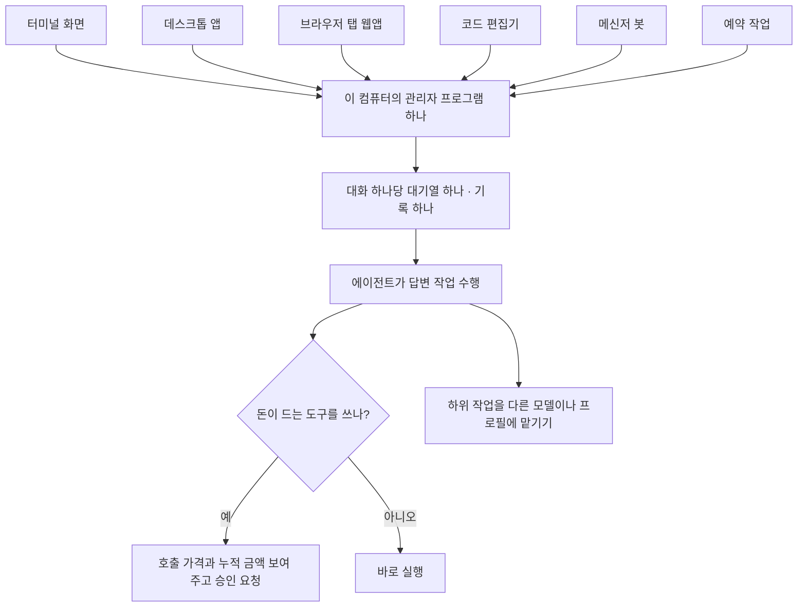

<aside class="ai-knowledge-sidebar">
  
CATEGORIES

  <nav class="ai-cat-tree">

에이전트 오케스트레이션19
<ul><li><a href="https://altjs4510.github.io/ai_news_blog/knowledge/20261107/" class="current">2026-11-07Hermes Agent v0.23.0 — The Hearth Release</a></li><li><a href="https://altjs4510.github.io/ai_news_blog/knowledge/20261029/">2026-10-29How Anthropic ships Claude with Claude: Separati…</a></li><li><a href="https://altjs4510.github.io/ai_news_blog/knowledge/20261027/">2026-10-27nightly-labs/openbot — Codex·Claude·Grok을 상주 팀원처…</a></li><li><a href="https://altjs4510.github.io/ai_news_blog/knowledge/20261015/">2026-10-15How Third Moment Research runs 10,000 agents for…</a></li><li><a href="https://altjs4510.github.io/ai_news_blog/knowledge/20261014/">2026-10-14How Anthropic's Dynamic Workflows Coordinate Cla…</a></li><li><a href="https://altjs4510.github.io/ai_news_blog/knowledge/20260930/">2026-09-30Agents you can coach: how Asana builds human-age…</a></li><li><a href="https://altjs4510.github.io/ai_news_blog/knowledge/20260929/">2026-09-29vectorize-io/hindsight — Hindsight: Agent Memory…</a></li><li><a href="https://altjs4510.github.io/ai_news_blog/knowledge/20260831-openexecutive-virtual-c-suite/">2026-08-31Open Executive — 8명의 전문 에이전트를 하나의 임원 목소리로</a></li><li><a href="https://altjs4510.github.io/ai_news_blog/knowledge/20260828/">2026-08-28Google ADK for Python v2.8.0 — RemoteA2aAgent 네이…</a></li><li><a href="https://altjs4510.github.io/ai_news_blog/knowledge/20260826/">2026-08-26apache/maka — 도구 호출·권한 결정·종료 이벤트를 append-only 로그…</a></li><li><a href="https://altjs4510.github.io/ai_news_blog/knowledge/20260823/">2026-08-23The Evolution of the Agent Harness — 하네스가 모델 가중치…</a></li><li><a href="https://altjs4510.github.io/ai_news_blog/knowledge/20260821/">2026-08-21volcengine/OpenViking — 에이전트 메모리·Knowledge RAG·스…</a></li><li><a href="https://altjs4510.github.io/ai_news_blog/knowledge/20260805/">2026-08-05TencentCloud/TencentDB-Agent-Memory — 대화·문서·코드를 …</a></li><li><a href="https://altjs4510.github.io/ai_news_blog/knowledge/20260717/">2026-07-17After a year building agent memory, 'save everyt…</a></li><li><a href="https://altjs4510.github.io/ai_news_blog/knowledge/20260623/">2026-06-23bytedance/deer-flow — 샌드박스·메모리·서브에이전트·메시지 게이트웨이를…</a></li><li><a href="https://altjs4510.github.io/ai_news_blog/knowledge/20260611/">2026-06-11The evolution of agentic surfaces: building with…</a></li><li><a href="https://altjs4510.github.io/ai_news_blog/knowledge/20260602/">2026-06-02revfactory/harness — 도메인별 에이전트 팀과 스킬을 자동 설계하는 메타…</a></li><li><a href="https://altjs4510.github.io/ai_news_blog/knowledge/20260529/">2026-05-29Introducing dynamic workflows in Claude Code</a></li><li><a href="https://altjs4510.github.io/ai_news_blog/knowledge/20260507/">2026-05-07ruvnet/ruflo — Claude 멀티 에이전트 오케스트레이션 플랫폼</a></li></ul>

MCP &amp; 도구 통합20
<ul><li><a href="https://altjs4510.github.io/ai_news_blog/knowledge/20261103/">2026-11-03vercel-labs/agent-desktop — 픽셀 대신 OS 접근성 트리로 앱 U…</a></li><li><a href="https://altjs4510.github.io/ai_news_blog/knowledge/20261017/">2026-10-17mksglu/context-mode — 코딩 에이전트용 컨텍스트 윈도우 최적화</a></li><li><a href="https://altjs4510.github.io/ai_news_blog/knowledge/20261007/">2026-10-07morluto/rea — 앱 동작부터 네이티브 바이너리까지 에이전트로 리버스 엔지니어링</a></li><li><a href="https://altjs4510.github.io/ai_news_blog/knowledge/20260831-gitnexus-code-knowledge-graph/">2026-08-31GitNexus — 코드베이스를 지식그래프로 바꿔 에이전트에게 쥐어주기</a></li><li><a href="https://altjs4510.github.io/ai_news_blog/knowledge/20260829/">2026-08-29cursor/plugins — 플러그인 명세(specification)와 공식 플러그인…</a></li><li><a href="https://altjs4510.github.io/ai_news_blog/knowledge/20260802/">2026-08-02Stateless MCP has recaptured my interest (and in…</a></li><li><a href="https://altjs4510.github.io/ai_news_blog/knowledge/20260731/">2026-07-31different-ai/openwork — Claude Cowork의 오픈소스 대안(o…</a></li><li><a href="https://altjs4510.github.io/ai_news_blog/knowledge/20260729/">2026-07-29Bringing MCP 2026-07-28 to Claude</a></li><li><a href="https://altjs4510.github.io/ai_news_blog/knowledge/20260726/">2026-07-26citrolabs/ego-lite — 로그인된 브라우저 상태를 AI 에이전트와 공유하는…</a></li><li><a href="https://altjs4510.github.io/ai_news_blog/knowledge/20260718/">2026-07-18tirth8205/code-review-graph — MCP·CLI용 로컬 코드 인텔리…</a></li><li><a href="https://altjs4510.github.io/ai_news_blog/knowledge/20260708/">2026-07-08Expanding Managed Agents in Gemini API: backgrou…</a></li><li><a href="https://altjs4510.github.io/ai_news_blog/knowledge/20260618/">2026-06-18DeusData/codebase-memory-mcp — 158개 언어 코드베이스를 밀리…</a></li><li><a href="https://altjs4510.github.io/ai_news_blog/knowledge/20260604/">2026-06-04chopratejas/headroom — Compress tool outputs bef…</a></li><li><a href="https://altjs4510.github.io/ai_news_blog/knowledge/20260603/">2026-06-03How Bad MCP design cost your Agent 5× more token…</a></li><li><a href="https://altjs4510.github.io/ai_news_blog/knowledge/20260521/">2026-05-21colbymchenry/codegraph — Pre-indexed code knowle…</a></li><li><a href="https://altjs4510.github.io/ai_news_blog/knowledge/20260520/">2026-05-20New in Claude Managed Agents: self-hosted sandbo…</a></li><li><a href="https://altjs4510.github.io/ai_news_blog/knowledge/20260517/">2026-05-17I gave my LLM 100,000+ tools — Lazy Discovery &a…</a></li><li><a href="https://altjs4510.github.io/ai_news_blog/knowledge/20260512/">2026-05-12agentmemory — Persistent memory for AI coding ag…</a></li><li><a href="https://altjs4510.github.io/ai_news_blog/knowledge/20260509/">2026-05-09How to connect 100 MCP servers without the conte…</a></li><li><a href="https://altjs4510.github.io/ai_news_blog/knowledge/20260506/">2026-05-06mksglu/context-mode — AI 코딩 에이전트용 컨텍스트 윈도우 최적화</a></li></ul>

코딩 에이전트27
<ul><li><a href="https://altjs4510.github.io/ai_news_blog/knowledge/20261106/">2026-11-06Cline desktop-nightly-20261104233655: feat(core)…</a></li><li><a href="https://altjs4510.github.io/ai_news_blog/knowledge/20261022/">2026-10-22Claude Mods: Flipping the Harness Inside Out</a></li><li><a href="https://altjs4510.github.io/ai_news_blog/knowledge/20261018/">2026-10-18Quoting Addy Osmani, Morgan Westlee Lunt, and Qi…</a></li><li><a href="https://altjs4510.github.io/ai_news_blog/knowledge/20261014-claude-code-advisor/">2026-10-14Claude Code advisor — 가벼운 메인 모델이 일하고, 갈림길에서만 Opu…</a></li><li><a href="https://altjs4510.github.io/ai_news_blog/knowledge/20260920/">2026-09-20Claude Code 2.1.277 — CLAUDE.md가 없으면 AGENTS.md를 …</a></li><li><a href="https://altjs4510.github.io/ai_news_blog/knowledge/20260912/">2026-09-12Quoting Boris Cherny — 'Claude가 쓴 프로덕션 코드는 사람이 쓴…</a></li><li><a href="https://altjs4510.github.io/ai_news_blog/knowledge/20260910/">2026-09-10vastsa/PI-Desktop — Electron + Rust 호스트 코어 + 에이전…</a></li><li><a href="https://altjs4510.github.io/ai_news_blog/knowledge/20260906/">2026-09-06DietrichGebert/ponytail — 에이전트를 '방에서 가장 게으른 시니어 …</a></li><li><a href="https://altjs4510.github.io/ai_news_blog/knowledge/20260903/">2026-09-03pacifio/atlas — 여러 코딩 에이전트의 변경을 한곳에서 추적·질의하는 '에이…</a></li><li><a href="https://altjs4510.github.io/ai_news_blog/knowledge/20260901/">2026-09-01affaan-m/ECC — 스킬·본능·메모리·보안을 묶은 에이전트 하네스 성능 최적화 …</a></li><li><a href="https://altjs4510.github.io/ai_news_blog/knowledge/20260819/">2026-08-19akitaonrails/ai-memory — 코딩 에이전트 CLI 간 장기 기억과 벤더…</a></li><li><a href="https://altjs4510.github.io/ai_news_blog/knowledge/20260814/">2026-08-14cathrynlavery/diagram-design — Claude Code용 에디토리…</a></li><li><a href="https://altjs4510.github.io/ai_news_blog/knowledge/20260810/">2026-08-10Auto mode is now the default in Claude Code for …</a></li><li><a href="https://altjs4510.github.io/ai_news_blog/knowledge/20260808/">2026-08-08PrimeIntellect-ai/prime-agent — 코딩 워크플로우와 장시간 자율…</a></li><li><a href="https://altjs4510.github.io/ai_news_blog/knowledge/20260804/">2026-08-04esengine/DeepSeek-Reasonix — prefix-cache 안정성을 축…</a></li><li><a href="https://altjs4510.github.io/ai_news_blog/knowledge/20260728/">2026-07-28alibaba/open-code-review — 결정론적 파이프라인 + LLM 에이전트…</a></li><li><a href="https://altjs4510.github.io/ai_news_blog/knowledge/20260725/">2026-07-25The new rules of context engineering for Claude …</a></li><li><a href="https://altjs4510.github.io/ai_news_blog/knowledge/20260714/">2026-07-14Graphify-Labs/graphify — 코드베이스를 질의 가능한 지식 그래프로 만…</a></li><li><a href="https://altjs4510.github.io/ai_news_blog/knowledge/20260707/">2026-07-07AI Hero Skills Catalog — 실무 엔지니어를 위한 재사용 가능한 판단 …</a></li><li><a href="https://altjs4510.github.io/ai_news_blog/knowledge/20260705/">2026-07-05openai/codex-plugin-cc — Claude Code에서 Codex를 위임…</a></li><li><a href="https://altjs4510.github.io/ai_news_blog/knowledge/20260701/">2026-07-01Google OKF (Open Knowledge Format) — 벤더 중립 에이전트 …</a></li><li><a href="https://altjs4510.github.io/ai_news_blog/knowledge/20260626/">2026-06-26google-labs-code/design.md — 코딩 에이전트에게 디자인 시스템을 …</a></li><li><a href="https://altjs4510.github.io/ai_news_blog/knowledge/20260619/">2026-06-19Claude Code now supports artifacts</a></li><li><a href="https://altjs4510.github.io/ai_news_blog/knowledge/20260530/">2026-05-30Leonxlnx/taste-skill — AI에게 좋은 취향을 부여해 generic s…</a></li><li><a href="https://altjs4510.github.io/ai_news_blog/knowledge/20260515/">2026-05-15Clawdmeter — Claude Code 사용량을 데스크톱 대시보드로</a></li><li><a href="https://altjs4510.github.io/ai_news_blog/knowledge/20260508/">2026-05-08addyosmani/agent-skills — Production-grade engin…</a></li><li><a href="https://altjs4510.github.io/ai_news_blog/knowledge/20260505/">2026-05-05mattpocock/skills — Skills for Real Engineers (.…</a></li></ul>

모델 &amp; 연구12
<ul><li><a href="https://altjs4510.github.io/ai_news_blog/knowledge/20261111/">2026-11-11Quoting Prompting Claude Fable 5.2</a></li><li><a href="https://altjs4510.github.io/ai_news_blog/knowledge/20261104/">2026-11-04Qwen 3.8 27B on my laptop can interpret model we…</a></li><li><a href="https://altjs4510.github.io/ai_news_blog/knowledge/20261009/">2026-10-09Claude Haiku 5.5 (Simon Willison의 출시 노트와 가격 분석)</a></li><li><a href="https://altjs4510.github.io/ai_news_blog/knowledge/20260907-voicemem-dual-brain-memory/">2026-09-07VoiceMem — 좌뇌·우뇌로 쪼갠 스트리밍 메모리로 음성 에이전트 지연 없애기</a></li><li><a href="https://altjs4510.github.io/ai_news_blog/knowledge/20260904/">2026-09-04HarnessDev: Can LLMs Create and Evolve Their Own…</a></li><li><a href="https://altjs4510.github.io/ai_news_blog/knowledge/20260716-proprag/">2026-07-16PropRAG — 프로포지션 경로 위 beam search로 멀티홉 검색 안내</a></li><li><a href="https://altjs4510.github.io/ai_news_blog/knowledge/20260712/">2026-07-12Do Automated Evals Work?</a></li><li><a href="https://altjs4510.github.io/ai_news_blog/knowledge/20260620/">2026-06-20zai-org/GLM-5 — From Vibe Coding to Agentic Engi…</a></li><li><a href="https://altjs4510.github.io/ai_news_blog/knowledge/20260617/">2026-06-17Predicting model behavior before release by simu…</a></li><li><a href="https://altjs4510.github.io/ai_news_blog/knowledge/20260610/">2026-06-10Fable 5 just made cost-aware model routing manda…</a></li><li><a href="https://altjs4510.github.io/ai_news_blog/knowledge/20260516/">2026-05-16STALE — 에이전트가 자기 기억의 유효성을 인지할 수 있는가</a></li><li><a href="https://altjs4510.github.io/ai_news_blog/knowledge/20260513/">2026-05-13Thinking Machines' Native Interaction Models — T…</a></li></ul>

인프라 &amp; 컴퓨트4
<ul><li><a href="https://altjs4510.github.io/ai_news_blog/knowledge/20260905/">2026-09-05magnitudedev/magnitude — 하드웨어에 맞는 최적 로컬 모델을 띄워 이…</a></li><li><a href="https://altjs4510.github.io/ai_news_blog/knowledge/20260806/">2026-08-06cloudflare/computer — 에이전트에게 컴퓨터를 통째로 주는 엣지 실행 샌…</a></li><li><a href="https://altjs4510.github.io/ai_news_blog/knowledge/20260723/">2026-07-23diegosouzapw/OmniRoute — 268+ 프로바이더를 단일 엔드포인트로 묶…</a></li><li><a href="https://altjs4510.github.io/ai_news_blog/knowledge/20260522/">2026-05-22Giving Agents Computers — Ivan Burazin, Daytona</a></li></ul>

보안 &amp; 거버넌스26
<ul><li><a href="https://altjs4510.github.io/ai_news_blog/knowledge/20261031/">2026-10-31CopilotKit/OpenBot — AI 동료마다 전용 컴퓨터를 주고 모든 행동을 실…</a></li><li><a href="https://altjs4510.github.io/ai_news_blog/knowledge/20261030/">2026-10-30How we detect frontier model misalignment</a></li><li><a href="https://altjs4510.github.io/ai_news_blog/knowledge/20261021/">2026-10-21cloudflare/security-audit-skill — 독립 검증된 기계 판독형 …</a></li><li><a href="https://altjs4510.github.io/ai_news_blog/knowledge/20261020/">2026-10-20Satya Nadella — 모델을 내부자 위험으로 보는 원칙에 따라 Project P…</a></li><li><a href="https://altjs4510.github.io/ai_news_blog/knowledge/20261016/">2026-10-16Crossing the Threshold: How OpenAI and Anthropic…</a></li><li><a href="https://altjs4510.github.io/ai_news_blog/knowledge/20261011/">2026-10-11Anthropic can’t reliably control its AI agents. …</a></li><li><a href="https://altjs4510.github.io/ai_news_blog/knowledge/20261004/">2026-10-04Apple says it's tightening macOS 'Full Disk Acce…</a></li><li><a href="https://altjs4510.github.io/ai_news_blog/knowledge/20261001/">2026-10-01NVIDIA/OpenShell</a></li><li><a href="https://altjs4510.github.io/ai_news_blog/knowledge/20260919/">2026-09-19cloudflare/security-audit-skill — 다단계 보안 감사를 '독립…</a></li><li><a href="https://altjs4510.github.io/ai_news_blog/knowledge/20260913/">2026-09-13OpenAI agents attacked RubyGems back in May: Ope…</a></li><li><a href="https://altjs4510.github.io/ai_news_blog/knowledge/20260902/">2026-09-02AIR raises $50M to help companies vet the skills…</a></li><li><a href="https://altjs4510.github.io/ai_news_blog/knowledge/20260827/">2026-08-27Claude in Chrome is generally available</a></li><li><a href="https://altjs4510.github.io/ai_news_blog/knowledge/20260819-mind-viruses/">2026-08-19탈옥도, 인젝션도 없이 — 대화로만 퍼지는 에이전트의 '마인드 바이러스'</a></li><li><a href="https://altjs4510.github.io/ai_news_blog/knowledge/20260812/">2026-08-12semantica-agi/semantica — 컨텍스트와 '책임 추적 가능한(accou…</a></li><li><a href="https://altjs4510.github.io/ai_news_blog/knowledge/20260730/">2026-07-30Anatomy of a Frontier Lab Agent Intrusion: A Tec…</a></li><li><a href="https://altjs4510.github.io/ai_news_blog/knowledge/20260715/">2026-07-15Dicklesworthstone/destructive_command_guard — 에이…</a></li><li><a href="https://altjs4510.github.io/ai_news_blog/knowledge/20260710/">2026-07-1070개 MCP 서버 strace 런타임 감사 — 부팅 시 아웃바운드 호출 서버 적발</a></li><li><a href="https://altjs4510.github.io/ai_news_blog/knowledge/20260704/">2026-07-04Cloudflare is about to block AI agents by defaul…</a></li><li><a href="https://altjs4510.github.io/ai_news_blog/knowledge/20260703/">2026-07-03Giving admins more visibility and control over C…</a></li><li><a href="https://altjs4510.github.io/ai_news_blog/knowledge/20260630/">2026-06-30Introducing the Claude apps gateway for Amazon B…</a></li><li><a href="https://altjs4510.github.io/ai_news_blog/knowledge/20260624/">2026-06-24Agent identity in Claude Tag: a new access model…</a></li><li><a href="https://altjs4510.github.io/ai_news_blog/knowledge/20260613/">2026-06-13Fable 5's guardrails got bypassed in 48 hours — …</a></li><li><a href="https://altjs4510.github.io/ai_news_blog/knowledge/20260612/">2026-06-12NVIDIA/SkillSpector — AI 에이전트 스킬용 보안 스캐너</a></li><li><a href="https://altjs4510.github.io/ai_news_blog/knowledge/20260607/">2026-06-07OpenAI Help: Lockdown Mode</a></li><li><a href="https://altjs4510.github.io/ai_news_blog/knowledge/20260531/">2026-05-31How we contain Claude across products</a></li><li><a href="https://altjs4510.github.io/ai_news_blog/knowledge/20260527/">2026-05-27Microsoft Copilot Cowork Exfiltrates Files</a></li></ul>

응용 사례11
<ul><li><a href="https://altjs4510.github.io/ai_news_blog/knowledge/20261110/">2026-11-10meta/astryx — 직접 바꿔 쓸 수 있고 에이전트가 바로 쓸 수 있는(agent…</a></li><li><a href="https://altjs4510.github.io/ai_news_blog/knowledge/20261105/">2026-11-05NVIDIA/auto-ontology — 데이터 위에 그래프 기반 의미 추론 레이어를 …</a></li><li><a href="https://altjs4510.github.io/ai_news_blog/knowledge/20261101/">2026-11-01Agents Prompt People: Using Agents for Long-Hori…</a></li><li><a href="https://altjs4510.github.io/ai_news_blog/knowledge/20261028/">2026-10-28Greptile takes bug detection beyond code review …</a></li><li><a href="https://altjs4510.github.io/ai_news_blog/knowledge/20261006/">2026-10-06How Cresta turned CX expertise into an agent bui…</a></li><li><a href="https://altjs4510.github.io/ai_news_blog/knowledge/20260909/">2026-09-09Reducing cost and improving performance with Cla…</a></li><li><a href="https://altjs4510.github.io/ai_news_blog/knowledge/20260709/">2026-07-09mvanhorn/last30days-skill — Reddit·X·YouTube·HN·…</a></li><li><a href="https://altjs4510.github.io/ai_news_blog/knowledge/20260621/">2026-06-21calesthio/OpenMontage — 12 파이프라인·52 도구·500+ 스킬을 …</a></li><li><a href="https://altjs4510.github.io/ai_news_blog/knowledge/20260609/">2026-06-09Building intelligent apps for Apple platforms wi…</a></li><li><a href="https://altjs4510.github.io/ai_news_blog/knowledge/20260528/">2026-05-28Building self-improving tax agents with Codex</a></li><li><a href="https://altjs4510.github.io/ai_news_blog/knowledge/20260514/">2026-05-14Introducing Claude for Small Business</a></li></ul>

산업 동향10
<ul><li><a href="https://altjs4510.github.io/ai_news_blog/knowledge/20261024/">2026-10-24Donating Agent Skills to the Agentic AI Foundati…</a></li><li><a href="https://altjs4510.github.io/ai_news_blog/knowledge/20261023/">2026-10-23Claude Duet app is Anthropic's bet on agents</a></li><li><a href="https://altjs4510.github.io/ai_news_blog/knowledge/20260911/">2026-09-11Now everyone can put data to work — ChatGPT Work…</a></li><li><a href="https://altjs4510.github.io/ai_news_blog/knowledge/20260907-humanmade-52week-rhythm/">2026-09-07휴먼 메이드의 '52주 리듬' — 아이디어가 흔해진 시대에 값이 오르는 건 버리는 판단</a></li><li><a href="https://altjs4510.github.io/ai_news_blog/knowledge/20260830/">2026-08-30[AINews] OpenAI shuts off Cursor — 프론티어 모델 공급 차단…</a></li><li><a href="https://altjs4510.github.io/ai_news_blog/knowledge/20260711/">2026-07-11OpenAI says GPT 5.6 is the 'preferred model' for…</a></li><li><a href="https://altjs4510.github.io/ai_news_blog/knowledge/20260702/">2026-07-02How Cursor deploys AI inside the enterprise (For…</a></li><li><a href="https://altjs4510.github.io/ai_news_blog/knowledge/20260616/">2026-06-16Why AI hasn't replaced software engineers, and w…</a></li><li><a href="https://altjs4510.github.io/ai_news_blog/knowledge/20260519/">2026-05-19Anthropic acquires Stainless</a></li><li><a href="https://altjs4510.github.io/ai_news_blog/knowledge/20260504/">2026-05-04Agents for Everything Else: Codex for Knowledge …</a></li></ul>
</nav>
</aside>

<article class="ai-knowledge-article">

<header class="ai-post-hero">
  
<a class="ai-back" href="../">KNOWLEDGE</a> · 2026-11-07 · 오늘의 학습

  <h2 class="ai-post-title">Hermes Agent v0.23.0 — The Hearth Release</h2>
</header>

> 원문: [Hermes Agent v0.23.0 — The Hearth Release](https://github.com/NousResearch/hermes-agent/releases/tag/v0.23.0)

## 📌 학습 정리

### 1. 한 줄로 말하면

Hermes Agent v0.23.0은 여기저기 흩어져 따로 돌던 AI 비서의 대화를 한 곳에서 관리하도록 바꾼 업데이트예요. 이제 터미널·데스크톱 앱·브라우저·메신저 어디서 열어도 같은 대화를 이어서 봅니다. 원문은 이를 "모두가 둘러앉는 화로(Hearth)"에 빗대요.

### 2. 왜 이게 만들어졌어요?

원래 Hermes는 명령줄 화면(CLI), 터미널 안의 대화형 화면(TUI), 데스크톱 앱, 코드 편집기, 메신저 봇, 정해진 시간에 도는 예약 작업이 각자 에이전트를 따로 띄울 수 있었어요. 그러다 보니 같은 대화를 여러 곳이 동시에 건드려서 메시지가 두 번 쓰이거나 화면 사이에서 사라지는 일이 생겼다고 해요. 그래서 한 대의 컴퓨터에서는 관리자 프로그램 하나가 모든 대화를 맡고, 나머지 화면은 그 관리자에 접속해 쓰는 손님 역할만 하도록 구조를 바꿨어요. 하루 종일 켜 두는 사용 방식이 늘어나면서 메모리·속도·비용 문제도 함께 손봤어요. 유료 도구를 쓸 때 돈이 얼마나 드는지 보여 주는 기능도 들어갔고요.

### 3. 비유로 풀면

이건 마치 **식당 주방에 주문 접수대가 하나만 있는 것**과 비슷해요. 예전에는 홀 직원, 배달앱, 전화 주문이 각자 주방에 주문서를 들고 갔어요. 그러니 같은 주문이 두 번 들어가거나 하나가 빠지는 일이 생겼죠. 지금은 모든 주문이 접수대 한 곳으로 모이고, 주문 순서표와 기록도 거기에 하나만 있어요.

다른 비유로는 **단체 대화방에 사회자가 있는 모습**도 떠올려 볼 수 있어요. 이번에 나온 그룹 채팅(Group Chats)에서는 아무도 지목하지 않은 질문을 대표 봇이나 자동 배정 기능이 맡을 사람에게 넘겨요. 봇끼리 끝없이 서로 부르는 일도 막아 둡니다.

그래서 결국 어느 화면에서 말을 걸든 대화 기록과 대기열은 하나뿐이에요. 덕분에 중복이나 누락 없이 같은 대화를 이어 갈 수 있어요.

### 4. 어떻게 작동하는지 (그림으로)

여러 화면은 모두 손님 자격으로 관리자 프로그램 하나에 붙어요. 그래서 어디서 열든 같은 대화, 같은 대기열이 보여요. 에이전트가 유료 도구를 쓰려 하면 가격과 누적 금액을 먼저 보여 줘요. 정해 둔 한도를 넘기 전에는 사람에게 다시 물어봅니다. 큰 일을 쪼개 하위 에이전트에게 맡기는 방식도 이제 플러그인으로 갈아 끼울 수 있어요.

### 5. 처음 보는 용어 풀이

- **관리자 프로그램 (gateway)** — 한 컴퓨터에서 모든 대화를 맡아 관리하는 중심 프로그램이에요. 이번 버전부터 다른 화면은 모두 여기에 접속해서 써요. 그래서 메시지가 두 번 쓰이거나 사라지는 문제가 줄었어요.
- **대화 단위 (session)** — 대화 하나를 처음부터 끝까지 묶어 부르는 말이에요. 이번 버전에서는 대화 단위마다 대기열과 기록이 하나씩만 있어요. 이전 메시지로 되돌아가는 기능(`/rewind`)을 쓰면, 원래 대화는 그대로 두고 그 지점에서 새 대화로 갈라져 나올 수도 있어요.
- **기능 추가 꾸러미 (plugin)** — 본체에 나중에 끼워 넣는 확장 기능이에요. 이번에 목록이 약 600개에서 1,050개 이상으로 늘었어요. 자동 업데이트도 켤 수 있는데, 설정을 깨뜨릴 만한 업데이트는 적용하지 않고 보류한다고 해요.
- **외부 도구 연결 방식 (MCP)** — 원문에서는 에이전트가 외부 도구를 불러 쓰는 연결 통로로 등장해요. 이번에는 3D나 미디어 생성처럼 돈이 드는 MCP 도구가 호출 한 번의 가격을 미리 알려 줄 수 있게 됐어요.
- **하위 에이전트에게 일 맡기기 (delegation)** — 큰 작업을 쪼개 다른 에이전트에게 넘기는 방식이에요. 이제 이 방식을 플러그인으로 바꿀 수 있어요. 공식 `advanced-delegation` 플러그인을 쓰면 작업마다 특정 모델이나 별도 프로필로 보낼 수 있어요.
- **대화 요약 압축 (compaction)** — 대화가 길어지면 앞부분을 요약해 공간을 확보하는 기능이에요. 이번에 확실하지 않은 내용은 `UNVERIFIED:` 줄에 따로 적게 바뀌었어요. 추측이 나중에 사실처럼 되돌아오지 않게 하려는 거예요. 요약을 미리 만들어 두는 옵션도 생겼어요.
- **프롬프트 캐시 (prompt cache)** — 매번 반복해서 보내는 앞부분 지시문을 재활용하는 장치예요. 같은 내용을 다시 처리하지 않아서 비용과 시간이 줄어요. 이번에 같은 예약 작업은 실행할 때마다 캐시 하나를 함께 쓰도록 바뀌었어요.

### 6. 한 발 더 들어가고 싶다면

- [#106742](https://github.com/NousResearch/hermes-agent/pull/106742): 관리자 프로그램 하나가 모든 대화를 맡게 된 구조 변경이 어떻게 이뤄졌는지 볼 수 있어요.
- [#141864](https://github.com/NousResearch/hermes-agent/pull/141864): 데스크톱 작업 공간을 브라우저 탭으로 여는 웹앱 기능이 어떻게 시작됐는지 볼 수 있어요.
- [#144833](https://github.com/NousResearch/hermes-agent/pull/144833): 그룹 채팅에서 대표 봇이나 자동 배정이 답할 봇을 고르는 방식을 볼 수 있어요.
- [#142470](https://github.com/NousResearch/hermes-agent/pull/142470): 유료 도구에 가격을 붙이고 지출 한도를 확인하는 흐름을 볼 수 있어요.
- [#142563](https://github.com/NousResearch/hermes-agent/pull/142563): 하위 에이전트에게 일을 맡기는 방식을 플러그인으로 교체할 수 있게 된 과정을 볼 수 있어요.

---

## 📖 원문 전체 번역 (정독용)

> 의역 최소화한 전체 번역입니다. 큰 흐름은 위 정리에서 잡고, 정확한 워딩이 필요할 땐 이 섹션에서 정독하세요.

## Hermes Agent v0.23.0

**릴리스 날짜:** 2026년 11월 5일  
**v0.22.0 이후:** 커밋 약 10,080개 · 병합된 PR 약 1,950개 · 변경된 파일 약 8,720개 · 추가 약 725,200줄 · 삭제 약 201,400줄 · **해결된 이슈 약 850개** · 기여자 666명

> **The Hearth Release (화덕 릴리스).** 옛 찬가에서 헤르메스는 문턱을, 헤스티아는 화덕을 지켰고, 둘은 나란히 공경받았다. v0.22.0이 새로 온 사람들을 문 안으로 들였다면, v0.23.0은 그들이 둘러앉을 불을 짓는다. 핵심은 이렇다. 이제 Desktop 작업 공간 전체가 브라우저 탭에서 열리며, 사용자 자신의 gateway가 이를 서빙한다. 그 밑바탕에서는 모든 대화가 한곳에 존재한다. 단일 gateway가 각 세션을 소유하고, CLI, TUI, Desktop, 에디터, 봇, cron이 저마다 에이전트를 따로 돌리는 대신 모두 같은 식탁에 앉는다. 이 하나의 화덕에서 출발해, Desktop은 Hermes를 돌리는 모든 머신을 동시에 연결해 두고, Group Chat은 자체 대화를 라우팅하며, 터미널은 마침내 이미지를 인라인으로 그리고 대화를 되감을 수 있게 한다. 그 주변으로는 스스로 최신 상태를 유지하는 플러그인, 유료 MCP 도구의 가격표와 지출 한도, 플러그인으로 교체 가능한 delegation, 약 600개에서 1,050개 이상으로 늘어난 플러그인 카탈로그, 더 간결해진 내장 skill 세트, 그리고 오래 떠 있는 gateway를 위한 메모리·지연 시간 개선 작업이 길게 이어진다. 이번 릴리스는 v0.22.1–v0.22.7 패치 릴리스를 모두 포함하며 이를 완전히 문서화한다.

* * *

## ✨ 하이라이트

*   **브라우저 탭에서 여는 Desktop 작업 공간** — 새 Webapp은 전체 Desktop 작업 공간을 사용자 자신의 gateway에서 서빙한다. 같은 채팅, Group Chat, 플러그인, 설정을 네트워크 내 어떤 브라우저에서든, 또는 로그인이 걸린 공개 URL 뒤에서 쓸 수 있다. Docker 이미지와 Nix 패키지에 포함되어 배포된다. 기본값은 꺼짐이며, `webapp.enabled` 또는 설정의 Web Access로 켠다. ([#141864](https://github.com/NousResearch/hermes-agent/pull/141864), [#145598](https://github.com/NousResearch/hermes-agent/pull/145598), [#145536](https://github.com/NousResearch/hermes-agent/pull/145536), [#145072](https://github.com/NousResearch/hermes-agent/pull/145072), [#145153](https://github.com/NousResearch/hermes-agent/pull/145153) — [@jquesnelle](https://github.com/jquesnelle), [@BearHuddleston](https://github.com/BearHuddleston), [@IAvecilla](https://github.com/IAvecilla), [@Adolanium](https://github.com/Adolanium))

*   **하나의 gateway가 모든 대화를 소유** — 이전에는 CLI, TUI, Desktop, 에디터(ACP), 메시징 봇, cron이 같은 채팅에 대해 각자 에이전트 사본을 따로 돌릴 수 있었고, 그 때문에 메시지가 두 번 기록되거나 표면(surface) 사이에서 사라지곤 했다. 이제 각 머신은 모든 세션을 소유하는 gateway 하나를 실행하고, 모든 표면은 그 gateway에 클라이언트로 붙는다. 어디서 열든 같은 채팅이며, 큐와 히스토리도 하나다. 대기 중인 프롬프트를 Desktop에서 steer하거나 편집해도 두 번 실행되지 않는다. ([#106742](https://github.com/NousResearch/hermes-agent/pull/106742), [#140334](https://github.com/NousResearch/hermes-agent/pull/140334) — [@unsupportedpastels](https://github.com/unsupportedpastels), [@kshitijk4poor](https://github.com/kshitijk4poor))

*   **터미널 속 그림** — 이미지를 붙여넣거나 도구가 스크린샷을 찍으면, CLI와 TUI가 이제 파일 경로를 출력하는 대신 채팅 안에 바로 이미지를 그려 준다. kitty와 Ghostty(CLI와 TUI), iTerm2, WezTerm, Konsole(CLI)에서는 실제 픽셀로, 그 외에서는 색칠된 블록으로 그리며, VS Code 터미널에서는 이미지 지원이 켜져 있으면 원본 해상도로 표시한다. ([#147293](https://github.com/NousResearch/hermes-agent/pull/147293), [#148874](https://github.com/NousResearch/hermes-agent/pull/148874) — [@Adolanium](https://github.com/Adolanium))

*   **대화 되감기** — TUI 또는 클래식 CLI에서 Esc를 두 번 누르거나 `/rewind`를 입력하고, 이전 메시지를 고른 뒤 편집해 다시 보내거나 그 지점에서 새 세션을 포크(fork)한다. 원래 세션은 그대로 보존된다. TUI는 턴이 아직 실행 중일 때도 `/new`를 시작할 수 있으며, 이전 세션은 백그라운드에서 계속 작업한다. ([#144937](https://github.com/NousResearch/hermes-agent/pull/144937), [#148880](https://github.com/NousResearch/hermes-agent/pull/148880) — [@SaguaroDev](https://github.com/SaguaroDev))

*   **하나의 Desktop 창에 모든 머신** — Desktop이 이제 모든 gateway를 동시에 연결해 두므로, 이 컴퓨터와 SSH 또는 원격 gateway 사이를 전환하는 것이 즉각적이다. 터미널 탭은 그것이 열린 호스트에서 실행되고, Group Chat은 서로 다른 머신의 봇을 섞을 수 있다. ([#147681](https://github.com/NousResearch/hermes-agent/pull/147681), [#147708](https://github.com/NousResearch/hermes-agent/pull/147708), [#148418](https://github.com/NousResearch/hermes-agent/pull/148418) — [@dskwe](https://github.com/dskwe), [@janviernine](https://github.com/janviernine))

*   **스스로 굴러가는 Group Chat** — Bot Mode 룸에서는 아무도 지목하지 않은 메시지에 누가 답할지를 리드 봇 또는 자동 라우터가 정할 수 있다. 예약된 작업(scheduled job)이 룸에 글을 게시할 수 있고, 룸은 목적(purpose)과 공유 노트를 유지하며, 봇끼리 끝없이 서로를 호출하는 루프도 더는 발생하지 않는다. 룸은 이제 일반 Hermes 채팅처럼 보이고, 각 봇은 지금 하는 일을 실시간으로 표시한다("scout · terminal · 7s"). ([#144833](https://github.com/NousResearch/hermes-agent/pull/144833), [#148417](https://github.com/NousResearch/hermes-agent/pull/148417), [#148888](https://github.com/NousResearch/hermes-agent/pull/148888), [#148903](https://github.com/NousResearch/hermes-agent/pull/148903), [#148422](https://github.com/NousResearch/hermes-agent/pull/148422) — [@KoNit-K](https://github.com/KoNit-K))

*   **스스로 최신 상태를 유지하는 플러그인** — `hermes plugins update`가 모든 것을 한 번에 업데이트하며, 옵트인 방식의 Auto-update 스위치(CLI, 채팅, Desktop, 대시보드)가 카탈로그 및 git 플러그인을 최신으로 유지한다. 설정을 깨뜨릴 수 있는 업데이트는 적용되지 않고 보류된다. 카탈로그 자체도 약 600개에서 1,050개 이상으로 늘었고, 새 Verified 등급은 벤더가 직접 만든 플러그인임을 표시한다. ([#141513](https://github.com/NousResearch/hermes-agent/pull/141513), [#85794](https://github.com/NousResearch/hermes-agent/pull/85794), [#143468](https://github.com/NousResearch/hermes-agent/pull/143468), [#144257](https://github.com/NousResearch/hermes-agent/pull/144257) — [@charan-rathore](https://github.com/charan-rathore), [@YS-OH-CORE](https://github.com/YS-OH-CORE))

*   **유료 도구의 가격표와 지출 한도** — 3D나 미디어 생성 같은 유료 MCP 도구는 호출 한 번의 비용을 선언할 수 있다. 승인 프롬프트는 각 호출의 가격과 해당 채팅의 누적 합계를 보여주며, Hermes는 채팅이 한도를 넘기 전에 YOLO 모드에서도 먼저 확인을 요청한다. ([#142470](https://github.com/NousResearch/hermes-agent/pull/142470), [#143780](https://github.com/NousResearch/hermes-agent/pull/143780), [#143795](https://github.com/NousResearch/hermes-agent/pull/143795), [#143787](https://github.com/NousResearch/hermes-agent/pull/143787) — [@liuhao1024](https://github.com/liuhao1024), [@fangliquanflq](https://github.com/fangliquanflq))

*   **새 공식 플러그인, 그리고 더 작아진 코어** — Meshy(텍스트·이미지 to 3D), ElevenLabs Music 및 Sound Effects, X Chat, REA(리버스 엔지니어링), bubblewrap 샌드박스를 이제 명령 한 줄로 설치할 수 있다. Camofox, `mcp-serve`, 에이전트 importer, Singularity는 코어에서 플러그인으로 옮겨졌으며, 이를 사용하던 사람에게는 자동으로 설치된다. ([#142619](https://github.com/NousResearch/hermes-agent/pull/142619), [#146294](https://github.com/NousResearch/hermes-agent/pull/146294), [#139725](https://github.com/NousResearch/hermes-agent/pull/139725), [#143484](https://github.com/NousResearch/hermes-agent/pull/143484), [#139983](https://github.com/NousResearch/hermes-agent/pull/139983))

*   **subagent 실행 방식 선택** — Delegation이 이제 플러그인으로 교체 가능하다. 기본값을 유지하거나, 공식 `advanced-delegation` 플러그인을 설치해 각 subagent 작업을 지정한 모델이나 별도의 프로필로 보낼 수 있다. `/delegation`으로 전환한다. ([#142563](https://github.com/NousResearch/hermes-agent/pull/142563), [#142564](https://github.com/NousResearch/hermes-agent/pull/142564), [#143423](https://github.com/NousResearch/hermes-agent/pull/143423))

*   **더 가볍고 빨라짐, 특히 Hermes가 하루 종일 돌 때** — 반복 cron 작업은 프롬프트 캐시를 공유하고, 일회성 실행은 호출당 프롬프트 토큰을 약 1,570개 덜 보내며, `patch`/`write_file`은 LSP가 켜져 있어도 밀리초 단위로 반환한다. 오래 떠 있는 gateway는 이제 닫힌 세션의 메모리를 해제하고, Desktop 사이드바는 세션이 쌓여도 더는 느려지지 않는다(cron 실행 약 35k건이 쌓인 저장소 하나는 새로고침이 121초에서 즉각으로 줄었다). ([#139876](https://github.com/NousResearch/hermes-agent/pull/139876), [#144177](https://github.com/NousResearch/hermes-agent/pull/144177), [#140387](https://github.com/NousResearch/hermes-agent/pull/140387), [#147863](https://github.com/NousResearch/hermes-agent/pull/147863), [#137087](https://github.com/NousResearch/hermes-agent/pull/137087), [#147819](https://github.com/NousResearch/hermes-agent/pull/147819), [#144940](https://github.com/NousResearch/hermes-agent/pull/144940) — [@kshitijk4poor](https://github.com/kshitijk4poor))

*   **잠글 수 있는 더 간결한 skill 세트** — 내장 skill이 58개에서 44개로 줄었고, Word, PowerPoint, Excel은 하나의 `microsoft-office` skill로 통합되었다. `hermes curator lock`은 손수 큐레이션한 skill을 에이전트가 어떤 도구로든, YOLO 모드에서조차 다시 쓰지 못하게 막는다. ([#147557](https://github.com/NousResearch/hermes-agent/pull/147557) — [@daviseford](https://github.com/daviseford))

*   **비밀번호 관리자와 키체인 vault 키** — 검증된(Verified) 비밀번호 관리자 플러그인은 다른 사람의 로그인 정보는 보지 않고 브라우저에 사용자의 로그인 정보만 넘겨줄 수 있으며, 브라우저 vault의 키를 이제 OS 키체인에 둘 수 있다. ([#143964](https://github.com/NousResearch/hermes-agent/pull/143964), [#144246](https://github.com/NousResearch/hermes-agent/pull/144246) — [@Jesssullivan](https://github.com/Jesssullivan))

*   **실행 중인 cron 작업 중지** — CLI, Desktop, API, 또는 에이전트 자신이 실행 중인 작업을 취소할 수 있고, Hermes가 꺼져 있는 동안 놓친 실행을 어떻게 처리할지 작업별로 설정할 수 있다. ([#144801](https://github.com/NousResearch/hermes-agent/pull/144801) — [@kokhlo](https://github.com/kokhlo), [@fangliquanflq](https://github.com/fangliquanflq), [@LeonSGP43](https://github.com/LeonSGP43))

## ⚠️ 업그레이드 노트

*   **기존 내장 브라우저 도구가 사라졌다.** 브라우저 자동화는 `browser_exec`만으로 동작하며, agent-browser와 `browser_*` 도구 10개(`browser_navigate`, `browser_click` 등)는 제거되었다. Camofox를 쓰던 홈(home)에는 `camofox` 플러그인이 자동 설치된다. 직접 작성한 프롬프트, skill, toolset 목록에 예전 도구 이름이 있다면 `browser_exec`로 바꿔야 한다. ([#143146](https://github.com/NousResearch/hermes-agent/pull/143146))
*   **Desktop은 macOS 13 이상과 64비트 Windows가 필요하다.** 앱이 Electron 44로 옮겨 가면서 macOS 11, macOS 12, 32비트 Windows에서는 더 이상 실행되지 않는다. ([#142727](https://github.com/NousResearch/hermes-agent/pull/142727) — [@OutThisLife](https://github.com/OutThisLife), [@Adihaliem](https://github.com/Adihaliem))
*   **`hermes mcp serve`는 이제 `hermes mcp-serve`이다**(플러그인으로 이동). Hermes를 서버로 실행하는 MCP 클라이언트는 명령을 직접 수정해야 하며, 자동으로 고쳐 주지 않는다.
*   **Word, PowerPoint, Excel skill은 이제 하나의 `microsoft-office` skill이다.** 이전 사본은 직접 삭제하기 전까지 디스크에 남는다.
*   **Webapp은 기본값이 꺼짐이다.** `webapp.enabled` 또는 Web Access를 켜기 전에는 브라우저에 아무것도 서빙되지 않는다.

## 🧠 코어 에이전트, Gateway & 도구

### 프로바이더 & 모델

*   **모델을 고르지 않았을 때의 기본 모델은 GLM-5.3** — 암묵적 기본값이 GLM-5.2에서 GLM-5.3으로 바뀌었다. 가격은 거의 같고, Nous Portal과 OpenRouter에서 1M 컨텍스트 윈도우도 동일하다. ([#144810](https://github.com/NousResearch/hermes-agent/pull/144810) — [@calvinnwq](https://github.com/calvinnwq))
*   **새 모델** — GPT-6.1 Terra, DeepSeek V4.1 Flash 1017, Solstice의 Gemini 4 Argon. Claude Mythos는 항상 사고(always-thinking)하는 모델로 취급되어, 추론을 끈 요청이 첫 시도에서 실패하는 일이 없어진다. Nemotron 3.5 Super VL에는 기본 파라미터가 추가되었다. ([#145204](https://github.com/NousResearch/hermes-agent/pull/145204), [#140496](https://github.com/NousResearch/hermes-agent/pull/140496), [#139466](https://github.com/NousResearch/hermes-agent/pull/139466), [#148127](https://github.com/NousResearch/hermes-agent/pull/148127), [#138462](https://github.com/NousResearch/hermes-agent/pull/138462) — [@benbarclay](https://github.com/benbarclay), [@unsupportedpastels](https://github.com/unsupportedpastels), [@rroverin](https://github.com/rroverin))
*   **사용량 윈도우(usage-window) 요금제** — 사용량을 크레딧이 아니라 허용량(allowance)으로 추적하는 구독에서는 `/usage`가 허용량마다 막대 하나와 초기화 시각을 보여준다. 선택기(picker)는 해당 요금제의 추천 모델을 먼저 나열하고, Large 또는 Free 태그를 붙이며, 허용량이 소진되면 그 사실을 알려 준다. ([#142308](https://github.com/NousResearch/hermes-agent/pull/142308), [#145682](https://github.com/NousResearch/hermes-agent/pull/145682) — [@rob-maron](https://github.com/rob-maron))
*   **승인된 ChatGPT 구독을 위한 Daybreak** — 기본값이 꺼진 `agent.daybreak` 스위치가 OpenAI의 Trusted Access for Cyber 프로그램을 켠다. 이는 사용자 계정의 Codex 카탈로그가 승인됨으로 나열한 모델에서만 나타나며, 모든 요청마다 다시 확인된다. ([#148056](https://github.com/NousResearch/hermes-agent/pull/148056) — [@unsupportedpastels](https://github.com/unsupportedpastels), [@Froraut](https://github.com/Froraut))
*   **`/model reset`** — `/model`로 고정된 세션을 대화를 잃지 않고 설정된 기본값으로 되돌린다. CLI, TUI, Desktop, 메시징에서 모두 동작한다. ([#80448](https://github.com/NousResearch/hermes-agent/pull/80448) — [@shannonsands](https://github.com/shannonsands))
*   **GitHub Copilot이 labs 플러그인으로 이동** — Copilot(`copilot`, `copilot-acp`)은 이제 `github-copilot` Hermes Labs 플러그인에 있으며, Copilot을 쓰는 프로필에는 자동으로 설치된다. 코어에는 어떤 프로바이더 플러그인이든 쓸 수 있는 범용 프로바이더 훅이 남는다. ([#144788](https://github.com/NousResearch/hermes-agent/pull/144788))
*   **커스텀 엔드포인트가 안정적으로 해석됨** — 새 프로필은 `custom:<name>`, `${VAR}`, 레거시 커스텀 엔드포인트를 "Unknown provider"로 실패하지 않고 상속한다. 재개한 채팅은 그것을 서빙했던 엔드포인트에 그대로 머물고, 내장 프로바이더의 키가 같은 이름의 커스텀 항목으로 새어 들어가는 일도 없어졌다. ([#138513](https://github.com/NousResearch/hermes-agent/pull/138513), [#139947](https://github.com/NousResearch/hermes-agent/pull/139947), [#140335](https://github.com/NousResearch/hermes-agent/pull/140335), [#147761](https://github.com/NousResearch/hermes-agent/pull/147761) — [@jquesnelle](https://github.com/jquesnelle), [@unsupportedpastels](https://github.com/unsupportedpastels))
*   **프로바이더별 특이 동작 처리** — LM Studio, Kimi, MiniMax의 스트리밍 tool call이 더는 깨진 호출로 쪼개지지 않는다. Gemini 안전 차단은 이제 콘텐츠 정책 오류로 표시되고 폴백 모델로 넘어간다. 이미지를 거부하는 텍스트 전용 vLLM 서버에서도 복구되며, 바이트 상한 400 오류는 압축을 트리거한다. Bedrock에서는 멈춘 호출이 다섯 번이 아니라 한 번의 read timeout 후 실패한다. ([#140485](https://github.com/NousResearch/hermes-agent/pull/140485), [#85031](https://github.com/NousResearch/hermes-agent/pull/85031), [#85005](https://github.com/NousResearch/hermes-agent/pull/85005), [#85126](https://github.com/NousResearch/hermes-agent/pull/85126), [#146314](https://github.com/NousResearch/hermes-agent/pull/146314) — [@Chukwuebuka-2003](https://github.com/Chukwuebuka-2003))
*   **llama.cpp b11671 기반 로컬 런타임** — 단일 슬롯 DFlash 드래프트와 옵트인 Nemotron 3.5 Bolt를 추가한다. ([#139703](https://github.com/NousResearch/hermes-agent/pull/139703) — [@jquesnelle](https://github.com/jquesnelle))

### 에이전트 루프 & 세션

*   **프롬프트 토큰 및 캐시 비용 절감** — 같은 cron 작업의 모든 실행이 이제 하나의 프롬프트 캐시 키를 공유한다. 백그라운드 일회성 호출(요약, 제목, `/moa`)은 캐시 쓰기 비용을 더는 내지 않는다. 일회성 실행은 호출당 프롬프트 토큰이 1,570개 줄었고, 도구 스키마 네 개는 319토큰 짧아졌다. Gateway의 goal 및 heartbeat 턴, 압축(compaction) 이후의 턴, 턴 사이의 MCP 새로고침은 더 이상 캐시된 prefix를 다시 쓰지 않는다. ([#139876](https://github.com/NousResearch/hermes-agent/pull/139876), [#140478](https://github.com/NousResearch/hermes-agent/pull/140478), [#144177](https://github.com/NousResearch/hermes-agent/pull/144177), [#144173](https://github.com/NousResearch/hermes-agent/pull/144173), [#139865](https://github.com/NousResearch/hermes-agent/pull/139865), [#139851](https://github.com/NousResearch/hermes-agent/pull/139851) — [@100yenadmin](https://github.com/100yenadmin), [@jonpol01](https://github.com/jonpol01), [@chelsealong](https://github.com/chelsealong), [@AdrianBinDC](https://github.com/AdrianBinDC))
*   **옵트인 선행 압축(prepared compaction)** — `compression.prepare_ahead: true`로 하면, 세션이 트리거에 가까워질 때 다음 요약을 백그라운드에서 미리 작성하므로 요약을 쓰는 동안 압축이 턴을 멈추게 하지 않는다. 그 사이에 도착한 메시지는 tail에 원문 그대로 남는다. 기본값은 꺼짐. ([#144684](https://github.com/NousResearch/hermes-agent/pull/144684), [#144886](https://github.com/NousResearch/hermes-agent/pull/144886) — [@kshitijk4poor](https://github.com/kshitijk4poor))
*   **압축이 더 정직해지고 멈추기 어려워짐** — 요약은 불확실한 주장을 `UNVERIFIED:` 줄에 나열하므로, 추측이 사실처럼 되돌아오지 않는다. 메인 모델 폴백은 메인 라우트를 사용하고, `/stop`은 요약 스트림을 닫으며, 대기 중인 메시지와 `/steer`는 컨텍스트 소진 리셋 후에도 유지된다. ([#86019](https://github.com/NousResearch/hermes-agent/pull/86019), [#139872](https://github.com/NousResearch/hermes-agent/pull/139872), [#144825](https://github.com/NousResearch/hermes-agent/pull/144825), [#139783](https://github.com/NousResearch/hermes-agent/pull/139783), [#139923](https://github.com/NousResearch/hermes-agent/pull/139923) — [@helix4u](https://github.com/helix4u), [@thehugegatsby](https://github.com/thehugegatsby))
*   **`hermes sessions refresh-prompts`** — 이어지는 세션이 `/new` 없이도 수정된 `SOUL.md`, skill, 컨텍스트 파일을 다음 턴에 반영한다. 히스토리는 유지되며, 각 세션은 캐시 미스를 한 번 겪는다. ([#143581](https://github.com/NousResearch/hermes-agent/pull/143581) — [@victor-kyriazakos](https://github.com/victor-kyriazakos))
*   **옵트인 스트림 수명 상한** — `agent.stream_max_lifetime`(기본값 꺼짐)은 끝나지 않는 스트림을 끊는다. 타임아웃 오류는 이제 실패한 단계와 올려야 할 설정을 알려 준다. ([#80701](https://github.com/NousResearch/hermes-agent/pull/80701), [#80873](https://github.com/NousResearch/hermes-agent/pull/80873) — [@krzsda](https://github.com/krzsda))
*   **사진에 대한 후속 질문이 여전히 그 사진을 봄** — `--resume`, API 서버 세션 이어가기, gateway 재시작 이후에도 적용된다. ([#139873](https://github.com/NousResearch/hermes-agent/pull/139873) — [@Alexbob0](https://github.com/Alexbob0))
*   **세션 저장소** — 자동 정리(auto-prune)는 다시 옵트인이 되었고, 디스크가 부족해지면 Hermes가 한 번 물어본다. `hermes sessions optimize-storage`는 진행 상황을 보여주며 실제 저장소 하나에서 약 18배 빠르게 끝났다. 시작 시 scratch 정리를 더는 기다리지 않으며, `hermes sessions` 실패는 종료 코드 1로 끝난다. ([#139762](https://github.com/NousResearch/hermes-agent/pull/139762), [#144630](https://github.com/NousResearch/hermes-agent/pull/144630), [#144625](https://github.com/NousResearch/hermes-agent/pull/144625), [#144767](https://github.com/NousResearch/hermes-agent/pull/144767))

### 메시징 플랫폼 (Gateway)

*   **이제 하나의 gateway가 모든 로컬 세션을 소유** — v0.22.0부터 클래식 CLI, TUI, Desktop, API, ACP 에디터, 봇, cron이 모두 하나의 gateway를 통해 세션을 실행한다. 이번 주기에는 그로 인해 깨졌던 것들을 고쳤다. 슬래시 명령, `/retry`, `/refine`, `/review`, clarify 카드, 추론(reasoning) 표시, 사용량, ACP 세션이 다시 동작하며, 설정 변경이 재개된 세션에도 반영된다. ([#139149](https://github.com/NousResearch/hermes-agent/pull/139149), [#139577](https://github.com/NousResearch/hermes-agent/pull/139577), [#139884](https://github.com/NousResearch/hermes-agent/pull/139884), [#140249](https://github.com/NousResearch/hermes-agent/pull/140249), [#140595](https://github.com/NousResearch/hermes-agent/pull/140595), [#141916](https://github.com/NousResearch/hermes-agent/pull/141916), [#144005](https://github.com/NousResearch/hermes-agent/pull/144005), [#138719](https://github.com/NousResearch/hermes-agent/pull/138719) — [@unsupportedpastels](https://github.com/unsupportedpastels), [@yoniebans](https://github.com/yoniebans), [@drzxk](https://github.com/drzxk), [@fangliquanflq](https://github.com/fangliquanflq))
*   **Gateway 메모리와 응답성** — 메모리 정리 중 약 1분에 한 번씩 발생하던 멈춤이 사라졌고, 닫힌 세션은 메모리에서 빠지며, glibc malloc arena는 4개로 제한되고, 측정으로 확인된 이벤트 루프 차단 요인들은 루프 밖으로 옮겨졌다. ([#147840](https://github.com/NousResearch/hermes-agent/pull/147840), [#147831](https://github.com/NousResearch/hermes-agent/pull/147831), [#147810](https://github.com/NousResearch/hermes-agent/pull/147810), [#144911](https://github.com/NousResearch/hermes-agent/pull/144911), [#137156](https://github.com/NousResearch/hermes-agent/pull/137156) — [@kouyichi](https://github.com/kouyichi), [@ygd58](https://github.com/ygd58), [@zwmaupin](https://github.com/zwmaupin), [@kshitijk4poor](https://github.com/kshitijk4poor))
*   **더 안전한 gateway 라이프사이클** — `hermes gateway stop`/`restart`는 세션이 살아 있는 동안에는 거부하며, 다른 홈의 서비스에는 절대 작용하지 않는다. 에이전트의 터미널에서 시작한 gateway는 더 이상 자신을 launchd 서비스로 착각하지 않으며, 모든 플랫폼이 시작에 실패하더라도 gateway는 degraded 상태로 계속 떠 있다. ([#142041](https://github.com/NousResearch/hermes-agent/pull/142041), [#145930](https://github.com/NousResearch/hermes-agent/pull/145930), [#144592](https://github.com/NousResearch/hermes-agent/pull/144592), [#140922](https://github.com/NousResearch/hermes-agent/pull/140922) — [@salch-cred](https://github.com/salch-cred))
*   **Bot Mode Group Chat** — cron 작업이 룸에 글을 게시할 수 있으며(`deliver: room:<id>@<profile>`), @멘션된 봇만 깨운다. 룸은 목적(purpose)과 공유 노트를 가지며, 아무도 지목하지 않은 메시지에 누가 답할지를 정하는 두 가지 옵트인 모드(리드 봇, 또는 `auto` 라우팅)가 있다. `message_agent`는 모든 답변을 모아 질문자를 한 번만 깨운다. ([#144833](https://github.com/NousResearch/hermes-agent/pull/144833), [#148417](https://github.com/NousResearch/hermes-agent/pull/148417), [#148888](https://github.com/NousResearch/hermes-agent/pull/148888), [#144789](https://github.com/NousResearch/hermes-agent/pull/144789) — [@rorsch](https://github.com/rorsch), [@OutThisLife](https://github.com/OutThisLife))
*   **봇 대 봇 루프 종료** — 봇은 런타임 알림(runtime notice)을 받지 않으며, 마지막 사람 메시지 이후의 주고받음은 `max_hops`(기본 4)로 제한된다. `hermes peer dm <peer>/hermes`는 해당 peer의 기본 봇에 도달한다. ([#148903](https://github.com/NousResearch/hermes-agent/pull/148903), [#144900](https://github.com/NousResearch/hermes-agent/pull/144900) — [@KoNit-K](https://github.com/KoNit-K))
*   **Telegram** — 새 옵트인 `dm_topic_auto_transfer`는 루트 DM 메시지에 대해 새 토픽을 연다. 새 토픽의 첫 메시지는 그 토픽 안에 들어가고, 비디오 노트(video note)가 에이전트에 전달되며, 봇을 향하지 않은 그룹 메시지에는 침묵을 유지할 수 있다. ([#141347](https://github.com/NousResearch/hermes-agent/pull/141347), [#141751](https://github.com/NousResearch/hermes-agent/pull/141751), [#147572](https://github.com/NousResearch/hermes-agent/pull/147572), [#147144](https://github.com/NousResearch/hermes-agent/pull/147144) — [@KoNit-K](https://github.com/KoNit-K), [@PRELVAS94](https://github.com/PRELVAS94), [@sharpnotebot](https://github.com/sharpnotebot), [@Horizont367](https://github.com/Horizont367), [@diegoasanch](https://github.com/diegoasanch))
*   **Slack, Feishu, Discord** — Slack 스레드 컨텍스트에 이모지 리액션이 포함되며, 새 옵트인 `thread_followup_silence`는 특정인을 지목하지 않은 스레드 답글을 다룬다. Feishu에는 clarify 카드와 탭해서 고르는 선택기가 추가된다. Discord는 더 긴 승인 타임아웃을 존중하고 일반 오디오를 첨부 파일로 보낸다. 룸은 의도적인 침묵을 옵트인할 수 있다. ([#80882](https://github.com/NousResearch/hermes-agent/pull/80882), [#139586](https://github.com/NousResearch/hermes-agent/pull/139586), [#82170](https://github.com/NousResearch/hermes-agent/pull/82170), [#145948](https://github.com/NousResearch/hermes-agent/pull/145948), [#143800](https://github.com/NousResearch/hermes-agent/pull/143800), [#147143](https://github.com/NousResearch/hermes-agent/pull/147143) — [@hackartists](https://github.com/hackartists), [@helix4u](https://github.com/helix4u), [@liuhao1024](https://github.com/liuhao1024), [@nicodoggie](https://github.com/nicodoggie))
*   **모든 메시징 어댑터가 이제 플러그인** — Signal, Weixin, BlueBubbles, QQ Bot, Yuanbao, WhatsApp Cloud가 이제 번들 플랫폼 플러그인으로 제공된다. 사용자에게는 달라지는 것이 없다. ([#139843](https://github.com/NousResearch/hermes-agent/pull/139843), [#140168](https://github.com/NousResearch/hermes-agent/pull/140168) — [@karljohannisson](https://github.com/karljohannisson), [@sprmn24](https://github.com/sprmn24))
*   **스트리밍 응답에서도 이미지 전달** — 스트리밍 응답 속 마크다운 이미지가 그림으로 도착하며, 도구 진행 상황(tool-progress)의 인자는 코드 블록으로 렌더링된다. ([#144041](https://github.com/NousResearch/hermes-agent/pull/144041), [#139759](https://github.com/NousResearch/hermes-agent/pull/139759) — [@686f6c61](https://github.com/686f6c61), [@sambouli](https://github.com/sambouli))

### 도구, 브라우저 & 터미널

*   **LSP가 켜져 있어도 `patch`와 `write_file`이 밀리초 단위로 반환** — 오류 없는 TypeScript 편집이 10.1초에서 약 0.06초로 줄었다. 타입 오류는 여전히 모델에 전달된다. ([#140387](https://github.com/NousResearch/hermes-agent/pull/140387))
*   **더 똑똑해진 백그라운드 프로세스** — 마지막에 `&` 하나만 붙은 명령은 거부되는 대신 추적되는 백그라운드 프로세스로 실행된다. 조용한 프로세스를 폴링하는 대신, 프로세스가 종료되면 에이전트에 알림이 간다. 바쁜 턴 중에 끝난 작업들은 하나의 턴으로 돌아온다. ([#140317](https://github.com/NousResearch/hermes-agent/pull/140317), [#140330](https://github.com/NousResearch/hermes-agent/pull/140330), [#147678](https://github.com/NousResearch/hermes-agent/pull/147678) — [@lucasfdale](https://github.com/lucasfdale), [@suhanrain](https://github.com/suhanrain))
*   **`browser_vault`의 비밀번호 관리자** — 번들된 또는 검증된/공식 카탈로그 플러그인은 `ctx.register_login_backend`를 통해 자체 로그인 정보를 추가할 수 있으며, 각 플러그인은 자기 항목에만 접근할 수 있다. vault 키는 OS 키체인으로 옮길 수 있다(옵트인 `vault.key_storage: keychain`). 저장된 비밀번호는 Camofox 페이지에서도 채워진다. ([#143964](https://github.com/NousResearch/hermes-agent/pull/143964), [#144246](https://github.com/NousResearch/hermes-agent/pull/144246), [#146240](https://github.com/NousResearch/hermes-agent/pull/146240), [#139203](https://github.com/NousResearch/hermes-agent/pull/139203) — [@Jesssullivan](https://github.com/Jesssullivan), [@WillPlatnick](https://github.com/WillPlatnick))
*   **미디어 생성** — Nous gateway 또는 Krea API를 통한 Krea 3 이미지 생성 및 편집이 추가되었고, 아직 모델을 고르지 않은 유료 구독자의 기본 이미지 모델이 되었다. FAL에서 Wan 2.7 비디오를 지원한다. 에이전트는 `text_to_speech`에서 ElevenLabs 음성을 검색하고 고를 수 있다. ([#142155](https://github.com/NousResearch/hermes-agent/pull/142155), [#87464](https://github.com/NousResearch/hermes-agent/pull/87464), [#144633](https://github.com/NousResearch/hermes-agent/pull/144633) — [@entropidelic](https://github.com/entropidelic))
*   **터미널 백엔드** — 샌드박싱 백엔드는 `uses_host_filesystem = False`를 설정해 파일 도구가 샌드박스 안에서 실행되도록 할 수 있고, 플러그인 백엔드는 시작 디렉터리를 지정할 수 있다. Singularity는 자체 플러그인으로 옮겨졌다. 프로세스가 연 파일 디스크립터가 1024개를 넘어도 명령 출력이 더는 사라지지 않는다. ([#143756](https://github.com/NousResearch/hermes-agent/pull/143756), [#142225](https://github.com/NousResearch/hermes-agent/pull/142225), [#142561](https://github.com/NousResearch/hermes-agent/pull/142561), [#142299](https://github.com/NousResearch/hermes-agent/pull/142299) — [@unsupportedpastels](https://github.com/unsupportedpastels), [@aholten](https://github.com/aholten), [@MohamadKanso](https://github.com/MohamadKanso))
*   **브라우저 안정성** — Chrome이 프로필을 잠가도 실제 프로필(real-profile) 설정이 계속 동작한다. 중첩된 페이지 데이터가 더는 도구를 크래시시키지 않으며, 숨겨진 탭의 스크린샷도 더는 멈추지 않는다. ([#139245](https://github.com/NousResearch/hermes-agent/pull/139245), [#140562](https://github.com/NousResearch/hermes-agent/pull/140562), [#146082](https://github.com/NousResearch/hermes-agent/pull/146082) — [@cmaldonado80](https://github.com/cmaldonado80))

### Cron, Delegation & 멀티 에이전트

*   **플러그인으로 교체 가능한 delegation 백엔드** — `delegation.backend`가 각 `delegate_task` 작업을 자식 실행(child run)으로 만드는 방식을 선택하며, 기본 전략은 이제 번들 플러그인이다. 공식 `advanced-delegation` 플러그인은 모델 맵(model-map) 및 프로필별 라우팅을 추가한다. `/delegation <mode>`는 다음 세션을 위해 저장하고, `--now`는 즉시 적용한다. 옵트인 `delegation.prefix_stagger_seconds`를 쓰면 배치 subagent들이 프롬프트 캐시를 재사용할 수 있다. ([#142563](https://github.com/NousResearch/hermes-agent/pull/142563), [#142564](https://github.com/NousResearch/hermes-agent/pull/142564), [#143423](https://github.com/NousResearch/hermes-agent/pull/143423), [#86553](https://github.com/NousResearch/hermes-agent/pull/86553))
*   **실행 중인 cron 작업 중지** — `hermes cron cancel`, Desktop의 Stop 버튼, API, `cronjob_manage`가 실행 중인 작업을 중지하며, 작업을 삭제하면 그 실행도 취소된다. 각 작업은 자신만의 놓친 실행 정책(missed-run policy)을 고른다(`--catch-up on|off`). 수동 실행이 더는 일회성(one-shot)을 소모하지 않고, 프롬프트에는 실행 시각이 담긴다. ([#144801](https://github.com/NousResearch/hermes-agent/pull/144801), [#146113](https://github.com/NousResearch/hermes-agent/pull/146113), [#82826](https://github.com/NousResearch/hermes-agent/pul

*(원문 본문이 위 지점에서 잘려 있어, 번역도 같은 지점에서 끝납니다.)*

</article>

<!-- ai-related-links -->
<aside class="ai-related-links">
  
관련 학습

  <ul><li><a href="https://altjs4510.github.io/ai_news_blog/knowledge/20260512/">2026-05-12agentmemory — Persistent memory for AI coding ag…</a></li><li><a href="https://altjs4510.github.io/ai_news_blog/knowledge/20260819/">2026-08-19akitaonrails/ai-memory — 코딩 에이전트 CLI 간 장기 기억과 벤더…</a></li><li><a href="https://altjs4510.github.io/ai_news_blog/knowledge/20260805/">2026-08-05TencentCloud/TencentDB-Agent-Memory — 대화·문서·코드를 …</a></li></ul>
</aside>
<!-- /ai-related-links -->
