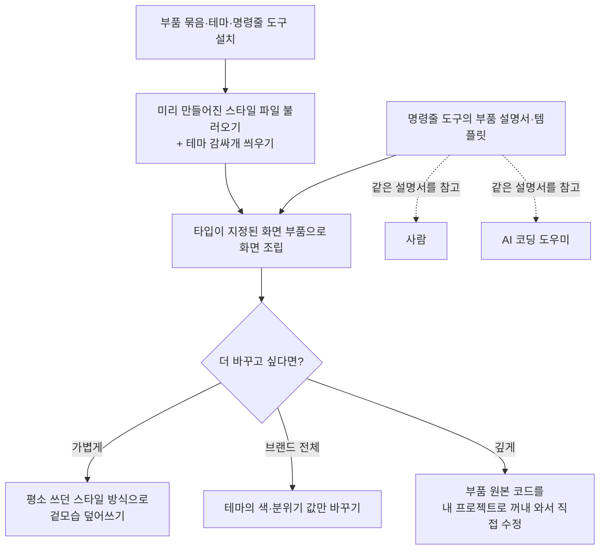

<aside class="ai-knowledge-sidebar">
  
CATEGORIES

  <nav class="ai-cat-tree">

에이전트 오케스트레이션20
<ul><li><a href="https://altjs4510.github.io/ai_news_blog/knowledge/20261107/">2026-11-07Hermes Agent v0.23.0 — The Hearth Release</a></li><li><a href="https://altjs4510.github.io/ai_news_blog/knowledge/20261106/">2026-11-06Cline desktop-nightly-20261104233655: feat(core)…</a></li><li><a href="https://altjs4510.github.io/ai_news_blog/knowledge/20261029/">2026-10-29How Anthropic ships Claude with Claude: Separati…</a></li><li><a href="https://altjs4510.github.io/ai_news_blog/knowledge/20261027/">2026-10-27nightly-labs/openbot — Codex·Claude·Grok을 상주 팀원처…</a></li><li><a href="https://altjs4510.github.io/ai_news_blog/knowledge/20261014/">2026-10-14How Anthropic's Dynamic Workflows Coordinate Cla…</a></li><li><a href="https://altjs4510.github.io/ai_news_blog/knowledge/20260930/">2026-09-30Agents you can coach: how Asana builds human-age…</a></li><li><a href="https://altjs4510.github.io/ai_news_blog/knowledge/20260929/">2026-09-29vectorize-io/hindsight — Hindsight: Agent Memory…</a></li><li><a href="https://altjs4510.github.io/ai_news_blog/knowledge/20260903/">2026-09-03pacifio/atlas — 여러 코딩 에이전트의 변경을 한곳에서 추적·질의하는 '에이…</a></li><li><a href="https://altjs4510.github.io/ai_news_blog/knowledge/20260831-openexecutive-virtual-c-suite/">2026-08-31Open Executive — 8명의 전문 에이전트를 하나의 임원 목소리로</a></li><li><a href="https://altjs4510.github.io/ai_news_blog/knowledge/20260828/">2026-08-28Google ADK for Python v2.8.0 — RemoteA2aAgent 네이…</a></li><li><a href="https://altjs4510.github.io/ai_news_blog/knowledge/20260826/">2026-08-26apache/maka — 도구 호출·권한 결정·종료 이벤트를 append-only 로그…</a></li><li><a href="https://altjs4510.github.io/ai_news_blog/knowledge/20260823/">2026-08-23The Evolution of the Agent Harness — 하네스가 모델 가중치…</a></li><li><a href="https://altjs4510.github.io/ai_news_blog/knowledge/20260821/">2026-08-21volcengine/OpenViking — 에이전트 메모리·Knowledge RAG·스…</a></li><li><a href="https://altjs4510.github.io/ai_news_blog/knowledge/20260805/">2026-08-05TencentCloud/TencentDB-Agent-Memory — 대화·문서·코드를 …</a></li><li><a href="https://altjs4510.github.io/ai_news_blog/knowledge/20260725/">2026-07-25The new rules of context engineering for Claude …</a></li><li><a href="https://altjs4510.github.io/ai_news_blog/knowledge/20260708/">2026-07-08Expanding Managed Agents in Gemini API: backgrou…</a></li><li><a href="https://altjs4510.github.io/ai_news_blog/knowledge/20260623/">2026-06-23bytedance/deer-flow — 샌드박스·메모리·서브에이전트·메시지 게이트웨이를…</a></li><li><a href="https://altjs4510.github.io/ai_news_blog/knowledge/20260602/">2026-06-02revfactory/harness — 도메인별 에이전트 팀과 스킬을 자동 설계하는 메타…</a></li><li><a href="https://altjs4510.github.io/ai_news_blog/knowledge/20260529/">2026-05-29Introducing dynamic workflows in Claude Code</a></li><li><a href="https://altjs4510.github.io/ai_news_blog/knowledge/20260507/">2026-05-07ruvnet/ruflo — Claude 멀티 에이전트 오케스트레이션 플랫폼</a></li></ul>

MCP &amp; 도구 통합18
<ul><li><a href="https://altjs4510.github.io/ai_news_blog/knowledge/20261103/">2026-11-03vercel-labs/agent-desktop — 픽셀 대신 OS 접근성 트리로 앱 U…</a></li><li><a href="https://altjs4510.github.io/ai_news_blog/knowledge/20261017/">2026-10-17mksglu/context-mode — 코딩 에이전트용 컨텍스트 윈도우 최적화</a></li><li><a href="https://altjs4510.github.io/ai_news_blog/knowledge/20261007/">2026-10-07morluto/rea — 앱 동작부터 네이티브 바이너리까지 에이전트로 리버스 엔지니어링</a></li><li><a href="https://altjs4510.github.io/ai_news_blog/knowledge/20260831-gitnexus-code-knowledge-graph/">2026-08-31GitNexus — 코드베이스를 지식그래프로 바꿔 에이전트에게 쥐어주기</a></li><li><a href="https://altjs4510.github.io/ai_news_blog/knowledge/20260829/">2026-08-29cursor/plugins — 플러그인 명세(specification)와 공식 플러그인…</a></li><li><a href="https://altjs4510.github.io/ai_news_blog/knowledge/20260802/">2026-08-02Stateless MCP has recaptured my interest (and in…</a></li><li><a href="https://altjs4510.github.io/ai_news_blog/knowledge/20260731/">2026-07-31different-ai/openwork — Claude Cowork의 오픈소스 대안(o…</a></li><li><a href="https://altjs4510.github.io/ai_news_blog/knowledge/20260729/">2026-07-29Bringing MCP 2026-07-28 to Claude</a></li><li><a href="https://altjs4510.github.io/ai_news_blog/knowledge/20260726/">2026-07-26citrolabs/ego-lite — 로그인된 브라우저 상태를 AI 에이전트와 공유하는…</a></li><li><a href="https://altjs4510.github.io/ai_news_blog/knowledge/20260718/">2026-07-18tirth8205/code-review-graph — MCP·CLI용 로컬 코드 인텔리…</a></li><li><a href="https://altjs4510.github.io/ai_news_blog/knowledge/20260618/">2026-06-18DeusData/codebase-memory-mcp — 158개 언어 코드베이스를 밀리…</a></li><li><a href="https://altjs4510.github.io/ai_news_blog/knowledge/20260604/">2026-06-04chopratejas/headroom — Compress tool outputs bef…</a></li><li><a href="https://altjs4510.github.io/ai_news_blog/knowledge/20260603/">2026-06-03How Bad MCP design cost your Agent 5× more token…</a></li><li><a href="https://altjs4510.github.io/ai_news_blog/knowledge/20260521/">2026-05-21colbymchenry/codegraph — Pre-indexed code knowle…</a></li><li><a href="https://altjs4510.github.io/ai_news_blog/knowledge/20260517/">2026-05-17I gave my LLM 100,000+ tools — Lazy Discovery &a…</a></li><li><a href="https://altjs4510.github.io/ai_news_blog/knowledge/20260512/">2026-05-12agentmemory — Persistent memory for AI coding ag…</a></li><li><a href="https://altjs4510.github.io/ai_news_blog/knowledge/20260509/">2026-05-09How to connect 100 MCP servers without the conte…</a></li><li><a href="https://altjs4510.github.io/ai_news_blog/knowledge/20260506/">2026-05-06mksglu/context-mode — AI 코딩 에이전트용 컨텍스트 윈도우 최적화</a></li></ul>

코딩 에이전트25
<ul><li><a href="https://altjs4510.github.io/ai_news_blog/knowledge/20261112/">2026-11-12shadcn/improve — 가장 강한 모델로 코드베이스를 감사해 계획을 쓰고, 더 …</a></li><li><a href="https://altjs4510.github.io/ai_news_blog/knowledge/20261022/">2026-10-22Claude Mods: Flipping the Harness Inside Out</a></li><li><a href="https://altjs4510.github.io/ai_news_blog/knowledge/20261018/">2026-10-18Quoting Addy Osmani, Morgan Westlee Lunt, and Qi…</a></li><li><a href="https://altjs4510.github.io/ai_news_blog/knowledge/20261014-claude-code-advisor/">2026-10-14Claude Code advisor — 가벼운 메인 모델이 일하고, 갈림길에서만 Opu…</a></li><li><a href="https://altjs4510.github.io/ai_news_blog/knowledge/20260920/">2026-09-20Claude Code 2.1.277 — CLAUDE.md가 없으면 AGENTS.md를 …</a></li><li><a href="https://altjs4510.github.io/ai_news_blog/knowledge/20260912/">2026-09-12Quoting Boris Cherny — 'Claude가 쓴 프로덕션 코드는 사람이 쓴…</a></li><li><a href="https://altjs4510.github.io/ai_news_blog/knowledge/20260910/">2026-09-10vastsa/PI-Desktop — Electron + Rust 호스트 코어 + 에이전…</a></li><li><a href="https://altjs4510.github.io/ai_news_blog/knowledge/20260906/">2026-09-06DietrichGebert/ponytail — 에이전트를 '방에서 가장 게으른 시니어 …</a></li><li><a href="https://altjs4510.github.io/ai_news_blog/knowledge/20260901/">2026-09-01affaan-m/ECC — 스킬·본능·메모리·보안을 묶은 에이전트 하네스 성능 최적화 …</a></li><li><a href="https://altjs4510.github.io/ai_news_blog/knowledge/20260819/">2026-08-19akitaonrails/ai-memory — 코딩 에이전트 CLI 간 장기 기억과 벤더…</a></li><li><a href="https://altjs4510.github.io/ai_news_blog/knowledge/20260814/">2026-08-14cathrynlavery/diagram-design — Claude Code용 에디토리…</a></li><li><a href="https://altjs4510.github.io/ai_news_blog/knowledge/20260810/">2026-08-10Auto mode is now the default in Claude Code for …</a></li><li><a href="https://altjs4510.github.io/ai_news_blog/knowledge/20260808/">2026-08-08PrimeIntellect-ai/prime-agent — 코딩 워크플로우와 장시간 자율…</a></li><li><a href="https://altjs4510.github.io/ai_news_blog/knowledge/20260804/">2026-08-04esengine/DeepSeek-Reasonix — prefix-cache 안정성을 축…</a></li><li><a href="https://altjs4510.github.io/ai_news_blog/knowledge/20260728/">2026-07-28alibaba/open-code-review — 결정론적 파이프라인 + LLM 에이전트…</a></li><li><a href="https://altjs4510.github.io/ai_news_blog/knowledge/20260714/">2026-07-14Graphify-Labs/graphify — 코드베이스를 질의 가능한 지식 그래프로 만…</a></li><li><a href="https://altjs4510.github.io/ai_news_blog/knowledge/20260707/">2026-07-07AI Hero Skills Catalog — 실무 엔지니어를 위한 재사용 가능한 판단 …</a></li><li><a href="https://altjs4510.github.io/ai_news_blog/knowledge/20260705/">2026-07-05openai/codex-plugin-cc — Claude Code에서 Codex를 위임…</a></li><li><a href="https://altjs4510.github.io/ai_news_blog/knowledge/20260701/">2026-07-01Google OKF (Open Knowledge Format) — 벤더 중립 에이전트 …</a></li><li><a href="https://altjs4510.github.io/ai_news_blog/knowledge/20260626/">2026-06-26google-labs-code/design.md — 코딩 에이전트에게 디자인 시스템을 …</a></li><li><a href="https://altjs4510.github.io/ai_news_blog/knowledge/20260619/">2026-06-19Claude Code now supports artifacts</a></li><li><a href="https://altjs4510.github.io/ai_news_blog/knowledge/20260530/">2026-05-30Leonxlnx/taste-skill — AI에게 좋은 취향을 부여해 generic s…</a></li><li><a href="https://altjs4510.github.io/ai_news_blog/knowledge/20260528/">2026-05-28Building self-improving tax agents with Codex</a></li><li><a href="https://altjs4510.github.io/ai_news_blog/knowledge/20260508/">2026-05-08addyosmani/agent-skills — Production-grade engin…</a></li><li><a href="https://altjs4510.github.io/ai_news_blog/knowledge/20260505/">2026-05-05mattpocock/skills — Skills for Real Engineers (.…</a></li></ul>

모델 &amp; 연구14
<ul><li><a href="https://altjs4510.github.io/ai_news_blog/knowledge/20261113/">2026-11-13Gemini Decisions API</a></li><li><a href="https://altjs4510.github.io/ai_news_blog/knowledge/20261111/">2026-11-11Quoting Prompting Claude Fable 5.2</a></li><li><a href="https://altjs4510.github.io/ai_news_blog/knowledge/20261105/">2026-11-05NVIDIA/auto-ontology — 데이터 위에 그래프 기반 의미 추론 레이어를 …</a></li><li><a href="https://altjs4510.github.io/ai_news_blog/knowledge/20261104/">2026-11-04Qwen 3.8 27B on my laptop can interpret model we…</a></li><li><a href="https://altjs4510.github.io/ai_news_blog/knowledge/20261009/">2026-10-09Claude Haiku 5.5 (Simon Willison의 출시 노트와 가격 분석)</a></li><li><a href="https://altjs4510.github.io/ai_news_blog/knowledge/20260907-voicemem-dual-brain-memory/">2026-09-07VoiceMem — 좌뇌·우뇌로 쪼갠 스트리밍 메모리로 음성 에이전트 지연 없애기</a></li><li><a href="https://altjs4510.github.io/ai_news_blog/knowledge/20260904/">2026-09-04HarnessDev: Can LLMs Create and Evolve Their Own…</a></li><li><a href="https://altjs4510.github.io/ai_news_blog/knowledge/20260717/">2026-07-17After a year building agent memory, 'save everyt…</a></li><li><a href="https://altjs4510.github.io/ai_news_blog/knowledge/20260716-proprag/">2026-07-16PropRAG — 프로포지션 경로 위 beam search로 멀티홉 검색 안내</a></li><li><a href="https://altjs4510.github.io/ai_news_blog/knowledge/20260712/">2026-07-12Do Automated Evals Work?</a></li><li><a href="https://altjs4510.github.io/ai_news_blog/knowledge/20260620/">2026-06-20zai-org/GLM-5 — From Vibe Coding to Agentic Engi…</a></li><li><a href="https://altjs4510.github.io/ai_news_blog/knowledge/20260617/">2026-06-17Predicting model behavior before release by simu…</a></li><li><a href="https://altjs4510.github.io/ai_news_blog/knowledge/20260516/">2026-05-16STALE — 에이전트가 자기 기억의 유효성을 인지할 수 있는가</a></li><li><a href="https://altjs4510.github.io/ai_news_blog/knowledge/20260513/">2026-05-13Thinking Machines' Native Interaction Models — T…</a></li></ul>

인프라 &amp; 컴퓨트8
<ul><li><a href="https://altjs4510.github.io/ai_news_blog/knowledge/20260909/">2026-09-09Reducing cost and improving performance with Cla…</a></li><li><a href="https://altjs4510.github.io/ai_news_blog/knowledge/20260905/">2026-09-05magnitudedev/magnitude — 하드웨어에 맞는 최적 로컬 모델을 띄워 이…</a></li><li><a href="https://altjs4510.github.io/ai_news_blog/knowledge/20260806/">2026-08-06cloudflare/computer — 에이전트에게 컴퓨터를 통째로 주는 엣지 실행 샌…</a></li><li><a href="https://altjs4510.github.io/ai_news_blog/knowledge/20260723/">2026-07-23diegosouzapw/OmniRoute — 268+ 프로바이더를 단일 엔드포인트로 묶…</a></li><li><a href="https://altjs4510.github.io/ai_news_blog/knowledge/20260611/">2026-06-11The evolution of agentic surfaces: building with…</a></li><li><a href="https://altjs4510.github.io/ai_news_blog/knowledge/20260610/">2026-06-10Fable 5 just made cost-aware model routing manda…</a></li><li><a href="https://altjs4510.github.io/ai_news_blog/knowledge/20260522/">2026-05-22Giving Agents Computers — Ivan Burazin, Daytona</a></li><li><a href="https://altjs4510.github.io/ai_news_blog/knowledge/20260520/">2026-05-20New in Claude Managed Agents: self-hosted sandbo…</a></li></ul>

보안 &amp; 거버넌스26
<ul><li><a href="https://altjs4510.github.io/ai_news_blog/knowledge/20261031/">2026-10-31CopilotKit/OpenBot — AI 동료마다 전용 컴퓨터를 주고 모든 행동을 실…</a></li><li><a href="https://altjs4510.github.io/ai_news_blog/knowledge/20261030/">2026-10-30How we detect frontier model misalignment</a></li><li><a href="https://altjs4510.github.io/ai_news_blog/knowledge/20261021/">2026-10-21cloudflare/security-audit-skill — 독립 검증된 기계 판독형 …</a></li><li><a href="https://altjs4510.github.io/ai_news_blog/knowledge/20261020/">2026-10-20Satya Nadella — 모델을 내부자 위험으로 보는 원칙에 따라 Project P…</a></li><li><a href="https://altjs4510.github.io/ai_news_blog/knowledge/20261016/">2026-10-16Crossing the Threshold: How OpenAI and Anthropic…</a></li><li><a href="https://altjs4510.github.io/ai_news_blog/knowledge/20261011/">2026-10-11Anthropic can’t reliably control its AI agents. …</a></li><li><a href="https://altjs4510.github.io/ai_news_blog/knowledge/20261004/">2026-10-04Apple says it's tightening macOS 'Full Disk Acce…</a></li><li><a href="https://altjs4510.github.io/ai_news_blog/knowledge/20261001/">2026-10-01NVIDIA/OpenShell</a></li><li><a href="https://altjs4510.github.io/ai_news_blog/knowledge/20260919/">2026-09-19cloudflare/security-audit-skill — 다단계 보안 감사를 '독립…</a></li><li><a href="https://altjs4510.github.io/ai_news_blog/knowledge/20260913/">2026-09-13OpenAI agents attacked RubyGems back in May: Ope…</a></li><li><a href="https://altjs4510.github.io/ai_news_blog/knowledge/20260902/">2026-09-02AIR raises $50M to help companies vet the skills…</a></li><li><a href="https://altjs4510.github.io/ai_news_blog/knowledge/20260827/">2026-08-27Claude in Chrome is generally available</a></li><li><a href="https://altjs4510.github.io/ai_news_blog/knowledge/20260819-mind-viruses/">2026-08-19탈옥도, 인젝션도 없이 — 대화로만 퍼지는 에이전트의 '마인드 바이러스'</a></li><li><a href="https://altjs4510.github.io/ai_news_blog/knowledge/20260812/">2026-08-12semantica-agi/semantica — 컨텍스트와 '책임 추적 가능한(accou…</a></li><li><a href="https://altjs4510.github.io/ai_news_blog/knowledge/20260730/">2026-07-30Anatomy of a Frontier Lab Agent Intrusion: A Tec…</a></li><li><a href="https://altjs4510.github.io/ai_news_blog/knowledge/20260715/">2026-07-15Dicklesworthstone/destructive_command_guard — 에이…</a></li><li><a href="https://altjs4510.github.io/ai_news_blog/knowledge/20260710/">2026-07-1070개 MCP 서버 strace 런타임 감사 — 부팅 시 아웃바운드 호출 서버 적발</a></li><li><a href="https://altjs4510.github.io/ai_news_blog/knowledge/20260704/">2026-07-04Cloudflare is about to block AI agents by defaul…</a></li><li><a href="https://altjs4510.github.io/ai_news_blog/knowledge/20260703/">2026-07-03Giving admins more visibility and control over C…</a></li><li><a href="https://altjs4510.github.io/ai_news_blog/knowledge/20260630/">2026-06-30Introducing the Claude apps gateway for Amazon B…</a></li><li><a href="https://altjs4510.github.io/ai_news_blog/knowledge/20260624/">2026-06-24Agent identity in Claude Tag: a new access model…</a></li><li><a href="https://altjs4510.github.io/ai_news_blog/knowledge/20260613/">2026-06-13Fable 5's guardrails got bypassed in 48 hours — …</a></li><li><a href="https://altjs4510.github.io/ai_news_blog/knowledge/20260612/">2026-06-12NVIDIA/SkillSpector — AI 에이전트 스킬용 보안 스캐너</a></li><li><a href="https://altjs4510.github.io/ai_news_blog/knowledge/20260607/">2026-06-07OpenAI Help: Lockdown Mode</a></li><li><a href="https://altjs4510.github.io/ai_news_blog/knowledge/20260531/">2026-05-31How we contain Claude across products</a></li><li><a href="https://altjs4510.github.io/ai_news_blog/knowledge/20260527/">2026-05-27Microsoft Copilot Cowork Exfiltrates Files</a></li></ul>

응용 사례12
<ul><li><a href="https://altjs4510.github.io/ai_news_blog/knowledge/20261114/">2026-11-14Introducing ChatGPT Wallet</a></li><li><a href="https://altjs4510.github.io/ai_news_blog/knowledge/20261110/" class="current">2026-11-10meta/astryx — 직접 바꿔 쓸 수 있고 에이전트가 바로 쓸 수 있는(agent…</a></li><li><a href="https://altjs4510.github.io/ai_news_blog/knowledge/20261101/">2026-11-01Agents Prompt People: Using Agents for Long-Hori…</a></li><li><a href="https://altjs4510.github.io/ai_news_blog/knowledge/20261028/">2026-10-28Greptile takes bug detection beyond code review …</a></li><li><a href="https://altjs4510.github.io/ai_news_blog/knowledge/20261015/">2026-10-15How Third Moment Research runs 10,000 agents for…</a></li><li><a href="https://altjs4510.github.io/ai_news_blog/knowledge/20261006/">2026-10-06How Cresta turned CX expertise into an agent bui…</a></li><li><a href="https://altjs4510.github.io/ai_news_blog/knowledge/20260911/">2026-09-11Now everyone can put data to work — ChatGPT Work…</a></li><li><a href="https://altjs4510.github.io/ai_news_blog/knowledge/20260709/">2026-07-09mvanhorn/last30days-skill — Reddit·X·YouTube·HN·…</a></li><li><a href="https://altjs4510.github.io/ai_news_blog/knowledge/20260621/">2026-06-21calesthio/OpenMontage — 12 파이프라인·52 도구·500+ 스킬을 …</a></li><li><a href="https://altjs4510.github.io/ai_news_blog/knowledge/20260609/">2026-06-09Building intelligent apps for Apple platforms wi…</a></li><li><a href="https://altjs4510.github.io/ai_news_blog/knowledge/20260515/">2026-05-15Clawdmeter — Claude Code 사용량을 데스크톱 대시보드로</a></li><li><a href="https://altjs4510.github.io/ai_news_blog/knowledge/20260514/">2026-05-14Introducing Claude for Small Business</a></li></ul>

산업 동향9
<ul><li><a href="https://altjs4510.github.io/ai_news_blog/knowledge/20261024/">2026-10-24Donating Agent Skills to the Agentic AI Foundati…</a></li><li><a href="https://altjs4510.github.io/ai_news_blog/knowledge/20261023/">2026-10-23Claude Duet app is Anthropic's bet on agents</a></li><li><a href="https://altjs4510.github.io/ai_news_blog/knowledge/20260907-humanmade-52week-rhythm/">2026-09-07휴먼 메이드의 '52주 리듬' — 아이디어가 흔해진 시대에 값이 오르는 건 버리는 판단</a></li><li><a href="https://altjs4510.github.io/ai_news_blog/knowledge/20260830/">2026-08-30[AINews] OpenAI shuts off Cursor — 프론티어 모델 공급 차단…</a></li><li><a href="https://altjs4510.github.io/ai_news_blog/knowledge/20260711/">2026-07-11OpenAI says GPT 5.6 is the 'preferred model' for…</a></li><li><a href="https://altjs4510.github.io/ai_news_blog/knowledge/20260702/">2026-07-02How Cursor deploys AI inside the enterprise (For…</a></li><li><a href="https://altjs4510.github.io/ai_news_blog/knowledge/20260616/">2026-06-16Why AI hasn't replaced software engineers, and w…</a></li><li><a href="https://altjs4510.github.io/ai_news_blog/knowledge/20260519/">2026-05-19Anthropic acquires Stainless</a></li><li><a href="https://altjs4510.github.io/ai_news_blog/knowledge/20260504/">2026-05-04Agents for Everything Else: Codex for Knowledge …</a></li></ul>
</nav>
</aside>

<article class="ai-knowledge-article">

<header class="ai-post-hero">
  
<a class="ai-back" href="../">KNOWLEDGE</a> · 2026-11-10 · 오늘의 학습

  <h2 class="ai-post-title">meta/astryx — 직접 바꿔 쓸 수 있고 에이전트가 바로 쓸 수 있는(agent ready) 오픈소스 디자인 시스템</h2>
</header>

> 원문: [meta/astryx — 직접 바꿔 쓸 수 있고 에이전트가 바로 쓸 수 있는(agent ready) 오픈소스 디자인 시스템](https://github.com/meta/astryx)

## 📌 학습 정리

### 1. 한 줄로 말하면

Meta 안에서 8년 동안 다듬어 온 화면 부품 세트를 누구나 쓸 수 있게 공개한 거예요. 사람과 AI 코딩 도우미가 같은 설명서를 보고 같은 방식으로 화면을 조립하도록 처음부터 함께 설계했다는 점이 특징이에요.

### 2. 왜 이게 만들어졌어요?

화면을 만드는 팀은 버튼, 표, 입력창 같은 공통 부품과 색·글꼴 규칙을 묶은 디자인 시스템(design system)을 둬서 화면의 일관성을 지켜요. 그런데 이런 시스템은 겉으로 드러난 사용법만 열어 두고 안쪽은 잠가 두는 경우가 많아서, 조금만 다르게 바꾸고 싶어도 부품을 한 겹 더 감싸거나(wrapping) 통째로 복사해 와야(forking) 했어요. 특정 스타일 도구를 함께 써야 하는 제약도 흔했고요. 여기에 요즘은 사람만이 아니라 AI 도우미도 화면 코드를 짜기 때문에, 부품의 규칙이 일정하지 않으면 AI가 처음 보는 부품을 어떻게 써야 할지 짐작하기 어려워요. Astryx는 Meta 내부에서 13,000개가 넘는 앱을 받쳐 온 경험을 바탕으로 이런 불편을 줄이려고 공개된 것으로 보여요.

### 3. 비유로 풀면

이건 마치 **조립 설명서가 아주 꼼꼼한 블록 장난감 세트** 같은 거예요. 완성품만 주는 게 아니라 낱개 블록도 다 꺼내 쓸 수 있고, 필요하면 완성된 부품 하나를 분해해서 내 서랍으로 옮겨 마음대로 고칠 수도 있어요. 블록마다 이름 붙이는 방식과 끼우는 방식이 같아서, 몇 개만 써 보면 나머지도 어떻게 쓰는지 자연스럽게 감이 와요.

또 하나는 **벽지만 갈아 끼우는 인테리어**예요. 집 구조(부품의 원래 코드)는 건드리지 않고 색과 분위기 값만 바꿔서 완전히 다른 집처럼 보이게 하는 방식이에요.

그래서 결국, 부품은 안쪽까지 열려 있어 깊게 손댈 수 있고, 겉모습은 설정 값만 바꿔서 내 브랜드처럼 만들 수 있어요. 규칙이 일정하니 사람과 AI가 같은 설명서를 보고 비슷한 결과를 낼 수 있고요.

### 4. 어떻게 작동하는지 (그림으로)

먼저 핵심 부품 묶음과 테마, 명령줄 도구를 설치하고, 스타일 파일 몇 개를 불러온 뒤 테마 감싸개만 씌우면 바로 쓸 수 있어요. 따로 빌드 도구 설정을 건드리지 않아도 된다는 점을 원문이 강조해요. 이후 얼마나 바꾸고 싶은지에 따라 겉모습만 덮어쓰거나, 테마 값을 바꾸거나, 부품 원본을 아예 꺼내 와서 고치는 세 가지 길이 있어요. 사람과 AI 도우미는 모두 명령줄 도구가 보여 주는 같은 설명서를 참고해요.

### 5. 처음 보는 용어 풀이

- **디자인 시스템 (design system)**: 버튼·표·입력창 같은 공통 화면 부품과 색·글꼴·간격 규칙을 한데 묶은 세트예요. 여러 화면이 같은 모양과 동작을 갖게 해 줘요.
- **화면 부품 (component)**: 화면을 이루는 재사용 가능한 조각이에요. Astryx는 접근성을 고려한 부품을 150개 넘게 제공하고, 타입스크립트(TypeScript)로 어떤 값을 넣을 수 있는지가 정해져 있어요.
- **테마 (theme)**: 색·분위기 같은 겉모습 값을 모아 둔 묶음이에요. Astryx에서는 스타일 변수 값(CSS custom property)을 덮어쓰는 방식이라, 부품 코드를 감싸거나 복사하지 않고도 모양을 바꿀 수 있어요. 기본 제공 테마는 neutral, butter, matcha 등 7가지예요.
- **부품 꺼내 오기 (swizzle)**: 부품 하나의 전체 원본 코드를 내 프로젝트 안으로 꺼내 와서, 그때부터 내가 직접 관리하며 고칠 수 있게 하는 기능이에요.
- **StyleX**: Astryx가 내부에서 스타일을 작성할 때 쓰는 도구예요. 다만 쓰는 사람 입장에서는 신경 쓸 필요가 없고, Tailwind나 일반 CSS 등 원래 쓰던 방식으로 겉모습을 덮어쓸 수 있어요.
- **명령줄 도구 (CLI)**: 터미널에 글자로 명령을 입력해 쓰는 도구예요. Astryx의 CLI는 부품 설명서 보기, 템플릿 만들기, 테마 관리, 코드 자동 변환(codemod) 같은 일을 해 줘요.
- **함께 설치해야 하는 의존성 (peer dependency)**: 이 패키지가 스스로 들고 오지 않고, 내 프로젝트에 이미 있다고 기대하는 다른 패키지예요. Astryx는 React 19 이상을 이런 방식으로 요구해요.

### 6. 한 발 더 들어가고 싶다면

- [@astryxdesign/core README의 빠른 시작](https://github.com/meta/astryx/blob/main/packages/core/README.md#quick-start): Next.js, Tailwind, Vite, CDN 환경별로 처음 설정하는 방법을 볼 수 있어요.
- [@astryxdesign/cli README](https://github.com/meta/astryx/blob/main/packages/cli/README.md): 명령줄 도구로 부품 설명서·템플릿·테마를 어떻게 다루는지 알 수 있어요.
- [테마 패키지 모음](https://github.com/meta/astryx/blob/main/packages/themes): 기본 제공 테마 7가지가 어떻게 생겼는지 볼 수 있어요.
- [API Conventions](https://github.com/meta/astryx/wiki/API-Conventions): 모든 부품이 따르는 이름·값·조합 규칙을 알 수 있어요. 사람과 AI가 처음 보는 부품의 동작을 어떻게 짐작할 수 있는지 이해하는 데 도움이 돼요.
- [CONTRIBUTING.md](https://github.com/meta/astryx/blob/main/CONTRIBUTING.md): 이 저장소에 직접 기여하고 싶을 때 필요한 환경과 절차를 알 수 있어요.

---

## 📖 원문 전체 번역 (정독용)

> 의역 최소화한 전체 번역입니다. 큰 흐름은 위 정리에서 잡고, 정확한 워딩이 필요할 땐 이 섹션에서 정독하세요.

## 개요

Astryx는 지난 8년 동안 Meta 내부에서 성장해 온 오픈소스 디자인 시스템으로, 사내에서 가장 많이 쓰이고 가장 큰 디자인 시스템이 되었습니다. 13,000개 이상의 앱을 구동하며, 이를 매일 사용하는 엔지니어, 디자이너, 프로덕트 팀이 함께 빚어 왔습니다.

Astryx는 150개 이상의 접근성 컴포넌트, 브랜드 수준의 테마, 다크 모드, 바로 배포할 수 있는 템플릿, 그리고 CLI를 하나의 일관된 시스템으로 제공합니다. 미리 빌드된 CSS를 가져오고 타입이 지정된 React 컴포넌트를 사용하면 됩니다. 빌드 플러그인도, 새로 도입해야 하는 스타일링 라이브러리도 필요 없으며, 사람과 AI 어시스턴트가 같은 도구로 개발합니다.

**Astryx가 다른 점:**

*   **열린 내부 구조 (Open internals).** 컴포넌트는 닫힌 최상위 API 뒤에 잠겨 있지 않고, 어느 수준에서든 조합(compose)할 수 있도록 만들어졌습니다. 손이 가게 되는 빌딩 블록은 직접 export되어 있으며, 더 깊이 들어가야 할 때는 swizzle이 컴포넌트의 전체 소스를 여러분의 프로젝트로 꺼내(eject) 직접 소유할 수 있게 해 줍니다.
*   **스타일링 종속 없음 (No styling lock-in).** Astryx는 StyleX로 스타일을 작성하지만, 이는 사용하는 쪽에는 보이지 않습니다. Tailwind, CSS 모듈, 순수 CSS 등 프로젝트에서 이미 쓰는 것이 무엇이든 `className`으로 덮어쓸 수 있습니다.
*   **감싸지 않고 커스터마이즈 (Customize without wrapping).** 테마는 CSS 커스텀 속성(custom property) 오버라이드의 집합이므로, 디자이너는 컴포넌트 소스를 포크하거나 래핑하지 않고도 Astryx를 확실히 자신의 것으로 만들 수 있습니다.
*   **사람과 에이전트를 위해 만들어짐 (Built for people and agents).** API, 문서, CLI가 함께 설계되어, 사람과 AI 어시스턴트가 같은 레퍼런스를 보고 같은 방식으로 개발합니다.

## 시작하기

Astryx는 **React 19** 이상이 필요합니다(`react`와 `react-dom`은 `@astryxdesign/core`의 peer dependency입니다).

Astryx, 테마, 그리고 peer dependency를 설치합니다:

# npm
npm install @astryxdesign/core @astryxdesign/theme-neutral @stylexjs/stylex
npm install -D @astryxdesign/cli

# pnpm
pnpm add @astryxdesign/core @astryxdesign/theme-neutral @stylexjs/stylex
pnpm add -D @astryxdesign/cli

# yarn
yarn add @astryxdesign/core @astryxdesign/theme-neutral @stylexjs/stylex
yarn add -D @astryxdesign/cli

CLI를 컴퓨터에 한 번만 설치해 두면 어느 폴더에서든 `astryx`가 동작하고 모든 코딩 에이전트가 Astryx를 알게 됩니다. 프로젝트 안에서는 여전히 해당 프로젝트 자체의 버전이 실행됩니다:

npm i -g @astryxdesign/cli

프로젝트 설치, 전역 설치, 둘 다 중 무엇이 좋을까요? `astryx docs global/project-global-or-both`가 이를 비교해 주며(둘 다 설치하는 것을 권장), `astryx docs global`은 전역 모드가 어떻게 동작하는지 설명합니다.

가장 간단한 설정은 몇 개의 CSS import와 테마 프로바이더(theme provider)뿐입니다. 빌드 플러그인도, PostCSS나 Babel 설정도 필요 없습니다. 전체 가이드(Next.js, Tailwind, Vite, CDN)는 **[@astryxdesign/core README](https://github.com/meta/astryx/blob/main/packages/core/README.md#quick-start)**를 참고하세요.

CLI를 안정적으로 호출하려면 `package.json`에 스크립트를 추가하세요:

"scripts": {
  "astryx": "node node_modules/@astryxdesign/cli/clients/cli/bin/astryx.mjs"
}

그런 다음 `npm run astryx -- component --list`처럼 사용하세요. 이렇게 하면 AI 어시스턴트나 신규 개발자가 CLI를 직접 호출할 때 생기는 경로 오류를 피할 수 있습니다.

## 패키지

| 패키지 | 설명 | README |
| --- | --- | --- |
| [`@astryxdesign/core`](https://github.com/meta/astryx/blob/main/packages/core) | 컴포넌트, 테마 시스템, 유틸리티 | [README](https://github.com/meta/astryx/blob/main/packages/core/README.md) |
| [`@astryxdesign/cli`](https://github.com/meta/astryx/blob/main/packages/cli) | CLI 도구: 컴포넌트 문서, 템플릿, 스캐폴딩, 테마, 코드모드(codemod) | [README](https://github.com/meta/astryx/blob/main/packages/cli/README.md) |
| [`@astryxdesign/build`](https://github.com/meta/astryx/blob/main/packages/build) | StyleX 소스 빌드용 빌드 플러그인 | [README](https://github.com/meta/astryx/blob/main/packages/build/README.md) |
| [`@astryxdesign/theme-*`](https://github.com/meta/astryx/blob/main/packages/themes) | 바로 쓸 수 있고 완전히 커스터마이즈 가능한 7가지 테마 (neutral, butter, chocolate, matcha, stone, gothic, y2k) | [README](https://github.com/meta/astryx/blob/main/packages/themes) |

> `@astryxdesign/lab`(실험적 컴포넌트)은 Storybook과 샌드박스용으로 내부에서만 사용되며 npm에는 배포되지 않습니다. `@astryxdesign/vega`(Vega/Vega-Lite 차트 래퍼)와 `@astryxdesign/charts`(차트 컴포넌트)는 `@canary` dist-tag로만 npm에 배포되며, 아직 안정(stable) 릴리스는 없습니다.

## 원칙

다음은 Astryx가 이를 기반으로 개발하는 사람들에게 하는 약속입니다.

*   **강제보다 안내 (Guidance over enforcement).** 컴포넌트는 여러분과 싸우는 가드레일이 아니라 능력(capability)을 제공합니다. 디자인에 대한 의견은 문서와 예제에 담겨 있으며, 값을 넘기면 컴포넌트는 그대로 렌더링합니다.
*   **강력하고 문서화된 컨벤션 (Strong, documented conventions).** 모든 컴포넌트는 동일한 네이밍, prop, 조합 규칙을 따르고 하나하나 철저히 문서화되어 있습니다. 그래서 몇 가지만 익히면 나머지도 익숙하게 느껴지고, 사람과 AI 모두 처음 보는 컴포넌트가 어떻게 동작할지 예측할 수 있습니다.
*   **사람과 AI를 위한 하나의 시스템 (One system for humans and AI).** API, 컨벤션, 문서, CLI가 함께 설계되어 사람과 AI 어시스턴트가 같은 방식으로 개발합니다. Astryx를 AI에게 더 쉽게 만든 모든 변경은 사람에게도 더 쉬운 것이 되었습니다.
*   **측정으로 얻어 낸다 (Earned by measurement).** 컨벤션은 주장하는 것이 아니라 테스트합니다. 결과를 느슨하게 쥐고, 새로운 상황이 컨벤션이 틀렸음을 입증하면 다시 검토합니다.

## 아키텍처

### 기초 (Foundations)

시각적으로 일관되고 접근성 높은 인터페이스를 위한 빌딩 블록: 타이포그래피, 색상, 레이아웃, 접근성.

### 컴포넌트 (Components)

완전한 TypeScript 지원을 갖춘, 150개 이상의 재사용 가능한 UI 빌딩 블록 라이브러리.

### 패턴 (Patterns)

흔한 인터랙션과 워크플로를 위해 실전에서 검증된 디자인 솔루션: 테이블 페이지, 상세 페이지 레이아웃, 폼 위저드(form wizard), 내비게이션 패턴, 데이터 입력 흐름.

## 프로젝트 구조

| 디렉터리 | 용도 |
| --- | --- |
| `apps/` | 예제 앱, 문서 사이트(docsite), Storybook |
| `packages/` | 배포되는 패키지: core, cli, build, themes |
| `internal/` | 내부 도구: 테스트 유틸리티, eslint 플러그인, vibe 테스트 |

## 기여하기

기여를 환영합니다! 전체 가이드는 **[CONTRIBUTING.md](https://github.com/meta/astryx/blob/main/CONTRIBUTING.md)**를 참고하세요.

질문이 있거나 PR에 도움이 필요하신가요? **[Discord](https://discord.com/invite/XnsUcFykEP)**에서 만나요.

컨벤션과 리뷰 기준(rubric)은 [Contributing 위키](https://github.com/meta/astryx/wiki/Contributing)에 있습니다. 여기에는 [API Conventions](https://github.com/meta/astryx/wiki/API-Conventions), [Design Conventions](https://github.com/meta/astryx/wiki/Design-Conventions), [Component Lifecycle](https://github.com/meta/astryx/wiki/Component-Lifecycle), [Contributing Templates](https://github.com/meta/astryx/wiki/Contributing-Templates), [Blog Review Rubric](https://github.com/meta/astryx/wiki/Blog-Review-Rubric#three-required-scored-criteria)가 포함됩니다. PR을 열기 전에 해당하는 기준을 먼저 읽어 주세요.

기여자를 위한 빠른 시작: 이 저장소는 **활성 LTS 라인의 Node 22 이상**과 **pnpm 11**을 사용합니다. pnpm을 직접 설치하거나, [Corepack](https://nodejs.org/api/corepack.html)을 한 번 활성화하면 고정된 pnpm 버전이 자동으로 설치됩니다:

corepack enable
pnpm install

`corepack`이 없다면 pnpm을 직접 설치하거나 Corepack을 수동으로 설치하세요. [CONTRIBUTING.md](https://github.com/meta/astryx/blob/main/CONTRIBUTING.md#troubleshooting)의 문제 해결(troubleshooting) 항목을 참고하세요.

Theme Showcase DOM 테스트는 공유 DOM 및 StyleX 테스트 설정을 위해 루트의 `ui` 프로젝트를 사용합니다. 저장소 루트에서 `pnpm exec vitest run --project ui apps/docsite/src/__tests__/theme-showcase/`를 실행하세요.

## 라이선스

MIT

</article>

<!-- ai-related-links -->
<aside class="ai-related-links">
  
관련 학습

  <ul><li><a href="https://altjs4510.github.io/ai_news_blog/knowledge/20260626/">2026-06-26google-labs-code/design.md — 코딩 에이전트에게 디자인 시스템을 …</a></li><li><a href="https://altjs4510.github.io/ai_news_blog/knowledge/20260530/">2026-05-30Leonxlnx/taste-skill — AI에게 좋은 취향을 부여해 generic s…</a></li><li><a href="https://altjs4510.github.io/ai_news_blog/knowledge/20260814/">2026-08-14cathrynlavery/diagram-design — Claude Code용 에디토리…</a></li></ul>
</aside>
<!-- /ai-related-links -->
