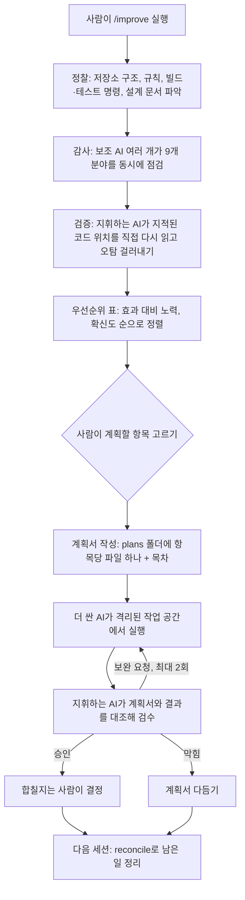

<div class="ai-knowledge-shell">

<aside class="ai-knowledge-sidebar">
  <p class="ai-eyebrow">CATEGORIES</p>
  <nav class="ai-cat-tree"><details class="ai-cat" open><summary><span class="catname">에이전트 오케스트레이션</span><span class="catcount">21</span></summary><ul><li><a href="https://altjs4510.github.io/ai_news_blog/knowledge/20261107/"><span class="kdate">2026-11-07</span><span class="ktitle">Hermes Agent v0.23.0 — The Hearth Release</span></a></li><li><a href="https://altjs4510.github.io/ai_news_blog/knowledge/20261029/"><span class="kdate">2026-10-29</span><span class="ktitle">How Anthropic ships Claude with Claude: Separati…</span></a></li><li><a href="https://altjs4510.github.io/ai_news_blog/knowledge/20261027/"><span class="kdate">2026-10-27</span><span class="ktitle">nightly-labs/openbot — Codex·Claude·Grok을 상주 팀원처…</span></a></li><li><a href="https://altjs4510.github.io/ai_news_blog/knowledge/20261015/"><span class="kdate">2026-10-15</span><span class="ktitle">How Third Moment Research runs 10,000 agents for…</span></a></li><li><a href="https://altjs4510.github.io/ai_news_blog/knowledge/20261014/"><span class="kdate">2026-10-14</span><span class="ktitle">How Anthropic's Dynamic Workflows Coordinate Cla…</span></a></li><li><a href="https://altjs4510.github.io/ai_news_blog/knowledge/20260930/"><span class="kdate">2026-09-30</span><span class="ktitle">Agents you can coach: how Asana builds human-age…</span></a></li><li><a href="https://altjs4510.github.io/ai_news_blog/knowledge/20260929/"><span class="kdate">2026-09-29</span><span class="ktitle">vectorize-io/hindsight — Hindsight: Agent Memory…</span></a></li><li><a href="https://altjs4510.github.io/ai_news_blog/knowledge/20260904/"><span class="kdate">2026-09-04</span><span class="ktitle">HarnessDev: Can LLMs Create and Evolve Their Own…</span></a></li><li><a href="https://altjs4510.github.io/ai_news_blog/knowledge/20260831-openexecutive-virtual-c-suite/"><span class="kdate">2026-08-31</span><span class="ktitle">Open Executive — 8명의 전문 에이전트를 하나의 임원 목소리로</span></a></li><li><a href="https://altjs4510.github.io/ai_news_blog/knowledge/20260828/"><span class="kdate">2026-08-28</span><span class="ktitle">Google ADK for Python v2.8.0 — RemoteA2aAgent 네이…</span></a></li><li><a href="https://altjs4510.github.io/ai_news_blog/knowledge/20260826/"><span class="kdate">2026-08-26</span><span class="ktitle">apache/maka — 도구 호출·권한 결정·종료 이벤트를 append-only 로그…</span></a></li><li><a href="https://altjs4510.github.io/ai_news_blog/knowledge/20260823/"><span class="kdate">2026-08-23</span><span class="ktitle">The Evolution of the Agent Harness — 하네스가 모델 가중치…</span></a></li><li><a href="https://altjs4510.github.io/ai_news_blog/knowledge/20260821/"><span class="kdate">2026-08-21</span><span class="ktitle">volcengine/OpenViking — 에이전트 메모리·Knowledge RAG·스…</span></a></li><li><a href="https://altjs4510.github.io/ai_news_blog/knowledge/20260805/"><span class="kdate">2026-08-05</span><span class="ktitle">TencentCloud/TencentDB-Agent-Memory — 대화·문서·코드를 …</span></a></li><li><a href="https://altjs4510.github.io/ai_news_blog/knowledge/20260726/"><span class="kdate">2026-07-26</span><span class="ktitle">citrolabs/ego-lite — 로그인된 브라우저 상태를 AI 에이전트와 공유하는…</span></a></li><li><a href="https://altjs4510.github.io/ai_news_blog/knowledge/20260717/"><span class="kdate">2026-07-17</span><span class="ktitle">After a year building agent memory, 'save everyt…</span></a></li><li><a href="https://altjs4510.github.io/ai_news_blog/knowledge/20260623/"><span class="kdate">2026-06-23</span><span class="ktitle">bytedance/deer-flow — 샌드박스·메모리·서브에이전트·메시지 게이트웨이를…</span></a></li><li><a href="https://altjs4510.github.io/ai_news_blog/knowledge/20260611/"><span class="kdate">2026-06-11</span><span class="ktitle">The evolution of agentic surfaces: building with…</span></a></li><li><a href="https://altjs4510.github.io/ai_news_blog/knowledge/20260602/"><span class="kdate">2026-06-02</span><span class="ktitle">revfactory/harness — 도메인별 에이전트 팀과 스킬을 자동 설계하는 메타…</span></a></li><li><a href="https://altjs4510.github.io/ai_news_blog/knowledge/20260529/"><span class="kdate">2026-05-29</span><span class="ktitle">Introducing dynamic workflows in Claude Code</span></a></li><li><a href="https://altjs4510.github.io/ai_news_blog/knowledge/20260507/"><span class="kdate">2026-05-07</span><span class="ktitle">ruvnet/ruflo — Claude 멀티 에이전트 오케스트레이션 플랫폼</span></a></li></ul></details><details class="ai-cat" open><summary><span class="catname">MCP &amp; 도구 통합</span><span class="catcount">16</span></summary><ul><li><a href="https://altjs4510.github.io/ai_news_blog/knowledge/20261103/"><span class="kdate">2026-11-03</span><span class="ktitle">vercel-labs/agent-desktop — 픽셀 대신 OS 접근성 트리로 앱 U…</span></a></li><li><a href="https://altjs4510.github.io/ai_news_blog/knowledge/20261017/"><span class="kdate">2026-10-17</span><span class="ktitle">mksglu/context-mode — 코딩 에이전트용 컨텍스트 윈도우 최적화</span></a></li><li><a href="https://altjs4510.github.io/ai_news_blog/knowledge/20260831-gitnexus-code-knowledge-graph/"><span class="kdate">2026-08-31</span><span class="ktitle">GitNexus — 코드베이스를 지식그래프로 바꿔 에이전트에게 쥐어주기</span></a></li><li><a href="https://altjs4510.github.io/ai_news_blog/knowledge/20260829/"><span class="kdate">2026-08-29</span><span class="ktitle">cursor/plugins — 플러그인 명세(specification)와 공식 플러그인…</span></a></li><li><a href="https://altjs4510.github.io/ai_news_blog/knowledge/20260802/"><span class="kdate">2026-08-02</span><span class="ktitle">Stateless MCP has recaptured my interest (and in…</span></a></li><li><a href="https://altjs4510.github.io/ai_news_blog/knowledge/20260731/"><span class="kdate">2026-07-31</span><span class="ktitle">different-ai/openwork — Claude Cowork의 오픈소스 대안(o…</span></a></li><li><a href="https://altjs4510.github.io/ai_news_blog/knowledge/20260729/"><span class="kdate">2026-07-29</span><span class="ktitle">Bringing MCP 2026-07-28 to Claude</span></a></li><li><a href="https://altjs4510.github.io/ai_news_blog/knowledge/20260718/"><span class="kdate">2026-07-18</span><span class="ktitle">tirth8205/code-review-graph — MCP·CLI용 로컬 코드 인텔리…</span></a></li><li><a href="https://altjs4510.github.io/ai_news_blog/knowledge/20260708/"><span class="kdate">2026-07-08</span><span class="ktitle">Expanding Managed Agents in Gemini API: backgrou…</span></a></li><li><a href="https://altjs4510.github.io/ai_news_blog/knowledge/20260618/"><span class="kdate">2026-06-18</span><span class="ktitle">DeusData/codebase-memory-mcp — 158개 언어 코드베이스를 밀리…</span></a></li><li><a href="https://altjs4510.github.io/ai_news_blog/knowledge/20260604/"><span class="kdate">2026-06-04</span><span class="ktitle">chopratejas/headroom — Compress tool outputs bef…</span></a></li><li><a href="https://altjs4510.github.io/ai_news_blog/knowledge/20260603/"><span class="kdate">2026-06-03</span><span class="ktitle">How Bad MCP design cost your Agent 5× more token…</span></a></li><li><a href="https://altjs4510.github.io/ai_news_blog/knowledge/20260521/"><span class="kdate">2026-05-21</span><span class="ktitle">colbymchenry/codegraph — Pre-indexed code knowle…</span></a></li><li><a href="https://altjs4510.github.io/ai_news_blog/knowledge/20260517/"><span class="kdate">2026-05-17</span><span class="ktitle">I gave my LLM 100,000+ tools — Lazy Discovery &a…</span></a></li><li><a href="https://altjs4510.github.io/ai_news_blog/knowledge/20260509/"><span class="kdate">2026-05-09</span><span class="ktitle">How to connect 100 MCP servers without the conte…</span></a></li><li><a href="https://altjs4510.github.io/ai_news_blog/knowledge/20260506/"><span class="kdate">2026-05-06</span><span class="ktitle">mksglu/context-mode — AI 코딩 에이전트용 컨텍스트 윈도우 최적화</span></a></li></ul></details><details class="ai-cat" open><summary><span class="catname">코딩 에이전트</span><span class="catcount">31</span></summary><ul><li><a href="https://altjs4510.github.io/ai_news_blog/knowledge/20261112/" class="current"><span class="kdate">2026-11-12</span><span class="ktitle">shadcn/improve — 가장 강한 모델로 코드베이스를 감사해 계획을 쓰고, 더 …</span></a></li><li><a href="https://altjs4510.github.io/ai_news_blog/knowledge/20261111/"><span class="kdate">2026-11-11</span><span class="ktitle">Quoting Prompting Claude Fable 5.2</span></a></li><li><a href="https://altjs4510.github.io/ai_news_blog/knowledge/20261110/"><span class="kdate">2026-11-10</span><span class="ktitle">meta/astryx — 직접 바꿔 쓸 수 있고 에이전트가 바로 쓸 수 있는(agent…</span></a></li><li><a href="https://altjs4510.github.io/ai_news_blog/knowledge/20261106/"><span class="kdate">2026-11-06</span><span class="ktitle">Cline desktop-nightly-20261104233655: feat(core)…</span></a></li><li><a href="https://altjs4510.github.io/ai_news_blog/knowledge/20261022/"><span class="kdate">2026-10-22</span><span class="ktitle">Claude Mods: Flipping the Harness Inside Out</span></a></li><li><a href="https://altjs4510.github.io/ai_news_blog/knowledge/20261018/"><span class="kdate">2026-10-18</span><span class="ktitle">Quoting Addy Osmani, Morgan Westlee Lunt, and Qi…</span></a></li><li><a href="https://altjs4510.github.io/ai_news_blog/knowledge/20261014-claude-code-advisor/"><span class="kdate">2026-10-14</span><span class="ktitle">Claude Code advisor — 가벼운 메인 모델이 일하고, 갈림길에서만 Opu…</span></a></li><li><a href="https://altjs4510.github.io/ai_news_blog/knowledge/20260920/"><span class="kdate">2026-09-20</span><span class="ktitle">Claude Code 2.1.277 — CLAUDE.md가 없으면 AGENTS.md를 …</span></a></li><li><a href="https://altjs4510.github.io/ai_news_blog/knowledge/20260912/"><span class="kdate">2026-09-12</span><span class="ktitle">Quoting Boris Cherny — 'Claude가 쓴 프로덕션 코드는 사람이 쓴…</span></a></li><li><a href="https://altjs4510.github.io/ai_news_blog/knowledge/20260910/"><span class="kdate">2026-09-10</span><span class="ktitle">vastsa/PI-Desktop — Electron + Rust 호스트 코어 + 에이전…</span></a></li><li><a href="https://altjs4510.github.io/ai_news_blog/knowledge/20260906/"><span class="kdate">2026-09-06</span><span class="ktitle">DietrichGebert/ponytail — 에이전트를 '방에서 가장 게으른 시니어 …</span></a></li><li><a href="https://altjs4510.github.io/ai_news_blog/knowledge/20260903/"><span class="kdate">2026-09-03</span><span class="ktitle">pacifio/atlas — 여러 코딩 에이전트의 변경을 한곳에서 추적·질의하는 '에이…</span></a></li><li><a href="https://altjs4510.github.io/ai_news_blog/knowledge/20260901/"><span class="kdate">2026-09-01</span><span class="ktitle">affaan-m/ECC — 스킬·본능·메모리·보안을 묶은 에이전트 하네스 성능 최적화 …</span></a></li><li><a href="https://altjs4510.github.io/ai_news_blog/knowledge/20260819/"><span class="kdate">2026-08-19</span><span class="ktitle">akitaonrails/ai-memory — 코딩 에이전트 CLI 간 장기 기억과 벤더…</span></a></li><li><a href="https://altjs4510.github.io/ai_news_blog/knowledge/20260814/"><span class="kdate">2026-08-14</span><span class="ktitle">cathrynlavery/diagram-design — Claude Code용 에디토리…</span></a></li><li><a href="https://altjs4510.github.io/ai_news_blog/knowledge/20260810/"><span class="kdate">2026-08-10</span><span class="ktitle">Auto mode is now the default in Claude Code for …</span></a></li><li><a href="https://altjs4510.github.io/ai_news_blog/knowledge/20260808/"><span class="kdate">2026-08-08</span><span class="ktitle">PrimeIntellect-ai/prime-agent — 코딩 워크플로우와 장시간 자율…</span></a></li><li><a href="https://altjs4510.github.io/ai_news_blog/knowledge/20260804/"><span class="kdate">2026-08-04</span><span class="ktitle">esengine/DeepSeek-Reasonix — prefix-cache 안정성을 축…</span></a></li><li><a href="https://altjs4510.github.io/ai_news_blog/knowledge/20260728/"><span class="kdate">2026-07-28</span><span class="ktitle">alibaba/open-code-review — 결정론적 파이프라인 + LLM 에이전트…</span></a></li><li><a href="https://altjs4510.github.io/ai_news_blog/knowledge/20260725/"><span class="kdate">2026-07-25</span><span class="ktitle">The new rules of context engineering for Claude …</span></a></li><li><a href="https://altjs4510.github.io/ai_news_blog/knowledge/20260714/"><span class="kdate">2026-07-14</span><span class="ktitle">Graphify-Labs/graphify — 코드베이스를 질의 가능한 지식 그래프로 만…</span></a></li><li><a href="https://altjs4510.github.io/ai_news_blog/knowledge/20260707/"><span class="kdate">2026-07-07</span><span class="ktitle">AI Hero Skills Catalog — 실무 엔지니어를 위한 재사용 가능한 판단 …</span></a></li><li><a href="https://altjs4510.github.io/ai_news_blog/knowledge/20260705/"><span class="kdate">2026-07-05</span><span class="ktitle">openai/codex-plugin-cc — Claude Code에서 Codex를 위임…</span></a></li><li><a href="https://altjs4510.github.io/ai_news_blog/knowledge/20260701/"><span class="kdate">2026-07-01</span><span class="ktitle">Google OKF (Open Knowledge Format) — 벤더 중립 에이전트 …</span></a></li><li><a href="https://altjs4510.github.io/ai_news_blog/knowledge/20260626/"><span class="kdate">2026-06-26</span><span class="ktitle">google-labs-code/design.md — 코딩 에이전트에게 디자인 시스템을 …</span></a></li><li><a href="https://altjs4510.github.io/ai_news_blog/knowledge/20260619/"><span class="kdate">2026-06-19</span><span class="ktitle">Claude Code now supports artifacts</span></a></li><li><a href="https://altjs4510.github.io/ai_news_blog/knowledge/20260530/"><span class="kdate">2026-05-30</span><span class="ktitle">Leonxlnx/taste-skill — AI에게 좋은 취향을 부여해 generic s…</span></a></li><li><a href="https://altjs4510.github.io/ai_news_blog/knowledge/20260528/"><span class="kdate">2026-05-28</span><span class="ktitle">Building self-improving tax agents with Codex</span></a></li><li><a href="https://altjs4510.github.io/ai_news_blog/knowledge/20260512/"><span class="kdate">2026-05-12</span><span class="ktitle">agentmemory — Persistent memory for AI coding ag…</span></a></li><li><a href="https://altjs4510.github.io/ai_news_blog/knowledge/20260508/"><span class="kdate">2026-05-08</span><span class="ktitle">addyosmani/agent-skills — Production-grade engin…</span></a></li><li><a href="https://altjs4510.github.io/ai_news_blog/knowledge/20260505/"><span class="kdate">2026-05-05</span><span class="ktitle">mattpocock/skills — Skills for Real Engineers (.…</span></a></li></ul></details><details class="ai-cat" open><summary><span class="catname">모델 &amp; 연구</span><span class="catcount">11</span></summary><ul><li><a href="https://altjs4510.github.io/ai_news_blog/knowledge/20261113/"><span class="kdate">2026-11-13</span><span class="ktitle">Gemini Decisions API</span></a></li><li><a href="https://altjs4510.github.io/ai_news_blog/knowledge/20261105/"><span class="kdate">2026-11-05</span><span class="ktitle">NVIDIA/auto-ontology — 데이터 위에 그래프 기반 의미 추론 레이어를 …</span></a></li><li><a href="https://altjs4510.github.io/ai_news_blog/knowledge/20261104/"><span class="kdate">2026-11-04</span><span class="ktitle">Qwen 3.8 27B on my laptop can interpret model we…</span></a></li><li><a href="https://altjs4510.github.io/ai_news_blog/knowledge/20261009/"><span class="kdate">2026-10-09</span><span class="ktitle">Claude Haiku 5.5 (Simon Willison의 출시 노트와 가격 분석)</span></a></li><li><a href="https://altjs4510.github.io/ai_news_blog/knowledge/20260907-voicemem-dual-brain-memory/"><span class="kdate">2026-09-07</span><span class="ktitle">VoiceMem — 좌뇌·우뇌로 쪼갠 스트리밍 메모리로 음성 에이전트 지연 없애기</span></a></li><li><a href="https://altjs4510.github.io/ai_news_blog/knowledge/20260716-proprag/"><span class="kdate">2026-07-16</span><span class="ktitle">PropRAG — 프로포지션 경로 위 beam search로 멀티홉 검색 안내</span></a></li><li><a href="https://altjs4510.github.io/ai_news_blog/knowledge/20260712/"><span class="kdate">2026-07-12</span><span class="ktitle">Do Automated Evals Work?</span></a></li><li><a href="https://altjs4510.github.io/ai_news_blog/knowledge/20260620/"><span class="kdate">2026-06-20</span><span class="ktitle">zai-org/GLM-5 — From Vibe Coding to Agentic Engi…</span></a></li><li><a href="https://altjs4510.github.io/ai_news_blog/knowledge/20260617/"><span class="kdate">2026-06-17</span><span class="ktitle">Predicting model behavior before release by simu…</span></a></li><li><a href="https://altjs4510.github.io/ai_news_blog/knowledge/20260516/"><span class="kdate">2026-05-16</span><span class="ktitle">STALE — 에이전트가 자기 기억의 유효성을 인지할 수 있는가</span></a></li><li><a href="https://altjs4510.github.io/ai_news_blog/knowledge/20260513/"><span class="kdate">2026-05-13</span><span class="ktitle">Thinking Machines' Native Interaction Models — T…</span></a></li></ul></details><details class="ai-cat" open><summary><span class="catname">인프라 &amp; 컴퓨트</span><span class="catcount">7</span></summary><ul><li><a href="https://altjs4510.github.io/ai_news_blog/knowledge/20260909/"><span class="kdate">2026-09-09</span><span class="ktitle">Reducing cost and improving performance with Cla…</span></a></li><li><a href="https://altjs4510.github.io/ai_news_blog/knowledge/20260905/"><span class="kdate">2026-09-05</span><span class="ktitle">magnitudedev/magnitude — 하드웨어에 맞는 최적 로컬 모델을 띄워 이…</span></a></li><li><a href="https://altjs4510.github.io/ai_news_blog/knowledge/20260806/"><span class="kdate">2026-08-06</span><span class="ktitle">cloudflare/computer — 에이전트에게 컴퓨터를 통째로 주는 엣지 실행 샌…</span></a></li><li><a href="https://altjs4510.github.io/ai_news_blog/knowledge/20260723/"><span class="kdate">2026-07-23</span><span class="ktitle">diegosouzapw/OmniRoute — 268+ 프로바이더를 단일 엔드포인트로 묶…</span></a></li><li><a href="https://altjs4510.github.io/ai_news_blog/knowledge/20260610/"><span class="kdate">2026-06-10</span><span class="ktitle">Fable 5 just made cost-aware model routing manda…</span></a></li><li><a href="https://altjs4510.github.io/ai_news_blog/knowledge/20260522/"><span class="kdate">2026-05-22</span><span class="ktitle">Giving Agents Computers — Ivan Burazin, Daytona</span></a></li><li><a href="https://altjs4510.github.io/ai_news_blog/knowledge/20260520/"><span class="kdate">2026-05-20</span><span class="ktitle">New in Claude Managed Agents: self-hosted sandbo…</span></a></li></ul></details><details class="ai-cat" open><summary><span class="catname">보안 &amp; 거버넌스</span><span class="catcount">27</span></summary><ul><li><a href="https://altjs4510.github.io/ai_news_blog/knowledge/20261031/"><span class="kdate">2026-10-31</span><span class="ktitle">CopilotKit/OpenBot — AI 동료마다 전용 컴퓨터를 주고 모든 행동을 실…</span></a></li><li><a href="https://altjs4510.github.io/ai_news_blog/knowledge/20261030/"><span class="kdate">2026-10-30</span><span class="ktitle">How we detect frontier model misalignment</span></a></li><li><a href="https://altjs4510.github.io/ai_news_blog/knowledge/20261021/"><span class="kdate">2026-10-21</span><span class="ktitle">cloudflare/security-audit-skill — 독립 검증된 기계 판독형 …</span></a></li><li><a href="https://altjs4510.github.io/ai_news_blog/knowledge/20261020/"><span class="kdate">2026-10-20</span><span class="ktitle">Satya Nadella — 모델을 내부자 위험으로 보는 원칙에 따라 Project P…</span></a></li><li><a href="https://altjs4510.github.io/ai_news_blog/knowledge/20261016/"><span class="kdate">2026-10-16</span><span class="ktitle">Crossing the Threshold: How OpenAI and Anthropic…</span></a></li><li><a href="https://altjs4510.github.io/ai_news_blog/knowledge/20261011/"><span class="kdate">2026-10-11</span><span class="ktitle">Anthropic can’t reliably control its AI agents. …</span></a></li><li><a href="https://altjs4510.github.io/ai_news_blog/knowledge/20261007/"><span class="kdate">2026-10-07</span><span class="ktitle">morluto/rea — 앱 동작부터 네이티브 바이너리까지 에이전트로 리버스 엔지니어링</span></a></li><li><a href="https://altjs4510.github.io/ai_news_blog/knowledge/20261004/"><span class="kdate">2026-10-04</span><span class="ktitle">Apple says it's tightening macOS 'Full Disk Acce…</span></a></li><li><a href="https://altjs4510.github.io/ai_news_blog/knowledge/20261001/"><span class="kdate">2026-10-01</span><span class="ktitle">NVIDIA/OpenShell</span></a></li><li><a href="https://altjs4510.github.io/ai_news_blog/knowledge/20260919/"><span class="kdate">2026-09-19</span><span class="ktitle">cloudflare/security-audit-skill — 다단계 보안 감사를 '독립…</span></a></li><li><a href="https://altjs4510.github.io/ai_news_blog/knowledge/20260913/"><span class="kdate">2026-09-13</span><span class="ktitle">OpenAI agents attacked RubyGems back in May: Ope…</span></a></li><li><a href="https://altjs4510.github.io/ai_news_blog/knowledge/20260902/"><span class="kdate">2026-09-02</span><span class="ktitle">AIR raises $50M to help companies vet the skills…</span></a></li><li><a href="https://altjs4510.github.io/ai_news_blog/knowledge/20260827/"><span class="kdate">2026-08-27</span><span class="ktitle">Claude in Chrome is generally available</span></a></li><li><a href="https://altjs4510.github.io/ai_news_blog/knowledge/20260819-mind-viruses/"><span class="kdate">2026-08-19</span><span class="ktitle">탈옥도, 인젝션도 없이 — 대화로만 퍼지는 에이전트의 '마인드 바이러스'</span></a></li><li><a href="https://altjs4510.github.io/ai_news_blog/knowledge/20260812/"><span class="kdate">2026-08-12</span><span class="ktitle">semantica-agi/semantica — 컨텍스트와 '책임 추적 가능한(accou…</span></a></li><li><a href="https://altjs4510.github.io/ai_news_blog/knowledge/20260730/"><span class="kdate">2026-07-30</span><span class="ktitle">Anatomy of a Frontier Lab Agent Intrusion: A Tec…</span></a></li><li><a href="https://altjs4510.github.io/ai_news_blog/knowledge/20260715/"><span class="kdate">2026-07-15</span><span class="ktitle">Dicklesworthstone/destructive_command_guard — 에이…</span></a></li><li><a href="https://altjs4510.github.io/ai_news_blog/knowledge/20260710/"><span class="kdate">2026-07-10</span><span class="ktitle">70개 MCP 서버 strace 런타임 감사 — 부팅 시 아웃바운드 호출 서버 적발</span></a></li><li><a href="https://altjs4510.github.io/ai_news_blog/knowledge/20260704/"><span class="kdate">2026-07-04</span><span class="ktitle">Cloudflare is about to block AI agents by defaul…</span></a></li><li><a href="https://altjs4510.github.io/ai_news_blog/knowledge/20260703/"><span class="kdate">2026-07-03</span><span class="ktitle">Giving admins more visibility and control over C…</span></a></li><li><a href="https://altjs4510.github.io/ai_news_blog/knowledge/20260630/"><span class="kdate">2026-06-30</span><span class="ktitle">Introducing the Claude apps gateway for Amazon B…</span></a></li><li><a href="https://altjs4510.github.io/ai_news_blog/knowledge/20260624/"><span class="kdate">2026-06-24</span><span class="ktitle">Agent identity in Claude Tag: a new access model…</span></a></li><li><a href="https://altjs4510.github.io/ai_news_blog/knowledge/20260613/"><span class="kdate">2026-06-13</span><span class="ktitle">Fable 5's guardrails got bypassed in 48 hours — …</span></a></li><li><a href="https://altjs4510.github.io/ai_news_blog/knowledge/20260612/"><span class="kdate">2026-06-12</span><span class="ktitle">NVIDIA/SkillSpector — AI 에이전트 스킬용 보안 스캐너</span></a></li><li><a href="https://altjs4510.github.io/ai_news_blog/knowledge/20260607/"><span class="kdate">2026-06-07</span><span class="ktitle">OpenAI Help: Lockdown Mode</span></a></li><li><a href="https://altjs4510.github.io/ai_news_blog/knowledge/20260531/"><span class="kdate">2026-05-31</span><span class="ktitle">How we contain Claude across products</span></a></li><li><a href="https://altjs4510.github.io/ai_news_blog/knowledge/20260527/"><span class="kdate">2026-05-27</span><span class="ktitle">Microsoft Copilot Cowork Exfiltrates Files</span></a></li></ul></details><details class="ai-cat" open><summary><span class="catname">응용 사례</span><span class="catcount">9</span></summary><ul><li><a href="https://altjs4510.github.io/ai_news_blog/knowledge/20261101/"><span class="kdate">2026-11-01</span><span class="ktitle">Agents Prompt People: Using Agents for Long-Hori…</span></a></li><li><a href="https://altjs4510.github.io/ai_news_blog/knowledge/20261028/"><span class="kdate">2026-10-28</span><span class="ktitle">Greptile takes bug detection beyond code review …</span></a></li><li><a href="https://altjs4510.github.io/ai_news_blog/knowledge/20261006/"><span class="kdate">2026-10-06</span><span class="ktitle">How Cresta turned CX expertise into an agent bui…</span></a></li><li><a href="https://altjs4510.github.io/ai_news_blog/knowledge/20260911/"><span class="kdate">2026-09-11</span><span class="ktitle">Now everyone can put data to work — ChatGPT Work…</span></a></li><li><a href="https://altjs4510.github.io/ai_news_blog/knowledge/20260709/"><span class="kdate">2026-07-09</span><span class="ktitle">mvanhorn/last30days-skill — Reddit·X·YouTube·HN·…</span></a></li><li><a href="https://altjs4510.github.io/ai_news_blog/knowledge/20260621/"><span class="kdate">2026-06-21</span><span class="ktitle">calesthio/OpenMontage — 12 파이프라인·52 도구·500+ 스킬을 …</span></a></li><li><a href="https://altjs4510.github.io/ai_news_blog/knowledge/20260609/"><span class="kdate">2026-06-09</span><span class="ktitle">Building intelligent apps for Apple platforms wi…</span></a></li><li><a href="https://altjs4510.github.io/ai_news_blog/knowledge/20260515/"><span class="kdate">2026-05-15</span><span class="ktitle">Clawdmeter — Claude Code 사용량을 데스크톱 대시보드로</span></a></li><li><a href="https://altjs4510.github.io/ai_news_blog/knowledge/20260514/"><span class="kdate">2026-05-14</span><span class="ktitle">Introducing Claude for Small Business</span></a></li></ul></details><details class="ai-cat" open><summary><span class="catname">산업 동향</span><span class="catcount">9</span></summary><ul><li><a href="https://altjs4510.github.io/ai_news_blog/knowledge/20261024/"><span class="kdate">2026-10-24</span><span class="ktitle">Donating Agent Skills to the Agentic AI Foundati…</span></a></li><li><a href="https://altjs4510.github.io/ai_news_blog/knowledge/20261023/"><span class="kdate">2026-10-23</span><span class="ktitle">Claude Duet app is Anthropic's bet on agents</span></a></li><li><a href="https://altjs4510.github.io/ai_news_blog/knowledge/20260907-humanmade-52week-rhythm/"><span class="kdate">2026-09-07</span><span class="ktitle">휴먼 메이드의 '52주 리듬' — 아이디어가 흔해진 시대에 값이 오르는 건 버리는 판단</span></a></li><li><a href="https://altjs4510.github.io/ai_news_blog/knowledge/20260830/"><span class="kdate">2026-08-30</span><span class="ktitle">[AINews] OpenAI shuts off Cursor — 프론티어 모델 공급 차단…</span></a></li><li><a href="https://altjs4510.github.io/ai_news_blog/knowledge/20260711/"><span class="kdate">2026-07-11</span><span class="ktitle">OpenAI says GPT 5.6 is the 'preferred model' for…</span></a></li><li><a href="https://altjs4510.github.io/ai_news_blog/knowledge/20260702/"><span class="kdate">2026-07-02</span><span class="ktitle">How Cursor deploys AI inside the enterprise (For…</span></a></li><li><a href="https://altjs4510.github.io/ai_news_blog/knowledge/20260616/"><span class="kdate">2026-06-16</span><span class="ktitle">Why AI hasn't replaced software engineers, and w…</span></a></li><li><a href="https://altjs4510.github.io/ai_news_blog/knowledge/20260519/"><span class="kdate">2026-05-19</span><span class="ktitle">Anthropic acquires Stainless</span></a></li><li><a href="https://altjs4510.github.io/ai_news_blog/knowledge/20260504/"><span class="kdate">2026-05-04</span><span class="ktitle">Agents for Everything Else: Codex for Knowledge …</span></a></li></ul></details></nav>
</aside>

<article class="ai-knowledge-article">

<header class="ai-post-hero">
  <p class="ai-eyebrow"><a class="ai-back" href="../">KNOWLEDGE</a> · 2026-11-12 · 오늘의 학습</p>
  <h2 class="ai-post-title">shadcn/improve — 가장 강한 모델로 코드베이스를 감사해 계획을 쓰고, 더 싼 모델이 그 계획을 실행하게 하는 도구</h2>
</header>

> 원문: [shadcn/improve — 가장 강한 모델로 코드베이스를 감사해 계획을 쓰고, 더 싼 모델이 그 계획을 실행하게 하는 도구](https://github.com/shadcn/improve)

## 📌 학습 정리

### 1. 한 줄로 말하면

가장 똑똑한(그래서 비싼) AI에게는 코드를 살펴보고 무엇을 고칠지 계획서를 쓰는 일만 맡기고, 실제로 고치는 일은 더 저렴한 AI에게 넘기는 도구예요. 이 도구가 내놓는 결과물은 고친 코드가 아니라 **계획서**예요.

### 2. 왜 이게 만들어졌어요?

AI에게 코드 작업을 시킬 때는 보통 한 모델이 처음부터 끝까지 다 했어요. 코드를 이해하고, 무엇을 고칠지 판단하고, 직접 고치는 것까지요. 그런데 비싼 모델로 단순 반복 작업까지 다 돌리면 비용이 아깝고, 싼 모델에게 전부 맡기면 "무엇이 정말 해볼 만한가"를 판단하는 부분이 약해지기 쉬워요. 이 도구를 만든 사람은 지능이 차곡차곡 쌓이는 부분, 그러니까 코드베이스를 이해하고 가치를 판단하고 명세를 쓰는 일에만 가장 강한 모델을 쓰자고 제안해요. 실행은 더 싼 모델에게 넘기고요. 그러려면 싼 모델이 헤매지 않을 만큼 꼼꼼한 계획서가 있어야 해서, 계획서 자체를 핵심 결과물로 삼았어요.

### 3. 비유로 풀면

경험 많은 현장 감독이 건물을 한 바퀴 돌며 점검한 뒤 작업 지시서를 쓰는 장면을 떠올려 보세요. 지시서에는 "3층 복도 배관, 현재 이런 상태, 이 순서로 교체, 끝나면 수압 테스트로 확인, 벽 안에서 예상과 다른 게 나오면 손대지 말고 연락"처럼 처음 온 작업자도 그대로 따라 할 수 있는 내용이 담겨 있어요. 감독은 직접 망치를 들지 않고, 작업이 끝나면 지시서와 결과를 대조해서 검수만 해요.

다른 비유로는 레시피를 들 수 있어요. 요리를 처음 하는 사람도 따라 할 수 있도록 재료와 분량, 순서, "이 색이 되면 불을 끄세요" 같은 확인 기준까지 적힌 레시피요.

그래서 결국 비싼 AI는 감독이나 레시피 작가 역할을 하고, 싼 AI는 그 지시서를 받아 일하는 작업자가 되는 구조예요. 마지막에 합칠지 말지는 언제나 사람이 정해요.

### 4. 어떻게 작동하는지 (그림으로)



먼저 저장소를 훑어서 어떤 기술을 쓰는지, 테스트는 어떤 명령으로 돌리는지 파악해요. 그다음 보조 AI들이 정확성, 보안, 성능, 테스트, 기술 부채 같은 분야를 나눠 점검하고, 지휘하는 AI가 그 결과를 직접 다시 확인해서 잘못 짚은 것은 걸러내요. 사람이 고른 항목만 계획서가 되고, 실행과 검수를 거친 뒤에도 코드를 합치는 결정은 사람 손에 남아 있어요.

### 5. 처음 보는 용어 풀이

- **에이전트 스킬 (Agent Skill)** — AI 작업 도우미에게 끼워 넣는 일종의 "업무 매뉴얼 꾸러미"예요. 이 도구도 그런 꾸러미 형태라서, 이 형식을 지원하는 도우미라면 어디서든 `npx skills add shadcn/improve` 한 줄로 설치할 수 있다고 해요.
- **코드 감사 (audit)** — 코드 전체를 점검해서 문제나 개선할 점을 찾아내는 일이에요. 찾은 항목마다 어느 파일 몇째 줄인지(`file:line`)라는 근거와 영향, 드는 노력, 확신도를 함께 적어요.
- **보조 에이전트 (subagent)** — 지휘하는 AI가 일을 나눠 맡기는 작은 AI 일꾼이에요. 여러 분야를 동시에 점검할 수 있어서 빠르지만 문제를 과하게 보고하는 경향이 있어서, 지휘하는 AI가 결과를 다시 확인해요.
- **검증 관문 (verification gate)** — 계획서의 각 단계 끝에 붙는 "이 명령을 돌리면 이런 결과가 나와야 함"이라는 확인 기준이에요. 덕분에 실행하는 AI가 성공했는지 스스로 판단할 필요 없이 기계적으로 확인할 수 있어요.
- **멈춤 조건 (STOP condition)** — "X 상황이면 멈추고 보고하라"는 규칙이에요. 작은 모델이 계획과 현실이 다를 때 마음대로 즉흥 대응하지 않게 막아 줘요.
- **격리된 작업 공간 (worktree)** — 원래 작업 폴더를 건드리지 않고 같은 저장소를 따로 펼쳐 놓은 임시 작업 공간이에요. 실행용 AI는 여기서만 코드를 고치고, 결과가 마음에 안 들면 그냥 버리면 돼요.
- **어긋남 확인 (drift check)** — 계획서에는 작성 시점의 커밋(코드 저장 시점 기록)이 찍혀 있어요. 실행 전에 그 뒤로 코드가 바뀌지 않았는지 먼저 확인하는 절차예요.

### 6. 한 발 더 들어가고 싶다면

- [shadcn/improve 저장소](https://github.com/shadcn/improve) — 이걸 보면 설치 방법과 `/improve quick`, `/improve branch`, `/improve execute` 같은 명령어별 쓰임새를 한눈에 볼 수 있어요.
- [예시 계획서](https://github.com/shadcn/improve/blob/main/examples/001-extract-shadow-config-resolution.md) — 이걸 보면 현재 코드 발췌, 정확한 단계, 검증 명령, 멈춤 조건이 실제 계획서 안에 어떻게 담기는지 알 수 있어요.
- [shadcn/ui](https://github.com/shadcn-ui/ui) — 원문 예시에서 이 도구로 점검한 대상 저장소예요. 이걸 보면 예시에 나온 중복 설정이나 느린 아이콘 변환 같은 지적이 실제로 어떤 코드에서 나왔는지 따라가 볼 수 있어요.
- [Agent Skills](https://agentskills.io/) — 이걸 보면 이 도구가 따르는 스킬 형식이 무엇이고 어떤 AI 도우미에서 쓸 수 있는지 알 수 있어요.

---

## 📖 원문 전체 번역 (정독용)

> 의역 최소화한 전체 번역입니다. 큰 흐름은 위 정리에서 잡고, 정확한 워딩이 필요할 땐 이 섹션에서 정독하세요.

# shadcn/improve

어떤 코드베이스든 감사(audit)하고, 다른 에이전트가 실행할 구현 계획(implementation plan)을 작성해 주는 에이전트 스킬입니다.

핵심 아이디어는 이렇습니다. 지능이 복리로 쌓이는 부분, 즉 코드베이스를 이해하고, 무엇이 할 가치가 있는지 판단하고, 스펙을 쓰는 일에는 가장 강력한 모델을 쓰고, 실행은 더 저렴한 모델에 넘깁니다. 이 스킬은 스스로 아무것도 구현하지 않습니다. 계획이 곧 산출물입니다.

```
you          →  /improve                    (expensive model, advises)
plans/       →  001-fix-n-plus-one.md       (self-contained specs)
other agent  →  implements, tests, ships    (cheap model, executes)
```

## 설치

[](https://github.com/shadcn/improve#install)

npx skills add shadcn/improve

[Agent Skills](https://agentskills.io/) 형식을 지원하는 모든 에이전트에서 동작합니다. 이 스킬이 쓰는 계획은 평범한 마크다운이므로 어떤 에이전트(또는 사람)든 이어받을 수 있습니다.

## 사용법

[](https://github.com/shadcn/improve#usage)

```
/improve                        full audit → prioritized findings → plans
/improve quick                  cheap pass: hotspots, top findings only
/improve deep                   exhaustive: every package, every category
/improve security               focused audit (also: perf, tests, bugs, ...)
/improve branch                 audit only what the current branch changes
/improve next                   feature suggestions — where to take the project
/improve plan <description>     skip the audit, spec one thing
/improve review-plan <file>     critique and tighten an existing plan
/improve execute <plan>         dispatch a cheaper executor, review its work
/improve reconcile              refresh the backlog: verify, unblock, retire
/improve ... --issues           also publish plans as GitHub issues
```

## 사용 방법

[](https://github.com/shadcn/improve#how-to-use)
처음부터 끝까지 일반적인 첫 실행 흐름은 다음과 같습니다.

1. 레포에서 에이전트를 열고 `/improve`를 실행합니다(비용을 낮추려면 `/improve quick`).
2. 스킬이 레포를 매핑하고 감사한 뒤 발견 사항(findings) 표를 가져옵니다. 계획으로 만들고 싶은 항목에 답하세요. 예: "plan 1, 3 and 5".
3. 계획은 `plans/`에 저장됩니다. 항목당 파일 하나, 그리고 권장 순서가 담긴 인덱스가 함께 생깁니다. 이 계획들은 검토받기 위한 것이니 꼭 읽어 보세요.
4. 계획을 아무 에이전트에게 넘기거나("implement plans/001-*.md"), 스킬이 직접 실행하게 합니다: `/improve execute 001`. 그러면 더 저렴한 모델을 격리된 worktree에 투입하고, 계획에 비추어 diff를 검토한 뒤 판정과 함께 보고합니다. 머지는 여전히 사용자 몫입니다.
5. 다음 세션에서는 `/improve reconcile`을 실행해 백로그를 정리합니다. 반영된 것은 검증하고, 어긋난(drift) 것은 갱신하고, 막힌 것은 풀어 줍니다.

PR을 올리기 전에는 `/improve branch`가 같은 일을 현재 브랜치가 바꾼 범위로 한정해서 수행합니다.

## 예시

[](https://github.com/shadcn/improve#example)
[shadcn/ui](https://github.com/shadcn-ui/ui)에 대해 실행하자 다음과 같은 발견 사항이 나왔습니다.

```
| # | Finding                                        | Category  | Effort | Confidence |
|---|------------------------------------------------|-----------|--------|------------|
| 1 | shadow-config duplicated in search.ts/view.ts, | tech-debt | M      | HIGH       |
|   | copies already drifted (TODO at search.ts:31)  |           |        |            |
| 2 | O(n²) icon migration (migrate-icons.ts:168)    | perf      | S      | HIGH       |
```

…그리고 몇 가지는 기각하면서, 다음 실행에서 다시 나오지 않도록 이유를 기록했습니다.

```
- [SEC-01] https_proxy env var "SSRF": by-design — standard proxy convention,
  every CLI honors it. Not a finding.
```

#1을 고르자 [이 계획](https://github.com/shadcn/improve/blob/main/examples/001-extract-shadow-config-resolution.md)이 만들어졌습니다. 현재 코드 발췌, 정확한 단계, 검증 게이트로 쓰이는 레포 자체의 테스트/린트 명령, 그리고 현실이 계획과 맞지 않을 때를 위한 STOP 조건이 담겨 있습니다.

## 동작 방식

[](https://github.com/shadcn/improve#how-it-works)
**Recon(정찰).** 레포를 매핑합니다: 스택, 컨벤션, 그리고 정확한 빌드/테스트/린트 명령. 이 명령들은 모든 계획의 검증 게이트가 됩니다. 또한 의도·설계 문서가 있으면 함께 읽어 들입니다. ADR(`docs/adr/`), PRD, `CONTEXT.md`, `DESIGN.md`, `PRODUCT.md` 등이 해당합니다. 덕분에 이미 결정된 트레이드오프가 발견 사항으로 다시 지적되지 않고, 방향 제안이 명시된 제품 의도에 근거하며, 계획이 레포 고유의 어휘로 쓰입니다. 이런 문서를 이미 관리하는 레포라면 어디든 잘 맞물립니다.

**Audit(감사).** 아홉 개 카테고리에 걸쳐 병렬 서브에이전트를 펼칩니다: 정확성(correctness), 보안, 성능, 테스트 커버리지, 기술 부채, 의존성 및 마이그레이션, DX, 문서, 방향(direction; 기능 제안 — 모든 제안은 레포 자체에서 근거를 인용해야 하며, 두루뭉술한 아이디어 쓰레기는 허용하지 않음). 모든 발견 사항에는 `file:line` 근거, 영향, 노력(effort), 확신도(confidence)가 붙습니다.

**Vet(검증).** 서브에이전트는 과대 보고를 하므로, 어드바이저가 사용자에게 무엇이든 보여 주기 전에 인용된 위치를 직접 다시 읽습니다. 거짓 양성은 제거되고, 잘못된 귀속은 바로잡히며, 기각 사유는 기록됩니다.

**Prioritize(우선순위화).** 발견 사항은 레버리지(영향 ÷ 노력, 확신도로 가중) 순으로 정렬된 표에 올라옵니다. 어떤 것을 계획으로 만들지는 사용자가 고릅니다.

**Plan(계획).** 선택된 발견 사항마다 파일 하나씩 `plans/`에 작성되며, 인덱스, 우선순위 순서, 의존성 그래프가 함께 만들어집니다.

## 계획을 실행 가능하게 만드는 것

[](https://github.com/shadcn/improve#what-makes-the-plans-executable)
계획은 있을 법한 가장 약한 실행자, 즉 어드바이저 세션을 본 적이 없고 훨씬 작을 수도 있는 모델을 기준으로 작성됩니다. 이를 떠받치는 세 가지 속성은 다음과 같습니다.

* **자기완결성(Self-contained).** 모든 맥락이 인라인으로 들어 있습니다: 정확한 파일 경로, 현재 상태의 코드 발췌, 예시 파일이 딸린 레포 컨벤션, 검증된 명령. "위에서 논의했듯이" 같은 표현은 없습니다.
* **검증 게이트(Verification gates).** 모든 단계는 명령과 그 기대 출력으로 끝납니다. 완료 기준은 기계적으로 확인할 수 있습니다. 실행자가 성공했는지를 스스로 판단할 필요가 없습니다.
* **명확한 경계(Hard boundaries).** 범위 밖 항목의 명시적 목록과 STOP 조건("X이면 멈추고 보고하라")을 두어, 현실이 계획과 맞지 않을 때 작은 모델이 즉흥적으로 대처하지 못하게 합니다.

또한 각 계획에는 작성 시점의 git 커밋이 기록되므로, 실행자는 아무것도 건드리기 전에 기계적인 drift 검사를 수행합니다.

## 루프 닫기

[](https://github.com/shadcn/improve#closing-the-loop)
계획은 쏘고 잊어버리는 것이 아닙니다.

* **`execute <plan>`** 은 격리된 git worktree에 더 저렴한 실행자 서브에이전트를 띄워 계획을 넘기고, 결과를 테크 리드처럼 검토합니다. 모든 완료 기준을 다시 실행하고, 범위 준수 여부를 확인하고, 의도에 비추어 diff를 읽습니다. 판정은 세 가지입니다: 승인(머지는 여전히 사용자가 결정), 수정 요청(최대 2회), 또는 차단 후 계획 보완.
* **`reconcile`** 은 그 이후에 일어난 일을 처리합니다. DONE 계획이 여전히 유효한지 검증하고, BLOCKED 계획을 조사해 장애물을 우회하도록 다시 쓰고, 어긋난 계획을 갱신하고, 독립적으로 수정된 발견 사항은 폐기합니다.
* **`--issues`** 는 계획을 GitHub 이슈로 게시합니다. 본문은 동일한 자기완결형이라, 어떤 에이전트나 사람이든 작업이 이미 놓여 있는 곳에서 이어받을 수 있습니다.

## 절대 규칙

[](https://github.com/shadcn/improve#hard-rules)
* 소스 코드를 직접 수정하지 않습니다. 쓰기는 `plans/`에만 이루어지며, 실행자는 일회용 worktree에서만 편집하고, 머지는 항상 사용자 몫입니다.
* 작업 트리를 변경하는 명령은 절대 실행하지 않습니다. 읽기, 검색, 읽기 전용 분석만 합니다.
* 비밀 값(secret)을 절대 재현하지 않습니다. 위치와 자격 증명 유형만 알리고, 항상 교체(rotation)를 권고합니다.
* 구현을 요청받으면 거절하고 계획을 가리키거나(또는 `execute`를 제안합니다).

## 라이선스

[](https://github.com/shadcn/improve#license)
MIT © shadcn

</article>

</div>

<!-- ai-related-links -->
<aside class="ai-related-links">
  <p class="ai-eyebrow">관련 학습</p>
  <ul><li><a href="https://altjs4510.github.io/ai_news_blog/knowledge/20260610/"><span class="kdate">2026-06-10</span><span class="ktitle">Fable 5 just made cost-aware model routing manda…</span></a></li><li><a href="https://altjs4510.github.io/ai_news_blog/knowledge/20260705/"><span class="kdate">2026-07-05</span><span class="ktitle">openai/codex-plugin-cc — Claude Code에서 Codex를 위임…</span></a></li><li><a href="https://altjs4510.github.io/ai_news_blog/knowledge/20260728/"><span class="kdate">2026-07-28</span><span class="ktitle">alibaba/open-code-review — 결정론적 파이프라인 + LLM 에이전트…</span></a></li></ul>
</aside>
<!-- /ai-related-links -->
