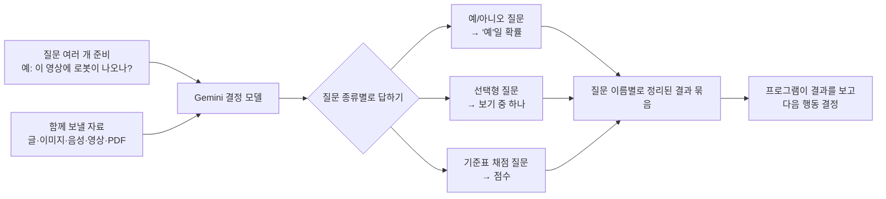

<div class="ai-knowledge-shell">

<aside class="ai-knowledge-sidebar">
  <p class="ai-eyebrow">CATEGORIES</p>
  <nav class="ai-cat-tree"><details class="ai-cat" open><summary><span class="catname">에이전트 오케스트레이션</span><span class="catcount">21</span></summary><ul><li><a href="https://altjs4510.github.io/ai_news_blog/knowledge/20261107/"><span class="kdate">2026-11-07</span><span class="ktitle">Hermes Agent v0.23.0 — The Hearth Release</span></a></li><li><a href="https://altjs4510.github.io/ai_news_blog/knowledge/20261029/"><span class="kdate">2026-10-29</span><span class="ktitle">How Anthropic ships Claude with Claude: Separati…</span></a></li><li><a href="https://altjs4510.github.io/ai_news_blog/knowledge/20261027/"><span class="kdate">2026-10-27</span><span class="ktitle">nightly-labs/openbot — Codex·Claude·Grok을 상주 팀원처…</span></a></li><li><a href="https://altjs4510.github.io/ai_news_blog/knowledge/20261015/"><span class="kdate">2026-10-15</span><span class="ktitle">How Third Moment Research runs 10,000 agents for…</span></a></li><li><a href="https://altjs4510.github.io/ai_news_blog/knowledge/20261014/"><span class="kdate">2026-10-14</span><span class="ktitle">How Anthropic's Dynamic Workflows Coordinate Cla…</span></a></li><li><a href="https://altjs4510.github.io/ai_news_blog/knowledge/20260930/"><span class="kdate">2026-09-30</span><span class="ktitle">Agents you can coach: how Asana builds human-age…</span></a></li><li><a href="https://altjs4510.github.io/ai_news_blog/knowledge/20260929/"><span class="kdate">2026-09-29</span><span class="ktitle">vectorize-io/hindsight — Hindsight: Agent Memory…</span></a></li><li><a href="https://altjs4510.github.io/ai_news_blog/knowledge/20260904/"><span class="kdate">2026-09-04</span><span class="ktitle">HarnessDev: Can LLMs Create and Evolve Their Own…</span></a></li><li><a href="https://altjs4510.github.io/ai_news_blog/knowledge/20260831-openexecutive-virtual-c-suite/"><span class="kdate">2026-08-31</span><span class="ktitle">Open Executive — 8명의 전문 에이전트를 하나의 임원 목소리로</span></a></li><li><a href="https://altjs4510.github.io/ai_news_blog/knowledge/20260828/"><span class="kdate">2026-08-28</span><span class="ktitle">Google ADK for Python v2.8.0 — RemoteA2aAgent 네이…</span></a></li><li><a href="https://altjs4510.github.io/ai_news_blog/knowledge/20260826/"><span class="kdate">2026-08-26</span><span class="ktitle">apache/maka — 도구 호출·권한 결정·종료 이벤트를 append-only 로그…</span></a></li><li><a href="https://altjs4510.github.io/ai_news_blog/knowledge/20260823/"><span class="kdate">2026-08-23</span><span class="ktitle">The Evolution of the Agent Harness — 하네스가 모델 가중치…</span></a></li><li><a href="https://altjs4510.github.io/ai_news_blog/knowledge/20260821/"><span class="kdate">2026-08-21</span><span class="ktitle">volcengine/OpenViking — 에이전트 메모리·Knowledge RAG·스…</span></a></li><li><a href="https://altjs4510.github.io/ai_news_blog/knowledge/20260805/"><span class="kdate">2026-08-05</span><span class="ktitle">TencentCloud/TencentDB-Agent-Memory — 대화·문서·코드를 …</span></a></li><li><a href="https://altjs4510.github.io/ai_news_blog/knowledge/20260726/"><span class="kdate">2026-07-26</span><span class="ktitle">citrolabs/ego-lite — 로그인된 브라우저 상태를 AI 에이전트와 공유하는…</span></a></li><li><a href="https://altjs4510.github.io/ai_news_blog/knowledge/20260717/"><span class="kdate">2026-07-17</span><span class="ktitle">After a year building agent memory, 'save everyt…</span></a></li><li><a href="https://altjs4510.github.io/ai_news_blog/knowledge/20260623/"><span class="kdate">2026-06-23</span><span class="ktitle">bytedance/deer-flow — 샌드박스·메모리·서브에이전트·메시지 게이트웨이를…</span></a></li><li><a href="https://altjs4510.github.io/ai_news_blog/knowledge/20260611/"><span class="kdate">2026-06-11</span><span class="ktitle">The evolution of agentic surfaces: building with…</span></a></li><li><a href="https://altjs4510.github.io/ai_news_blog/knowledge/20260602/"><span class="kdate">2026-06-02</span><span class="ktitle">revfactory/harness — 도메인별 에이전트 팀과 스킬을 자동 설계하는 메타…</span></a></li><li><a href="https://altjs4510.github.io/ai_news_blog/knowledge/20260529/"><span class="kdate">2026-05-29</span><span class="ktitle">Introducing dynamic workflows in Claude Code</span></a></li><li><a href="https://altjs4510.github.io/ai_news_blog/knowledge/20260507/"><span class="kdate">2026-05-07</span><span class="ktitle">ruvnet/ruflo — Claude 멀티 에이전트 오케스트레이션 플랫폼</span></a></li></ul></details><details class="ai-cat" open><summary><span class="catname">MCP &amp; 도구 통합</span><span class="catcount">16</span></summary><ul><li><a href="https://altjs4510.github.io/ai_news_blog/knowledge/20261103/"><span class="kdate">2026-11-03</span><span class="ktitle">vercel-labs/agent-desktop — 픽셀 대신 OS 접근성 트리로 앱 U…</span></a></li><li><a href="https://altjs4510.github.io/ai_news_blog/knowledge/20261017/"><span class="kdate">2026-10-17</span><span class="ktitle">mksglu/context-mode — 코딩 에이전트용 컨텍스트 윈도우 최적화</span></a></li><li><a href="https://altjs4510.github.io/ai_news_blog/knowledge/20260831-gitnexus-code-knowledge-graph/"><span class="kdate">2026-08-31</span><span class="ktitle">GitNexus — 코드베이스를 지식그래프로 바꿔 에이전트에게 쥐어주기</span></a></li><li><a href="https://altjs4510.github.io/ai_news_blog/knowledge/20260829/"><span class="kdate">2026-08-29</span><span class="ktitle">cursor/plugins — 플러그인 명세(specification)와 공식 플러그인…</span></a></li><li><a href="https://altjs4510.github.io/ai_news_blog/knowledge/20260802/"><span class="kdate">2026-08-02</span><span class="ktitle">Stateless MCP has recaptured my interest (and in…</span></a></li><li><a href="https://altjs4510.github.io/ai_news_blog/knowledge/20260731/"><span class="kdate">2026-07-31</span><span class="ktitle">different-ai/openwork — Claude Cowork의 오픈소스 대안(o…</span></a></li><li><a href="https://altjs4510.github.io/ai_news_blog/knowledge/20260729/"><span class="kdate">2026-07-29</span><span class="ktitle">Bringing MCP 2026-07-28 to Claude</span></a></li><li><a href="https://altjs4510.github.io/ai_news_blog/knowledge/20260718/"><span class="kdate">2026-07-18</span><span class="ktitle">tirth8205/code-review-graph — MCP·CLI용 로컬 코드 인텔리…</span></a></li><li><a href="https://altjs4510.github.io/ai_news_blog/knowledge/20260708/"><span class="kdate">2026-07-08</span><span class="ktitle">Expanding Managed Agents in Gemini API: backgrou…</span></a></li><li><a href="https://altjs4510.github.io/ai_news_blog/knowledge/20260618/"><span class="kdate">2026-06-18</span><span class="ktitle">DeusData/codebase-memory-mcp — 158개 언어 코드베이스를 밀리…</span></a></li><li><a href="https://altjs4510.github.io/ai_news_blog/knowledge/20260604/"><span class="kdate">2026-06-04</span><span class="ktitle">chopratejas/headroom — Compress tool outputs bef…</span></a></li><li><a href="https://altjs4510.github.io/ai_news_blog/knowledge/20260603/"><span class="kdate">2026-06-03</span><span class="ktitle">How Bad MCP design cost your Agent 5× more token…</span></a></li><li><a href="https://altjs4510.github.io/ai_news_blog/knowledge/20260521/"><span class="kdate">2026-05-21</span><span class="ktitle">colbymchenry/codegraph — Pre-indexed code knowle…</span></a></li><li><a href="https://altjs4510.github.io/ai_news_blog/knowledge/20260517/"><span class="kdate">2026-05-17</span><span class="ktitle">I gave my LLM 100,000+ tools — Lazy Discovery &a…</span></a></li><li><a href="https://altjs4510.github.io/ai_news_blog/knowledge/20260509/"><span class="kdate">2026-05-09</span><span class="ktitle">How to connect 100 MCP servers without the conte…</span></a></li><li><a href="https://altjs4510.github.io/ai_news_blog/knowledge/20260506/"><span class="kdate">2026-05-06</span><span class="ktitle">mksglu/context-mode — AI 코딩 에이전트용 컨텍스트 윈도우 최적화</span></a></li></ul></details><details class="ai-cat" open><summary><span class="catname">코딩 에이전트</span><span class="catcount">31</span></summary><ul><li><a href="https://altjs4510.github.io/ai_news_blog/knowledge/20261112/"><span class="kdate">2026-11-12</span><span class="ktitle">shadcn/improve — 가장 강한 모델로 코드베이스를 감사해 계획을 쓰고, 더 …</span></a></li><li><a href="https://altjs4510.github.io/ai_news_blog/knowledge/20261111/"><span class="kdate">2026-11-11</span><span class="ktitle">Quoting Prompting Claude Fable 5.2</span></a></li><li><a href="https://altjs4510.github.io/ai_news_blog/knowledge/20261110/"><span class="kdate">2026-11-10</span><span class="ktitle">meta/astryx — 직접 바꿔 쓸 수 있고 에이전트가 바로 쓸 수 있는(agent…</span></a></li><li><a href="https://altjs4510.github.io/ai_news_blog/knowledge/20261106/"><span class="kdate">2026-11-06</span><span class="ktitle">Cline desktop-nightly-20261104233655: feat(core)…</span></a></li><li><a href="https://altjs4510.github.io/ai_news_blog/knowledge/20261022/"><span class="kdate">2026-10-22</span><span class="ktitle">Claude Mods: Flipping the Harness Inside Out</span></a></li><li><a href="https://altjs4510.github.io/ai_news_blog/knowledge/20261018/"><span class="kdate">2026-10-18</span><span class="ktitle">Quoting Addy Osmani, Morgan Westlee Lunt, and Qi…</span></a></li><li><a href="https://altjs4510.github.io/ai_news_blog/knowledge/20261014-claude-code-advisor/"><span class="kdate">2026-10-14</span><span class="ktitle">Claude Code advisor — 가벼운 메인 모델이 일하고, 갈림길에서만 Opu…</span></a></li><li><a href="https://altjs4510.github.io/ai_news_blog/knowledge/20260920/"><span class="kdate">2026-09-20</span><span class="ktitle">Claude Code 2.1.277 — CLAUDE.md가 없으면 AGENTS.md를 …</span></a></li><li><a href="https://altjs4510.github.io/ai_news_blog/knowledge/20260912/"><span class="kdate">2026-09-12</span><span class="ktitle">Quoting Boris Cherny — 'Claude가 쓴 프로덕션 코드는 사람이 쓴…</span></a></li><li><a href="https://altjs4510.github.io/ai_news_blog/knowledge/20260910/"><span class="kdate">2026-09-10</span><span class="ktitle">vastsa/PI-Desktop — Electron + Rust 호스트 코어 + 에이전…</span></a></li><li><a href="https://altjs4510.github.io/ai_news_blog/knowledge/20260906/"><span class="kdate">2026-09-06</span><span class="ktitle">DietrichGebert/ponytail — 에이전트를 '방에서 가장 게으른 시니어 …</span></a></li><li><a href="https://altjs4510.github.io/ai_news_blog/knowledge/20260903/"><span class="kdate">2026-09-03</span><span class="ktitle">pacifio/atlas — 여러 코딩 에이전트의 변경을 한곳에서 추적·질의하는 '에이…</span></a></li><li><a href="https://altjs4510.github.io/ai_news_blog/knowledge/20260901/"><span class="kdate">2026-09-01</span><span class="ktitle">affaan-m/ECC — 스킬·본능·메모리·보안을 묶은 에이전트 하네스 성능 최적화 …</span></a></li><li><a href="https://altjs4510.github.io/ai_news_blog/knowledge/20260819/"><span class="kdate">2026-08-19</span><span class="ktitle">akitaonrails/ai-memory — 코딩 에이전트 CLI 간 장기 기억과 벤더…</span></a></li><li><a href="https://altjs4510.github.io/ai_news_blog/knowledge/20260814/"><span class="kdate">2026-08-14</span><span class="ktitle">cathrynlavery/diagram-design — Claude Code용 에디토리…</span></a></li><li><a href="https://altjs4510.github.io/ai_news_blog/knowledge/20260810/"><span class="kdate">2026-08-10</span><span class="ktitle">Auto mode is now the default in Claude Code for …</span></a></li><li><a href="https://altjs4510.github.io/ai_news_blog/knowledge/20260808/"><span class="kdate">2026-08-08</span><span class="ktitle">PrimeIntellect-ai/prime-agent — 코딩 워크플로우와 장시간 자율…</span></a></li><li><a href="https://altjs4510.github.io/ai_news_blog/knowledge/20260804/"><span class="kdate">2026-08-04</span><span class="ktitle">esengine/DeepSeek-Reasonix — prefix-cache 안정성을 축…</span></a></li><li><a href="https://altjs4510.github.io/ai_news_blog/knowledge/20260728/"><span class="kdate">2026-07-28</span><span class="ktitle">alibaba/open-code-review — 결정론적 파이프라인 + LLM 에이전트…</span></a></li><li><a href="https://altjs4510.github.io/ai_news_blog/knowledge/20260725/"><span class="kdate">2026-07-25</span><span class="ktitle">The new rules of context engineering for Claude …</span></a></li><li><a href="https://altjs4510.github.io/ai_news_blog/knowledge/20260714/"><span class="kdate">2026-07-14</span><span class="ktitle">Graphify-Labs/graphify — 코드베이스를 질의 가능한 지식 그래프로 만…</span></a></li><li><a href="https://altjs4510.github.io/ai_news_blog/knowledge/20260707/"><span class="kdate">2026-07-07</span><span class="ktitle">AI Hero Skills Catalog — 실무 엔지니어를 위한 재사용 가능한 판단 …</span></a></li><li><a href="https://altjs4510.github.io/ai_news_blog/knowledge/20260705/"><span class="kdate">2026-07-05</span><span class="ktitle">openai/codex-plugin-cc — Claude Code에서 Codex를 위임…</span></a></li><li><a href="https://altjs4510.github.io/ai_news_blog/knowledge/20260701/"><span class="kdate">2026-07-01</span><span class="ktitle">Google OKF (Open Knowledge Format) — 벤더 중립 에이전트 …</span></a></li><li><a href="https://altjs4510.github.io/ai_news_blog/knowledge/20260626/"><span class="kdate">2026-06-26</span><span class="ktitle">google-labs-code/design.md — 코딩 에이전트에게 디자인 시스템을 …</span></a></li><li><a href="https://altjs4510.github.io/ai_news_blog/knowledge/20260619/"><span class="kdate">2026-06-19</span><span class="ktitle">Claude Code now supports artifacts</span></a></li><li><a href="https://altjs4510.github.io/ai_news_blog/knowledge/20260530/"><span class="kdate">2026-05-30</span><span class="ktitle">Leonxlnx/taste-skill — AI에게 좋은 취향을 부여해 generic s…</span></a></li><li><a href="https://altjs4510.github.io/ai_news_blog/knowledge/20260528/"><span class="kdate">2026-05-28</span><span class="ktitle">Building self-improving tax agents with Codex</span></a></li><li><a href="https://altjs4510.github.io/ai_news_blog/knowledge/20260512/"><span class="kdate">2026-05-12</span><span class="ktitle">agentmemory — Persistent memory for AI coding ag…</span></a></li><li><a href="https://altjs4510.github.io/ai_news_blog/knowledge/20260508/"><span class="kdate">2026-05-08</span><span class="ktitle">addyosmani/agent-skills — Production-grade engin…</span></a></li><li><a href="https://altjs4510.github.io/ai_news_blog/knowledge/20260505/"><span class="kdate">2026-05-05</span><span class="ktitle">mattpocock/skills — Skills for Real Engineers (.…</span></a></li></ul></details><details class="ai-cat" open><summary><span class="catname">모델 &amp; 연구</span><span class="catcount">11</span></summary><ul><li><a href="https://altjs4510.github.io/ai_news_blog/knowledge/20261113/" class="current"><span class="kdate">2026-11-13</span><span class="ktitle">Gemini Decisions API</span></a></li><li><a href="https://altjs4510.github.io/ai_news_blog/knowledge/20261105/"><span class="kdate">2026-11-05</span><span class="ktitle">NVIDIA/auto-ontology — 데이터 위에 그래프 기반 의미 추론 레이어를 …</span></a></li><li><a href="https://altjs4510.github.io/ai_news_blog/knowledge/20261104/"><span class="kdate">2026-11-04</span><span class="ktitle">Qwen 3.8 27B on my laptop can interpret model we…</span></a></li><li><a href="https://altjs4510.github.io/ai_news_blog/knowledge/20261009/"><span class="kdate">2026-10-09</span><span class="ktitle">Claude Haiku 5.5 (Simon Willison의 출시 노트와 가격 분석)</span></a></li><li><a href="https://altjs4510.github.io/ai_news_blog/knowledge/20260907-voicemem-dual-brain-memory/"><span class="kdate">2026-09-07</span><span class="ktitle">VoiceMem — 좌뇌·우뇌로 쪼갠 스트리밍 메모리로 음성 에이전트 지연 없애기</span></a></li><li><a href="https://altjs4510.github.io/ai_news_blog/knowledge/20260716-proprag/"><span class="kdate">2026-07-16</span><span class="ktitle">PropRAG — 프로포지션 경로 위 beam search로 멀티홉 검색 안내</span></a></li><li><a href="https://altjs4510.github.io/ai_news_blog/knowledge/20260712/"><span class="kdate">2026-07-12</span><span class="ktitle">Do Automated Evals Work?</span></a></li><li><a href="https://altjs4510.github.io/ai_news_blog/knowledge/20260620/"><span class="kdate">2026-06-20</span><span class="ktitle">zai-org/GLM-5 — From Vibe Coding to Agentic Engi…</span></a></li><li><a href="https://altjs4510.github.io/ai_news_blog/knowledge/20260617/"><span class="kdate">2026-06-17</span><span class="ktitle">Predicting model behavior before release by simu…</span></a></li><li><a href="https://altjs4510.github.io/ai_news_blog/knowledge/20260516/"><span class="kdate">2026-05-16</span><span class="ktitle">STALE — 에이전트가 자기 기억의 유효성을 인지할 수 있는가</span></a></li><li><a href="https://altjs4510.github.io/ai_news_blog/knowledge/20260513/"><span class="kdate">2026-05-13</span><span class="ktitle">Thinking Machines' Native Interaction Models — T…</span></a></li></ul></details><details class="ai-cat" open><summary><span class="catname">인프라 &amp; 컴퓨트</span><span class="catcount">7</span></summary><ul><li><a href="https://altjs4510.github.io/ai_news_blog/knowledge/20260909/"><span class="kdate">2026-09-09</span><span class="ktitle">Reducing cost and improving performance with Cla…</span></a></li><li><a href="https://altjs4510.github.io/ai_news_blog/knowledge/20260905/"><span class="kdate">2026-09-05</span><span class="ktitle">magnitudedev/magnitude — 하드웨어에 맞는 최적 로컬 모델을 띄워 이…</span></a></li><li><a href="https://altjs4510.github.io/ai_news_blog/knowledge/20260806/"><span class="kdate">2026-08-06</span><span class="ktitle">cloudflare/computer — 에이전트에게 컴퓨터를 통째로 주는 엣지 실행 샌…</span></a></li><li><a href="https://altjs4510.github.io/ai_news_blog/knowledge/20260723/"><span class="kdate">2026-07-23</span><span class="ktitle">diegosouzapw/OmniRoute — 268+ 프로바이더를 단일 엔드포인트로 묶…</span></a></li><li><a href="https://altjs4510.github.io/ai_news_blog/knowledge/20260610/"><span class="kdate">2026-06-10</span><span class="ktitle">Fable 5 just made cost-aware model routing manda…</span></a></li><li><a href="https://altjs4510.github.io/ai_news_blog/knowledge/20260522/"><span class="kdate">2026-05-22</span><span class="ktitle">Giving Agents Computers — Ivan Burazin, Daytona</span></a></li><li><a href="https://altjs4510.github.io/ai_news_blog/knowledge/20260520/"><span class="kdate">2026-05-20</span><span class="ktitle">New in Claude Managed Agents: self-hosted sandbo…</span></a></li></ul></details><details class="ai-cat" open><summary><span class="catname">보안 &amp; 거버넌스</span><span class="catcount">27</span></summary><ul><li><a href="https://altjs4510.github.io/ai_news_blog/knowledge/20261031/"><span class="kdate">2026-10-31</span><span class="ktitle">CopilotKit/OpenBot — AI 동료마다 전용 컴퓨터를 주고 모든 행동을 실…</span></a></li><li><a href="https://altjs4510.github.io/ai_news_blog/knowledge/20261030/"><span class="kdate">2026-10-30</span><span class="ktitle">How we detect frontier model misalignment</span></a></li><li><a href="https://altjs4510.github.io/ai_news_blog/knowledge/20261021/"><span class="kdate">2026-10-21</span><span class="ktitle">cloudflare/security-audit-skill — 독립 검증된 기계 판독형 …</span></a></li><li><a href="https://altjs4510.github.io/ai_news_blog/knowledge/20261020/"><span class="kdate">2026-10-20</span><span class="ktitle">Satya Nadella — 모델을 내부자 위험으로 보는 원칙에 따라 Project P…</span></a></li><li><a href="https://altjs4510.github.io/ai_news_blog/knowledge/20261016/"><span class="kdate">2026-10-16</span><span class="ktitle">Crossing the Threshold: How OpenAI and Anthropic…</span></a></li><li><a href="https://altjs4510.github.io/ai_news_blog/knowledge/20261011/"><span class="kdate">2026-10-11</span><span class="ktitle">Anthropic can’t reliably control its AI agents. …</span></a></li><li><a href="https://altjs4510.github.io/ai_news_blog/knowledge/20261007/"><span class="kdate">2026-10-07</span><span class="ktitle">morluto/rea — 앱 동작부터 네이티브 바이너리까지 에이전트로 리버스 엔지니어링</span></a></li><li><a href="https://altjs4510.github.io/ai_news_blog/knowledge/20261004/"><span class="kdate">2026-10-04</span><span class="ktitle">Apple says it's tightening macOS 'Full Disk Acce…</span></a></li><li><a href="https://altjs4510.github.io/ai_news_blog/knowledge/20261001/"><span class="kdate">2026-10-01</span><span class="ktitle">NVIDIA/OpenShell</span></a></li><li><a href="https://altjs4510.github.io/ai_news_blog/knowledge/20260919/"><span class="kdate">2026-09-19</span><span class="ktitle">cloudflare/security-audit-skill — 다단계 보안 감사를 '독립…</span></a></li><li><a href="https://altjs4510.github.io/ai_news_blog/knowledge/20260913/"><span class="kdate">2026-09-13</span><span class="ktitle">OpenAI agents attacked RubyGems back in May: Ope…</span></a></li><li><a href="https://altjs4510.github.io/ai_news_blog/knowledge/20260902/"><span class="kdate">2026-09-02</span><span class="ktitle">AIR raises $50M to help companies vet the skills…</span></a></li><li><a href="https://altjs4510.github.io/ai_news_blog/knowledge/20260827/"><span class="kdate">2026-08-27</span><span class="ktitle">Claude in Chrome is generally available</span></a></li><li><a href="https://altjs4510.github.io/ai_news_blog/knowledge/20260819-mind-viruses/"><span class="kdate">2026-08-19</span><span class="ktitle">탈옥도, 인젝션도 없이 — 대화로만 퍼지는 에이전트의 '마인드 바이러스'</span></a></li><li><a href="https://altjs4510.github.io/ai_news_blog/knowledge/20260812/"><span class="kdate">2026-08-12</span><span class="ktitle">semantica-agi/semantica — 컨텍스트와 '책임 추적 가능한(accou…</span></a></li><li><a href="https://altjs4510.github.io/ai_news_blog/knowledge/20260730/"><span class="kdate">2026-07-30</span><span class="ktitle">Anatomy of a Frontier Lab Agent Intrusion: A Tec…</span></a></li><li><a href="https://altjs4510.github.io/ai_news_blog/knowledge/20260715/"><span class="kdate">2026-07-15</span><span class="ktitle">Dicklesworthstone/destructive_command_guard — 에이…</span></a></li><li><a href="https://altjs4510.github.io/ai_news_blog/knowledge/20260710/"><span class="kdate">2026-07-10</span><span class="ktitle">70개 MCP 서버 strace 런타임 감사 — 부팅 시 아웃바운드 호출 서버 적발</span></a></li><li><a href="https://altjs4510.github.io/ai_news_blog/knowledge/20260704/"><span class="kdate">2026-07-04</span><span class="ktitle">Cloudflare is about to block AI agents by defaul…</span></a></li><li><a href="https://altjs4510.github.io/ai_news_blog/knowledge/20260703/"><span class="kdate">2026-07-03</span><span class="ktitle">Giving admins more visibility and control over C…</span></a></li><li><a href="https://altjs4510.github.io/ai_news_blog/knowledge/20260630/"><span class="kdate">2026-06-30</span><span class="ktitle">Introducing the Claude apps gateway for Amazon B…</span></a></li><li><a href="https://altjs4510.github.io/ai_news_blog/knowledge/20260624/"><span class="kdate">2026-06-24</span><span class="ktitle">Agent identity in Claude Tag: a new access model…</span></a></li><li><a href="https://altjs4510.github.io/ai_news_blog/knowledge/20260613/"><span class="kdate">2026-06-13</span><span class="ktitle">Fable 5's guardrails got bypassed in 48 hours — …</span></a></li><li><a href="https://altjs4510.github.io/ai_news_blog/knowledge/20260612/"><span class="kdate">2026-06-12</span><span class="ktitle">NVIDIA/SkillSpector — AI 에이전트 스킬용 보안 스캐너</span></a></li><li><a href="https://altjs4510.github.io/ai_news_blog/knowledge/20260607/"><span class="kdate">2026-06-07</span><span class="ktitle">OpenAI Help: Lockdown Mode</span></a></li><li><a href="https://altjs4510.github.io/ai_news_blog/knowledge/20260531/"><span class="kdate">2026-05-31</span><span class="ktitle">How we contain Claude across products</span></a></li><li><a href="https://altjs4510.github.io/ai_news_blog/knowledge/20260527/"><span class="kdate">2026-05-27</span><span class="ktitle">Microsoft Copilot Cowork Exfiltrates Files</span></a></li></ul></details><details class="ai-cat" open><summary><span class="catname">응용 사례</span><span class="catcount">9</span></summary><ul><li><a href="https://altjs4510.github.io/ai_news_blog/knowledge/20261101/"><span class="kdate">2026-11-01</span><span class="ktitle">Agents Prompt People: Using Agents for Long-Hori…</span></a></li><li><a href="https://altjs4510.github.io/ai_news_blog/knowledge/20261028/"><span class="kdate">2026-10-28</span><span class="ktitle">Greptile takes bug detection beyond code review …</span></a></li><li><a href="https://altjs4510.github.io/ai_news_blog/knowledge/20261006/"><span class="kdate">2026-10-06</span><span class="ktitle">How Cresta turned CX expertise into an agent bui…</span></a></li><li><a href="https://altjs4510.github.io/ai_news_blog/knowledge/20260911/"><span class="kdate">2026-09-11</span><span class="ktitle">Now everyone can put data to work — ChatGPT Work…</span></a></li><li><a href="https://altjs4510.github.io/ai_news_blog/knowledge/20260709/"><span class="kdate">2026-07-09</span><span class="ktitle">mvanhorn/last30days-skill — Reddit·X·YouTube·HN·…</span></a></li><li><a href="https://altjs4510.github.io/ai_news_blog/knowledge/20260621/"><span class="kdate">2026-06-21</span><span class="ktitle">calesthio/OpenMontage — 12 파이프라인·52 도구·500+ 스킬을 …</span></a></li><li><a href="https://altjs4510.github.io/ai_news_blog/knowledge/20260609/"><span class="kdate">2026-06-09</span><span class="ktitle">Building intelligent apps for Apple platforms wi…</span></a></li><li><a href="https://altjs4510.github.io/ai_news_blog/knowledge/20260515/"><span class="kdate">2026-05-15</span><span class="ktitle">Clawdmeter — Claude Code 사용량을 데스크톱 대시보드로</span></a></li><li><a href="https://altjs4510.github.io/ai_news_blog/knowledge/20260514/"><span class="kdate">2026-05-14</span><span class="ktitle">Introducing Claude for Small Business</span></a></li></ul></details><details class="ai-cat" open><summary><span class="catname">산업 동향</span><span class="catcount">9</span></summary><ul><li><a href="https://altjs4510.github.io/ai_news_blog/knowledge/20261024/"><span class="kdate">2026-10-24</span><span class="ktitle">Donating Agent Skills to the Agentic AI Foundati…</span></a></li><li><a href="https://altjs4510.github.io/ai_news_blog/knowledge/20261023/"><span class="kdate">2026-10-23</span><span class="ktitle">Claude Duet app is Anthropic's bet on agents</span></a></li><li><a href="https://altjs4510.github.io/ai_news_blog/knowledge/20260907-humanmade-52week-rhythm/"><span class="kdate">2026-09-07</span><span class="ktitle">휴먼 메이드의 '52주 리듬' — 아이디어가 흔해진 시대에 값이 오르는 건 버리는 판단</span></a></li><li><a href="https://altjs4510.github.io/ai_news_blog/knowledge/20260830/"><span class="kdate">2026-08-30</span><span class="ktitle">[AINews] OpenAI shuts off Cursor — 프론티어 모델 공급 차단…</span></a></li><li><a href="https://altjs4510.github.io/ai_news_blog/knowledge/20260711/"><span class="kdate">2026-07-11</span><span class="ktitle">OpenAI says GPT 5.6 is the 'preferred model' for…</span></a></li><li><a href="https://altjs4510.github.io/ai_news_blog/knowledge/20260702/"><span class="kdate">2026-07-02</span><span class="ktitle">How Cursor deploys AI inside the enterprise (For…</span></a></li><li><a href="https://altjs4510.github.io/ai_news_blog/knowledge/20260616/"><span class="kdate">2026-06-16</span><span class="ktitle">Why AI hasn't replaced software engineers, and w…</span></a></li><li><a href="https://altjs4510.github.io/ai_news_blog/knowledge/20260519/"><span class="kdate">2026-05-19</span><span class="ktitle">Anthropic acquires Stainless</span></a></li><li><a href="https://altjs4510.github.io/ai_news_blog/knowledge/20260504/"><span class="kdate">2026-05-04</span><span class="ktitle">Agents for Everything Else: Codex for Knowledge …</span></a></li></ul></details></nav>
</aside>

<article class="ai-knowledge-article">

<header class="ai-post-hero">
  <p class="ai-eyebrow"><a class="ai-back" href="../">KNOWLEDGE</a> · 2026-11-13 · 오늘의 학습</p>
  <h2 class="ai-post-title">Gemini Decisions API</h2>
</header>

> 원문: [Gemini Decisions API](https://simonwillison.net/2026/Nov/11/gemini-decisions-api/)

## 📌 학습 정리

### 1. 한 줄로 말하면

AI에게 길게 설명을 듣는 대신 "예/아니오", "이 중 하나", "몇 점"처럼 짧은 판단만 빠르고 싸게 받아 오는 창구예요. 이번에 Google도 이런 창구를 열었어요.

### 2. 왜 이게 만들어졌어요?

AI 에이전트(사람 대신 여러 단계를 알아서 처리하는 AI 프로그램)는 일하는 중간중간 "계속 진행할까, 여기서 멈추고 사람에게 물어볼까?" 같은 판단을 자주 해야 해요. 이런 판단에도 매번 긴 답을 쓰는 큰 모델을 부르면 시간이 걸리고 비용도 쌓여요. 그래서 판단만 전문으로 하는 결정 모델(decision model)이라는 종류가 생겼어요. 원문을 보면 Jev와 OpenAI가 먼저 이런 모델을 내놓았고, 이번에 Google이 "Gemini Decision 1"로 합류했어요. 흥미로운 건 Google의 API(프로그램끼리 기능을 주고받는 창구) 구조가 Jev와 거의 같다는 점이에요. 이 분야에서 쓰는 방식이 점점 비슷하게 굳어 가는 분위기로 볼 수 있어요.

### 3. 비유로 풀면

이건 마치 시험 채점자에게 서술형 답안 대신 OX표, 객관식 답안지, 채점 기준표를 건네는 것과 비슷해요. 채점자는 길게 쓸 필요 없이 표시만 하면 되니까 빠르고, 받는 쪽도 결과를 바로 집계할 수 있어요.

다만 Gemini 채점자는 O나 X를 딱 잘라 표시하지 않아요. "O일 가능성 92%"처럼 얼마나 확신하는지를 숫자로 적어 줘요. 원문에 따르면 Jev와 OpenAI는 예/아니오 질문에 1.0이나 0.0으로만 답하는데, Gemini는 그보다 조금 덜 확신하는 값을 돌려준다고 해요.

그래서 결국, 이 도구는 AI의 판단을 짧고 기계가 바로 읽을 수 있는 형태로 받아서, 다음 행동을 고르는 데 쓰라고 만든 거예요.

### 4. 어떻게 작동하는지 (그림으로)



먼저 질문마다 짧은 이름을 붙이고, 판단에 쓸 자료와 함께 모델에 보내요. 모델은 질문 이름별로 질문 종류와 답을 정리해서 돌려줘요. 원문의 실험에서 Simon Willison은 직접 만든 로봇 영상을 보내면서 "용이 나오나?", "로봇이 나오나?", "프랑스가 배경인가?", "미국이 배경인가?"를 물었어요. 결과는 로봇 약 0.92, 미국 약 0.92, 용 약 0.05, 프랑스 약 0.08이었어요. 맞는 쪽은 높게, 아닌 쪽은 낮게 나왔지만 0이나 1로 딱 떨어지지는 않았어요.

### 5. 처음 보는 용어 풀이

- **판단 전용 모델 (decision model)**: 긴 글을 생성하지 않고 정해진 형식의 판단만 돌려주는 AI 모델이에요. 원문 기준으로 Jev, OpenAI, Google이 이 종류의 모델을 내놓았어요.
- **예/아니오 질문 (yes/no question)**: 답이 "예" 아니면 "아니오"인 질문이에요. Gemini는 결과에 "예"일 확률을 0과 1 사이 숫자로 적어 줘요.
- **Noul**: Jev가 예/아니오 질문을 가리킬 때 쓰는 이름이에요. Gemini도 같은 이름을 그대로 가져다 썼다고 해요.
- **기준표 채점 (rubric-scoring)**: 미리 정한 평가 기준에 맞춰 점수를 매기게 하는 질문 방식이에요. 선택형 질문(choice)과 함께 이 API가 지원하는 세 가지 질문 종류 중 하나예요.
- **토큰 (token)**: AI가 글을 읽을 때 쓰는 작은 조각 단위예요. 가격도 이 단위로 매겨요. Gemini Decision 1은 입력 100만 토큰당 10센트이고 출력은 무료라서, GPT-6 Luna 결정 모델과 가격이 같아요. 원문 기준으로 가장 싼 건 100만 토큰당 4.2센트인 Jev예요.
- **여러 형식 입력 지원 (multimodal)**: 글뿐 아니라 이미지, 소리, 영상 같은 다양한 형식의 자료를 함께 받을 수 있다는 뜻이에요. 원문에 따르면 Jev는 글(과 JSON)만, OpenAI는 글과 이미지를 받아요. Gemini Decision 1은 글·이미지·음성·영상·PDF를 모두 받아요.
- **구조화된 데이터 형식 (JSON)**: 이름과 값을 짝지어 적는 데이터 표기 방식이에요. 실험 결과도 이 형식으로 나와서, 프로그램이 바로 읽고 다음 단계에 활용할 수 있어요.

### 6. 한 발 더 들어가고 싶다면

- [Gemini Decisions API](https://blog.google/innovation-and-ai/technology/developers-tools/gemini-decisions-api/): 이걸 보면 Google이 직접 소개한 Gemini Decision 1의 내용을 알 수 있어요.
- [Jev](https://simonwillison.net/2026/Sep/21/jev/): 이걸 보면 이 분야에 먼저 나온 결정 모델이자, Gemini가 구조를 거의 그대로 따른 Jev가 어떤 모델인지 알 수 있어요.
- [OpenAI](https://simonwillison.net/2026/Oct/6/llm-openai-decisions/): 이걸 보면 OpenAI의 결정 모델이 어떻게 소개됐는지 알 수 있어요.
- [Yonkers stomping robot](https://simonwillison.net/2026/Nov/10/yonkers-rises/): 이걸 보면 실험에 실제로 쓴 로봇 영상이 어떤 건지 알 수 있어요.
- [Hacker News 토론](https://news.ycombinator.com/item?id=50456791): 이걸 보면 개발자들이 이 발표에 어떻게 반응했는지 알 수 있어요.

---

## 📖 원문 전체 번역 (정독용)

> 의역 최소화한 전체 번역입니다. 큰 흐름은 위 정리에서 잡고, 정확한 워딩이 필요할 땐 이 섹션에서 정독하세요.

2026년 11월 11일 - 링크 블로그

**[Gemini Decisions API](https://blog.google/innovation-and-ai/technology/developers-tools/gemini-decisions-api/)** ([via](https://news.ycombinator.com/item?id=50456791 "Hacker News")) Google이 "Gemini Decision 1"로 [Jev](https://simonwillison.net/2026/Sep/21/jev/) 및 [OpenAI](https://simonwillison.net/2026/Oct/6/llm-openai-decisions/)와 함께 의사결정(decision) 모델 카테고리에 합류했습니다. 이 새 모델 API는 Jev와 거의 동일합니다. 같은 세 가지 유형의 질문(예/아니오, 선택, 루브릭 채점)을 지원하며, 예/아니오 질문에 대해 Jev가 쓰는 용어 "Noul"까지 그대로 재사용합니다.

가격은 GPT-6 Luna 의사결정 모델과 같습니다. 입력 토큰 100만 개당 10센트이고 출력은 무료입니다. Jev는 100만 개당 4.2센트로, 셋 중 여전히 가장 저렴합니다.

Jev는 텍스트(및 JSON)만 지원합니다. OpenAI는 텍스트와 이미지를 처리할 수 있습니다. Gemini Decision 1은 완전한 멀티모달입니다. 텍스트, 이미지, 오디오, 비디오, PDF를 모두 다룹니다.

저는 [Yonkers 스톰핑 로봇](https://simonwillison.net/2026/Nov/10/yonkers-rises/) 비디오 파일과 함께 아래 질문들을 넘겨 비디오에 대해 테스트했습니다.

```
dragon: Does this video have a dragon in it?
robot: Does this video have a robot in it?
france: Is this video set in France?
usa: Is this video set in the USA?
```

Jev와 OpenAI는 예/아니오 질문에 대해 1.0 또는 0.0을 반환하지만, Gemini는 그보다 조금 덜 확신하는 값을 고집합니다.

{
  "dragon": {
    "type": "yes_no",
    "probability": 0.04976021841520312
  },
  "robot": {
    "type": "yes_no",
    "probability": 0.9234055387792485
  },
  "france": {
    "type": "yes_no",
    "probability": 0.08329171353166241
  },
  "usa": {
    "type": "yes_no",
    "probability": 0.9230459995157706
  }
}

</article>

</div>
