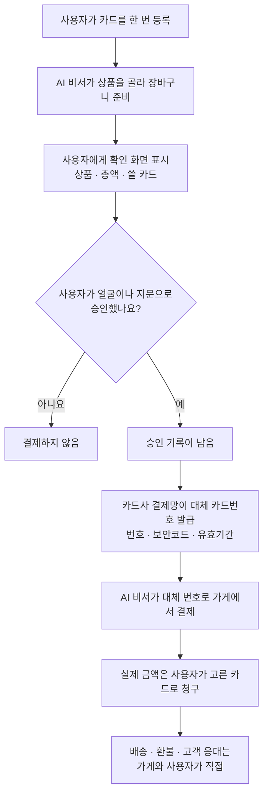

<aside class="ai-knowledge-sidebar">
  
CATEGORIES

  <nav class="ai-cat-tree">

에이전트 오케스트레이션21
<ul><li><a href="https://altjs4510.github.io/ai_news_blog/knowledge/20261107/">2026-11-07Hermes Agent v0.23.0 — The Hearth Release</a></li><li><a href="https://altjs4510.github.io/ai_news_blog/knowledge/20261029/">2026-10-29How Anthropic ships Claude with Claude: Separati…</a></li><li><a href="https://altjs4510.github.io/ai_news_blog/knowledge/20261027/">2026-10-27nightly-labs/openbot — Codex·Claude·Grok을 상주 팀원처…</a></li><li><a href="https://altjs4510.github.io/ai_news_blog/knowledge/20261015/">2026-10-15How Third Moment Research runs 10,000 agents for…</a></li><li><a href="https://altjs4510.github.io/ai_news_blog/knowledge/20261014/">2026-10-14How Anthropic's Dynamic Workflows Coordinate Cla…</a></li><li><a href="https://altjs4510.github.io/ai_news_blog/knowledge/20260930/">2026-09-30Agents you can coach: how Asana builds human-age…</a></li><li><a href="https://altjs4510.github.io/ai_news_blog/knowledge/20260929/">2026-09-29vectorize-io/hindsight — Hindsight: Agent Memory…</a></li><li><a href="https://altjs4510.github.io/ai_news_blog/knowledge/20260904/">2026-09-04HarnessDev: Can LLMs Create and Evolve Their Own…</a></li><li><a href="https://altjs4510.github.io/ai_news_blog/knowledge/20260831-openexecutive-virtual-c-suite/">2026-08-31Open Executive — 8명의 전문 에이전트를 하나의 임원 목소리로</a></li><li><a href="https://altjs4510.github.io/ai_news_blog/knowledge/20260828/">2026-08-28Google ADK for Python v2.8.0 — RemoteA2aAgent 네이…</a></li><li><a href="https://altjs4510.github.io/ai_news_blog/knowledge/20260826/">2026-08-26apache/maka — 도구 호출·권한 결정·종료 이벤트를 append-only 로그…</a></li><li><a href="https://altjs4510.github.io/ai_news_blog/knowledge/20260823/">2026-08-23The Evolution of the Agent Harness — 하네스가 모델 가중치…</a></li><li><a href="https://altjs4510.github.io/ai_news_blog/knowledge/20260821/">2026-08-21volcengine/OpenViking — 에이전트 메모리·Knowledge RAG·스…</a></li><li><a href="https://altjs4510.github.io/ai_news_blog/knowledge/20260805/">2026-08-05TencentCloud/TencentDB-Agent-Memory — 대화·문서·코드를 …</a></li><li><a href="https://altjs4510.github.io/ai_news_blog/knowledge/20260726/">2026-07-26citrolabs/ego-lite — 로그인된 브라우저 상태를 AI 에이전트와 공유하는…</a></li><li><a href="https://altjs4510.github.io/ai_news_blog/knowledge/20260717/">2026-07-17After a year building agent memory, 'save everyt…</a></li><li><a href="https://altjs4510.github.io/ai_news_blog/knowledge/20260623/">2026-06-23bytedance/deer-flow — 샌드박스·메모리·서브에이전트·메시지 게이트웨이를…</a></li><li><a href="https://altjs4510.github.io/ai_news_blog/knowledge/20260611/">2026-06-11The evolution of agentic surfaces: building with…</a></li><li><a href="https://altjs4510.github.io/ai_news_blog/knowledge/20260602/">2026-06-02revfactory/harness — 도메인별 에이전트 팀과 스킬을 자동 설계하는 메타…</a></li><li><a href="https://altjs4510.github.io/ai_news_blog/knowledge/20260529/">2026-05-29Introducing dynamic workflows in Claude Code</a></li><li><a href="https://altjs4510.github.io/ai_news_blog/knowledge/20260507/">2026-05-07ruvnet/ruflo — Claude 멀티 에이전트 오케스트레이션 플랫폼</a></li></ul>

MCP &amp; 도구 통합16
<ul><li><a href="https://altjs4510.github.io/ai_news_blog/knowledge/20261103/">2026-11-03vercel-labs/agent-desktop — 픽셀 대신 OS 접근성 트리로 앱 U…</a></li><li><a href="https://altjs4510.github.io/ai_news_blog/knowledge/20261017/">2026-10-17mksglu/context-mode — 코딩 에이전트용 컨텍스트 윈도우 최적화</a></li><li><a href="https://altjs4510.github.io/ai_news_blog/knowledge/20260831-gitnexus-code-knowledge-graph/">2026-08-31GitNexus — 코드베이스를 지식그래프로 바꿔 에이전트에게 쥐어주기</a></li><li><a href="https://altjs4510.github.io/ai_news_blog/knowledge/20260829/">2026-08-29cursor/plugins — 플러그인 명세(specification)와 공식 플러그인…</a></li><li><a href="https://altjs4510.github.io/ai_news_blog/knowledge/20260802/">2026-08-02Stateless MCP has recaptured my interest (and in…</a></li><li><a href="https://altjs4510.github.io/ai_news_blog/knowledge/20260731/">2026-07-31different-ai/openwork — Claude Cowork의 오픈소스 대안(o…</a></li><li><a href="https://altjs4510.github.io/ai_news_blog/knowledge/20260729/">2026-07-29Bringing MCP 2026-07-28 to Claude</a></li><li><a href="https://altjs4510.github.io/ai_news_blog/knowledge/20260718/">2026-07-18tirth8205/code-review-graph — MCP·CLI용 로컬 코드 인텔리…</a></li><li><a href="https://altjs4510.github.io/ai_news_blog/knowledge/20260708/">2026-07-08Expanding Managed Agents in Gemini API: backgrou…</a></li><li><a href="https://altjs4510.github.io/ai_news_blog/knowledge/20260618/">2026-06-18DeusData/codebase-memory-mcp — 158개 언어 코드베이스를 밀리…</a></li><li><a href="https://altjs4510.github.io/ai_news_blog/knowledge/20260604/">2026-06-04chopratejas/headroom — Compress tool outputs bef…</a></li><li><a href="https://altjs4510.github.io/ai_news_blog/knowledge/20260603/">2026-06-03How Bad MCP design cost your Agent 5× more token…</a></li><li><a href="https://altjs4510.github.io/ai_news_blog/knowledge/20260521/">2026-05-21colbymchenry/codegraph — Pre-indexed code knowle…</a></li><li><a href="https://altjs4510.github.io/ai_news_blog/knowledge/20260517/">2026-05-17I gave my LLM 100,000+ tools — Lazy Discovery &a…</a></li><li><a href="https://altjs4510.github.io/ai_news_blog/knowledge/20260509/">2026-05-09How to connect 100 MCP servers without the conte…</a></li><li><a href="https://altjs4510.github.io/ai_news_blog/knowledge/20260506/">2026-05-06mksglu/context-mode — AI 코딩 에이전트용 컨텍스트 윈도우 최적화</a></li></ul>

코딩 에이전트31
<ul><li><a href="https://altjs4510.github.io/ai_news_blog/knowledge/20261112/">2026-11-12shadcn/improve — 가장 강한 모델로 코드베이스를 감사해 계획을 쓰고, 더 …</a></li><li><a href="https://altjs4510.github.io/ai_news_blog/knowledge/20261111/">2026-11-11Quoting Prompting Claude Fable 5.2</a></li><li><a href="https://altjs4510.github.io/ai_news_blog/knowledge/20261110/">2026-11-10meta/astryx — 직접 바꿔 쓸 수 있고 에이전트가 바로 쓸 수 있는(agent…</a></li><li><a href="https://altjs4510.github.io/ai_news_blog/knowledge/20261106/">2026-11-06Cline desktop-nightly-20261104233655: feat(core)…</a></li><li><a href="https://altjs4510.github.io/ai_news_blog/knowledge/20261022/">2026-10-22Claude Mods: Flipping the Harness Inside Out</a></li><li><a href="https://altjs4510.github.io/ai_news_blog/knowledge/20261018/">2026-10-18Quoting Addy Osmani, Morgan Westlee Lunt, and Qi…</a></li><li><a href="https://altjs4510.github.io/ai_news_blog/knowledge/20261014-claude-code-advisor/">2026-10-14Claude Code advisor — 가벼운 메인 모델이 일하고, 갈림길에서만 Opu…</a></li><li><a href="https://altjs4510.github.io/ai_news_blog/knowledge/20260920/">2026-09-20Claude Code 2.1.277 — CLAUDE.md가 없으면 AGENTS.md를 …</a></li><li><a href="https://altjs4510.github.io/ai_news_blog/knowledge/20260912/">2026-09-12Quoting Boris Cherny — 'Claude가 쓴 프로덕션 코드는 사람이 쓴…</a></li><li><a href="https://altjs4510.github.io/ai_news_blog/knowledge/20260910/">2026-09-10vastsa/PI-Desktop — Electron + Rust 호스트 코어 + 에이전…</a></li><li><a href="https://altjs4510.github.io/ai_news_blog/knowledge/20260906/">2026-09-06DietrichGebert/ponytail — 에이전트를 '방에서 가장 게으른 시니어 …</a></li><li><a href="https://altjs4510.github.io/ai_news_blog/knowledge/20260903/">2026-09-03pacifio/atlas — 여러 코딩 에이전트의 변경을 한곳에서 추적·질의하는 '에이…</a></li><li><a href="https://altjs4510.github.io/ai_news_blog/knowledge/20260901/">2026-09-01affaan-m/ECC — 스킬·본능·메모리·보안을 묶은 에이전트 하네스 성능 최적화 …</a></li><li><a href="https://altjs4510.github.io/ai_news_blog/knowledge/20260819/">2026-08-19akitaonrails/ai-memory — 코딩 에이전트 CLI 간 장기 기억과 벤더…</a></li><li><a href="https://altjs4510.github.io/ai_news_blog/knowledge/20260814/">2026-08-14cathrynlavery/diagram-design — Claude Code용 에디토리…</a></li><li><a href="https://altjs4510.github.io/ai_news_blog/knowledge/20260810/">2026-08-10Auto mode is now the default in Claude Code for …</a></li><li><a href="https://altjs4510.github.io/ai_news_blog/knowledge/20260808/">2026-08-08PrimeIntellect-ai/prime-agent — 코딩 워크플로우와 장시간 자율…</a></li><li><a href="https://altjs4510.github.io/ai_news_blog/knowledge/20260804/">2026-08-04esengine/DeepSeek-Reasonix — prefix-cache 안정성을 축…</a></li><li><a href="https://altjs4510.github.io/ai_news_blog/knowledge/20260728/">2026-07-28alibaba/open-code-review — 결정론적 파이프라인 + LLM 에이전트…</a></li><li><a href="https://altjs4510.github.io/ai_news_blog/knowledge/20260725/">2026-07-25The new rules of context engineering for Claude …</a></li><li><a href="https://altjs4510.github.io/ai_news_blog/knowledge/20260714/">2026-07-14Graphify-Labs/graphify — 코드베이스를 질의 가능한 지식 그래프로 만…</a></li><li><a href="https://altjs4510.github.io/ai_news_blog/knowledge/20260707/">2026-07-07AI Hero Skills Catalog — 실무 엔지니어를 위한 재사용 가능한 판단 …</a></li><li><a href="https://altjs4510.github.io/ai_news_blog/knowledge/20260705/">2026-07-05openai/codex-plugin-cc — Claude Code에서 Codex를 위임…</a></li><li><a href="https://altjs4510.github.io/ai_news_blog/knowledge/20260701/">2026-07-01Google OKF (Open Knowledge Format) — 벤더 중립 에이전트 …</a></li><li><a href="https://altjs4510.github.io/ai_news_blog/knowledge/20260626/">2026-06-26google-labs-code/design.md — 코딩 에이전트에게 디자인 시스템을 …</a></li><li><a href="https://altjs4510.github.io/ai_news_blog/knowledge/20260619/">2026-06-19Claude Code now supports artifacts</a></li><li><a href="https://altjs4510.github.io/ai_news_blog/knowledge/20260530/">2026-05-30Leonxlnx/taste-skill — AI에게 좋은 취향을 부여해 generic s…</a></li><li><a href="https://altjs4510.github.io/ai_news_blog/knowledge/20260528/">2026-05-28Building self-improving tax agents with Codex</a></li><li><a href="https://altjs4510.github.io/ai_news_blog/knowledge/20260512/">2026-05-12agentmemory — Persistent memory for AI coding ag…</a></li><li><a href="https://altjs4510.github.io/ai_news_blog/knowledge/20260508/">2026-05-08addyosmani/agent-skills — Production-grade engin…</a></li><li><a href="https://altjs4510.github.io/ai_news_blog/knowledge/20260505/">2026-05-05mattpocock/skills — Skills for Real Engineers (.…</a></li></ul>

모델 &amp; 연구11
<ul><li><a href="https://altjs4510.github.io/ai_news_blog/knowledge/20261113/">2026-11-13Gemini Decisions API</a></li><li><a href="https://altjs4510.github.io/ai_news_blog/knowledge/20261105/">2026-11-05NVIDIA/auto-ontology — 데이터 위에 그래프 기반 의미 추론 레이어를 …</a></li><li><a href="https://altjs4510.github.io/ai_news_blog/knowledge/20261104/">2026-11-04Qwen 3.8 27B on my laptop can interpret model we…</a></li><li><a href="https://altjs4510.github.io/ai_news_blog/knowledge/20261009/">2026-10-09Claude Haiku 5.5 (Simon Willison의 출시 노트와 가격 분석)</a></li><li><a href="https://altjs4510.github.io/ai_news_blog/knowledge/20260907-voicemem-dual-brain-memory/">2026-09-07VoiceMem — 좌뇌·우뇌로 쪼갠 스트리밍 메모리로 음성 에이전트 지연 없애기</a></li><li><a href="https://altjs4510.github.io/ai_news_blog/knowledge/20260716-proprag/">2026-07-16PropRAG — 프로포지션 경로 위 beam search로 멀티홉 검색 안내</a></li><li><a href="https://altjs4510.github.io/ai_news_blog/knowledge/20260712/">2026-07-12Do Automated Evals Work?</a></li><li><a href="https://altjs4510.github.io/ai_news_blog/knowledge/20260620/">2026-06-20zai-org/GLM-5 — From Vibe Coding to Agentic Engi…</a></li><li><a href="https://altjs4510.github.io/ai_news_blog/knowledge/20260617/">2026-06-17Predicting model behavior before release by simu…</a></li><li><a href="https://altjs4510.github.io/ai_news_blog/knowledge/20260516/">2026-05-16STALE — 에이전트가 자기 기억의 유효성을 인지할 수 있는가</a></li><li><a href="https://altjs4510.github.io/ai_news_blog/knowledge/20260513/">2026-05-13Thinking Machines' Native Interaction Models — T…</a></li></ul>

인프라 &amp; 컴퓨트7
<ul><li><a href="https://altjs4510.github.io/ai_news_blog/knowledge/20260909/">2026-09-09Reducing cost and improving performance with Cla…</a></li><li><a href="https://altjs4510.github.io/ai_news_blog/knowledge/20260905/">2026-09-05magnitudedev/magnitude — 하드웨어에 맞는 최적 로컬 모델을 띄워 이…</a></li><li><a href="https://altjs4510.github.io/ai_news_blog/knowledge/20260806/">2026-08-06cloudflare/computer — 에이전트에게 컴퓨터를 통째로 주는 엣지 실행 샌…</a></li><li><a href="https://altjs4510.github.io/ai_news_blog/knowledge/20260723/">2026-07-23diegosouzapw/OmniRoute — 268+ 프로바이더를 단일 엔드포인트로 묶…</a></li><li><a href="https://altjs4510.github.io/ai_news_blog/knowledge/20260610/">2026-06-10Fable 5 just made cost-aware model routing manda…</a></li><li><a href="https://altjs4510.github.io/ai_news_blog/knowledge/20260522/">2026-05-22Giving Agents Computers — Ivan Burazin, Daytona</a></li><li><a href="https://altjs4510.github.io/ai_news_blog/knowledge/20260520/">2026-05-20New in Claude Managed Agents: self-hosted sandbo…</a></li></ul>

보안 &amp; 거버넌스27
<ul><li><a href="https://altjs4510.github.io/ai_news_blog/knowledge/20261031/">2026-10-31CopilotKit/OpenBot — AI 동료마다 전용 컴퓨터를 주고 모든 행동을 실…</a></li><li><a href="https://altjs4510.github.io/ai_news_blog/knowledge/20261030/">2026-10-30How we detect frontier model misalignment</a></li><li><a href="https://altjs4510.github.io/ai_news_blog/knowledge/20261021/">2026-10-21cloudflare/security-audit-skill — 독립 검증된 기계 판독형 …</a></li><li><a href="https://altjs4510.github.io/ai_news_blog/knowledge/20261020/">2026-10-20Satya Nadella — 모델을 내부자 위험으로 보는 원칙에 따라 Project P…</a></li><li><a href="https://altjs4510.github.io/ai_news_blog/knowledge/20261016/">2026-10-16Crossing the Threshold: How OpenAI and Anthropic…</a></li><li><a href="https://altjs4510.github.io/ai_news_blog/knowledge/20261011/">2026-10-11Anthropic can’t reliably control its AI agents. …</a></li><li><a href="https://altjs4510.github.io/ai_news_blog/knowledge/20261007/">2026-10-07morluto/rea — 앱 동작부터 네이티브 바이너리까지 에이전트로 리버스 엔지니어링</a></li><li><a href="https://altjs4510.github.io/ai_news_blog/knowledge/20261004/">2026-10-04Apple says it's tightening macOS 'Full Disk Acce…</a></li><li><a href="https://altjs4510.github.io/ai_news_blog/knowledge/20261001/">2026-10-01NVIDIA/OpenShell</a></li><li><a href="https://altjs4510.github.io/ai_news_blog/knowledge/20260919/">2026-09-19cloudflare/security-audit-skill — 다단계 보안 감사를 '독립…</a></li><li><a href="https://altjs4510.github.io/ai_news_blog/knowledge/20260913/">2026-09-13OpenAI agents attacked RubyGems back in May: Ope…</a></li><li><a href="https://altjs4510.github.io/ai_news_blog/knowledge/20260902/">2026-09-02AIR raises $50M to help companies vet the skills…</a></li><li><a href="https://altjs4510.github.io/ai_news_blog/knowledge/20260827/">2026-08-27Claude in Chrome is generally available</a></li><li><a href="https://altjs4510.github.io/ai_news_blog/knowledge/20260819-mind-viruses/">2026-08-19탈옥도, 인젝션도 없이 — 대화로만 퍼지는 에이전트의 '마인드 바이러스'</a></li><li><a href="https://altjs4510.github.io/ai_news_blog/knowledge/20260812/">2026-08-12semantica-agi/semantica — 컨텍스트와 '책임 추적 가능한(accou…</a></li><li><a href="https://altjs4510.github.io/ai_news_blog/knowledge/20260730/">2026-07-30Anatomy of a Frontier Lab Agent Intrusion: A Tec…</a></li><li><a href="https://altjs4510.github.io/ai_news_blog/knowledge/20260715/">2026-07-15Dicklesworthstone/destructive_command_guard — 에이…</a></li><li><a href="https://altjs4510.github.io/ai_news_blog/knowledge/20260710/">2026-07-1070개 MCP 서버 strace 런타임 감사 — 부팅 시 아웃바운드 호출 서버 적발</a></li><li><a href="https://altjs4510.github.io/ai_news_blog/knowledge/20260704/">2026-07-04Cloudflare is about to block AI agents by defaul…</a></li><li><a href="https://altjs4510.github.io/ai_news_blog/knowledge/20260703/">2026-07-03Giving admins more visibility and control over C…</a></li><li><a href="https://altjs4510.github.io/ai_news_blog/knowledge/20260630/">2026-06-30Introducing the Claude apps gateway for Amazon B…</a></li><li><a href="https://altjs4510.github.io/ai_news_blog/knowledge/20260624/">2026-06-24Agent identity in Claude Tag: a new access model…</a></li><li><a href="https://altjs4510.github.io/ai_news_blog/knowledge/20260613/">2026-06-13Fable 5's guardrails got bypassed in 48 hours — …</a></li><li><a href="https://altjs4510.github.io/ai_news_blog/knowledge/20260612/">2026-06-12NVIDIA/SkillSpector — AI 에이전트 스킬용 보안 스캐너</a></li><li><a href="https://altjs4510.github.io/ai_news_blog/knowledge/20260607/">2026-06-07OpenAI Help: Lockdown Mode</a></li><li><a href="https://altjs4510.github.io/ai_news_blog/knowledge/20260531/">2026-05-31How we contain Claude across products</a></li><li><a href="https://altjs4510.github.io/ai_news_blog/knowledge/20260527/">2026-05-27Microsoft Copilot Cowork Exfiltrates Files</a></li></ul>

응용 사례10
<ul><li><a href="https://altjs4510.github.io/ai_news_blog/knowledge/20261114/" class="current">2026-11-14Introducing ChatGPT Wallet</a></li><li><a href="https://altjs4510.github.io/ai_news_blog/knowledge/20261101/">2026-11-01Agents Prompt People: Using Agents for Long-Hori…</a></li><li><a href="https://altjs4510.github.io/ai_news_blog/knowledge/20261028/">2026-10-28Greptile takes bug detection beyond code review …</a></li><li><a href="https://altjs4510.github.io/ai_news_blog/knowledge/20261006/">2026-10-06How Cresta turned CX expertise into an agent bui…</a></li><li><a href="https://altjs4510.github.io/ai_news_blog/knowledge/20260911/">2026-09-11Now everyone can put data to work — ChatGPT Work…</a></li><li><a href="https://altjs4510.github.io/ai_news_blog/knowledge/20260709/">2026-07-09mvanhorn/last30days-skill — Reddit·X·YouTube·HN·…</a></li><li><a href="https://altjs4510.github.io/ai_news_blog/knowledge/20260621/">2026-06-21calesthio/OpenMontage — 12 파이프라인·52 도구·500+ 스킬을 …</a></li><li><a href="https://altjs4510.github.io/ai_news_blog/knowledge/20260609/">2026-06-09Building intelligent apps for Apple platforms wi…</a></li><li><a href="https://altjs4510.github.io/ai_news_blog/knowledge/20260515/">2026-05-15Clawdmeter — Claude Code 사용량을 데스크톱 대시보드로</a></li><li><a href="https://altjs4510.github.io/ai_news_blog/knowledge/20260514/">2026-05-14Introducing Claude for Small Business</a></li></ul>

산업 동향9
<ul><li><a href="https://altjs4510.github.io/ai_news_blog/knowledge/20261024/">2026-10-24Donating Agent Skills to the Agentic AI Foundati…</a></li><li><a href="https://altjs4510.github.io/ai_news_blog/knowledge/20261023/">2026-10-23Claude Duet app is Anthropic's bet on agents</a></li><li><a href="https://altjs4510.github.io/ai_news_blog/knowledge/20260907-humanmade-52week-rhythm/">2026-09-07휴먼 메이드의 '52주 리듬' — 아이디어가 흔해진 시대에 값이 오르는 건 버리는 판단</a></li><li><a href="https://altjs4510.github.io/ai_news_blog/knowledge/20260830/">2026-08-30[AINews] OpenAI shuts off Cursor — 프론티어 모델 공급 차단…</a></li><li><a href="https://altjs4510.github.io/ai_news_blog/knowledge/20260711/">2026-07-11OpenAI says GPT 5.6 is the 'preferred model' for…</a></li><li><a href="https://altjs4510.github.io/ai_news_blog/knowledge/20260702/">2026-07-02How Cursor deploys AI inside the enterprise (For…</a></li><li><a href="https://altjs4510.github.io/ai_news_blog/knowledge/20260616/">2026-06-16Why AI hasn't replaced software engineers, and w…</a></li><li><a href="https://altjs4510.github.io/ai_news_blog/knowledge/20260519/">2026-05-19Anthropic acquires Stainless</a></li><li><a href="https://altjs4510.github.io/ai_news_blog/knowledge/20260504/">2026-05-04Agents for Everything Else: Codex for Knowledge …</a></li></ul>
</nav>
</aside>

<article class="ai-knowledge-article">

<header class="ai-post-hero">
  
<a class="ai-back" href="../">KNOWLEDGE</a> · 2026-11-14 · 오늘의 학습

  <h2 class="ai-post-title">Introducing ChatGPT Wallet</h2>
</header>

> 원문: [Introducing ChatGPT Wallet](https://openai.com/index/introducing-chatgpt-wallet)

## 📌 학습 정리

### 1. 한 줄로 말하면

ChatGPT Wallet은 AI 비서가 내 대신 물건값을 낼 수 있게 해 주는 지갑이에요. 내 실제 카드번호는 비서에게도, 가게에도 넘어가지 않아요. 그리고 결제할 때마다 내가 얼굴이나 지문으로 직접 "좋아요"를 눌러야 돈이 나가요.

### 2. 왜 이게 만들어졌어요?

원문에 따르면 ChatGPT는 매주 12억 명이 쓰고, 그중 많은 사람이 상품을 알아보고 비교하고 무엇을 살지 정하는 데 활용하고 있어요. 그런데 고르는 데까지만 도와주고, 실제로 사는 건 여전히 사람이 직접 해야 했어요. AI가 대신 결제하게 하려면 카드 정보를 어떻게 지킬지, 사용자가 허락하지 않은 결제를 어떻게 막을지, 가게는 이 결제를 받아도 되는지 같은 문제가 남아 있었어요. 가게 쪽 사이트나 결제 시스템이 AI가 들어오는 걸 수상하게 보고 막아 버리는 경우도 있었고요. ChatGPT Wallet은 이런 걱정을 줄이면서, 가게들이 지금 쓰는 결제 시스템으로도 그대로 받을 수 있는 결제 방법을 만들려는 시도예요.

### 3. 비유로 풀면

이건 마치 심부름하는 사람에게 진짜 카드 대신 **한 번만 쓸 수 있게 따로 발급한 대리 카드**를 쥐여 주는 것과 같아요. 심부름꾼은 장바구니를 채워서 "이거 사도 될까요?" 하고 내역서를 보여 주고, 내가 확인 도장을 찍어야 그 대리 카드가 생겨요. 가게는 대리 카드로 결제를 받지만, 실제 돈은 내 원래 카드에서 빠져나가요.

그래서 결국 AI는 내 진짜 카드번호를 한 번도 보지 않고 결제를 끝내요. 결제 하나하나에 내가 승인했다는 기록이 남고요. 원래 카드에 붙어 있던 포인트 같은 혜택이나 분쟁이 생겼을 때의 보호도 그대로 유지돼요.

### 4. 어떻게 작동하는지 (그림으로)

카드는 처음에 한 번만 등록하면 되고, 그다음부터는 결제할 때마다 카드 정보를 다시 입력하지 않고 승인만 해요. 승인이 끝나야 결제망이 진짜 카드번호 대신 쓸 번호를 내주고, AI 비서는 그 번호로만 결제해요. 거래는 사용자와 가게 사이에서 직접 이뤄지기 때문에 가격, 배송, 반품, 고객 응대는 가게가 지금처럼 맡아요.

앞으로는 "한 달에 얼마까지", "이 종류 물건만", "이 기간 동안만"처럼 조건을 미리 정해 두고, 그 범위 안의 결제는 AI에게 통째로 맡기는 방향도 내다보고 있다고 해요. 그때도 생체 인증과 승인 기록 같은 지금의 보호 장치를 바탕으로 더 강화된 안전장치를 붙일 계획이라고 하고요.

### 5. 처음 보는 용어 풀이

- **AI 비서 (agent)**: 사용자를 대신해 여러 단계의 일을 스스로 처리하는 AI예요. 여기서는 상품을 찾아 장바구니에 담고 결제까지 진행하는 역할을 해요.
- **AI 비서가 하는 쇼핑 (agentic commerce)**: 사람이 직접 클릭해서 사는 대신 AI 비서가 구매를 처리하는 새로운 쇼핑 방식이에요. 원문은 아직 초기 단계라서 많은 사이트와 결제 시스템이 적응하는 중이라고 설명해요.
- **대체 카드번호 (payment token)**: 진짜 카드 정보 대신 쓰는 번호예요. 카드번호, 보안코드, 유효기간을 따로 갖고 있어서 가게나 AI가 진짜 카드 정보를 몰라도 결제가 돼요.
- **생체 인증 보안 확인 (biometric check)**: Face ID(얼굴 인식)나 지문처럼 내 몸으로 본인임을 확인하는 방법이에요. 결제마다 이 확인을 거쳐야 해서 "내가 정말 허락했다"는 증거가 돼요.
- **위험 거래 감지 시스템 (risk system)**: 결제가 사기는 아닌지 자동으로 살피는 시스템이에요. 평소와 다른 패턴을 막도록 만들어져 있어서, AI가 하는 정상적인 구매까지 의심해 거절하거나 취소할 수 있어요.
- **서명된 요청 확인 (Web Bot Auth)**: 사이트에 들어오는 자동 프로그램이 정말 ChatGPT 비서인지 알아볼 수 있게 해 주는 방식이에요. 가게는 콘텐츠 전송망(CDN)이나 방화벽(firewall)에서 이 서명을 알아보도록 설정해, ChatGPT 비서가 실수로 막히지 않게 할 수 있어요.
- **상품 목록 파일 (product feed)과 연결 도구 (plugin, WebMCP)**: 상품 목록 파일은 가게가 현재 가격과 재고를 정리해서 ChatGPT에 올리는 자료예요. 플러그인(plugin)이나 WebMCP 도구를 붙이면 AI 비서가 재고 확인이나 장바구니 관리 같은 일을 가게 시스템에서 바로 할 수 있어요. 원문에 따르면 브라우저로 사이트에 접근하는 것만이라면 플러그인이나 상품 목록 파일이 없어도 돼요.

참고로 ChatGPT Wallet은 American Express, Mastercard, Visa와 함께 만들었어요. 처음에는 dots를 통해 미국의 만 18세 이상 ChatGPT Pro 구독자 중 미국에서 발급한 대상 카드를 가진 사람에게만 제공돼요. dots는 OpenAI 제품으로, 원문에서는 사용자의 "dot"이 대신 구매를 마치는 곳으로 소개돼요.

### 6. 한 발 더 들어가고 싶다면

- [dots](https://openai.com/index/introducing-dots/): ChatGPT Wallet이 처음 제공되는 dots가 어떤 제품인지 알 수 있어요.
- [Commerce Partner Playbook](https://developers.openai.com/commerce): 가게가 AI 비서를 통해 오는 손님을 받으려면 무엇을 준비해야 하는지 정리한 실무 안내서예요. 상품 정보 공개, AI 비서 접근 허용, 결제 거절 줄이기 같은 내용이 담겨 있어요.
- [Claim your business in ChatGPT](https://openai.com/index/introducing-businesses-chatgpt/): 가게가 ChatGPT에서 자기 사업체를 인증받고 상품 정보를 직접 관리하는 방법을 알 수 있어요.

---

## 📖 원문 전체 번역 (정독용)

> 의역 최소화한 전체 번역입니다. 큰 흐름은 위 정리에서 잡고, 정확한 워딩이 필요할 땐 이 섹션에서 정독하세요.

# ChatGPT Wallet 소개

저희는 에이전트의 보안 결제 기준을 새롭게 끌어올리는 ChatGPT Wallet을 선보입니다. ChatGPT Wallet은 에이전트가 사용자의 실제 카드 정보에 접근하지 않고도 결제할 수 있게 하고, 모든 구매마다 보안 확인을 요구하는 최초의 지갑입니다. 기존 카드 혜택과 적격 분쟁에 대한 보호도 그대로 유지됩니다. American Express, Mastercard, Visa와 협력해 만든 ChatGPT Wallet은 처음에는 미국의 ChatGPT Pro 구독자를 대상으로 [dots](https://openai.com/index/introducing-dots/)를 통해 제공됩니다. ChatGPT Wallet과 함께, 기업이 에이전트를 사용하는 고객을 지원할 수 있도록 돕는 도구와 가이드도 공개합니다.

매주 12억 명이 ChatGPT를 사용하며, 그중 많은 사람이 제품을 조사하고, 선택지를 비교하고, 무엇을 살지 결정하는 데 ChatGPT를 활용합니다. ChatGPT Wallet을 통해 저희는 이제 사람들이 구매를 완료하도록 돕고, 기업이 기존 시스템으로 받아들일 수 있는 결제 수단을 에이전트에게 제공합니다.

ChatGPT Wallet으로 결제를 받으려면, 웹사이트는 에이전트가 의도치 않게 차단되지 않도록 해야 하고, 결제 및 리스크 시스템은 에이전트가 한 정상적인 구매를 인식해야 합니다. 저희는 ChatGPT Pro 사용자에게 제한적으로 제공하는 것으로 시작합니다. 실제 사용에서 배우고, 기업·은행·결제 네트워크와 함께 호환성과 신뢰성을 개선하기 위해서입니다.

## 구매가 이루어지는 방식

ChatGPT Wallet은 에이전트가 사용자를 대신해 안전하게 결제할 수 있는 방법을 제공합니다. 사용자는 카드를 한 번만 추가하면 되고, 이후에는 결제 정보를 다시 입력하지 않고 각 구매를 승인합니다.

각 구매 전에 사용자는 품목, 합계 금액, 선택한 카드를 확인한 뒤 Face ID나 지문 인식 같은 보안 확인으로 승인합니다. 각 승인은 사용자가 에이전트에게 구매를 허가했다는 명확한 기록을 남깁니다.

사용자가 승인하면 결제 네트워크가 결제 토큰을 제공합니다. 이는 사용자의 실제 카드 정보를 대신하는 것으로, 카드 번호, 보안 코드, 만료일로 구성됩니다. 결제는 사용자가 선택한 카드로 청구되며, ChatGPT Wallet은 실제 카드 정보를 기업이나 에이전트와 공유하지 않습니다.

저희는 에이전트 주도 커머스가 기존 시스템에 안정적으로 맞물리도록 구축하고 있습니다. 사용자는 카드의 기존 혜택을 유지하고, 예를 들어 상품에 결함이 있는 경우처럼 기업과의 적격 분쟁에 대한 보호도 그대로 받습니다. 은행과 네트워크는 거래를 평가하는 전문성을 발휘합니다. 사용자는 기업과 직접 거래하며, 기업은 고객 관계를 유지하고 가격, 이행(fulfillment), 반품, 고객 서비스를 계속 통제합니다.

시간이 지나면, 사용자가 지출 한도, 구매 카테고리, 기간 같은 명확한 조건을 설정하고, 생체 인증과 명확한 승인 기록 등 현재의 보호 장치를 토대로 한 강화된 안전장치와 함께 해당 구매를 사전 승인함으로써 구매를 에이전트에게 완전히 위임할 수 있게 되리라 기대합니다.

1 / 3

## 에이전트 커머스를 위한 기업 지원

에이전트 커머스는 아직 초기 단계입니다. 에이전트가 더 많은 쇼핑과 구매 작업을 맡기 시작하면서, 많은 웹사이트와 결제 시스템이 이 방식에 아직 적응하는 중입니다. 일부 사이트는 ChatGPT Wallet이나 다른 에이전트 결제 제품을 통한 구매를 의도치 않게 차단할 수 있으며, 저희는 기업이 이 전환을 이루도록 돕는 데 집중하고 있습니다.

ChatGPT Wallet과 함께, 기업이 기존 웹사이트와 시스템으로 에이전트를 사용하는 고객을 지원할 수 있도록 도구와 실무 가이드를 담은 [Commerce Partner Playbook(새 창에서 열림)](https://developers.openai.com/commerce)을 공개합니다. 여기에는 제품 정보 제공, 에이전트 접근 보장, 불필요한 거절을 줄이기 위한 결제·리스크 제공업체와의 협업이 다뤄집니다. 기업은 자사 고객에게 가장 관련 있는 영역부터 시작할 수 있습니다.

*   **고객이 정확한 제품 정보를 찾도록 돕기.** [ChatGPT에서 비즈니스를 등록(claim)](https://openai.com/index/introducing-businesses-chatgpt/)하고, 인증이 완료되면 비즈니스 정보를 업데이트하고 최신 가격과 재고 현황이 담긴 제품 피드를 업로드하세요.

*   **ChatGPT 에이전트가 웹사이트에 접근할 수 있도록 보장하기.** CDN이나 방화벽이 Web Bot Auth를 사용한 서명된 요청을 인식하도록 설정하고, 일반적인 사이트 보안 조치가 ChatGPT 에이전트를 의도치 않게 차단하고 있지 않은지 확인하세요. 브라우저 접근에는 플러그인이나 제품 피드가 필요하지 않습니다.

*   **결제·리스크 제공업체와 협력해 에이전트 구매를 지원하기.** Wallet의 결제 토큰은 기존 체크아웃 흐름에서 작동하지만, 리스크 시스템이 에이전트가 한 정상적인 구매를 여전히 의심 거래로 표시해 거절이나 취소로 이어질 수 있습니다. 제공업체와 협력해 이들이 이런 거래를 어떻게 인식하는지 파악할 수 있습니다. 저희 역시 Forter, Riskified, Sardine, Signifyd 등 사기 방지 파트너와 Adyen, Checkout.com, Stripe 등 결제 서비스 제공업체와 협력해, 이들의 시스템이 에이전트가 한 정상적인 구매를 인식하도록 돕고 있습니다.

*   **에이전트가 비즈니스와 더 다양한 방식으로 작업하도록 하기.** 에이전트가 기존 시스템을 통해 재고 확인, 장바구니 관리, 기타 작업을 할 수 있도록 플러그인을 만드세요. 웹사이트는 WebMCP 도구를 추가할 수도 있습니다.

## 제공 시점 및 대상

ChatGPT Wallet은 오늘부터 dots에서 순차적으로 제공되기 시작하며, 사용자는 자신의 dot이 대신 구매를 완료하도록 할 수 있습니다. 처음에는 미국 거주 만 18세 이상의 ChatGPT Pro 구독자 중 미국에서 발급된 적격 카드를 가진 사용자에게 제공됩니다. 저희는 기업, 은행, 결제 네트워크와 협력해 초기 사용에서 배우고 제공 범위를 넓혀, 더 많은 고객과 기업이 에이전트 커머스의 혜택을 누릴 수 있도록 하겠습니다.

</article>

