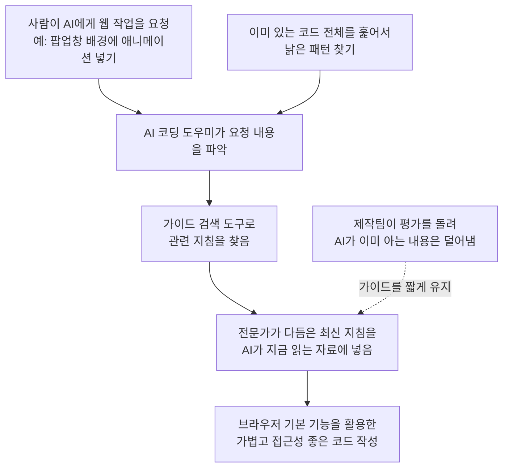

<aside class="ai-knowledge-sidebar">
  
CATEGORIES

  <nav class="ai-cat-tree">

에이전트 오케스트레이션20
<ul><li><a href="https://altjs4510.github.io/ai_news_blog/knowledge/20261121/">2026-11-21Google ADK v2.15.0 — 느린 도구에도 응답성 유지, 다중 실행 신뢰성·부…</a></li><li><a href="https://altjs4510.github.io/ai_news_blog/knowledge/20261118/">2026-11-18Tencent/LoopForge — CodeBuddy·Codex·Claude Code를…</a></li><li><a href="https://altjs4510.github.io/ai_news_blog/knowledge/20261107/">2026-11-07Hermes Agent v0.23.0 — The Hearth Release</a></li><li><a href="https://altjs4510.github.io/ai_news_blog/knowledge/20261029/">2026-10-29How Anthropic ships Claude with Claude: Separati…</a></li><li><a href="https://altjs4510.github.io/ai_news_blog/knowledge/20261027/">2026-10-27nightly-labs/openbot — Codex·Claude·Grok을 상주 팀원처…</a></li><li><a href="https://altjs4510.github.io/ai_news_blog/knowledge/20261015/">2026-10-15How Third Moment Research runs 10,000 agents for…</a></li><li><a href="https://altjs4510.github.io/ai_news_blog/knowledge/20261014/">2026-10-14How Anthropic's Dynamic Workflows Coordinate Cla…</a></li><li><a href="https://altjs4510.github.io/ai_news_blog/knowledge/20260930/">2026-09-30Agents you can coach: how Asana builds human-age…</a></li><li><a href="https://altjs4510.github.io/ai_news_blog/knowledge/20260831-openexecutive-virtual-c-suite/">2026-08-31Open Executive — 8명의 전문 에이전트를 하나의 임원 목소리로</a></li><li><a href="https://altjs4510.github.io/ai_news_blog/knowledge/20260828/">2026-08-28Google ADK for Python v2.8.0 — RemoteA2aAgent 네이…</a></li><li><a href="https://altjs4510.github.io/ai_news_blog/knowledge/20260826/">2026-08-26apache/maka — 도구 호출·권한 결정·종료 이벤트를 append-only 로그…</a></li><li><a href="https://altjs4510.github.io/ai_news_blog/knowledge/20260823/">2026-08-23The Evolution of the Agent Harness — 하네스가 모델 가중치…</a></li><li><a href="https://altjs4510.github.io/ai_news_blog/knowledge/20260821/">2026-08-21volcengine/OpenViking — 에이전트 메모리·Knowledge RAG·스…</a></li><li><a href="https://altjs4510.github.io/ai_news_blog/knowledge/20260805/">2026-08-05TencentCloud/TencentDB-Agent-Memory — 대화·문서·코드를 …</a></li><li><a href="https://altjs4510.github.io/ai_news_blog/knowledge/20260708/">2026-07-08Expanding Managed Agents in Gemini API: backgrou…</a></li><li><a href="https://altjs4510.github.io/ai_news_blog/knowledge/20260623/">2026-06-23bytedance/deer-flow — 샌드박스·메모리·서브에이전트·메시지 게이트웨이를…</a></li><li><a href="https://altjs4510.github.io/ai_news_blog/knowledge/20260611/">2026-06-11The evolution of agentic surfaces: building with…</a></li><li><a href="https://altjs4510.github.io/ai_news_blog/knowledge/20260602/">2026-06-02revfactory/harness — 도메인별 에이전트 팀과 스킬을 자동 설계하는 메타…</a></li><li><a href="https://altjs4510.github.io/ai_news_blog/knowledge/20260529/">2026-05-29Introducing dynamic workflows in Claude Code</a></li><li><a href="https://altjs4510.github.io/ai_news_blog/knowledge/20260507/">2026-05-07ruvnet/ruflo — Claude 멀티 에이전트 오케스트레이션 플랫폼</a></li></ul>

MCP &amp; 도구 통합18
<ul><li><a href="https://altjs4510.github.io/ai_news_blog/knowledge/20261103/">2026-11-03vercel-labs/agent-desktop — 픽셀 대신 OS 접근성 트리로 앱 U…</a></li><li><a href="https://altjs4510.github.io/ai_news_blog/knowledge/20261017/">2026-10-17mksglu/context-mode — 코딩 에이전트용 컨텍스트 윈도우 최적화</a></li><li><a href="https://altjs4510.github.io/ai_news_blog/knowledge/20261007/">2026-10-07morluto/rea — 앱 동작부터 네이티브 바이너리까지 에이전트로 리버스 엔지니어링</a></li><li><a href="https://altjs4510.github.io/ai_news_blog/knowledge/20260829/">2026-08-29cursor/plugins — 플러그인 명세(specification)와 공식 플러그인…</a></li><li><a href="https://altjs4510.github.io/ai_news_blog/knowledge/20260802/">2026-08-02Stateless MCP has recaptured my interest (and in…</a></li><li><a href="https://altjs4510.github.io/ai_news_blog/knowledge/20260731/">2026-07-31different-ai/openwork — Claude Cowork의 오픈소스 대안(o…</a></li><li><a href="https://altjs4510.github.io/ai_news_blog/knowledge/20260729/">2026-07-29Bringing MCP 2026-07-28 to Claude</a></li><li><a href="https://altjs4510.github.io/ai_news_blog/knowledge/20260726/">2026-07-26citrolabs/ego-lite — 로그인된 브라우저 상태를 AI 에이전트와 공유하는…</a></li><li><a href="https://altjs4510.github.io/ai_news_blog/knowledge/20260718/">2026-07-18tirth8205/code-review-graph — MCP·CLI용 로컬 코드 인텔리…</a></li><li><a href="https://altjs4510.github.io/ai_news_blog/knowledge/20260701/">2026-07-01Google OKF (Open Knowledge Format) — 벤더 중립 에이전트 …</a></li><li><a href="https://altjs4510.github.io/ai_news_blog/knowledge/20260618/">2026-06-18DeusData/codebase-memory-mcp — 158개 언어 코드베이스를 밀리…</a></li><li><a href="https://altjs4510.github.io/ai_news_blog/knowledge/20260603/">2026-06-03How Bad MCP design cost your Agent 5× more token…</a></li><li><a href="https://altjs4510.github.io/ai_news_blog/knowledge/20260521/">2026-05-21colbymchenry/codegraph — Pre-indexed code knowle…</a></li><li><a href="https://altjs4510.github.io/ai_news_blog/knowledge/20260520/">2026-05-20New in Claude Managed Agents: self-hosted sandbo…</a></li><li><a href="https://altjs4510.github.io/ai_news_blog/knowledge/20260517/">2026-05-17I gave my LLM 100,000+ tools — Lazy Discovery &a…</a></li><li><a href="https://altjs4510.github.io/ai_news_blog/knowledge/20260512/">2026-05-12agentmemory — Persistent memory for AI coding ag…</a></li><li><a href="https://altjs4510.github.io/ai_news_blog/knowledge/20260509/">2026-05-09How to connect 100 MCP servers without the conte…</a></li><li><a href="https://altjs4510.github.io/ai_news_blog/knowledge/20260506/">2026-05-06mksglu/context-mode — AI 코딩 에이전트용 컨텍스트 윈도우 최적화</a></li></ul>

코딩 에이전트32
<ul><li><a href="https://altjs4510.github.io/ai_news_blog/knowledge/20261126/">2026-11-26Three LLM inflection points in twelve months</a></li><li><a href="https://altjs4510.github.io/ai_news_blog/knowledge/20261125/">2026-11-25Anthropic launches Claude Ship, letting AI agent…</a></li><li><a href="https://altjs4510.github.io/ai_news_blog/knowledge/20261115/" class="current">2026-11-15GoogleChrome/modern-web-guidance-src — 코딩 에이전트에 …</a></li><li><a href="https://altjs4510.github.io/ai_news_blog/knowledge/20261112/">2026-11-12shadcn/improve — 가장 강한 모델로 코드베이스를 감사해 계획을 쓰고, 더 …</a></li><li><a href="https://altjs4510.github.io/ai_news_blog/knowledge/20261111/">2026-11-11Quoting Prompting Claude Fable 5.2</a></li><li><a href="https://altjs4510.github.io/ai_news_blog/knowledge/20261106/">2026-11-06Cline desktop-nightly-20261104233655: feat(core)…</a></li><li><a href="https://altjs4510.github.io/ai_news_blog/knowledge/20261022/">2026-10-22Claude Mods: Flipping the Harness Inside Out</a></li><li><a href="https://altjs4510.github.io/ai_news_blog/knowledge/20261018/">2026-10-18Quoting Addy Osmani, Morgan Westlee Lunt, and Qi…</a></li><li><a href="https://altjs4510.github.io/ai_news_blog/knowledge/20261014-claude-code-advisor/">2026-10-14Claude Code advisor — 가벼운 메인 모델이 일하고, 갈림길에서만 Opu…</a></li><li><a href="https://altjs4510.github.io/ai_news_blog/knowledge/20260920/">2026-09-20Claude Code 2.1.277 — CLAUDE.md가 없으면 AGENTS.md를 …</a></li><li><a href="https://altjs4510.github.io/ai_news_blog/knowledge/20260912/">2026-09-12Quoting Boris Cherny — 'Claude가 쓴 프로덕션 코드는 사람이 쓴…</a></li><li><a href="https://altjs4510.github.io/ai_news_blog/knowledge/20260910/">2026-09-10vastsa/PI-Desktop — Electron + Rust 호스트 코어 + 에이전…</a></li><li><a href="https://altjs4510.github.io/ai_news_blog/knowledge/20260906/">2026-09-06DietrichGebert/ponytail — 에이전트를 '방에서 가장 게으른 시니어 …</a></li><li><a href="https://altjs4510.github.io/ai_news_blog/knowledge/20260903/">2026-09-03pacifio/atlas — 여러 코딩 에이전트의 변경을 한곳에서 추적·질의하는 '에이…</a></li><li><a href="https://altjs4510.github.io/ai_news_blog/knowledge/20260901/">2026-09-01affaan-m/ECC — 스킬·본능·메모리·보안을 묶은 에이전트 하네스 성능 최적화 …</a></li><li><a href="https://altjs4510.github.io/ai_news_blog/knowledge/20260831-gitnexus-code-knowledge-graph/">2026-08-31GitNexus — 코드베이스를 지식그래프로 바꿔 에이전트에게 쥐어주기</a></li><li><a href="https://altjs4510.github.io/ai_news_blog/knowledge/20260819/">2026-08-19akitaonrails/ai-memory — 코딩 에이전트 CLI 간 장기 기억과 벤더…</a></li><li><a href="https://altjs4510.github.io/ai_news_blog/knowledge/20260814/">2026-08-14cathrynlavery/diagram-design — Claude Code용 에디토리…</a></li><li><a href="https://altjs4510.github.io/ai_news_blog/knowledge/20260810/">2026-08-10Auto mode is now the default in Claude Code for …</a></li><li><a href="https://altjs4510.github.io/ai_news_blog/knowledge/20260808/">2026-08-08PrimeIntellect-ai/prime-agent — 코딩 워크플로우와 장시간 자율…</a></li><li><a href="https://altjs4510.github.io/ai_news_blog/knowledge/20260804/">2026-08-04esengine/DeepSeek-Reasonix — prefix-cache 안정성을 축…</a></li><li><a href="https://altjs4510.github.io/ai_news_blog/knowledge/20260728/">2026-07-28alibaba/open-code-review — 결정론적 파이프라인 + LLM 에이전트…</a></li><li><a href="https://altjs4510.github.io/ai_news_blog/knowledge/20260725/">2026-07-25The new rules of context engineering for Claude …</a></li><li><a href="https://altjs4510.github.io/ai_news_blog/knowledge/20260714/">2026-07-14Graphify-Labs/graphify — 코드베이스를 질의 가능한 지식 그래프로 만…</a></li><li><a href="https://altjs4510.github.io/ai_news_blog/knowledge/20260707/">2026-07-07AI Hero Skills Catalog — 실무 엔지니어를 위한 재사용 가능한 판단 …</a></li><li><a href="https://altjs4510.github.io/ai_news_blog/knowledge/20260705/">2026-07-05openai/codex-plugin-cc — Claude Code에서 Codex를 위임…</a></li><li><a href="https://altjs4510.github.io/ai_news_blog/knowledge/20260626/">2026-06-26google-labs-code/design.md — 코딩 에이전트에게 디자인 시스템을 …</a></li><li><a href="https://altjs4510.github.io/ai_news_blog/knowledge/20260619/">2026-06-19Claude Code now supports artifacts</a></li><li><a href="https://altjs4510.github.io/ai_news_blog/knowledge/20260530/">2026-05-30Leonxlnx/taste-skill — AI에게 좋은 취향을 부여해 generic s…</a></li><li><a href="https://altjs4510.github.io/ai_news_blog/knowledge/20260528/">2026-05-28Building self-improving tax agents with Codex</a></li><li><a href="https://altjs4510.github.io/ai_news_blog/knowledge/20260508/">2026-05-08addyosmani/agent-skills — Production-grade engin…</a></li><li><a href="https://altjs4510.github.io/ai_news_blog/knowledge/20260505/">2026-05-05mattpocock/skills — Skills for Real Engineers (.…</a></li></ul>

모델 &amp; 연구15
<ul><li><a href="https://altjs4510.github.io/ai_news_blog/knowledge/20261113/">2026-11-13Gemini Decisions API</a></li><li><a href="https://altjs4510.github.io/ai_news_blog/knowledge/20261105/">2026-11-05NVIDIA/auto-ontology — 데이터 위에 그래프 기반 의미 추론 레이어를 …</a></li><li><a href="https://altjs4510.github.io/ai_news_blog/knowledge/20261104/">2026-11-04Qwen 3.8 27B on my laptop can interpret model we…</a></li><li><a href="https://altjs4510.github.io/ai_news_blog/knowledge/20261009/">2026-10-09Claude Haiku 5.5 (Simon Willison의 출시 노트와 가격 분석)</a></li><li><a href="https://altjs4510.github.io/ai_news_blog/knowledge/20260929/">2026-09-29vectorize-io/hindsight — Hindsight: Agent Memory…</a></li><li><a href="https://altjs4510.github.io/ai_news_blog/knowledge/20260907-voicemem-dual-brain-memory/">2026-09-07VoiceMem — 좌뇌·우뇌로 쪼갠 스트리밍 메모리로 음성 에이전트 지연 없애기</a></li><li><a href="https://altjs4510.github.io/ai_news_blog/knowledge/20260904/">2026-09-04HarnessDev: Can LLMs Create and Evolve Their Own…</a></li><li><a href="https://altjs4510.github.io/ai_news_blog/knowledge/20260717/">2026-07-17After a year building agent memory, 'save everyt…</a></li><li><a href="https://altjs4510.github.io/ai_news_blog/knowledge/20260716-proprag/">2026-07-16PropRAG — 프로포지션 경로 위 beam search로 멀티홉 검색 안내</a></li><li><a href="https://altjs4510.github.io/ai_news_blog/knowledge/20260712/">2026-07-12Do Automated Evals Work?</a></li><li><a href="https://altjs4510.github.io/ai_news_blog/knowledge/20260620/">2026-06-20zai-org/GLM-5 — From Vibe Coding to Agentic Engi…</a></li><li><a href="https://altjs4510.github.io/ai_news_blog/knowledge/20260617/">2026-06-17Predicting model behavior before release by simu…</a></li><li><a href="https://altjs4510.github.io/ai_news_blog/knowledge/20260610/">2026-06-10Fable 5 just made cost-aware model routing manda…</a></li><li><a href="https://altjs4510.github.io/ai_news_blog/knowledge/20260516/">2026-05-16STALE — 에이전트가 자기 기억의 유효성을 인지할 수 있는가</a></li><li><a href="https://altjs4510.github.io/ai_news_blog/knowledge/20260513/">2026-05-13Thinking Machines' Native Interaction Models — T…</a></li></ul>

인프라 &amp; 컴퓨트7
<ul><li><a href="https://altjs4510.github.io/ai_news_blog/knowledge/20261120/">2026-11-20How OpenAI’s Performance Factory keeps ChatGPT f…</a></li><li><a href="https://altjs4510.github.io/ai_news_blog/knowledge/20260905/">2026-09-05magnitudedev/magnitude — 하드웨어에 맞는 최적 로컬 모델을 띄워 이…</a></li><li><a href="https://altjs4510.github.io/ai_news_blog/knowledge/20260812/">2026-08-12semantica-agi/semantica — 컨텍스트와 '책임 추적 가능한(accou…</a></li><li><a href="https://altjs4510.github.io/ai_news_blog/knowledge/20260806/">2026-08-06cloudflare/computer — 에이전트에게 컴퓨터를 통째로 주는 엣지 실행 샌…</a></li><li><a href="https://altjs4510.github.io/ai_news_blog/knowledge/20260723/">2026-07-23diegosouzapw/OmniRoute — 268+ 프로바이더를 단일 엔드포인트로 묶…</a></li><li><a href="https://altjs4510.github.io/ai_news_blog/knowledge/20260604/">2026-06-04chopratejas/headroom — Compress tool outputs bef…</a></li><li><a href="https://altjs4510.github.io/ai_news_blog/knowledge/20260522/">2026-05-22Giving Agents Computers — Ivan Burazin, Daytona</a></li></ul>

보안 &amp; 거버넌스27
<ul><li><a href="https://altjs4510.github.io/ai_news_blog/knowledge/20261119/">2026-11-19External sandboxes for coding agents</a></li><li><a href="https://altjs4510.github.io/ai_news_blog/knowledge/20261117/">2026-11-17NVIDIA/SkillEvaluator — AI 에이전트 스킬·플러그인을 품질 게이트,…</a></li><li><a href="https://altjs4510.github.io/ai_news_blog/knowledge/20261031/">2026-10-31CopilotKit/OpenBot — AI 동료마다 전용 컴퓨터를 주고 모든 행동을 실…</a></li><li><a href="https://altjs4510.github.io/ai_news_blog/knowledge/20261030/">2026-10-30How we detect frontier model misalignment</a></li><li><a href="https://altjs4510.github.io/ai_news_blog/knowledge/20261021/">2026-10-21cloudflare/security-audit-skill — 독립 검증된 기계 판독형 …</a></li><li><a href="https://altjs4510.github.io/ai_news_blog/knowledge/20261020/">2026-10-20Satya Nadella — 모델을 내부자 위험으로 보는 원칙에 따라 Project P…</a></li><li><a href="https://altjs4510.github.io/ai_news_blog/knowledge/20261016/">2026-10-16Crossing the Threshold: How OpenAI and Anthropic…</a></li><li><a href="https://altjs4510.github.io/ai_news_blog/knowledge/20261011/">2026-10-11Anthropic can’t reliably control its AI agents. …</a></li><li><a href="https://altjs4510.github.io/ai_news_blog/knowledge/20261004/">2026-10-04Apple says it's tightening macOS 'Full Disk Acce…</a></li><li><a href="https://altjs4510.github.io/ai_news_blog/knowledge/20261001/">2026-10-01NVIDIA/OpenShell</a></li><li><a href="https://altjs4510.github.io/ai_news_blog/knowledge/20260919/">2026-09-19cloudflare/security-audit-skill — 다단계 보안 감사를 '독립…</a></li><li><a href="https://altjs4510.github.io/ai_news_blog/knowledge/20260913/">2026-09-13OpenAI agents attacked RubyGems back in May: Ope…</a></li><li><a href="https://altjs4510.github.io/ai_news_blog/knowledge/20260902/">2026-09-02AIR raises $50M to help companies vet the skills…</a></li><li><a href="https://altjs4510.github.io/ai_news_blog/knowledge/20260827/">2026-08-27Claude in Chrome is generally available</a></li><li><a href="https://altjs4510.github.io/ai_news_blog/knowledge/20260819-mind-viruses/">2026-08-19탈옥도, 인젝션도 없이 — 대화로만 퍼지는 에이전트의 '마인드 바이러스'</a></li><li><a href="https://altjs4510.github.io/ai_news_blog/knowledge/20260730/">2026-07-30Anatomy of a Frontier Lab Agent Intrusion: A Tec…</a></li><li><a href="https://altjs4510.github.io/ai_news_blog/knowledge/20260715/">2026-07-15Dicklesworthstone/destructive_command_guard — 에이…</a></li><li><a href="https://altjs4510.github.io/ai_news_blog/knowledge/20260710/">2026-07-1070개 MCP 서버 strace 런타임 감사 — 부팅 시 아웃바운드 호출 서버 적발</a></li><li><a href="https://altjs4510.github.io/ai_news_blog/knowledge/20260704/">2026-07-04Cloudflare is about to block AI agents by defaul…</a></li><li><a href="https://altjs4510.github.io/ai_news_blog/knowledge/20260703/">2026-07-03Giving admins more visibility and control over C…</a></li><li><a href="https://altjs4510.github.io/ai_news_blog/knowledge/20260630/">2026-06-30Introducing the Claude apps gateway for Amazon B…</a></li><li><a href="https://altjs4510.github.io/ai_news_blog/knowledge/20260624/">2026-06-24Agent identity in Claude Tag: a new access model…</a></li><li><a href="https://altjs4510.github.io/ai_news_blog/knowledge/20260613/">2026-06-13Fable 5's guardrails got bypassed in 48 hours — …</a></li><li><a href="https://altjs4510.github.io/ai_news_blog/knowledge/20260612/">2026-06-12NVIDIA/SkillSpector — AI 에이전트 스킬용 보안 스캐너</a></li><li><a href="https://altjs4510.github.io/ai_news_blog/knowledge/20260607/">2026-06-07OpenAI Help: Lockdown Mode</a></li><li><a href="https://altjs4510.github.io/ai_news_blog/knowledge/20260531/">2026-05-31How we contain Claude across products</a></li><li><a href="https://altjs4510.github.io/ai_news_blog/knowledge/20260527/">2026-05-27Microsoft Copilot Cowork Exfiltrates Files</a></li></ul>

응용 사례12
<ul><li><a href="https://altjs4510.github.io/ai_news_blog/knowledge/20261124/">2026-11-24A more tailored Google Search that’s uniquely yo…</a></li><li><a href="https://altjs4510.github.io/ai_news_blog/knowledge/20261114/">2026-11-14Introducing ChatGPT Wallet</a></li><li><a href="https://altjs4510.github.io/ai_news_blog/knowledge/20261110/">2026-11-10meta/astryx — 직접 바꿔 쓸 수 있고 에이전트가 바로 쓸 수 있는(agent…</a></li><li><a href="https://altjs4510.github.io/ai_news_blog/knowledge/20261101/">2026-11-01Agents Prompt People: Using Agents for Long-Hori…</a></li><li><a href="https://altjs4510.github.io/ai_news_blog/knowledge/20261028/">2026-10-28Greptile takes bug detection beyond code review …</a></li><li><a href="https://altjs4510.github.io/ai_news_blog/knowledge/20261006/">2026-10-06How Cresta turned CX expertise into an agent bui…</a></li><li><a href="https://altjs4510.github.io/ai_news_blog/knowledge/20260909/">2026-09-09Reducing cost and improving performance with Cla…</a></li><li><a href="https://altjs4510.github.io/ai_news_blog/knowledge/20260709/">2026-07-09mvanhorn/last30days-skill — Reddit·X·YouTube·HN·…</a></li><li><a href="https://altjs4510.github.io/ai_news_blog/knowledge/20260621/">2026-06-21calesthio/OpenMontage — 12 파이프라인·52 도구·500+ 스킬을 …</a></li><li><a href="https://altjs4510.github.io/ai_news_blog/knowledge/20260609/">2026-06-09Building intelligent apps for Apple platforms wi…</a></li><li><a href="https://altjs4510.github.io/ai_news_blog/knowledge/20260515/">2026-05-15Clawdmeter — Claude Code 사용량을 데스크톱 대시보드로</a></li><li><a href="https://altjs4510.github.io/ai_news_blog/knowledge/20260514/">2026-05-14Introducing Claude for Small Business</a></li></ul>

산업 동향10
<ul><li><a href="https://altjs4510.github.io/ai_news_blog/knowledge/20261024/">2026-10-24Donating Agent Skills to the Agentic AI Foundati…</a></li><li><a href="https://altjs4510.github.io/ai_news_blog/knowledge/20261023/">2026-10-23Claude Duet app is Anthropic's bet on agents</a></li><li><a href="https://altjs4510.github.io/ai_news_blog/knowledge/20260911/">2026-09-11Now everyone can put data to work — ChatGPT Work…</a></li><li><a href="https://altjs4510.github.io/ai_news_blog/knowledge/20260907-humanmade-52week-rhythm/">2026-09-07휴먼 메이드의 '52주 리듬' — 아이디어가 흔해진 시대에 값이 오르는 건 버리는 판단</a></li><li><a href="https://altjs4510.github.io/ai_news_blog/knowledge/20260830/">2026-08-30[AINews] OpenAI shuts off Cursor — 프론티어 모델 공급 차단…</a></li><li><a href="https://altjs4510.github.io/ai_news_blog/knowledge/20260711/">2026-07-11OpenAI says GPT 5.6 is the 'preferred model' for…</a></li><li><a href="https://altjs4510.github.io/ai_news_blog/knowledge/20260702/">2026-07-02How Cursor deploys AI inside the enterprise (For…</a></li><li><a href="https://altjs4510.github.io/ai_news_blog/knowledge/20260616/">2026-06-16Why AI hasn't replaced software engineers, and w…</a></li><li><a href="https://altjs4510.github.io/ai_news_blog/knowledge/20260519/">2026-05-19Anthropic acquires Stainless</a></li><li><a href="https://altjs4510.github.io/ai_news_blog/knowledge/20260504/">2026-05-04Agents for Everything Else: Codex for Knowledge …</a></li></ul>
</nav>
</aside>

<article class="ai-knowledge-article">

<header class="ai-post-hero">
  
<a class="ai-back" href="../">KNOWLEDGE</a> · 2026-11-15 · 오늘의 학습

  <h2 class="ai-post-title">GoogleChrome/modern-web-guidance-src — 코딩 에이전트에 최신 웹 모범 사례를 주입하는 도구</h2>
</header>

> 원문: [GoogleChrome/modern-web-guidance-src — 코딩 에이전트에 최신 웹 모범 사례를 주입하는 도구](https://github.com/GoogleChrome/modern-web-guidance-src)

## 📌 학습 정리

### 1. 한 줄로 말하면

AI 코딩 도우미가 웹 화면을 만들 때 옛날 방식을 습관처럼 쓰지 않도록, 요즘 브라우저가 기본으로 지원하는 방법을 그때그때 꺼내 보여 주는 참고서 묶음이에요.

### 2. 왜 이게 만들어졌어요?

요즘은 AI에게 코드를 맡기는 일이 많아졌어요. 그런데 AI가 공부한 자료에는 예전 방식으로 짠 코드가 아주 많이 들어 있어요. 그래서 AI는 지금은 브라우저가 기본으로 빠르게 처리해 주는 일도, 굳이 무거운 자바스크립트(JavaScript) 코드를 잔뜩 써서 해결하곤 해요. 새 기능이 있다는 걸 알더라도, 실제 서비스에 쓸 만큼 제대로 활용한 예시를 충분히 본 적이 없어서 쓰는 방법을 자주 틀리기도 하고요. Modern Web Guidance는 이 빈틈을 메우려고 나왔어요. Google Chrome, Microsoft Edge, Mozilla Firefox, 그리고 웹 개발 문서 사이트인 MDN 팀이 웹 개발 커뮤니티와 함께 관리하고 있어요.

### 3. 비유로 풀면

경력은 길지만 최근 몇 년 사이 업계 변화는 잘 모르는 베테랑 직원 옆에 "요즘은 이렇게 해요" 메모장을 붙여 주는 것과 비슷해요. 직원이 일을 시작하기 전에 메모장에서 필요한 쪽만 찾아 읽으니, 예전 습관 대신 지금 방식으로 일을 처리하게 돼요.

또 하나 중요한 점은, 이 메모장에 직원이 이미 아는 내용은 적지 않는다는 거예요. 시험을 쳐 보고 이미 잘 아는 부분은 지우고, 자주 틀리는 부분만 남겨 둬요.

그래서 결국, AI에게 최신 웹 지식 전체를 다시 가르치는 대신 지금 하는 작업에 필요한 요점만 그때그때 손에 쥐여 주는 방식이에요.

### 4. 어떻게 작동하는지 (그림으로)

사람이 작업을 요청하면 AI는 이 도구로 관련 가이드를 찾아요. 찾은 지침이 AI가 지금 참고하는 자료에 들어가면, AI는 그걸 바탕으로 최신 방식의 코드를 써요. 이미 있는 프로젝트라면 낡은 패턴이 어디 있는지 먼저 훑어볼 수도 있어요. 뒤쪽에서는 제작팀이 평가를 돌려 AI가 이미 잘 아는 내용을 계속 덜어 내고, 그래서 가이드가 짧게 유지돼요.

설치는 `npx modern-web-guidance@latest install` 한 줄이면 되고, 실행하면 질문에 답하며 따라가는 설치 화면이 떠요. 설치하지 않고 바로 써 볼 수도 있어요. `search`는 원하는 내용으로 가이드를 찾고, `retrieve`는 가이드 이름으로 내용을 꺼내고, `legacy-scan`은 코드에서 낡은 패턴을 찾아 줘요.

### 5. 처음 보는 용어 풀이

- **AI 코딩 도우미 (coding agent)** — 사람이 말로 요청하면 코드를 직접 읽고 쓰고 고쳐 주는 AI 프로그램이에요. 이 도구는 이 도우미가 더 나은 코드를 쓰도록 거들어요.
- **스킬 (skill)** — AI 코딩 도우미에 붙여서 특정 분야 지식이나 작업 요령을 더해 주는 꾸러미예요. Modern Web Guidance는 웹 분야의 노하우와 "어느 브라우저에서 되는지" 정보를 스킬로 담아 둔 거예요.
- **AI가 한 번에 읽는 작업 공간 (context window)** — AI가 답을 만들 때 한꺼번에 볼 수 있는 글의 범위예요. 공간이 한정돼 있어서, 가이드를 필요한 만큼만 넣는 게 중요해요.
- **글자 조각 단위 (token)** — AI가 글을 읽고 처리하는 최소 단위예요. 가이드가 "토큰을 아끼게 설계됐다"는 건 꼭 필요한 내용만 짧게 담았다는 뜻이에요.
- **평가 (eval)** — AI가 실제로 얼마나 잘하는지 시험해 보는 과정이에요. 이 프로젝트는 평가 결과를 보고 AI가 이미 아는 내용은 가이드에서 빼요.
- **구버전 보완 코드 (polyfill)** — 브라우저가 아직 지원하지 않는 기능을 흉내 내려고 따로 덧붙이는 코드예요. 무겁기 쉬워서, 이 가이드는 대신 가벼운 대비책(fallback)을 쓰도록 안내해요.
- **명령줄 도구 (CLI)** — 화면 버튼 대신 터미널에 글자 명령을 입력해서 쓰는 프로그램이에요. 여기서는 `search`, `retrieve`, `legacy-scan` 같은 명령으로 가이드를 찾거나 코드를 점검해요.

### 6. 한 발 더 들어가고 싶다면

- [Modern Web Guidance 공식 문서](https://developer.chrome.com/docs/modern-web-guidance) — 이걸 보면 이 스킬이 무엇이고 어떻게 쓰는지 전체 그림을 알 수 있어요.
- [Eval Dashboard](https://googlechrome.github.io/modern-web-guidance-src/) — 이걸 보면 가이드를 넣었을 때 AI의 결과가 어떻게 달라지는지 평가 결과를 확인할 수 있어요.
- [`navigation-drawer` 가이드 예시](https://github.com/GoogleChrome/modern-web-guidance/blob/main/skills/modern-web-guidance/guides/ui-components/navigation-drawer.md) — 이걸 보면 AI에게 실제로 전달되는 가이드 한 편이 어떻게 생겼는지 알 수 있어요.
- [GoogleChrome/modern-web-guidance](https://github.com/GoogleChrome/modern-web-guidance) — 이걸 보면 사용자에게 배포되는 완성본 저장소를 볼 수 있어요. 지금 소개한 저장소는 이 완성본을 만들고 평가하는 원본 쪽이에요.
- [CONTRIBUTING.md](https://github.com/GoogleChrome/modern-web-guidance-src/blob/main/CONTRIBUTING.md) — 이걸 보면 가이드를 직접 추가하거나 고치는 방법과 코드 구조를 알 수 있어요.

---

## 📖 원문 전체 번역 (정독용)

> 의역 최소화한 전체 번역입니다. 큰 흐름은 위 정리에서 잡고, 정확한 워딩이 필요할 땐 이 섹션에서 정독하세요.

이 저장소는 [GoogleChrome/modern-web-guidance](https://github.com/GoogleChrome/modern-web-guidance)의 소스 저장소이며, 그 콘텐츠를 작성·보정(calibrating)·평가하기 위한 코드와 문서를 포함합니다.

[**Modern Web Guidance**](https://developer.chrome.com/docs/modern-web-guidance)는 웹 플랫폼 전문 지식, 모범 사례, 브라우저 호환성 데이터를 코딩 에이전트에 직접 내장하는 스킬(skills) 모음입니다. 코딩 에이전트가 레거시 패턴에서 벗어나, 최신 웹 플랫폼의 힘과 기능을 활용하는 해법으로 향하도록 유도합니다.

프로젝트 진행 방식과 코드베이스 안내는 [CONTRIBUTING.md](https://github.com/GoogleChrome/modern-web-guidance-src/blob/main/CONTRIBUTING.md)와 [GOVERNANCE.md](https://github.com/GoogleChrome/modern-web-guidance-src/blob/main/GOVERNANCE.md)를 참고하세요.

* * *

_Google Chrome, Microsoft Edge, Mozilla Firefox, MDN 팀이 웹 개발 커뮤니티와 함께 운영(steward)합니다._

[문서](https://developer.chrome.com/docs/modern-web-guidance) · [평가 대시보드](https://googlechrome.github.io/modern-web-guidance-src/) · [소스 코드](https://github.com/GoogleChrome/modern-web-guidance-src) · [이슈 제보](https://github.com/GoogleChrome/modern-web-guidance-src/issues)

##  퀵스타트

npx modern-web-guidance@latest install

이 명령은 Modern Web Guidance를 설치하는 대화형 마법사를 실행합니다. 아래의 [대체 설치 방법](https://github.com/GoogleChrome/modern-web-guidance-src#-alternative-installation-methods)도 참고하세요.

#### 설치 없이 사용해 보기

# 관련 가이드 검색
npx modern-web-guidance@latest search "animate a dialog modal backdrop"

# ID로 가이드 가져오기
npx modern-web-guidance@latest retrieve "animate-to-from-top-layer"

# 현대화할 레거시 패턴을 찾기 위해 코드베이스 스캔
npx modern-web-guidance@latest legacy-scan .

##  왜 필요한가?

코딩 에이전트는 LLM 학습 데이터에 방대한 양의 레거시 코드가 들어 있기 때문에 종종 오래된 패턴을 기본값으로 택합니다. 그 결과, 이제는 네이티브이면서 고성능인 웹 플랫폼 해법이 있는 작업에도 비대한 JavaScript를 생성하는 경우가 많습니다.

모델이 어떤 API가 존재한다는 것을 알고 있더라도, 프로덕션 수준의 코드에 필요한 실제 환경의 최신 구현 패턴은 충분한 밀도로 알지 못하는 경우가 많습니다.

**Modern Web Guidance는 이 간극을 메웁니다.** 이 스킬의 CLI는 전문가가 큐레이션한 맞춤형 가이드라인을 에이전트의 컨텍스트 윈도우에 직접 돌려주며, 다음에 초점을 둡니다.

*   **최신 브라우저 API**: 모델이 자주 잘못 사용하는 API를 올바르게 구성하도록 돕습니다.
*   **성능 및 접근성**: 브라우저가 최적화할 수 있고 접근성 지원 기능(affordance)이 내장된 플랫폼 수준 API를 선호합니다.
*   **책임 있는 폴백**: 무거운 폴리필이나 레거시 라이브러리 대신, 합리적이고 가벼운 폴백을 사용하도록 모델을 안내합니다.

##  무엇이 포함되어 있나?

최근 수년간 웹 플랫폼에 추가된 새 기능부터 최첨단 기능까지 다룹니다. 가이드는 **토큰 효율적으로 설계**되었습니다. 평가(evals)를 실행해, 모델이 이미 아는 최소공통분모 수준의 콘텐츠는 가지치기합니다.

### 핵심 분야

#### 🎨 사용자 경험 (User Experience)

부드러운 시각 상태 전환 (View Transitions, 진입/퇴장 애니메이션, 패럴랙스 스크롤, CSS `scrollbar-color`).

#### 📐 CSS 레이아웃

최신 레이아웃 시스템 (컨테이너 쿼리, `subgrid`, `oklch` 같은 최신 색 공간, text-wrap 조정, line-height 트리밍).

#### ⚡ 성능 (Performance)

속도 최적화 (즉시 프리로딩, Interaction to Next Paint (INP) 진단, `scheduler.yield`를 통한 태스크 스케줄링).

#### 📝 폼 & UI (Forms & UI)

네이티브 컴포넌트 (툴팁용 Anchor Positioning, Popover API, 다이얼로그, `:user-invalid` 유효성 검사, 자동 크기 조절 필드).

#### ♿ 접근성 (Accessibility)

중요한 고려 사항 (스크린 리더 및 키보드 조작성, 콘텐츠 탐색 및 발견 가능성).

#### 🤖 내장 AI (Built-in AI)

로컬 클라이언트 모델 (네이티브 번역, 요약, 언어 감지 API).

_예시 보기:_ [`navigation-drawer` 가이드](https://github.com/GoogleChrome/modern-web-guidance/blob/main/skills/modern-web-guidance/guides/ui-components/navigation-drawer.md).

#### 전체 목록

**250개의 최신 웹 기능**
### CSS & 레이아웃 (140개 기능)

|  |  |  |
| --- | --- | --- |
| [::backdrop](https://web-platform-dx.github.io/web-features-explorer/features/backdrop/) | [content-visibility](https://web-platform-dx.github.io/web-features-explorer/features/content-visibility/) | [progress()](https://web-platform-dx.github.io/web-features-explorer/features/progress-function/) |
| [::details-content](https://web-platform-dx.github.io/web-features-explorer/features/details-content/) | [contrast-color()](https://web-platform-dx.github.io/web-features-explorer/features/contrast-color/) | [reading-flow](https://web-platform-dx.github.io/web-features-explorer/features/reading-flow/) |
| [::file-selector-button](https://web-platform-dx.github.io/web-features-explorer/features/file-selector-button/) | [Cross-document view transitions](https://web-platform-dx.github.io/web-features-explorer/features/cross-document-view-transitions/) | [Relative colors](https://web-platform-dx.github.io/web-features-explorer/features/relative-color/) |
| [::placeholder](https://web-platform-dx.github.io/web-features-explorer/features/placeholder/) | [currentColor](https://web-platform-dx.github.io/web-features-explorer/features/currentcolor/) | [rem](https://web-platform-dx.github.io/web-features-explorer/features/rem/) |
| [::selection](https://web-platform-dx.github.io/web-features-explorer/features/selection/) | [Custom highlights](https://web-platform-dx.github.io/web-features-explorer/features/highlight/) | [resize (CSS property)](https://web-platform-dx.github.io/web-features-explorer/features/resize/) |
| [:dir()](https://web-platform-dx.github.io/web-features-explorer/features/dir-pseudo/) | [Custom properties](https://web-platform-dx.github.io/web-features-explorer/features/custom-properties/) | [revert](https://web-platform-dx.github.io/web-features-explorer/features/revert-value/) |
| [:focus-visible](https://web-platform-dx.github.io/web-features-explorer/features/focus-visible/) | [display animation](https://web-platform-dx.github.io/web-features-explorer/features/display-animation/) | [revert-rule](https://web-platform-dx.github.io/web-features-explorer/features/revert-rule/) |
| [:focus-within](https://web-platform-dx.github.io/web-features-explorer/features/focus-within/) | [Element-scoped view transitions](https://web-platform-dx.github.io/web-features-explorer/features/view-transitions-element-scoped/) | [Safe area inset environment variables](https://web-platform-dx.github.io/web-features-explorer/features/safe-area-inset/) |
| [:has()](https://web-platform-dx.github.io/web-features-explorer/features/has/) | [em unit](https://web-platform-dx.github.io/web-features-explorer/features/em-unit/) | [Scroll marker target pseudo-classes](https://web-platform-dx.github.io/web-features-explorer/features/scroll-marker-targets/) |
| [:host-context()](https://web-platform-dx.github.io/web-features-explorer/features/host-context/) | [field-sizing](https://web-platform-dx.github.io/web-features-explorer/features/field-sizing/) | [Scroll method promises](https://web-platform-dx.github.io/web-features-explorer/features/scroll-promises/) |
| [:is()](https://web-platform-dx.github.io/web-features-explorer/features/is/) | [filter](https://web-platform-dx.github.io/web-features-explorer/features/filter/) | [Scroll snap](https://web-platform-dx.github.io/web-features-explorer/features/scroll-snap/) |
| [:modal](https://web-platform-dx.github.io/web-features-explorer/features/modal/) | [flex-wrap: balance](https://web-platform-dx.github.io/web-features-explorer/features/flexbox-flex-wrap-balance/) | [Scroll snap events](https://web-platform-dx.github.io/web-features-explorer/features/scroll-snap-events/) |
| [:not()](https://web-platform-dx.github.io/web-features-explorer/features/not/) | [Flexbox](https://web-platform-dx.github.io/web-features-explorer/features/flexbox/) | [scroll-axis-lock](https://web-platform-dx.github.io/web-features-explorer/features/scroll-axis-lock/) |
| [:nth-child() of <selector>](https://web-platform-dx.github.io/web-features-explorer/features/nth-child-of/) | [font-size](https://web-platform-dx.github.io/web-features-explorer/features/font-size/) | [scroll-behavior](https://web-platform-dx.github.io/web-features-explorer/features/scroll-behavior/) |
| [:placeholder-shown](https://web-platform-dx.github.io/web-features-explorer/features/placeholder-shown/) | [font-size-adjust](https://web-platform-dx.github.io/web-features-explorer/features/font-size-adjust/) | [Scroll-driven animations](https://web-platform-dx.github.io/web-features-explorer/features/scroll-driven-animations/) |
| [:user-valid and :user-invalid](https://web-platform-dx.github.io/web-features-explorer/features/user-pseudos/) | [Forced colors](https://web-platform-dx.github.io/web-features-explorer/features/forced-colors/) | [scroll-initial-target](https://web-platform-dx.github.io/web-features-explorer/features/scroll-initial-target/) |
| [:where()](https://web-platform-dx.github.io/web-features-explorer/features/where/) | [Gradient interpolation](https://web-platform-dx.github.io/web-features-explorer/features/gradient-interpolation/) | [scroll-target-group](https://web-platform-dx.github.io/web-features-explorer/features/scroll-target-group/) |
| [@function](https://web-platform-dx.github.io/web-features-explorer/features/function/) | [Gradients](https://web-platform-dx.github.io/web-features-explorer/features/gradients/) | [scrollbar-color](https://web-platform-dx.github.io/web-features-explorer/features/scrollbar-color/) |
| [@scope](https://web-platform-dx.github.io/web-features-explorer/features/scope/) | [Grid](https://web-platform-dx.github.io/web-features-explorer/features/grid/) | [scrollbar-gutter](https://web-platform-dx.github.io/web-features-explorer/features/scrollbar-gutter/) |
| [@starting-style](https://web-platform-dx.github.io/web-features-explorer/features/starting-style/) | [Grid lanes](https://web-platform-dx.github.io/web-features-explorer/features/grid-lanes/) | [scrollbar-width](https://web-platform-dx.github.io/web-features-explorer/features/scrollbar-width/) |
| [@supports](https://web-platform-dx.github.io/web-features-explorer/features/supports/) | [Hyphenation](https://web-platform-dx.github.io/web-features-explorer/features/hyphens/) | [scrollend](https://web-platform-dx.github.io/web-features-explorer/features/scrollend/) |
| [abs() and sign()](https://web-platform-dx.github.io/web-features-explorer/features/abs-sign/) | [image-set()](https://web-platform-dx.github.io/web-features-explorer/features/image-set/) | [scrollIntoView()](https://web-platform-dx.github.io/web-features-explorer/features/scroll-into-view/) |
| [accent-color](https://web-platform-dx.github.io/web-features-explorer/features/accent-color/) | [Individual transform properties](https://web-platform-dx.github.io/web-features-explorer/features/individual-transforms/) | [Shadow parts](https://web-platform-dx.github.io/web-features-explorer/features/shadow-parts/) |
| [Active view transition](https://web-platform-dx.github.io/web-features-explorer/features/active-view-transition/) | [inherit](https://web-platform-dx.github.io/web-features-explorer/features/inherit-value/) | [sibling-count() and sibling-index()](https://web-platform-dx.github.io/web-features-explorer/features/sibling-count/) |
| [Alt text for generated content](https://web-platform-dx.github.io/web-features-explorer/features/alt-text-generated-content/) | [initial](https://web-platform-dx.github.io/web-features-explorer/features/initial-value/) | [Sticky positioning](https://web-platform-dx.github.io/web-features-explorer/features/sticky-positioning/) |
| [Anchor position container queries](https://web-platform-dx.github.io/web-features-explorer/features/container-anchor-position-queries/) | [Interaction media queries](https://web-platform-dx.github.io/web-features-explorer/features/interaction/) | [Subgrid](https://web-platform-dx.github.io/web-features-explorer/features/subgrid/) |
| [Anchor positioning](https://web-platform-dx.github.io/web-features-explorer/features/anchor-positioning/) | [interpolate-size](https://web-platform-dx.github.io/web-features-explorer/features/interpolate-size/) | [System colors](https://web-platform-dx.github.io/web-features-explorer/features/system-color/) |
| [Animations (CSS)](https://web-platform-dx.github.io/web-features-explorer/features/animations-css/) | [isolation](https://web-platform-dx.github.io/web-features-explorer/features/isolation/) | [Text overflow](https://web-platform-dx.github.io/web-features-explorer/features/text-overflow/) |
| [appearance](https://web-platform-dx.github.io/web-features-explorer/features/appearance/) | [Lab and LCH](https://web-platform-dx.github.io/web-features-explorer/features/lab/) | [Text stroke and fill (compatibility prefixes)](https://web-platform-dx.github.io/web-features-explorer/features/text-stroke-fill/) |
| [aspect-ratio](https://web-platform-dx.github.io/web-features-explorer/features/aspect-ratio/) | [light-dark()](https://web-platform-dx.github.io/web-features-explorer/features/light-dark/) | [text-box](https://web-platform-dx.github.io/web-features-explorer/features/text-box/) |
| [at-rule()](https://web-platform-dx.github.io/web-features-explorer/features/supports-at-rule/) | [line-clamp](https://web-platform-dx.github.io/web-features-explorer/features/line-clamp/) | [text-decoration](https://web-platform-dx.github.io/web-features-explorer/features/text-decoration/) |
| [attr()](https://web-platform-dx.github.io/web-features-explorer/features/attr/) | [line-height](https://web-platform-dx.github.io/web-features-explorer/features/line-height/) | [text-decoration-skip-ink](https://web-platform-dx.github.io/web-features-explorer/features/text-decoration-skip-ink/) |
| [background-blend-mode](https://web-platform-dx.github.io/web-features-explorer/features/background-blend-mode/) | [linear() easing](https://web-platform-dx.github.io/web-features-explorer/features/linear-easing/) | [text-decoration-skip-ink: all](https://web-platform-dx.github.io/web-features-explorer/features/text-decoration-skip-ink-all/) |
| [background-clip: border-area](https://web-platform-dx.github.io/web-features-explorer/features/background-clip-border-area/) | [Logical properties](https://web-platform-dx.github.io/web-features-explorer/features/logical-properties/) | [text-decoration-skip-spaces](https://web-platform-dx.github.io/web-features-explorer/features/text-decoration-skip-spaces/) |
| [border-radius](https://web-platform-dx.github.io/web-features-explorer/features/border-radius/) | [Masks](https://web-platform-dx.github.io/web-features-explorer/features/masks/) | [text-wrap](https://web-platform-dx.github.io/web-features-explorer/features/text-wrap/) |
| [box-shadow](https://web-platform-dx.github.io/web-features-explorer/features/box-shadow/) | [min(), max(), and clamp()](https://web-platform-dx.github.io/web-features-explorer/features/min-max-clamp/) | [text-wrap: balance](https://web-platform-dx.github.io/web-features-explorer/features/text-wrap-balance/) |
| [calc-size()](https://web-platform-dx.github.io/web-features-explorer/features/calc-size/) | [mix-blend-mode](https://web-platform-dx.github.io/web-features-explorer/features/mix-blend-mode/) | [text-wrap: pretty](https://web-platform-dx.github.io/web-features-explorer/features/text-wrap-pretty/) |
| [Cascade layers](https://web-platform-dx.github.io/web-features-explorer/features/cascade-layers/) | [Nesting](https://web-platform-dx.github.io/web-features-explorer/features/nesting/) | [transition-behavior](https://web-platform-dx.github.io/web-features-explorer/features/transition-behavior/) |
| [ch unit](https://web-platform-dx.github.io/web-features-explorer/features/ch/) | [Oklab and OkLCh](https://web-platform-dx.github.io/web-features-explorer/features/oklab/) | [Transitions (CSS)](https://web-platform-dx.github.io/web-features-explorer/features/transitions/) |
| [clip-path](https://web-platform-dx.github.io/web-features-explorer/features/clip-path/) | [overflow-clip-margin](https://web-platform-dx.github.io/web-features-explorer/features/overflow-clip-margin/) | [Trigonometric functions (CSS)](https://web-platform-dx.github.io/web-features-explorer/features/trig-functions/) |
| [color-mix()](https://web-platform-dx.github.io/web-features-explorer/features/color-mix/) | [overflow-wrap](https://web-platform-dx.github.io/web-features-explorer/features/overflow-wrap/) | [unset](https://web-platform-dx.github.io/web-features-explorer/features/unset-value/) |
| [color-scheme](https://web-platform-dx.github.io/web-features-explorer/features/color-scheme/) | [overflow: clip](https://web-platform-dx.github.io/web-features-explorer/features/overflow-clip/) | [user-select](https://web-platform-dx.github.io/web-features-explorer/features/user-select/) |
| [Conic gradients](https://web-platform-dx.github.io/web-features-explorer/features/conic-gradients/) | [overlay](https://web-platform-dx.github.io/web-features-explorer/features/overlay/) | [View transitions](https://web-platform-dx.github.io/web-features-explorer/features/view-transitions/) |
| [Container queries (size)](https://web-platform-dx.github.io/web-features-explorer/features/container-queries/) | [overscroll-behavior](https://web-platform-dx.github.io/web-features-explorer/features/overscroll-behavior/) | [view-transition-class](https://web-platform-dx.github.io/web-features-explorer/features/view-transition-class/) |
| [Container scroll-state queries](https://web-platform-dx.github.io/web-features-explorer/features/container-scroll-state-queries/) | [prefers-color-scheme media query](https://web-platform-dx.github.io/web-features-explorer/features/prefers-color-scheme/) | [Viewport units](https://web-platform-dx.github.io/web-features-explorer/features/viewport-units/) |
| [Container style queries](https://web-platform-dx.github.io/web-features-explorer/features/container-style-queries/) | [prefers-contrast media query](https://web-platform-dx.github.io/web-features-explorer/features/prefers-contrast/) | [Web animations](https://web-platform-dx.github.io/web-features-explorer/features/web-animations/) |
| [Content](https://web-platform-dx.github.io/web-features-explorer/features/content/) | [prefers-reduced-motion media query](https://web-platform-dx.github.io/web-features-explorer/features/prefers-reduced-motion/) |  |

### HTML & DOM (36개 기능)

|  |  |  |
| --- | --- | --- |
| [:autofill](https://web-platform-dx.github.io/web-features-explorer/features/autofill/) | [<slot>](https://web-platform-dx.github.io/web-features-explorer/features/slot/) | [HTML streaming setters](https://web-platform-dx.github.io/web-features-explorer/features/html-streaming-setters/) |
| [:indeterminate](https://web-platform-dx.github.io/web-features-explorer/features/indeterminate/) | [<video>](https://web-platform-dx.github.io/web-features-explorer/features/video/) | [HTML-in-canvas](https://web-platform-dx.github.io/web-features-explorer/features/canvas-html/) |
| [<audio>](https://web-platform-dx.github.io/web-features-explorer/features/audio/) | [Autonomous custom elements](https://web-platform-dx.github.io/web-features-explorer/features/autonomous-custom-elements/) | [inert](https://web-platform-dx.github.io/web-features-explorer/features/inert/) |
| [
](https://web-platform-dx.github.io/web-features-explorer/features/details/) | [blocking="render"](https://web-platform-dx.github.io/web-features-explorer/features/blocking-render/) | [Interest invokers](https://web-platform-dx.github.io/web-features-explorer/features/interest-invokers/) |
| [<dialog closedby>](https://web-platform-dx.github.io/web-features-explorer/features/dialog-closedby/) | [Customizable <select>](https://web-platform-dx.github.io/web-features-explorer/features/customizable-select/) | [Invoker commands](https://web-platform-dx.github.io/web-features-explorer/features/invoker-commands/) |
| [<dialog>](https://web-platform-dx.github.io/web-features-explorer/features/dialog/) | [Declarative shadow DOM](https://web-platform-dx.github.io/web-features-explorer/features/declarative-shadow-dom/) | [Lazy-loading media](https://web-platform-dx.github.io/web-features-explorer/features/loading-lazy-media/) |
| [<input type="checkbox" switch>](https://web-platform-dx.github.io/web-features-explorer/features/switch-control/) | [Email, telephone, and URL <input> types](https://web-platform-dx.github.io/web-features-explorer/features/input-email-tel-url/) | [moveBefore()](https://web-platform-dx.github.io/web-features-explorer/features/move-before/) |
| [<input type="range">](https://web-platform-dx.github.io/web-features-explorer/features/input-range/) | [Fetch priority](https://web-platform-dx.github.io/web-features-explorer/features/fetch-priority/) | [MutationObserver](https://web-platform-dx.github.io/web-features-explorer/features/mutationobserver/) |
| [<input>](https://web-platform-dx.github.io/web-features-explorer/features/input/) | [focusgroup](https://web-platform-dx.github.io/web-features-explorer/features/focusgroup/) | [Mutually exclusive 
 elements](https://web-platform-dx.github.io/web-features-explorer/features/details-name/) |
| [<link rel="expect">](https://web-platform-dx.github.io/web-features-explorer/features/link-rel-expect/) | [Form-associated custom elements](https://web-platform-dx.github.io/web-features-explorer/features/form-associated-custom-elements/) | [Popover](https://web-platform-dx.github.io/web-features-explorer/features/popover/) |
| [<link rel="preload">](https://web-platform-dx.github.io/web-features-explorer/features/link-rel-preload/) | [hidden="until-found"](https://web-platform-dx.github.io/web-features-explorer/features/hidden-until-found/) | [popover="hint"](https://web-platform-dx.github.io/web-features-explorer/features/popover-hint/) |
| [<progress>](https://web-platform-dx.github.io/web-features-explorer/features/progress/) | [HTML setter methods](https://web-platform-dx.github.io/web-features-explorer/features/html-setters/) | [Shadow DOM](https://web-platform-dx.github.io/web-features-explorer/features/shadow-dom/) |

### JavaScript & API (74개 기능)

|  |  |  |
| --- | --- | --- |
| [<install>](https://web-platform-dx.github.io/web-features-explorer/features/install/) | [integrity() for url()](https://web-platform-dx.github.io/web-features-explorer/features/url-integrity/) | [Sanitizer API](https://web-platform-dx.github.io/web-features-explorer/features/sanitizer/) |
| [<meta name="text-scale">](https://web-platform-dx.github.io/web-features-explorer/features/meta-text-scale/) | [Interaction contentful paint performance entries](https://web-platform-dx.github.io/web-features-explorer/features/interaction-contentful-paint/) | [Scheduler API](https://web-platform-dx.github.io/web-features-explorer/features/scheduler/) |
| [<template for>](https://web-platform-dx.github.io/web-features-explorer/features/template-for/) | [Intersection observer](https://web-platform-dx.github.io/web-features-explorer/features/intersection-observer/) | [Small, large, and dynamic viewport units](https://web-platform-dx.github.io/web-features-explorer/features/viewport-unit-variants/) |
| [AbortController and AbortSignal](https://web-platform-dx.github.io/web-features-explorer/features/aborting/) | [Intl.DurationFormat](https://web-platform-dx.github.io/web-features-explorer/features/intl-duration-format/) | [Soft navigation performance entries](https://web-platform-dx.github.io/web-features-explorer/features/soft-navigations/) |
| [ARIA attribute reflection](https://web-platform-dx.github.io/web-features-explorer/features/aria-attribute-reflection/) | [Keyboard events](https://web-platform-dx.github.io/web-features-explorer/features/keyboard-events/) | [Speculation rules](https://web-platform-dx.github.io/web-features-explorer/features/speculation-rules/) |
| [ariaNotify()](https://web-platform-dx.github.io/web-features-explorer/features/arianotify/) | [Language detector](https://web-platform-dx.github.io/web-features-explorer/features/languagedetector/) | [Subresource integrity](https://web-platform-dx.github.io/web-features-explorer/features/subresource-integrity/) |
| [Async clipboard](https://web-platform-dx.github.io/web-features-explorer/features/async-clipboard/) | [LanguageModel](https://web-platform-dx.github.io/web-features-explorer/features/languagemodel/) | [Summarizer](https://web-platform-dx.github.io/web-features-explorer/features/summarizer/) |
| [autocorrect](https://web-platform-dx.github.io/web-features-explorer/features/autocorrect/) | [Lazy-loading images and iframes](https://web-platform-dx.github.io/web-features-explorer/features/loading-lazy/) | [SVG](https://web-platform-dx.github.io/web-features-explorer/features/svg/) |
| [beforeinstallprompt](https://web-platform-dx.github.io/web-features-explorer/features/beforeinstallprompt/) | [light-dark() image values](https://web-platform-dx.github.io/web-features-explorer/features/light-dark-image/) | [Temporal](https://web-platform-dx.github.io/web-features-explorer/features/temporal/) |
| [border-shape](https://web-platform-dx.github.io/web-features-explorer/features/border-shape/) | [Local network access](https://web-platform-dx.github.io/web-features-explorer/features/local-network-access/) | [text-decoration-inset](https://web-platform-dx.github.io/web-features-explorer/features/tmp-text-decoration-inset/) |
| [Connection allowlists](https://web-platform-dx.github.io/web-features-explorer/features/connection-allowlists/) | [Long animation frames performance entries](https://web-platform-dx.github.io/web-features-explorer/features/long-animation-frames/) | [text-fit](https://web-platform-dx.github.io/web-features-explorer/features/text-fit/) |
| [corner-shape](https://web-platform-dx.github.io/web-features-explorer/features/corner-shape/) | [long-animation-frames-style-layout](https://web-platform-dx.github.io/web-features-explorer/features/tmp-long-animation-frames-style-layout/) | [Top-level await](https://web-platform-dx.github.io/web-features-explorer/features/top-level-await/) |
| [Credential management](https://web-platform-dx.github.io/web-features-explorer/features/credential-management/) | [Navigation API](https://web-platform-dx.github.io/web-features-explorer/features/navigation/) | [touch-action](https://web-platform-dx.github.io/web-features-explorer/features/touch-action/) |
| [cross-origin() for url()](https://web-platform-dx.github.io/web-features-explorer/features/url-cross-origin/) | [navigator.install()](https://web-platform-dx.github.io/web-features-explorer/features/navigator-install/) | [Translator](https://web-platform-dx.github.io/web-features-explorer/features/translator/) |
| [document.modelContext](https://web-platform-dx.github.io/web-features-explorer/features/document-modelcontext/) | [Origin](https://web-platform-dx.github.io/web-features-explorer/features/origin/) | [Trusted types](https://web-platform-dx.github.io/web-features-explorer/features/trusted-types/) |
| [email-verification](https://web-platform-dx.github.io/web-features-explorer/features/tmp-email-verification/) | [Page visibility](https://web-platform-dx.github.io/web-features-explorer/features/page-visibility/) | [User agent client hints](https://web-platform-dx.github.io/web-features-explorer/features/ua-client-hints/) |
| [enterkeyhint](https://web-platform-dx.github.io/web-features-explorer/features/enterkeyhint/) | [Page visibility state performance entries](https://web-platform-dx.github.io/web-features-explorer/features/page-visibility-state/) | [Web app manifest](https://web-platform-dx.github.io/web-features-explorer/features/manifest/) |
| [Event timing performance entries](https://web-platform-dx.github.io/web-features-explorer/features/event-timing/) | [Partitioned cookies](https://web-platform-dx.github.io/web-features-explorer/features/partitioned-cookies/) | [Web app origin mig

_(원문은 여기서 잘려 있습니다. 마지막 항목 "Web app origin mig…"는 제공된 본문이 끊긴 지점입니다.)_

</article>

<!-- ai-related-links -->
<aside class="ai-related-links">
  
관련 학습

  <ul><li><a href="https://altjs4510.github.io/ai_news_blog/knowledge/20260626/">2026-06-26google-labs-code/design.md — 코딩 에이전트에게 디자인 시스템을 …</a></li><li><a href="https://altjs4510.github.io/ai_news_blog/knowledge/20260508/">2026-05-08addyosmani/agent-skills — Production-grade engin…</a></li><li><a href="https://altjs4510.github.io/ai_news_blog/knowledge/20260505/">2026-05-05mattpocock/skills — Skills for Real Engineers (.…</a></li></ul>
</aside>
<!-- /ai-related-links -->
