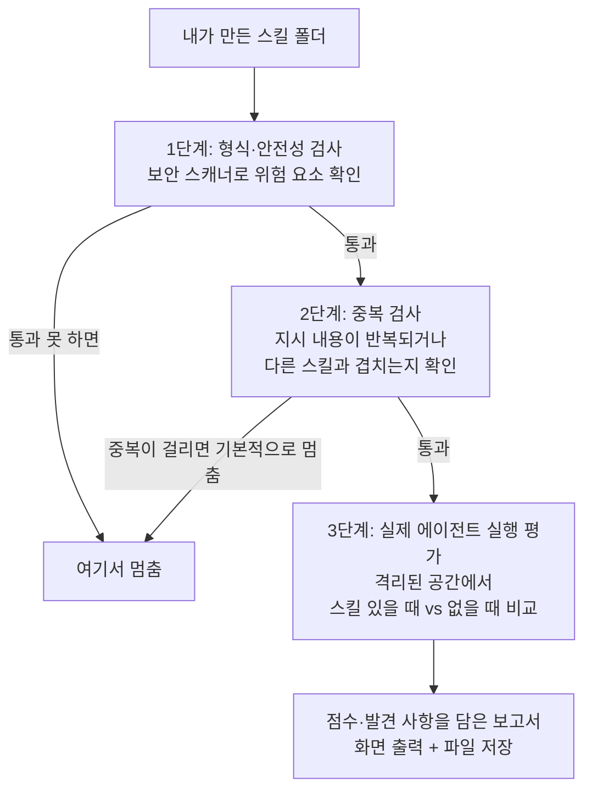

<div class="ai-knowledge-shell">

<aside class="ai-knowledge-sidebar">
  <p class="ai-eyebrow">CATEGORIES</p>
  <nav class="ai-cat-tree"><details class="ai-cat" open><summary><span class="catname">에이전트 오케스트레이션</span><span class="catcount">23</span></summary><ul><li><a href="https://altjs4510.github.io/ai_news_blog/knowledge/20261118/"><span class="kdate">2026-11-18</span><span class="ktitle">Tencent/LoopForge — CodeBuddy·Codex·Claude Code를…</span></a></li><li><a href="https://altjs4510.github.io/ai_news_blog/knowledge/20261117/" class="current"><span class="kdate">2026-11-17</span><span class="ktitle">NVIDIA/SkillEvaluator — AI 에이전트 스킬·플러그인을 품질 게이트,…</span></a></li><li><a href="https://altjs4510.github.io/ai_news_blog/knowledge/20261107/"><span class="kdate">2026-11-07</span><span class="ktitle">Hermes Agent v0.23.0 — The Hearth Release</span></a></li><li><a href="https://altjs4510.github.io/ai_news_blog/knowledge/20261029/"><span class="kdate">2026-10-29</span><span class="ktitle">How Anthropic ships Claude with Claude: Separati…</span></a></li><li><a href="https://altjs4510.github.io/ai_news_blog/knowledge/20261027/"><span class="kdate">2026-10-27</span><span class="ktitle">nightly-labs/openbot — Codex·Claude·Grok을 상주 팀원처…</span></a></li><li><a href="https://altjs4510.github.io/ai_news_blog/knowledge/20261015/"><span class="kdate">2026-10-15</span><span class="ktitle">How Third Moment Research runs 10,000 agents for…</span></a></li><li><a href="https://altjs4510.github.io/ai_news_blog/knowledge/20261014/"><span class="kdate">2026-10-14</span><span class="ktitle">How Anthropic's Dynamic Workflows Coordinate Cla…</span></a></li><li><a href="https://altjs4510.github.io/ai_news_blog/knowledge/20260930/"><span class="kdate">2026-09-30</span><span class="ktitle">Agents you can coach: how Asana builds human-age…</span></a></li><li><a href="https://altjs4510.github.io/ai_news_blog/knowledge/20260929/"><span class="kdate">2026-09-29</span><span class="ktitle">vectorize-io/hindsight — Hindsight: Agent Memory…</span></a></li><li><a href="https://altjs4510.github.io/ai_news_blog/knowledge/20260831-openexecutive-virtual-c-suite/"><span class="kdate">2026-08-31</span><span class="ktitle">Open Executive — 8명의 전문 에이전트를 하나의 임원 목소리로</span></a></li><li><a href="https://altjs4510.github.io/ai_news_blog/knowledge/20260828/"><span class="kdate">2026-08-28</span><span class="ktitle">Google ADK for Python v2.8.0 — RemoteA2aAgent 네이…</span></a></li><li><a href="https://altjs4510.github.io/ai_news_blog/knowledge/20260826/"><span class="kdate">2026-08-26</span><span class="ktitle">apache/maka — 도구 호출·권한 결정·종료 이벤트를 append-only 로그…</span></a></li><li><a href="https://altjs4510.github.io/ai_news_blog/knowledge/20260823/"><span class="kdate">2026-08-23</span><span class="ktitle">The Evolution of the Agent Harness — 하네스가 모델 가중치…</span></a></li><li><a href="https://altjs4510.github.io/ai_news_blog/knowledge/20260805/"><span class="kdate">2026-08-05</span><span class="ktitle">TencentCloud/TencentDB-Agent-Memory — 대화·문서·코드를 …</span></a></li><li><a href="https://altjs4510.github.io/ai_news_blog/knowledge/20260726/"><span class="kdate">2026-07-26</span><span class="ktitle">citrolabs/ego-lite — 로그인된 브라우저 상태를 AI 에이전트와 공유하는…</span></a></li><li><a href="https://altjs4510.github.io/ai_news_blog/knowledge/20260717/"><span class="kdate">2026-07-17</span><span class="ktitle">After a year building agent memory, 'save everyt…</span></a></li><li><a href="https://altjs4510.github.io/ai_news_blog/knowledge/20260708/"><span class="kdate">2026-07-08</span><span class="ktitle">Expanding Managed Agents in Gemini API: backgrou…</span></a></li><li><a href="https://altjs4510.github.io/ai_news_blog/knowledge/20260623/"><span class="kdate">2026-06-23</span><span class="ktitle">bytedance/deer-flow — 샌드박스·메모리·서브에이전트·메시지 게이트웨이를…</span></a></li><li><a href="https://altjs4510.github.io/ai_news_blog/knowledge/20260621/"><span class="kdate">2026-06-21</span><span class="ktitle">calesthio/OpenMontage — 12 파이프라인·52 도구·500+ 스킬을 …</span></a></li><li><a href="https://altjs4510.github.io/ai_news_blog/knowledge/20260611/"><span class="kdate">2026-06-11</span><span class="ktitle">The evolution of agentic surfaces: building with…</span></a></li><li><a href="https://altjs4510.github.io/ai_news_blog/knowledge/20260602/"><span class="kdate">2026-06-02</span><span class="ktitle">revfactory/harness — 도메인별 에이전트 팀과 스킬을 자동 설계하는 메타…</span></a></li><li><a href="https://altjs4510.github.io/ai_news_blog/knowledge/20260529/"><span class="kdate">2026-05-29</span><span class="ktitle">Introducing dynamic workflows in Claude Code</span></a></li><li><a href="https://altjs4510.github.io/ai_news_blog/knowledge/20260507/"><span class="kdate">2026-05-07</span><span class="ktitle">ruvnet/ruflo — Claude 멀티 에이전트 오케스트레이션 플랫폼</span></a></li></ul></details><details class="ai-cat" open><summary><span class="catname">MCP &amp; 도구 통합</span><span class="catcount">15</span></summary><ul><li><a href="https://altjs4510.github.io/ai_news_blog/knowledge/20261103/"><span class="kdate">2026-11-03</span><span class="ktitle">vercel-labs/agent-desktop — 픽셀 대신 OS 접근성 트리로 앱 U…</span></a></li><li><a href="https://altjs4510.github.io/ai_news_blog/knowledge/20261007/"><span class="kdate">2026-10-07</span><span class="ktitle">morluto/rea — 앱 동작부터 네이티브 바이너리까지 에이전트로 리버스 엔지니어링</span></a></li><li><a href="https://altjs4510.github.io/ai_news_blog/knowledge/20260831-gitnexus-code-knowledge-graph/"><span class="kdate">2026-08-31</span><span class="ktitle">GitNexus — 코드베이스를 지식그래프로 바꿔 에이전트에게 쥐어주기</span></a></li><li><a href="https://altjs4510.github.io/ai_news_blog/knowledge/20260829/"><span class="kdate">2026-08-29</span><span class="ktitle">cursor/plugins — 플러그인 명세(specification)와 공식 플러그인…</span></a></li><li><a href="https://altjs4510.github.io/ai_news_blog/knowledge/20260802/"><span class="kdate">2026-08-02</span><span class="ktitle">Stateless MCP has recaptured my interest (and in…</span></a></li><li><a href="https://altjs4510.github.io/ai_news_blog/knowledge/20260731/"><span class="kdate">2026-07-31</span><span class="ktitle">different-ai/openwork — Claude Cowork의 오픈소스 대안(o…</span></a></li><li><a href="https://altjs4510.github.io/ai_news_blog/knowledge/20260729/"><span class="kdate">2026-07-29</span><span class="ktitle">Bringing MCP 2026-07-28 to Claude</span></a></li><li><a href="https://altjs4510.github.io/ai_news_blog/knowledge/20260718/"><span class="kdate">2026-07-18</span><span class="ktitle">tirth8205/code-review-graph — MCP·CLI용 로컬 코드 인텔리…</span></a></li><li><a href="https://altjs4510.github.io/ai_news_blog/knowledge/20260618/"><span class="kdate">2026-06-18</span><span class="ktitle">DeusData/codebase-memory-mcp — 158개 언어 코드베이스를 밀리…</span></a></li><li><a href="https://altjs4510.github.io/ai_news_blog/knowledge/20260603/"><span class="kdate">2026-06-03</span><span class="ktitle">How Bad MCP design cost your Agent 5× more token…</span></a></li><li><a href="https://altjs4510.github.io/ai_news_blog/knowledge/20260521/"><span class="kdate">2026-05-21</span><span class="ktitle">colbymchenry/codegraph — Pre-indexed code knowle…</span></a></li><li><a href="https://altjs4510.github.io/ai_news_blog/knowledge/20260517/"><span class="kdate">2026-05-17</span><span class="ktitle">I gave my LLM 100,000+ tools — Lazy Discovery &a…</span></a></li><li><a href="https://altjs4510.github.io/ai_news_blog/knowledge/20260512/"><span class="kdate">2026-05-12</span><span class="ktitle">agentmemory — Persistent memory for AI coding ag…</span></a></li><li><a href="https://altjs4510.github.io/ai_news_blog/knowledge/20260509/"><span class="kdate">2026-05-09</span><span class="ktitle">How to connect 100 MCP servers without the conte…</span></a></li><li><a href="https://altjs4510.github.io/ai_news_blog/knowledge/20260506/"><span class="kdate">2026-05-06</span><span class="ktitle">mksglu/context-mode — AI 코딩 에이전트용 컨텍스트 윈도우 최적화</span></a></li></ul></details><details class="ai-cat" open><summary><span class="catname">코딩 에이전트</span><span class="catcount">29</span></summary><ul><li><a href="https://altjs4510.github.io/ai_news_blog/knowledge/20261115/"><span class="kdate">2026-11-15</span><span class="ktitle">GoogleChrome/modern-web-guidance-src — 코딩 에이전트에 …</span></a></li><li><a href="https://altjs4510.github.io/ai_news_blog/knowledge/20261112/"><span class="kdate">2026-11-12</span><span class="ktitle">shadcn/improve — 가장 강한 모델로 코드베이스를 감사해 계획을 쓰고, 더 …</span></a></li><li><a href="https://altjs4510.github.io/ai_news_blog/knowledge/20261106/"><span class="kdate">2026-11-06</span><span class="ktitle">Cline desktop-nightly-20261104233655: feat(core)…</span></a></li><li><a href="https://altjs4510.github.io/ai_news_blog/knowledge/20261022/"><span class="kdate">2026-10-22</span><span class="ktitle">Claude Mods: Flipping the Harness Inside Out</span></a></li><li><a href="https://altjs4510.github.io/ai_news_blog/knowledge/20261018/"><span class="kdate">2026-10-18</span><span class="ktitle">Quoting Addy Osmani, Morgan Westlee Lunt, and Qi…</span></a></li><li><a href="https://altjs4510.github.io/ai_news_blog/knowledge/20261017/"><span class="kdate">2026-10-17</span><span class="ktitle">mksglu/context-mode — 코딩 에이전트용 컨텍스트 윈도우 최적화</span></a></li><li><a href="https://altjs4510.github.io/ai_news_blog/knowledge/20261014-claude-code-advisor/"><span class="kdate">2026-10-14</span><span class="ktitle">Claude Code advisor — 가벼운 메인 모델이 일하고, 갈림길에서만 Opu…</span></a></li><li><a href="https://altjs4510.github.io/ai_news_blog/knowledge/20260920/"><span class="kdate">2026-09-20</span><span class="ktitle">Claude Code 2.1.277 — CLAUDE.md가 없으면 AGENTS.md를 …</span></a></li><li><a href="https://altjs4510.github.io/ai_news_blog/knowledge/20260912/"><span class="kdate">2026-09-12</span><span class="ktitle">Quoting Boris Cherny — 'Claude가 쓴 프로덕션 코드는 사람이 쓴…</span></a></li><li><a href="https://altjs4510.github.io/ai_news_blog/knowledge/20260910/"><span class="kdate">2026-09-10</span><span class="ktitle">vastsa/PI-Desktop — Electron + Rust 호스트 코어 + 에이전…</span></a></li><li><a href="https://altjs4510.github.io/ai_news_blog/knowledge/20260906/"><span class="kdate">2026-09-06</span><span class="ktitle">DietrichGebert/ponytail — 에이전트를 '방에서 가장 게으른 시니어 …</span></a></li><li><a href="https://altjs4510.github.io/ai_news_blog/knowledge/20260903/"><span class="kdate">2026-09-03</span><span class="ktitle">pacifio/atlas — 여러 코딩 에이전트의 변경을 한곳에서 추적·질의하는 '에이…</span></a></li><li><a href="https://altjs4510.github.io/ai_news_blog/knowledge/20260901/"><span class="kdate">2026-09-01</span><span class="ktitle">affaan-m/ECC — 스킬·본능·메모리·보안을 묶은 에이전트 하네스 성능 최적화 …</span></a></li><li><a href="https://altjs4510.github.io/ai_news_blog/knowledge/20260819/"><span class="kdate">2026-08-19</span><span class="ktitle">akitaonrails/ai-memory — 코딩 에이전트 CLI 간 장기 기억과 벤더…</span></a></li><li><a href="https://altjs4510.github.io/ai_news_blog/knowledge/20260814/"><span class="kdate">2026-08-14</span><span class="ktitle">cathrynlavery/diagram-design — Claude Code용 에디토리…</span></a></li><li><a href="https://altjs4510.github.io/ai_news_blog/knowledge/20260810/"><span class="kdate">2026-08-10</span><span class="ktitle">Auto mode is now the default in Claude Code for …</span></a></li><li><a href="https://altjs4510.github.io/ai_news_blog/knowledge/20260808/"><span class="kdate">2026-08-08</span><span class="ktitle">PrimeIntellect-ai/prime-agent — 코딩 워크플로우와 장시간 자율…</span></a></li><li><a href="https://altjs4510.github.io/ai_news_blog/knowledge/20260804/"><span class="kdate">2026-08-04</span><span class="ktitle">esengine/DeepSeek-Reasonix — prefix-cache 안정성을 축…</span></a></li><li><a href="https://altjs4510.github.io/ai_news_blog/knowledge/20260728/"><span class="kdate">2026-07-28</span><span class="ktitle">alibaba/open-code-review — 결정론적 파이프라인 + LLM 에이전트…</span></a></li><li><a href="https://altjs4510.github.io/ai_news_blog/knowledge/20260725/"><span class="kdate">2026-07-25</span><span class="ktitle">The new rules of context engineering for Claude …</span></a></li><li><a href="https://altjs4510.github.io/ai_news_blog/knowledge/20260714/"><span class="kdate">2026-07-14</span><span class="ktitle">Graphify-Labs/graphify — 코드베이스를 질의 가능한 지식 그래프로 만…</span></a></li><li><a href="https://altjs4510.github.io/ai_news_blog/knowledge/20260707/"><span class="kdate">2026-07-07</span><span class="ktitle">AI Hero Skills Catalog — 실무 엔지니어를 위한 재사용 가능한 판단 …</span></a></li><li><a href="https://altjs4510.github.io/ai_news_blog/knowledge/20260705/"><span class="kdate">2026-07-05</span><span class="ktitle">openai/codex-plugin-cc — Claude Code에서 Codex를 위임…</span></a></li><li><a href="https://altjs4510.github.io/ai_news_blog/knowledge/20260701/"><span class="kdate">2026-07-01</span><span class="ktitle">Google OKF (Open Knowledge Format) — 벤더 중립 에이전트 …</span></a></li><li><a href="https://altjs4510.github.io/ai_news_blog/knowledge/20260626/"><span class="kdate">2026-06-26</span><span class="ktitle">google-labs-code/design.md — 코딩 에이전트에게 디자인 시스템을 …</span></a></li><li><a href="https://altjs4510.github.io/ai_news_blog/knowledge/20260619/"><span class="kdate">2026-06-19</span><span class="ktitle">Claude Code now supports artifacts</span></a></li><li><a href="https://altjs4510.github.io/ai_news_blog/knowledge/20260530/"><span class="kdate">2026-05-30</span><span class="ktitle">Leonxlnx/taste-skill — AI에게 좋은 취향을 부여해 generic s…</span></a></li><li><a href="https://altjs4510.github.io/ai_news_blog/knowledge/20260508/"><span class="kdate">2026-05-08</span><span class="ktitle">addyosmani/agent-skills — Production-grade engin…</span></a></li><li><a href="https://altjs4510.github.io/ai_news_blog/knowledge/20260505/"><span class="kdate">2026-05-05</span><span class="ktitle">mattpocock/skills — Skills for Real Engineers (.…</span></a></li></ul></details><details class="ai-cat" open><summary><span class="catname">모델 &amp; 연구</span><span class="catcount">13</span></summary><ul><li><a href="https://altjs4510.github.io/ai_news_blog/knowledge/20261113/"><span class="kdate">2026-11-13</span><span class="ktitle">Gemini Decisions API</span></a></li><li><a href="https://altjs4510.github.io/ai_news_blog/knowledge/20261111/"><span class="kdate">2026-11-11</span><span class="ktitle">Quoting Prompting Claude Fable 5.2</span></a></li><li><a href="https://altjs4510.github.io/ai_news_blog/knowledge/20261104/"><span class="kdate">2026-11-04</span><span class="ktitle">Qwen 3.8 27B on my laptop can interpret model we…</span></a></li><li><a href="https://altjs4510.github.io/ai_news_blog/knowledge/20261009/"><span class="kdate">2026-10-09</span><span class="ktitle">Claude Haiku 5.5 (Simon Willison의 출시 노트와 가격 분석)</span></a></li><li><a href="https://altjs4510.github.io/ai_news_blog/knowledge/20260907-voicemem-dual-brain-memory/"><span class="kdate">2026-09-07</span><span class="ktitle">VoiceMem — 좌뇌·우뇌로 쪼갠 스트리밍 메모리로 음성 에이전트 지연 없애기</span></a></li><li><a href="https://altjs4510.github.io/ai_news_blog/knowledge/20260904/"><span class="kdate">2026-09-04</span><span class="ktitle">HarnessDev: Can LLMs Create and Evolve Their Own…</span></a></li><li><a href="https://altjs4510.github.io/ai_news_blog/knowledge/20260821/"><span class="kdate">2026-08-21</span><span class="ktitle">volcengine/OpenViking — 에이전트 메모리·Knowledge RAG·스…</span></a></li><li><a href="https://altjs4510.github.io/ai_news_blog/knowledge/20260716-proprag/"><span class="kdate">2026-07-16</span><span class="ktitle">PropRAG — 프로포지션 경로 위 beam search로 멀티홉 검색 안내</span></a></li><li><a href="https://altjs4510.github.io/ai_news_blog/knowledge/20260712/"><span class="kdate">2026-07-12</span><span class="ktitle">Do Automated Evals Work?</span></a></li><li><a href="https://altjs4510.github.io/ai_news_blog/knowledge/20260620/"><span class="kdate">2026-06-20</span><span class="ktitle">zai-org/GLM-5 — From Vibe Coding to Agentic Engi…</span></a></li><li><a href="https://altjs4510.github.io/ai_news_blog/knowledge/20260617/"><span class="kdate">2026-06-17</span><span class="ktitle">Predicting model behavior before release by simu…</span></a></li><li><a href="https://altjs4510.github.io/ai_news_blog/knowledge/20260516/"><span class="kdate">2026-05-16</span><span class="ktitle">STALE — 에이전트가 자기 기억의 유효성을 인지할 수 있는가</span></a></li><li><a href="https://altjs4510.github.io/ai_news_blog/knowledge/20260513/"><span class="kdate">2026-05-13</span><span class="ktitle">Thinking Machines' Native Interaction Models — T…</span></a></li></ul></details><details class="ai-cat" open><summary><span class="catname">인프라 &amp; 컴퓨트</span><span class="catcount">8</span></summary><ul><li><a href="https://altjs4510.github.io/ai_news_blog/knowledge/20260905/"><span class="kdate">2026-09-05</span><span class="ktitle">magnitudedev/magnitude — 하드웨어에 맞는 최적 로컬 모델을 띄워 이…</span></a></li><li><a href="https://altjs4510.github.io/ai_news_blog/knowledge/20260812/"><span class="kdate">2026-08-12</span><span class="ktitle">semantica-agi/semantica — 컨텍스트와 '책임 추적 가능한(accou…</span></a></li><li><a href="https://altjs4510.github.io/ai_news_blog/knowledge/20260806/"><span class="kdate">2026-08-06</span><span class="ktitle">cloudflare/computer — 에이전트에게 컴퓨터를 통째로 주는 엣지 실행 샌…</span></a></li><li><a href="https://altjs4510.github.io/ai_news_blog/knowledge/20260723/"><span class="kdate">2026-07-23</span><span class="ktitle">diegosouzapw/OmniRoute — 268+ 프로바이더를 단일 엔드포인트로 묶…</span></a></li><li><a href="https://altjs4510.github.io/ai_news_blog/knowledge/20260610/"><span class="kdate">2026-06-10</span><span class="ktitle">Fable 5 just made cost-aware model routing manda…</span></a></li><li><a href="https://altjs4510.github.io/ai_news_blog/knowledge/20260604/"><span class="kdate">2026-06-04</span><span class="ktitle">chopratejas/headroom — Compress tool outputs bef…</span></a></li><li><a href="https://altjs4510.github.io/ai_news_blog/knowledge/20260522/"><span class="kdate">2026-05-22</span><span class="ktitle">Giving Agents Computers — Ivan Burazin, Daytona</span></a></li><li><a href="https://altjs4510.github.io/ai_news_blog/knowledge/20260520/"><span class="kdate">2026-05-20</span><span class="ktitle">New in Claude Managed Agents: self-hosted sandbo…</span></a></li></ul></details><details class="ai-cat" open><summary><span class="catname">보안 &amp; 거버넌스</span><span class="catcount">25</span></summary><ul><li><a href="https://altjs4510.github.io/ai_news_blog/knowledge/20261031/"><span class="kdate">2026-10-31</span><span class="ktitle">CopilotKit/OpenBot — AI 동료마다 전용 컴퓨터를 주고 모든 행동을 실…</span></a></li><li><a href="https://altjs4510.github.io/ai_news_blog/knowledge/20261030/"><span class="kdate">2026-10-30</span><span class="ktitle">How we detect frontier model misalignment</span></a></li><li><a href="https://altjs4510.github.io/ai_news_blog/knowledge/20261021/"><span class="kdate">2026-10-21</span><span class="ktitle">cloudflare/security-audit-skill — 독립 검증된 기계 판독형 …</span></a></li><li><a href="https://altjs4510.github.io/ai_news_blog/knowledge/20261020/"><span class="kdate">2026-10-20</span><span class="ktitle">Satya Nadella — 모델을 내부자 위험으로 보는 원칙에 따라 Project P…</span></a></li><li><a href="https://altjs4510.github.io/ai_news_blog/knowledge/20261016/"><span class="kdate">2026-10-16</span><span class="ktitle">Crossing the Threshold: How OpenAI and Anthropic…</span></a></li><li><a href="https://altjs4510.github.io/ai_news_blog/knowledge/20261011/"><span class="kdate">2026-10-11</span><span class="ktitle">Anthropic can’t reliably control its AI agents. …</span></a></li><li><a href="https://altjs4510.github.io/ai_news_blog/knowledge/20261004/"><span class="kdate">2026-10-04</span><span class="ktitle">Apple says it's tightening macOS 'Full Disk Acce…</span></a></li><li><a href="https://altjs4510.github.io/ai_news_blog/knowledge/20261001/"><span class="kdate">2026-10-01</span><span class="ktitle">NVIDIA/OpenShell</span></a></li><li><a href="https://altjs4510.github.io/ai_news_blog/knowledge/20260919/"><span class="kdate">2026-09-19</span><span class="ktitle">cloudflare/security-audit-skill — 다단계 보안 감사를 '독립…</span></a></li><li><a href="https://altjs4510.github.io/ai_news_blog/knowledge/20260913/"><span class="kdate">2026-09-13</span><span class="ktitle">OpenAI agents attacked RubyGems back in May: Ope…</span></a></li><li><a href="https://altjs4510.github.io/ai_news_blog/knowledge/20260902/"><span class="kdate">2026-09-02</span><span class="ktitle">AIR raises $50M to help companies vet the skills…</span></a></li><li><a href="https://altjs4510.github.io/ai_news_blog/knowledge/20260827/"><span class="kdate">2026-08-27</span><span class="ktitle">Claude in Chrome is generally available</span></a></li><li><a href="https://altjs4510.github.io/ai_news_blog/knowledge/20260819-mind-viruses/"><span class="kdate">2026-08-19</span><span class="ktitle">탈옥도, 인젝션도 없이 — 대화로만 퍼지는 에이전트의 '마인드 바이러스'</span></a></li><li><a href="https://altjs4510.github.io/ai_news_blog/knowledge/20260730/"><span class="kdate">2026-07-30</span><span class="ktitle">Anatomy of a Frontier Lab Agent Intrusion: A Tec…</span></a></li><li><a href="https://altjs4510.github.io/ai_news_blog/knowledge/20260715/"><span class="kdate">2026-07-15</span><span class="ktitle">Dicklesworthstone/destructive_command_guard — 에이…</span></a></li><li><a href="https://altjs4510.github.io/ai_news_blog/knowledge/20260710/"><span class="kdate">2026-07-10</span><span class="ktitle">70개 MCP 서버 strace 런타임 감사 — 부팅 시 아웃바운드 호출 서버 적발</span></a></li><li><a href="https://altjs4510.github.io/ai_news_blog/knowledge/20260704/"><span class="kdate">2026-07-04</span><span class="ktitle">Cloudflare is about to block AI agents by defaul…</span></a></li><li><a href="https://altjs4510.github.io/ai_news_blog/knowledge/20260703/"><span class="kdate">2026-07-03</span><span class="ktitle">Giving admins more visibility and control over C…</span></a></li><li><a href="https://altjs4510.github.io/ai_news_blog/knowledge/20260630/"><span class="kdate">2026-06-30</span><span class="ktitle">Introducing the Claude apps gateway for Amazon B…</span></a></li><li><a href="https://altjs4510.github.io/ai_news_blog/knowledge/20260624/"><span class="kdate">2026-06-24</span><span class="ktitle">Agent identity in Claude Tag: a new access model…</span></a></li><li><a href="https://altjs4510.github.io/ai_news_blog/knowledge/20260613/"><span class="kdate">2026-06-13</span><span class="ktitle">Fable 5's guardrails got bypassed in 48 hours — …</span></a></li><li><a href="https://altjs4510.github.io/ai_news_blog/knowledge/20260612/"><span class="kdate">2026-06-12</span><span class="ktitle">NVIDIA/SkillSpector — AI 에이전트 스킬용 보안 스캐너</span></a></li><li><a href="https://altjs4510.github.io/ai_news_blog/knowledge/20260607/"><span class="kdate">2026-06-07</span><span class="ktitle">OpenAI Help: Lockdown Mode</span></a></li><li><a href="https://altjs4510.github.io/ai_news_blog/knowledge/20260531/"><span class="kdate">2026-05-31</span><span class="ktitle">How we contain Claude across products</span></a></li><li><a href="https://altjs4510.github.io/ai_news_blog/knowledge/20260527/"><span class="kdate">2026-05-27</span><span class="ktitle">Microsoft Copilot Cowork Exfiltrates Files</span></a></li></ul></details><details class="ai-cat" open><summary><span class="catname">응용 사례</span><span class="catcount">14</span></summary><ul><li><a href="https://altjs4510.github.io/ai_news_blog/knowledge/20261114/"><span class="kdate">2026-11-14</span><span class="ktitle">Introducing ChatGPT Wallet</span></a></li><li><a href="https://altjs4510.github.io/ai_news_blog/knowledge/20261110/"><span class="kdate">2026-11-10</span><span class="ktitle">meta/astryx — 직접 바꿔 쓸 수 있고 에이전트가 바로 쓸 수 있는(agent…</span></a></li><li><a href="https://altjs4510.github.io/ai_news_blog/knowledge/20261105/"><span class="kdate">2026-11-05</span><span class="ktitle">NVIDIA/auto-ontology — 데이터 위에 그래프 기반 의미 추론 레이어를 …</span></a></li><li><a href="https://altjs4510.github.io/ai_news_blog/knowledge/20261101/"><span class="kdate">2026-11-01</span><span class="ktitle">Agents Prompt People: Using Agents for Long-Hori…</span></a></li><li><a href="https://altjs4510.github.io/ai_news_blog/knowledge/20261028/"><span class="kdate">2026-10-28</span><span class="ktitle">Greptile takes bug detection beyond code review …</span></a></li><li><a href="https://altjs4510.github.io/ai_news_blog/knowledge/20261023/"><span class="kdate">2026-10-23</span><span class="ktitle">Claude Duet app is Anthropic's bet on agents</span></a></li><li><a href="https://altjs4510.github.io/ai_news_blog/knowledge/20261006/"><span class="kdate">2026-10-06</span><span class="ktitle">How Cresta turned CX expertise into an agent bui…</span></a></li><li><a href="https://altjs4510.github.io/ai_news_blog/knowledge/20260911/"><span class="kdate">2026-09-11</span><span class="ktitle">Now everyone can put data to work — ChatGPT Work…</span></a></li><li><a href="https://altjs4510.github.io/ai_news_blog/knowledge/20260909/"><span class="kdate">2026-09-09</span><span class="ktitle">Reducing cost and improving performance with Cla…</span></a></li><li><a href="https://altjs4510.github.io/ai_news_blog/knowledge/20260709/"><span class="kdate">2026-07-09</span><span class="ktitle">mvanhorn/last30days-skill — Reddit·X·YouTube·HN·…</span></a></li><li><a href="https://altjs4510.github.io/ai_news_blog/knowledge/20260609/"><span class="kdate">2026-06-09</span><span class="ktitle">Building intelligent apps for Apple platforms wi…</span></a></li><li><a href="https://altjs4510.github.io/ai_news_blog/knowledge/20260528/"><span class="kdate">2026-05-28</span><span class="ktitle">Building self-improving tax agents with Codex</span></a></li><li><a href="https://altjs4510.github.io/ai_news_blog/knowledge/20260515/"><span class="kdate">2026-05-15</span><span class="ktitle">Clawdmeter — Claude Code 사용량을 데스크톱 대시보드로</span></a></li><li><a href="https://altjs4510.github.io/ai_news_blog/knowledge/20260514/"><span class="kdate">2026-05-14</span><span class="ktitle">Introducing Claude for Small Business</span></a></li></ul></details><details class="ai-cat" open><summary><span class="catname">산업 동향</span><span class="catcount">8</span></summary><ul><li><a href="https://altjs4510.github.io/ai_news_blog/knowledge/20261024/"><span class="kdate">2026-10-24</span><span class="ktitle">Donating Agent Skills to the Agentic AI Foundati…</span></a></li><li><a href="https://altjs4510.github.io/ai_news_blog/knowledge/20260907-humanmade-52week-rhythm/"><span class="kdate">2026-09-07</span><span class="ktitle">휴먼 메이드의 '52주 리듬' — 아이디어가 흔해진 시대에 값이 오르는 건 버리는 판단</span></a></li><li><a href="https://altjs4510.github.io/ai_news_blog/knowledge/20260830/"><span class="kdate">2026-08-30</span><span class="ktitle">[AINews] OpenAI shuts off Cursor — 프론티어 모델 공급 차단…</span></a></li><li><a href="https://altjs4510.github.io/ai_news_blog/knowledge/20260711/"><span class="kdate">2026-07-11</span><span class="ktitle">OpenAI says GPT 5.6 is the 'preferred model' for…</span></a></li><li><a href="https://altjs4510.github.io/ai_news_blog/knowledge/20260702/"><span class="kdate">2026-07-02</span><span class="ktitle">How Cursor deploys AI inside the enterprise (For…</span></a></li><li><a href="https://altjs4510.github.io/ai_news_blog/knowledge/20260616/"><span class="kdate">2026-06-16</span><span class="ktitle">Why AI hasn't replaced software engineers, and w…</span></a></li><li><a href="https://altjs4510.github.io/ai_news_blog/knowledge/20260519/"><span class="kdate">2026-05-19</span><span class="ktitle">Anthropic acquires Stainless</span></a></li><li><a href="https://altjs4510.github.io/ai_news_blog/knowledge/20260504/"><span class="kdate">2026-05-04</span><span class="ktitle">Agents for Everything Else: Codex for Knowledge …</span></a></li></ul></details></nav>
</aside>

<article class="ai-knowledge-article">

<header class="ai-post-hero">
  <p class="ai-eyebrow"><a class="ai-back" href="../">KNOWLEDGE</a> · 2026-11-17 · 오늘의 학습</p>
  <h2 class="ai-post-title">NVIDIA/SkillEvaluator — AI 에이전트 스킬·플러그인을 품질 게이트, 의미 중복 탐지, 합성 평가셋, 실제 에이전트 평가로 검증하는 다층 프레임워크</h2>
</header>

> 원문: [NVIDIA/SkillEvaluator — AI 에이전트 스킬·플러그인을 품질 게이트, 의미 중복 탐지, 합성 평가셋, 실제 에이전트 평가로 검증하는 다층 프레임워크](https://github.com/NVIDIA/SkillEvaluator)

## 📌 학습 정리

### 1. 한 줄로 말하면

AI 에이전트에게 붙이는 '업무 매뉴얼 폴더'가 제대로 만들어졌는지 먼저 점검하고, 그 매뉴얼을 줬을 때와 안 줬을 때 실제로 일을 더 잘하는지 비교해 주는 검사 도구예요.

### 2. 왜 이게 만들어졌어요?

요즘 AI 에이전트(사람 대신 여러 단계의 작업을 알아서 처리하는 AI 프로그램, agent)에는 '스킬(skill)'을 붙여 쓰는 경우가 많아요. 스킬은 "이런 일은 이렇게 처리해" 같은 지시문과 참고 파일을 폴더 하나에 담아 둔 거고, 그 형식은 Agent Skills 명세라는 공통 규격으로 정해져 있어요. 그런데 스킬을 만드는 건 쉬워도 "이 스킬이 형식에 맞는지, 위험한 내용은 없는지, 다른 스킬과 겹치지는 않는지, 그리고 정말 에이전트가 일을 더 잘하게 만드는지"를 확인하기는 꽤 번거로워요. SkillEvaluator는 이 질문들을 단계별로 나눠 하나의 명령어 도구로 점검할 수 있게 만든 프레임워크로 보여요. NVIDIA가 스킬을 검증하는 과정(NVIDIA Verified Skills pipeline)의 일부이기도 해요.

### 3. 비유로 풀면

이건 마치 신입 사원용 업무 매뉴얼을 세 단계로 검수하는 것과 비슷해요. 첫 번째로 서식이 맞는지, 민감한 정보가 들어 있지 않은지 문서 자체를 훑어봐요. 두 번째로 다른 매뉴얼과 같은 말을 반복하거나 내용이 겹치지 않는지 대조하고요. 마지막으로 신입 두 명에게 같은 일을 시키면서 한 명에게만 매뉴얼을 줘 보고, 결과가 정말 좋아지는지 지켜보는 거예요.

또 하나 덧붙이자면, 세 번째 단계는 실제 사무실이 아니라 따로 마련한 연습실에서 진행된다고 생각하면 돼요. 에이전트가 실수해도 바깥에 영향을 주지 않도록 격리된 공간(샌드박스, sandbox)에서 돌리거든요.

그래서 결국 "잘 써진 매뉴얼인가?"에서 끝나지 않고, "이 매뉴얼이 실제로 일의 결과를 바꾸는가?"까지 숫자와 근거로 확인하려는 도구예요.

### 4. 어떻게 작동하는지 (그림으로)



세 단계는 서로 독립적이라 필요한 단계만 골라 돌릴 수도 있어요. 다 함께 돌리는 `validate` 명령에서는 1단계를 통과해야 다음으로 넘어가고, 2단계도 별도 옵션으로 끄지 않으면 관문 역할을 해요. 3단계 결과는 기본적으로 참고용이고, 옵션을 켰을 때만 통과 여부를 가르는 관문이 돼요.

가장 가볍게 시작하는 방법은 AI 모델 없이 정적 품질 검사만 돌려 보는 거예요. 원문 예시인 `text-analyzer` 스킬은 이 검사에서 88.8점(B)을 받았고, 기본 통과 기준은 70점이에요. 다만 이 검사만으로는 보안과 실제 효과까지 확인되지 않아서, 공개 배포용 판정은 '미완료(INCOMPLETE)'로 남는다고 해요.

### 5. 처음 보는 용어 풀이

- **에이전트 스킬 (agent skill)** — 에이전트에게 특정 일을 처리하는 방법을 알려 주는 지시문과 보조 파일을 담은 폴더예요. Claude Code나 Codex 같은 에이전트에 붙여서 쓸 수 있어요.
- **단계 (tier)** — SkillEvaluator가 검사를 나눈 층이에요. 1단계는 형식·안전성, 2단계는 중복, 3단계는 실제 에이전트 실행 평가를 맡아요.
- **중복 제거 검사 (deduplication)** — 스킬 안의 안내가 같은 말을 되풀이하거나, 다른 스킬과 의미가 겹치는지 찾는 검사예요. 스킬 목록 파일(`--catalog`)을 넘기면 스킬끼리도 비교해요.
- **임베딩 (embedding)** — 문장의 의미를 숫자 묶음으로 바꾼 거예요. 글자가 달라도 뜻이 비슷한 문장을 찾아낼 수 있어서 2단계 중복 검사에 쓰여요.
- **평가 기준표 채점 (rubric eval)** — 미리 정해 둔 채점 기준에 따라 AI 모델이 스킬 문서를 읽고 점수와 피드백을 매기는 방식이에요. 평가가 끝까지 돌아가도 기준 점수에 못 미치면 실패로 나올 수 있어요.
- **샌드박스 (sandbox)** — 에이전트를 바깥과 격리해서 안전하게 돌려 보는 공간이에요. 3단계 실제 평가에 필요하고, 기본값으로는 Docker를 써요.
- **오토파일럿 (autopilot)** — 3단계에서 평가용 문제가 따로 없을 때 기존 자료를 다시 쓰거나, 스킬 내용을 바탕으로 평가 사례를 하나 자동으로 만들어 주는 기능이에요. 원문에서도 이렇게 만든 사례는 검사 범위가 제한적이라고 밝히고 있어요.

참고로 원문에 나오는 SkillSpector는 스킬 전용 보안 스캐너, Gitleaks는 비밀번호나 키 같은 민감한 값이 새어 나가지 않았는지 찾는 도구예요. Harbor는 에이전트를 격리 공간에서 돌려 평가하는 오픈소스 프레임워크이고요.

### 6. 한 발 더 들어가고 싶다면

- [NVIDIA/SkillEvaluator 저장소](https://github.com/NVIDIA/SkillEvaluator) — 이걸 보면 설치 방법, 단계별 가이드, CI 연동 방법, 명령어 레퍼런스를 한곳에서 따라가 볼 수 있어요.
- 저장소 안의 키 없이 해 보는 안내서(keyless walkthrough) — 이걸 보면 API 키 없이 첫 품질 점수를 받아 보는 과정을 차근차근 확인할 수 있어요.
- 저장소 안의 에이전트 가이드(agent guide) — 이걸 보면 Claude Code 같은 에이전트에 SkillEvaluator를 붙여서 "내 스킬 괜찮아?"라고 대화로 물어보는 방법을 알 수 있어요.
- 저장소에 연결된 논문과 NVIDIA Developer 블로그 — 이걸 보면 이 평가 방식이 어떤 연구 배경에서 나왔는지 알 수 있어요.

참고로 이 프로젝트는 '실험적(Experimental)' 단계로 안내되어 있어요. 커뮤니티가 가능한 범위에서 지원하고 정해진 지원 수준 약속(SLA)은 없어요. AI 모델이나 관리형 샌드박스를 쓰면 비용이 생길 수 있다는 점도 함께 알아 두면 좋아요.

---

## 📖 원문 전체 번역 (정독용)

> 의역 최소화한 전체 번역입니다. 큰 흐름은 위 정리에서 잡고, 정확한 워딩이 필요할 땐 이 섹션에서 정독하세요.

# SkillEvaluator

📺 **라이브스트림:** Ask the Experts: Evaluating Agent Skills

SkillEvaluator는 AI 에이전트 스킬(skill)을 검증하고, 그 스킬이 작업 결과에 미치는 영향을 측정합니다. 먼저 품질 검사부터 시작한 뒤, 스킬을 쓴 실행과 쓰지 않은 실행을 비교합니다.

에이전트 스킬은 [Agent Skills 사양](https://agentskills.io)이 정의하는, 지침과 보조 파일로 이루어진 폴더입니다. SkillEvaluator는 NVIDIA Verified Skills 파이프라인의 일부입니다.

## 시작하기

진입 방법은 세 가지이며, CLI는 하나이고 결과도 같습니다.

### 1. CLI를 직접 실행

pip로 설치합니다:

```bash
pip install skillevaluator
```

또는 uv로 설치합니다:

```bash
uv tool install \
  skillevaluator
```

그다음 API 키 없이 스킬을 검사합니다:

```bash
skillevaluator validate \
  ./my-skill --tiers 1
```

다른 티어(tier)는 설치 가이드를 참고하세요.

### 2. CI를 통해 레포지토리에 추가

저희 CI 템플릿이 모든 스킬 변경을 검사합니다. 유지보수할 평가 코드가 없습니다.

GitHub 레포지토리에서 다음을 실행하세요. 설정 PR이 열립니다:

```bash
skillevaluator ci init
```

GitLab 및 세부 사항은 레포지토리 가이드를 참고하세요.

### 3. 에이전트에 연결

스킬을 Claude Code, Codex 또는 다른 에이전트에 추가합니다:

```bash
npx skills add \
  NVIDIA/SkillEvaluator
```

그다음 이렇게 물어보세요:

> "내 스킬 괜찮아?"

에이전트 가이드를 참고하세요.

## 퀵스타트

두 경로 모두 번들로 포함된 `text-analyzer`를 사용합니다.

| 시작 방법 | 필요한 것 | 첫 결과 |
|---|---|---|
| LLM 없이 실행 | Git과 uv | 결정론적(deterministic) 품질 점수와 발견 사항 |
| NVIDIA Build 사용 | Git, uv, Build API 키 | 모델 기반 루브릭(rubric) 점수와 피드백 |

### LLM 없이 실행

[uv](https://docs.astral.sh/uv/)와 Git을 설치한 뒤 예제를 받아옵니다:

```bash
git clone --depth 1 https://github.com/NVIDIA/SkillEvaluator.git
cd SkillEvaluator
```

uv가 Python 3.13과 의존성을 준비합니다. 독립 실행형(standalone) 설치는 설치 가이드를 참고하세요.

```bash
uv run --python 3.13 skillevaluator quality-check \
  src/skillevaluator/tier3/reference_skills/text-analyzer \
  -r cli -r json -o reports/first-quality
```

API 키, 스캐너, GPU, Docker가 필요 없습니다. 예제는 **88.8/100 (B)**를 받고, 종료 코드 `0`으로 끝나며, `reports/first-quality/skillevaluator-quality.json`을 저장합니다. 통과 기준(threshold)의 기본값은 70입니다.

이는 정적 품질을 검사하는 것이며, 게시(publication) 증거는 `INCOMPLETE`로 남습니다. 보안에는 스캐너가 필요하고, 에이전트 영향도에는 라이브 평가가 필요합니다. 예제 경로를 본인의 스킬 디렉터리로 바꾸세요. 키 없는 워크스루(keyless walkthrough)를 참고하세요.

### NVIDIA Build 사용

자격이 있는 NVIDIA Developer Program 회원은 무료 프로토타이핑을 위해 NVIDIA 호스팅 엔드포인트를 사용할 수 있으며, 접근 약관과 요청 제한(rate limit)이 적용됩니다.

1. [build.nvidia.com](https://build.nvidia.com)에 로그인하고 등록을 완료합니다.
2. 모델 페이지를 열고 **Get API Key**를 선택해 키를 생성합니다.
3. 같은 터미널에서 제공자(provider)와 키를 설정한 뒤 루브릭 검사를 실행합니다:

```bash
export SKILL_EVAL_LLM_PROVIDER=nv_build
export NVIDIA_API_KEY='nvapi-...'
uv run --python 3.13 --extra llm skillevaluator rubric-eval \
  src/skillevaluator/tier3/reference_skills/text-analyzer \
  -r cli -r json -o reports/first-build
```

이 명령은 스킬 문서를 모델에 전송하고 피드백을 `reports/first-build/skillevaluator-rubric.json`에 저장합니다. 에이전트 런타임이나 Docker는 필요 없습니다. 완료된 평가라도 루브릭 기준을 통과하지 못할 수 있습니다.

같은 키로 Tier 2 임베딩(embedding)과 지원되는 Tier 3 에이전트도 쓸 수 있습니다. Build 워크스루 또는 제공자 설정을 참고하세요.

## 3티어 개요

각 티어는 독립적입니다. 명령에 해당 티어의 extra를 추가하세요:

| 티어 | 질문 | 설정 후 예시 | 추가 설정 |
|---|---|---|---|
| Tier 1: 검증(Validation) | 스킬이 안전하고, 형식이 올바르며, 하니스(harness)와 호환되는가? | `uv run skillevaluator tier1 ./my-skill --no-llm` | 전체 정적 검사 범위를 위한 외부 스캐너; 제공자와 모델 클라이언트가 있으면 LLM 검사 활성화 |
| Tier 2: 중복 제거(Deduplication) | 지침이 반복되거나 겹치는가? | `uv run --extra tier2 skillevaluator tier2 ./my-skill` | 임베딩과 채팅; 스킬 간 비교를 하려면 `--catalog ./skill-catalog.json` 추가 |
| Tier 3: 라이브 평가(Live Evaluation) | 스킬이 에이전트에 도움이 되는가? | `uv run --extra tier3 skillevaluator tier3 ./my-skill` | 제공자 접근 권한, 지원되는 에이전트, 실행 중인 샌드박스(기본값은 Docker) |

Tier 1은 고정(pinned)·검증된 SkillSpector와 Gitleaks 릴리스가 없으면 가져옵니다. Semgrep은 선택 사항입니다. 스캐너 문서를 참고하세요. `--no-llm`은 스캐너 요구 사항을 없애지 않습니다. 실행할 수 없는 스캐너가 있으면 `INCOMPLETE`가 되고 0이 아닌 코드로 종료됩니다.

[SkillSpector](https://github.com/NVIDIA/SkillSpector)는 스킬 전용 보안 스캔을 제공하고, 오픈소스 에이전트 평가 프레임워크인 [Harbor](https://github.com/harbor-framework/harbor)는 샌드박스 에이전트 실행을 구동합니다.

Tier 2는 스킬 간 비교가 실행되지 않았을 때 이를 보고합니다. Tier 3 autopilot은 기존 소스를 재사용하거나, 커버리지가 제한된 스킬 기반(skill-grounded) 케이스 하나를 생성합니다. 티어 가이드를 참고하세요.

## 통합 파이프라인 실행

제공자, 스캐너, 에이전트 샌드박스를 설정한 뒤 세 티어를 모두 실행합니다:

```bash
uv run --python 3.13 --extra all skillevaluator doctor --env-mode docker
uv run --python 3.13 --extra all skillevaluator validate ./my-skill
```

`doctor`는 추론 성공 여부가 아니라 준비 상태(readiness)를 검사합니다. `validate`는 스킬에 대해 autopilot과 함께 모든 티어를 실행합니다. 라이브 평가를 건너뛰려면 `--tiers 1,2`를, 정적 검사만 하려면 `--tiers 1`을 사용하세요. `--no-autopilot`은 기존 소스를 필요로 합니다. 다른 아티팩트 유형은 해당하는 단계를 그대로 유지합니다.

Tier 1은 `validate`를 게이팅(gating)합니다. Tier 2는 `--no-block-on-dedup`을 설정하지 않는 한 게이팅하며, Tier 3는 `--block-on-agent-eval`을 지정했을 때만 게이팅합니다. 모델 및 관리형 샌드박스 사용에는 요금이 발생할 수 있습니다. 런타임 및 비용 문서를 참고하세요.

단독 생성(standalone generation)에는 실질적인 `evals/EVAL.md` 지침, 작업 요청과 결과가 담긴 `--prompt` 파일, 또는 일치하는 보존 트레이스(retained trace)가 필요합니다. 아래의 `--force`는 autopilot 스타터를 교체하고, `--refine`은 이를 다듬습니다. 명시적인 `--grounding skill`은 스킬 전용 스타터를 허용합니다. 케이스를 검토하세요. 템플릿은 직접 작성되지 않은 부정(negative) 케이스를 생략합니다.

```bash
uv run --python 3.13 --extra tier3 skillevaluator tier3 create-eval-dataset ./my-skill --full --prompt eval-guidance.md --force
```

### 소스 체크아웃에서 실행

관련 extra와 함께 `uv run --python 3.13`을 사용하세요. extra와 독립 실행형 업그레이드는 설치 가이드를 참고하세요.

## 연구 및 인용

자료: 논문, PDF, DOI, BibTeX, 그리고 NVIDIA Developer 블로그.

논문을 인용하고 SkillEvaluator 릴리스 또는 커밋을 기록하세요. `CITATION.cff`를 참고하세요.

## 문서

설정, 티어 가이드, 리포트, CI 통합, CLI 레퍼런스, 성능 대시보드는 문서를 참고하세요.

## 설치 및 서드파티 소프트웨어

전체 설치 또는 티어별 소규모 설치 중 하나를 고르려면 설치 가이드를 따르세요.

이 프로젝트는 추가적인 서드파티 오픈소스 소프트웨어 프로젝트를 다운로드하고 설치합니다. 사용하기 전에 이 오픈소스 프로젝트들의 라이선스 조건을 검토하세요.

## 기여

`CONTRIBUTING.md`를 읽고 다음을 실행하세요:

```bash
make lint && make test && make build
```

프로젝트 거버넌스와 행동 강령(Code of Conduct)을 참고하세요.

## 지원

지원 수준: **Experimental**. 커뮤니티 지원이며 최선 노력(best-effort) 방식이고, SLA나 NVIDIA 엔터프라이즈 지원 자격은 없습니다. 버그와 기능 요청은 GitHub Issues로 제보하세요. `SUPPORT.md`를 참고하세요.

## 보안

취약점으로 의심되는 사항은 `SECURITY.md`의 비공개 절차로 제보하세요. 보안 이슈를 공개 GitHub 이슈에 공개하지 마세요.

## 릴리스

릴리스 변경 사항은 `CHANGELOG.md`와 GitHub Releases에 기록됩니다.

## 라이선스

Apache License 2.0 — `LICENSE`, `NOTICE`, `THIRD_PARTY_NOTICES.md`를 참고하세요.

Copyright (c) 2026 NVIDIA CORPORATION & AFFILIATES. All rights reserved.

</article>

</div>

<!-- ai-related-links -->
<aside class="ai-related-links">
  <p class="ai-eyebrow">관련 학습</p>
  <ul><li><a href="https://altjs4510.github.io/ai_news_blog/knowledge/20260612/"><span class="kdate">2026-06-12</span><span class="ktitle">NVIDIA/SkillSpector — AI 에이전트 스킬용 보안 스캐너</span></a></li><li><a href="https://altjs4510.github.io/ai_news_blog/knowledge/20260712/"><span class="kdate">2026-07-12</span><span class="ktitle">Do Automated Evals Work?</span></a></li><li><a href="https://altjs4510.github.io/ai_news_blog/knowledge/20260707/"><span class="kdate">2026-07-07</span><span class="ktitle">AI Hero Skills Catalog — 실무 엔지니어를 위한 재사용 가능한 판단 …</span></a></li></ul>
</aside>
<!-- /ai-related-links -->
