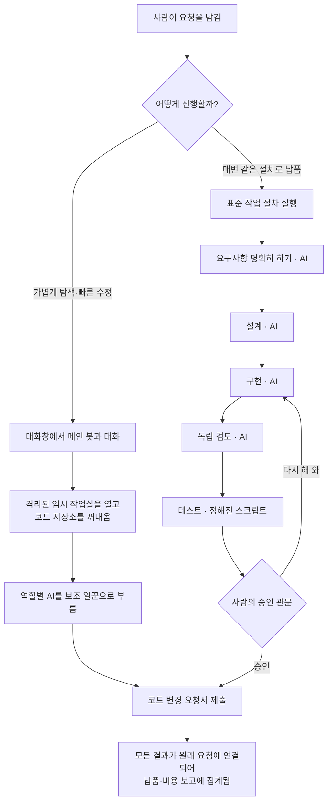

<aside class="ai-knowledge-sidebar">
  
CATEGORIES

  <nav class="ai-cat-tree">

에이전트 오케스트레이션20
<ul><li><a href="https://altjs4510.github.io/ai_news_blog/knowledge/20261121/">2026-11-21Google ADK v2.15.0 — 느린 도구에도 응답성 유지, 다중 실행 신뢰성·부…</a></li><li><a href="https://altjs4510.github.io/ai_news_blog/knowledge/20261118/" class="current">2026-11-18Tencent/LoopForge — CodeBuddy·Codex·Claude Code를…</a></li><li><a href="https://altjs4510.github.io/ai_news_blog/knowledge/20261107/">2026-11-07Hermes Agent v0.23.0 — The Hearth Release</a></li><li><a href="https://altjs4510.github.io/ai_news_blog/knowledge/20261029/">2026-10-29How Anthropic ships Claude with Claude: Separati…</a></li><li><a href="https://altjs4510.github.io/ai_news_blog/knowledge/20261027/">2026-10-27nightly-labs/openbot — Codex·Claude·Grok을 상주 팀원처…</a></li><li><a href="https://altjs4510.github.io/ai_news_blog/knowledge/20261015/">2026-10-15How Third Moment Research runs 10,000 agents for…</a></li><li><a href="https://altjs4510.github.io/ai_news_blog/knowledge/20261014/">2026-10-14How Anthropic's Dynamic Workflows Coordinate Cla…</a></li><li><a href="https://altjs4510.github.io/ai_news_blog/knowledge/20260930/">2026-09-30Agents you can coach: how Asana builds human-age…</a></li><li><a href="https://altjs4510.github.io/ai_news_blog/knowledge/20260831-openexecutive-virtual-c-suite/">2026-08-31Open Executive — 8명의 전문 에이전트를 하나의 임원 목소리로</a></li><li><a href="https://altjs4510.github.io/ai_news_blog/knowledge/20260828/">2026-08-28Google ADK for Python v2.8.0 — RemoteA2aAgent 네이…</a></li><li><a href="https://altjs4510.github.io/ai_news_blog/knowledge/20260826/">2026-08-26apache/maka — 도구 호출·권한 결정·종료 이벤트를 append-only 로그…</a></li><li><a href="https://altjs4510.github.io/ai_news_blog/knowledge/20260823/">2026-08-23The Evolution of the Agent Harness — 하네스가 모델 가중치…</a></li><li><a href="https://altjs4510.github.io/ai_news_blog/knowledge/20260821/">2026-08-21volcengine/OpenViking — 에이전트 메모리·Knowledge RAG·스…</a></li><li><a href="https://altjs4510.github.io/ai_news_blog/knowledge/20260805/">2026-08-05TencentCloud/TencentDB-Agent-Memory — 대화·문서·코드를 …</a></li><li><a href="https://altjs4510.github.io/ai_news_blog/knowledge/20260708/">2026-07-08Expanding Managed Agents in Gemini API: backgrou…</a></li><li><a href="https://altjs4510.github.io/ai_news_blog/knowledge/20260623/">2026-06-23bytedance/deer-flow — 샌드박스·메모리·서브에이전트·메시지 게이트웨이를…</a></li><li><a href="https://altjs4510.github.io/ai_news_blog/knowledge/20260611/">2026-06-11The evolution of agentic surfaces: building with…</a></li><li><a href="https://altjs4510.github.io/ai_news_blog/knowledge/20260602/">2026-06-02revfactory/harness — 도메인별 에이전트 팀과 스킬을 자동 설계하는 메타…</a></li><li><a href="https://altjs4510.github.io/ai_news_blog/knowledge/20260529/">2026-05-29Introducing dynamic workflows in Claude Code</a></li><li><a href="https://altjs4510.github.io/ai_news_blog/knowledge/20260507/">2026-05-07ruvnet/ruflo — Claude 멀티 에이전트 오케스트레이션 플랫폼</a></li></ul>

MCP &amp; 도구 통합18
<ul><li><a href="https://altjs4510.github.io/ai_news_blog/knowledge/20261103/">2026-11-03vercel-labs/agent-desktop — 픽셀 대신 OS 접근성 트리로 앱 U…</a></li><li><a href="https://altjs4510.github.io/ai_news_blog/knowledge/20261017/">2026-10-17mksglu/context-mode — 코딩 에이전트용 컨텍스트 윈도우 최적화</a></li><li><a href="https://altjs4510.github.io/ai_news_blog/knowledge/20261007/">2026-10-07morluto/rea — 앱 동작부터 네이티브 바이너리까지 에이전트로 리버스 엔지니어링</a></li><li><a href="https://altjs4510.github.io/ai_news_blog/knowledge/20260829/">2026-08-29cursor/plugins — 플러그인 명세(specification)와 공식 플러그인…</a></li><li><a href="https://altjs4510.github.io/ai_news_blog/knowledge/20260802/">2026-08-02Stateless MCP has recaptured my interest (and in…</a></li><li><a href="https://altjs4510.github.io/ai_news_blog/knowledge/20260731/">2026-07-31different-ai/openwork — Claude Cowork의 오픈소스 대안(o…</a></li><li><a href="https://altjs4510.github.io/ai_news_blog/knowledge/20260729/">2026-07-29Bringing MCP 2026-07-28 to Claude</a></li><li><a href="https://altjs4510.github.io/ai_news_blog/knowledge/20260726/">2026-07-26citrolabs/ego-lite — 로그인된 브라우저 상태를 AI 에이전트와 공유하는…</a></li><li><a href="https://altjs4510.github.io/ai_news_blog/knowledge/20260718/">2026-07-18tirth8205/code-review-graph — MCP·CLI용 로컬 코드 인텔리…</a></li><li><a href="https://altjs4510.github.io/ai_news_blog/knowledge/20260701/">2026-07-01Google OKF (Open Knowledge Format) — 벤더 중립 에이전트 …</a></li><li><a href="https://altjs4510.github.io/ai_news_blog/knowledge/20260618/">2026-06-18DeusData/codebase-memory-mcp — 158개 언어 코드베이스를 밀리…</a></li><li><a href="https://altjs4510.github.io/ai_news_blog/knowledge/20260603/">2026-06-03How Bad MCP design cost your Agent 5× more token…</a></li><li><a href="https://altjs4510.github.io/ai_news_blog/knowledge/20260521/">2026-05-21colbymchenry/codegraph — Pre-indexed code knowle…</a></li><li><a href="https://altjs4510.github.io/ai_news_blog/knowledge/20260520/">2026-05-20New in Claude Managed Agents: self-hosted sandbo…</a></li><li><a href="https://altjs4510.github.io/ai_news_blog/knowledge/20260517/">2026-05-17I gave my LLM 100,000+ tools — Lazy Discovery &a…</a></li><li><a href="https://altjs4510.github.io/ai_news_blog/knowledge/20260512/">2026-05-12agentmemory — Persistent memory for AI coding ag…</a></li><li><a href="https://altjs4510.github.io/ai_news_blog/knowledge/20260509/">2026-05-09How to connect 100 MCP servers without the conte…</a></li><li><a href="https://altjs4510.github.io/ai_news_blog/knowledge/20260506/">2026-05-06mksglu/context-mode — AI 코딩 에이전트용 컨텍스트 윈도우 최적화</a></li></ul>

코딩 에이전트32
<ul><li><a href="https://altjs4510.github.io/ai_news_blog/knowledge/20261126/">2026-11-26Three LLM inflection points in twelve months</a></li><li><a href="https://altjs4510.github.io/ai_news_blog/knowledge/20261125/">2026-11-25Anthropic launches Claude Ship, letting AI agent…</a></li><li><a href="https://altjs4510.github.io/ai_news_blog/knowledge/20261115/">2026-11-15GoogleChrome/modern-web-guidance-src — 코딩 에이전트에 …</a></li><li><a href="https://altjs4510.github.io/ai_news_blog/knowledge/20261112/">2026-11-12shadcn/improve — 가장 강한 모델로 코드베이스를 감사해 계획을 쓰고, 더 …</a></li><li><a href="https://altjs4510.github.io/ai_news_blog/knowledge/20261111/">2026-11-11Quoting Prompting Claude Fable 5.2</a></li><li><a href="https://altjs4510.github.io/ai_news_blog/knowledge/20261106/">2026-11-06Cline desktop-nightly-20261104233655: feat(core)…</a></li><li><a href="https://altjs4510.github.io/ai_news_blog/knowledge/20261022/">2026-10-22Claude Mods: Flipping the Harness Inside Out</a></li><li><a href="https://altjs4510.github.io/ai_news_blog/knowledge/20261018/">2026-10-18Quoting Addy Osmani, Morgan Westlee Lunt, and Qi…</a></li><li><a href="https://altjs4510.github.io/ai_news_blog/knowledge/20261014-claude-code-advisor/">2026-10-14Claude Code advisor — 가벼운 메인 모델이 일하고, 갈림길에서만 Opu…</a></li><li><a href="https://altjs4510.github.io/ai_news_blog/knowledge/20260920/">2026-09-20Claude Code 2.1.277 — CLAUDE.md가 없으면 AGENTS.md를 …</a></li><li><a href="https://altjs4510.github.io/ai_news_blog/knowledge/20260912/">2026-09-12Quoting Boris Cherny — 'Claude가 쓴 프로덕션 코드는 사람이 쓴…</a></li><li><a href="https://altjs4510.github.io/ai_news_blog/knowledge/20260910/">2026-09-10vastsa/PI-Desktop — Electron + Rust 호스트 코어 + 에이전…</a></li><li><a href="https://altjs4510.github.io/ai_news_blog/knowledge/20260906/">2026-09-06DietrichGebert/ponytail — 에이전트를 '방에서 가장 게으른 시니어 …</a></li><li><a href="https://altjs4510.github.io/ai_news_blog/knowledge/20260903/">2026-09-03pacifio/atlas — 여러 코딩 에이전트의 변경을 한곳에서 추적·질의하는 '에이…</a></li><li><a href="https://altjs4510.github.io/ai_news_blog/knowledge/20260901/">2026-09-01affaan-m/ECC — 스킬·본능·메모리·보안을 묶은 에이전트 하네스 성능 최적화 …</a></li><li><a href="https://altjs4510.github.io/ai_news_blog/knowledge/20260831-gitnexus-code-knowledge-graph/">2026-08-31GitNexus — 코드베이스를 지식그래프로 바꿔 에이전트에게 쥐어주기</a></li><li><a href="https://altjs4510.github.io/ai_news_blog/knowledge/20260819/">2026-08-19akitaonrails/ai-memory — 코딩 에이전트 CLI 간 장기 기억과 벤더…</a></li><li><a href="https://altjs4510.github.io/ai_news_blog/knowledge/20260814/">2026-08-14cathrynlavery/diagram-design — Claude Code용 에디토리…</a></li><li><a href="https://altjs4510.github.io/ai_news_blog/knowledge/20260810/">2026-08-10Auto mode is now the default in Claude Code for …</a></li><li><a href="https://altjs4510.github.io/ai_news_blog/knowledge/20260808/">2026-08-08PrimeIntellect-ai/prime-agent — 코딩 워크플로우와 장시간 자율…</a></li><li><a href="https://altjs4510.github.io/ai_news_blog/knowledge/20260804/">2026-08-04esengine/DeepSeek-Reasonix — prefix-cache 안정성을 축…</a></li><li><a href="https://altjs4510.github.io/ai_news_blog/knowledge/20260728/">2026-07-28alibaba/open-code-review — 결정론적 파이프라인 + LLM 에이전트…</a></li><li><a href="https://altjs4510.github.io/ai_news_blog/knowledge/20260725/">2026-07-25The new rules of context engineering for Claude …</a></li><li><a href="https://altjs4510.github.io/ai_news_blog/knowledge/20260714/">2026-07-14Graphify-Labs/graphify — 코드베이스를 질의 가능한 지식 그래프로 만…</a></li><li><a href="https://altjs4510.github.io/ai_news_blog/knowledge/20260707/">2026-07-07AI Hero Skills Catalog — 실무 엔지니어를 위한 재사용 가능한 판단 …</a></li><li><a href="https://altjs4510.github.io/ai_news_blog/knowledge/20260705/">2026-07-05openai/codex-plugin-cc — Claude Code에서 Codex를 위임…</a></li><li><a href="https://altjs4510.github.io/ai_news_blog/knowledge/20260626/">2026-06-26google-labs-code/design.md — 코딩 에이전트에게 디자인 시스템을 …</a></li><li><a href="https://altjs4510.github.io/ai_news_blog/knowledge/20260619/">2026-06-19Claude Code now supports artifacts</a></li><li><a href="https://altjs4510.github.io/ai_news_blog/knowledge/20260530/">2026-05-30Leonxlnx/taste-skill — AI에게 좋은 취향을 부여해 generic s…</a></li><li><a href="https://altjs4510.github.io/ai_news_blog/knowledge/20260528/">2026-05-28Building self-improving tax agents with Codex</a></li><li><a href="https://altjs4510.github.io/ai_news_blog/knowledge/20260508/">2026-05-08addyosmani/agent-skills — Production-grade engin…</a></li><li><a href="https://altjs4510.github.io/ai_news_blog/knowledge/20260505/">2026-05-05mattpocock/skills — Skills for Real Engineers (.…</a></li></ul>

모델 &amp; 연구15
<ul><li><a href="https://altjs4510.github.io/ai_news_blog/knowledge/20261113/">2026-11-13Gemini Decisions API</a></li><li><a href="https://altjs4510.github.io/ai_news_blog/knowledge/20261105/">2026-11-05NVIDIA/auto-ontology — 데이터 위에 그래프 기반 의미 추론 레이어를 …</a></li><li><a href="https://altjs4510.github.io/ai_news_blog/knowledge/20261104/">2026-11-04Qwen 3.8 27B on my laptop can interpret model we…</a></li><li><a href="https://altjs4510.github.io/ai_news_blog/knowledge/20261009/">2026-10-09Claude Haiku 5.5 (Simon Willison의 출시 노트와 가격 분석)</a></li><li><a href="https://altjs4510.github.io/ai_news_blog/knowledge/20260929/">2026-09-29vectorize-io/hindsight — Hindsight: Agent Memory…</a></li><li><a href="https://altjs4510.github.io/ai_news_blog/knowledge/20260907-voicemem-dual-brain-memory/">2026-09-07VoiceMem — 좌뇌·우뇌로 쪼갠 스트리밍 메모리로 음성 에이전트 지연 없애기</a></li><li><a href="https://altjs4510.github.io/ai_news_blog/knowledge/20260904/">2026-09-04HarnessDev: Can LLMs Create and Evolve Their Own…</a></li><li><a href="https://altjs4510.github.io/ai_news_blog/knowledge/20260717/">2026-07-17After a year building agent memory, 'save everyt…</a></li><li><a href="https://altjs4510.github.io/ai_news_blog/knowledge/20260716-proprag/">2026-07-16PropRAG — 프로포지션 경로 위 beam search로 멀티홉 검색 안내</a></li><li><a href="https://altjs4510.github.io/ai_news_blog/knowledge/20260712/">2026-07-12Do Automated Evals Work?</a></li><li><a href="https://altjs4510.github.io/ai_news_blog/knowledge/20260620/">2026-06-20zai-org/GLM-5 — From Vibe Coding to Agentic Engi…</a></li><li><a href="https://altjs4510.github.io/ai_news_blog/knowledge/20260617/">2026-06-17Predicting model behavior before release by simu…</a></li><li><a href="https://altjs4510.github.io/ai_news_blog/knowledge/20260610/">2026-06-10Fable 5 just made cost-aware model routing manda…</a></li><li><a href="https://altjs4510.github.io/ai_news_blog/knowledge/20260516/">2026-05-16STALE — 에이전트가 자기 기억의 유효성을 인지할 수 있는가</a></li><li><a href="https://altjs4510.github.io/ai_news_blog/knowledge/20260513/">2026-05-13Thinking Machines' Native Interaction Models — T…</a></li></ul>

인프라 &amp; 컴퓨트7
<ul><li><a href="https://altjs4510.github.io/ai_news_blog/knowledge/20261120/">2026-11-20How OpenAI’s Performance Factory keeps ChatGPT f…</a></li><li><a href="https://altjs4510.github.io/ai_news_blog/knowledge/20260905/">2026-09-05magnitudedev/magnitude — 하드웨어에 맞는 최적 로컬 모델을 띄워 이…</a></li><li><a href="https://altjs4510.github.io/ai_news_blog/knowledge/20260812/">2026-08-12semantica-agi/semantica — 컨텍스트와 '책임 추적 가능한(accou…</a></li><li><a href="https://altjs4510.github.io/ai_news_blog/knowledge/20260806/">2026-08-06cloudflare/computer — 에이전트에게 컴퓨터를 통째로 주는 엣지 실행 샌…</a></li><li><a href="https://altjs4510.github.io/ai_news_blog/knowledge/20260723/">2026-07-23diegosouzapw/OmniRoute — 268+ 프로바이더를 단일 엔드포인트로 묶…</a></li><li><a href="https://altjs4510.github.io/ai_news_blog/knowledge/20260604/">2026-06-04chopratejas/headroom — Compress tool outputs bef…</a></li><li><a href="https://altjs4510.github.io/ai_news_blog/knowledge/20260522/">2026-05-22Giving Agents Computers — Ivan Burazin, Daytona</a></li></ul>

보안 &amp; 거버넌스27
<ul><li><a href="https://altjs4510.github.io/ai_news_blog/knowledge/20261119/">2026-11-19External sandboxes for coding agents</a></li><li><a href="https://altjs4510.github.io/ai_news_blog/knowledge/20261117/">2026-11-17NVIDIA/SkillEvaluator — AI 에이전트 스킬·플러그인을 품질 게이트,…</a></li><li><a href="https://altjs4510.github.io/ai_news_blog/knowledge/20261031/">2026-10-31CopilotKit/OpenBot — AI 동료마다 전용 컴퓨터를 주고 모든 행동을 실…</a></li><li><a href="https://altjs4510.github.io/ai_news_blog/knowledge/20261030/">2026-10-30How we detect frontier model misalignment</a></li><li><a href="https://altjs4510.github.io/ai_news_blog/knowledge/20261021/">2026-10-21cloudflare/security-audit-skill — 독립 검증된 기계 판독형 …</a></li><li><a href="https://altjs4510.github.io/ai_news_blog/knowledge/20261020/">2026-10-20Satya Nadella — 모델을 내부자 위험으로 보는 원칙에 따라 Project P…</a></li><li><a href="https://altjs4510.github.io/ai_news_blog/knowledge/20261016/">2026-10-16Crossing the Threshold: How OpenAI and Anthropic…</a></li><li><a href="https://altjs4510.github.io/ai_news_blog/knowledge/20261011/">2026-10-11Anthropic can’t reliably control its AI agents. …</a></li><li><a href="https://altjs4510.github.io/ai_news_blog/knowledge/20261004/">2026-10-04Apple says it's tightening macOS 'Full Disk Acce…</a></li><li><a href="https://altjs4510.github.io/ai_news_blog/knowledge/20261001/">2026-10-01NVIDIA/OpenShell</a></li><li><a href="https://altjs4510.github.io/ai_news_blog/knowledge/20260919/">2026-09-19cloudflare/security-audit-skill — 다단계 보안 감사를 '독립…</a></li><li><a href="https://altjs4510.github.io/ai_news_blog/knowledge/20260913/">2026-09-13OpenAI agents attacked RubyGems back in May: Ope…</a></li><li><a href="https://altjs4510.github.io/ai_news_blog/knowledge/20260902/">2026-09-02AIR raises $50M to help companies vet the skills…</a></li><li><a href="https://altjs4510.github.io/ai_news_blog/knowledge/20260827/">2026-08-27Claude in Chrome is generally available</a></li><li><a href="https://altjs4510.github.io/ai_news_blog/knowledge/20260819-mind-viruses/">2026-08-19탈옥도, 인젝션도 없이 — 대화로만 퍼지는 에이전트의 '마인드 바이러스'</a></li><li><a href="https://altjs4510.github.io/ai_news_blog/knowledge/20260730/">2026-07-30Anatomy of a Frontier Lab Agent Intrusion: A Tec…</a></li><li><a href="https://altjs4510.github.io/ai_news_blog/knowledge/20260715/">2026-07-15Dicklesworthstone/destructive_command_guard — 에이…</a></li><li><a href="https://altjs4510.github.io/ai_news_blog/knowledge/20260710/">2026-07-1070개 MCP 서버 strace 런타임 감사 — 부팅 시 아웃바운드 호출 서버 적발</a></li><li><a href="https://altjs4510.github.io/ai_news_blog/knowledge/20260704/">2026-07-04Cloudflare is about to block AI agents by defaul…</a></li><li><a href="https://altjs4510.github.io/ai_news_blog/knowledge/20260703/">2026-07-03Giving admins more visibility and control over C…</a></li><li><a href="https://altjs4510.github.io/ai_news_blog/knowledge/20260630/">2026-06-30Introducing the Claude apps gateway for Amazon B…</a></li><li><a href="https://altjs4510.github.io/ai_news_blog/knowledge/20260624/">2026-06-24Agent identity in Claude Tag: a new access model…</a></li><li><a href="https://altjs4510.github.io/ai_news_blog/knowledge/20260613/">2026-06-13Fable 5's guardrails got bypassed in 48 hours — …</a></li><li><a href="https://altjs4510.github.io/ai_news_blog/knowledge/20260612/">2026-06-12NVIDIA/SkillSpector — AI 에이전트 스킬용 보안 스캐너</a></li><li><a href="https://altjs4510.github.io/ai_news_blog/knowledge/20260607/">2026-06-07OpenAI Help: Lockdown Mode</a></li><li><a href="https://altjs4510.github.io/ai_news_blog/knowledge/20260531/">2026-05-31How we contain Claude across products</a></li><li><a href="https://altjs4510.github.io/ai_news_blog/knowledge/20260527/">2026-05-27Microsoft Copilot Cowork Exfiltrates Files</a></li></ul>

응용 사례12
<ul><li><a href="https://altjs4510.github.io/ai_news_blog/knowledge/20261124/">2026-11-24A more tailored Google Search that’s uniquely yo…</a></li><li><a href="https://altjs4510.github.io/ai_news_blog/knowledge/20261114/">2026-11-14Introducing ChatGPT Wallet</a></li><li><a href="https://altjs4510.github.io/ai_news_blog/knowledge/20261110/">2026-11-10meta/astryx — 직접 바꿔 쓸 수 있고 에이전트가 바로 쓸 수 있는(agent…</a></li><li><a href="https://altjs4510.github.io/ai_news_blog/knowledge/20261101/">2026-11-01Agents Prompt People: Using Agents for Long-Hori…</a></li><li><a href="https://altjs4510.github.io/ai_news_blog/knowledge/20261028/">2026-10-28Greptile takes bug detection beyond code review …</a></li><li><a href="https://altjs4510.github.io/ai_news_blog/knowledge/20261006/">2026-10-06How Cresta turned CX expertise into an agent bui…</a></li><li><a href="https://altjs4510.github.io/ai_news_blog/knowledge/20260909/">2026-09-09Reducing cost and improving performance with Cla…</a></li><li><a href="https://altjs4510.github.io/ai_news_blog/knowledge/20260709/">2026-07-09mvanhorn/last30days-skill — Reddit·X·YouTube·HN·…</a></li><li><a href="https://altjs4510.github.io/ai_news_blog/knowledge/20260621/">2026-06-21calesthio/OpenMontage — 12 파이프라인·52 도구·500+ 스킬을 …</a></li><li><a href="https://altjs4510.github.io/ai_news_blog/knowledge/20260609/">2026-06-09Building intelligent apps for Apple platforms wi…</a></li><li><a href="https://altjs4510.github.io/ai_news_blog/knowledge/20260515/">2026-05-15Clawdmeter — Claude Code 사용량을 데스크톱 대시보드로</a></li><li><a href="https://altjs4510.github.io/ai_news_blog/knowledge/20260514/">2026-05-14Introducing Claude for Small Business</a></li></ul>

산업 동향10
<ul><li><a href="https://altjs4510.github.io/ai_news_blog/knowledge/20261024/">2026-10-24Donating Agent Skills to the Agentic AI Foundati…</a></li><li><a href="https://altjs4510.github.io/ai_news_blog/knowledge/20261023/">2026-10-23Claude Duet app is Anthropic's bet on agents</a></li><li><a href="https://altjs4510.github.io/ai_news_blog/knowledge/20260911/">2026-09-11Now everyone can put data to work — ChatGPT Work…</a></li><li><a href="https://altjs4510.github.io/ai_news_blog/knowledge/20260907-humanmade-52week-rhythm/">2026-09-07휴먼 메이드의 '52주 리듬' — 아이디어가 흔해진 시대에 값이 오르는 건 버리는 판단</a></li><li><a href="https://altjs4510.github.io/ai_news_blog/knowledge/20260830/">2026-08-30[AINews] OpenAI shuts off Cursor — 프론티어 모델 공급 차단…</a></li><li><a href="https://altjs4510.github.io/ai_news_blog/knowledge/20260711/">2026-07-11OpenAI says GPT 5.6 is the 'preferred model' for…</a></li><li><a href="https://altjs4510.github.io/ai_news_blog/knowledge/20260702/">2026-07-02How Cursor deploys AI inside the enterprise (For…</a></li><li><a href="https://altjs4510.github.io/ai_news_blog/knowledge/20260616/">2026-06-16Why AI hasn't replaced software engineers, and w…</a></li><li><a href="https://altjs4510.github.io/ai_news_blog/knowledge/20260519/">2026-05-19Anthropic acquires Stainless</a></li><li><a href="https://altjs4510.github.io/ai_news_blog/knowledge/20260504/">2026-05-04Agents for Everything Else: Codex for Knowledge …</a></li></ul>
</nav>
</aside>

<article class="ai-knowledge-article">

<header class="ai-post-hero">
  
<a class="ai-back" href="../">KNOWLEDGE</a> · 2026-11-18 · 오늘의 학습

  <h2 class="ai-post-title">Tencent/LoopForge — CodeBuddy·Codex·Claude Code를 스크립트와 사람 승인 게이트로 엮는 셀프호스팅 코딩 에이전트 워크플로</h2>
</header>

> 원문: [Tencent/LoopForge — CodeBuddy·Codex·Claude Code를 스크립트와 사람 승인 게이트로 엮는 셀프호스팅 코딩 에이전트 워크플로](https://github.com/Tencent/LoopForge)

## 📌 학습 정리

### 1. 한 줄로 말하면

LoopForge는 여러 회사가 만든 AI 코딩 도우미들을 한 팀처럼 일하게 하는 작업 공간이에요. 계획하는 AI, 코드를 쓰는 AI, 검토하는 AI가 정해진 순서대로 일하고, 중요한 대목마다 사람이 "이대로 가도 돼요"라고 승인해야 다음 단계로 넘어가요.

### 2. 왜 이게 만들어졌어요?

요즘은 AI 코딩 도구에게 "이 버그 고쳐줘"라고 부탁하는 일이 흔해요. 그런데 결과는 그때그때 달라요. 원문에 따르면 계획을 건너뛰기도 하고, 테스트를 빼먹기도 하고, 자기가 쓴 코드를 자기가 검토하기도 하고, 중간에 멈췄는데 아무도 모르고 지나가기도 해요. 시연용이라면 괜찮지만 팀이 실제로 제품을 내보낼 때는 곤란하죠. 그래서 "잘 됐던 일하는 방식"을 정해진 절차로 저장해 두고, 다음 요청도 같은 단계와 같은 점검을 거치게 하려고 LoopForge가 나왔어요.

### 3. 비유로 풀면

이건 마치 **공장 생산 라인에 품질 검사대를 끼워 넣은 것** 같아요. 라인에는 설계 담당, 조립 담당, 검수 담당이 따로 서 있어요. 각 자리에 어느 회사 직원(어떤 AI 도구)을 세울지는 고를 수 있고요. 그리고 라인 중간에 사람 검사관이 있어서, 검사관이 통과시켜야 다음 공정으로 넘어가요. 불량이 보이면 "조립 단계로 돌려보내" 하고 특정 공정으로 되돌릴 수도 있어요.

또 하나는 **작업마다 새로 마련하는 임시 작업실**이에요. AI는 매번 따로 격리된 방에서 실제 코드 저장소를 꺼내 놓고 일하기 때문에, 다른 작업과 섞이지 않아요.

그래서 결국, LoopForge가 AI 도구를 대신하는 건 아니에요. 누가 무엇을 맡고, 어느 작업실에서, 어떤 순서로, 어떤 점검을 거쳐, 누가 최종 승인하는지를 정해 주는 **관리 틀**이라고 보면 돼요.

### 4. 어떻게 작동하는지 (그림으로)

일하는 길은 두 가지예요. 하나는 대화창에서 메인 봇(Main Bot)과 이야기하면서 탐색하는 길이고, 다른 하나는 정해 둔 절차를 단계별로 돌리는 길이에요. 절차 쪽에서는 AI 단계와 스크립트 단계, 사람 승인 단계가 한 흐름에 섞여 있어요. 사람이 결과물을 보고 승인하거나, 특정 단계로 돌려보내거나, 맥락을 더 적어서 그 단계를 다시 돌릴 수 있어요. 두 길 모두 같은 "요구사항"에 묶이기 때문에, 대화로 고친 것이든 절차로 고친 것이든 원래 무엇을 요청했는지 추적할 수 있어요.

### 5. 처음 보는 용어 풀이

- **표준 작업 절차 (SOP, Standard Operating Procedure)** — 하나의 납품이 거치는 단계들을 미리 정해 둔 작업 흐름이에요. AI 단계, 스크립트 단계, 사람 승인 단계를 화면에서 블록처럼 이어 붙여 만들고, 버전을 관리하면서 고쳐 나갈 수 있어요. 백엔드, 프런트엔드, 버그 수정, 제품 기획용 기본 절차가 들어 있어요.
- **사람 승인 관문 (Human gate)** — 작업을 잠깐 멈춰 두고 사람이 결과물을 확인하게 하는 단계예요. 승인하면 다음으로 넘어가고, 마음에 안 들면 원하는 이전 단계로 돌려보낼 수 있어요. AI가 혼자 끝까지 달려가 버리는 걸 막는 장치예요.
- **실행기 (Executor)** — 실제로 코드를 쓰는 AI 코딩 도구를 말해요. CodeBuddy, Codex, Claude Code, OpenCode, Cursor CLI 등 10가지 중에서 고를 수 있고, 단계(역할)마다 다른 도구를 지정할 수 있어요. 기본 역할들은 CodeBuddy를 기본값으로 써요.
- **역할 (Role)** — "계획 담당", "검토 담당"처럼 AI에게 맡기는 직무 정의예요. 지시문, 사용할 AI 도구와 모델, 규칙, 쓸 수 있는 도구 묶음이 함께 들어 있어요. 한 번 만들어 두면 절차 안의 단계로도, 대화 중의 보조 일꾼으로도 다시 쓸 수 있어요.
- **격리된 실행 공간 (Sandbox)** — 다른 작업과 섞이지 않게 따로 떼어 낸 작업용 방이에요. LoopForge는 도커(Docker, 프로그램을 독립된 상자에 담아 실행하는 기술)로 이 방을 만들고, 그 안에서 저장소를 꺼내 작업해요. 원문은 이 구성이 신뢰하는 팀 내부용이고, 서로 모르는 여러 사용자를 엄격하게 분리하는 용도는 아니라고 짚어 두었어요.
- **보조 일꾼 에이전트 (Subagent)** — 대화 중에 메인 봇이 일을 나눠 맡기는 하위 AI예요. 프로젝트에 정의된 역할들이 이 보조 일꾼으로 불려 와서 각자 맡은 일을 해요.
- **직접 서버에 설치해 쓰는 방식 (Self-hosted)** — 남의 클라우드 서비스를 빌려 쓰는 대신, 우리 서버에 직접 설치해 운영하는 방식이에요. LoopForge는 MIT 라이선스(자유롭게 쓰고 고칠 수 있는 공개 라이선스)로 공개되어 있어요.

### 6. 한 발 더 들어가고 싶다면

- [Conversation workspaces 문서](https://github.com/Tencent/LoopForge/blob/main/docs/conversation-workspaces.md) — 이걸 보면 대화창에서 메인 봇이 임시 작업실을 열고 역할들을 부르는 방식을 자세히 알 수 있어요.
- [Deployment 문서](https://github.com/Tencent/LoopForge/blob/main/docs/deployment.md) — 이걸 보면 설치 방법과 계정·접근 권한 구조, 외부에 공개하기 전에 주의할 점을 알 수 있어요.
- [Validation record](https://github.com/Tencent/LoopForge/blob/main/docs/validation.md) — 이걸 보면 만든 팀이 실제로 무엇을 검증했고, 아직 부족한 부분은 무엇이라고 밝혔는지 알 수 있어요.
- [LoopForge Local 가이드](https://github.com/Tencent/LoopForge/blob/main/docs/local/usage.md) — 이걸 보면 서버 없이 Claude Code 같은 평소 쓰던 코딩 도우미 안에서 기본 절차를 바로 써 보는 방법을 알 수 있어요.
- [Architecture 문서](https://github.com/Tencent/LoopForge/blob/main/docs/architecture.md) — 이걸 보면 플랫폼 내부 구조와 기능을 확장하는 방법을 알 수 있어요.

---

## 📖 원문 전체 번역 (정독용)

> 의역 최소화한 전체 번역입니다. 큰 흐름은 위 정리에서 잡고, 정확한 워딩이 필요할 땐 이 섹션에서 정독하세요.

**English** · [简体中文](https://github.com/Tencent/LoopForge/blob/main/README.zh-CN.md)

[두 가지 작업 방식](https://github.com/Tencent/LoopForge#two-ways-to-work) · [빠른 시작](https://github.com/Tencent/LoopForge#quick-start) · [SOP](https://github.com/Tencent/LoopForge#how-sops-work) · [기능](https://github.com/Tencent/LoopForge#features) · [Local](https://github.com/Tencent/LoopForge#loopforge-local) · [FAQ](https://github.com/Tencent/LoopForge#faq) · [문서](https://github.com/Tencent/LoopForge#documentation)

loopforge-promo-v11-en.mp4[영상 3](https://private-user-images.githubusercontent.com/330265241/697476858-8af401d9-1aae-427c-b4bc-455c12d17beb.mp4?jwt=eyJ0eXAiOiJKV1QiLCJhbGciOiJIUzI1NiJ9.eyJpc3MiOiJnaXRodWIuY29tIiwiYXVkIjoicmF3LmdpdGh1YnVzZXJjb250ZW50LmNvbSIsImtleSI6ImtleTUiLCJleHAiOjE3OTQ5Mzg4NzksIm5iZiI6MTc5NDkzODU3OSwicGF0aCI6Ii8zMzAyNjUyNDEvNjk3NDc2ODU4LThhZjQwMWQ5LTFhYWUtNDI3Yy1iNGJjLTQ1NWMxMmQxN2JlYi5tcDQ_WC1BbXotQWxnb3JpdGhtPUFXUzQtSE1BQy1TSEEyNTYmWC1BbXotQ3JlZGVudGlhbD1BS0lBVkNPRFlMU0E1M1BRSzRaQSUyRjIwMjYxMTE3JTJGdXMtZWFzdC0xJTJGczMlMkZhd3M0X3JlcXVlc3QmWC1BbXotRGF0ZT0yMDI2MTExN1QxODAyNTlaJlgtQW16LUV4cGlyZXM9MzAwJlgtQW16LVNpZ25hdHVyZT02ZmRlMjFhODlkODFmZmRiYjA0ZWU3MGM2MTAzOGEyNmVhNjc1MzA0ZTQ3MzdjNTZiYmE3ZTMwMTUwY2NhMDk4JlgtQW16LVNpZ25lZEhlYWRlcnM9aG9zdCZyZXNwb25zZS1jb250ZW50LXR5cGU9dmlkZW8lMkZtcDQifQ.o_7yCFDwDLUF0PSXDmJtpXMuFS1UstT7VvKhdbGRgbY)

80초 제품 투어 (1080p, 음성 포함).

**LoopForge**는 팀이 코딩 에이전트와 함께 소프트웨어를 출시하는 셀프호스팅 워크스페이스입니다. 필요한 것을 채팅으로 **Main Bot**에게 설명하면, Main Bot이 Docker 샌드박스를 열고, 저장소를 체크아웃하고, 프로젝트 역할(role)에 작업을 위임하고, PR을 엽니다. 어떤 작업 방식이 효과가 입증되면 그것을 **SOP**(에이전트·스크립트·사람 승인 게이트로 이루어진 표준 워크플로)로 저장해 두세요. 그러면 다음 요구사항도 같은 방식으로, 리뷰와 승인이 내장된 채로 전달됩니다.

실제 작업은 코딩 에이전트 CLI가 수행합니다: CodeBuddy, Codex, Claude Code, OpenCode, Cursor CLI, Antigravity, Kimi Code, Pi, DeepSeek Harness, ZCode. LoopForge는 이들 주위에 역할, 샌드박스, 체크포인트, 이력을 더하며, 모두 MIT 라이선스 하에 여러분 자체 인프라에서 동작합니다.

## 두 가지 작업 방식

|  | **Main Bot과 채팅** | **SOP 실행** |
| --- | --- | --- |
| 적합한 용도 | 탐색, 빠른 수정, 에이전트와 반복 작업 | 고정된 단계와 승인(sign-off)이 있는 반복 가능한 전달 |
| 실행 방식 | Main Bot이 필요할 때 [대화 워크스페이스](https://github.com/Tencent/LoopForge/blob/main/docs/conversation-workspaces.md)(여러분의 저장소가 들어 있는 Docker 샌드박스)를 열고 프로젝트 역할을 서브에이전트로 호출 | 엔진이 Agent, Script, Human-gate, sub-SOP 노드를 자체 샌드박스에서 순서대로 실행 |
| 제어권 유지 방법 | 응답 도중 메시지를 큐에 넣거나 방향을 틀기(steer), 채팅에서 실행 중인 SOP를 일시정지·재개·인수 | 휴먼 게이트에서 승인, 선택한 단계로 작업 되돌리기, 임의의 노드에서 재시도 또는 재실행 |
| 산출물 | PR/MR, 또는 공유 브랜치로의 직접 머지(`mode=direct`) | 문서, 코드 또는 PR, 그리고 노드별 아티팩트와 로그 |

두 경로는 동일한 **요구사항(requirement)**을 추적하므로, 채팅에서 했든 SOP로 했든 모든 변경이 요청된 내용과 연결되고 전달 및 비용 리포트에 집계됩니다.

채팅 홈. 요청을 입력하고, `@`로 역할·스킬·요구사항·SOP·저장소를 지정하며, 대화별로 실행기(executor), 모델, 권한 모드를 고릅니다.

코딩 에이전트에게 "이 버그 고쳐줘"라고 하면 결과는 그 실행에 달려 있습니다. 계획을 건너뛰거나, 테스트를 잊거나, 자기 코드를 스스로 리뷰하거나, 아무도 모르는 사이에 중간에 멈출 수도 있습니다. 데모에는 괜찮지만 팀이 출시하는 방식은 아닙니다.

*   **반복 가능.** 모든 요구사항에 동일한 SOP, 동일한 단계, 동일한 검사. 기본 제공되는 백엔드, 프론트엔드, 버그 수정, 프로덕트 SOP에서 시작하세요.
*   **분리된 역할.** 계획, 구현, 리뷰, 테스트가 각각 고유한 프롬프트, 실행기, 모델, 규칙, Skills, MCP 도구를 가집니다. 역할은 SOP 노드로도, 채팅의 서브에이전트로도 동작합니다.
*   **사람 개입(Human in the loop).** 중요한 곳에 승인 게이트를 둡니다. 보고서를 읽고, 승인하거나, 선택한 단계로 작업을 되돌립니다.
*   **관찰 가능하고 재개 가능.** 노드 상태, 도구 트레이스, 로그, 아티팩트를 한곳에서. 일시정지하거나, 실패한 단계를 재시도하거나, 임의의 노드부터 다시 실행합니다.
*   **여러분의 스택, 여러분의 서버.** CodeBuddy, Codex, Claude Code부터 OpenCode, Cursor CLI 등까지 열 가지 코딩 에이전트 CLI를 실행기로 사용. GitHub, Skills, MCP를 도구로 사용. Docker 샌드박스 또는 여러분의 머신을 런타임으로 사용.

## 빠른 시작

먼저 **Git**을 설치하고 저장소를 클론하세요. 설치 스크립트는 Docker, Compose, Python 3, curl을 확인하고 누락된 구성요소의 설치를 제안합니다. Python/curl 설치는 Linux의 apt, dnf, yum을 지원하며, Compose 플러그인은 x86_64/arm64를 지원하고 공식 릴리스의 SHA-256을 검증합니다. macOS에서는 동작하는 Python 3와 Docker Desktop이 필요하며, 누락된 구성요소는 Homebrew로 설치할 수 있습니다. 일반 Linux 사용자는 Docker 그룹 접근 권한 또는 sudo를 통해 지원됩니다. 설치 프롬프트를 모두 수락하려면 `LOOPFORGE_YES=1`을 설정하세요. 패키지와 이미지 다운로드에는 인터넷 접속이 필요합니다.

git clone https://github.com/Tencent/LoopForge.git
cd LoopForge
./start.sh

`./start.sh`는 로컬 빌드 없이 `compose.yaml`에 고정(pin)된 GHCR 릴리스 이미지를 풀(pull)합니다(`bash scripts/install.sh`도 동일). MySQL과 플랫폼 서비스를 생성하고, 설정과 세션 시크릿을 생성하며, 기본 제공 샌드박스, 스타터 SOP, 웰컴 프로젝트를 설치합니다. 호스트에 Go와 Node.js가 설치되어 있을 필요는 없습니다. 모델 API 키와 GitHub 인증은 시작 후에 설정하세요. 관리에는 `./start.sh logs`, `stop`, `restart`, `pull`을 쓰고, 체크아웃한 소스에서 빌드하려면 `./start.sh dev`를 쓰세요.

`ghcr.io`에서의 다운로드가 멈추면, `ghcr.io`를 대신할 수 있는 레지스트리 호스트로 `MIRROR`를 설정하세요. `./start.sh`는 그 호스트에서 이미지를 풀하고 `compose.yaml`에 고정된 이름으로 다시 태그합니다. `MIRROR`를 설정하면 그 호스트를 신뢰하게 됩니다. 다운로드한 이미지에 공식 이름이 태그되기 때문입니다. GitHub Release에는 다이제스트가 기록되어 있으며, `docker image inspect --format '{{index .RepoDigests 0}}' ghcr.io/tencent/loopforge:<pin>`을 실행하면 `@` 뒤에 같은 다이제스트가 보여야 합니다. `MIRROR`가 없으면 `./start.sh`는 여전히 `ghcr.io`에서 직접 풀하며 `compose.yaml`은 변경되지 않습니다. 업그레이드도 같은 변수와 `./start.sh pull`로 하세요. [ghcr.nju.edu.cn](https://doc.nju.edu.cn/books/e1654/page/ghcr)이 그러한 호스트 중 하나입니다. `https://docker.nju.edu.cn` 같은 Docker `registry-mirrors` 항목은 Docker Hub만 가속하므로 `MIRROR`의 값으로 쓸 수 없습니다.

MIRROR=ghcr.nju.edu.cn ./start.sh

설치 스크립트가 출력한 주소를 열어 계정을 만드세요. 첫 번째 계정이 관리자가 됩니다. 서비스는 기본적으로 `0.0.0.0:8090`에서 대기합니다. 클라우드 호스트에서는 설치 스크립트가 제공자의 메타데이터 서비스에서 공인 IP를 읽어 출력합니다. 보안 그룹에서 해당 포트를 허용하거나, 앞단에 HTTPS 리버스 프록시를 두세요. 관리자 계정이 만들어지기 전까지는 접근을 본인 IP로 제한하세요. 홈 페이지의 빠른 접근 가이드가 모델 키 추가, 저장소 연결, SOP 선택을 안내합니다.

GitLab, Gitea, Gogs 및 기타 Git 호스트의 경우, 개인 키로 브랜치를 체크아웃하고 푸시하려면 [Git SSH를 설정](https://github.com/Tencent/LoopForge/blob/main/docs/deployment.md#git-repositories-over-ssh)하세요. PR/MR 및 Issue 자동화에는 호스팅 API 토큰 또는 별도로 구성한 MCP가 필요합니다.

### API 키 없이 체험하기

새 계정은 스크립트와 휴먼 게이트만으로 이루어진 SOP가 포함된 **LoopForge 데모 프로젝트**에 참여하게 됩니다:

1.   데모 프로젝트로 전환하고 **Templates**를 연 다음 **Platform check · script & approval**을 엽니다.
2.   **Run SOP**를 클릭합니다. 실제 스크립트가 보고서를 작성한 뒤, 실행은 승인 단계에서 여러분을 기다립니다.
3.   **Needs review** 또는 실행 페이지에서 승인하고, 실행이 최종 아티팩트까지 이어지는 것을 지켜보세요.

### 실제 작업에 필요한 것

| 하고 싶은 일 | 필요한 것 |
| --- | --- |
| 스크립트 + 승인 데모 실행 | 없음 |
| Main Bot과 채팅, 문서 또는 새 프로젝트 생성 | 선택한 실행기의 API 키 |
| 기존 저장소 변경(채팅 또는 SOP로)과 PR 열기 | 모델 자격 증명과 GitHub 저장소(개인 설정에서 GitHub 연결) |

**추가 설정 상세**: 실행기, GitHub, 샌드박스, 접근 모델  

*   **실행기(Executor).** 홈 입력창 옆에서 열 가지 CLI 중 하나를 고른 다음 모델을 고릅니다. 모든 SOP 역할은 실행기를 독립적으로 선택할 수 있습니다(기본 제공 역할의 기본값은 CodeBuddy). 요구사항 명확화, AI 알림 요약, Bot 응답, 실행 평가(run evals)는 현재 CodeBuddy를 사용하므로 해당 모델 선택기에는 CodeBuddy 모델만 표시되며, 서버는 다른 CLI의 모델을 CodeBuddy로 바꿔 주지 않고 거부합니다. 예약된 어시스턴트 작업은 그 작업이 선택한 CLI에서 실행됩니다.

| 실행기 | 자격 증명 | 설치 |
| --- | --- | --- |
| **CodeBuddy** | 개인 키, 또는 관리자가 채팅 및 SOP 실행용으로 설정한 공유 키 | Docker 이미지에 포함 |
| **Codex** | 개인 키; 연결된 실행 머신은 로컬 로그인을 사용 가능 | Docker 이미지에 포함 |
| **Claude Code** | 개인 키; 연결된 실행 머신은 로컬 로그인을 사용 가능 | 최초 사용 시 npm에서 설치 후 캐시 |
| **OpenCode · Kimi Code · Pi** | 개인 키만 | 최초 사용 시 npm에서 설치 후 캐시 |
| **DeepSeek Harness** | 개인 키만 | Docker 이미지에 포함 |
| **Cursor CLI · Antigravity** | 개인 키만 | 첫 채팅 사용 시 제공자 설치 프로그램으로 설치; SOP 샌드박스에는 설치되지 않음 |
| **ZCode** | 개인 키만 | 번들되지 않음; 서비스 또는 실행 머신의 PATH에 직접 설치 |

Claude Code 이후의 일곱 가지 에이전트 CLI는 모델 및 MCP 설정을 실행마다 비공개 홈 디렉터리에 보관하므로, 연결된 실행 머신에서도 항상 개인 설정에 있는 책임 사용자 본인의 키와 Base URL을 사용합니다. 팀에 도입할 때는 각 구성원이 자신의 자격 증명을 설정합니다. 최초 사용 시 설치에는 npm 또는 제공자 접근이 필요하며, [네이티브 배포](https://github.com/Tencent/LoopForge/blob/main/docs/deployment.md#workers-and-runners)에는 선택한 실행기의 CLI가 필요합니다.

*   **GitHub은 선택 사항입니다.** 기본 제공되는 범용 SOP는 모두 저장소 없이 실행됩니다. 프로덕트 SOP는 문서를 전달하고, 새 프론트엔드/백엔드 프로젝트는 작업 워크스페이스에 소스 파일을 전달합니다. 버그 수정에는 여전히 소스 코드와 재현 정보가 필요합니다. 기존 코드를 다루거나 PR을 원할 때 저장소를 연결하세요.

*   **저장소로 전달하기.** 개인 설정에서 **Connect GitHub**를 선택하고, GitHub에서 디바이스 코드를 승인한 뒤 저장소를 고르세요(LoopForge OAuth App이 내장되어 있어 PAT가 필요 없으며, 수동 PAT 입력도 여전히 동작합니다). 실행기 자격 증명을 설정(또는 로컬 실행 머신을 바인딩)한 다음, 프로젝트 SOP를 실행하거나 Main Bot에게 코드를 변경하고 PR/MR을 제출하도록 요청하세요.

*   **샌드박스.** 기본 Compose 설치에서는 SOP 실행과 대화 워크스페이스 모두 호스트 Docker 소켓을 통해 시작되는 Docker 샌드박스 컨테이너를 사용합니다. 기본 샌드박스는 설치된 런타임 이미지를 재사용하므로 설치 후 추가로 빌드되는 것은 없으며, 커스텀 Dockerfile은 여전히 자체 이미지를 빌드합니다. Docker 소켓 접근은 호스트 데몬의 제어권을 부여하므로, 이 구성은 신뢰할 수 있는 팀을 위한 것이지 신뢰할 수 없는 멀티테넌트 격리용이 아닙니다. [배포 경계](https://github.com/Tencent/LoopForge/blob/main/docs/deployment.md#accounts)를 참고하세요. 설치 스크립트를 다시 실행해도 데이터는 유지됩니다.

*   **계정과 접근.** 새 설치는 모든 인터페이스에서 대기하며(기존 바인드 설정은 유지됨) 신뢰할 수 있는 팀을 위해 설계되었습니다. 로그인한 사용자는 인스턴스 전체의 프로젝트 데이터를 읽을 수 있고, 팀원은 로그인 페이지에서 직접 가입할 수 있습니다(`.env`의 `AGENTFLOW_ALLOW_SIGNUP=false`로 끌 수 있음). 팀 밖으로 노출하기 전에 [계정 및 접근 모델](https://github.com/Tencent/LoopForge/blob/main/docs/deployment.md#accounts)을 읽어 보세요.

*   **원격 접근, HTTPS, 별도 워커.** [배포](https://github.com/Tencent/LoopForge/blob/main/docs/deployment.md)를 참고하세요.

*   **LoopForge 자체를 개발하나요?** `bash scripts/dev.sh`로 네이티브 실행합니다(Go 1.26.11+).

## SOP의 동작 방식

**SOP**는 하나의 전달(delivery)이 따르는 워크플로입니다. 에이전트, 스크립트, 사람이 같은 실행에 함께 참여합니다:

기본 제공 버그 수정 SOP를 연 SOP 디자이너. 각 단계는 역할을 선택하며, 실패한 검사는 작업을 이전 단계로 되돌릴 수 있습니다.

| 노드 | 하는 일 |
| --- | --- |
| **Agent** | 설계, 구현, 리뷰, 테스트를 수행하는 역할(프롬프트, 실행기, 모델, 규칙, Skills, MCP 도구). |
| **Script** | 결정론적 셸 단계: 빌드, 테스트, 린트, 보고서 생성. AI가 필요 없는 곳에는 AI를 쓰지 않습니다. |
| **Human gate** | 누군가 아티팩트를 확인하고 승인하거나 작업을 특정 단계로 되돌릴 때까지 실행을 일시정지합니다. |
| **Sub-SOP** | 다른 SOP를 하위 워크플로로 실행합니다. |
| **Preview build** | 정적 사이트를 빌드하고 리뷰용으로 아카이브합니다. |

각 노드는 자신의 아티팩트와 의존성을 선언하며, 엔진은 의존성이 완료되면 각 단계를 시작합니다. 기본 제공 SOP에서 시작해 역할, 규칙, 환경을 프로젝트에 맞게 조정하고, 발전해 가는 대로 버전을 게시하세요.

휴먼 게이트에서 대기 중인 실행: 승인하고 계속하거나, 컨텍스트를 추가해 해당 단계를 다시 실행하거나, 작업을 상류로 되돌립니다.

**실제로 돌려 본 전달 사례:** 네 개의 CodeBuddy 역할이 Python 수정을 계획하고, 구현하고, 독립적으로 리뷰하고, 전달 내용을 요약했습니다. 실제 테스트 세 개가 통과했고, 실행은 사람의 승인을 기다렸으며, 이후 승인된 코드가 변경되지 않았음을 검증했습니다. [재사용 가능한 인수 케이스](https://github.com/Tencent/LoopForge/blob/main/e2e/api/45-delivery-model.test.mjs)가 파일과 결과를 확인합니다. 범위와 알려진 공백은 [검증 기록](https://github.com/Tencent/LoopForge/blob/main/docs/validation.md)을 참고하세요.

## 기능

| 영역 | 제공되는 것 |
| --- | --- |
| **채팅 워크벤치** | 대화별 실행기, 모델, 권한 모드를 가진 Main Bot. 역할, 스킬, 요구사항, SOP, 저장소를 위한 `@` 참조. 응답이 진행되는 동안 메시지가 큐에 쌓이며, _Steer_는 중단하고 즉시 전송합니다. 생성된 파일은 미리보기, 소스, 다운로드를 제공하는 사이드 패널에서 열립니다. |
| **대화 워크스페이스** | 프로젝트 저장소가 체크아웃된 온디맨드 Docker 샌드박스, 네이티브 서브에이전트로서의 프로젝트 역할, 실행 중인 SOP 워크스페이스의 직접 제어(일시정지, 재개, 인수). |
| **SOP 디자이너** | Agent, Script, Human gate, Sub-SOP, Preview 노드를 가진 시각적 캔버스, 실패 시 재작업(rework-on-failure) 엣지, 검증, 버전 이력, 게시. 기본 제공 백엔드, 프론트엔드, 버그 수정, 프로덕트 SOP. |
| **역할(Roles)** | 재사용 가능한 정의: 프롬프트, 실행기, 모델, 규칙, Skills, MCP 도구, 아티팩트, 게이트. SOP 노드와 채팅 서브에이전트 사이에서 공유됩니다. |
| **요구사항 → 전달** | SOP로 출시하든 채팅에서 바로 출시하든 요구사항을 처음부터 끝까지 추적하며, PR/MR 상태 추적, 머지 감지, 직접 브랜치 머지를 지원합니다. |
| **실행과 승인** | 실시간 노드 상태, 도구 트레이스, 워커 로그, 노드별 아티팩트 스냅샷, 워크스페이스 미리보기. 여러분을 기다리는 모든 게이트를 모은 단일 **Needs review** 인박스. |
| **AI 예약 작업** | 전체 워크스페이스, SOP, MCP 접근 권한을 가진 반복 에이전트 작업; 버전 관리되고 파라미터화된 작업 템플릿의 공유 마켓; 신규 요구사항에 대한 자동 SOP 디스패치. |
| **인사이트와 비용** | 엔지니어링 지표, 정적 HTML/SVG 내보내기를 지원하는 비즈니스 도메인 리포트, SOP와 대화에 대한 토큰/비용 집계(공개 정가 기준). |
| **실행 환경** | 플랫폼 워커, Docker 샌드박스, 또는 여러분의 도구와 저장소를 사용하는 연결된 로컬 실행 머신. |
| **팀 대응** | 비밀번호 계정, 프로젝트와 구성원, 라이트/다크/시스템 테마, OpenAPI로 기술된 HTTP 및 MCP API. 관리 페이지는 영어와 중국어를 지원하며, 채팅 워크벤치는 현재 중국어입니다. |

기본 제공 SOP는 읽기 전용 청사진입니다. 실행하고 편집하려면 프로젝트로 복사하세요.

## LoopForge Local

서버를 운영하고 싶지 않으신가요? **LoopForge Local**은 기본 제공 전달 워크플로를 이미 사용 중인 코딩 어시스턴트 안으로 곧바로 가져옵니다:

# 대상 프로젝트 안에서 실행, 예: Claude Code의 경우
npx -y loopforge-cli@latest install claude

그런 다음 Claude Code에서 `/start-devflow "<your request>"`를 실행하세요.

| 호스트 | 지원 |
| --- | --- |
| Claude Code · CodeBuddy · Codex · Cursor | Classic(기본) 및 Portable 에디션 |
| Pi | Portable 에디션 |
| DeepSeek Harness | Portable 에디션 |
| Hermes Agent | Portable 에디션 |

각 호스트의 진입점은 [로컬 가이드](https://github.com/Tencent/LoopForge/blob/main/docs/local/usage.md)를, 차이점은 [에디션](https://github.com/Tencent/LoopForge/blob/main/docs/local/editions.md)을 참고하세요. 소스는 [`local/`](https://github.com/Tencent/LoopForge/blob/main/local)에 있습니다. Local은 현재 기본 제공 워크플로를 실행하며, 플랫폼 SOP를 독립 실행형 로컬 실행용으로 내보내는 기능은 계획 중입니다.

|  | Platform | Local |
| --- | --- | --- |
| 적합한 용도 | 채팅 워크스페이스, SOP, 승인, 이력을 공유하는 팀 | IDE 또는 CLI 안의 개발자 한 명 |
| 필요 사항 | Docker + Python 3 | Node.js 20+, Python 3.8+, 코딩 어시스턴트 |
| 워크플로 | Main Bot과의 채팅 + 시각적 캔버스의 커스텀 SOP | 기본 제공 Classic / Portable 워크플로 |
| 증빙 | 웹 워크스페이스의 공유 실행 상세, 승인, 지표 | `artifacts/{task_slug}/` 아래 아티팩트 + 선택적 로컬 대시보드 |

## FAQ

**체험하려면 API 키가 필요한가요?** 아니요. 데모 SOP는 스크립트와 휴먼 게이트만 사용합니다. 채팅과 에이전트 단계에는 선택한 실행기의 키가 필요합니다. 모델 사용량은 포함되어 있지 않으며, 자격 증명은 직접 준비해야 합니다.

**GitHub이 필요한가요?** 아니요. 채팅, 문서, 새 프로젝트는 작업 워크스페이스에서 실행됩니다. 기존 저장소를 변경하거나 PR을 열고 싶을 때 GitHub을 연결하세요.

**채팅과 SOP 중 무엇을 써야 하나요?** 탐색하고 반복할 때는 채팅을 쓰세요. Main Bot도 PR을 열 수 있습니다. 모든 요구사항이 고정된 리뷰어, 테스트, 승인과 함께 따르기를 원하는 작업 방식을 찾았다면 SOP에 담으세요. Main Bot이 SOP 실행을 시작·일시정지·인수할 수 있으므로 두 경로는 함께 동작합니다.

**Dify, n8n, Flowise와는 무엇이 다른가요?** 그것들은 범용 AI 및 자동화 워크플로 빌더입니다. LoopForge는 **코딩 에이전트를 활용한 소프트웨어 전달**을 위해 만들어졌습니다: 구현자와 리뷰어 역할, 실제 저장소가 있는 Docker 샌드박스, GitHub 전달, 사람의 승인 게이트, 실행 증빙.

**Claude Code, Codex, CodeBuddy 등 다른 코딩 CLI를 직접 쓰는 것과는 무엇이 다른가요?** LoopForge는 이들을 대체하지 않고 오케스트레이션합니다. 각 에이전트 단계와 각 채팅 턴은 그 CLI 중 하나를 실행합니다. LoopForge는 그 주변을 더합니다: 누가 무엇을, 어느 샌드박스에서, 어떤 순서로, 어떤 검사와 함께 수행하고, 누가 승인하는가.

**인터넷에 노출해도 안전한가요?** 새 설치는 모든 인터페이스에서 대기하며 신뢰할 수 있는 팀을 대상으로 합니다. 외부에 공개하기 전에 [계정 및 접근 모델](https://github.com/Tencent/LoopForge/blob/main/docs/deployment.md#accounts)을 읽고 HTTPS를 설정하세요. 취약점은 [보안 정책](https://github.com/Tencent/LoopForge/blob/main/SECURITY.md)을 통해 비공개로 제보해 주세요.

## 문서

| 하고 싶은 일 | 여기서 시작 |
| --- | --- |
| 배포, 계정 관리, 실행 머신 연결 | [배포](https://github.com/Tencent/LoopForge/blob/main/docs/deployment.md) |
| 채팅 워크스페이스, AI 예약 작업, 토큰 가격 이해 | [대화 워크스페이스](https://github.com/Tencent/LoopForge/blob/main/docs/conversation-workspaces.md) · [AI 예약 작업](https://github.com/Tencent/LoopForge/blob/main/docs/ai-scheduled-task-capabilities.md) · [토큰 가격](https://github.com/Tencent/LoopForge/blob/main/docs/token-pricing.md) |
| 로컬 워크플로 설치 또는 에디션 선택 | [LoopForge Local](https://github.com/Tencent/LoopForge/blob/main/docs/local/usage.md) · [에디션](https://github.com/Tencent/LoopForge/blob/main/docs/local/editions.md) |
| 플랫폼 확장 또는 HTTP / MCP API 사용 | [아키텍처](https://github.com/Tencent/LoopForge/blob/main/docs/architecture.md) · [API 레퍼런스](https://github.com/Tencent/LoopForge/blob/main/docs/api/README.md) · [공유 스케줄 API](https://github.com/Tencent/LoopForge/blob/main/docs/api/shared-schedules.md) |
| UI에 기여 | [프론트엔드 디자인 컨벤션](https://github.com/Tencent/LoopForge/blob/main/design.md) (중국어) |
| 기능 커버리지와 릴리스 준비 상태 확인 | [검증 기록](https://github.com/Tencent/LoopForge/blob/main/docs/validation.md) · [인수 매트릭스](https://github.com/Tencent/LoopForge/blob/main/docs/testing/acceptance-matrix.md) · [릴리스 리뷰](https://github.com/Tencent/LoopForge/blob/main/docs/release-readiness.md) |
| 소스 출처와 유지보수 이해 | [공개 범위](https://github.com/Tencent/LoopForge/blob/main/docs/open-source-scope.md) · [업스트림 동기화](https://github.com/Tencent/LoopForge/blob/main/docs/upstream-sync.md) |

## 커뮤니티

QR 코드를 스캔해 LoopForge 커뮤니티 그룹에 참여하세요.

## 기여하기

이슈와 PR을 환영합니다: 사용 사례를 공유하고, 버그를 제보하고, 워크플로·통합·플랫폼 경험을 개선해 주세요. [기여 가이드](https://github.com/Tencent/LoopForge/blob/main/CONTRIBUTING.md)부터 시작하세요. 보안 이슈는 [보안 정책](https://github.com/Tencent/LoopForge/blob/main/SECURITY.md)을 통해 제보하세요.

LoopForge가 도움이 되었다면, 스타 하나가 다른 사람들이 이 프로젝트를 찾는 데 도움이 됩니다.

## 라이선스

[MIT](https://github.com/Tencent/LoopForge/blob/main/LICENSE). 서드파티 구성요소는 각자의 라이선스와 고지를 따릅니다. [THIRD_PARTY_NOTICES.md](https://github.com/Tencent/LoopForge/blob/main/THIRD_PARTY_NOTICES.md)를 참고하세요.

</article>

<!-- ai-related-links -->
<aside class="ai-related-links">
  
관련 학습

  <ul><li><a href="https://altjs4510.github.io/ai_news_blog/knowledge/20260705/">2026-07-05openai/codex-plugin-cc — Claude Code에서 Codex를 위임…</a></li><li><a href="https://altjs4510.github.io/ai_news_blog/knowledge/20260529/">2026-05-29Introducing dynamic workflows in Claude Code</a></li><li><a href="https://altjs4510.github.io/ai_news_blog/knowledge/20260623/">2026-06-23bytedance/deer-flow — 샌드박스·메모리·서브에이전트·메시지 게이트웨이를…</a></li></ul>
</aside>
<!-- /ai-related-links -->
