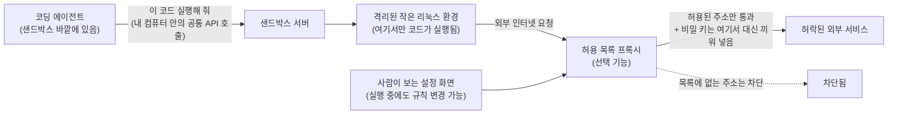

<aside class="ai-knowledge-sidebar">
  
CATEGORIES

  <nav class="ai-cat-tree">

에이전트 오케스트레이션20
<ul><li><a href="https://altjs4510.github.io/ai_news_blog/knowledge/20261118/">2026-11-18Tencent/LoopForge — CodeBuddy·Codex·Claude Code를…</a></li><li><a href="https://altjs4510.github.io/ai_news_blog/knowledge/20261107/">2026-11-07Hermes Agent v0.23.0 — The Hearth Release</a></li><li><a href="https://altjs4510.github.io/ai_news_blog/knowledge/20261106/">2026-11-06Cline desktop-nightly-20261104233655: feat(core)…</a></li><li><a href="https://altjs4510.github.io/ai_news_blog/knowledge/20261029/">2026-10-29How Anthropic ships Claude with Claude: Separati…</a></li><li><a href="https://altjs4510.github.io/ai_news_blog/knowledge/20261027/">2026-10-27nightly-labs/openbot — Codex·Claude·Grok을 상주 팀원처…</a></li><li><a href="https://altjs4510.github.io/ai_news_blog/knowledge/20261015/">2026-10-15How Third Moment Research runs 10,000 agents for…</a></li><li><a href="https://altjs4510.github.io/ai_news_blog/knowledge/20261014/">2026-10-14How Anthropic's Dynamic Workflows Coordinate Cla…</a></li><li><a href="https://altjs4510.github.io/ai_news_blog/knowledge/20260831-openexecutive-virtual-c-suite/">2026-08-31Open Executive — 8명의 전문 에이전트를 하나의 임원 목소리로</a></li><li><a href="https://altjs4510.github.io/ai_news_blog/knowledge/20260828/">2026-08-28Google ADK for Python v2.8.0 — RemoteA2aAgent 네이…</a></li><li><a href="https://altjs4510.github.io/ai_news_blog/knowledge/20260826/">2026-08-26apache/maka — 도구 호출·권한 결정·종료 이벤트를 append-only 로그…</a></li><li><a href="https://altjs4510.github.io/ai_news_blog/knowledge/20260823/">2026-08-23The Evolution of the Agent Harness — 하네스가 모델 가중치…</a></li><li><a href="https://altjs4510.github.io/ai_news_blog/knowledge/20260805/">2026-08-05TencentCloud/TencentDB-Agent-Memory — 대화·문서·코드를 …</a></li><li><a href="https://altjs4510.github.io/ai_news_blog/knowledge/20260717/">2026-07-17After a year building agent memory, 'save everyt…</a></li><li><a href="https://altjs4510.github.io/ai_news_blog/knowledge/20260708/">2026-07-08Expanding Managed Agents in Gemini API: backgrou…</a></li><li><a href="https://altjs4510.github.io/ai_news_blog/knowledge/20260701/">2026-07-01Google OKF (Open Knowledge Format) — 벤더 중립 에이전트 …</a></li><li><a href="https://altjs4510.github.io/ai_news_blog/knowledge/20260623/">2026-06-23bytedance/deer-flow — 샌드박스·메모리·서브에이전트·메시지 게이트웨이를…</a></li><li><a href="https://altjs4510.github.io/ai_news_blog/knowledge/20260611/">2026-06-11The evolution of agentic surfaces: building with…</a></li><li><a href="https://altjs4510.github.io/ai_news_blog/knowledge/20260602/">2026-06-02revfactory/harness — 도메인별 에이전트 팀과 스킬을 자동 설계하는 메타…</a></li><li><a href="https://altjs4510.github.io/ai_news_blog/knowledge/20260529/">2026-05-29Introducing dynamic workflows in Claude Code</a></li><li><a href="https://altjs4510.github.io/ai_news_blog/knowledge/20260507/">2026-05-07ruvnet/ruflo — Claude 멀티 에이전트 오케스트레이션 플랫폼</a></li></ul>

MCP &amp; 도구 통합19
<ul><li><a href="https://altjs4510.github.io/ai_news_blog/knowledge/20261103/">2026-11-03vercel-labs/agent-desktop — 픽셀 대신 OS 접근성 트리로 앱 U…</a></li><li><a href="https://altjs4510.github.io/ai_news_blog/knowledge/20261017/">2026-10-17mksglu/context-mode — 코딩 에이전트용 컨텍스트 윈도우 최적화</a></li><li><a href="https://altjs4510.github.io/ai_news_blog/knowledge/20261007/">2026-10-07morluto/rea — 앱 동작부터 네이티브 바이너리까지 에이전트로 리버스 엔지니어링</a></li><li><a href="https://altjs4510.github.io/ai_news_blog/knowledge/20260831-gitnexus-code-knowledge-graph/">2026-08-31GitNexus — 코드베이스를 지식그래프로 바꿔 에이전트에게 쥐어주기</a></li><li><a href="https://altjs4510.github.io/ai_news_blog/knowledge/20260829/">2026-08-29cursor/plugins — 플러그인 명세(specification)와 공식 플러그인…</a></li><li><a href="https://altjs4510.github.io/ai_news_blog/knowledge/20260802/">2026-08-02Stateless MCP has recaptured my interest (and in…</a></li><li><a href="https://altjs4510.github.io/ai_news_blog/knowledge/20260731/">2026-07-31different-ai/openwork — Claude Cowork의 오픈소스 대안(o…</a></li><li><a href="https://altjs4510.github.io/ai_news_blog/knowledge/20260729/">2026-07-29Bringing MCP 2026-07-28 to Claude</a></li><li><a href="https://altjs4510.github.io/ai_news_blog/knowledge/20260726/">2026-07-26citrolabs/ego-lite — 로그인된 브라우저 상태를 AI 에이전트와 공유하는…</a></li><li><a href="https://altjs4510.github.io/ai_news_blog/knowledge/20260718/">2026-07-18tirth8205/code-review-graph — MCP·CLI용 로컬 코드 인텔리…</a></li><li><a href="https://altjs4510.github.io/ai_news_blog/knowledge/20260618/">2026-06-18DeusData/codebase-memory-mcp — 158개 언어 코드베이스를 밀리…</a></li><li><a href="https://altjs4510.github.io/ai_news_blog/knowledge/20260604/">2026-06-04chopratejas/headroom — Compress tool outputs bef…</a></li><li><a href="https://altjs4510.github.io/ai_news_blog/knowledge/20260603/">2026-06-03How Bad MCP design cost your Agent 5× more token…</a></li><li><a href="https://altjs4510.github.io/ai_news_blog/knowledge/20260521/">2026-05-21colbymchenry/codegraph — Pre-indexed code knowle…</a></li><li><a href="https://altjs4510.github.io/ai_news_blog/knowledge/20260520/">2026-05-20New in Claude Managed Agents: self-hosted sandbo…</a></li><li><a href="https://altjs4510.github.io/ai_news_blog/knowledge/20260517/">2026-05-17I gave my LLM 100,000+ tools — Lazy Discovery &a…</a></li><li><a href="https://altjs4510.github.io/ai_news_blog/knowledge/20260512/">2026-05-12agentmemory — Persistent memory for AI coding ag…</a></li><li><a href="https://altjs4510.github.io/ai_news_blog/knowledge/20260509/">2026-05-09How to connect 100 MCP servers without the conte…</a></li><li><a href="https://altjs4510.github.io/ai_news_blog/knowledge/20260506/">2026-05-06mksglu/context-mode — AI 코딩 에이전트용 컨텍스트 윈도우 최적화</a></li></ul>

코딩 에이전트27
<ul><li><a href="https://altjs4510.github.io/ai_news_blog/knowledge/20261115/">2026-11-15GoogleChrome/modern-web-guidance-src — 코딩 에이전트에 …</a></li><li><a href="https://altjs4510.github.io/ai_news_blog/knowledge/20261112/">2026-11-12shadcn/improve — 가장 강한 모델로 코드베이스를 감사해 계획을 쓰고, 더 …</a></li><li><a href="https://altjs4510.github.io/ai_news_blog/knowledge/20261111/">2026-11-11Quoting Prompting Claude Fable 5.2</a></li><li><a href="https://altjs4510.github.io/ai_news_blog/knowledge/20261022/">2026-10-22Claude Mods: Flipping the Harness Inside Out</a></li><li><a href="https://altjs4510.github.io/ai_news_blog/knowledge/20261018/">2026-10-18Quoting Addy Osmani, Morgan Westlee Lunt, and Qi…</a></li><li><a href="https://altjs4510.github.io/ai_news_blog/knowledge/20261014-claude-code-advisor/">2026-10-14Claude Code advisor — 가벼운 메인 모델이 일하고, 갈림길에서만 Opu…</a></li><li><a href="https://altjs4510.github.io/ai_news_blog/knowledge/20260920/">2026-09-20Claude Code 2.1.277 — CLAUDE.md가 없으면 AGENTS.md를 …</a></li><li><a href="https://altjs4510.github.io/ai_news_blog/knowledge/20260912/">2026-09-12Quoting Boris Cherny — 'Claude가 쓴 프로덕션 코드는 사람이 쓴…</a></li><li><a href="https://altjs4510.github.io/ai_news_blog/knowledge/20260910/">2026-09-10vastsa/PI-Desktop — Electron + Rust 호스트 코어 + 에이전…</a></li><li><a href="https://altjs4510.github.io/ai_news_blog/knowledge/20260906/">2026-09-06DietrichGebert/ponytail — 에이전트를 '방에서 가장 게으른 시니어 …</a></li><li><a href="https://altjs4510.github.io/ai_news_blog/knowledge/20260903/">2026-09-03pacifio/atlas — 여러 코딩 에이전트의 변경을 한곳에서 추적·질의하는 '에이…</a></li><li><a href="https://altjs4510.github.io/ai_news_blog/knowledge/20260901/">2026-09-01affaan-m/ECC — 스킬·본능·메모리·보안을 묶은 에이전트 하네스 성능 최적화 …</a></li><li><a href="https://altjs4510.github.io/ai_news_blog/knowledge/20260819/">2026-08-19akitaonrails/ai-memory — 코딩 에이전트 CLI 간 장기 기억과 벤더…</a></li><li><a href="https://altjs4510.github.io/ai_news_blog/knowledge/20260814/">2026-08-14cathrynlavery/diagram-design — Claude Code용 에디토리…</a></li><li><a href="https://altjs4510.github.io/ai_news_blog/knowledge/20260810/">2026-08-10Auto mode is now the default in Claude Code for …</a></li><li><a href="https://altjs4510.github.io/ai_news_blog/knowledge/20260808/">2026-08-08PrimeIntellect-ai/prime-agent — 코딩 워크플로우와 장시간 자율…</a></li><li><a href="https://altjs4510.github.io/ai_news_blog/knowledge/20260804/">2026-08-04esengine/DeepSeek-Reasonix — prefix-cache 안정성을 축…</a></li><li><a href="https://altjs4510.github.io/ai_news_blog/knowledge/20260728/">2026-07-28alibaba/open-code-review — 결정론적 파이프라인 + LLM 에이전트…</a></li><li><a href="https://altjs4510.github.io/ai_news_blog/knowledge/20260725/">2026-07-25The new rules of context engineering for Claude …</a></li><li><a href="https://altjs4510.github.io/ai_news_blog/knowledge/20260714/">2026-07-14Graphify-Labs/graphify — 코드베이스를 질의 가능한 지식 그래프로 만…</a></li><li><a href="https://altjs4510.github.io/ai_news_blog/knowledge/20260707/">2026-07-07AI Hero Skills Catalog — 실무 엔지니어를 위한 재사용 가능한 판단 …</a></li><li><a href="https://altjs4510.github.io/ai_news_blog/knowledge/20260705/">2026-07-05openai/codex-plugin-cc — Claude Code에서 Codex를 위임…</a></li><li><a href="https://altjs4510.github.io/ai_news_blog/knowledge/20260626/">2026-06-26google-labs-code/design.md — 코딩 에이전트에게 디자인 시스템을 …</a></li><li><a href="https://altjs4510.github.io/ai_news_blog/knowledge/20260619/">2026-06-19Claude Code now supports artifacts</a></li><li><a href="https://altjs4510.github.io/ai_news_blog/knowledge/20260530/">2026-05-30Leonxlnx/taste-skill — AI에게 좋은 취향을 부여해 generic s…</a></li><li><a href="https://altjs4510.github.io/ai_news_blog/knowledge/20260508/">2026-05-08addyosmani/agent-skills — Production-grade engin…</a></li><li><a href="https://altjs4510.github.io/ai_news_blog/knowledge/20260505/">2026-05-05mattpocock/skills — Skills for Real Engineers (.…</a></li></ul>

모델 &amp; 연구12
<ul><li><a href="https://altjs4510.github.io/ai_news_blog/knowledge/20261113/">2026-11-13Gemini Decisions API</a></li><li><a href="https://altjs4510.github.io/ai_news_blog/knowledge/20261104/">2026-11-04Qwen 3.8 27B on my laptop can interpret model we…</a></li><li><a href="https://altjs4510.github.io/ai_news_blog/knowledge/20261009/">2026-10-09Claude Haiku 5.5 (Simon Willison의 출시 노트와 가격 분석)</a></li><li><a href="https://altjs4510.github.io/ai_news_blog/knowledge/20260929/">2026-09-29vectorize-io/hindsight — Hindsight: Agent Memory…</a></li><li><a href="https://altjs4510.github.io/ai_news_blog/knowledge/20260907-voicemem-dual-brain-memory/">2026-09-07VoiceMem — 좌뇌·우뇌로 쪼갠 스트리밍 메모리로 음성 에이전트 지연 없애기</a></li><li><a href="https://altjs4510.github.io/ai_news_blog/knowledge/20260904/">2026-09-04HarnessDev: Can LLMs Create and Evolve Their Own…</a></li><li><a href="https://altjs4510.github.io/ai_news_blog/knowledge/20260716-proprag/">2026-07-16PropRAG — 프로포지션 경로 위 beam search로 멀티홉 검색 안내</a></li><li><a href="https://altjs4510.github.io/ai_news_blog/knowledge/20260712/">2026-07-12Do Automated Evals Work?</a></li><li><a href="https://altjs4510.github.io/ai_news_blog/knowledge/20260620/">2026-06-20zai-org/GLM-5 — From Vibe Coding to Agentic Engi…</a></li><li><a href="https://altjs4510.github.io/ai_news_blog/knowledge/20260617/">2026-06-17Predicting model behavior before release by simu…</a></li><li><a href="https://altjs4510.github.io/ai_news_blog/knowledge/20260516/">2026-05-16STALE — 에이전트가 자기 기억의 유효성을 인지할 수 있는가</a></li><li><a href="https://altjs4510.github.io/ai_news_blog/knowledge/20260513/">2026-05-13Thinking Machines' Native Interaction Models — T…</a></li></ul>

인프라 &amp; 컴퓨트9
<ul><li><a href="https://altjs4510.github.io/ai_news_blog/knowledge/20261105/">2026-11-05NVIDIA/auto-ontology — 데이터 위에 그래프 기반 의미 추론 레이어를 …</a></li><li><a href="https://altjs4510.github.io/ai_news_blog/knowledge/20260909/">2026-09-09Reducing cost and improving performance with Cla…</a></li><li><a href="https://altjs4510.github.io/ai_news_blog/knowledge/20260905/">2026-09-05magnitudedev/magnitude — 하드웨어에 맞는 최적 로컬 모델을 띄워 이…</a></li><li><a href="https://altjs4510.github.io/ai_news_blog/knowledge/20260821/">2026-08-21volcengine/OpenViking — 에이전트 메모리·Knowledge RAG·스…</a></li><li><a href="https://altjs4510.github.io/ai_news_blog/knowledge/20260812/">2026-08-12semantica-agi/semantica — 컨텍스트와 '책임 추적 가능한(accou…</a></li><li><a href="https://altjs4510.github.io/ai_news_blog/knowledge/20260806/">2026-08-06cloudflare/computer — 에이전트에게 컴퓨터를 통째로 주는 엣지 실행 샌…</a></li><li><a href="https://altjs4510.github.io/ai_news_blog/knowledge/20260723/">2026-07-23diegosouzapw/OmniRoute — 268+ 프로바이더를 단일 엔드포인트로 묶…</a></li><li><a href="https://altjs4510.github.io/ai_news_blog/knowledge/20260610/">2026-06-10Fable 5 just made cost-aware model routing manda…</a></li><li><a href="https://altjs4510.github.io/ai_news_blog/knowledge/20260522/">2026-05-22Giving Agents Computers — Ivan Burazin, Daytona</a></li></ul>

보안 &amp; 거버넌스27
<ul><li><a href="https://altjs4510.github.io/ai_news_blog/knowledge/20261119/" class="current">2026-11-19External sandboxes for coding agents</a></li><li><a href="https://altjs4510.github.io/ai_news_blog/knowledge/20261117/">2026-11-17NVIDIA/SkillEvaluator — AI 에이전트 스킬·플러그인을 품질 게이트,…</a></li><li><a href="https://altjs4510.github.io/ai_news_blog/knowledge/20261031/">2026-10-31CopilotKit/OpenBot — AI 동료마다 전용 컴퓨터를 주고 모든 행동을 실…</a></li><li><a href="https://altjs4510.github.io/ai_news_blog/knowledge/20261030/">2026-10-30How we detect frontier model misalignment</a></li><li><a href="https://altjs4510.github.io/ai_news_blog/knowledge/20261021/">2026-10-21cloudflare/security-audit-skill — 독립 검증된 기계 판독형 …</a></li><li><a href="https://altjs4510.github.io/ai_news_blog/knowledge/20261020/">2026-10-20Satya Nadella — 모델을 내부자 위험으로 보는 원칙에 따라 Project P…</a></li><li><a href="https://altjs4510.github.io/ai_news_blog/knowledge/20261016/">2026-10-16Crossing the Threshold: How OpenAI and Anthropic…</a></li><li><a href="https://altjs4510.github.io/ai_news_blog/knowledge/20261011/">2026-10-11Anthropic can’t reliably control its AI agents. …</a></li><li><a href="https://altjs4510.github.io/ai_news_blog/knowledge/20261004/">2026-10-04Apple says it's tightening macOS 'Full Disk Acce…</a></li><li><a href="https://altjs4510.github.io/ai_news_blog/knowledge/20261001/">2026-10-01NVIDIA/OpenShell</a></li><li><a href="https://altjs4510.github.io/ai_news_blog/knowledge/20260919/">2026-09-19cloudflare/security-audit-skill — 다단계 보안 감사를 '독립…</a></li><li><a href="https://altjs4510.github.io/ai_news_blog/knowledge/20260913/">2026-09-13OpenAI agents attacked RubyGems back in May: Ope…</a></li><li><a href="https://altjs4510.github.io/ai_news_blog/knowledge/20260902/">2026-09-02AIR raises $50M to help companies vet the skills…</a></li><li><a href="https://altjs4510.github.io/ai_news_blog/knowledge/20260827/">2026-08-27Claude in Chrome is generally available</a></li><li><a href="https://altjs4510.github.io/ai_news_blog/knowledge/20260819-mind-viruses/">2026-08-19탈옥도, 인젝션도 없이 — 대화로만 퍼지는 에이전트의 '마인드 바이러스'</a></li><li><a href="https://altjs4510.github.io/ai_news_blog/knowledge/20260730/">2026-07-30Anatomy of a Frontier Lab Agent Intrusion: A Tec…</a></li><li><a href="https://altjs4510.github.io/ai_news_blog/knowledge/20260715/">2026-07-15Dicklesworthstone/destructive_command_guard — 에이…</a></li><li><a href="https://altjs4510.github.io/ai_news_blog/knowledge/20260710/">2026-07-1070개 MCP 서버 strace 런타임 감사 — 부팅 시 아웃바운드 호출 서버 적발</a></li><li><a href="https://altjs4510.github.io/ai_news_blog/knowledge/20260704/">2026-07-04Cloudflare is about to block AI agents by defaul…</a></li><li><a href="https://altjs4510.github.io/ai_news_blog/knowledge/20260703/">2026-07-03Giving admins more visibility and control over C…</a></li><li><a href="https://altjs4510.github.io/ai_news_blog/knowledge/20260630/">2026-06-30Introducing the Claude apps gateway for Amazon B…</a></li><li><a href="https://altjs4510.github.io/ai_news_blog/knowledge/20260624/">2026-06-24Agent identity in Claude Tag: a new access model…</a></li><li><a href="https://altjs4510.github.io/ai_news_blog/knowledge/20260613/">2026-06-13Fable 5's guardrails got bypassed in 48 hours — …</a></li><li><a href="https://altjs4510.github.io/ai_news_blog/knowledge/20260612/">2026-06-12NVIDIA/SkillSpector — AI 에이전트 스킬용 보안 스캐너</a></li><li><a href="https://altjs4510.github.io/ai_news_blog/knowledge/20260607/">2026-06-07OpenAI Help: Lockdown Mode</a></li><li><a href="https://altjs4510.github.io/ai_news_blog/knowledge/20260531/">2026-05-31How we contain Claude across products</a></li><li><a href="https://altjs4510.github.io/ai_news_blog/knowledge/20260527/">2026-05-27Microsoft Copilot Cowork Exfiltrates Files</a></li></ul>

응용 사례14
<ul><li><a href="https://altjs4510.github.io/ai_news_blog/knowledge/20261114/">2026-11-14Introducing ChatGPT Wallet</a></li><li><a href="https://altjs4510.github.io/ai_news_blog/knowledge/20261110/">2026-11-10meta/astryx — 직접 바꿔 쓸 수 있고 에이전트가 바로 쓸 수 있는(agent…</a></li><li><a href="https://altjs4510.github.io/ai_news_blog/knowledge/20261101/">2026-11-01Agents Prompt People: Using Agents for Long-Hori…</a></li><li><a href="https://altjs4510.github.io/ai_news_blog/knowledge/20261028/">2026-10-28Greptile takes bug detection beyond code review …</a></li><li><a href="https://altjs4510.github.io/ai_news_blog/knowledge/20261006/">2026-10-06How Cresta turned CX expertise into an agent bui…</a></li><li><a href="https://altjs4510.github.io/ai_news_blog/knowledge/20260930/">2026-09-30Agents you can coach: how Asana builds human-age…</a></li><li><a href="https://altjs4510.github.io/ai_news_blog/knowledge/20260911/">2026-09-11Now everyone can put data to work — ChatGPT Work…</a></li><li><a href="https://altjs4510.github.io/ai_news_blog/knowledge/20260907-humanmade-52week-rhythm/">2026-09-07휴먼 메이드의 '52주 리듬' — 아이디어가 흔해진 시대에 값이 오르는 건 버리는 판단</a></li><li><a href="https://altjs4510.github.io/ai_news_blog/knowledge/20260709/">2026-07-09mvanhorn/last30days-skill — Reddit·X·YouTube·HN·…</a></li><li><a href="https://altjs4510.github.io/ai_news_blog/knowledge/20260621/">2026-06-21calesthio/OpenMontage — 12 파이프라인·52 도구·500+ 스킬을 …</a></li><li><a href="https://altjs4510.github.io/ai_news_blog/knowledge/20260609/">2026-06-09Building intelligent apps for Apple platforms wi…</a></li><li><a href="https://altjs4510.github.io/ai_news_blog/knowledge/20260528/">2026-05-28Building self-improving tax agents with Codex</a></li><li><a href="https://altjs4510.github.io/ai_news_blog/knowledge/20260515/">2026-05-15Clawdmeter — Claude Code 사용량을 데스크톱 대시보드로</a></li><li><a href="https://altjs4510.github.io/ai_news_blog/knowledge/20260514/">2026-05-14Introducing Claude for Small Business</a></li></ul>

산업 동향8
<ul><li><a href="https://altjs4510.github.io/ai_news_blog/knowledge/20261024/">2026-10-24Donating Agent Skills to the Agentic AI Foundati…</a></li><li><a href="https://altjs4510.github.io/ai_news_blog/knowledge/20261023/">2026-10-23Claude Duet app is Anthropic's bet on agents</a></li><li><a href="https://altjs4510.github.io/ai_news_blog/knowledge/20260830/">2026-08-30[AINews] OpenAI shuts off Cursor — 프론티어 모델 공급 차단…</a></li><li><a href="https://altjs4510.github.io/ai_news_blog/knowledge/20260711/">2026-07-11OpenAI says GPT 5.6 is the 'preferred model' for…</a></li><li><a href="https://altjs4510.github.io/ai_news_blog/knowledge/20260702/">2026-07-02How Cursor deploys AI inside the enterprise (For…</a></li><li><a href="https://altjs4510.github.io/ai_news_blog/knowledge/20260616/">2026-06-16Why AI hasn't replaced software engineers, and w…</a></li><li><a href="https://altjs4510.github.io/ai_news_blog/knowledge/20260519/">2026-05-19Anthropic acquires Stainless</a></li><li><a href="https://altjs4510.github.io/ai_news_blog/knowledge/20260504/">2026-05-04Agents for Everything Else: Codex for Knowledge …</a></li></ul>
</nav>
</aside>

<article class="ai-knowledge-article">

<header class="ai-post-hero">
  
<a class="ai-back" href="../">KNOWLEDGE</a> · 2026-11-19 · 오늘의 학습

  <h2 class="ai-post-title">External sandboxes for coding agents</h2>
</header>

> 원문: [External sandboxes for coding agents](https://simonwillison.net/2026/Nov/17/external-sandboxes-for-coding-agents/)

## 📌 학습 정리

### 1. 한 줄로 말하면

AI 코딩 도우미가 코드를 실행할 때는 내 컴퓨터가 아니라 따로 마련한 격리된 방에서만 돌게 하는 방식이에요. 도우미 자신은 방 밖에 있고, 코드를 돌릴 일이 생기면 그 방에 실행을 맡겨요.

### 2. 왜 이게 만들어졌어요?

요즘 AI 코딩 도우미(코딩 에이전트, coding agent)는 글로 답하는 데서 멈추지 않고 내 컴퓨터에서 직접 코드를 실행하기도 해요. 그런데 모델이 실수하거나, 누군가 몰래 심어 둔 지시문에 속으면(프롬프트 인젝션, prompt injection) 컴퓨터에 해로운 일을 할 수 있어요. 특히 내 컴퓨터에서 직접 돌리는 모델(로컬 모델, local model)을 처음 시험해 볼 때는 이 모델이 얼마나 믿을 만한지 아직 모르니까 더 마음이 쓰이죠. Simon Willison은 이런 걱정 없이 로컬 모델을 시험할 수 있도록, 에이전트가 실행하는 코드를 격리하는 새로운 방법을 찾아봤어요. 그 결과로 정리한 것이 이 "외부 샌드박스" 패턴이에요.

### 3. 비유로 풀면

이건 마치 실험실 밖에 있는 연구원이 안전 유리창 너머 실험실 안의 로봇 팔에 "이 시약 섞어 줘" 하고 지시를 보내는 것과 같아요. 연구원(에이전트)은 계속 바깥에 있고, 위험할 수 있는 작업은 유리벽 안(샌드박스)에서만 일어나요. 혹시 실험이 잘못돼 폭발이 나도 피해는 실험실 안에서 끝나요.

여기에 하나가 더 붙어요. 실험실 출입문에는 경비원(허용 목록 프록시)이 서 있어서 명단에 있는 곳으로만 연락을 내보내요. 또 출입증 같은 비밀 정보는 경비원이 따로 쥐고 있다가 나가는 요청에 대신 붙여 줘서, 실험실 안에서는 그 출입증을 볼 수 없어요.

그래서 결국, 에이전트가 무엇을 실행하든 영향은 격리된 공간 안에 머물고, 바깥과 주고받는 통신과 비밀번호는 사람이 정한 규칙대로만 오가게 돼요.

### 4. 어떻게 작동하는지 (그림으로)

에이전트는 코드를 실행할 일이 생기면, 내 컴퓨터 안에서 열려 있는 샌드박스 서버에 요청을 보내요. 그러면 코드는 서버가 띄워 둔 격리된 리눅스 환경 안에서만 돌아요. 이 코드가 인터넷에 연결하려고 하면 선택 기능인 프록시가 허용된 곳인지 확인하고, 필요하면 비밀 키를 대신 붙여서 내보내요. 허용 규칙은 샌드박스가 돌아가는 동안에도 설정 화면에서 바꿀 수 있어요.

원문에서는 이 방식을 보여 주려고 서로 다른 방법으로 만든 샌드박스 서버 세 가지를 공개했어요. 셋 다 똑같은 API를 제공하기 때문에 Pi, Claude Code, Codex 같은 에이전트에서는 "코드는 저 주소로 보내서 실행해" 하고 한 번만 설정해 두면 돼요.

### 5. 처음 보는 용어 풀이

- **격리 실행 공간 (sandbox)** — 프로그램이 바깥 컴퓨터에 영향을 주지 못하도록 가둬 두고 실행하는 공간이에요. 안에서 무슨 일이 생겨도 피해가 그 안에서 끝나게 하려고 써요.
- **외부 샌드박스 패턴 (external sandbox pattern)** — 에이전트는 샌드박스 바깥에 두고, 에이전트가 실행하려는 코드만 전용 샌드박스 안에서 돌리는 설계 방식이에요. 이 글에서 핵심으로 소개하는 개념이에요.
- **몰래 심은 지시문 공격 (prompt injection)** — AI가 읽는 글이나 데이터에 엉뚱한 지시를 숨겨 넣어서 AI가 원래 의도와 다른 행동을 하게 만드는 공격이에요. 이 글에서는 모델의 단순 실수와 함께 샌드박스가 막으려는 대표적인 위험으로 나와요.
- **내 컴퓨터 안의 공통 API (localhost API)** — 같은 컴퓨터 안에서만 접속할 수 있는 주소로 열려 있는 요청 창구예요. 세 가지 구현이 모두 같은 창구를 제공해서, 에이전트는 어떤 샌드박스를 쓰든 같은 방식으로 실행을 맡길 수 있어요.
- **허용 목록 프록시 (allow-list proxy)** — 샌드박스 안의 코드가 인터넷에 보내는 요청을 중간에서 받아서, 미리 허락한 주소로 가는 요청만 내보내는 중계 장치예요. 코드가 어디와 통신할 수 있는지를 정확히 정할 수 있어요.
- **비밀 정보 바꿔 끼우기 (credential replacement)** — 로그인 키 같은 비밀 정보를 에이전트에게 직접 건네지 않고, 요청이 나가는 길목에서 대신 넣어 주는 방식이에요. 에이전트는 비밀을 모른 채로도 인증이 필요한 서비스를 쓸 수 있어요.
- **Alpine Linux / v86 / Quicksand** — 원문의 세 구현에 쓰인 재료예요. Alpine Linux는 샌드박스 안에서 돌아가는 리눅스 운영체제이고, v86은 이 리눅스를 웹어셈블리(WebAssembly, 브라우저 등에서 쓰는 실행 형식) 위에서 돌리는 데 쓰였어요. Quicksand는 Microsoft가 만든 격리 실행용 라이브러리로, QEMU(컴퓨터를 소프트웨어로 흉내 내는 도구)와 Alpine Linux를 파이썬 패키지 하나에 묶어 담고 있어요.

### 6. 한 발 더 들어가고 싶다면

- [External sandboxes for coding agents (Prime Radiant 블로그)](https://blog.primeradiant.com/external-sandboxes-for-coding-agents/) — 이걸 보면 외부 샌드박스 패턴을 왜, 어떻게 설계했는지 본편 설명을 볼 수 있어요.
- [external-sandbox-v86](https://github.com/prime-radiant-inc/external-sandbox-v86) — 이걸 보면 Node.js 서버가 웹어셈블리 안에서 리눅스를 띄우는 구현을 직접 살펴볼 수 있어요.
- [external-sandbox-container](https://github.com/prime-radiant-inc/external-sandbox-container) — 이걸 보면 Apple Containers 위에 샌드박스를 올린 파이썬 서버 구현을 볼 수 있어요.
- [external-sandbox-quicksand](https://github.com/prime-radiant-inc/external-sandbox-quicksand) — 이걸 보면 Microsoft의 Quicksand 라이브러리로 만든 세 번째 구현을 볼 수 있어요.
- [Quicksand](https://github.com/microsoft/quicksand) — 이걸 보면 QEMU와 Alpine Linux를 파이썬 패키지 하나로 묶은 격리 실행 라이브러리가 어떻게 생겼는지 알 수 있어요.

---

## 📖 원문 전체 번역 (정독용)

> 의역 최소화한 전체 번역입니다. 큰 흐름은 위 정리에서 잡고, 정확한 워딩이 필요할 땐 이 섹션에서 정독하세요.

2026년 11월 17일 - 링크 블로그

**[코딩 에이전트를 위한 외부 샌드박스 (External sandboxes for coding agents)](https://blog.primeradiant.com/external-sandboxes-for-coding-agents/)**. 나는 에이전트가 실행하는 코드를 샌드박스화하는 새로운 방법을 탐구해 왔다. 특히 로컬 모델을 시험해 볼 때, 실수나 프롬프트 인젝션(prompt injection) 공격 때문에 모델이 머신에 해로운 행동을 하지 않을까 걱정하지 않도록 더 안전하게 만드는 데 초점을 두었다.

나는 이 프로젝트를 Superpowers와 [다른 프로젝트들](https://github.com/orgs/prime-radiant-inc/repositories)을 만든 AI 연구소 [Prime Radiant](https://primeradiant.com/)와 함께 진행했다.

Prime Radiant 블로그에 올린 [내 글](https://blog.primeradiant.com/external-sandboxes-for-coding-agents/)은 **외부 샌드박스(external sandbox)** 패턴을 소개한다. 이 패턴에서는 에이전트가 실행하는 코드는 전용 샌드박스 안에서 돌아가고, 에이전트 자체는 그 샌드박스 바깥에 존재한다.

이 패턴을 시연하기 위해 세 가지 샌드박스 서버 구현체를 공개했다.

*   [external-sandbox-v86](https://github.com/prime-radiant-inc/external-sandbox-v86)은 Node.js 서버를 실행하고, 이 서버가 다시 [v86](https://github.com/copy/v86)을 사용해 WebAssembly 안에서 Alpine Linux를 실행한다.
*   [external-sandbox-container](https://github.com/prime-radiant-inc/external-sandbox-container)는 Python 웹 서버로, Apple Containers 인스턴스 안의 Alpine Linux에서 샌드박스를 실행한다.
*   [external-sandbox-quicksand](https://github.com/prime-radiant-inc/external-sandbox-quicksand)는 또 다른 Python 웹 서버이며, 이번에는 Microsoft의 [Quicksand](https://github.com/microsoft/quicksand) 샌드박싱 라이브러리를 사용한다. 이 라이브러리는 QEMU _와_ Alpine Linux를 하나의 Python 패키지로 묶어 제공한다!

이 구현체들은 모두 동일한 localhost API를 제공한다. 그런 다음 Pi, Claude Code, 또는 Codex가 코드를 실행하고 싶을 때마다 해당 샌드박스로 API 호출을 보내도록 설정할 수 있다.

샌드박스에는 선택적으로 HTTP/HTTPS 허용 목록(allow-list) 프록시도 포함되어 있어, 에이전트의 코드가 통신할 수 있는 호스트를 정확히 제어할 수 있다. 또한 자격 증명 치환(credential replacement) 메커니즘을 통해 에이전트에게 비밀 값(secret)을 공유하지 않고도 인증이 필요한 API 호출을 할 수 있다. 다음은 샌드박스가 실행 중인 상태에서 그 프록시를 재설정하는 데 쓸 수 있는 UI이다.

나는 신뢰할 수 없는 코드를 안전하게 실행한다는 과제에 계속 매료되어 있다. 이 외부 샌드박스 패턴은 다양한 접근 방식을 실험해 볼 수 있는 깔끔한 방법을 제공한다.

</article>

