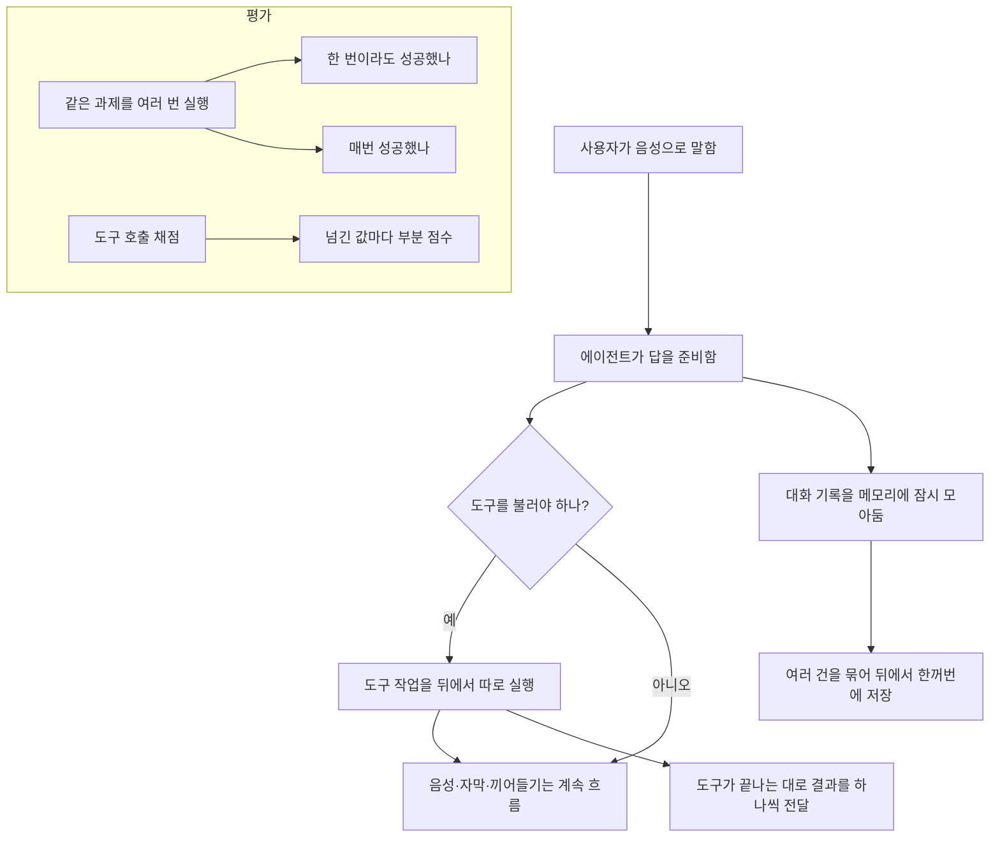

<aside class="ai-knowledge-sidebar">
  
CATEGORIES

  <nav class="ai-cat-tree">

에이전트 오케스트레이션20
<ul><li><a href="https://altjs4510.github.io/ai_news_blog/knowledge/20261121/" class="current">2026-11-21Google ADK v2.15.0 — 느린 도구에도 응답성 유지, 다중 실행 신뢰성·부…</a></li><li><a href="https://altjs4510.github.io/ai_news_blog/knowledge/20261118/">2026-11-18Tencent/LoopForge — CodeBuddy·Codex·Claude Code를…</a></li><li><a href="https://altjs4510.github.io/ai_news_blog/knowledge/20261107/">2026-11-07Hermes Agent v0.23.0 — The Hearth Release</a></li><li><a href="https://altjs4510.github.io/ai_news_blog/knowledge/20261029/">2026-10-29How Anthropic ships Claude with Claude: Separati…</a></li><li><a href="https://altjs4510.github.io/ai_news_blog/knowledge/20261027/">2026-10-27nightly-labs/openbot — Codex·Claude·Grok을 상주 팀원처…</a></li><li><a href="https://altjs4510.github.io/ai_news_blog/knowledge/20261015/">2026-10-15How Third Moment Research runs 10,000 agents for…</a></li><li><a href="https://altjs4510.github.io/ai_news_blog/knowledge/20261014/">2026-10-14How Anthropic's Dynamic Workflows Coordinate Cla…</a></li><li><a href="https://altjs4510.github.io/ai_news_blog/knowledge/20260930/">2026-09-30Agents you can coach: how Asana builds human-age…</a></li><li><a href="https://altjs4510.github.io/ai_news_blog/knowledge/20260831-openexecutive-virtual-c-suite/">2026-08-31Open Executive — 8명의 전문 에이전트를 하나의 임원 목소리로</a></li><li><a href="https://altjs4510.github.io/ai_news_blog/knowledge/20260828/">2026-08-28Google ADK for Python v2.8.0 — RemoteA2aAgent 네이…</a></li><li><a href="https://altjs4510.github.io/ai_news_blog/knowledge/20260826/">2026-08-26apache/maka — 도구 호출·권한 결정·종료 이벤트를 append-only 로그…</a></li><li><a href="https://altjs4510.github.io/ai_news_blog/knowledge/20260823/">2026-08-23The Evolution of the Agent Harness — 하네스가 모델 가중치…</a></li><li><a href="https://altjs4510.github.io/ai_news_blog/knowledge/20260821/">2026-08-21volcengine/OpenViking — 에이전트 메모리·Knowledge RAG·스…</a></li><li><a href="https://altjs4510.github.io/ai_news_blog/knowledge/20260805/">2026-08-05TencentCloud/TencentDB-Agent-Memory — 대화·문서·코드를 …</a></li><li><a href="https://altjs4510.github.io/ai_news_blog/knowledge/20260717/">2026-07-17After a year building agent memory, 'save everyt…</a></li><li><a href="https://altjs4510.github.io/ai_news_blog/knowledge/20260623/">2026-06-23bytedance/deer-flow — 샌드박스·메모리·서브에이전트·메시지 게이트웨이를…</a></li><li><a href="https://altjs4510.github.io/ai_news_blog/knowledge/20260611/">2026-06-11The evolution of agentic surfaces: building with…</a></li><li><a href="https://altjs4510.github.io/ai_news_blog/knowledge/20260602/">2026-06-02revfactory/harness — 도메인별 에이전트 팀과 스킬을 자동 설계하는 메타…</a></li><li><a href="https://altjs4510.github.io/ai_news_blog/knowledge/20260529/">2026-05-29Introducing dynamic workflows in Claude Code</a></li><li><a href="https://altjs4510.github.io/ai_news_blog/knowledge/20260507/">2026-05-07ruvnet/ruflo — Claude 멀티 에이전트 오케스트레이션 플랫폼</a></li></ul>

MCP &amp; 도구 통합20
<ul><li><a href="https://altjs4510.github.io/ai_news_blog/knowledge/20261103/">2026-11-03vercel-labs/agent-desktop — 픽셀 대신 OS 접근성 트리로 앱 U…</a></li><li><a href="https://altjs4510.github.io/ai_news_blog/knowledge/20261017/">2026-10-17mksglu/context-mode — 코딩 에이전트용 컨텍스트 윈도우 최적화</a></li><li><a href="https://altjs4510.github.io/ai_news_blog/knowledge/20261007/">2026-10-07morluto/rea — 앱 동작부터 네이티브 바이너리까지 에이전트로 리버스 엔지니어링</a></li><li><a href="https://altjs4510.github.io/ai_news_blog/knowledge/20260831-gitnexus-code-knowledge-graph/">2026-08-31GitNexus — 코드베이스를 지식그래프로 바꿔 에이전트에게 쥐어주기</a></li><li><a href="https://altjs4510.github.io/ai_news_blog/knowledge/20260829/">2026-08-29cursor/plugins — 플러그인 명세(specification)와 공식 플러그인…</a></li><li><a href="https://altjs4510.github.io/ai_news_blog/knowledge/20260802/">2026-08-02Stateless MCP has recaptured my interest (and in…</a></li><li><a href="https://altjs4510.github.io/ai_news_blog/knowledge/20260731/">2026-07-31different-ai/openwork — Claude Cowork의 오픈소스 대안(o…</a></li><li><a href="https://altjs4510.github.io/ai_news_blog/knowledge/20260729/">2026-07-29Bringing MCP 2026-07-28 to Claude</a></li><li><a href="https://altjs4510.github.io/ai_news_blog/knowledge/20260726/">2026-07-26citrolabs/ego-lite — 로그인된 브라우저 상태를 AI 에이전트와 공유하는…</a></li><li><a href="https://altjs4510.github.io/ai_news_blog/knowledge/20260718/">2026-07-18tirth8205/code-review-graph — MCP·CLI용 로컬 코드 인텔리…</a></li><li><a href="https://altjs4510.github.io/ai_news_blog/knowledge/20260708/">2026-07-08Expanding Managed Agents in Gemini API: backgrou…</a></li><li><a href="https://altjs4510.github.io/ai_news_blog/knowledge/20260618/">2026-06-18DeusData/codebase-memory-mcp — 158개 언어 코드베이스를 밀리…</a></li><li><a href="https://altjs4510.github.io/ai_news_blog/knowledge/20260604/">2026-06-04chopratejas/headroom — Compress tool outputs bef…</a></li><li><a href="https://altjs4510.github.io/ai_news_blog/knowledge/20260603/">2026-06-03How Bad MCP design cost your Agent 5× more token…</a></li><li><a href="https://altjs4510.github.io/ai_news_blog/knowledge/20260521/">2026-05-21colbymchenry/codegraph — Pre-indexed code knowle…</a></li><li><a href="https://altjs4510.github.io/ai_news_blog/knowledge/20260520/">2026-05-20New in Claude Managed Agents: self-hosted sandbo…</a></li><li><a href="https://altjs4510.github.io/ai_news_blog/knowledge/20260517/">2026-05-17I gave my LLM 100,000+ tools — Lazy Discovery &a…</a></li><li><a href="https://altjs4510.github.io/ai_news_blog/knowledge/20260512/">2026-05-12agentmemory — Persistent memory for AI coding ag…</a></li><li><a href="https://altjs4510.github.io/ai_news_blog/knowledge/20260509/">2026-05-09How to connect 100 MCP servers without the conte…</a></li><li><a href="https://altjs4510.github.io/ai_news_blog/knowledge/20260506/">2026-05-06mksglu/context-mode — AI 코딩 에이전트용 컨텍스트 윈도우 최적화</a></li></ul>

코딩 에이전트31
<ul><li><a href="https://altjs4510.github.io/ai_news_blog/knowledge/20261115/">2026-11-15GoogleChrome/modern-web-guidance-src — 코딩 에이전트에 …</a></li><li><a href="https://altjs4510.github.io/ai_news_blog/knowledge/20261112/">2026-11-12shadcn/improve — 가장 강한 모델로 코드베이스를 감사해 계획을 쓰고, 더 …</a></li><li><a href="https://altjs4510.github.io/ai_news_blog/knowledge/20261111/">2026-11-11Quoting Prompting Claude Fable 5.2</a></li><li><a href="https://altjs4510.github.io/ai_news_blog/knowledge/20261106/">2026-11-06Cline desktop-nightly-20261104233655: feat(core)…</a></li><li><a href="https://altjs4510.github.io/ai_news_blog/knowledge/20261022/">2026-10-22Claude Mods: Flipping the Harness Inside Out</a></li><li><a href="https://altjs4510.github.io/ai_news_blog/knowledge/20261018/">2026-10-18Quoting Addy Osmani, Morgan Westlee Lunt, and Qi…</a></li><li><a href="https://altjs4510.github.io/ai_news_blog/knowledge/20261014-claude-code-advisor/">2026-10-14Claude Code advisor — 가벼운 메인 모델이 일하고, 갈림길에서만 Opu…</a></li><li><a href="https://altjs4510.github.io/ai_news_blog/knowledge/20260920/">2026-09-20Claude Code 2.1.277 — CLAUDE.md가 없으면 AGENTS.md를 …</a></li><li><a href="https://altjs4510.github.io/ai_news_blog/knowledge/20260919/">2026-09-19cloudflare/security-audit-skill — 다단계 보안 감사를 '독립…</a></li><li><a href="https://altjs4510.github.io/ai_news_blog/knowledge/20260912/">2026-09-12Quoting Boris Cherny — 'Claude가 쓴 프로덕션 코드는 사람이 쓴…</a></li><li><a href="https://altjs4510.github.io/ai_news_blog/knowledge/20260910/">2026-09-10vastsa/PI-Desktop — Electron + Rust 호스트 코어 + 에이전…</a></li><li><a href="https://altjs4510.github.io/ai_news_blog/knowledge/20260906/">2026-09-06DietrichGebert/ponytail — 에이전트를 '방에서 가장 게으른 시니어 …</a></li><li><a href="https://altjs4510.github.io/ai_news_blog/knowledge/20260903/">2026-09-03pacifio/atlas — 여러 코딩 에이전트의 변경을 한곳에서 추적·질의하는 '에이…</a></li><li><a href="https://altjs4510.github.io/ai_news_blog/knowledge/20260901/">2026-09-01affaan-m/ECC — 스킬·본능·메모리·보안을 묶은 에이전트 하네스 성능 최적화 …</a></li><li><a href="https://altjs4510.github.io/ai_news_blog/knowledge/20260819/">2026-08-19akitaonrails/ai-memory — 코딩 에이전트 CLI 간 장기 기억과 벤더…</a></li><li><a href="https://altjs4510.github.io/ai_news_blog/knowledge/20260814/">2026-08-14cathrynlavery/diagram-design — Claude Code용 에디토리…</a></li><li><a href="https://altjs4510.github.io/ai_news_blog/knowledge/20260810/">2026-08-10Auto mode is now the default in Claude Code for …</a></li><li><a href="https://altjs4510.github.io/ai_news_blog/knowledge/20260808/">2026-08-08PrimeIntellect-ai/prime-agent — 코딩 워크플로우와 장시간 자율…</a></li><li><a href="https://altjs4510.github.io/ai_news_blog/knowledge/20260804/">2026-08-04esengine/DeepSeek-Reasonix — prefix-cache 안정성을 축…</a></li><li><a href="https://altjs4510.github.io/ai_news_blog/knowledge/20260728/">2026-07-28alibaba/open-code-review — 결정론적 파이프라인 + LLM 에이전트…</a></li><li><a href="https://altjs4510.github.io/ai_news_blog/knowledge/20260725/">2026-07-25The new rules of context engineering for Claude …</a></li><li><a href="https://altjs4510.github.io/ai_news_blog/knowledge/20260714/">2026-07-14Graphify-Labs/graphify — 코드베이스를 질의 가능한 지식 그래프로 만…</a></li><li><a href="https://altjs4510.github.io/ai_news_blog/knowledge/20260707/">2026-07-07AI Hero Skills Catalog — 실무 엔지니어를 위한 재사용 가능한 판단 …</a></li><li><a href="https://altjs4510.github.io/ai_news_blog/knowledge/20260705/">2026-07-05openai/codex-plugin-cc — Claude Code에서 Codex를 위임…</a></li><li><a href="https://altjs4510.github.io/ai_news_blog/knowledge/20260701/">2026-07-01Google OKF (Open Knowledge Format) — 벤더 중립 에이전트 …</a></li><li><a href="https://altjs4510.github.io/ai_news_blog/knowledge/20260626/">2026-06-26google-labs-code/design.md — 코딩 에이전트에게 디자인 시스템을 …</a></li><li><a href="https://altjs4510.github.io/ai_news_blog/knowledge/20260619/">2026-06-19Claude Code now supports artifacts</a></li><li><a href="https://altjs4510.github.io/ai_news_blog/knowledge/20260530/">2026-05-30Leonxlnx/taste-skill — AI에게 좋은 취향을 부여해 generic s…</a></li><li><a href="https://altjs4510.github.io/ai_news_blog/knowledge/20260515/">2026-05-15Clawdmeter — Claude Code 사용량을 데스크톱 대시보드로</a></li><li><a href="https://altjs4510.github.io/ai_news_blog/knowledge/20260508/">2026-05-08addyosmani/agent-skills — Production-grade engin…</a></li><li><a href="https://altjs4510.github.io/ai_news_blog/knowledge/20260505/">2026-05-05mattpocock/skills — Skills for Real Engineers (.…</a></li></ul>

모델 &amp; 연구12
<ul><li><a href="https://altjs4510.github.io/ai_news_blog/knowledge/20261113/">2026-11-13Gemini Decisions API</a></li><li><a href="https://altjs4510.github.io/ai_news_blog/knowledge/20261104/">2026-11-04Qwen 3.8 27B on my laptop can interpret model we…</a></li><li><a href="https://altjs4510.github.io/ai_news_blog/knowledge/20261009/">2026-10-09Claude Haiku 5.5 (Simon Willison의 출시 노트와 가격 분석)</a></li><li><a href="https://altjs4510.github.io/ai_news_blog/knowledge/20260929/">2026-09-29vectorize-io/hindsight — Hindsight: Agent Memory…</a></li><li><a href="https://altjs4510.github.io/ai_news_blog/knowledge/20260907-voicemem-dual-brain-memory/">2026-09-07VoiceMem — 좌뇌·우뇌로 쪼갠 스트리밍 메모리로 음성 에이전트 지연 없애기</a></li><li><a href="https://altjs4510.github.io/ai_news_blog/knowledge/20260904/">2026-09-04HarnessDev: Can LLMs Create and Evolve Their Own…</a></li><li><a href="https://altjs4510.github.io/ai_news_blog/knowledge/20260716-proprag/">2026-07-16PropRAG — 프로포지션 경로 위 beam search로 멀티홉 검색 안내</a></li><li><a href="https://altjs4510.github.io/ai_news_blog/knowledge/20260712/">2026-07-12Do Automated Evals Work?</a></li><li><a href="https://altjs4510.github.io/ai_news_blog/knowledge/20260620/">2026-06-20zai-org/GLM-5 — From Vibe Coding to Agentic Engi…</a></li><li><a href="https://altjs4510.github.io/ai_news_blog/knowledge/20260617/">2026-06-17Predicting model behavior before release by simu…</a></li><li><a href="https://altjs4510.github.io/ai_news_blog/knowledge/20260516/">2026-05-16STALE — 에이전트가 자기 기억의 유효성을 인지할 수 있는가</a></li><li><a href="https://altjs4510.github.io/ai_news_blog/knowledge/20260513/">2026-05-13Thinking Machines' Native Interaction Models — T…</a></li></ul>

인프라 &amp; 컴퓨트8
<ul><li><a href="https://altjs4510.github.io/ai_news_blog/knowledge/20261120/">2026-11-20How OpenAI’s Performance Factory keeps ChatGPT f…</a></li><li><a href="https://altjs4510.github.io/ai_news_blog/knowledge/20260909/">2026-09-09Reducing cost and improving performance with Cla…</a></li><li><a href="https://altjs4510.github.io/ai_news_blog/knowledge/20260905/">2026-09-05magnitudedev/magnitude — 하드웨어에 맞는 최적 로컬 모델을 띄워 이…</a></li><li><a href="https://altjs4510.github.io/ai_news_blog/knowledge/20260812/">2026-08-12semantica-agi/semantica — 컨텍스트와 '책임 추적 가능한(accou…</a></li><li><a href="https://altjs4510.github.io/ai_news_blog/knowledge/20260806/">2026-08-06cloudflare/computer — 에이전트에게 컴퓨터를 통째로 주는 엣지 실행 샌…</a></li><li><a href="https://altjs4510.github.io/ai_news_blog/knowledge/20260723/">2026-07-23diegosouzapw/OmniRoute — 268+ 프로바이더를 단일 엔드포인트로 묶…</a></li><li><a href="https://altjs4510.github.io/ai_news_blog/knowledge/20260610/">2026-06-10Fable 5 just made cost-aware model routing manda…</a></li><li><a href="https://altjs4510.github.io/ai_news_blog/knowledge/20260522/">2026-05-22Giving Agents Computers — Ivan Burazin, Daytona</a></li></ul>

보안 &amp; 거버넌스26
<ul><li><a href="https://altjs4510.github.io/ai_news_blog/knowledge/20261119/">2026-11-19External sandboxes for coding agents</a></li><li><a href="https://altjs4510.github.io/ai_news_blog/knowledge/20261117/">2026-11-17NVIDIA/SkillEvaluator — AI 에이전트 스킬·플러그인을 품질 게이트,…</a></li><li><a href="https://altjs4510.github.io/ai_news_blog/knowledge/20261031/">2026-10-31CopilotKit/OpenBot — AI 동료마다 전용 컴퓨터를 주고 모든 행동을 실…</a></li><li><a href="https://altjs4510.github.io/ai_news_blog/knowledge/20261030/">2026-10-30How we detect frontier model misalignment</a></li><li><a href="https://altjs4510.github.io/ai_news_blog/knowledge/20261021/">2026-10-21cloudflare/security-audit-skill — 독립 검증된 기계 판독형 …</a></li><li><a href="https://altjs4510.github.io/ai_news_blog/knowledge/20261020/">2026-10-20Satya Nadella — 모델을 내부자 위험으로 보는 원칙에 따라 Project P…</a></li><li><a href="https://altjs4510.github.io/ai_news_blog/knowledge/20261016/">2026-10-16Crossing the Threshold: How OpenAI and Anthropic…</a></li><li><a href="https://altjs4510.github.io/ai_news_blog/knowledge/20261011/">2026-10-11Anthropic can’t reliably control its AI agents. …</a></li><li><a href="https://altjs4510.github.io/ai_news_blog/knowledge/20261004/">2026-10-04Apple says it's tightening macOS 'Full Disk Acce…</a></li><li><a href="https://altjs4510.github.io/ai_news_blog/knowledge/20261001/">2026-10-01NVIDIA/OpenShell</a></li><li><a href="https://altjs4510.github.io/ai_news_blog/knowledge/20260913/">2026-09-13OpenAI agents attacked RubyGems back in May: Ope…</a></li><li><a href="https://altjs4510.github.io/ai_news_blog/knowledge/20260902/">2026-09-02AIR raises $50M to help companies vet the skills…</a></li><li><a href="https://altjs4510.github.io/ai_news_blog/knowledge/20260827/">2026-08-27Claude in Chrome is generally available</a></li><li><a href="https://altjs4510.github.io/ai_news_blog/knowledge/20260819-mind-viruses/">2026-08-19탈옥도, 인젝션도 없이 — 대화로만 퍼지는 에이전트의 '마인드 바이러스'</a></li><li><a href="https://altjs4510.github.io/ai_news_blog/knowledge/20260730/">2026-07-30Anatomy of a Frontier Lab Agent Intrusion: A Tec…</a></li><li><a href="https://altjs4510.github.io/ai_news_blog/knowledge/20260715/">2026-07-15Dicklesworthstone/destructive_command_guard — 에이…</a></li><li><a href="https://altjs4510.github.io/ai_news_blog/knowledge/20260710/">2026-07-1070개 MCP 서버 strace 런타임 감사 — 부팅 시 아웃바운드 호출 서버 적발</a></li><li><a href="https://altjs4510.github.io/ai_news_blog/knowledge/20260704/">2026-07-04Cloudflare is about to block AI agents by defaul…</a></li><li><a href="https://altjs4510.github.io/ai_news_blog/knowledge/20260703/">2026-07-03Giving admins more visibility and control over C…</a></li><li><a href="https://altjs4510.github.io/ai_news_blog/knowledge/20260630/">2026-06-30Introducing the Claude apps gateway for Amazon B…</a></li><li><a href="https://altjs4510.github.io/ai_news_blog/knowledge/20260624/">2026-06-24Agent identity in Claude Tag: a new access model…</a></li><li><a href="https://altjs4510.github.io/ai_news_blog/knowledge/20260613/">2026-06-13Fable 5's guardrails got bypassed in 48 hours — …</a></li><li><a href="https://altjs4510.github.io/ai_news_blog/knowledge/20260612/">2026-06-12NVIDIA/SkillSpector — AI 에이전트 스킬용 보안 스캐너</a></li><li><a href="https://altjs4510.github.io/ai_news_blog/knowledge/20260607/">2026-06-07OpenAI Help: Lockdown Mode</a></li><li><a href="https://altjs4510.github.io/ai_news_blog/knowledge/20260531/">2026-05-31How we contain Claude across products</a></li><li><a href="https://altjs4510.github.io/ai_news_blog/knowledge/20260527/">2026-05-27Microsoft Copilot Cowork Exfiltrates Files</a></li></ul>

응용 사례11
<ul><li><a href="https://altjs4510.github.io/ai_news_blog/knowledge/20261114/">2026-11-14Introducing ChatGPT Wallet</a></li><li><a href="https://altjs4510.github.io/ai_news_blog/knowledge/20261110/">2026-11-10meta/astryx — 직접 바꿔 쓸 수 있고 에이전트가 바로 쓸 수 있는(agent…</a></li><li><a href="https://altjs4510.github.io/ai_news_blog/knowledge/20261105/">2026-11-05NVIDIA/auto-ontology — 데이터 위에 그래프 기반 의미 추론 레이어를 …</a></li><li><a href="https://altjs4510.github.io/ai_news_blog/knowledge/20261101/">2026-11-01Agents Prompt People: Using Agents for Long-Hori…</a></li><li><a href="https://altjs4510.github.io/ai_news_blog/knowledge/20261028/">2026-10-28Greptile takes bug detection beyond code review …</a></li><li><a href="https://altjs4510.github.io/ai_news_blog/knowledge/20261006/">2026-10-06How Cresta turned CX expertise into an agent bui…</a></li><li><a href="https://altjs4510.github.io/ai_news_blog/knowledge/20260709/">2026-07-09mvanhorn/last30days-skill — Reddit·X·YouTube·HN·…</a></li><li><a href="https://altjs4510.github.io/ai_news_blog/knowledge/20260621/">2026-06-21calesthio/OpenMontage — 12 파이프라인·52 도구·500+ 스킬을 …</a></li><li><a href="https://altjs4510.github.io/ai_news_blog/knowledge/20260609/">2026-06-09Building intelligent apps for Apple platforms wi…</a></li><li><a href="https://altjs4510.github.io/ai_news_blog/knowledge/20260528/">2026-05-28Building self-improving tax agents with Codex</a></li><li><a href="https://altjs4510.github.io/ai_news_blog/knowledge/20260514/">2026-05-14Introducing Claude for Small Business</a></li></ul>

산업 동향10
<ul><li><a href="https://altjs4510.github.io/ai_news_blog/knowledge/20261024/">2026-10-24Donating Agent Skills to the Agentic AI Foundati…</a></li><li><a href="https://altjs4510.github.io/ai_news_blog/knowledge/20261023/">2026-10-23Claude Duet app is Anthropic's bet on agents</a></li><li><a href="https://altjs4510.github.io/ai_news_blog/knowledge/20260911/">2026-09-11Now everyone can put data to work — ChatGPT Work…</a></li><li><a href="https://altjs4510.github.io/ai_news_blog/knowledge/20260907-humanmade-52week-rhythm/">2026-09-07휴먼 메이드의 '52주 리듬' — 아이디어가 흔해진 시대에 값이 오르는 건 버리는 판단</a></li><li><a href="https://altjs4510.github.io/ai_news_blog/knowledge/20260830/">2026-08-30[AINews] OpenAI shuts off Cursor — 프론티어 모델 공급 차단…</a></li><li><a href="https://altjs4510.github.io/ai_news_blog/knowledge/20260711/">2026-07-11OpenAI says GPT 5.6 is the 'preferred model' for…</a></li><li><a href="https://altjs4510.github.io/ai_news_blog/knowledge/20260702/">2026-07-02How Cursor deploys AI inside the enterprise (For…</a></li><li><a href="https://altjs4510.github.io/ai_news_blog/knowledge/20260616/">2026-06-16Why AI hasn't replaced software engineers, and w…</a></li><li><a href="https://altjs4510.github.io/ai_news_blog/knowledge/20260519/">2026-05-19Anthropic acquires Stainless</a></li><li><a href="https://altjs4510.github.io/ai_news_blog/knowledge/20260504/">2026-05-04Agents for Everything Else: Codex for Knowledge …</a></li></ul>
</nav>
</aside>

<article class="ai-knowledge-article">

<header class="ai-post-hero">
  
<a class="ai-back" href="../">KNOWLEDGE</a> · 2026-11-21 · 오늘의 학습

  <h2 class="ai-post-title">Google ADK v2.15.0 — 느린 도구에도 응답성 유지, 다중 실행 신뢰성·부분 tool-call 정확도 측정</h2>
</header>

> 원문: [Google ADK v2.15.0 — 느린 도구에도 응답성 유지, 다중 실행 신뢰성·부분 tool-call 정확도 측정](https://github.com/google/adk-python/releases/tag/v2.15.0)

## 📌 학습 정리

### 1. 한 줄로 말하면

구글의 AI 에이전트 개발 도구 모음인 ADK가 새 버전(v2.15.0)을 냈어요. 이번 버전에서는 느린 작업이 끼어 있어도 대화가 멈추지 않게 했고, 에이전트가 같은 일을 매번 믿을 만하게 해내는지 점수로 확인할 수 있게 했어요.

### 2. 왜 이게 만들어졌어요?

AI 에이전트는 혼자 답하지 않고 중간중간 외부 도구를 불러 써요. 주소를 확인하거나 데이터베이스를 조회하는 식이죠. 그런데 그 도구가 느리면 음성 대화가 뚝 끊기거나, 대화 기록을 저장하는 동안 다음 차례가 늦어지는 일이 생겼어요.

평가하는 방식에도 아쉬운 점이 있었어요. 에이전트를 한 번 돌려 성공하면 "된다"고 보기 쉬운데, 실제로 일을 맡기려면 "한 번은 된다"와 "매번 된다"를 따로 봐야 해요. 도구를 부를 때 넘기는 값 중 하나만 틀려도 그 호출 전체를 실패로 처리하던 점도 문제였어요. 그러면 거의 맞힌 경우와 완전히 틀린 경우가 똑같은 점수를 받으니까요. 이번 릴리스는 이 두 가지 불편, 그러니까 응답이 끊기는 문제와 신뢰성을 재기 어려운 문제를 함께 다뤄요.

### 3. 비유로 풀면

이건 마치 손님 응대와 창고 심부름을 나눠 맡은 가게 같아요. 예전에는 점원이 창고에 물건을 가지러 가면 카운터가 비어서 손님이 기다려야 했어요. 이제는 심부름을 뒤에서 따로 처리하니까, 점원은 카운터에서 손님과 계속 이야기할 수 있어요. 손님이 말을 끊고 끼어들어도 바로 받아줄 수 있고요.

평가 쪽은 운전면허 시험에 빗대 볼 수 있어요. "다섯 번 중 한 번이라도 붙었나"와 "다섯 번 모두 붙었나"는 전혀 다른 이야기예요. 채점할 때도 주차에서 한 가지를 놓쳤다고 시험 전체를 0점 처리하지 않고, 항목마다 점수를 따로 주는 방식으로 바뀌었어요.

그래서 결국 이번 버전은 에이전트가 끊기지 않고 응답하게 만들고, 얼마나 믿고 맡길 수 있는지를 더 촘촘하게 재도록 도와줘요.

### 4. 어떻게 작동하는지 (그림으로)

위쪽은 실제로 쓰일 때의 흐름이에요. 도구를 부르는 일은 뒤에서 따로 돌아가니까 음성 대화가 멈추지 않아요. 대화 기록도 메모리에 잠시 모았다가 뒤에서 묶어 저장하기 때문에 다음 차례를 붙잡지 않아요. 아래 '평가' 상자는 개발자가 에이전트를 시험할 때의 흐름인데, 같은 과제를 여러 번 돌려 두 가지 성공률을 따로 보고 도구 호출은 값마다 부분 점수를 매겨요.

원문에는 이 밖에도 변화가 몇 가지 더 있어요. 격리된 실행 공간(샌드박스, sandbox)을 사용자별·대화별로 따로 둘 수 있게 됐어요. 구글 지도로 주소 확인과 스트리트뷰 이미지 가져오기가 가능해졌고, 정확한 테이블 이름을 몰라도 빅쿼리(BigQuery)에서 관련 테이블을 찾아 분석 질문에 답할 수 있게 됐어요. 저장해 둔 자료를 찾아 답에 활용하는 검색(RAG)도 최대 6배 빨라졌어요.

반대로 기존 사용자가 꼭 확인해야 할 변경도 있어요. 화면에서 노드를 이어 에이전트를 만들던 '비주얼 에이전트 빌더(Visual Agent Builder)'가 빠졌어요. 원문에 따르면 요즘은 코딩 에이전트와 함께 만드는 경우가 늘었고 빌더 사용은 꾸준히 줄었다고 해요. 빌더로 만들어 둔 에이전트는 계속 실행돼요. 또 보안을 위해 외부 MCP 서버에 대화 상태 값을 자동으로 넘기지 않게 바뀌었어요. 그래서 필요한 값은 개발자가 직접 지정해야 해요.

### 5. 처음 보는 용어 풀이

- **도구 호출 (tool call)** — 에이전트가 답을 만들다가 외부 기능(지도 조회, 데이터 검색 등)을 불러 쓰는 일이에요. 이 호출이 느리면 전체 대화가 멈출 수 있어서 이번에 뒤에서 따로 돌도록 바뀌었어요.
- **실시간 음성 실행 (`run_live`)** — 음성으로 실시간 대화하는 에이전트를 돌리는 기능이에요. 이제는 도구 작업을 뒤에서 처리해서 말하는 도중에도 소리, 자막, 끼어들기가 계속 이어져요.
- **끼어들기 (barge-in)** — 에이전트가 말하는 도중에 사용자가 말을 끊고 들어오는 상황이에요. 사람처럼 자연스럽게 대화하려면 이걸 바로 받아줄 수 있어야 해요.
- **모아서 저장하는 세션 서비스 (`BufferedSessionService`)** — 대화 기록을 바로바로 저장하지 않고 메모리에 잠시 모았다가, 뒤에서 묶어 한꺼번에 저장하는 기능이에요. 원문에서는 아직 실험 단계(experimental)로 소개돼요.
- **한 번이라도 성공 / 매번 성공 (pass@k / pass^k)** — 같은 과제를 k번 돌렸을 때 "한 번이라도 해냈는가"와 "매번 해냈는가"를 나눠 보는 두 지표예요. 앞의 것은 할 수 있는 능력을, 뒤의 것은 믿고 맡길 수 있는 정도를 보여줘요.
- **도구 인자 일치 점수 (`tool_parameter_match`)** — 도구를 부를 때 넘긴 값 하나하나를 따로 채점하는 방식이에요. 값 하나가 틀렸다고 호출 전체를 실패로 보지 않고 부분 점수를 줘요.
- **샌드박스 범위 (`EnvironmentScope`)** — 코드가 실행되는 격리 공간을 모두 함께 쓸지(SHARED), 사용자별로 둘지(USER), 대화별로 둘지(SESSION) 정하는 설정이에요. 한 대화의 공간이 준비되는 동안 다른 대화가 기다리지 않아도 돼요.

### 6. 한 발 더 들어가고 싶다면

- [평가 설정 가이드](https://github.com/google/adk-python/blob/main/docs/guides/evaluation/eval_config/index.md) — pass@k·pass^k와 도구 호출 부분 점수를 실제로 어떻게 설정하는지 볼 수 있어요.
- [실시간 음성 도구 가이드](https://github.com/google/adk-python/blob/main/docs/guides/live/tools/index.md) — 음성 대화 중에 도구 작업을 뒤에서 돌리는 방식을 알 수 있어요.
- [모아서 저장하는 세션 서비스 가이드](https://github.com/google/adk-python/blob/main/docs/guides/sessions/buffered_session_service/index.md) — 대화 기록을 묶어서 뒤에서 저장하는 구조를 볼 수 있어요.
- [실행 환경(샌드박스) 가이드](https://github.com/google/adk-python/blob/main/docs/guides/environment/base_environment/index.md) — 사용자별·대화별로 실행 공간을 나누는 방법을 알 수 있어요.
- [구글 지도 연동 예제](https://github.com/google/adk-python/tree/main/contributing/samples/integrations/google_maps_photo_audit) — 에이전트가 주소를 확인하고 스트리트뷰 이미지를 가져오는 실제 예시를 볼 수 있어요.

---

## 📖 원문 전체 번역 (정독용)

> 의역 최소화한 전체 번역입니다. 큰 흐름은 위 정리에서 잡고, 정확한 워딩이 필요할 땐 이 섹션에서 정독하세요.

## [2.15.0](https://github.com/google/adk-python/compare/v2.14.1...v2.15.0) (2026-11-19)

### 하이라이트

이번 릴리스는 느린 도구와 세션 저장소 환경에서도 음성 스트림과 에이전트 턴의 응답성을 유지하고, 다중 실행(multi-run) 신뢰성과 부분 tool-call 정확도를 측정하며, 사용자별 또는 세션별로 샌드박스를 격리하고, Google Maps와 프로젝트 전반의 BigQuery 테이블 탐색을 추가하며, RAG 메모리 검색을 최대 6배 빠르게 합니다. 또한 ADK Web에서 대화형 Visual Agent Builder를 제거합니다.

*   **통합(Integrations)**: 
    *   `GoogleMapsToolset`(`get_street_view_image`, `validate_address`, `reverse_geocode`)으로 에이전트에서 직접 주소를 검증하고, 좌표를 역지오코딩하고, Street View 이미지를 가져옵니다. 자세한 내용은 [유닛 가이드](https://github.com/google/adk-python/blob/main/docs/guides/integrations/google_maps/index.md)와 [샘플](https://github.com/google/adk-python/tree/main/contributing/samples/integrations/google_maps_photo_audit)을 참고하세요. ([5371bb1](https://github.com/google/adk-python/commit/5371bb12fdb58303ed956912c145972e469543b4))
    *   정확한 `table_references`를 미리 알지 못해도 개방형 분석 질문에 답할 수 있습니다. `BigQueryToolset`의 `ask_data_insights`가 이제 `search_scope`(`includeProjectIds` 및 `includeDatasetReferences`)를 받아, 여러 프로젝트 또는 데이터셋에 걸쳐 관련 테이블을 찾아냅니다. ([9eb6d9d](https://github.com/google/adk-python/commit/9eb6d9d93aff15278f27337348a3cb8e527624fb))

*   **세션과 아티팩트(Sessions and artifacts)**: 
    *   실험적 기능인 `BufferedSessionService`와 `BaseSessionService.append_events`로, 느린 데이터베이스·네트워크 쓰기를 에이전트 턴의 크리티컬 패스에서 분리합니다. 이들은 세션 이벤트를 메모리에 버퍼링했다가 백그라운드 배치로 flush합니다. 자세한 내용은 [유닛 가이드](https://github.com/google/adk-python/blob/main/docs/guides/sessions/buffered_session_service/index.md)를 참고하세요. ([e1deb17](https://github.com/google/adk-python/commit/e1deb17f5274f49595caa703e41d9439563b8015), [f4fab78](https://github.com/google/adk-python/commit/f4fab78850d900009e27ae9b0e03ef664775fd77))
    *   로컬 개발과 클라우드 객체 스토어(`gs://`, `s3://`, `file://`, `memory://`)에서 단일 아티팩트 서비스를 사용할 수 있습니다. `FsspecArtifactService`가 이제 S3 사용자 정의 메타데이터를 포함해 아티팩트를 쓰고, 삭제하고, 버전 관리합니다(`save_artifact`, `delete_artifact`, `get_artifact_version`, `list_artifact_versions`). ([df9f9d0](https://github.com/google/adk-python/commit/df9f9d0452c02e2d461899f34acfb756e9612746), [b916291](https://github.com/google/adk-python/commit/b916291fccb1b830affe542240c2520f7a176b10))

*   **평가(Evaluation)**: 
    *   `multi_run_config`에서 에이전트가 과제를 최소 한 번은 풀 수 있는지(`pass_at_k` / `pass@k`)와 매 실행마다 안정적으로 푸는지(`pass_hat_k` / `pass^k`)를 구분합니다. `adk eval`은 이제 평가 세트 전체에 대한 두 값의 평균을 보고하고, 케이스별 다중 실행 요약 표를 기본으로 출력하며, `MultiRunCaseSummary` 결과를 `.evalset_result.json`에 저장합니다. 자세한 내용은 [유닛 가이드](https://github.com/google/adk-python/blob/main/docs/guides/evaluation/eval_config/index.md)를 참고하세요. ([5c7a829](https://github.com/google/adk-python/commit/5c7a8297ef987672c37a6083ad31af99b8e2b66a), [b64b540](https://github.com/google/adk-python/commit/b64b540c18318ec25062cc32c582d9dea406e870), [287c0b0](https://github.com/google/adk-python/commit/287c0b0e65899b0060efd5672c8f419c1119530d))
    *   파라미터 하나가 맞지 않는다고 호출 전체를 실패 처리하는 대신, `tool_parameter_match`(`ToolParameterMatchCriterion`)를 사용해 인자별 부분 점수로 tool call을 채점합니다. 이는 `ToolArgsMatcher`와 `IN_ORDER`, `EXACT`, `ANY_ORDER` 호출 짝짓기를 기반으로 합니다. 자세한 내용은 [유닛 가이드](https://github.com/google/adk-python/blob/main/docs/guides/evaluation/eval_config/index.md)를 참고하세요. ([04ba412](https://github.com/google/adk-python/commit/04ba412094d4d5b01aea4ffb25690068311a8ad6))

*   **실행 환경(Execution environments)**: 샌드박스 시작 중에 다른 동시 세션을 기다리게 하지 않으면서 사용자별 또는 세션별로 샌드박스를 격리합니다. `BaseEnvironment` 메서드가 이제 호출한 실행의 `ctx: Context`를 받고, `BaseEnvironment.scope`(`EnvironmentScope.SHARED`, `USER`, `SESSION`)가 그에 맞게 초기화 락의 범위를 정합니다. 자세한 내용은 [유닛 가이드](https://github.com/google/adk-python/blob/main/docs/guides/environment/base_environment/index.md)를 참고하세요. ([1bd22e3](https://github.com/google/adk-python/commit/1bd22e34d415cee15dca5d7b717c337f3dc604f7), [691ecbe](https://github.com/google/adk-python/commit/691ecbeedcb3da44690c773876ec662f27dc17e6))
*   **라이브 스트리밍과 성능(Live streaming and performance)**: 
    *   느린 도구가 실행되는 동안에도 음성 오디오, 전사(transcription), barge-in(끼어들기)이 계속 흐르게 합니다. `run_live`는 이제 모든 tool call을 백그라운드 태스크에서 실행하고, `BaseLlmConnection.send_context_update`는 열려 있는 Gemini 3.x Live 연결에서 재연결 없이 세션 도중 시스템 인스트럭션이나 도구를 갱신합니다. 자세한 내용은 [유닛 가이드](https://github.com/google/adk-python/blob/main/docs/guides/live/tools/index.md)를 참고하세요. ([e5dd820](https://github.com/google/adk-python/commit/e5dd820da49433c73be1b1296c790f17ec3defa7), [6ccd07b](https://github.com/google/adk-python/commit/6ccd07b797c82c9dc19fa9837495cb9c77a45089))
    *   이벤트 루프마다 API 클라이언트를 재사용해 `VertexAiRagMemoryService`와 `VertexAiRagRetrieval`의 RAG 메모리 검색 지연 시간을 최대 6배 줄입니다. 또한 스케줄러 틱마다 상태 체크포인트를 한 번으로 합쳐(coalescing), 재개 가능한(resumable) `Workflow` 실행에서 병렬 fan-out 브랜치를 동시에 시작합니다. ([112491d](https://github.com/google/adk-python/commit/112491db84bc4de3d22c13d5925efffdb8ea1bb8), [6dbe5bb](https://github.com/google/adk-python/commit/6dbe5bb6d48be6a6c1895acade363e89d7b9bd98))

#### 호환성을 깨는 변경 (Breaking changes)

*   **ADK Web에서 대화형 Visual Agent Builder 제거**: 개발자들이 노드를 손으로 연결하기보다 코딩 에이전트와 함께 에이전트를 만드는 방식을 점점 더 선호하고 있으며, 빌더 사용량은 꾸준히 감소했습니다. ADK Web은 이제 에이전트의 실행, 테스트, 디버깅, 평가에 집중합니다. 빌더로 만든 에이전트는 표준 Agent Config YAML이며 `adk web`, `adk run`, `adk deploy`로 계속 실행됩니다. 새 에이전트를 만들려면 Agents CLI 스킬을 갖춘 Antigravity 같은 코딩 에이전트를 사용하거나 `adk create`로 시작하세요. `/dev/apps/{app_name}/builder*` 라우트와 `google.adk.cli.built_in_agents`가 제거되었습니다. ([c890aa3](https://github.com/google/adk-python/commit/c890aa317f61988c99ac9cd4df49a1443ed87d15), [e2a21ac](https://github.com/google/adk-python/commit/e2a21ac23260d043bf9d217b573af1bef48f0f70), [fb08c78](https://github.com/google/adk-python/commit/fb08c784242c9afc3d8645508d8c5c08c9836eb9))
*   **`McpInstructionProvider`의 명시적 프롬프트 인자 (보안 강화)**: 관련 없는 `session.state` 키가 외부 MCP 서버에 노출되는 것을 막기 위해, `McpInstructionProvider`는 더 이상 `session.state`에서 프롬프트 인자를 자동으로 채우지 않습니다. 프롬프트가 기대하는 인자가 있다면 `McpInstructionProvider(..., arguments=...)`(매핑 또는 `ReadonlyContext`를 받는 callable)로 전달하세요. ([889ddd3](https://github.com/google/adk-python/commit/889ddd3134df1dd1a626205ee78811950dec2a5c))

#### 동작 변경 (Behavior changes)

*   **라이브 function call이 백그라운드 태스크에서 실행**: `run_live`는 오디오나 인터럽트를 막지 않고 모든 tool call을 백그라운드 태스크에서 실행합니다. 병렬 호출은 각각 끝나는 대로 별도의 `FunctionResponse` 이벤트를 내보내며, 도구에서 예외가 발생하면 라이브 실행을 끝내는 대신 오류 응답을 반환합니다. ([e5dd820](https://github.com/google/adk-python/commit/e5dd820da49433c73be1b1296c790f17ec3defa7))
*   **`DYNAMIC_INSTRUCTION_ROUTING` 기본 활성화**: `load_artifacts`와 `load_mcp_resource`의 동적 인스트럭션은 `system_instruction`에 덧붙여지는 대신 현재 턴 앞의 user-role 메시지에 배치되므로, 정적 인스트럭션 접두부가 캐시 가능한 상태로 유지됩니다(비활성화하려면 `ADK_DISABLE_DYNAMIC_INSTRUCTION_ROUTING=1` 설정). ([c6586f1](https://github.com/google/adk-python/commit/c6586f19ab8a2bb8b53e70041633b10858d9902e))

전체 변경 사항
### 기능 (Features)

*   BaseLlmConnection.send_context_update 추가 ([6ccd07b](https://github.com/google/adk-python/commit/6ccd07b797c82c9dc19fa9837495cb9c77a45089))
*   근거(grounding) 검증을 위한 CheckGroundingClient 추가 ([abcc020](https://github.com/google/adk-python/commit/abcc0205bcacc13c6163952903e2b0b20300ed09))
*   context filter, Model Armor, BigQuery 플러그인 샘플 추가 ([389f80a](https://github.com/google/adk-python/commit/389f80a0e6b7c1fa4cc680018142e8aeef49b13d))
*   **artifacts:** FsspecArtifactService에 쓰기, 삭제, 버전 메타데이터 지원 추가 ([df9f9d0](https://github.com/google/adk-python/commit/df9f9d0452c02e2d461899f34acfb756e9612746))
*   **artifacts:** FsspecArtifactService에서 S3의 아티팩트 메타데이터 지원 ([b916291](https://github.com/google/adk-python/commit/b916291fccb1b830affe542240c2520f7a176b10))
*   첫 턴에 에이전트 cached_content 시드 첨부 ([3256db0](https://github.com/google/adk-python/commit/3256db08ca547fb928326108b9e8df89ea196585)), closes [#7536](https://github.com/google/adk-python/issues/7536)
*   **bigquery:** ask_data_insights에 search_scope 지원 추가 ([9eb6d9d](https://github.com/google/adk-python/commit/9eb6d9d93aff15278f27337348a3cb8e527624fb))
*   **environment:** `EnvironmentScope` 추가 및 scope별 `initialize` 락 ([691ecbe](https://github.com/google/adk-python/commit/691ecbeedcb3da44690c773876ec662f27dc17e6))
*   **environment:** BaseEnvironment 메서드에 호출 컨텍스트 전달 ([1bd22e3](https://github.com/google/adk-python/commit/1bd22e34d415cee15dca5d7b717c337f3dc604f7))
*   **eval:** 다중 실행 교차 실행(cross-run) 기준으로 pass@k와 pass^k 추가 ([5c7a829](https://github.com/google/adk-python/commit/5c7a8297ef987672c37a6083ad31af99b8e2b66a))
*   **eval:** 다중 실행 케이스 요약을 저장하고 기본 Pass Rate 요약 출력 ([287c0b0](https://github.com/google/adk-python/commit/287c0b0e65899b0060efd5672c8f419c1119530d))
*   **eval:** 각 교차 실행 기준의 평가 세트 평균 보고 ([b64b540](https://github.com/google/adk-python/commit/b64b540c18318ec25062cc32c582d9dea406e870))
*   **evaluation:** 설정 가능한 tool parameter match 메트릭 추가 ([04ba412](https://github.com/google/adk-python/commit/04ba412094d4d5b01aea4ffb25690068311a8ad6)), closes [#6726](https://github.com/google/adk-python/issues/6726)
*   **features:** DYNAMIC_INSTRUCTION_ROUTING 기본 활성화 ([c6586f1](https://github.com/google/adk-python/commit/c6586f19ab8a2bb8b53e70041633b10858d9902e))
*   **integrations:** Google Maps Platform 통합 추가 ([5371bb1](https://github.com/google/adk-python/commit/5371bb12fdb58303ed956912c145972e469543b4))
*   toolset이 invocation별 도구 캐싱을 선택적으로 끌 수 있도록 허용 ([b979abe](https://github.com/google/adk-python/commit/b979abe5784a344185bacd441ed74b3ba1d95d32))
*   load_skill 응답에 번들된 리소스 경로 나열 ([c41bc42](https://github.com/google/adk-python/commit/c41bc42fb8a7487d7e3cd3d62202005ea0d1375a))
*   **live:** CascadeLive 추론 턴에 클라이언트 라벨 텔레메트리 추가 ([9620b42](https://github.com/google/adk-python/commit/9620b42965305294dba886ff38757dae3478c401))
*   **live:** 모든 라이브 function call을 백그라운드 태스크에서 실행 ([e5dd820](https://github.com/google/adk-python/commit/e5dd820da49433c73be1b1296c790f17ec3defa7))
*   **models:** LlmRequest.to_generate_content_body() 추가 ([9be8630](https://github.com/google/adk-python/commit/9be86308a1a1af769541165c9ff57d0ec095c68c))
*   **plugins:** 필터가 있는 eval 세션 및 턴 쿼리 템플릿 추가 ([5e83dd5](https://github.com/google/adk-python/commit/5e83dd5b2bd2d7bc80514efaa46f963052b27a70))
*   **plugins:** 중첩된 AgentTool 상태를 격리하고 response_text_key 추가 ([5ce1d0c](https://github.com/google/adk-python/commit/5ce1d0c15af9edef87692f43230bc5bc01103202))
*   Agent Builder Assistant와 내장 `__` 에이전트 제거 ([e2a21ac](https://github.com/google/adk-python/commit/e2a21ac23260d043bf9d217b573af1bef48f0f70))
*   dev 서버에서 Agent Builder 엔드포인트 제거 ([c890aa3](https://github.com/google/adk-python/commit/c890aa317f61988c99ac9cd4df49a1443ed87d15))
*   **sessions:** BaseSessionService.append_events 추가 및 이를 이용한 버퍼링된 쓰기 배치 처리 ([f4fab78](https://github.com/google/adk-python/commit/f4fab78850d900009e27ae9b0e03ef664775fd77))
*   **sessions:** 세션 이벤트를 백그라운드에서 쓰는 BufferedSessionService 추가 ([e1deb17](https://github.com/google/adk-python/commit/e1deb17f5274f49595caa703e41d9439563b8015))
*   제한된(bounded) 병렬 에이전트 워커 지원 ([5e4f0e1](https://github.com/google/adk-python/commit/5e4f0e18cfe869a183901192f92c86d7574881b0)), closes [#7641](https://github.com/google/adk-python/issues/7641)
*   **telemetry:** 모든 스키마 버전에서 추론 토큰 메트릭 기록 ([1de9760](https://github.com/google/adk-python/commit/1de97607c86b18c0288bfe71257bad102ea74fb6))
*   **telemetry:** 클라이언트 라벨에 Cloud Run 및 Kubernetes 런타임 태깅 ([1997a12](https://github.com/google/adk-python/commit/1997a12b809add98f454d7ca6e4625ae076e867a))
*   **telemetry:** model_consult advisor 메트릭에 해당 실행의 텔레메트리 설정 사용 ([f9d948c](https://github.com/google/adk-python/commit/f9d948c58aa84b579355eeb10d9dc28f4f21d45c))

### 버그 수정 (Bug Fixes)

*   **a2a:** last_chunk가 없는 스트리밍 RemoteA2aAgent 출력 영속화 ([dbae28d](https://github.com/google/adk-python/commit/dbae28d3ccd0958d202a85e2c39cdf249ae2c7f2)), closes [#7255](https://github.com/google/adk-python/issues/7255)
*   **a2a:** 단항(unary) A2A 태스크 이력에서 finish_task 인자 해석 ([1cb926d](https://github.com/google/adk-python/commit/1cb926d5b8d702261ec82a26d3f1c4296e0db7d7)), closes [#7246](https://github.com/google/adk-python/issues/7246)
*   별칭(alias)을 쓰는 AgentTool input_schema 인자 허용 ([90d352b](https://github.com/google/adk-python/commit/90d352bdf1d4796c633bfa9850bd4bd2a2fd0504))
*   Interactions 코드 실행 결과에서 content 리스트 허용 ([6959bac](https://github.com/google/adk-python/commit/6959bac7bf254b35e35e13bc4809350c87f732ea))
*   ModelConsultTool에서 모든 SDK thinking level 허용 ([c74df83](https://github.com/google/adk-python/commit/c74df83c0dae648459c6b485e29d531dda9aab29))
*   **antigravity:** 턴 사용량 이벤트에 캐시된 토큰 수 전달 ([cd8debd](https://github.com/google/adk-python/commit/cd8debd2e7920512783217bc81f268824a81033e))
*   **build:** ADK pyproject.toml에서 uv exclude-newer를 7일로 설정 ([f390bd9](https://github.com/google/adk-python/commit/f390bd99b0fb643f1a98bb4e491a765023677f66))
*   테스트에서 google_adk 로거의 app_details 디버그 로그 캡처 ([b4bf854](https://github.com/google/adk-python/commit/b4bf854ddad631b1250e4ad639cb44a402ba0894))
*   세션 삭제 후 빈 맵 정리 ([c0bcdaa](https://github.com/google/adk-python/commit/c0bcdaa480a7547587fffd783f54bc408ae814a0)), closes [#7722](https://github.com/google/adk-python/issues/7722)
*   **cli:** extra_packages를 requirements 앞에 두고 이후에 재설치 ([5e91ab0](https://github.com/google/adk-python/commit/5e91ab0a5dcd0d2dc872c9cb8581a7a2afb18055))
*   **cli:** /run이 반환하는 가려진(redacted) 페이로드 로깅 ([ba774bc](https://github.com/google/adk-python/commit/ba774bcc3341a0573a4dd84ad379aaabffecd135))
*   **cli:** 텔레메트리 동의 쓰기에 로컬 클라이언트 요구 ([3e6c586](https://github.com/google/adk-python/commit/3e6c5868f53bd483a50bc3337af282a3652640f7))
*   **cli:** 아티팩트 저장 실패 시 고정된 상세 문자열 반환 ([6507ad8](https://github.com/google/adk-python/commit/6507ad8da73fb3d9a72cb8edd733b95c52c0ed27))
*   **cli:** Agent Engine 컨테이너 시작 시 에이전트 import 검증 ([7d2c7b7](https://github.com/google/adk-python/commit/7d2c7b75d08a038345babd099f42a2ef7dc31114)), closes [#8062](https://github.com/google/adk-python/issues/8062)
*   스레드 멘션에서 SlackRunner 실행 중복 제거 ([d103e36](https://github.com/google/adk-python/commit/d103e364a480b07209682cf764c9711323a1417a))
*   실패한 원격 A2A 태스크를 워크플로 출력으로 승격하지 않음 ([f67cc35](https://github.com/google/adk-python/commit/f67cc356cd31775a75f9a8e7aae30cc86b00bcf8))
*   라벨 없는 문장이 있는 hallucinations_v1 응답은 채점하지 않음 ([59b0dd6](https://github.com/google/adk-python/commit/59b0dd63c32cc5dbf8475f1e0e555770aabaa6f0))
*   BaseAgent의 repr에서 parent_agent 제거 ([8ec642c](https://github.com/google/adk-python/commit/8ec642c1298f498e36ea622a1f7aa584a9eaf53e))
*   BuiltInCodeExecutor가 빈 이벤트를 내보내지 않도록 수정 ([61f8143](https://github.com/google/adk-python/commit/61f814335bba37f0beeece48fe8b952576cbbac9)), closes [#7878](https://github.com/google/adk-python/issues/7878)
*   모든 Claude 요청을 user 턴으로 끝내도록 수정 ([92b93c8](https://github.com/google/adk-python/commit/92b93c860b37e09408bfa8ac3b8c78871f2539b3)), closes [#7861](https://github.com/google/adk-python/issues/7861)
*   0으로 설정된 ExecuteBashTool 리소스 제한 강제 적용 ([a702e3c](https://github.com/google/adk-python/commit/a702e3c083c893794e78ac15d6dc044798905326)), closes [#7983](https://github.com/google/adk-python/issues/7983)
*   **eval:** 모든 eval 케이스의 세션 상세를 결과에 유지 ([f1b1f9d](https://github.com/google/adk-python/commit/f1b1f9d9606c61ca23dd09c4ecd5610167a2b0da))
*   **eval:** 기본 budget 대신 Gemini 4에 thinking level 전송 ([36ac021](https://github.com/google/adk-python/commit/36ac021eb6156a5fccf2af257b83c97eb8b84e1f))
*   **eval:** judge 및 Vertex 메트릭이 모델의 thought를 채점하지 않도록 중단 ([dd7161f](https://github.com/google/adk-python/commit/dd7161f7a2b88cd7ae482cc2acd8423675ac027c))
*   평가 대상 tool call에서 ADK 클라이언트 function call 제외 ([825a374](https://github.com/google/adk-python/commit/825a3747e9a9aea7b92eb5a6bb0d926304ded696)), closes [#8025](https://github.com/google/adk-python/issues/8025)
*   커넥터 스키마 작업 오류 시 실패 처리하고 poll 대기 시간 제한 ([ab63844](https://github.com/google/adk-python/commit/ab638443816b425787dbb6b2fd835cdf03bbcbef)), closes [#7165](https://github.com/google/adk-python/issues/7165)
*   처리되지 않은 실행 오류 시 디버그 로깅 trace를 flush하고 상태 초기화 ([9e549ad](https://github.com/google/adk-python/commit/9e549adf7ed48fa2040f4a062a9a48680cc7ab6f))
*   복제된(cloned) LlmAgent에 자체 하위 에이전트용 도구 부여 ([61a4dc6](https://github.com/google/adk-python/commit/61a4dc642019345199702eeddfac03626fe8e50b)), closes [#7894](https://github.com/google/adk-python/issues/7894)
*   시뮬레이터 및 환각(hallucination) 평가에서 parallelism_limit 준수 ([656696c](https://github.com/google/adk-python/commit/656696c4d257b98e0d0c477f51fc96d4c0f9b1e0))
*   Event 및 LlmAgent kwargs에서 서브클래스의 validation alias 준수 ([72663e5](https://github.com/google/adk-python/commit/72663e5f036f90f7ff707e6e761eec98ddacb99a))
*   tool call로부터 환경 초기화 ([61efa30](https://github.com/google/adk-python/commit/61efa3003f896d715fd8ed07b570f73c01f81247))
*   OpenAI strict 모드에서 재귀적 output_schema의 $defs 유지 ([245f5d5](https://github.com/google/adk-python/commit/245f5d590a49783efe6700f7a8231908c23e0a18))
*   워크플로 도구가 입력을 기다리는 동안 delegation을 대기 상태로 유지 ([6012810](https://github.com/google/adk-python/commit/601281049557d90d6406452716eb9f7de23b0dd5)), closes [#7974](https://github.com/google/adk-python/issues/7974)
*   입력 요청이 문자열을 요구할 때 텍스트 답변을 텍스트로 유지 ([b989d68](https://github.com/google/adk-python/commit/b989d684945f8d16baf3d7a64cb784cdc9b58bd4))
*   load_web_page에서 중국어·일본어 줄 유지 ([89ae4d3](https://github.com/google/adk-python/commit/89ae4d3537c2abbf072da3118408bce9450c6146)), closes [#7956](https://github.com/google/adk-python/issues/7956)
*   DaytonaEnvironment가 사용하는 0.x SDK에 daytona 고정 ([4da8071](https://github.com/google/adk-python/commit/4da8071faca2bad8e9a1355bbf815d493f4476f7))
*   ManagedAgent Developer API 클라이언트를 v1beta로 유지 ([30cb66e](https://github.com/google/adk-python/commit/30cb66ec17702b4ff6f0bbfe043dbcc86fdadd8e))
*   스트리밍된 OCI 병렬 tool call을 분리하고 순서를 유지 ([353a771](https://github.com/google/adk-python/commit/353a771d7603834432592abee15bea2b2e208852))
*   버전이 설정되지 않으면 Gemini API를 v1beta로 유지 ([aa0f434](https://github.com/google/adk-python/commit/aa0f434a8b09de181db5812268e00e9e2f27e20f))
*   재개 불가능한(non-resumable) 업데이트를 거쳐도 라이브 재개 핸들 유지 ([02db0ff](https://github.com/google/adk-python/commit/02db0ff256d9889b4a3a730bcaf5b63275b7ecc7))
*   실행 태스크가 취소될 때 일시 중지된 장기 실행 호출을 열린 상태로 유지 ([e1e231c](https://github.com/google/adk-python/commit/e1e231cb34c82783990ff29419e279ae354b82be))
*   MCP 요청 헤더가 대소문자에 관계없이 정적 헤더를 대체하도록 허용 ([58d1ebe](https://github.com/google/adk-python/commit/58d1ebe32baade2d23477ecd9332ad6b98b1266b))
*   **live:** 호출자가 제공한 클라이언트를 통한 라이브 세션에서도 추적 헤더 전송 ([761538a](https://github.com/google/adk-python/commit/761538ab2b8111688995a8108059c4606e4e13f7))
*   **live:** 라이브 연결이 실패할 때 완료된 도구 응답 yield ([1a0ddab](https://github.com/google/adk-python/commit/1a0ddabf1b65d49bb814ac1c2b0c06af4a3a57a4))
*   **live:** barge-in 시 모델 오디오를 저장하기 전에 interrupted를 yield ([907414b](https://github.com/google/adk-python/commit/907414b7eb2debf5d7daa0432fc8f63e1692206e))
*   텔레메트리 직렬화기에서 자격 증명(credential) 정보 마스킹 ([b695287](https://github.com/google/adk-python/commit/b6952874ae58d5528bf758573a2f701eaae61643)), closes [#7311](https://github.com/google/adk-python/issues/7311)
*   **mcp:** 서버가 세션을 끊은 후 tool call을 한 번 재시도 ([10711d0](https://github.com/google/adk-python/commit/10711d0532373f526a4438c8c0bcb93c4e81419c)), closes [#6822](https://github.com/google/adk-python/issues/6822)[#6933](https://github.com/google/adk-python/issues/6933)
*   rerun_on_resume 오류에 호출한 노드 이름 명시 ([ba43b4f](https://github.com/google/adk-python/commit/ba43b4f0a0cf48ad86620b94ff467c7f79e379d5))
*   에이전트 리로드가 활성화된 경우에만 에이전트 파일 워처 생성 ([12aab4a](https://github.com/google/adk-python/commit/12aab4aaaa1a72e3edcc65fa4f9d849896ea6c48))
*   프로젝트를 선언한 extra_packages 폴더만 pip install ([c16dac7](https://github.com/google/adk-python/commit/c16dac705b9dcd38acca627458b22858484efd26))
*   single_turn 전환 대상의 응답을 하위로 전달 ([b4126cd](https://github.com/google/adk-python/commit/b4126cddb2c982e6649dde36171cc6b82b704b2e)), closes [#7782](https://github.com/google/adk-python/issues/7782)
*   각 adk deploy --allow_origins를 별도의 서버 인자로 전달 ([1ade0ba](https://github.com/google/adk-python/commit/1ade0ba68cffb497d03de6b103f861f72d41798d))
*   **plugins:** eval trace에서 실패한 tool call에 응답하고 HITL 도구는 건너뜀 ([10b7162](https://github.com/google/adk-python/commit/10b716235500c12bb439fd10e57267da1e7d0dad))
*   **plugins:** AutoTracingPlugin에서 래핑된 제너레이터 닫기 ([0192edd](https://github.com/google/adk-python/commit/0192edd395986c6cc1a92ea9321be21ed32f0cfa))
*   **plugins:** 잘린(truncated) eval 턴을 not ready로 표시 ([16898f3](https://github.com/google/adk-python/commit/16898f30c9a5c6b2ae1ecf099424afff8fd28e77))
*   빈 Anthropic thinking 블록 보존 ([946ca77](https://github.com/google/adk-python/commit/946ca77224d5b3e1bf7c5a1dd0a39e9b17c3e655))
*   FileArtifactService 텍스트 아티팩트의 줄 끝(line ending) 보존 ([1fa0044](https://github.com/google/adk-python/commit/1fa00445f82409ad314df95808b28658a1ae0259)), closes [#7914](https://github.com/google/adk-python/issues/7914)
*   RestApiTool 직렬화에서 required 플래그 보존 ([e5ffe9c](https://github.com/google/adk-python/commit/e5ffe9c9daed15b952e83d5d778fe89c251f1d48)), closes [#8065](https://github.com/google/adk-python/issues/8065)
*   SqliteSessionService busy timeout을 30초로 상향 ([d09599e](https://github.com/google/adk-python/commit/d09599e480f5d4165cacc11e5de63f2c70766f11))
*   LangGraphAgent 응답 텍스트를 content 블록에서 읽도록 수정 ([0795861](https://github.com/google/adk-python/commit/079586136e74221e0c2b795f531be8db935a44d7))
*   첫 턴에서 실패하는 모델 샘플 수리 ([13b6ae8](https://github.com/google/adk-python/commit/13b6ae89cc2d8a55388bc638b97c8ec03bd80401))
*   빈 Claude 응답을 모델 오류로 보고 ([5839007](https://github.com/google/adk-python/commit/5839007855d3f795c822f07b230755a5bf18feaa)), closes [#7660](https://github.com/google/adk-python/issues/7660)
*   hitl 샘플에서 고액 환급 전에 확인 요구 ([982f608](https://github.com/google/adk-python/commit/982f6083ce05420f92cdc7426d9c94de706a7684))
*   .agent_engine_config.json의 display_name 준수 ([319b5a7](https://github.com/google/adk-python/commit/319b5a70e9ce500490d8d1a81c38392a05c73ed5)), closes [#7619](https://github.com/google/adk-python/issues/7619)
*   라우트 리스트가 한 노드로 가는 여러 엣지와 일치할 때 그 노드를 한 번만 실행 ([dc7d743](https://github.com/google/adk-python/commit/dc7d7431a6d325003068bc3d19af2aa1262adca6)), closes [#8072](https://github.com/google/adk-python/issues/8072)
*   finish_task가 성공하면 태스크 에이전트의 after 콜백 실행 ([fa647fc](https://github.com/google/adk-python/commit/fa647fcc1ed93b171ae6f32580a51a649048910c))
*   파일을 쓰지 않는 코드는 아티팩트 서비스 없이 실행 ([9687bae](https://github.com/google/adk-python/commit/9687bae1c91e0b3572529c955c81850c5a642409))
*   OAuth2 인증 응답 토큰 교환을 이벤트 루프 밖에서 실행 ([f8ba96a](https://github.com/google/adk-python/commit/f8ba96a2503d9dbdc7e4384006a545d68e309d66))
*   서비스 계정 토큰 교환을 이벤트 루프 밖에서 실행 ([9651df0](https://github.com/google/adk-python/commit/9651df04d6680720a061b37f45561ecd0417279b))
*   동기식 메트릭 평가기를 이벤트 루프 밖에서 실행 ([67b217d](https://github.com/google/adk-python/commit/67b217d009cbcdd5827f035e001620dbe08e839b))
*   루브릭 기반 메트릭에서 각 invocation을 자체 루브릭으로 채점 ([e4f6c3a](https://github.com/google/adk-python/commit/e4f6c3a9c8fc8683a7493b62f0e8af5e04b396e4))
*   gs:// 파일 파트를 인라인 base64로 Claude에 전송 ([e87ef73](https://github.com/google/adk-python/commit/e87ef73d4dcc87f88a3af9a23115daade78192e2))
*   Apigee 추론 모델에 max_completion_tokens 전송 ([32c202e](https://github.com/google/adk-python/commit/32c202e819fb5867ec1aed15b07d2e66e0e5b36d)), closes [#7863](https://github.com/google/adk-python/issues/7863)
*   도구가 반환한 미디어를 Interactions API로 전송 ([80bd338](https://github.com/google/adk-python/commit/80bd338576a7cbab6477b01049052c89cbcd695f))
*   Apigee chat completions에 구조화된 출력 스키마 전송 ([e648b71](https://github.com/google/adk-python/commit/e648b71beca74e210104fc9a0bcca28a7152b94c)), closes [#7864](https://github.com/google/adk-python/issues/7864)
*   **sessions:** append_event에서 저장된 이벤트와 상태 델타 격리 ([a0339b7](https://github.com/google/adk-python/commit/a0339b776d27d44f252c18cf7e93d1b32f10323a)), closes [#7701](https://github.com/google/adk-python/issues/7701)
*   작업 디렉터리를 `is_initialized` 대신 `working_dir` 기준으로 표시 ([d05e482](https://github.com/google/adk-python/commit/d05e482038bdbb226c3a1179550cf83bd8fcbefb))
*   **skills:** 스크립트 실행 시 환경 안의 오래된 스킬 사본 갱신 ([d94b5e2](https://github.com/google/adk-python/commit/d94b5e214c435a0d05ca090e9c83c7462761cb87))
*   **skills:** 요청을 구성하는 동안 환경에 스킬을 쓰지 않도록 중단 ([5f2f227](https://github.com/google/adk-python/commit/5f2f2279c9a29c473efb4dec151ba4b53e841cd9))
*   의존성이 충돌할 때 genai OTel instrumentor 건너뜀 ([277553a](https://github.com/google/adk-python/commit/277553a02ab8e91a93a380306221c66562651655))
*   InMemoryMemoryService에서 혼합 문자(mixed-script) 검색 쿼리 분리 ([e9f9790](https://github.com/google/adk-python/commit/e9f9790f94585219061b73156edc890a44b2425b))
*   동시 쓰기로 app: 및 user: 상태가 유실되는 문제 방지 ([6b2d455](https://github.com/google/adk-python/commit/6b2d45523b06fd2e5a8ba5f52c2270f93d1607a4))
*   최적화 필드 스키마 안에서 `required: true`를 내보내지 않도록 중단 ([3bb410c](https://github.com/google/adk-python/commit/3bb410c90bb8c32bdf3229c00247476ae8c126cb))
*   타임스탬프 순서와 다르게 추가된 이벤트를 get_session이 누락하지 않도록 수정 ([b7c9c40](https://github.com/google/adk-python/commit/b7c9c40f855a91943297b63a2a45fad9a160d0d7))
*   MCP 서버가 프롬프트 인자를 통해 세션 상태를 읽지 못하도록 차단 ([889ddd3](https://github.com/google/adk-python/commit/889ddd3134df1dd1a626205ee78811950dec2a5c))
*   대기 중인 wait_for_output 노드를 재개 시 다시 실행하지 않도록 수정 ([ba142cf](https://github.com/google/adk-python/commit/ba142cf8e91b045aa0b435f71dbd7c3e686efa45)), closes [#7905](https://github.com/google/adk-python/issues/7905)
*   컨텍스트 캐시 생성을 거부하는 모델에서 생성 재시도 중단 ([43e959e](https://github.com/google/adk-python/commit/43e959ee4611a3cf9b6d084a7aeaf33f68b489ea))
*   잡히지 않은 예외 텍스트를 원격 A2A 피어와 트리거 호출자에게 반환하지 않도록 수정 ([d61f428](https://github.com/google/adk-python/commit/d61f4281d0af7e5047e1032018c9e7a41643e89e))
*   텔레메트리에서 YAML 에이전트를 Visual Builder 앱으로 태깅하지 않도록 수정 ([fb08c78](https://github.com/google/adk-python/commit/fb08c784242c9afc3d8645508d8c5c08c9836eb9))
*   세션 모드에서 멀티모달 플러그인이 인라인 미디어를 재전송하지 않도록 수정 ([2b7e320](https://github.com/google/adk-python/commit/2b7e3209890c85b0908cfff81080e9be49650581))
*   변환기를 _converters로 옮긴 google-genai 릴리스 지원 ([15af24c](https://github.com/google/adk-python/commit/15af24c15c11baaf9066fb3f8121badab41fce3d))
*   app-info와 get_agents_dict에서 non-LLM 루트 노드 지원 ([ec2ac7c](https://github.com/google/adk-python/commit/ec2ac7c5ea8f007e6cdffd4db999df7dea9f329d))
*   _remove_any_of에서 null이 아닌 첫 union 멤버 선택 ([ca42dcd](https://github.com/google/adk-python/commit/ca42dcd186d2fab30eb0b57eac99712707921627))
*   **telemetry:** 기록된 span이 없을 때 모델 호출 시간에서 도구 런타임 제외 ([8d857f4](https://github.com/google/adk-python/comm

*(참고: 원문 본문이 마지막 항목 중간(`.../comm`)에서 잘려 있어, 번역도 해당 지점까지만 옮겼습니다.)*

</article>

<!-- ai-related-links -->
<aside class="ai-related-links">
  
관련 학습

  <ul><li><a href="https://altjs4510.github.io/ai_news_blog/knowledge/20260828/">2026-08-28Google ADK for Python v2.8.0 — RemoteA2aAgent 네이…</a></li><li><a href="https://altjs4510.github.io/ai_news_blog/knowledge/20260708/">2026-07-08Expanding Managed Agents in Gemini API: backgrou…</a></li><li><a href="https://altjs4510.github.io/ai_news_blog/knowledge/20260712/">2026-07-12Do Automated Evals Work?</a></li></ul>
</aside>
<!-- /ai-related-links -->
