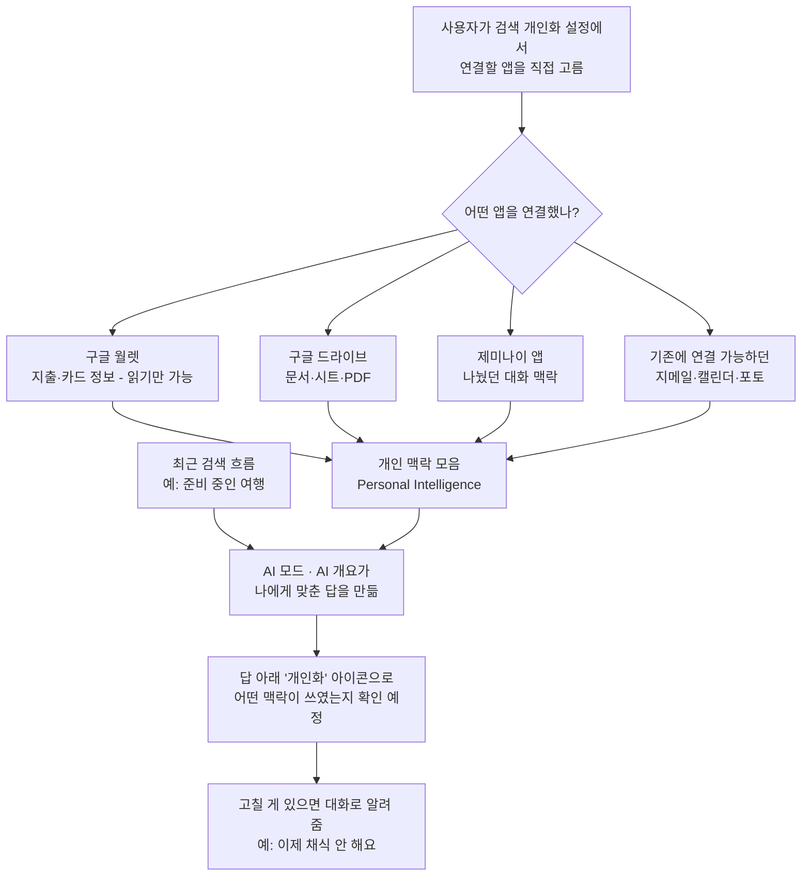

<aside class="ai-knowledge-sidebar">
  
CATEGORIES

  <nav class="ai-cat-tree">

에이전트 오케스트레이션20
<ul><li><a href="https://altjs4510.github.io/ai_news_blog/knowledge/20261121/">2026-11-21Google ADK v2.15.0 — 느린 도구에도 응답성 유지, 다중 실행 신뢰성·부…</a></li><li><a href="https://altjs4510.github.io/ai_news_blog/knowledge/20261118/">2026-11-18Tencent/LoopForge — CodeBuddy·Codex·Claude Code를…</a></li><li><a href="https://altjs4510.github.io/ai_news_blog/knowledge/20261107/">2026-11-07Hermes Agent v0.23.0 — The Hearth Release</a></li><li><a href="https://altjs4510.github.io/ai_news_blog/knowledge/20261029/">2026-10-29How Anthropic ships Claude with Claude: Separati…</a></li><li><a href="https://altjs4510.github.io/ai_news_blog/knowledge/20261027/">2026-10-27nightly-labs/openbot — Codex·Claude·Grok을 상주 팀원처…</a></li><li><a href="https://altjs4510.github.io/ai_news_blog/knowledge/20261015/">2026-10-15How Third Moment Research runs 10,000 agents for…</a></li><li><a href="https://altjs4510.github.io/ai_news_blog/knowledge/20261014/">2026-10-14How Anthropic's Dynamic Workflows Coordinate Cla…</a></li><li><a href="https://altjs4510.github.io/ai_news_blog/knowledge/20260930/">2026-09-30Agents you can coach: how Asana builds human-age…</a></li><li><a href="https://altjs4510.github.io/ai_news_blog/knowledge/20260831-openexecutive-virtual-c-suite/">2026-08-31Open Executive — 8명의 전문 에이전트를 하나의 임원 목소리로</a></li><li><a href="https://altjs4510.github.io/ai_news_blog/knowledge/20260828/">2026-08-28Google ADK for Python v2.8.0 — RemoteA2aAgent 네이…</a></li><li><a href="https://altjs4510.github.io/ai_news_blog/knowledge/20260826/">2026-08-26apache/maka — 도구 호출·권한 결정·종료 이벤트를 append-only 로그…</a></li><li><a href="https://altjs4510.github.io/ai_news_blog/knowledge/20260823/">2026-08-23The Evolution of the Agent Harness — 하네스가 모델 가중치…</a></li><li><a href="https://altjs4510.github.io/ai_news_blog/knowledge/20260805/">2026-08-05TencentCloud/TencentDB-Agent-Memory — 대화·문서·코드를 …</a></li><li><a href="https://altjs4510.github.io/ai_news_blog/knowledge/20260708/">2026-07-08Expanding Managed Agents in Gemini API: backgrou…</a></li><li><a href="https://altjs4510.github.io/ai_news_blog/knowledge/20260701/">2026-07-01Google OKF (Open Knowledge Format) — 벤더 중립 에이전트 …</a></li><li><a href="https://altjs4510.github.io/ai_news_blog/knowledge/20260623/">2026-06-23bytedance/deer-flow — 샌드박스·메모리·서브에이전트·메시지 게이트웨이를…</a></li><li><a href="https://altjs4510.github.io/ai_news_blog/knowledge/20260611/">2026-06-11The evolution of agentic surfaces: building with…</a></li><li><a href="https://altjs4510.github.io/ai_news_blog/knowledge/20260602/">2026-06-02revfactory/harness — 도메인별 에이전트 팀과 스킬을 자동 설계하는 메타…</a></li><li><a href="https://altjs4510.github.io/ai_news_blog/knowledge/20260529/">2026-05-29Introducing dynamic workflows in Claude Code</a></li><li><a href="https://altjs4510.github.io/ai_news_blog/knowledge/20260507/">2026-05-07ruvnet/ruflo — Claude 멀티 에이전트 오케스트레이션 플랫폼</a></li></ul>

MCP &amp; 도구 통합19
<ul><li><a href="https://altjs4510.github.io/ai_news_blog/knowledge/20261103/">2026-11-03vercel-labs/agent-desktop — 픽셀 대신 OS 접근성 트리로 앱 U…</a></li><li><a href="https://altjs4510.github.io/ai_news_blog/knowledge/20261017/">2026-10-17mksglu/context-mode — 코딩 에이전트용 컨텍스트 윈도우 최적화</a></li><li><a href="https://altjs4510.github.io/ai_news_blog/knowledge/20261007/">2026-10-07morluto/rea — 앱 동작부터 네이티브 바이너리까지 에이전트로 리버스 엔지니어링</a></li><li><a href="https://altjs4510.github.io/ai_news_blog/knowledge/20260831-gitnexus-code-knowledge-graph/">2026-08-31GitNexus — 코드베이스를 지식그래프로 바꿔 에이전트에게 쥐어주기</a></li><li><a href="https://altjs4510.github.io/ai_news_blog/knowledge/20260829/">2026-08-29cursor/plugins — 플러그인 명세(specification)와 공식 플러그인…</a></li><li><a href="https://altjs4510.github.io/ai_news_blog/knowledge/20260802/">2026-08-02Stateless MCP has recaptured my interest (and in…</a></li><li><a href="https://altjs4510.github.io/ai_news_blog/knowledge/20260731/">2026-07-31different-ai/openwork — Claude Cowork의 오픈소스 대안(o…</a></li><li><a href="https://altjs4510.github.io/ai_news_blog/knowledge/20260729/">2026-07-29Bringing MCP 2026-07-28 to Claude</a></li><li><a href="https://altjs4510.github.io/ai_news_blog/knowledge/20260726/">2026-07-26citrolabs/ego-lite — 로그인된 브라우저 상태를 AI 에이전트와 공유하는…</a></li><li><a href="https://altjs4510.github.io/ai_news_blog/knowledge/20260718/">2026-07-18tirth8205/code-review-graph — MCP·CLI용 로컬 코드 인텔리…</a></li><li><a href="https://altjs4510.github.io/ai_news_blog/knowledge/20260618/">2026-06-18DeusData/codebase-memory-mcp — 158개 언어 코드베이스를 밀리…</a></li><li><a href="https://altjs4510.github.io/ai_news_blog/knowledge/20260604/">2026-06-04chopratejas/headroom — Compress tool outputs bef…</a></li><li><a href="https://altjs4510.github.io/ai_news_blog/knowledge/20260603/">2026-06-03How Bad MCP design cost your Agent 5× more token…</a></li><li><a href="https://altjs4510.github.io/ai_news_blog/knowledge/20260521/">2026-05-21colbymchenry/codegraph — Pre-indexed code knowle…</a></li><li><a href="https://altjs4510.github.io/ai_news_blog/knowledge/20260520/">2026-05-20New in Claude Managed Agents: self-hosted sandbo…</a></li><li><a href="https://altjs4510.github.io/ai_news_blog/knowledge/20260517/">2026-05-17I gave my LLM 100,000+ tools — Lazy Discovery &a…</a></li><li><a href="https://altjs4510.github.io/ai_news_blog/knowledge/20260512/">2026-05-12agentmemory — Persistent memory for AI coding ag…</a></li><li><a href="https://altjs4510.github.io/ai_news_blog/knowledge/20260509/">2026-05-09How to connect 100 MCP servers without the conte…</a></li><li><a href="https://altjs4510.github.io/ai_news_blog/knowledge/20260506/">2026-05-06mksglu/context-mode — AI 코딩 에이전트용 컨텍스트 윈도우 최적화</a></li></ul>

코딩 에이전트28
<ul><li><a href="https://altjs4510.github.io/ai_news_blog/knowledge/20261115/">2026-11-15GoogleChrome/modern-web-guidance-src — 코딩 에이전트에 …</a></li><li><a href="https://altjs4510.github.io/ai_news_blog/knowledge/20261112/">2026-11-12shadcn/improve — 가장 강한 모델로 코드베이스를 감사해 계획을 쓰고, 더 …</a></li><li><a href="https://altjs4510.github.io/ai_news_blog/knowledge/20261106/">2026-11-06Cline desktop-nightly-20261104233655: feat(core)…</a></li><li><a href="https://altjs4510.github.io/ai_news_blog/knowledge/20261022/">2026-10-22Claude Mods: Flipping the Harness Inside Out</a></li><li><a href="https://altjs4510.github.io/ai_news_blog/knowledge/20261018/">2026-10-18Quoting Addy Osmani, Morgan Westlee Lunt, and Qi…</a></li><li><a href="https://altjs4510.github.io/ai_news_blog/knowledge/20261014-claude-code-advisor/">2026-10-14Claude Code advisor — 가벼운 메인 모델이 일하고, 갈림길에서만 Opu…</a></li><li><a href="https://altjs4510.github.io/ai_news_blog/knowledge/20260920/">2026-09-20Claude Code 2.1.277 — CLAUDE.md가 없으면 AGENTS.md를 …</a></li><li><a href="https://altjs4510.github.io/ai_news_blog/knowledge/20260912/">2026-09-12Quoting Boris Cherny — 'Claude가 쓴 프로덕션 코드는 사람이 쓴…</a></li><li><a href="https://altjs4510.github.io/ai_news_blog/knowledge/20260910/">2026-09-10vastsa/PI-Desktop — Electron + Rust 호스트 코어 + 에이전…</a></li><li><a href="https://altjs4510.github.io/ai_news_blog/knowledge/20260906/">2026-09-06DietrichGebert/ponytail — 에이전트를 '방에서 가장 게으른 시니어 …</a></li><li><a href="https://altjs4510.github.io/ai_news_blog/knowledge/20260903/">2026-09-03pacifio/atlas — 여러 코딩 에이전트의 변경을 한곳에서 추적·질의하는 '에이…</a></li><li><a href="https://altjs4510.github.io/ai_news_blog/knowledge/20260901/">2026-09-01affaan-m/ECC — 스킬·본능·메모리·보안을 묶은 에이전트 하네스 성능 최적화 …</a></li><li><a href="https://altjs4510.github.io/ai_news_blog/knowledge/20260819/">2026-08-19akitaonrails/ai-memory — 코딩 에이전트 CLI 간 장기 기억과 벤더…</a></li><li><a href="https://altjs4510.github.io/ai_news_blog/knowledge/20260814/">2026-08-14cathrynlavery/diagram-design — Claude Code용 에디토리…</a></li><li><a href="https://altjs4510.github.io/ai_news_blog/knowledge/20260810/">2026-08-10Auto mode is now the default in Claude Code for …</a></li><li><a href="https://altjs4510.github.io/ai_news_blog/knowledge/20260808/">2026-08-08PrimeIntellect-ai/prime-agent — 코딩 워크플로우와 장시간 자율…</a></li><li><a href="https://altjs4510.github.io/ai_news_blog/knowledge/20260804/">2026-08-04esengine/DeepSeek-Reasonix — prefix-cache 안정성을 축…</a></li><li><a href="https://altjs4510.github.io/ai_news_blog/knowledge/20260728/">2026-07-28alibaba/open-code-review — 결정론적 파이프라인 + LLM 에이전트…</a></li><li><a href="https://altjs4510.github.io/ai_news_blog/knowledge/20260725/">2026-07-25The new rules of context engineering for Claude …</a></li><li><a href="https://altjs4510.github.io/ai_news_blog/knowledge/20260714/">2026-07-14Graphify-Labs/graphify — 코드베이스를 질의 가능한 지식 그래프로 만…</a></li><li><a href="https://altjs4510.github.io/ai_news_blog/knowledge/20260707/">2026-07-07AI Hero Skills Catalog — 실무 엔지니어를 위한 재사용 가능한 판단 …</a></li><li><a href="https://altjs4510.github.io/ai_news_blog/knowledge/20260705/">2026-07-05openai/codex-plugin-cc — Claude Code에서 Codex를 위임…</a></li><li><a href="https://altjs4510.github.io/ai_news_blog/knowledge/20260626/">2026-06-26google-labs-code/design.md — 코딩 에이전트에게 디자인 시스템을 …</a></li><li><a href="https://altjs4510.github.io/ai_news_blog/knowledge/20260619/">2026-06-19Claude Code now supports artifacts</a></li><li><a href="https://altjs4510.github.io/ai_news_blog/knowledge/20260530/">2026-05-30Leonxlnx/taste-skill — AI에게 좋은 취향을 부여해 generic s…</a></li><li><a href="https://altjs4510.github.io/ai_news_blog/knowledge/20260515/">2026-05-15Clawdmeter — Claude Code 사용량을 데스크톱 대시보드로</a></li><li><a href="https://altjs4510.github.io/ai_news_blog/knowledge/20260508/">2026-05-08addyosmani/agent-skills — Production-grade engin…</a></li><li><a href="https://altjs4510.github.io/ai_news_blog/knowledge/20260505/">2026-05-05mattpocock/skills — Skills for Real Engineers (.…</a></li></ul>

모델 &amp; 연구14
<ul><li><a href="https://altjs4510.github.io/ai_news_blog/knowledge/20261113/">2026-11-13Gemini Decisions API</a></li><li><a href="https://altjs4510.github.io/ai_news_blog/knowledge/20261111/">2026-11-11Quoting Prompting Claude Fable 5.2</a></li><li><a href="https://altjs4510.github.io/ai_news_blog/knowledge/20261104/">2026-11-04Qwen 3.8 27B on my laptop can interpret model we…</a></li><li><a href="https://altjs4510.github.io/ai_news_blog/knowledge/20261009/">2026-10-09Claude Haiku 5.5 (Simon Willison의 출시 노트와 가격 분석)</a></li><li><a href="https://altjs4510.github.io/ai_news_blog/knowledge/20260929/">2026-09-29vectorize-io/hindsight — Hindsight: Agent Memory…</a></li><li><a href="https://altjs4510.github.io/ai_news_blog/knowledge/20260907-voicemem-dual-brain-memory/">2026-09-07VoiceMem — 좌뇌·우뇌로 쪼갠 스트리밍 메모리로 음성 에이전트 지연 없애기</a></li><li><a href="https://altjs4510.github.io/ai_news_blog/knowledge/20260904/">2026-09-04HarnessDev: Can LLMs Create and Evolve Their Own…</a></li><li><a href="https://altjs4510.github.io/ai_news_blog/knowledge/20260717/">2026-07-17After a year building agent memory, 'save everyt…</a></li><li><a href="https://altjs4510.github.io/ai_news_blog/knowledge/20260716-proprag/">2026-07-16PropRAG — 프로포지션 경로 위 beam search로 멀티홉 검색 안내</a></li><li><a href="https://altjs4510.github.io/ai_news_blog/knowledge/20260712/">2026-07-12Do Automated Evals Work?</a></li><li><a href="https://altjs4510.github.io/ai_news_blog/knowledge/20260620/">2026-06-20zai-org/GLM-5 — From Vibe Coding to Agentic Engi…</a></li><li><a href="https://altjs4510.github.io/ai_news_blog/knowledge/20260617/">2026-06-17Predicting model behavior before release by simu…</a></li><li><a href="https://altjs4510.github.io/ai_news_blog/knowledge/20260516/">2026-05-16STALE — 에이전트가 자기 기억의 유효성을 인지할 수 있는가</a></li><li><a href="https://altjs4510.github.io/ai_news_blog/knowledge/20260513/">2026-05-13Thinking Machines' Native Interaction Models — T…</a></li></ul>

인프라 &amp; 컴퓨트9
<ul><li><a href="https://altjs4510.github.io/ai_news_blog/knowledge/20261120/">2026-11-20How OpenAI’s Performance Factory keeps ChatGPT f…</a></li><li><a href="https://altjs4510.github.io/ai_news_blog/knowledge/20260909/">2026-09-09Reducing cost and improving performance with Cla…</a></li><li><a href="https://altjs4510.github.io/ai_news_blog/knowledge/20260905/">2026-09-05magnitudedev/magnitude — 하드웨어에 맞는 최적 로컬 모델을 띄워 이…</a></li><li><a href="https://altjs4510.github.io/ai_news_blog/knowledge/20260821/">2026-08-21volcengine/OpenViking — 에이전트 메모리·Knowledge RAG·스…</a></li><li><a href="https://altjs4510.github.io/ai_news_blog/knowledge/20260812/">2026-08-12semantica-agi/semantica — 컨텍스트와 '책임 추적 가능한(accou…</a></li><li><a href="https://altjs4510.github.io/ai_news_blog/knowledge/20260806/">2026-08-06cloudflare/computer — 에이전트에게 컴퓨터를 통째로 주는 엣지 실행 샌…</a></li><li><a href="https://altjs4510.github.io/ai_news_blog/knowledge/20260723/">2026-07-23diegosouzapw/OmniRoute — 268+ 프로바이더를 단일 엔드포인트로 묶…</a></li><li><a href="https://altjs4510.github.io/ai_news_blog/knowledge/20260610/">2026-06-10Fable 5 just made cost-aware model routing manda…</a></li><li><a href="https://altjs4510.github.io/ai_news_blog/knowledge/20260522/">2026-05-22Giving Agents Computers — Ivan Burazin, Daytona</a></li></ul>

보안 &amp; 거버넌스27
<ul><li><a href="https://altjs4510.github.io/ai_news_blog/knowledge/20261119/">2026-11-19External sandboxes for coding agents</a></li><li><a href="https://altjs4510.github.io/ai_news_blog/knowledge/20261117/">2026-11-17NVIDIA/SkillEvaluator — AI 에이전트 스킬·플러그인을 품질 게이트,…</a></li><li><a href="https://altjs4510.github.io/ai_news_blog/knowledge/20261031/">2026-10-31CopilotKit/OpenBot — AI 동료마다 전용 컴퓨터를 주고 모든 행동을 실…</a></li><li><a href="https://altjs4510.github.io/ai_news_blog/knowledge/20261030/">2026-10-30How we detect frontier model misalignment</a></li><li><a href="https://altjs4510.github.io/ai_news_blog/knowledge/20261021/">2026-10-21cloudflare/security-audit-skill — 독립 검증된 기계 판독형 …</a></li><li><a href="https://altjs4510.github.io/ai_news_blog/knowledge/20261020/">2026-10-20Satya Nadella — 모델을 내부자 위험으로 보는 원칙에 따라 Project P…</a></li><li><a href="https://altjs4510.github.io/ai_news_blog/knowledge/20261016/">2026-10-16Crossing the Threshold: How OpenAI and Anthropic…</a></li><li><a href="https://altjs4510.github.io/ai_news_blog/knowledge/20261011/">2026-10-11Anthropic can’t reliably control its AI agents. …</a></li><li><a href="https://altjs4510.github.io/ai_news_blog/knowledge/20261004/">2026-10-04Apple says it's tightening macOS 'Full Disk Acce…</a></li><li><a href="https://altjs4510.github.io/ai_news_blog/knowledge/20261001/">2026-10-01NVIDIA/OpenShell</a></li><li><a href="https://altjs4510.github.io/ai_news_blog/knowledge/20260919/">2026-09-19cloudflare/security-audit-skill — 다단계 보안 감사를 '독립…</a></li><li><a href="https://altjs4510.github.io/ai_news_blog/knowledge/20260913/">2026-09-13OpenAI agents attacked RubyGems back in May: Ope…</a></li><li><a href="https://altjs4510.github.io/ai_news_blog/knowledge/20260902/">2026-09-02AIR raises $50M to help companies vet the skills…</a></li><li><a href="https://altjs4510.github.io/ai_news_blog/knowledge/20260827/">2026-08-27Claude in Chrome is generally available</a></li><li><a href="https://altjs4510.github.io/ai_news_blog/knowledge/20260819-mind-viruses/">2026-08-19탈옥도, 인젝션도 없이 — 대화로만 퍼지는 에이전트의 '마인드 바이러스'</a></li><li><a href="https://altjs4510.github.io/ai_news_blog/knowledge/20260730/">2026-07-30Anatomy of a Frontier Lab Agent Intrusion: A Tec…</a></li><li><a href="https://altjs4510.github.io/ai_news_blog/knowledge/20260715/">2026-07-15Dicklesworthstone/destructive_command_guard — 에이…</a></li><li><a href="https://altjs4510.github.io/ai_news_blog/knowledge/20260710/">2026-07-1070개 MCP 서버 strace 런타임 감사 — 부팅 시 아웃바운드 호출 서버 적발</a></li><li><a href="https://altjs4510.github.io/ai_news_blog/knowledge/20260704/">2026-07-04Cloudflare is about to block AI agents by defaul…</a></li><li><a href="https://altjs4510.github.io/ai_news_blog/knowledge/20260703/">2026-07-03Giving admins more visibility and control over C…</a></li><li><a href="https://altjs4510.github.io/ai_news_blog/knowledge/20260630/">2026-06-30Introducing the Claude apps gateway for Amazon B…</a></li><li><a href="https://altjs4510.github.io/ai_news_blog/knowledge/20260624/">2026-06-24Agent identity in Claude Tag: a new access model…</a></li><li><a href="https://altjs4510.github.io/ai_news_blog/knowledge/20260613/">2026-06-13Fable 5's guardrails got bypassed in 48 hours — …</a></li><li><a href="https://altjs4510.github.io/ai_news_blog/knowledge/20260612/">2026-06-12NVIDIA/SkillSpector — AI 에이전트 스킬용 보안 스캐너</a></li><li><a href="https://altjs4510.github.io/ai_news_blog/knowledge/20260607/">2026-06-07OpenAI Help: Lockdown Mode</a></li><li><a href="https://altjs4510.github.io/ai_news_blog/knowledge/20260531/">2026-05-31How we contain Claude across products</a></li><li><a href="https://altjs4510.github.io/ai_news_blog/knowledge/20260527/">2026-05-27Microsoft Copilot Cowork Exfiltrates Files</a></li></ul>

응용 사례14
<ul><li><a href="https://altjs4510.github.io/ai_news_blog/knowledge/20261124/" class="current">2026-11-24A more tailored Google Search that’s uniquely yo…</a></li><li><a href="https://altjs4510.github.io/ai_news_blog/knowledge/20261114/">2026-11-14Introducing ChatGPT Wallet</a></li><li><a href="https://altjs4510.github.io/ai_news_blog/knowledge/20261110/">2026-11-10meta/astryx — 직접 바꿔 쓸 수 있고 에이전트가 바로 쓸 수 있는(agent…</a></li><li><a href="https://altjs4510.github.io/ai_news_blog/knowledge/20261105/">2026-11-05NVIDIA/auto-ontology — 데이터 위에 그래프 기반 의미 추론 레이어를 …</a></li><li><a href="https://altjs4510.github.io/ai_news_blog/knowledge/20261101/">2026-11-01Agents Prompt People: Using Agents for Long-Hori…</a></li><li><a href="https://altjs4510.github.io/ai_news_blog/knowledge/20261028/">2026-10-28Greptile takes bug detection beyond code review …</a></li><li><a href="https://altjs4510.github.io/ai_news_blog/knowledge/20261023/">2026-10-23Claude Duet app is Anthropic's bet on agents</a></li><li><a href="https://altjs4510.github.io/ai_news_blog/knowledge/20261006/">2026-10-06How Cresta turned CX expertise into an agent bui…</a></li><li><a href="https://altjs4510.github.io/ai_news_blog/knowledge/20260911/">2026-09-11Now everyone can put data to work — ChatGPT Work…</a></li><li><a href="https://altjs4510.github.io/ai_news_blog/knowledge/20260709/">2026-07-09mvanhorn/last30days-skill — Reddit·X·YouTube·HN·…</a></li><li><a href="https://altjs4510.github.io/ai_news_blog/knowledge/20260621/">2026-06-21calesthio/OpenMontage — 12 파이프라인·52 도구·500+ 스킬을 …</a></li><li><a href="https://altjs4510.github.io/ai_news_blog/knowledge/20260609/">2026-06-09Building intelligent apps for Apple platforms wi…</a></li><li><a href="https://altjs4510.github.io/ai_news_blog/knowledge/20260528/">2026-05-28Building self-improving tax agents with Codex</a></li><li><a href="https://altjs4510.github.io/ai_news_blog/knowledge/20260514/">2026-05-14Introducing Claude for Small Business</a></li></ul>

산업 동향8
<ul><li><a href="https://altjs4510.github.io/ai_news_blog/knowledge/20261024/">2026-10-24Donating Agent Skills to the Agentic AI Foundati…</a></li><li><a href="https://altjs4510.github.io/ai_news_blog/knowledge/20260907-humanmade-52week-rhythm/">2026-09-07휴먼 메이드의 '52주 리듬' — 아이디어가 흔해진 시대에 값이 오르는 건 버리는 판단</a></li><li><a href="https://altjs4510.github.io/ai_news_blog/knowledge/20260830/">2026-08-30[AINews] OpenAI shuts off Cursor — 프론티어 모델 공급 차단…</a></li><li><a href="https://altjs4510.github.io/ai_news_blog/knowledge/20260711/">2026-07-11OpenAI says GPT 5.6 is the 'preferred model' for…</a></li><li><a href="https://altjs4510.github.io/ai_news_blog/knowledge/20260702/">2026-07-02How Cursor deploys AI inside the enterprise (For…</a></li><li><a href="https://altjs4510.github.io/ai_news_blog/knowledge/20260616/">2026-06-16Why AI hasn't replaced software engineers, and w…</a></li><li><a href="https://altjs4510.github.io/ai_news_blog/knowledge/20260519/">2026-05-19Anthropic acquires Stainless</a></li><li><a href="https://altjs4510.github.io/ai_news_blog/knowledge/20260504/">2026-05-04Agents for Everything Else: Codex for Knowledge …</a></li></ul>
</nav>
</aside>

<article class="ai-knowledge-article">

<header class="ai-post-hero">
  
<a class="ai-back" href="../">KNOWLEDGE</a> · 2026-11-24 · 오늘의 학습

  <h2 class="ai-post-title">A more tailored Google Search that’s uniquely yours (Personal Intelligence)</h2>
</header>

> 원문: [A more tailored Google Search that’s uniquely yours (Personal Intelligence)](https://blog.google/products-and-platforms/products/search/google-search-personal-intelligence-apps/)

## 📌 학습 정리

### 1. 한 줄로 말하면

구글 검색이 내 지갑 결제 내역, 드라이브 문서, 제미나이 앱 대화를 (내가 허락한 만큼만) 참고해서, 나에게 맞춘 답을 주기 시작했다는 소식이에요. 연결할지 말지는 내가 고르고, 언제든 끌 수 있어요.

### 2. 왜 이게 만들어졌어요?

보통 검색은 "세상에 있는 정보"를 찾아 주는 데는 강하지만, 나에 대한 사정은 잘 몰라요. 그래서 세금 준비나 카드 혜택 비교처럼 내 상황이 중요한 질문을 하면, 필요한 정보를 내가 직접 여기저기서 모아 와서 다시 설명해야 했어요. 원문 표현을 빌리면, 프로젝트를 시작하거나 큰 결정을 내릴 때 필요한 정보가 문서·스프레드시트·PDF에 흩어져 있는 경우가 많다는 거죠. 구글은 이미 Gmail, 캘린더(Calendar), 포토(Photos)를 'Personal Intelligence'에 연결할 수 있게 해 두었고, 이번에 연결할 수 있는 앱을 더 늘렸어요. 세상의 정보와 나에게만 의미 있는 맥락을 한자리에서 합쳐 보자는 게 출발점이에요.

### 3. 비유로 풀면

이건 마치 **내 사정을 아는 단골 상담사** 같은 거예요. 처음 가는 상담 창구에서는 매번 "제 카드는 이거고요, 지난달엔 이렇게 썼고요…"부터 설명해야 하잖아요. 그런데 내가 서류철을 보여 주겠다고 동의해 두면, 상담사는 그 서류를 읽어 보고 바로 나에게 맞는 조언을 해 줄 수 있어요. 다만 이 상담사는 서류를 **읽기만** 할 수 있고, 내 계좌에서 돈을 옮기거나 투자를 대신 할 수는 없어요.

또 하나는 **어제 하던 대화를 기억하는 친구**예요. 여행 계획을 같이 짜다가 다음 날 다시 얘기를 꺼내면, 처음부터 다시 말하지 않아도 "아, 그 여행 말이지?" 하고 이어 가는 거죠.

그래서 결국, 내가 연결을 허락한 앱의 내용과 최근 검색 흐름을 검색이 참고해서 같은 설명을 반복하지 않아도 나에게 맞는 답이 나오는 구조예요. 연결하는 범위와 켜고 끄는 건 늘 내가 정해요.

### 4. 어떻게 작동하는지 (그림으로)

먼저 사용자가 연결할 앱을 직접 고르고, 그렇게 모인 개인 맥락과 최근 검색 흐름을 바탕으로 AI 모드가 답을 만들어요. 앞으로는 답 아래 '개인화(Personalization)' 아이콘을 눌러 어떤 맥락이 쓰였는지 볼 수 있게 된다고 해요. 틀린 정보가 있으면 그 대화 안에서 "이제 채식 안 해요"처럼 말로 고쳐 주면 돼요. 월렛은 오늘부터 순차적으로 열리고, 드라이브와 제미나이 앱은 앞으로 몇 주 안에 지원될 예정이에요.

### 5. 처음 보는 용어 풀이

- **개인 맥락 연결 기능 (Personal Intelligence)** — 내가 허락한 구글 앱들의 정보를 검색이나 제미나이 앱이 참고할 수 있게 해 주는 기능이에요. 나에 대한 배경을 매번 설명하지 않아도 되도록 돕는 장치라고 보면 돼요.
- **AI 모드 (AI Mode)** — 구글 검색 안에 있는 대화형 검색 화면이에요. 질문을 이어 가며 묻고 답할 수 있고, 이번 개인화 기능도 여기서 작동해요.
- **AI 개요 (AI Overviews)** — 검색 결과 위쪽에 AI가 요약해서 보여 주는 답이에요. 이번 발표로 여기에도 최근 검색 흐름을 반영한 답이 더 많이 나온다고 해요.
- **직접 동의해야 켜지는 방식 (opt in)** — 기본으로 켜져 있지 않고, 사용자가 원할 때 스스로 켜야 작동한다는 뜻이에요. 원문에서는 연결 여부와 시점을 사용자가 정하고, 언제든 끄고 켤 수 있다고 강조해요.
- **연결된 앱 (Connected Apps)** — 검색 개인화(Search Personalization) 설정 안에 있는 메뉴예요. 여기서 어떤 앱을 연결할지 고를 수 있어요.
- **구글 월렛 (Google Wallet)** — 카드나 결제 정보를 담아 두는 구글의 전자 지갑 서비스예요. 연결하면 지출 흐름 정리, 캐시백·여행 혜택·포인트 활용 같은 조언을 받을 수 있는데, 읽기만 가능하고 돈을 움직이거나 관리하지는 못해요.
- **제미나이 앱 (Gemini app)** — 구글의 AI 대화 앱이에요. 앞으로는 이 앱에서 나눈 대화와 AI 모드의 맥락이 서로 이어져서, 한쪽에서 하던 고민을 다른 쪽에서 이어 갈 수 있게 된다고 해요.

### 6. 한 발 더 들어가고 싶다면

- [Personal Intelligence](https://blog.google/products-and-platforms/products/search/personal-intelligence-expansion/) — 이걸 보면 이번 발표 이전에 Personal Intelligence가 어떻게 확장돼 왔는지 알 수 있어요.
- [Gemini app에서의 Google Wallet 연결](https://blog.google/innovation-and-ai/products/gemini-app/google-wallet-gemini-app/) — 이걸 보면 제미나이 앱 쪽에서 월렛을 연결했을 때 무엇을 할 수 있는지 알 수 있어요.
- [Search 기록을 Gemini 앱에 연결하기](https://blog.google/innovation-and-ai/products/gemini-app/personal-intelligence/) — 이걸 보면 검색 기록을 제미나이 앱의 Personal Intelligence에 연결하는 기존 기능을 알 수 있어요.
- [연결할 앱 고르기](https://myactivity.google.com/search-services/apps) — 이걸 보면 실제로 어떤 앱을 연결하거나 끊을 수 있는지 설정 화면을 확인할 수 있어요.
- [개인화 끄기](https://www.google.com/search-personalization) — 이걸 보면 검색 개인화를 조정하거나 끄는 방법을 알 수 있어요.

---

## 📖 원문 전체 번역 (정독용)

> 의역 최소화한 전체 번역입니다. 큰 흐름은 위 정리에서 잡고, 정확한 워딩이 필요할 땐 이 섹션에서 정독하세요.

# 나만을 위해 더 맞춤화된 Google 검색 (Personal Intelligence)

2026년 11월 23일

|

AI 모드(AI Mode)의 Personal Intelligence에 Google Wallet, Drive, Gemini 앱을 안전하게 연결하도록 직접 선택(opt in)하면, 더 도움이 되는 검색 응답을 받을 수 있습니다.

* * *

* * *

[오디오 3](https://storage.googleapis.com/gweb-uniblog-publish-prod/media/tts_audio_87065_umbriel_2026_11_23_17_00_48.mp3)

기사 듣기

[[duration]]분

이 콘텐츠는 Google AI가 생성했습니다. 생성형 AI는 실험적 기술입니다.

가장 도움이 되는 검색 경험은 세상의 풍부한 정보와 나에게 고유하게 관련된 인사이트를 하나로 모아 줍니다. 오늘부터 검색은 더 많은 앱을 Personal Intelligence에 연결할 수 있게 되면서 한층 더 맞춤화됩니다. 또한 개인에게 더 관련성 높은 응답을 도입해, 필요한 것을 더 쉽게 찾을 수 있도록 했습니다.

오늘부터 순차적으로 제공되는 기능으로, [AI 모드](http://g.ai/)의 [Personal Intelligence](https://blog.google/products-and-platforms/products/search/personal-intelligence-expansion/)에 Google Wallet을 안전하게 연결하도록 직접 선택할 수 있으며, Drive와 Gemini 앱은 앞으로 몇 주 안에 지원됩니다. 이를 통해 지출, 문서, 대화에서 얻은 맥락을 검색에 바로 가져올 수 있습니다. 이 앱들은 Gmail, Calendar, Photos와 함께, 나의 개인 맥락을 반영한 더욱 맞춤화된 응답을 제공합니다.

*   **Google Wallet으로 지출 현황을 더 분명하게 파악하기:** AI 모드와 [Gemini 앱](https://blog.google/innovation-and-ai/products/gemini-app/google-wallet-gemini-app/) 모두에서 Google Wallet을 Personal Intelligence에 연결하면, 재정 이정표를 그려 보고 일상 지출을 줄일 수 있는 실행 가능한 방법을 찾을 수 있습니다. 또한 Wallet을 통해 연결된 카드를 기반으로 캐시백 카테고리, 여행 혜택, 보상 포인트 최적화 등 신용카드 혜택을 극대화할 수도 있습니다. Wallet 연결을 선택하더라도 AI 모드는 계정의 정보를 읽기만 할 수 있으며, 돈을 이동하거나 관리하거나 투자할 수는 없습니다.
*   **Google Drive로 작업 흐름 유지하기:** 프로젝트를 시작하거나 중요한 결정을 내리는 데 필요한 정보가 문서, 스프레드시트, PDF 곳곳에 흩어져 있는 경우가 있습니다. Personal Intelligence에 Google Drive를 연결하면 이 모든 맥락을 고려한, 나에게 고유하게 도움이 되는 응답을 받아 시작할 수 있습니다. 예를 들어 세금 신고 시즌을 앞둔 맞춤형 준비 계획을 받을 수 있습니다.
*   **Gemini 앱과 검색 사이의 점을 잇기:** 앞으로 몇 주 안에 Gemini 앱과 검색의 AI 모드 사이에서 맥락을 쉽게 공유할 수 있게 됩니다. 따라서 Gemini 앱에서 어떤 아이디어를 탐색했다면 AI 모드가 그 토대 위에서 이어갈 수 있고, 반대의 경우도 마찬가지입니다. 이미 Gemini 앱의 Personal Intelligence에 [검색 기록을 연결](https://blog.google/innovation-and-ai/products/gemini-app/personal-intelligence/)하도록 선택할 수 있었지만, 곧 AI 모드의 Personal Intelligence에도 Gemini 앱을 안전하게 연결하도록 선택할 수 있게 됩니다.

AI 모드의 Personal Intelligence에 앱을 연결하려면 검색 개인 설정(Search Personalization)을 열고 연결된 앱(Connected Apps)을 선택한 다음, [연결하려는](https://myactivity.google.com/search-services/apps) 앱을 고르세요. 연결 여부와 시점은 직접 선택하며, 언제든지 연결을 켜거나 끌 수 있습니다. 개인 설정은 항상 사용자가 제어하며, 곧 맞춤 응답 아래의 "개인 설정(Personalization)" 아이콘을 통해 AI 모드가 사용하는 맥락을 확인할 수도 있게 됩니다. 무엇이든 수정하고 싶다면 AI 모드에 바꿀 내용을 알려주기만 하면 됩니다. 예를 들어 스레드에서 "저는 이제 채식주의자가 아니에요"라고 답하면 됩니다.

또한 AI 개요(AI Overviews)와 AI 모드에서 최근 검색 맥락에 맞춘, 개인에게 더 관련성 높은 응답이 나타나기 시작합니다. 예를 들어 여행을 조사하고 계획해 왔다면, 처음부터 다시 시작하거나 같은 말을 반복하지 않고도 새 검색 스레드에서 중단한 지점부터 바로 이어갈 수 있습니다. 언제나처럼 검색 설정에서 언제든지 [개인 설정을 조정하거나 끌](https://www.google.com/search-personalization) 수 있습니다.

## Google의 최신 소식을 받은 편지함으로 받아보세요

제품 업데이트, 행사 정보, 특별 혜택 등을 담은 뉴스레터에 가입하세요.

입력하신 정보는 [Google 개인정보처리방침](https://policies.google.com/privacy)에 따라 사용됩니다. 언제든지 수신을 거부할 수 있습니다.

## 저자 소개

### Robby Stein

#### VP of Product, Google Search

Robby Stein은 Google Search의 제품 부문 부사장(Vice President of Product)으로, 사람들이 정보를 힘들이지 않고 검색하고 접근할 수 있도록 돕는 생성형 AI 제품과 경험의 개발을 맡고 있습니다.

 Robby Stein의 글 더 보기

</article>

