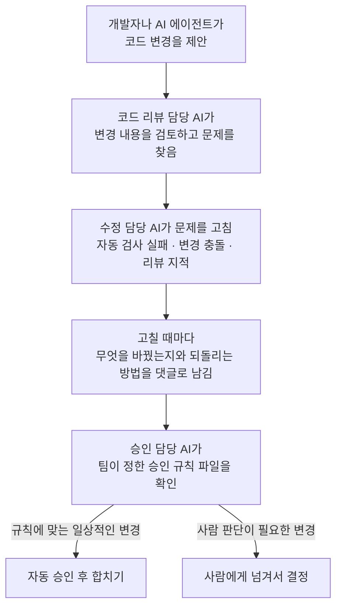

<aside class="ai-knowledge-sidebar">
  
CATEGORIES

  <nav class="ai-cat-tree">

에이전트 오케스트레이션20
<ul><li><a href="https://altjs4510.github.io/ai_news_blog/knowledge/20261121/">2026-11-21Google ADK v2.15.0 — 느린 도구에도 응답성 유지, 다중 실행 신뢰성·부…</a></li><li><a href="https://altjs4510.github.io/ai_news_blog/knowledge/20261118/">2026-11-18Tencent/LoopForge — CodeBuddy·Codex·Claude Code를…</a></li><li><a href="https://altjs4510.github.io/ai_news_blog/knowledge/20261107/">2026-11-07Hermes Agent v0.23.0 — The Hearth Release</a></li><li><a href="https://altjs4510.github.io/ai_news_blog/knowledge/20261029/">2026-10-29How Anthropic ships Claude with Claude: Separati…</a></li><li><a href="https://altjs4510.github.io/ai_news_blog/knowledge/20261027/">2026-10-27nightly-labs/openbot — Codex·Claude·Grok을 상주 팀원처…</a></li><li><a href="https://altjs4510.github.io/ai_news_blog/knowledge/20261015/">2026-10-15How Third Moment Research runs 10,000 agents for…</a></li><li><a href="https://altjs4510.github.io/ai_news_blog/knowledge/20261014/">2026-10-14How Anthropic's Dynamic Workflows Coordinate Cla…</a></li><li><a href="https://altjs4510.github.io/ai_news_blog/knowledge/20260930/">2026-09-30Agents you can coach: how Asana builds human-age…</a></li><li><a href="https://altjs4510.github.io/ai_news_blog/knowledge/20260831-openexecutive-virtual-c-suite/">2026-08-31Open Executive — 8명의 전문 에이전트를 하나의 임원 목소리로</a></li><li><a href="https://altjs4510.github.io/ai_news_blog/knowledge/20260828/">2026-08-28Google ADK for Python v2.8.0 — RemoteA2aAgent 네이…</a></li><li><a href="https://altjs4510.github.io/ai_news_blog/knowledge/20260826/">2026-08-26apache/maka — 도구 호출·권한 결정·종료 이벤트를 append-only 로그…</a></li><li><a href="https://altjs4510.github.io/ai_news_blog/knowledge/20260823/">2026-08-23The Evolution of the Agent Harness — 하네스가 모델 가중치…</a></li><li><a href="https://altjs4510.github.io/ai_news_blog/knowledge/20260805/">2026-08-05TencentCloud/TencentDB-Agent-Memory — 대화·문서·코드를 …</a></li><li><a href="https://altjs4510.github.io/ai_news_blog/knowledge/20260708/">2026-07-08Expanding Managed Agents in Gemini API: backgrou…</a></li><li><a href="https://altjs4510.github.io/ai_news_blog/knowledge/20260701/">2026-07-01Google OKF (Open Knowledge Format) — 벤더 중립 에이전트 …</a></li><li><a href="https://altjs4510.github.io/ai_news_blog/knowledge/20260623/">2026-06-23bytedance/deer-flow — 샌드박스·메모리·서브에이전트·메시지 게이트웨이를…</a></li><li><a href="https://altjs4510.github.io/ai_news_blog/knowledge/20260611/">2026-06-11The evolution of agentic surfaces: building with…</a></li><li><a href="https://altjs4510.github.io/ai_news_blog/knowledge/20260602/">2026-06-02revfactory/harness — 도메인별 에이전트 팀과 스킬을 자동 설계하는 메타…</a></li><li><a href="https://altjs4510.github.io/ai_news_blog/knowledge/20260529/">2026-05-29Introducing dynamic workflows in Claude Code</a></li><li><a href="https://altjs4510.github.io/ai_news_blog/knowledge/20260507/">2026-05-07ruvnet/ruflo — Claude 멀티 에이전트 오케스트레이션 플랫폼</a></li></ul>

MCP &amp; 도구 통합19
<ul><li><a href="https://altjs4510.github.io/ai_news_blog/knowledge/20261103/">2026-11-03vercel-labs/agent-desktop — 픽셀 대신 OS 접근성 트리로 앱 U…</a></li><li><a href="https://altjs4510.github.io/ai_news_blog/knowledge/20261017/">2026-10-17mksglu/context-mode — 코딩 에이전트용 컨텍스트 윈도우 최적화</a></li><li><a href="https://altjs4510.github.io/ai_news_blog/knowledge/20261007/">2026-10-07morluto/rea — 앱 동작부터 네이티브 바이너리까지 에이전트로 리버스 엔지니어링</a></li><li><a href="https://altjs4510.github.io/ai_news_blog/knowledge/20260831-gitnexus-code-knowledge-graph/">2026-08-31GitNexus — 코드베이스를 지식그래프로 바꿔 에이전트에게 쥐어주기</a></li><li><a href="https://altjs4510.github.io/ai_news_blog/knowledge/20260829/">2026-08-29cursor/plugins — 플러그인 명세(specification)와 공식 플러그인…</a></li><li><a href="https://altjs4510.github.io/ai_news_blog/knowledge/20260802/">2026-08-02Stateless MCP has recaptured my interest (and in…</a></li><li><a href="https://altjs4510.github.io/ai_news_blog/knowledge/20260731/">2026-07-31different-ai/openwork — Claude Cowork의 오픈소스 대안(o…</a></li><li><a href="https://altjs4510.github.io/ai_news_blog/knowledge/20260729/">2026-07-29Bringing MCP 2026-07-28 to Claude</a></li><li><a href="https://altjs4510.github.io/ai_news_blog/knowledge/20260726/">2026-07-26citrolabs/ego-lite — 로그인된 브라우저 상태를 AI 에이전트와 공유하는…</a></li><li><a href="https://altjs4510.github.io/ai_news_blog/knowledge/20260718/">2026-07-18tirth8205/code-review-graph — MCP·CLI용 로컬 코드 인텔리…</a></li><li><a href="https://altjs4510.github.io/ai_news_blog/knowledge/20260618/">2026-06-18DeusData/codebase-memory-mcp — 158개 언어 코드베이스를 밀리…</a></li><li><a href="https://altjs4510.github.io/ai_news_blog/knowledge/20260604/">2026-06-04chopratejas/headroom — Compress tool outputs bef…</a></li><li><a href="https://altjs4510.github.io/ai_news_blog/knowledge/20260603/">2026-06-03How Bad MCP design cost your Agent 5× more token…</a></li><li><a href="https://altjs4510.github.io/ai_news_blog/knowledge/20260521/">2026-05-21colbymchenry/codegraph — Pre-indexed code knowle…</a></li><li><a href="https://altjs4510.github.io/ai_news_blog/knowledge/20260520/">2026-05-20New in Claude Managed Agents: self-hosted sandbo…</a></li><li><a href="https://altjs4510.github.io/ai_news_blog/knowledge/20260517/">2026-05-17I gave my LLM 100,000+ tools — Lazy Discovery &a…</a></li><li><a href="https://altjs4510.github.io/ai_news_blog/knowledge/20260512/">2026-05-12agentmemory — Persistent memory for AI coding ag…</a></li><li><a href="https://altjs4510.github.io/ai_news_blog/knowledge/20260509/">2026-05-09How to connect 100 MCP servers without the conte…</a></li><li><a href="https://altjs4510.github.io/ai_news_blog/knowledge/20260506/">2026-05-06mksglu/context-mode — AI 코딩 에이전트용 컨텍스트 윈도우 최적화</a></li></ul>

코딩 에이전트29
<ul><li><a href="https://altjs4510.github.io/ai_news_blog/knowledge/20261125/" class="current">2026-11-25Anthropic launches Claude Ship, letting AI agent…</a></li><li><a href="https://altjs4510.github.io/ai_news_blog/knowledge/20261115/">2026-11-15GoogleChrome/modern-web-guidance-src — 코딩 에이전트에 …</a></li><li><a href="https://altjs4510.github.io/ai_news_blog/knowledge/20261112/">2026-11-12shadcn/improve — 가장 강한 모델로 코드베이스를 감사해 계획을 쓰고, 더 …</a></li><li><a href="https://altjs4510.github.io/ai_news_blog/knowledge/20261106/">2026-11-06Cline desktop-nightly-20261104233655: feat(core)…</a></li><li><a href="https://altjs4510.github.io/ai_news_blog/knowledge/20261022/">2026-10-22Claude Mods: Flipping the Harness Inside Out</a></li><li><a href="https://altjs4510.github.io/ai_news_blog/knowledge/20261018/">2026-10-18Quoting Addy Osmani, Morgan Westlee Lunt, and Qi…</a></li><li><a href="https://altjs4510.github.io/ai_news_blog/knowledge/20261014-claude-code-advisor/">2026-10-14Claude Code advisor — 가벼운 메인 모델이 일하고, 갈림길에서만 Opu…</a></li><li><a href="https://altjs4510.github.io/ai_news_blog/knowledge/20260920/">2026-09-20Claude Code 2.1.277 — CLAUDE.md가 없으면 AGENTS.md를 …</a></li><li><a href="https://altjs4510.github.io/ai_news_blog/knowledge/20260912/">2026-09-12Quoting Boris Cherny — 'Claude가 쓴 프로덕션 코드는 사람이 쓴…</a></li><li><a href="https://altjs4510.github.io/ai_news_blog/knowledge/20260910/">2026-09-10vastsa/PI-Desktop — Electron + Rust 호스트 코어 + 에이전…</a></li><li><a href="https://altjs4510.github.io/ai_news_blog/knowledge/20260906/">2026-09-06DietrichGebert/ponytail — 에이전트를 '방에서 가장 게으른 시니어 …</a></li><li><a href="https://altjs4510.github.io/ai_news_blog/knowledge/20260903/">2026-09-03pacifio/atlas — 여러 코딩 에이전트의 변경을 한곳에서 추적·질의하는 '에이…</a></li><li><a href="https://altjs4510.github.io/ai_news_blog/knowledge/20260901/">2026-09-01affaan-m/ECC — 스킬·본능·메모리·보안을 묶은 에이전트 하네스 성능 최적화 …</a></li><li><a href="https://altjs4510.github.io/ai_news_blog/knowledge/20260819/">2026-08-19akitaonrails/ai-memory — 코딩 에이전트 CLI 간 장기 기억과 벤더…</a></li><li><a href="https://altjs4510.github.io/ai_news_blog/knowledge/20260814/">2026-08-14cathrynlavery/diagram-design — Claude Code용 에디토리…</a></li><li><a href="https://altjs4510.github.io/ai_news_blog/knowledge/20260810/">2026-08-10Auto mode is now the default in Claude Code for …</a></li><li><a href="https://altjs4510.github.io/ai_news_blog/knowledge/20260808/">2026-08-08PrimeIntellect-ai/prime-agent — 코딩 워크플로우와 장시간 자율…</a></li><li><a href="https://altjs4510.github.io/ai_news_blog/knowledge/20260804/">2026-08-04esengine/DeepSeek-Reasonix — prefix-cache 안정성을 축…</a></li><li><a href="https://altjs4510.github.io/ai_news_blog/knowledge/20260728/">2026-07-28alibaba/open-code-review — 결정론적 파이프라인 + LLM 에이전트…</a></li><li><a href="https://altjs4510.github.io/ai_news_blog/knowledge/20260725/">2026-07-25The new rules of context engineering for Claude …</a></li><li><a href="https://altjs4510.github.io/ai_news_blog/knowledge/20260714/">2026-07-14Graphify-Labs/graphify — 코드베이스를 질의 가능한 지식 그래프로 만…</a></li><li><a href="https://altjs4510.github.io/ai_news_blog/knowledge/20260707/">2026-07-07AI Hero Skills Catalog — 실무 엔지니어를 위한 재사용 가능한 판단 …</a></li><li><a href="https://altjs4510.github.io/ai_news_blog/knowledge/20260705/">2026-07-05openai/codex-plugin-cc — Claude Code에서 Codex를 위임…</a></li><li><a href="https://altjs4510.github.io/ai_news_blog/knowledge/20260626/">2026-06-26google-labs-code/design.md — 코딩 에이전트에게 디자인 시스템을 …</a></li><li><a href="https://altjs4510.github.io/ai_news_blog/knowledge/20260619/">2026-06-19Claude Code now supports artifacts</a></li><li><a href="https://altjs4510.github.io/ai_news_blog/knowledge/20260530/">2026-05-30Leonxlnx/taste-skill — AI에게 좋은 취향을 부여해 generic s…</a></li><li><a href="https://altjs4510.github.io/ai_news_blog/knowledge/20260515/">2026-05-15Clawdmeter — Claude Code 사용량을 데스크톱 대시보드로</a></li><li><a href="https://altjs4510.github.io/ai_news_blog/knowledge/20260508/">2026-05-08addyosmani/agent-skills — Production-grade engin…</a></li><li><a href="https://altjs4510.github.io/ai_news_blog/knowledge/20260505/">2026-05-05mattpocock/skills — Skills for Real Engineers (.…</a></li></ul>

모델 &amp; 연구14
<ul><li><a href="https://altjs4510.github.io/ai_news_blog/knowledge/20261113/">2026-11-13Gemini Decisions API</a></li><li><a href="https://altjs4510.github.io/ai_news_blog/knowledge/20261111/">2026-11-11Quoting Prompting Claude Fable 5.2</a></li><li><a href="https://altjs4510.github.io/ai_news_blog/knowledge/20261104/">2026-11-04Qwen 3.8 27B on my laptop can interpret model we…</a></li><li><a href="https://altjs4510.github.io/ai_news_blog/knowledge/20261009/">2026-10-09Claude Haiku 5.5 (Simon Willison의 출시 노트와 가격 분석)</a></li><li><a href="https://altjs4510.github.io/ai_news_blog/knowledge/20260929/">2026-09-29vectorize-io/hindsight — Hindsight: Agent Memory…</a></li><li><a href="https://altjs4510.github.io/ai_news_blog/knowledge/20260907-voicemem-dual-brain-memory/">2026-09-07VoiceMem — 좌뇌·우뇌로 쪼갠 스트리밍 메모리로 음성 에이전트 지연 없애기</a></li><li><a href="https://altjs4510.github.io/ai_news_blog/knowledge/20260904/">2026-09-04HarnessDev: Can LLMs Create and Evolve Their Own…</a></li><li><a href="https://altjs4510.github.io/ai_news_blog/knowledge/20260717/">2026-07-17After a year building agent memory, 'save everyt…</a></li><li><a href="https://altjs4510.github.io/ai_news_blog/knowledge/20260716-proprag/">2026-07-16PropRAG — 프로포지션 경로 위 beam search로 멀티홉 검색 안내</a></li><li><a href="https://altjs4510.github.io/ai_news_blog/knowledge/20260712/">2026-07-12Do Automated Evals Work?</a></li><li><a href="https://altjs4510.github.io/ai_news_blog/knowledge/20260620/">2026-06-20zai-org/GLM-5 — From Vibe Coding to Agentic Engi…</a></li><li><a href="https://altjs4510.github.io/ai_news_blog/knowledge/20260617/">2026-06-17Predicting model behavior before release by simu…</a></li><li><a href="https://altjs4510.github.io/ai_news_blog/knowledge/20260516/">2026-05-16STALE — 에이전트가 자기 기억의 유효성을 인지할 수 있는가</a></li><li><a href="https://altjs4510.github.io/ai_news_blog/knowledge/20260513/">2026-05-13Thinking Machines' Native Interaction Models — T…</a></li></ul>

인프라 &amp; 컴퓨트9
<ul><li><a href="https://altjs4510.github.io/ai_news_blog/knowledge/20261120/">2026-11-20How OpenAI’s Performance Factory keeps ChatGPT f…</a></li><li><a href="https://altjs4510.github.io/ai_news_blog/knowledge/20260909/">2026-09-09Reducing cost and improving performance with Cla…</a></li><li><a href="https://altjs4510.github.io/ai_news_blog/knowledge/20260905/">2026-09-05magnitudedev/magnitude — 하드웨어에 맞는 최적 로컬 모델을 띄워 이…</a></li><li><a href="https://altjs4510.github.io/ai_news_blog/knowledge/20260821/">2026-08-21volcengine/OpenViking — 에이전트 메모리·Knowledge RAG·스…</a></li><li><a href="https://altjs4510.github.io/ai_news_blog/knowledge/20260812/">2026-08-12semantica-agi/semantica — 컨텍스트와 '책임 추적 가능한(accou…</a></li><li><a href="https://altjs4510.github.io/ai_news_blog/knowledge/20260806/">2026-08-06cloudflare/computer — 에이전트에게 컴퓨터를 통째로 주는 엣지 실행 샌…</a></li><li><a href="https://altjs4510.github.io/ai_news_blog/knowledge/20260723/">2026-07-23diegosouzapw/OmniRoute — 268+ 프로바이더를 단일 엔드포인트로 묶…</a></li><li><a href="https://altjs4510.github.io/ai_news_blog/knowledge/20260610/">2026-06-10Fable 5 just made cost-aware model routing manda…</a></li><li><a href="https://altjs4510.github.io/ai_news_blog/knowledge/20260522/">2026-05-22Giving Agents Computers — Ivan Burazin, Daytona</a></li></ul>

보안 &amp; 거버넌스27
<ul><li><a href="https://altjs4510.github.io/ai_news_blog/knowledge/20261119/">2026-11-19External sandboxes for coding agents</a></li><li><a href="https://altjs4510.github.io/ai_news_blog/knowledge/20261117/">2026-11-17NVIDIA/SkillEvaluator — AI 에이전트 스킬·플러그인을 품질 게이트,…</a></li><li><a href="https://altjs4510.github.io/ai_news_blog/knowledge/20261031/">2026-10-31CopilotKit/OpenBot — AI 동료마다 전용 컴퓨터를 주고 모든 행동을 실…</a></li><li><a href="https://altjs4510.github.io/ai_news_blog/knowledge/20261030/">2026-10-30How we detect frontier model misalignment</a></li><li><a href="https://altjs4510.github.io/ai_news_blog/knowledge/20261021/">2026-10-21cloudflare/security-audit-skill — 독립 검증된 기계 판독형 …</a></li><li><a href="https://altjs4510.github.io/ai_news_blog/knowledge/20261020/">2026-10-20Satya Nadella — 모델을 내부자 위험으로 보는 원칙에 따라 Project P…</a></li><li><a href="https://altjs4510.github.io/ai_news_blog/knowledge/20261016/">2026-10-16Crossing the Threshold: How OpenAI and Anthropic…</a></li><li><a href="https://altjs4510.github.io/ai_news_blog/knowledge/20261011/">2026-10-11Anthropic can’t reliably control its AI agents. …</a></li><li><a href="https://altjs4510.github.io/ai_news_blog/knowledge/20261004/">2026-10-04Apple says it's tightening macOS 'Full Disk Acce…</a></li><li><a href="https://altjs4510.github.io/ai_news_blog/knowledge/20261001/">2026-10-01NVIDIA/OpenShell</a></li><li><a href="https://altjs4510.github.io/ai_news_blog/knowledge/20260919/">2026-09-19cloudflare/security-audit-skill — 다단계 보안 감사를 '독립…</a></li><li><a href="https://altjs4510.github.io/ai_news_blog/knowledge/20260913/">2026-09-13OpenAI agents attacked RubyGems back in May: Ope…</a></li><li><a href="https://altjs4510.github.io/ai_news_blog/knowledge/20260902/">2026-09-02AIR raises $50M to help companies vet the skills…</a></li><li><a href="https://altjs4510.github.io/ai_news_blog/knowledge/20260827/">2026-08-27Claude in Chrome is generally available</a></li><li><a href="https://altjs4510.github.io/ai_news_blog/knowledge/20260819-mind-viruses/">2026-08-19탈옥도, 인젝션도 없이 — 대화로만 퍼지는 에이전트의 '마인드 바이러스'</a></li><li><a href="https://altjs4510.github.io/ai_news_blog/knowledge/20260730/">2026-07-30Anatomy of a Frontier Lab Agent Intrusion: A Tec…</a></li><li><a href="https://altjs4510.github.io/ai_news_blog/knowledge/20260715/">2026-07-15Dicklesworthstone/destructive_command_guard — 에이…</a></li><li><a href="https://altjs4510.github.io/ai_news_blog/knowledge/20260710/">2026-07-1070개 MCP 서버 strace 런타임 감사 — 부팅 시 아웃바운드 호출 서버 적발</a></li><li><a href="https://altjs4510.github.io/ai_news_blog/knowledge/20260704/">2026-07-04Cloudflare is about to block AI agents by defaul…</a></li><li><a href="https://altjs4510.github.io/ai_news_blog/knowledge/20260703/">2026-07-03Giving admins more visibility and control over C…</a></li><li><a href="https://altjs4510.github.io/ai_news_blog/knowledge/20260630/">2026-06-30Introducing the Claude apps gateway for Amazon B…</a></li><li><a href="https://altjs4510.github.io/ai_news_blog/knowledge/20260624/">2026-06-24Agent identity in Claude Tag: a new access model…</a></li><li><a href="https://altjs4510.github.io/ai_news_blog/knowledge/20260613/">2026-06-13Fable 5's guardrails got bypassed in 48 hours — …</a></li><li><a href="https://altjs4510.github.io/ai_news_blog/knowledge/20260612/">2026-06-12NVIDIA/SkillSpector — AI 에이전트 스킬용 보안 스캐너</a></li><li><a href="https://altjs4510.github.io/ai_news_blog/knowledge/20260607/">2026-06-07OpenAI Help: Lockdown Mode</a></li><li><a href="https://altjs4510.github.io/ai_news_blog/knowledge/20260531/">2026-05-31How we contain Claude across products</a></li><li><a href="https://altjs4510.github.io/ai_news_blog/knowledge/20260527/">2026-05-27Microsoft Copilot Cowork Exfiltrates Files</a></li></ul>

응용 사례14
<ul><li><a href="https://altjs4510.github.io/ai_news_blog/knowledge/20261124/">2026-11-24A more tailored Google Search that’s uniquely yo…</a></li><li><a href="https://altjs4510.github.io/ai_news_blog/knowledge/20261114/">2026-11-14Introducing ChatGPT Wallet</a></li><li><a href="https://altjs4510.github.io/ai_news_blog/knowledge/20261110/">2026-11-10meta/astryx — 직접 바꿔 쓸 수 있고 에이전트가 바로 쓸 수 있는(agent…</a></li><li><a href="https://altjs4510.github.io/ai_news_blog/knowledge/20261105/">2026-11-05NVIDIA/auto-ontology — 데이터 위에 그래프 기반 의미 추론 레이어를 …</a></li><li><a href="https://altjs4510.github.io/ai_news_blog/knowledge/20261101/">2026-11-01Agents Prompt People: Using Agents for Long-Hori…</a></li><li><a href="https://altjs4510.github.io/ai_news_blog/knowledge/20261028/">2026-10-28Greptile takes bug detection beyond code review …</a></li><li><a href="https://altjs4510.github.io/ai_news_blog/knowledge/20261023/">2026-10-23Claude Duet app is Anthropic's bet on agents</a></li><li><a href="https://altjs4510.github.io/ai_news_blog/knowledge/20261006/">2026-10-06How Cresta turned CX expertise into an agent bui…</a></li><li><a href="https://altjs4510.github.io/ai_news_blog/knowledge/20260911/">2026-09-11Now everyone can put data to work — ChatGPT Work…</a></li><li><a href="https://altjs4510.github.io/ai_news_blog/knowledge/20260709/">2026-07-09mvanhorn/last30days-skill — Reddit·X·YouTube·HN·…</a></li><li><a href="https://altjs4510.github.io/ai_news_blog/knowledge/20260621/">2026-06-21calesthio/OpenMontage — 12 파이프라인·52 도구·500+ 스킬을 …</a></li><li><a href="https://altjs4510.github.io/ai_news_blog/knowledge/20260609/">2026-06-09Building intelligent apps for Apple platforms wi…</a></li><li><a href="https://altjs4510.github.io/ai_news_blog/knowledge/20260528/">2026-05-28Building self-improving tax agents with Codex</a></li><li><a href="https://altjs4510.github.io/ai_news_blog/knowledge/20260514/">2026-05-14Introducing Claude for Small Business</a></li></ul>

산업 동향8
<ul><li><a href="https://altjs4510.github.io/ai_news_blog/knowledge/20261024/">2026-10-24Donating Agent Skills to the Agentic AI Foundati…</a></li><li><a href="https://altjs4510.github.io/ai_news_blog/knowledge/20260907-humanmade-52week-rhythm/">2026-09-07휴먼 메이드의 '52주 리듬' — 아이디어가 흔해진 시대에 값이 오르는 건 버리는 판단</a></li><li><a href="https://altjs4510.github.io/ai_news_blog/knowledge/20260830/">2026-08-30[AINews] OpenAI shuts off Cursor — 프론티어 모델 공급 차단…</a></li><li><a href="https://altjs4510.github.io/ai_news_blog/knowledge/20260711/">2026-07-11OpenAI says GPT 5.6 is the 'preferred model' for…</a></li><li><a href="https://altjs4510.github.io/ai_news_blog/knowledge/20260702/">2026-07-02How Cursor deploys AI inside the enterprise (For…</a></li><li><a href="https://altjs4510.github.io/ai_news_blog/knowledge/20260616/">2026-06-16Why AI hasn't replaced software engineers, and w…</a></li><li><a href="https://altjs4510.github.io/ai_news_blog/knowledge/20260519/">2026-05-19Anthropic acquires Stainless</a></li><li><a href="https://altjs4510.github.io/ai_news_blog/knowledge/20260504/">2026-05-04Agents for Everything Else: Codex for Knowledge …</a></li></ul>
</nav>
</aside>

<article class="ai-knowledge-article">

<header class="ai-post-hero">
  
<a class="ai-back" href="../">KNOWLEDGE</a> · 2026-11-25 · 오늘의 학습

  <h2 class="ai-post-title">Anthropic launches Claude Ship, letting AI agents review, fix, and approve code changes</h2>
</header>

> 원문: [Anthropic launches Claude Ship, letting AI agents review, fix, and approve code changes](https://techcrunch.com/2026/11/23/anthropic-launches-claude-ship-letting-ai-agents-review-fix-and-approve-code-changes/)

## 📌 학습 정리

### 1. 한 줄로 말하면

AI가 짠 코드를 검토하고, 문제를 고치고, 팀이 미리 정해 둔 기준에 맞으면 "이건 내보내도 돼요"라고 승인까지 해 주는 AI 도우미 묶음이에요. 기준에 안 맞거나 애매한 변경은 여전히 사람에게 넘길 수 있어요.

### 2. 왜 이게 만들어졌어요?

원래 개발팀은 코드가 바뀔 때마다 사람이 하나하나 확인하고 승인하는 방식으로 일했어요. 사람이 코드를 한 줄씩 직접 쓰던 시절에는 이 방식으로도 충분히 따라갈 수 있었어요. 그런데 요즘은 AI 코딩 에이전트가 코드를 대량으로 만들어 내요. 그러다 보니 코드를 쓰는 속도보다 검토하고 승인하는 속도가 느려서, 그 단계에 일이 쌓이는 병목이 생겼어요. Anthropic도 블로그에서 자기네 Claude Code 팀은 코드 대부분을 Claude가 쓰고 있다고 밝혔어요. 그래서 코드 변경을 제안한 뒤의 과정도 그만큼 빠르게 굴러가게 하고 싶었다고 해요.

### 3. 비유로 풀면

출판사 편집부를 떠올려 보면 쉬워요. 원고가 너무 많이 들어오니까 교정 담당이 오탈자와 문법을 먼저 잡고, 수정 담당이 지적받은 곳을 직접 고쳐요. 그다음 출판사가 미리 적어 둔 "이런 원고는 편집장 확인 없이 바로 인쇄해도 된다"는 규정집을 보고, 해당하는 원고만 자동으로 통과시키는 거예요. 규정에 안 맞거나 애매한 원고는 편집장 책상으로 올라가요.

새로 온 직원에게 처음부터 도장을 맡기지 않는 것과도 비슷해요. 한동안은 "나라면 이걸 통과시켰을 거예요"라고 의견만 내게 하고, 실제 결정은 선배가 하면서 지켜보는 거죠.

그래서 결국 Claude Ship은 승인 권한을 통째로 AI에 넘기는 게 아니에요. 팀이 직접 쓴 규칙 안에서 일상적인 변경만 AI가 승인하게 하고, 나머지는 사람에게 남겨 두는 구조예요.

### 4. 어떻게 작동하는지 (그림으로)

먼저 코드 리뷰(Code Review)가 제안된 변경을 살펴보고 문제를 찾아요. 그러면 PR Steward가 자동 검사 실패나 충돌, 리뷰에서 나온 지적을 고치고, 고칠 때마다 뭘 바꿨는지와 되돌리는 방법을 댓글로 남겨요. 마지막으로 Claude Approvals가 팀이 저장소에 써 둔 승인 규칙을 보고, 자동으로 승인할지 사람에게 넘길지 정해요.

### 5. 처음 보는 용어 풀이

- **변경 제안서 (Pull Request, PR)** — "이 코드를 이렇게 바꾸고 싶어요" 하고 팀에 올리는 요청이에요. 다른 사람이나 AI가 이걸 검토한 다음 실제 코드에 반영할지 정해요.
- **합치기 (merge)** — 검토를 통과한 변경 제안서를 실제 코드에 반영하는 일이에요. 원문에서 "ready to merge"는 "반영해도 될 만큼 준비됐다"는 뜻이에요.
- **자동 검사 (CI checks)** — 코드를 올릴 때마다 기계가 자동으로 돌려 보는 테스트예요. 이게 실패하면 어딘가 깨졌다는 신호라서, PR Steward가 고치는 대상 중 하나예요.
- **변경 충돌 (merge conflict)** — 여러 사람이 같은 부분을 서로 다르게 고쳐서, 어느 쪽을 따라야 할지 컴퓨터가 혼자 정하지 못하는 상태예요. 누군가 정리해 줘야 합칠 수 있어요.
- **승인 규칙 (approval policy)** — "어떤 변경은 AI가 승인해도 되고, 어떤 변경은 사람이 봐야 한다"를 팀이 직접 적어 둔 규칙이에요. 저장소 안에 파일로 두고, 일반 문장(자연어)으로 쓸 수 있다고 해요.
- **분류기 (classifier)** — 들어온 대상을 정해진 종류로 나눠 주는 판별 장치예요. 원문에 따르면 회사가 직접 만든 분류기 결과도 승인 판단의 근거로 함께 쓸 수 있어요.
- **관찰 전용 모드 (observe-only mode)** — AI가 실제로 승인하지는 않고 "나라면 이렇게 판단했을 거예요"만 보여 주는 시험 운전 상태예요. 아직 베타(정식 출시 전 시험판, beta)라서 Anthropic은 이 모드로 먼저 써 보길 권해요.

### 6. 한 발 더 들어가고 싶다면

- [Introducing Claude Ship](https://claude.com/resources/articles/introducing-claude-ship) — 이걸 보면 Anthropic이 직접 밝힌 출시 배경과 "모든 변경을 사람이 승인하는 방식"에 대한 생각을 알 수 있어요.
- [Claude Ship 문서](https://code.claude.com/docs/en/claude-ship) — 이걸 보면 Code Review, PR Steward, Claude Approvals 세 가지가 어떻게 묶여 돌아가는지 자세히 알 수 있어요.
- [Code Review 설정 안내](https://code.claude.com/docs/en/code-review-setup) — 이걸 보면 이미 정식으로 쓸 수 있는 코드 리뷰 기능을 저장소에 붙이는 방법을 알 수 있어요.

덧붙여, 원문 기준으로 Claude Ship은 GitHub 저장소를 쓰는 Claude Team·Enterprise 요금제부터 제공되고 있어요. 리뷰 깊이는 Quick·Standard·Deep 중에서 고를 수 있어요. 처음에는 저장소 하나로 시작하거나 월 사용 한도를 걸어 두는 식으로 조심스럽게 써 볼 수도 있어요.

---

## 📖 원문 전체 번역 (정독용)

> 의역 최소화한 전체 번역입니다. 큰 흐름은 위 정리에서 잡고, 정확한 워딩이 필요할 땐 이 섹션에서 정독하세요.

Anthropic이 Claude가 코드를 작성하게 하는 데서 한 걸음 더 나아가, 그 코드를 언제 배포(ship)해도 되는지 개발자가 판단하도록 돕는 쪽으로 움직이고 있다. 최근 상장한 이 AI 기업은 월요일, 일상적인 코드 변경의 리뷰·수정·승인을 자동화하는 AI 에이전트 모음인 [Claude Ship](https://code.claude.com/docs/en/claude-ship)의 출시를 [발표했다](https://claude.com/resources/articles/introducing-claude-ship).

AI 코딩 도구는 이전에도 코드 리뷰 기능을 제공해 왔기 때문에, 이 새 도구 모음에서 더 흥미로운 쪽은 후자(승인)다. Claude Ship이 주목할 만한 점은 제안된 코드 변경을 리뷰하고 문제를 찾아 해결할 수 있다는 데만 있지 않다. 개발 팀이 정한 정책에 따라 코드 변경을 자동으로 승인할 수 있는 에이전트도 포함한다는 점이다.

**Image Credits:**Anthropic

이번 출시는 AI 코딩 에이전트가 방대한 양의 코드를 생성할 수 있을 만큼 점점 더 유능해지면서, 코드 변경이 실제 서비스에 반영되기 전 리뷰와 승인 단계에서 병목이 생기고 있는 시점에 나왔다. Claude Ship의 아이디어는 개발 과정에 드는 작업을 더 많이 자동화하는 것이다. 본질적으로는 승인 권한 자체를 AI 에이전트에게 위임하는 셈이다.

회사 블로그 글은 이렇게 설명한다. "대부분의 팀은 사람이 모든 변경을 승인하길 원하며, 사람이 모든 줄을 작성할 때는 그 속도를 따라가기 쉽습니다. 하지만 이제 많은 개발자가 에이전트와 함께 개발합니다. Claude Code 팀에서는 Claude가 우리 코드의 대부분을 작성하고, 우리는 PR 이후의 모든 과정도 그만큼 빠르게 움직이길 원했습니다."

Claude Ship은 베타로 출시되며, 얼리 어답터는 이를 사용해 풀 리퀘스트(PR)를 리뷰하고 어떤 것을 머지할 준비가 되었는지 판단할 수 있다.

새 제품군은 [이미 정식 출시(GA)된](https://code.claude.com/docs/en/code-review-setup) Code Review와, 현재 베타인 두 개의 새 에이전트 PR Steward 및 Claude Approvals로 구성된다. PR Steward는 CI 검사 실패, 머지 충돌, Code Review의 피드백 같은 문제를 처리하는 데 집중한다. 또한 매번 푸시한 뒤에 무엇을 바꿨는지, 필요하다면 어떻게 롤백하는지를 댓글로 남긴다.

**Image Credits:**Anthropic

Claude Approvals는 팀이 저장소 안의 파일로 작성해 둔 승인 정책을 적용한다. 이 승인 과정에는 Code Review 결과나 회사 자체 분류기(classifier) 등 다양한 신호를 반영할 수 있으며, 정책은 자연어로 작성한다.

아직 베타이기 때문에 Anthropic은 승인 기능을 먼저 관찰 전용(observe-only) 모드로 실행해 볼 것을 권한다. 팀은 저장소 하나로 시작하고 월별 지출 한도를 설정해 과정을 더 잘 통제할 수도 있다.

Anthropic은 또한 Claude Ship을 어디에서 실행할지, 어떤 리뷰 설정(예: Quick, Standard, Deep)을 쓸지, 어떤 변경을 사람의 판단으로 에스컬레이션할지에 대한 통제권은 팀이 계속 갖는다고 밝혔다.

Claude Ship은 GitHub 저장소를 대상으로 Claude Team 및 Enterprise 요금제에 순차적으로 제공된다. Code Review는 정식 출시되었고, PR Steward와 Claude Approvals는 베타다.

_기사 내 링크를 통해 구매하시면 [소정의 수수료를 받을 수 있습니다](https://techcrunch.com/techcrunch-affiliate-monetization-standards/). 이는 편집의 독립성에 영향을 주지 않습니다._

Sarah는 2011년 8월부터 TechCrunch 기자로 일해 왔다. 이전에는 ReadWriteWeb에서 3년 넘게 근무한 뒤 합류했다. 기자가 되기 전에는 은행, 소매, 소프트웨어 등 여러 업종에서 IT 업무를 했다.

Sarah에게 연락하거나 연락 내용을 확인하려면 이메일([[email protected]](https://techcrunch.com/cdn-cgi/l/email-protection#5122302330392111253432393223243f32397f323e3c))로 보내거나, Signal에서 sarahperez.01로 암호화 메시지를 보내면 된다.

[프로필 보기](https://techcrunch.com/author/sarah-perez/)

</article>

