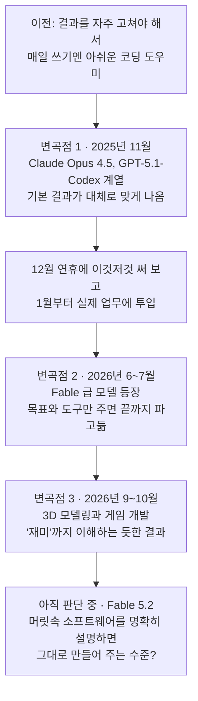

<aside class="ai-knowledge-sidebar">
  
CATEGORIES

  <nav class="ai-cat-tree">

에이전트 오케스트레이션20
<ul><li><a href="https://altjs4510.github.io/ai_news_blog/knowledge/20261121/">2026-11-21Google ADK v2.15.0 — 느린 도구에도 응답성 유지, 다중 실행 신뢰성·부…</a></li><li><a href="https://altjs4510.github.io/ai_news_blog/knowledge/20261118/">2026-11-18Tencent/LoopForge — CodeBuddy·Codex·Claude Code를…</a></li><li><a href="https://altjs4510.github.io/ai_news_blog/knowledge/20261107/">2026-11-07Hermes Agent v0.23.0 — The Hearth Release</a></li><li><a href="https://altjs4510.github.io/ai_news_blog/knowledge/20261029/">2026-10-29How Anthropic ships Claude with Claude: Separati…</a></li><li><a href="https://altjs4510.github.io/ai_news_blog/knowledge/20261027/">2026-10-27nightly-labs/openbot — Codex·Claude·Grok을 상주 팀원처…</a></li><li><a href="https://altjs4510.github.io/ai_news_blog/knowledge/20261015/">2026-10-15How Third Moment Research runs 10,000 agents for…</a></li><li><a href="https://altjs4510.github.io/ai_news_blog/knowledge/20261014/">2026-10-14How Anthropic's Dynamic Workflows Coordinate Cla…</a></li><li><a href="https://altjs4510.github.io/ai_news_blog/knowledge/20260930/">2026-09-30Agents you can coach: how Asana builds human-age…</a></li><li><a href="https://altjs4510.github.io/ai_news_blog/knowledge/20260831-openexecutive-virtual-c-suite/">2026-08-31Open Executive — 8명의 전문 에이전트를 하나의 임원 목소리로</a></li><li><a href="https://altjs4510.github.io/ai_news_blog/knowledge/20260828/">2026-08-28Google ADK for Python v2.8.0 — RemoteA2aAgent 네이…</a></li><li><a href="https://altjs4510.github.io/ai_news_blog/knowledge/20260826/">2026-08-26apache/maka — 도구 호출·권한 결정·종료 이벤트를 append-only 로그…</a></li><li><a href="https://altjs4510.github.io/ai_news_blog/knowledge/20260823/">2026-08-23The Evolution of the Agent Harness — 하네스가 모델 가중치…</a></li><li><a href="https://altjs4510.github.io/ai_news_blog/knowledge/20260821/">2026-08-21volcengine/OpenViking — 에이전트 메모리·Knowledge RAG·스…</a></li><li><a href="https://altjs4510.github.io/ai_news_blog/knowledge/20260805/">2026-08-05TencentCloud/TencentDB-Agent-Memory — 대화·문서·코드를 …</a></li><li><a href="https://altjs4510.github.io/ai_news_blog/knowledge/20260708/">2026-07-08Expanding Managed Agents in Gemini API: backgrou…</a></li><li><a href="https://altjs4510.github.io/ai_news_blog/knowledge/20260623/">2026-06-23bytedance/deer-flow — 샌드박스·메모리·서브에이전트·메시지 게이트웨이를…</a></li><li><a href="https://altjs4510.github.io/ai_news_blog/knowledge/20260611/">2026-06-11The evolution of agentic surfaces: building with…</a></li><li><a href="https://altjs4510.github.io/ai_news_blog/knowledge/20260602/">2026-06-02revfactory/harness — 도메인별 에이전트 팀과 스킬을 자동 설계하는 메타…</a></li><li><a href="https://altjs4510.github.io/ai_news_blog/knowledge/20260529/">2026-05-29Introducing dynamic workflows in Claude Code</a></li><li><a href="https://altjs4510.github.io/ai_news_blog/knowledge/20260507/">2026-05-07ruvnet/ruflo — Claude 멀티 에이전트 오케스트레이션 플랫폼</a></li></ul>

MCP &amp; 도구 통합18
<ul><li><a href="https://altjs4510.github.io/ai_news_blog/knowledge/20261103/">2026-11-03vercel-labs/agent-desktop — 픽셀 대신 OS 접근성 트리로 앱 U…</a></li><li><a href="https://altjs4510.github.io/ai_news_blog/knowledge/20261017/">2026-10-17mksglu/context-mode — 코딩 에이전트용 컨텍스트 윈도우 최적화</a></li><li><a href="https://altjs4510.github.io/ai_news_blog/knowledge/20261007/">2026-10-07morluto/rea — 앱 동작부터 네이티브 바이너리까지 에이전트로 리버스 엔지니어링</a></li><li><a href="https://altjs4510.github.io/ai_news_blog/knowledge/20260829/">2026-08-29cursor/plugins — 플러그인 명세(specification)와 공식 플러그인…</a></li><li><a href="https://altjs4510.github.io/ai_news_blog/knowledge/20260802/">2026-08-02Stateless MCP has recaptured my interest (and in…</a></li><li><a href="https://altjs4510.github.io/ai_news_blog/knowledge/20260731/">2026-07-31different-ai/openwork — Claude Cowork의 오픈소스 대안(o…</a></li><li><a href="https://altjs4510.github.io/ai_news_blog/knowledge/20260729/">2026-07-29Bringing MCP 2026-07-28 to Claude</a></li><li><a href="https://altjs4510.github.io/ai_news_blog/knowledge/20260726/">2026-07-26citrolabs/ego-lite — 로그인된 브라우저 상태를 AI 에이전트와 공유하는…</a></li><li><a href="https://altjs4510.github.io/ai_news_blog/knowledge/20260718/">2026-07-18tirth8205/code-review-graph — MCP·CLI용 로컬 코드 인텔리…</a></li><li><a href="https://altjs4510.github.io/ai_news_blog/knowledge/20260701/">2026-07-01Google OKF (Open Knowledge Format) — 벤더 중립 에이전트 …</a></li><li><a href="https://altjs4510.github.io/ai_news_blog/knowledge/20260618/">2026-06-18DeusData/codebase-memory-mcp — 158개 언어 코드베이스를 밀리…</a></li><li><a href="https://altjs4510.github.io/ai_news_blog/knowledge/20260603/">2026-06-03How Bad MCP design cost your Agent 5× more token…</a></li><li><a href="https://altjs4510.github.io/ai_news_blog/knowledge/20260521/">2026-05-21colbymchenry/codegraph — Pre-indexed code knowle…</a></li><li><a href="https://altjs4510.github.io/ai_news_blog/knowledge/20260520/">2026-05-20New in Claude Managed Agents: self-hosted sandbo…</a></li><li><a href="https://altjs4510.github.io/ai_news_blog/knowledge/20260517/">2026-05-17I gave my LLM 100,000+ tools — Lazy Discovery &a…</a></li><li><a href="https://altjs4510.github.io/ai_news_blog/knowledge/20260512/">2026-05-12agentmemory — Persistent memory for AI coding ag…</a></li><li><a href="https://altjs4510.github.io/ai_news_blog/knowledge/20260509/">2026-05-09How to connect 100 MCP servers without the conte…</a></li><li><a href="https://altjs4510.github.io/ai_news_blog/knowledge/20260506/">2026-05-06mksglu/context-mode — AI 코딩 에이전트용 컨텍스트 윈도우 최적화</a></li></ul>

코딩 에이전트32
<ul><li><a href="https://altjs4510.github.io/ai_news_blog/knowledge/20261126/" class="current">2026-11-26Three LLM inflection points in twelve months</a></li><li><a href="https://altjs4510.github.io/ai_news_blog/knowledge/20261125/">2026-11-25Anthropic launches Claude Ship, letting AI agent…</a></li><li><a href="https://altjs4510.github.io/ai_news_blog/knowledge/20261115/">2026-11-15GoogleChrome/modern-web-guidance-src — 코딩 에이전트에 …</a></li><li><a href="https://altjs4510.github.io/ai_news_blog/knowledge/20261112/">2026-11-12shadcn/improve — 가장 강한 모델로 코드베이스를 감사해 계획을 쓰고, 더 …</a></li><li><a href="https://altjs4510.github.io/ai_news_blog/knowledge/20261111/">2026-11-11Quoting Prompting Claude Fable 5.2</a></li><li><a href="https://altjs4510.github.io/ai_news_blog/knowledge/20261106/">2026-11-06Cline desktop-nightly-20261104233655: feat(core)…</a></li><li><a href="https://altjs4510.github.io/ai_news_blog/knowledge/20261022/">2026-10-22Claude Mods: Flipping the Harness Inside Out</a></li><li><a href="https://altjs4510.github.io/ai_news_blog/knowledge/20261018/">2026-10-18Quoting Addy Osmani, Morgan Westlee Lunt, and Qi…</a></li><li><a href="https://altjs4510.github.io/ai_news_blog/knowledge/20261014-claude-code-advisor/">2026-10-14Claude Code advisor — 가벼운 메인 모델이 일하고, 갈림길에서만 Opu…</a></li><li><a href="https://altjs4510.github.io/ai_news_blog/knowledge/20260920/">2026-09-20Claude Code 2.1.277 — CLAUDE.md가 없으면 AGENTS.md를 …</a></li><li><a href="https://altjs4510.github.io/ai_news_blog/knowledge/20260912/">2026-09-12Quoting Boris Cherny — 'Claude가 쓴 프로덕션 코드는 사람이 쓴…</a></li><li><a href="https://altjs4510.github.io/ai_news_blog/knowledge/20260910/">2026-09-10vastsa/PI-Desktop — Electron + Rust 호스트 코어 + 에이전…</a></li><li><a href="https://altjs4510.github.io/ai_news_blog/knowledge/20260906/">2026-09-06DietrichGebert/ponytail — 에이전트를 '방에서 가장 게으른 시니어 …</a></li><li><a href="https://altjs4510.github.io/ai_news_blog/knowledge/20260903/">2026-09-03pacifio/atlas — 여러 코딩 에이전트의 변경을 한곳에서 추적·질의하는 '에이…</a></li><li><a href="https://altjs4510.github.io/ai_news_blog/knowledge/20260901/">2026-09-01affaan-m/ECC — 스킬·본능·메모리·보안을 묶은 에이전트 하네스 성능 최적화 …</a></li><li><a href="https://altjs4510.github.io/ai_news_blog/knowledge/20260831-gitnexus-code-knowledge-graph/">2026-08-31GitNexus — 코드베이스를 지식그래프로 바꿔 에이전트에게 쥐어주기</a></li><li><a href="https://altjs4510.github.io/ai_news_blog/knowledge/20260819/">2026-08-19akitaonrails/ai-memory — 코딩 에이전트 CLI 간 장기 기억과 벤더…</a></li><li><a href="https://altjs4510.github.io/ai_news_blog/knowledge/20260814/">2026-08-14cathrynlavery/diagram-design — Claude Code용 에디토리…</a></li><li><a href="https://altjs4510.github.io/ai_news_blog/knowledge/20260810/">2026-08-10Auto mode is now the default in Claude Code for …</a></li><li><a href="https://altjs4510.github.io/ai_news_blog/knowledge/20260808/">2026-08-08PrimeIntellect-ai/prime-agent — 코딩 워크플로우와 장시간 자율…</a></li><li><a href="https://altjs4510.github.io/ai_news_blog/knowledge/20260804/">2026-08-04esengine/DeepSeek-Reasonix — prefix-cache 안정성을 축…</a></li><li><a href="https://altjs4510.github.io/ai_news_blog/knowledge/20260728/">2026-07-28alibaba/open-code-review — 결정론적 파이프라인 + LLM 에이전트…</a></li><li><a href="https://altjs4510.github.io/ai_news_blog/knowledge/20260725/">2026-07-25The new rules of context engineering for Claude …</a></li><li><a href="https://altjs4510.github.io/ai_news_blog/knowledge/20260714/">2026-07-14Graphify-Labs/graphify — 코드베이스를 질의 가능한 지식 그래프로 만…</a></li><li><a href="https://altjs4510.github.io/ai_news_blog/knowledge/20260707/">2026-07-07AI Hero Skills Catalog — 실무 엔지니어를 위한 재사용 가능한 판단 …</a></li><li><a href="https://altjs4510.github.io/ai_news_blog/knowledge/20260705/">2026-07-05openai/codex-plugin-cc — Claude Code에서 Codex를 위임…</a></li><li><a href="https://altjs4510.github.io/ai_news_blog/knowledge/20260626/">2026-06-26google-labs-code/design.md — 코딩 에이전트에게 디자인 시스템을 …</a></li><li><a href="https://altjs4510.github.io/ai_news_blog/knowledge/20260619/">2026-06-19Claude Code now supports artifacts</a></li><li><a href="https://altjs4510.github.io/ai_news_blog/knowledge/20260530/">2026-05-30Leonxlnx/taste-skill — AI에게 좋은 취향을 부여해 generic s…</a></li><li><a href="https://altjs4510.github.io/ai_news_blog/knowledge/20260528/">2026-05-28Building self-improving tax agents with Codex</a></li><li><a href="https://altjs4510.github.io/ai_news_blog/knowledge/20260508/">2026-05-08addyosmani/agent-skills — Production-grade engin…</a></li><li><a href="https://altjs4510.github.io/ai_news_blog/knowledge/20260505/">2026-05-05mattpocock/skills — Skills for Real Engineers (.…</a></li></ul>

모델 &amp; 연구15
<ul><li><a href="https://altjs4510.github.io/ai_news_blog/knowledge/20261113/">2026-11-13Gemini Decisions API</a></li><li><a href="https://altjs4510.github.io/ai_news_blog/knowledge/20261105/">2026-11-05NVIDIA/auto-ontology — 데이터 위에 그래프 기반 의미 추론 레이어를 …</a></li><li><a href="https://altjs4510.github.io/ai_news_blog/knowledge/20261104/">2026-11-04Qwen 3.8 27B on my laptop can interpret model we…</a></li><li><a href="https://altjs4510.github.io/ai_news_blog/knowledge/20261009/">2026-10-09Claude Haiku 5.5 (Simon Willison의 출시 노트와 가격 분석)</a></li><li><a href="https://altjs4510.github.io/ai_news_blog/knowledge/20260929/">2026-09-29vectorize-io/hindsight — Hindsight: Agent Memory…</a></li><li><a href="https://altjs4510.github.io/ai_news_blog/knowledge/20260907-voicemem-dual-brain-memory/">2026-09-07VoiceMem — 좌뇌·우뇌로 쪼갠 스트리밍 메모리로 음성 에이전트 지연 없애기</a></li><li><a href="https://altjs4510.github.io/ai_news_blog/knowledge/20260904/">2026-09-04HarnessDev: Can LLMs Create and Evolve Their Own…</a></li><li><a href="https://altjs4510.github.io/ai_news_blog/knowledge/20260717/">2026-07-17After a year building agent memory, 'save everyt…</a></li><li><a href="https://altjs4510.github.io/ai_news_blog/knowledge/20260716-proprag/">2026-07-16PropRAG — 프로포지션 경로 위 beam search로 멀티홉 검색 안내</a></li><li><a href="https://altjs4510.github.io/ai_news_blog/knowledge/20260712/">2026-07-12Do Automated Evals Work?</a></li><li><a href="https://altjs4510.github.io/ai_news_blog/knowledge/20260620/">2026-06-20zai-org/GLM-5 — From Vibe Coding to Agentic Engi…</a></li><li><a href="https://altjs4510.github.io/ai_news_blog/knowledge/20260617/">2026-06-17Predicting model behavior before release by simu…</a></li><li><a href="https://altjs4510.github.io/ai_news_blog/knowledge/20260610/">2026-06-10Fable 5 just made cost-aware model routing manda…</a></li><li><a href="https://altjs4510.github.io/ai_news_blog/knowledge/20260516/">2026-05-16STALE — 에이전트가 자기 기억의 유효성을 인지할 수 있는가</a></li><li><a href="https://altjs4510.github.io/ai_news_blog/knowledge/20260513/">2026-05-13Thinking Machines' Native Interaction Models — T…</a></li></ul>

인프라 &amp; 컴퓨트7
<ul><li><a href="https://altjs4510.github.io/ai_news_blog/knowledge/20261120/">2026-11-20How OpenAI’s Performance Factory keeps ChatGPT f…</a></li><li><a href="https://altjs4510.github.io/ai_news_blog/knowledge/20260905/">2026-09-05magnitudedev/magnitude — 하드웨어에 맞는 최적 로컬 모델을 띄워 이…</a></li><li><a href="https://altjs4510.github.io/ai_news_blog/knowledge/20260812/">2026-08-12semantica-agi/semantica — 컨텍스트와 '책임 추적 가능한(accou…</a></li><li><a href="https://altjs4510.github.io/ai_news_blog/knowledge/20260806/">2026-08-06cloudflare/computer — 에이전트에게 컴퓨터를 통째로 주는 엣지 실행 샌…</a></li><li><a href="https://altjs4510.github.io/ai_news_blog/knowledge/20260723/">2026-07-23diegosouzapw/OmniRoute — 268+ 프로바이더를 단일 엔드포인트로 묶…</a></li><li><a href="https://altjs4510.github.io/ai_news_blog/knowledge/20260604/">2026-06-04chopratejas/headroom — Compress tool outputs bef…</a></li><li><a href="https://altjs4510.github.io/ai_news_blog/knowledge/20260522/">2026-05-22Giving Agents Computers — Ivan Burazin, Daytona</a></li></ul>

보안 &amp; 거버넌스27
<ul><li><a href="https://altjs4510.github.io/ai_news_blog/knowledge/20261119/">2026-11-19External sandboxes for coding agents</a></li><li><a href="https://altjs4510.github.io/ai_news_blog/knowledge/20261117/">2026-11-17NVIDIA/SkillEvaluator — AI 에이전트 스킬·플러그인을 품질 게이트,…</a></li><li><a href="https://altjs4510.github.io/ai_news_blog/knowledge/20261031/">2026-10-31CopilotKit/OpenBot — AI 동료마다 전용 컴퓨터를 주고 모든 행동을 실…</a></li><li><a href="https://altjs4510.github.io/ai_news_blog/knowledge/20261030/">2026-10-30How we detect frontier model misalignment</a></li><li><a href="https://altjs4510.github.io/ai_news_blog/knowledge/20261021/">2026-10-21cloudflare/security-audit-skill — 독립 검증된 기계 판독형 …</a></li><li><a href="https://altjs4510.github.io/ai_news_blog/knowledge/20261020/">2026-10-20Satya Nadella — 모델을 내부자 위험으로 보는 원칙에 따라 Project P…</a></li><li><a href="https://altjs4510.github.io/ai_news_blog/knowledge/20261016/">2026-10-16Crossing the Threshold: How OpenAI and Anthropic…</a></li><li><a href="https://altjs4510.github.io/ai_news_blog/knowledge/20261011/">2026-10-11Anthropic can’t reliably control its AI agents. …</a></li><li><a href="https://altjs4510.github.io/ai_news_blog/knowledge/20261004/">2026-10-04Apple says it's tightening macOS 'Full Disk Acce…</a></li><li><a href="https://altjs4510.github.io/ai_news_blog/knowledge/20261001/">2026-10-01NVIDIA/OpenShell</a></li><li><a href="https://altjs4510.github.io/ai_news_blog/knowledge/20260919/">2026-09-19cloudflare/security-audit-skill — 다단계 보안 감사를 '독립…</a></li><li><a href="https://altjs4510.github.io/ai_news_blog/knowledge/20260913/">2026-09-13OpenAI agents attacked RubyGems back in May: Ope…</a></li><li><a href="https://altjs4510.github.io/ai_news_blog/knowledge/20260902/">2026-09-02AIR raises $50M to help companies vet the skills…</a></li><li><a href="https://altjs4510.github.io/ai_news_blog/knowledge/20260827/">2026-08-27Claude in Chrome is generally available</a></li><li><a href="https://altjs4510.github.io/ai_news_blog/knowledge/20260819-mind-viruses/">2026-08-19탈옥도, 인젝션도 없이 — 대화로만 퍼지는 에이전트의 '마인드 바이러스'</a></li><li><a href="https://altjs4510.github.io/ai_news_blog/knowledge/20260730/">2026-07-30Anatomy of a Frontier Lab Agent Intrusion: A Tec…</a></li><li><a href="https://altjs4510.github.io/ai_news_blog/knowledge/20260715/">2026-07-15Dicklesworthstone/destructive_command_guard — 에이…</a></li><li><a href="https://altjs4510.github.io/ai_news_blog/knowledge/20260710/">2026-07-1070개 MCP 서버 strace 런타임 감사 — 부팅 시 아웃바운드 호출 서버 적발</a></li><li><a href="https://altjs4510.github.io/ai_news_blog/knowledge/20260704/">2026-07-04Cloudflare is about to block AI agents by defaul…</a></li><li><a href="https://altjs4510.github.io/ai_news_blog/knowledge/20260703/">2026-07-03Giving admins more visibility and control over C…</a></li><li><a href="https://altjs4510.github.io/ai_news_blog/knowledge/20260630/">2026-06-30Introducing the Claude apps gateway for Amazon B…</a></li><li><a href="https://altjs4510.github.io/ai_news_blog/knowledge/20260624/">2026-06-24Agent identity in Claude Tag: a new access model…</a></li><li><a href="https://altjs4510.github.io/ai_news_blog/knowledge/20260613/">2026-06-13Fable 5's guardrails got bypassed in 48 hours — …</a></li><li><a href="https://altjs4510.github.io/ai_news_blog/knowledge/20260612/">2026-06-12NVIDIA/SkillSpector — AI 에이전트 스킬용 보안 스캐너</a></li><li><a href="https://altjs4510.github.io/ai_news_blog/knowledge/20260607/">2026-06-07OpenAI Help: Lockdown Mode</a></li><li><a href="https://altjs4510.github.io/ai_news_blog/knowledge/20260531/">2026-05-31How we contain Claude across products</a></li><li><a href="https://altjs4510.github.io/ai_news_blog/knowledge/20260527/">2026-05-27Microsoft Copilot Cowork Exfiltrates Files</a></li></ul>

응용 사례12
<ul><li><a href="https://altjs4510.github.io/ai_news_blog/knowledge/20261124/">2026-11-24A more tailored Google Search that’s uniquely yo…</a></li><li><a href="https://altjs4510.github.io/ai_news_blog/knowledge/20261114/">2026-11-14Introducing ChatGPT Wallet</a></li><li><a href="https://altjs4510.github.io/ai_news_blog/knowledge/20261110/">2026-11-10meta/astryx — 직접 바꿔 쓸 수 있고 에이전트가 바로 쓸 수 있는(agent…</a></li><li><a href="https://altjs4510.github.io/ai_news_blog/knowledge/20261101/">2026-11-01Agents Prompt People: Using Agents for Long-Hori…</a></li><li><a href="https://altjs4510.github.io/ai_news_blog/knowledge/20261028/">2026-10-28Greptile takes bug detection beyond code review …</a></li><li><a href="https://altjs4510.github.io/ai_news_blog/knowledge/20261006/">2026-10-06How Cresta turned CX expertise into an agent bui…</a></li><li><a href="https://altjs4510.github.io/ai_news_blog/knowledge/20260909/">2026-09-09Reducing cost and improving performance with Cla…</a></li><li><a href="https://altjs4510.github.io/ai_news_blog/knowledge/20260709/">2026-07-09mvanhorn/last30days-skill — Reddit·X·YouTube·HN·…</a></li><li><a href="https://altjs4510.github.io/ai_news_blog/knowledge/20260621/">2026-06-21calesthio/OpenMontage — 12 파이프라인·52 도구·500+ 스킬을 …</a></li><li><a href="https://altjs4510.github.io/ai_news_blog/knowledge/20260609/">2026-06-09Building intelligent apps for Apple platforms wi…</a></li><li><a href="https://altjs4510.github.io/ai_news_blog/knowledge/20260515/">2026-05-15Clawdmeter — Claude Code 사용량을 데스크톱 대시보드로</a></li><li><a href="https://altjs4510.github.io/ai_news_blog/knowledge/20260514/">2026-05-14Introducing Claude for Small Business</a></li></ul>

산업 동향10
<ul><li><a href="https://altjs4510.github.io/ai_news_blog/knowledge/20261024/">2026-10-24Donating Agent Skills to the Agentic AI Foundati…</a></li><li><a href="https://altjs4510.github.io/ai_news_blog/knowledge/20261023/">2026-10-23Claude Duet app is Anthropic's bet on agents</a></li><li><a href="https://altjs4510.github.io/ai_news_blog/knowledge/20260911/">2026-09-11Now everyone can put data to work — ChatGPT Work…</a></li><li><a href="https://altjs4510.github.io/ai_news_blog/knowledge/20260907-humanmade-52week-rhythm/">2026-09-07휴먼 메이드의 '52주 리듬' — 아이디어가 흔해진 시대에 값이 오르는 건 버리는 판단</a></li><li><a href="https://altjs4510.github.io/ai_news_blog/knowledge/20260830/">2026-08-30[AINews] OpenAI shuts off Cursor — 프론티어 모델 공급 차단…</a></li><li><a href="https://altjs4510.github.io/ai_news_blog/knowledge/20260711/">2026-07-11OpenAI says GPT 5.6 is the 'preferred model' for…</a></li><li><a href="https://altjs4510.github.io/ai_news_blog/knowledge/20260702/">2026-07-02How Cursor deploys AI inside the enterprise (For…</a></li><li><a href="https://altjs4510.github.io/ai_news_blog/knowledge/20260616/">2026-06-16Why AI hasn't replaced software engineers, and w…</a></li><li><a href="https://altjs4510.github.io/ai_news_blog/knowledge/20260519/">2026-05-19Anthropic acquires Stainless</a></li><li><a href="https://altjs4510.github.io/ai_news_blog/knowledge/20260504/">2026-05-04Agents for Everything Else: Codex for Knowledge …</a></li></ul>
</nav>
</aside>

<article class="ai-knowledge-article">

<header class="ai-post-hero">
  
<a class="ai-back" href="../">KNOWLEDGE</a> · 2026-11-26 · 오늘의 학습

  <h2 class="ai-post-title">Three LLM inflection points in twelve months</h2>
</header>

> 원문: [Three LLM inflection points in twelve months](https://simonwillison.net/2026/Nov/24/llm-inflection-points/)

## 📌 학습 정리

### 1. 한 줄로 말하면

지난 1년 사이 AI에게 코딩을 맡기는 일이 세 번 크게 달라졌어요. 처음엔 "맡겨도 대체로 맞게 해 오는" 수준이 됐고, 다음엔 "목표와 도구만 주면 끝까지 파고드는" 수준이 됐어요. 그다음엔 "재미" 같은 감각까지 다루는 수준이 됐다는 회고예요.

### 2. 왜 이게 만들어졌어요?

이 글은 Simon Willison이 몇 주 전 AI Engineer Code Summit에서 한 기조연설을 글로 다시 정리한 거예요. 연설에서 다룬 "변곡점" 이야기를 더 깊이 따져 보려고 쓴 글이에요. 이 사람도 원래는 Claude Code 같은 코딩 도우미를 매일 쓰지는 않았다고 해요. 결과를 너무 자주 고쳐야 해서, 직접 하는 것보다 확실히 빠르다는 느낌이 들지 않았기 때문이에요. 그러다 모델이 새로 나올 때마다 "맡길 수 있는 일의 범위"가 한 단계씩 넓어지는 순간이 생겼어요. 그런 순간들이 1년 동안 어디서 있었는지 시간 순서대로 짚어 본 글이라고 보면 돼요.

### 3. 비유로 풀면

이건 마치 새로 들어온 동료가 1년 동안 성장하는 걸 지켜보는 것과 비슷해요. 처음엔 시킨 일을 매번 다시 봐 줘야 했어요. 어느 날부터는 "알아서 맞게 해 오는" 사람이 되고, 그다음엔 "목표만 알려 주면 필요한 도구를 직접 챙겨 와서 끝까지 해결하는" 사람이 돼요. 결국엔 "이거 좀 더 재밌게 만들어 줘" 같은 막연한 부탁까지 알아듣게 되는 거죠.

그래서 결국, 이 글에서 말하는 변곡점은 AI가 몇 점 더 잘하게 된 순간이 아니에요. **사람이 AI에게 맡기는 일의 종류 자체가 바뀐 순간**을 가리켜요.

### 4. 어떻게 작동하는지 (그림으로)

첫 번째 변곡점은 코딩 에이전트가 "믿고 맡길 만해진" 시점이에요. 두 번째는 모델이 목표를 이루려고 스스로 도구를 만들고 끝까지 밀어붙이게 된 시점이고, 세 번째는 3D 공간과 게임의 재미처럼 사람 고유의 영역이라고 여겼던 일까지 넘보게 된 시점이에요. 마지막 칸은 저자도 아직 변곡점인지, 그냥 꾸준한 개선인지 고민하고 있는 부분이에요.

### 5. 처음 보는 용어 풀이

- **변곡점 (inflection point)** — 흐름의 방향이나 성격이 확 바뀌는 지점이에요. 이 글에서는 AI가 조금 더 잘하게 된 순간이 아니라, 사람이 AI를 쓰는 방식 자체가 달라진 순간을 말해요.
- **코딩 에이전트 (coding agent)** — 사람 대신 코드를 읽고, 쓰고, 실행해 보면서 작업을 이어 가는 AI 도우미예요. 글에 나오는 Claude Code(Anthropic의 코딩 도우미)와 Codex(OpenAI의 코딩 도우미)가 여기에 해당해요.
- **Fable 급 모델 (Fable class models)** — 저자가 직접 붙인 이름이에요. "목표를 정해 주고 필요한 도구를 쥐여 주면, 힘으로 밀어붙여서라도 문제를 풀어내는 모델"을 뜻해요. 저자는 Claude Fable 5·5.1·5.2와 Opus 5.5를 여기에 넣고, GPT-6 Astra와 Gemini 4 Neon도 해당될 수 있다고 봐요.
- **최첨단 모델 (frontier model)** — 각 AI 회사가 내놓은 가장 앞선 성능의 모델을 말해요. 저자는 이제 Fable 급 성능을 최첨단 모델이라면 당연히 갖춰야 할 기본선으로 본다고 해요.
- **수출 통제 (export controls)** — 정부가 특정 기술이 해외로 나가지 못하게 막는 조치예요. Claude Fable 5는 공개 사흘 만에 미국 정부의 수출 통제 대상이 되면서 사실상 쓸 수 없게 됐다가, 7월 1일에야 다시 쓸 수 있게 됐어요.
- **3D 공간 인식 (3D spatial awareness)** — 물체가 입체 공간에서 어디에 어떻게 놓여 있는지 파악하는 능력이에요. 저자는 이 능력이 로봇에 이미지를 보는 AI를 쓰려면 꼭 필요하다고 짚어요. 다만 3D 모델링 실력이 그 연구의 부산물인지, 아니면 반대 방향인지는 모르겠다고 해요.
- **플레이테스트 (playtesting)** — 게임을 직접 해 보면서 재미있는지, 균형이 맞는지 점검하는 과정이에요. 글에서는 Opus 5.5가 12시간 동안 스스로 플레이테스트하며 게임 밸런스를 다시 맞춘 사례가 나와요.

### 6. 한 발 더 들어가고 싶다면

- [the video](https://www.youtube.com/watch?v=9RKrSF9d2SE) — 이걸 보면 이 글의 바탕이 된 기조연설 원본을 처음부터 볼 수 있어요.
- [Claude Fable is relentlessly proactive](https://simonwillison.net/2026/Jun/11/fable-is-relentlessly-proactive/) — 이걸 보면 Fable이 Safari 화면 버그 하나를 고치려고 스크린샷 장치와 로그 서버까지 스스로 만들어 낸 과정을 알 수 있어요.
- [mysterious beep finder](https://simonwillison.net/2026/Nov/9/mysterious-beeps/) — 이걸 보면 마이크 다섯 개만 주고 정체 모를 삐 소리의 위치를 약 40cm 오차로 찾아낸 사례를 자세히 알 수 있어요.
- [And it worked](https://simonwillison.net/2026/Oct/20/battledrones/#v4-the-fun-update) — 이걸 보면 "훨씬 더 재밌게 만들어 줘"라는 한마디로 지루하던 전략 게임이 어떻게 달라졌는지 알 수 있어요.
- [with Blender](https://til.simonwillison.net/llms/blender-coding-agents-macos) — 이걸 보면 3D 제작 도구인 Blender에 코딩 에이전트를 연결하는 방법을 알 수 있어요.

---

## 📖 원문 전체 번역 (정독용)

> 의역 최소화한 전체 번역입니다. 큰 흐름은 위 정리에서 잡고, 정확한 워딩이 필요할 땐 이 섹션에서 정독하세요.

# 12개월 동안 일어난 세 번의 LLM 변곡점

2026년 11월 24일

몇 주 전 [AI Engineer Code Summit](https://ai.engineer/code/2026)에서 기조연설을 했습니다. 지난 12개월 사이에 LLM과 코딩 에이전트의 능력에서 의미 있는 변곡점이 세 번 있었다는 발상을 중심으로 구성한 발표였습니다.

[발표 영상](https://www.youtube.com/watch?v=9RKrSF9d2SE)입니다. 이 글에서는 그 핵심인 변곡점이라는 주제를 따로 떼어 더 깊이 따져 보려 합니다.

#### 2025년 11월의 코딩 에이전트[#](https://simonwillison.net/2026/Nov/24/llm-inflection-points/#coding-agents-in-november-2025)

오늘, 2026년 11월 24일은 [Claude Opus 4.5](https://www.anthropic.com/news/claude-opus-4-5)가 출시된 지 1주년이 되는 날입니다. 지나고 보니 이 모델은 중대한 영향을 미친 모델이었습니다.

Anthropic은 Opus 4.5 발표에서 이렇게 말했습니다.

> 테스터들은 Claude Opus 4.5가 모호한 상황을 다루고 트레이드오프를 따져 추론할 때 일일이 손을 잡아 줄 필요가 없다고 했습니다. 복잡한 다중 시스템 버그를 가리켜 주면 Opus 4.5가 해결책을 찾아낸다고 했습니다. 불과 몇 주 전만 해도 Sonnet 4.5로는 거의 불가능했던 작업이 이제는 손이 닿는 범위에 들어왔다고도 했습니다.

이 말은 사실로 입증되었습니다.

당시 Claude Code는 출시 9개월 차였습니다. 2025년 2월 24일 [Claude 3.7 Sonnet과 함께 공개](https://www.anthropic.com/news/claude-3-7-sonnet)된 도구입니다.

Opus 4.5는 제가 Claude Code와 함께 써 본 모델 중 기본 결과물이 대체로 올바른 것이 나온 첫 모델이었습니다. 그전까지는 Claude Code를 매일 쓰는 주력 도구로 쓰지 않았습니다. 충분히 믿음직하지 않다고 느꼈기 때문입니다. 바로잡아 줘야 하는 일이 너무 잦아서 확실한 가속 수단으로 느껴지지 않았습니다.

새 Opus가 그것을 바꿔 놓았습니다. 제가 매일 마주치는 코딩 문제 대부분을 Opus가 _제대로 풀어냈습니다_. 문제를 제가 직접 풀어 나가는 것보다 분명히 빨랐습니다.

같은 11월에 OpenAI도 GPT-5.1 Instant, GPT-5.1 Thinking, GPT-5.1-Codex, GPT-5.1-Codex-Max를 출시했습니다. 이 모델들은 OpenAI의 코딩 에이전트 Codex에 비슷한 효과를 냈습니다. 제 코딩 작업 상당수에 믿고 쓸 만한 도구가 된 것입니다.

타이밍도 좋았습니다. 마침 12월 연휴가 코앞이었으니까요. 저를 포함해 많은 사람이 12월 내내 이 새 도구들로 무엇을 할 수 있는지 이것저것 만져 보며 보냈습니다. 1월이 되자 우리는 이 도구들을 실제 업무에 쓸 준비가 되어 있었습니다.

#### 6~7월의 Fable급 모델[#](https://simonwillison.net/2026/Nov/24/llm-inflection-points/#fable-class-models-in-june-july)

Claude Fable의 첫 조짐은 4월에 나타났습니다. Anthropic이 Claude Mythos를 발표하면서, 향상된 사이버보안 능력 때문에 [너무 위험해서 공개할 수 없다고 밝힌](https://simonwillison.net/2026/Apr/7/project-glasswing/) 때입니다. Mythos는 보안 취약점을 찾아내는 데 그치지 않고 그것을 어떻게 악용할지까지 알아낼 수 있는 모델이었습니다.

6월에 Claude Fable 5가 출시되면서 그 모델이 얼마나 뛰어난지 직접 확인할 수 있게 되었습니다. Fable 5는 이빨을 뽑은 Mythos로, 대부분의 문제를 풀어내지만 보안 작업에 쓰려 하면 적극적으로 차단하는 모델이었습니다.

영광스러운 사흘이 지나자… 미국 정부가 그것을 우리에게서 빼앗아 갔습니다. Fable 5는 사실상 모델을 금지하는 수출 통제 대상이 되었습니다. 우리가 이를 다시 쓸 수 있게 된 것은 7월 1일이었습니다.

제게 Fable이 변곡점이었던 이유는, 지금 제가 **Fable급 모델**이라고 생각하는 것을 우리에게 처음 보여 줬기 때문입니다. 제가 내리는 정의는 이렇습니다.

 6월에 저는 [Claude Fable이 끈질길 만큼 능동적](https://simonwillison.net/2026/Jun/11/fable-is-relentlessly-proactive/)이라는 글을 썼습니다. Safari의 화면 표시 결함을 고쳐 달라고 했더니, Fable이 스스로 `pyobjc-framework-Quartz` 기반 스크린샷 장치와 CORS를 허용한 localhost 로깅 서버를 띄워 버그를 해결하는 데 썼던 일입니다.

Fable급 모델의 힘을 보여 주는 더 최근 사례는 몇 주 전 만든 [수수께끼의 삑 소리 찾기](https://simonwillison.net/2026/Nov/9/mysterious-beeps/)입니다. 상자로 가득 찬 방에 WebAudio 마이크 다섯 개를 두고 Opus 5.5에, 이어서 Fable 5.2에 접근 권한을 줬더니, 짜증 나는 정체불명의 삑 소리의 근원을 약 40cm 오차 안으로 삼각측량해 냈습니다.

목표를 주고, 알맞은 도구를 주고, 요리하는 걸 지켜보세요.

현재 저는 Claude Fable 5, 5.1, 5.2와 Claude Opus 5.5를 Fable급으로 분류합니다(Opus 5.5는 "저렴한 Fable"이라고 생각합니다). GPT-6 Astra도 제 기준으로는 그 수준에 도달했고, 새로 나온 Gemini 4 Neon도 해당될 수 있다고 봅니다.

이 모델들은 이제 제가 프런티어 모델에 기대하는 기준선이 되었습니다.

#### 9~10월의 3D 모델링과 게임 개발[#](https://simonwillison.net/2026/Nov/24/llm-inflection-points/#3d-modeling-and-game-development-in-september-october)

지난 넉 달 사이 프런티어 LLM에서 흥미로운 일이 일어났습니다. 3D 모델링을 _정말 잘하게_ 된 것입니다. [Blender와 연결](https://til.simonwillison.net/llms/blender-coding-agents-macos)해 주거나 Three.js 코드를 쓰게 하면, 요청하는 거의 모든 것에 대해 그럴듯한 모델을 만들어 냅니다.

저는 이것을 Claude Fable 5에서 처음 알아챘지만, 본격적으로 속도가 붙은 것은 Opus 5.5, GPT-5.6 Sol, GPT-6 Astra, 그리고 가장 최근의 Gemini 4 계열부터입니다. 예를 들어 "Make a three js animation where yonkers stands up as a big mech (cool stand up motion) and stomps around manhattan and queens and Brooklyn, use openstreetmap mapping data"라는 요청에 대한 [Gemini 4 Neon의 결과물](https://static.simonwillison.net/static/2026/gemini-4-neon-yonkers/index.html)이 있습니다.

비전 LLM을 로보틱스에 쓰려면 3D 공간 인식이 핵심입니다. 3D 모델링 능력이 연구소들이 그 방향에 집중한 부산물인지, 아니면 그 반대인지는 저도 모르겠습니다.

8월에 저는 [Fable 5에게 너구리 강도 게임을 만들게](https://simonwillison.net/2026/Aug/5/raccoon-heist/) 해 보는 실험을 했습니다. 3D 그래픽이 있었고, 게임처럼 보였지만, 실제로 해 보면 정말 형편없었습니다. GPT-5.6 Sol Ultra는 [훨씬 잘해 냈지만](https://simonwillison.net/2026/Aug/7/moonlight-mayhem/), 그 게임조차 플레이 90초가 지나면 꽤 지루했습니다.

_재미있는_ 게임을 설계하는 일은 여전히 인간 고유의 영역으로 남아 있는 듯해서 어느 정도 안도했습니다. 9월에는 [발표에서](https://simonwillison.net/2026/Sep/27/2026-in-llms-so-far/#simon-willison-2026-in-llms.059.webp) 이를 근거로 들며, 우리 인간에게는 아직 할 역할이 있다고 사람들을 안심시키기까지 했습니다!

그러다 Claude Opus 5.5에게 "이 게임은 아직 충분히 재미있지 않아. 훨씬 더 재미있게 만들어 줘."라고 해 봤습니다. [그러자 통했습니다.](https://simonwillison.net/2026/Oct/20/battledrones/#v4-the-fun-update) Opus가 12시간 동안 새 기능을 플레이 테스트하고 게임 밸런스를 다시 잡은 끝에, 제가 만들던 Command & Conquer 스타일 RTS가 하룻밤 사이에 지루한 게임에서 깊이 몰입되는 게임으로 바뀌었습니다.

Opus 5.5는 제가 써 본 모델 중 재미를 이해하는 것처럼 보인 첫 모델이었습니다. 이후 [여러 소규모 게임 프로젝트](https://simonwillison.net/2026/Oct/28/vibe-game-development/)를 진행했는데, "재미있으면서도 아름답게 만들려면 어떻게 해야 할지 깊이 생각해 봐"와 같은 프롬프트가 상당한 시간 동안 저를 몰입하게 하는 결과물을 만들어 냈습니다.

Opus 5.5는 2026년 9월 22일에 출시되었습니다. 그 뒤로 두 곳의 서로 다른 컨퍼런스에 갔는데, 거기서 사람들이 진행 중인 게임 프로젝트를 보여 줬고, 그것들은 정말로 제대로 된, 가치 있는 게임처럼 느껴졌습니다.

인디 게임 씬은 AI 보조 프로그래밍을 둘러싼 [전면적인 문화 전쟁](https://kotaku.com/big-walk-ai-disclosure-igf-awards-vg-chat-2000755514)으로 접어들었습니다. 많은 사람이 GTA VI를 [생성형 AI 이전 시대의 마지막 블록버스터](https://gamingbolt.com/gta-6-is-the-last-pre-ai-blockbuster-video-game-of-its-kind-says-former-take-two-ceo)라고 부르고 있습니다.

제게는 이것도 또 하나의 변곡점처럼 느껴집니다.

#### Fable 5.2도 변곡점일까?[#](https://simonwillison.net/2026/Nov/24/llm-inflection-points/#is-fable-5-2-an-inflection-point-too-)

Fable 5.2가 새로운 변곡점인지, 아니면 또 하나의 점진적 개선일 뿐인지는 아직 판단하지 못하고 있습니다.

지금 그 모델로 _정말 많은_ 일을 해내고 있습니다!

그 모델은 제 취향과 거의 정확히 맞아떨어지는 감각을 가진 것 같습니다. 몇 년째 머릿속에 두고 있던(혹은 미뤄 두던) 온갖 까다로운 문제를 줄줄이 해치우는 중입니다. Datasette [1.0a42](https://docs.datasette.io/en/latest/changelog.html#a42-2026-11-08), [1.0a43](https://docs.datasette.io/en/latest/changelog.html#a43-2026-11-15), [1.0a44](https://docs.datasette.io/en/latest/changelog.html#a44-2026-11-22)의 릴리스 노트, 그리고 LLM [0.37](https://llm.datasette.io/en/stable/changelog.html#v0-37), [0.37.1](https://llm.datasette.io/en/stable/changelog.html#v0-37-1), [0.37.2](https://llm.datasette.io/en/stable/changelog.html#v0-37-2), [0.37.3](https://llm.datasette.io/en/stable/changelog.html#v0-37-3), [0.38](https://llm.datasette.io/en/stable/changelog.html#v0-38)의 릴리스 노트는 _모두 최근 3주 안에 나온 것_으로, 수정·기능·개선이 쏟아져 나온 결과입니다.

이것이 정말 변곡점이라면, 핵심 특징은 _소프트웨어를 상상하고 그것을 명확하게 설명할 수 있다면 Fable이 그것을 만들 수 있다_는 점으로 보입니다. 터무니없는 말이지만, 지난 몇 주간 제 경험과는 들어맞습니다.

소프트웨어 개발은 지난 1년 사이에 알아볼 수 없을 만큼 변했습니다. 저는 이제 대부분의 코드를 손으로 직접 타이핑하는 방식으로는 다시 돌아가지 않을 것 같습니다.

</article>

