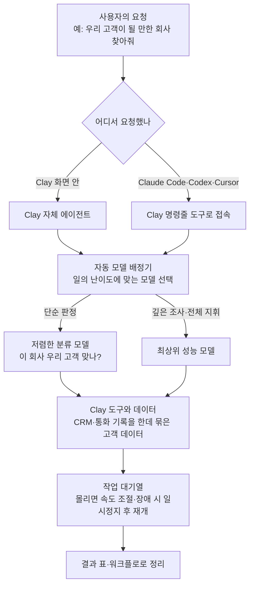

<aside class="ai-knowledge-sidebar">
  
CATEGORIES

  <nav class="ai-cat-tree">

에이전트 오케스트레이션21
<ul><li><a href="https://altjs4510.github.io/ai_news_blog/knowledge/20261121/">2026-11-21Google ADK v2.15.0 — 느린 도구에도 응답성 유지, 다중 실행 신뢰성·부…</a></li><li><a href="https://altjs4510.github.io/ai_news_blog/knowledge/20261118/">2026-11-18Tencent/LoopForge — CodeBuddy·Codex·Claude Code를…</a></li><li><a href="https://altjs4510.github.io/ai_news_blog/knowledge/20261107/">2026-11-07Hermes Agent v0.23.0 — The Hearth Release</a></li><li><a href="https://altjs4510.github.io/ai_news_blog/knowledge/20261029/">2026-10-29How Anthropic ships Claude with Claude: Separati…</a></li><li><a href="https://altjs4510.github.io/ai_news_blog/knowledge/20261027/">2026-10-27nightly-labs/openbot — Codex·Claude·Grok을 상주 팀원처…</a></li><li><a href="https://altjs4510.github.io/ai_news_blog/knowledge/20261015/">2026-10-15How Third Moment Research runs 10,000 agents for…</a></li><li><a href="https://altjs4510.github.io/ai_news_blog/knowledge/20261014/">2026-10-14How Anthropic's Dynamic Workflows Coordinate Cla…</a></li><li><a href="https://altjs4510.github.io/ai_news_blog/knowledge/20260930/">2026-09-30Agents you can coach: how Asana builds human-age…</a></li><li><a href="https://altjs4510.github.io/ai_news_blog/knowledge/20260929/">2026-09-29vectorize-io/hindsight — Hindsight: Agent Memory…</a></li><li><a href="https://altjs4510.github.io/ai_news_blog/knowledge/20260831-openexecutive-virtual-c-suite/">2026-08-31Open Executive — 8명의 전문 에이전트를 하나의 임원 목소리로</a></li><li><a href="https://altjs4510.github.io/ai_news_blog/knowledge/20260828/">2026-08-28Google ADK for Python v2.8.0 — RemoteA2aAgent 네이…</a></li><li><a href="https://altjs4510.github.io/ai_news_blog/knowledge/20260826/">2026-08-26apache/maka — 도구 호출·권한 결정·종료 이벤트를 append-only 로그…</a></li><li><a href="https://altjs4510.github.io/ai_news_blog/knowledge/20260823/">2026-08-23The Evolution of the Agent Harness — 하네스가 모델 가중치…</a></li><li><a href="https://altjs4510.github.io/ai_news_blog/knowledge/20260805/">2026-08-05TencentCloud/TencentDB-Agent-Memory — 대화·문서·코드를 …</a></li><li><a href="https://altjs4510.github.io/ai_news_blog/knowledge/20260717/">2026-07-17After a year building agent memory, 'save everyt…</a></li><li><a href="https://altjs4510.github.io/ai_news_blog/knowledge/20260708/">2026-07-08Expanding Managed Agents in Gemini API: backgrou…</a></li><li><a href="https://altjs4510.github.io/ai_news_blog/knowledge/20260623/">2026-06-23bytedance/deer-flow — 샌드박스·메모리·서브에이전트·메시지 게이트웨이를…</a></li><li><a href="https://altjs4510.github.io/ai_news_blog/knowledge/20260611/">2026-06-11The evolution of agentic surfaces: building with…</a></li><li><a href="https://altjs4510.github.io/ai_news_blog/knowledge/20260602/">2026-06-02revfactory/harness — 도메인별 에이전트 팀과 스킬을 자동 설계하는 메타…</a></li><li><a href="https://altjs4510.github.io/ai_news_blog/knowledge/20260529/">2026-05-29Introducing dynamic workflows in Claude Code</a></li><li><a href="https://altjs4510.github.io/ai_news_blog/knowledge/20260507/">2026-05-07ruvnet/ruflo — Claude 멀티 에이전트 오케스트레이션 플랫폼</a></li></ul>

MCP &amp; 도구 통합16
<ul><li><a href="https://altjs4510.github.io/ai_news_blog/knowledge/20261103/">2026-11-03vercel-labs/agent-desktop — 픽셀 대신 OS 접근성 트리로 앱 U…</a></li><li><a href="https://altjs4510.github.io/ai_news_blog/knowledge/20261017/">2026-10-17mksglu/context-mode — 코딩 에이전트용 컨텍스트 윈도우 최적화</a></li><li><a href="https://altjs4510.github.io/ai_news_blog/knowledge/20261007/">2026-10-07morluto/rea — 앱 동작부터 네이티브 바이너리까지 에이전트로 리버스 엔지니어링</a></li><li><a href="https://altjs4510.github.io/ai_news_blog/knowledge/20260829/">2026-08-29cursor/plugins — 플러그인 명세(specification)와 공식 플러그인…</a></li><li><a href="https://altjs4510.github.io/ai_news_blog/knowledge/20260819/">2026-08-19akitaonrails/ai-memory — 코딩 에이전트 CLI 간 장기 기억과 벤더…</a></li><li><a href="https://altjs4510.github.io/ai_news_blog/knowledge/20260802/">2026-08-02Stateless MCP has recaptured my interest (and in…</a></li><li><a href="https://altjs4510.github.io/ai_news_blog/knowledge/20260731/">2026-07-31different-ai/openwork — Claude Cowork의 오픈소스 대안(o…</a></li><li><a href="https://altjs4510.github.io/ai_news_blog/knowledge/20260729/">2026-07-29Bringing MCP 2026-07-28 to Claude</a></li><li><a href="https://altjs4510.github.io/ai_news_blog/knowledge/20260726/">2026-07-26citrolabs/ego-lite — 로그인된 브라우저 상태를 AI 에이전트와 공유하는…</a></li><li><a href="https://altjs4510.github.io/ai_news_blog/knowledge/20260618/">2026-06-18DeusData/codebase-memory-mcp — 158개 언어 코드베이스를 밀리…</a></li><li><a href="https://altjs4510.github.io/ai_news_blog/knowledge/20260603/">2026-06-03How Bad MCP design cost your Agent 5× more token…</a></li><li><a href="https://altjs4510.github.io/ai_news_blog/knowledge/20260521/">2026-05-21colbymchenry/codegraph — Pre-indexed code knowle…</a></li><li><a href="https://altjs4510.github.io/ai_news_blog/knowledge/20260517/">2026-05-17I gave my LLM 100,000+ tools — Lazy Discovery &a…</a></li><li><a href="https://altjs4510.github.io/ai_news_blog/knowledge/20260512/">2026-05-12agentmemory — Persistent memory for AI coding ag…</a></li><li><a href="https://altjs4510.github.io/ai_news_blog/knowledge/20260509/">2026-05-09How to connect 100 MCP servers without the conte…</a></li><li><a href="https://altjs4510.github.io/ai_news_blog/knowledge/20260506/">2026-05-06mksglu/context-mode — AI 코딩 에이전트용 컨텍스트 윈도우 최적화</a></li></ul>

코딩 에이전트34
<ul><li><a href="https://altjs4510.github.io/ai_news_blog/knowledge/20261127/">2026-11-27Claude-Mem Cloud Sync — 기기를 바꿔도 코딩 에이전트 메모리를 이어 …</a></li><li><a href="https://altjs4510.github.io/ai_news_blog/knowledge/20261126/">2026-11-26Three LLM inflection points in twelve months</a></li><li><a href="https://altjs4510.github.io/ai_news_blog/knowledge/20261125/">2026-11-25Anthropic launches Claude Ship, letting AI agent…</a></li><li><a href="https://altjs4510.github.io/ai_news_blog/knowledge/20261115/">2026-11-15GoogleChrome/modern-web-guidance-src — 코딩 에이전트에 …</a></li><li><a href="https://altjs4510.github.io/ai_news_blog/knowledge/20261112/">2026-11-12shadcn/improve — 가장 강한 모델로 코드베이스를 감사해 계획을 쓰고, 더 …</a></li><li><a href="https://altjs4510.github.io/ai_news_blog/knowledge/20261111/">2026-11-11Quoting Prompting Claude Fable 5.2</a></li><li><a href="https://altjs4510.github.io/ai_news_blog/knowledge/20261106/">2026-11-06Cline desktop-nightly-20261104233655: feat(core)…</a></li><li><a href="https://altjs4510.github.io/ai_news_blog/knowledge/20261022/">2026-10-22Claude Mods: Flipping the Harness Inside Out</a></li><li><a href="https://altjs4510.github.io/ai_news_blog/knowledge/20261018/">2026-10-18Quoting Addy Osmani, Morgan Westlee Lunt, and Qi…</a></li><li><a href="https://altjs4510.github.io/ai_news_blog/knowledge/20261014-claude-code-advisor/">2026-10-14Claude Code advisor — 가벼운 메인 모델이 일하고, 갈림길에서만 Opu…</a></li><li><a href="https://altjs4510.github.io/ai_news_blog/knowledge/20260920/">2026-09-20Claude Code 2.1.277 — CLAUDE.md가 없으면 AGENTS.md를 …</a></li><li><a href="https://altjs4510.github.io/ai_news_blog/knowledge/20260919/">2026-09-19cloudflare/security-audit-skill — 다단계 보안 감사를 '독립…</a></li><li><a href="https://altjs4510.github.io/ai_news_blog/knowledge/20260912/">2026-09-12Quoting Boris Cherny — 'Claude가 쓴 프로덕션 코드는 사람이 쓴…</a></li><li><a href="https://altjs4510.github.io/ai_news_blog/knowledge/20260910/">2026-09-10vastsa/PI-Desktop — Electron + Rust 호스트 코어 + 에이전…</a></li><li><a href="https://altjs4510.github.io/ai_news_blog/knowledge/20260906/">2026-09-06DietrichGebert/ponytail — 에이전트를 '방에서 가장 게으른 시니어 …</a></li><li><a href="https://altjs4510.github.io/ai_news_blog/knowledge/20260903/">2026-09-03pacifio/atlas — 여러 코딩 에이전트의 변경을 한곳에서 추적·질의하는 '에이…</a></li><li><a href="https://altjs4510.github.io/ai_news_blog/knowledge/20260901/">2026-09-01affaan-m/ECC — 스킬·본능·메모리·보안을 묶은 에이전트 하네스 성능 최적화 …</a></li><li><a href="https://altjs4510.github.io/ai_news_blog/knowledge/20260831-gitnexus-code-knowledge-graph/">2026-08-31GitNexus — 코드베이스를 지식그래프로 바꿔 에이전트에게 쥐어주기</a></li><li><a href="https://altjs4510.github.io/ai_news_blog/knowledge/20260814/">2026-08-14cathrynlavery/diagram-design — Claude Code용 에디토리…</a></li><li><a href="https://altjs4510.github.io/ai_news_blog/knowledge/20260810/">2026-08-10Auto mode is now the default in Claude Code for …</a></li><li><a href="https://altjs4510.github.io/ai_news_blog/knowledge/20260808/">2026-08-08PrimeIntellect-ai/prime-agent — 코딩 워크플로우와 장시간 자율…</a></li><li><a href="https://altjs4510.github.io/ai_news_blog/knowledge/20260804/">2026-08-04esengine/DeepSeek-Reasonix — prefix-cache 안정성을 축…</a></li><li><a href="https://altjs4510.github.io/ai_news_blog/knowledge/20260728/">2026-07-28alibaba/open-code-review — 결정론적 파이프라인 + LLM 에이전트…</a></li><li><a href="https://altjs4510.github.io/ai_news_blog/knowledge/20260725/">2026-07-25The new rules of context engineering for Claude …</a></li><li><a href="https://altjs4510.github.io/ai_news_blog/knowledge/20260718/">2026-07-18tirth8205/code-review-graph — MCP·CLI용 로컬 코드 인텔리…</a></li><li><a href="https://altjs4510.github.io/ai_news_blog/knowledge/20260714/">2026-07-14Graphify-Labs/graphify — 코드베이스를 질의 가능한 지식 그래프로 만…</a></li><li><a href="https://altjs4510.github.io/ai_news_blog/knowledge/20260707/">2026-07-07AI Hero Skills Catalog — 실무 엔지니어를 위한 재사용 가능한 판단 …</a></li><li><a href="https://altjs4510.github.io/ai_news_blog/knowledge/20260705/">2026-07-05openai/codex-plugin-cc — Claude Code에서 Codex를 위임…</a></li><li><a href="https://altjs4510.github.io/ai_news_blog/knowledge/20260701/">2026-07-01Google OKF (Open Knowledge Format) — 벤더 중립 에이전트 …</a></li><li><a href="https://altjs4510.github.io/ai_news_blog/knowledge/20260626/">2026-06-26google-labs-code/design.md — 코딩 에이전트에게 디자인 시스템을 …</a></li><li><a href="https://altjs4510.github.io/ai_news_blog/knowledge/20260619/">2026-06-19Claude Code now supports artifacts</a></li><li><a href="https://altjs4510.github.io/ai_news_blog/knowledge/20260530/">2026-05-30Leonxlnx/taste-skill — AI에게 좋은 취향을 부여해 generic s…</a></li><li><a href="https://altjs4510.github.io/ai_news_blog/knowledge/20260508/">2026-05-08addyosmani/agent-skills — Production-grade engin…</a></li><li><a href="https://altjs4510.github.io/ai_news_blog/knowledge/20260505/">2026-05-05mattpocock/skills — Skills for Real Engineers (.…</a></li></ul>

모델 &amp; 연구12
<ul><li><a href="https://altjs4510.github.io/ai_news_blog/knowledge/20261113/">2026-11-13Gemini Decisions API</a></li><li><a href="https://altjs4510.github.io/ai_news_blog/knowledge/20261104/">2026-11-04Qwen 3.8 27B on my laptop can interpret model we…</a></li><li><a href="https://altjs4510.github.io/ai_news_blog/knowledge/20261009/">2026-10-09Claude Haiku 5.5 (Simon Willison의 출시 노트와 가격 분석)</a></li><li><a href="https://altjs4510.github.io/ai_news_blog/knowledge/20260907-voicemem-dual-brain-memory/">2026-09-07VoiceMem — 좌뇌·우뇌로 쪼갠 스트리밍 메모리로 음성 에이전트 지연 없애기</a></li><li><a href="https://altjs4510.github.io/ai_news_blog/knowledge/20260904/">2026-09-04HarnessDev: Can LLMs Create and Evolve Their Own…</a></li><li><a href="https://altjs4510.github.io/ai_news_blog/knowledge/20260716-proprag/">2026-07-16PropRAG — 프로포지션 경로 위 beam search로 멀티홉 검색 안내</a></li><li><a href="https://altjs4510.github.io/ai_news_blog/knowledge/20260712/">2026-07-12Do Automated Evals Work?</a></li><li><a href="https://altjs4510.github.io/ai_news_blog/knowledge/20260620/">2026-06-20zai-org/GLM-5 — From Vibe Coding to Agentic Engi…</a></li><li><a href="https://altjs4510.github.io/ai_news_blog/knowledge/20260617/">2026-06-17Predicting model behavior before release by simu…</a></li><li><a href="https://altjs4510.github.io/ai_news_blog/knowledge/20260610/">2026-06-10Fable 5 just made cost-aware model routing manda…</a></li><li><a href="https://altjs4510.github.io/ai_news_blog/knowledge/20260516/">2026-05-16STALE — 에이전트가 자기 기억의 유효성을 인지할 수 있는가</a></li><li><a href="https://altjs4510.github.io/ai_news_blog/knowledge/20260513/">2026-05-13Thinking Machines' Native Interaction Models — T…</a></li></ul>

인프라 &amp; 컴퓨트8
<ul><li><a href="https://altjs4510.github.io/ai_news_blog/knowledge/20261120/">2026-11-20How OpenAI’s Performance Factory keeps ChatGPT f…</a></li><li><a href="https://altjs4510.github.io/ai_news_blog/knowledge/20260905/">2026-09-05magnitudedev/magnitude — 하드웨어에 맞는 최적 로컬 모델을 띄워 이…</a></li><li><a href="https://altjs4510.github.io/ai_news_blog/knowledge/20260821/">2026-08-21volcengine/OpenViking — 에이전트 메모리·Knowledge RAG·스…</a></li><li><a href="https://altjs4510.github.io/ai_news_blog/knowledge/20260806/">2026-08-06cloudflare/computer — 에이전트에게 컴퓨터를 통째로 주는 엣지 실행 샌…</a></li><li><a href="https://altjs4510.github.io/ai_news_blog/knowledge/20260723/">2026-07-23diegosouzapw/OmniRoute — 268+ 프로바이더를 단일 엔드포인트로 묶…</a></li><li><a href="https://altjs4510.github.io/ai_news_blog/knowledge/20260604/">2026-06-04chopratejas/headroom — Compress tool outputs bef…</a></li><li><a href="https://altjs4510.github.io/ai_news_blog/knowledge/20260522/">2026-05-22Giving Agents Computers — Ivan Burazin, Daytona</a></li><li><a href="https://altjs4510.github.io/ai_news_blog/knowledge/20260520/">2026-05-20New in Claude Managed Agents: self-hosted sandbo…</a></li></ul>

보안 &amp; 거버넌스27
<ul><li><a href="https://altjs4510.github.io/ai_news_blog/knowledge/20261119/">2026-11-19External sandboxes for coding agents</a></li><li><a href="https://altjs4510.github.io/ai_news_blog/knowledge/20261117/">2026-11-17NVIDIA/SkillEvaluator — AI 에이전트 스킬·플러그인을 품질 게이트,…</a></li><li><a href="https://altjs4510.github.io/ai_news_blog/knowledge/20261031/">2026-10-31CopilotKit/OpenBot — AI 동료마다 전용 컴퓨터를 주고 모든 행동을 실…</a></li><li><a href="https://altjs4510.github.io/ai_news_blog/knowledge/20261030/">2026-10-30How we detect frontier model misalignment</a></li><li><a href="https://altjs4510.github.io/ai_news_blog/knowledge/20261021/">2026-10-21cloudflare/security-audit-skill — 독립 검증된 기계 판독형 …</a></li><li><a href="https://altjs4510.github.io/ai_news_blog/knowledge/20261020/">2026-10-20Satya Nadella — 모델을 내부자 위험으로 보는 원칙에 따라 Project P…</a></li><li><a href="https://altjs4510.github.io/ai_news_blog/knowledge/20261016/">2026-10-16Crossing the Threshold: How OpenAI and Anthropic…</a></li><li><a href="https://altjs4510.github.io/ai_news_blog/knowledge/20261011/">2026-10-11Anthropic can’t reliably control its AI agents. …</a></li><li><a href="https://altjs4510.github.io/ai_news_blog/knowledge/20261004/">2026-10-04Apple says it's tightening macOS 'Full Disk Acce…</a></li><li><a href="https://altjs4510.github.io/ai_news_blog/knowledge/20261001/">2026-10-01NVIDIA/OpenShell</a></li><li><a href="https://altjs4510.github.io/ai_news_blog/knowledge/20260913/">2026-09-13OpenAI agents attacked RubyGems back in May: Ope…</a></li><li><a href="https://altjs4510.github.io/ai_news_blog/knowledge/20260902/">2026-09-02AIR raises $50M to help companies vet the skills…</a></li><li><a href="https://altjs4510.github.io/ai_news_blog/knowledge/20260827/">2026-08-27Claude in Chrome is generally available</a></li><li><a href="https://altjs4510.github.io/ai_news_blog/knowledge/20260819-mind-viruses/">2026-08-19탈옥도, 인젝션도 없이 — 대화로만 퍼지는 에이전트의 '마인드 바이러스'</a></li><li><a href="https://altjs4510.github.io/ai_news_blog/knowledge/20260812/">2026-08-12semantica-agi/semantica — 컨텍스트와 '책임 추적 가능한(accou…</a></li><li><a href="https://altjs4510.github.io/ai_news_blog/knowledge/20260730/">2026-07-30Anatomy of a Frontier Lab Agent Intrusion: A Tec…</a></li><li><a href="https://altjs4510.github.io/ai_news_blog/knowledge/20260715/">2026-07-15Dicklesworthstone/destructive_command_guard — 에이…</a></li><li><a href="https://altjs4510.github.io/ai_news_blog/knowledge/20260710/">2026-07-1070개 MCP 서버 strace 런타임 감사 — 부팅 시 아웃바운드 호출 서버 적발</a></li><li><a href="https://altjs4510.github.io/ai_news_blog/knowledge/20260704/">2026-07-04Cloudflare is about to block AI agents by defaul…</a></li><li><a href="https://altjs4510.github.io/ai_news_blog/knowledge/20260703/">2026-07-03Giving admins more visibility and control over C…</a></li><li><a href="https://altjs4510.github.io/ai_news_blog/knowledge/20260630/">2026-06-30Introducing the Claude apps gateway for Amazon B…</a></li><li><a href="https://altjs4510.github.io/ai_news_blog/knowledge/20260624/">2026-06-24Agent identity in Claude Tag: a new access model…</a></li><li><a href="https://altjs4510.github.io/ai_news_blog/knowledge/20260613/">2026-06-13Fable 5's guardrails got bypassed in 48 hours — …</a></li><li><a href="https://altjs4510.github.io/ai_news_blog/knowledge/20260612/">2026-06-12NVIDIA/SkillSpector — AI 에이전트 스킬용 보안 스캐너</a></li><li><a href="https://altjs4510.github.io/ai_news_blog/knowledge/20260607/">2026-06-07OpenAI Help: Lockdown Mode</a></li><li><a href="https://altjs4510.github.io/ai_news_blog/knowledge/20260531/">2026-05-31How we contain Claude across products</a></li><li><a href="https://altjs4510.github.io/ai_news_blog/knowledge/20260527/">2026-05-27Microsoft Copilot Cowork Exfiltrates Files</a></li></ul>

응용 사례17
<ul><li><a href="https://altjs4510.github.io/ai_news_blog/knowledge/20261128/" class="current">2026-11-28How Clay Builds GTM Agents — Jeff Barg, Head of …</a></li><li><a href="https://altjs4510.github.io/ai_news_blog/knowledge/20261124/">2026-11-24A more tailored Google Search that’s uniquely yo…</a></li><li><a href="https://altjs4510.github.io/ai_news_blog/knowledge/20261114/">2026-11-14Introducing ChatGPT Wallet</a></li><li><a href="https://altjs4510.github.io/ai_news_blog/knowledge/20261110/">2026-11-10meta/astryx — 직접 바꿔 쓸 수 있고 에이전트가 바로 쓸 수 있는(agent…</a></li><li><a href="https://altjs4510.github.io/ai_news_blog/knowledge/20261105/">2026-11-05NVIDIA/auto-ontology — 데이터 위에 그래프 기반 의미 추론 레이어를 …</a></li><li><a href="https://altjs4510.github.io/ai_news_blog/knowledge/20261101/">2026-11-01Agents Prompt People: Using Agents for Long-Hori…</a></li><li><a href="https://altjs4510.github.io/ai_news_blog/knowledge/20261028/">2026-10-28Greptile takes bug detection beyond code review …</a></li><li><a href="https://altjs4510.github.io/ai_news_blog/knowledge/20261023/">2026-10-23Claude Duet app is Anthropic's bet on agents</a></li><li><a href="https://altjs4510.github.io/ai_news_blog/knowledge/20261006/">2026-10-06How Cresta turned CX expertise into an agent bui…</a></li><li><a href="https://altjs4510.github.io/ai_news_blog/knowledge/20260911/">2026-09-11Now everyone can put data to work — ChatGPT Work…</a></li><li><a href="https://altjs4510.github.io/ai_news_blog/knowledge/20260909/">2026-09-09Reducing cost and improving performance with Cla…</a></li><li><a href="https://altjs4510.github.io/ai_news_blog/knowledge/20260709/">2026-07-09mvanhorn/last30days-skill — Reddit·X·YouTube·HN·…</a></li><li><a href="https://altjs4510.github.io/ai_news_blog/knowledge/20260621/">2026-06-21calesthio/OpenMontage — 12 파이프라인·52 도구·500+ 스킬을 …</a></li><li><a href="https://altjs4510.github.io/ai_news_blog/knowledge/20260609/">2026-06-09Building intelligent apps for Apple platforms wi…</a></li><li><a href="https://altjs4510.github.io/ai_news_blog/knowledge/20260528/">2026-05-28Building self-improving tax agents with Codex</a></li><li><a href="https://altjs4510.github.io/ai_news_blog/knowledge/20260515/">2026-05-15Clawdmeter — Claude Code 사용량을 데스크톱 대시보드로</a></li><li><a href="https://altjs4510.github.io/ai_news_blog/knowledge/20260514/">2026-05-14Introducing Claude for Small Business</a></li></ul>

산업 동향8
<ul><li><a href="https://altjs4510.github.io/ai_news_blog/knowledge/20261024/">2026-10-24Donating Agent Skills to the Agentic AI Foundati…</a></li><li><a href="https://altjs4510.github.io/ai_news_blog/knowledge/20260907-humanmade-52week-rhythm/">2026-09-07휴먼 메이드의 '52주 리듬' — 아이디어가 흔해진 시대에 값이 오르는 건 버리는 판단</a></li><li><a href="https://altjs4510.github.io/ai_news_blog/knowledge/20260830/">2026-08-30[AINews] OpenAI shuts off Cursor — 프론티어 모델 공급 차단…</a></li><li><a href="https://altjs4510.github.io/ai_news_blog/knowledge/20260711/">2026-07-11OpenAI says GPT 5.6 is the 'preferred model' for…</a></li><li><a href="https://altjs4510.github.io/ai_news_blog/knowledge/20260702/">2026-07-02How Cursor deploys AI inside the enterprise (For…</a></li><li><a href="https://altjs4510.github.io/ai_news_blog/knowledge/20260616/">2026-06-16Why AI hasn't replaced software engineers, and w…</a></li><li><a href="https://altjs4510.github.io/ai_news_blog/knowledge/20260519/">2026-05-19Anthropic acquires Stainless</a></li><li><a href="https://altjs4510.github.io/ai_news_blog/knowledge/20260504/">2026-05-04Agents for Everything Else: Codex for Knowledge …</a></li></ul>
</nav>
</aside>

<article class="ai-knowledge-article">

<header class="ai-post-hero">
  
<a class="ai-back" href="../">KNOWLEDGE</a> · 2026-11-28 · 오늘의 학습

  <h2 class="ai-post-title">How Clay Builds GTM Agents — Jeff Barg, Head of AI</h2>
</header>

> 원문: [How Clay Builds GTM Agents — Jeff Barg, Head of AI](https://latent.space/p/how-clay-builds-gtm-agents-jeff-barg-head-of-ai/)

## 📌 학습 정리

### 1. 한 줄로 말하면

Clay는 영업 대상 회사를 찾고 골라내는 일을 돕는 서비스예요. 이 인터뷰는 Clay가 그 도구 상자를 "Clay 전용 AI 비서"만 쓰는 게 아니라 어떤 AI 비서든 똑같이 꺼내 쓸 수 있게 열어 두고, 어떤 AI 두뇌를 쓸지는 사용자 대신 골라 주려는 이야기예요.

### 2. 왜 이게 만들어졌어요?

원래 영업 대상 목록은 사람이 하나하나 찾아서 정리했어요. 회사가 우리 고객이 될 만한지도 사람이 판단했고요. 그러다 AI가 웹을 돌아다니며 회사를 조사하고 판단까지 할 수 있게 되면서, Clay는 이 일을 맡아 줄 AI 비서, 즉 에이전트(agent)를 만들었어요. 처음 만든 에이전트 Sculptor는 정해진 도구 몇 개를 반복해서 돌리는 구조였어요. 표에 칸을 추가하는 일은 잘했지만, "자격 있는 미팅 10개 잡아 줘" 같은 큰일은 잘 해내지 못했어요. 한편 Clay 사내 영업팀은 Cursor 같은 코딩 도구를 떠나려 하지 않았고, 고객들은 매번 어떤 AI 모델을 써야 할지 고르는 걸 싫어했어요. 그래서 "어디서 쓰든 비슷한 결과가 나오는 공용 인프라"와 "모델은 알아서 골라 주는 설계"로 방향을 잡게 됐어요.

### 3. 비유로 풀면

이건 마치 잘 갖춰진 공용 주방 같은 거예요. 예전에는 Clay가 데려온 전속 요리사만 그 주방을 쓸 수 있었어요. 이제는 외부 요리사(Claude Code나 Codex 같은 다른 AI 비서)가 와도 같은 재료와 같은 칼을 쓸 수 있게 열어 두는 거예요. 실제로 사용량도 Clay 자체 에이전트와 외부 도구가 거의 반반에 가깝다고 해요.

또 하나는 택시 배차 같은 거예요. 손님이 "어느 기사님, 어느 차종"을 매번 고르지 않아도 목적지만 말하면 앱이 알아서 맞는 차를 보내 주잖아요. Clay도 "애플 CEO 찾기"처럼 쉬운 일과 "잘 알려지지 않은 동네 회사 CEO 찾기"처럼 어려운 일에 각각 맞는 모델을 자동으로 배정하려는 거예요.

그래서 결국, 도구와 데이터는 공용으로 열어 두고 모델 선택은 뒤에서 알아서 해서 사용자는 "무엇을 할지"에만 집중하게 하려는 설계예요.

### 4. 어떻게 작동하는지 (그림으로)

요청은 Clay 화면에서 오든 외부 AI 도구에서 오든 같은 도구와 데이터로 모여요. 중간에서 자동 배정기가 일의 성격을 보고 싼 모델로 충분한지, 똑똑한 모델이 필요한지 골라요. 수만 개 회사를 한 번에 돌리면 요청이 한꺼번에 몰리기 때문에, 대기열에서 속도를 조절하고 작은 고객의 작업도 밀리지 않게 공정하게 나눠 처리해요.

### 5. 처음 보는 용어 풀이

- **시장 진출 전략 (GTM, go-to-market)** — 제품을 누구에게 어떻게 팔지 정하고 실행하는 영업·마케팅 활동 전체를 말해요. Clay는 이 일을 시스템으로 설계하는 사람을 "GTM 엔지니어"라고 부르며 핵심 고객으로 삼고 있어요.
- **잠재 고객 자격 판정 (lead qualification)** — 어떤 회사나 사람이 실제로 우리 고객이 될 만한지 가려내는 일이에요. 인터뷰에서는 이 일이 "거의 풀린 문제"에 가깝다고 봐요. 지난 1년 안에 나온 모델이라면 대부분 Clay의 평가에서 거의 만점을 받았다고 하거든요.
- **이상적인 고객 프로필 (ICP, ideal customer profile)** — "우리에게 딱 맞는 고객은 이런 회사"라는 기준표예요. 이 기준과 각 회사 정보를 비교해서 맞는지 판정해요. 4천만 개 회사 전체를 이렇게 돌려도 약 1,500달러라는 계산이 여기서 나왔어요.
- **데이터 보강 (enrichment)** — 이메일 주소 하나처럼 적은 정보에서 출발해서 회사 규모, 투자 유치 이력, CEO 이름 같은 정보를 덧붙여 채우는 일이에요. Clay는 수백 곳의 데이터 제공처와 연결돼 있다고 해요.
- **실행 틀 (harness)** — AI 모델이 실제로 도구를 쓰고 일을 처리하도록 감싸 주는 작업 환경이에요. Claude Code나 Codex가 대표적인 예이고, Clay는 외부 실행 틀에서도 자기 에이전트와 비슷한 결과가 나오기를 바라요.
- **사후 학습 (post-training)** — 이미 만들어진 모델을 우리 도구와 질문에 맞춰 추가로 학습시키는 일이에요. Jeff는 추론(inference) 비용이 1천만~1억 달러 수준은 돼야 이렇게 해서 아끼는 돈이 의미가 있다고 봐요.
- **실행 기록 (trace)** — 에이전트가 어떤 순서로 무엇을 했는지 남긴 긴 기록이에요. Jeff가 가장 바라는 건 이 기록을 읽고 어디서 잘못됐는지 짚어 주는 모델인데, 지금 모델들은 진짜 실수 대신 오래 걸린 단계만 지목하는 경향이 있다고 해요.

### 6. 한 발 더 들어가고 싶다면

- [How Clay Scales GTM Agents](https://www.youtube.com/watch?v=LmQtSORYPfw&utm_source=latent.space&utm_medium=ainews&utm_campaign=lsbeehiiv) — Jeff가 LangChain Interrupt에서 한 발표예요. 이걸 보면 Clay가 실제 서비스에서 에이전트를 어떻게 돌리는지 알 수 있어요.
- [Clay Agent Plugin (CLI & API)](https://clay.com/changelog/clay-agent-plugin-cli-api?utm_source=latent.space&utm_medium=ainews&utm_campaign=lsbeehiiv) — 이걸 보면 Claude Code나 Codex에서 Clay를 직접 부르는 방법을 알 수 있어요.
- [Inside Clay Workflows](https://www.clay.com/blog/the-story-of-clay-workflows?utm_source=latent.space&utm_medium=ainews&utm_campaign=lsbeehiiv) — 이걸 보면 Workflows가 어떻게 만들어졌는지, 고객이 왜 표 화면을 되돌려 달라고 했는지 알 수 있어요.
- [Sculpt recap: Building the self-learning revenue engine](https://www.clay.com/blog/sculpt-2026-recap?utm_source=latent.space&utm_medium=ainews&utm_campaign=lsbeehiiv) — 이걸 보면 10월에 나온 새 에이전트와 Workflows 발표 내용을 한눈에 볼 수 있어요.
- [TypeSafe launched Jev because sequential LLMs are "totally useless for computers"](https://thenewstack.io/typesafe-jev-system-one/?utm_source=latent.space&utm_medium=ainews&utm_campaign=lsbeehiiv) — 이걸 보면 "1,500달러로 모든 회사 판정" 계산의 바탕이 된 분류 모델 Jev가 무엇인지 알 수 있어요.

---

## 📖 원문 전체 번역 (정독용)

> 의역 최소화한 전체 번역입니다. 큰 흐름은 위 정리에서 잡고, 정확한 워딩이 필요할 땐 이 섹션에서 정독하세요.

# How Clay Builds GTM Agents — Jeff Barg, Head of AI (Clay는 GTM 에이전트를 어떻게 만드는가 — Jeff Barg, AI 총괄)

원문: https://latent.space/p/how-clay-builds-gtm-agents-jeff-barg-head-of-ai/

[Clay](https://www.clay.com/?utm_source=latent.space&utm_medium=ainews&utm_campaign=lsbeehiiv)는 자사 에이전트를 쓰든, Claude Code를 Clay에 연결해 쓰든 거의 같은 결과를 얻기를 바랍니다. 이미 사용량은 Clay의 에이전트와 외부 하니스(harness)가 거의 50 대 50으로 나뉘어 있습니다. 이번 에피소드에서는 Clay의 AI 총괄(Head of AI)인 Jeff Barg와 함께, 어떤 에이전트든 사용할 수 있는 go-to-market 인프라를 만들려면 무엇이 필요한지 이야기합니다.

Jeff는 자신이 공동 창업한 운영(ops) 알림 스타트업 Avenue를 Clay가 [인수](https://clay.com/blog/avenue?utm_source=latent.space&utm_medium=ainews&utm_campaign=lsbeehiiv)하면서 Clay에 합류했습니다. 당시 Clay는 약 50명, Avenue는 5명이었습니다. AI는 이미 Clay가 제품을 바라보는 방식의 큰 부분이었지만, 정작 AI를 담당하는 사람은 아무도 없었습니다. 그 이후 사업은 대략 10배 성장했고, 팀은 약 600명까지 늘었습니다. 9월에 Clay는 [71억 달러 기업가치로 1억 1,500만 달러를 조달](https://www.clay.com/blog/series-d?utm_source=latent.space&utm_medium=ainews&utm_campaign=lsbeehiiv)했습니다.

Jeff의 대략적인 계산에 따르면, TypeSafe의 Jev 같은 분류기(classifier)로 Clay 데이터베이스에 있는 4,000만 개 기업 전부를 이상적 고객 프로필(ICP)과 대조해 보는 데 약 1,500달러가 듭니다. 모델들은 약 1년 전부터 Clay의 리드 적격성 평가(lead-qualification eval)를 만점에 가깝게 통과해 왔습니다. Jeff는 프런티어 모델을 오케스트레이션과 딥 리서치에 쓰는 편이 더 가치 있다고 봅니다. 또한 고객이 왜 모델 고르기를 싫어하는지, Clay가 고객 대신 모델을 어떻게 고르려 하는지, 그리고 팀이 왜 Temporal이나 LangGraph 없이 BullMQ로 직접 만든 시스템 위에서 여전히 에이전트를 돌리는지도 이야기합니다.

Jeff는 출시를 이틀 앞두고 OpenAI가 Clay의 ChatGPT 앱 출시를 취소했을 때 무슨 일이 있었는지 들려줍니다. 또 고객들이 처음에 왜 Workflows를 싫어했는지, 에이전트가 어떻게 대부분의 워크플로를 만들게 되었는지, 포스트 트레이닝(post-training)은 언제 효과를 내는지도 다룹니다. 그리고 Clay의 에이전트가 YC 고객 수를 약 1분 만에 셀 수 있는 지금도, 에이전트가 왜 여전히 다른 에이전트를 디버깅하지 못하는지도 이야기합니다.

* * *

### Sculptor는 도구 루프로 시작했다. 지금은 코딩 에이전트다.

Jeff가 AI 총괄을 맡았을 때, Clay의 에이전트 작업은 엔지니어 한 명이 전부 하고 있었습니다. 그는 곧 떠나 자기 회사를 차렸습니다. Claude Code는 Jeff가 만들고 싶은 것을 바꿔 놓았습니다. 그의 첫 출시작은 2025년 9월에 Sonnet 3.5 시대의 모델 위에서 출시된 Sculptor였습니다. Sculptor는 팀이 많은 시간을 들여 튜닝한 시스템 프롬프트와 함께 도구 모음을 루프로 실행했습니다. 컬럼을 추가하는 데는 훌륭했지만, 적격 미팅 10건을 잡는 데는 형편없었습니다.

eval은 별로 잡아내지 못했습니다. Clay는 LLM을 써서 Sculptor가 어떤 도구를 호출했는지를 평가했습니다. 그 방식은 사람들이 실제로 Sculptor로 한 일들, 예컨대 테이블 분석을 시키거나 수백만 행짜리 엔터프라이즈 테이블을 건네는 것 같은 일들을 놓쳤습니다.

Jeff는 세 가지 교훈을 얻었습니다. 코딩 에이전트는 Bash와 Python을 정말 잘한다는 것. Sculptor의 도구는 너무 제한적이어서 서로 엮어 봐야 할 수 있는 일이 많지 않았다는 것. 그리고 에이전트가 CRM 데이터나 캠페인 결과를 볼 수 없었다는 것. 그래서 Clay는 Sculptor를 Pi 하니스 위의 코딩 에이전트로 다시 만들었습니다. 이 에이전트는 클라우드 샌드박스에서 Clay CLI를 실행합니다. Audiences라는 새로운 데이터 레이어가 CRM과 Gong 전반의 레코드를 매칭해, 에이전트가 이를 함께 볼 수 있게 해 줍니다.

### 대부분의 회사는 포스트 트레이닝을 너무 일찍 한다

Jeff가 Clay에 있던 첫 18개월 동안 팀은 자체 모델을 학습시키는 이야기를 계속 해 왔습니다. 현실성이 보이기 시작한 건 최근 두어 달 사이입니다. Jeff는 비용을 낮추는 방법이 두 가지라고 봅니다. 먼저, 이미 Opus보다 훨씬 저렴한 기성 오픈 웨이트(open-weight) 모델로 바꿔 끼우는 것입니다. 그런 다음 자사의 도구와 쿼리로 더 작은 모델을 포스트 트레이닝해서, 해당 작업에서 Opus만큼 잘할 때까지 끌어올릴 수 있습니다.

Jeff는 회사들이 여기서 두 가지 실수를 한다고 봅니다. 하나는 프런티어 모델을 이기려 드는 것인데, 단일 도메인에서조차 여전히 정말 어렵습니다. 다른 하나는 절감 효과가 의미 있을 만큼 추론(inference)에 충분히 쓰기도 전에 시작하는 것입니다. Jeff는 그 기준선을 1,000만 달러에서 1억 달러 사이 어딘가로 봅니다.

### 전 세계 모든 기업을 평가하는 데 1,500달러

Clay는 아직 TypeSafe의 Jev를 프로덕션에 넣지 않았지만, Jeff는 숫자를 계산해 봤습니다. Clay의 데이터베이스에는 약 4,000만 개 기업이 있습니다. LinkedIn 페이지 하나는 대략 1,000 토큰이고, 이상적 고객 프로필이 약 500 토큰을 더합니다. 각 기업이 적합한지 분류기에 물으면, 4,000만 개 전체의 비용이 약 1,500달러입니다. 오늘날 대부분의 고객은 아마 1만 개 정도의 기업 목록을 적격 판정합니다. 이 가격이라면 시장 전체에서 시작할 수 있습니다.

Jeff는 좋은 인리치먼트(enrichment) 예산을 적격 리드 하나당 1~10달러, 예약된 통화 한 건당 10~100달러로 봅니다. 그는 적격 판정 자체는 거의 풀렸다고 생각합니다. 모델들은 약 1년간 Clay의 eval에서 낼 수 있는 최고 수준에 가까운 점수를 기록해 왔습니다. 지난 1년 사이의 거의 모든 모델이 기업의 최신 펀딩 라운드를 가져올 수 있습니다. 프런티어 모델이 여전히 중요한 곳은 딥 프로스펙팅 리서치와 오케스트레이션이며, Jeff는 거기서는 최고의 플레이가 평균적인 플레이보다 10배에서 100배 효과적일 수 있다고 말합니다.

### 고객은 모델 선택기를 싫어한다

고객들은 Clay의 모델 선택기를 보면 불평합니다. 새 모델이 나올 때마다 자기 사용 사례에 대한 eval을 확인할 수도 없고, 그래야 할 이유도 없습니다. Clay는 작업마다 모델을 골라 주는 자동 라우터를 곧 출시할 예정입니다. 거창한 브랜딩은 없습니다. Apple의 CEO를 찾는 일과 이름 없는 지역 기업의 CEO를 찾는 일은 완전히 다른 작업입니다.

선택기가 사라지지는 않을 것입니다. 에이전시 운영자와 파워 유저는 여전히 통제권을 원합니다. 나머지 사람들은 그저 하던 일을 계속하고 싶을 뿐입니다. 사람들이 자동으로 켜 두게 하려면 Clay가 먼저 신뢰를 얻어야 합니다.

### Temporal도, LangGraph도 없다

Clay는 에이전트 스택 대부분을 직접 만들었습니다. 에이전트 잡을 계속 돌리는 데는 BullMQ를, 제품 데이터에는 Postgres와 ClickHouse를, 분석에는 Snowflake를 씁니다. Jeff는 사용량이 또 10배 늘었을 때 BullMQ가 어떻게 버틸지는 확신하지 못하지만, 지금까지는 버텨 왔습니다. Clay는 최근 25~30개의 신규 통합(integration)을 출시했습니다. 계약과 테스트가 엔지니어링 작업보다 오래 걸렸습니다.

Clay가 실제로 어려움을 겪은 곳은 규모였습니다. 사람들은 행(row)마다 에이전트를 돌리기 때문에, 누군가 5만 개 기업이 담긴 테이블에서 실행을 시작하면 추론 수요가 한꺼번에 폭증합니다. Clay는 무슨 일이 벌어지는지 보기 위해 LangSmith를 도입했습니다. 팀은 또 요청을 스로틀링하는 방법과, 제공자(provider)가 다운되거나 레이트 리밋을 걸기 시작할 때 작업을 일시 중지했다가 재개하는 방법도 만들었습니다. 더 어려운 부분은 공정성을 유지하는 일입니다. 열 명이 쓰는 워크플로를 돌리는 사람도, 엔터프라이즈 고객이 100만 행을 인리치하고 있는 동안에 자기 워크플로가 돌아가야 합니다.

### Clay만이 아니라 모든 에이전트를 위해 만든다

Clay는 Clay의 모든 도구와 빌딩 블록을 자유롭게 쓸 수 있는 샌드박스 에이전트를 출시할 계획입니다. Jeff는 Claude Code에서 Clay를 쓰는 사람도 거의 같은 결과를 얻기를 원합니다. 사람들은 이미 일하고 있는 곳 어디에서든 Clay를 쓸 수 있어야 합니다. 사용량은 이미 Jeff가 예상했던 것보다 훨씬 50 대 50에 가깝게 Clay의 에이전트와 외부 하니스로 나뉘어 있습니다.

이 추진력은 Clay 내부에서 나왔습니다. 자체 go-to-market 팀이 Cursor에서 살다시피 하며 떠나려 하지 않았고, 그래서 CLI를 요청했습니다. MCP 팀이 방향을 바꿔 이를 만들었고, 지금 Clay의 영업팀은 Codex에서 딜 준비를 합니다. 그렇다면 왜 자사(first-party) 에이전트를 굳이 만들까요? Clay UI에서 사는 고객이 많고, 그들은 바로 그 자리에 에이전트를 원하기 때문입니다.

### 계획이 틀어져도 계속 만들어라

Jeff는 600명 규모에서 계획을 바꾸는 데는 50명일 때보다 더 큰 용기가 필요하다고 생각합니다. Clay는 ChatGPT 앱의 런치 파트너였습니다. 분기 중반에 Clay는 엔지니어의 약 4분의 1을 한 달 동안 그 통합에 투입했습니다. 출시 이틀 전, OpenAI가 이를 무기한 연기했습니다. Clay는 OpenAI가 마음을 바꿀 것이라는 가정으로 계속 만들었습니다. 3~4일 뒤, 정말 그렇게 되었습니다.

Clay가 처음 고객에게 Workflows를 보여줬을 때 고객들은 혼란스러워했습니다. 일부는 화를 냈습니다. 그들은 스프레드시트를 원했습니다. 지금은 에이전시 운영자들이 이를 좋아하고, 예전에 테이블에서 돌던 작업 중 점점 더 큰 비중이 Workflows에서 돌아갑니다. 대부분의 워크플로는 CLI나 에이전트로 만들어집니다. CEO Kareem Amin은 거의 아무것도 되지 않던 시기에 5년 동안 Clay를 만들었습니다. Jeff는 그 끈기를 오늘날의 회사에서도 여전히 봅니다.

### 에이전트는 아직 에이전트를 디버깅하지 못한다

Jeff가 가장 원하는 것은 긴 에이전트 트레이스(trace)를 읽고 실행이 어디서 잘못되었는지 알려 줄 수 있는 모델입니다. 오늘날의 모델은 실수가 다른 곳에 있더라도 오래 걸린 단계를 문제로 지목하는 경향이 있습니다. Clay는 나쁜 실행의 트레이스를 가져와 에이전트가 검토하게 하고, 거기서 찾은 것으로 에이전트를 자동으로 개선하고 싶어 합니다. 그것은 아직 되지 않으며, Clay는 스킬(skill)의 상당수를 손으로 작성합니다.

모델은 여전히 같은 입력으로 같은 CLI 명령을 계속 재시도하는 것 같은 기초적인 실수를 합니다. 그래도 Jeff가 YC 기업 중 Clay를 쓰는 곳이 몇 개인지 알고 싶었을 때는 에이전트에게 물었고, 약 1분 만에 답을 얻었습니다. 1년 전이라면 배치를 스크래핑하고, Snowflake 접근 권한을 받고, 둘을 손으로 교차 대조해야 했을 것입니다.

## 쇼 노트

*   [Clay](https://www.clay.com/?utm_source=latent.space&utm_medium=ainews&utm_campaign=lsbeehiiv) — Jeff가 AI 총괄로 있는 go-to-market 플랫폼.

*   [Clay raises $115M to be the AI growth engine for every company](https://www.clay.com/blog/series-d?utm_source=latent.space&utm_medium=ainews&utm_campaign=lsbeehiiv) — Wellington이 주도한, 기업가치 71억 달러의 9월 시리즈 D.

*   [Clay acquires Avenue to help growth teams act on intent signals](https://clay.com/blog/avenue?utm_source=latent.space&utm_medium=ainews&utm_campaign=lsbeehiiv) — Jeff의 팀을 Clay로 데려온 2025년 1월의 인수 건.

*   [How Clay Scales GTM Agents](https://www.youtube.com/watch?v=LmQtSORYPfw&utm_source=latent.space&utm_medium=ainews&utm_campaign=lsbeehiiv) — Clay의 에이전트를 프로덕션에서 운영하는 방법에 관한 Jeff의 LangChain Interrupt 발표.

*   [Clay Agent Plugin (CLI & API)](https://clay.com/changelog/clay-agent-plugin-cli-api?utm_source=latent.space&utm_medium=ainews&utm_campaign=lsbeehiiv) — Claude Code와 Codex가 Clay와 직접 작업할 수 있게 해 주는 CLI와 API.

*   [Inside Clay Workflows](https://www.clay.com/blog/the-story-of-clay-workflows?utm_source=latent.space&utm_medium=ainews&utm_campaign=lsbeehiiv) — 고객들이 되돌려 달라고 요청한 테이블 뷰를 포함해, Workflows가 어떻게 만들어졌는지.

*   [Sellers have a new AI edge: Clay in ChatGPT](https://www.clay.com/blog/clay-in-chatgpt?utm_source=latent.space&utm_medium=ainews&utm_campaign=lsbeehiiv) — Jeff의 이야기에 나온 ChatGPT 앱 출시.

*   [Sculpt recap: Building the self-learning revenue engine](https://www.clay.com/blog/sculpt-2026-recap?utm_source=latent.space&utm_medium=ainews&utm_campaign=lsbeehiiv) — 새 에이전트와 Workflows를 포함한 Clay의 10월 출시 내용.

*   [TypeSafe launched Jev because sequential LLMs are "totally useless for computers"](https://thenewstack.io/typesafe-jev-system-one/?utm_source=latent.space&utm_medium=ainews&utm_campaign=lsbeehiiv) — Jeff의 1,500달러 계산의 바탕이 된 분류기 모델에 관한 The New Stack 기사.

## 타임스탬프

*   [0:00](https://youtu.be/qjPcaZf_plo?t=0&utm_source=latent.space&utm_medium=ainews&utm_campaign=lsbeehiiv) 인트로

*   [0:55](https://youtu.be/qjPcaZf_plo?t=55&utm_source=latent.space&utm_medium=ainews&utm_campaign=lsbeehiiv) Clay의 AI 총괄 Jeff Barg를 만나다

*   [3:27](https://youtu.be/qjPcaZf_plo?t=207&utm_source=latent.space&utm_medium=ainews&utm_campaign=lsbeehiiv) GTM 엔지니어란 실제로 무엇인가

*   [8:21](https://youtu.be/qjPcaZf_plo?t=501&utm_source=latent.space&utm_medium=ainews&utm_campaign=lsbeehiiv) 5명일 때 Avenue를 Clay에 매각하다

*   [16:10](https://youtu.be/qjPcaZf_plo?t=970&utm_source=latent.space&utm_medium=ainews&utm_campaign=lsbeehiiv) AI를 앞세우면서도 AI 담당자는 0명이었던 회사

*   [18:45](https://youtu.be/qjPcaZf_plo?t=1125&utm_source=latent.space&utm_medium=ainews&utm_campaign=lsbeehiiv) Claygents vs. Sculptor

*   [24:49](https://youtu.be/qjPcaZf_plo?t=1489&utm_source=latent.space&utm_medium=ainews&utm_campaign=lsbeehiiv) Clay가 에이전트를 코딩 에이전트 중심으로 다시 만든 이유

*   [27:48](https://youtu.be/qjPcaZf_plo?t=1668&utm_source=latent.space&utm_medium=ainews&utm_campaign=lsbeehiiv) 포스트 트레이닝과 오픈 웨이트 모델이 효과를 내는 시점

*   [30:35](https://youtu.be/qjPcaZf_plo?t=1835&utm_source=latent.space&utm_medium=ainews&utm_campaign=lsbeehiiv) 1,500달러로 전 세계 모든 기업을 적격 판정하기

*   [32:40](https://youtu.be/qjPcaZf_plo?t=1960&utm_source=latent.space&utm_medium=ainews&utm_campaign=lsbeehiiv) 여전히 프런티어 지능이 필요한 곳

*   [34:16](https://youtu.be/qjPcaZf_plo?t=2056&utm_source=latent.space&utm_medium=ainews&utm_campaign=lsbeehiiv) 사용자가 모델 선택기를 싫어하는 이유

*   [37:09](https://youtu.be/qjPcaZf_plo?t=2229&utm_source=latent.space&utm_medium=ainews&utm_campaign=lsbeehiiv) Clay는 에이전트를 어떻게 eval하는가

*   [42:15](https://youtu.be/qjPcaZf_plo?t=2535&utm_source=latent.space&utm_medium=ainews&utm_campaign=lsbeehiiv) Temporal도 LangGraph도 없다: Clay의 직접 만든 스택

*   [45:44](https://youtu.be/qjPcaZf_plo?t=2744&utm_source=latent.space&utm_medium=ainews&utm_campaign=lsbeehiiv) 에이전트가 규모를 키우자 무엇이 깨졌나

*   [48:26](https://youtu.be/qjPcaZf_plo?t=2906&utm_source=latent.space&utm_medium=ainews&utm_campaign=lsbeehiiv) Clay의 에이전트가 Clay + Claude Code를 이기면 안 되는 이유

*   [54:26](https://youtu.be/qjPcaZf_plo?t=3266&utm_source=latent.space&utm_medium=ainews&utm_campaign=lsbeehiiv) OpenAI가 출시 이틀 전 Clay의 런치를 취소하다

*   [1:00:11](https://youtu.be/qjPcaZf_plo?t=3611&utm_source=latent.space&utm_medium=ainews&utm_campaign=lsbeehiiv) Workflows: 사용자 반발에서 에이전트가 만드는 것으로

*   [1:09:59](https://youtu.be/qjPcaZf_plo?t=4199&utm_source=latent.space&utm_medium=ainews&utm_campaign=lsbeehiiv) 에이전트가 아직도 자기 트레이스를 디버깅하지 못하는 이유

## 전사본 (Transcript)

_수정본(revised edit)에서 자동으로 전사되었으며, 이름과 표현에 오류가 있을 수 있습니다._

**0:00** 저희에겐 4,000만 개 기업의 기업 데이터셋이 있습니다. "이 고객이 내 제품이나 서비스에 잘 맞는가?" 같은 질문을 던지고, 그걸 전 세계 모든 기업에 대해 돌린다고 상상해 보세요. 제 생각에 비용이 대략 1,500달러쯤 나옵니다. 저희 사용자들은 저희 모델 선택기를 싫어합니다. 대부분의 고객은 그걸 보고 싶어 하지 않아요. 그걸 보면 화를 냅니다. 저희는 에이전트가 그냥 Clay와 Claude Code를 쓰는 것보다 눈에 띄게 낫기를 일부러 원하지 않습니다. 얼마나 많은 YC 기업이 Clay를 쓰는지 분석하고 있었는데, 에이전트에게 그냥 물어봤더니 한 60초 만에 찾아냈어요. 그때 이런 생각이 들었습니다. 1년 전이었다면 수많은 에이전트 트레이스를 뒤지느라 정말 많은 시간이 걸렸을 거라고요. 첫째, 모델은 여전히 좀 멍청합니다. 같은 입력으로 CLI 명령을 계속 시도하면서 고치지를 못해요. 저희는 ChatGPT 앱의 런치 파트너 중 하나였고, 한 달 동안 엔지니어링 팀의 25% 정도가 매달렸습니다. 출시 이틀 전에 그쪽에서 "이걸 무기한 연기하겠다"고 했어요. 

여기 Clay의 Jeff Barg가 나와 있습니다. AI 총괄이시죠. 본인과 사업을 간단히 소개해 주시겠어요? 네, 물론입니다. 먼저 초대해 주셔서 감사합니다. 저는 Jeff이고, Clay에 온 지 2년쯤 됐습니다. Clay는 스스로를 성장을 위한 크리에이티브 도구라고 생각하고 싶어 합니다. 실제로 그게 뜻하는 바는, 저희가 사람들이 프로스펙팅(prospecting), 즉 고객을 확보하거나 새롭고 훌륭한 고객을 찾기 위해 기업과 연락처 목록을 만들도록 돕는다는 겁니다. 그래서 에이전트와 다른 데이터 제공자를 써서 그 목록을 적격 판정하고, 매출액이나 투자받은 금액, CEO가 누구인지, 어떤 지역에 사무실이 있는지 같은 데이터 포인트를 추가하고, 그걸로 걸러내서 누가 최고의 고객인지 알아내도록 돕습니다. YouTube로 보시는 분들을 위해 말씀드리면, 

**1:30** 당신은 어쩐지 이 스프레드시트와 정말 동일시되는 분입니다. 다른 AI 빌더들과 스프레드시트 폼팩터 이야기를 하면 보통 Clay를 성공 사례로 꼽아요. 네. 그리고 재미있는 건, Clay가 7년 전에 스프레드시트 안의 로우코드 도구로 시작했다는 거예요. 그래서 이해가 되죠. 저희가 꽤 오래 있었고, 정말 그 스프레드시트 위에 쌓아 올렸으니까요. 네. 그리고 제가 확인해 볼게요... 크리에이티브 뭐라고 하셨죠... 여기엔 크리에이티브란 말이 전혀 없는데요. "매출을 키우는 시스템을 만든다"라고 되어 있어요. 그건... 훨씬 더, 그러니까 돈, 여러분 이런 느낌이네요. 그래서 크리에이티브인 거죠. 사실 잠깐만요, 왜 여러분은 늘 이렇게 쾌활하고 눈에 띄는지 두 마디만 해 주세요. Clay의 브랜딩은 정말 훌륭하잖아요. 음, go-to-market이 정말로 창의적인 작업이라는 게 핵심 논지의 일부라고 생각해요. 그리고 제 생각엔 경쟁사들 중에 그걸 정말 믿거나 시도하는 곳은 없는 것 같아요. 그게 에토스(ethos)를 더해 준다고 봅니다. 회사를 키우려고 정말 멋지고 창의적인 걸 시도하는 사람들의 커뮤니티를 만드는 데 도움이 된다고 생각해요. 그런데 처음부터 그랬나요? 사업이 늘 이랬나요? 저희가 브랜드와 우리를 어떻게 보여줄지에 대해 늘 많은 시간을 들여 고민해 왔다고 생각해요. 하지만 아니요, go-to-market으로 좁힌 건 따로 있었어요. 제가 합류하기 전 일인데, 대략 3년 전에 정말로 초점을 맞췄어요... "채용에 집중할까, go-to-market에 집중할까?" 하고 고민하던 중이었죠. go-to-market에 집중하기로 하고, 거기에 정말 배팅을 더 크게 걸었습니다.

**3:00** 네. 이유가 뭐였나요? 그냥 하나의 가설이었나요? 이런 멋진 연혁 차트가 있는데, 이게 뭘 재생하는 건지는 모르겠지만... 네. 네. 네. 그러니까, 이게 시작된 5년 동안 아마 진화가 많았을 거예요. 하지만 네, 저희는 회사나 사업을 바라보는 여러 가지 방식으로 시작했는데, 처음엔 아주 수평적(horizontal)이었어요. 그러다 하나의 단일 페르소나에 집중하고 싶어졌고, 그게 결국 Clay를 성공하게 만든 것들을 만드는 데 도움이 됐다고 생각합니다. 좋네요. 많은 분들이 Clay에 대해 말하는 건, 제가 latent space와 AIE를 키운 방식과 유사점이 많다는 거예요. 저는 제가 AI 엔지니어라고 부른 시장 세그먼트를 찾아냈고, 그들을 위해 정말 집중해서 일했거든요. 그리고 여러분은 이제 GTM 엔지니어와 사실상 동의어가 됐습니다. 그게 뭔지 설명해 주실 수 있나요? Basil과 제가 이 팟캐스트에 나오는 게 흥미로운 이유 중 하나라고 생각해요. Basil은 FDE에 집중하고, 여러분은 GTME, 저는 AIE를 하고 있으니까요. 저희는 go-to-market 엔지니어라는 용어를 정말로 브랜딩했고, 아이디어는 이랬습니다. 2010년대의 회사들은 파이프라인을 만들거나 회사를 키우기 위해 그저 문제에 사람을 더 투입하는 데 정말 많은 시간을 썼어요. 이 문제들의 상당수는 그냥 엔지니어링으로 해결할 수 있을 거예요. 실제로 고객을 대신 찾아 주는 시스템을 만들 수 있을 거라고요. 그리고 이게 LLM, 그러니까 ChatGPT 이후 시대와 맞물렸다고 생각해요. 에이전트가 웹을 크롤링하거나 고객을 적격 판정하고, 잠재 고객을 찾는 데 판단을 발휘해서 그런 규모로 할 수 있게 됐죠. 그래서 이 분야에서 계정을 효과적으로 적격 판정하거나 점수를 매겨 줄 수 있는 새로운 시스템과, 자동화로 향하는 지속적인 흐름이 합쳐지는 지점이 생긴 거예요. 그리고 go-to-market 시스템을 엔지니어링하는 사람들이 더 많이 보였고, 그 주변으로 용어를 브랜딩하려 했던 겁니다.

**4:30** 그전에는 그걸 하는 사람의 역할이 뭐였나요? 사람들이 오랫동안 이걸 해 보려 했을 건 분명한데요. 글쎄요, go-to-market 엔지니어링에 들어가는 여러 분야를 생각해 보면, 뭔가를 적격 판정하기 위한 최고의 프롬프트를 쓰는 방법을 알아내기 위한 에이전트 엔지니어링이 어느 정도 있을 거예요. 그러니까 LLM 시스템을 이해하는 거죠. 데이터 엔지니어링도 어느 정도 있을 거고요. 실제로 목록을 잔뜩 만들고, 변환하고, 인리치하고, 걸러내고, 그 위에 다양한 뷰를 만드는 거니까요. 그리고 일반적인 소프트웨어 엔지니어링도 들어 있어요. 예를 들어 누군가 웹사이트의 문의(get in touch) 폼을 작성하면, 아마 그 회사를 리서치하고, 영업 담당자에게 보내거나 아웃바운드 캠페인으로 보내는 시스템을 오케스트레이션하는 거죠. 이런 것들은 전통적인 소프트웨어 엔지니어링이에요. 네. 옛날식 이름은 마케팅 엔지니어, 운영 담당자쯤 되겠죠. 소프트웨어 엔지니어가 그 일부일 수도 있고, 그로스 엔지니어도 일부일 수 있지만, 그로스는 마케팅에 더 초점이 있고 여러분은 영업에 더 가깝죠? 네.

**6:00** 아마 이 기능은 예전에 레비뉴 오퍼레이션(revenue operations)에 속했을 거예요. 아마 그 범주였을 거고요. 지금도 저희는 레비뉴 오퍼레이션 팀에 판매합니다. 하지만 네, 하나의 직무로서는 어느 정도 구분된다고 생각해요. 꽤 새롭다고 하겠습니다. 성공하는 go-to-market 엔지니어는 어떤 배경을 가진 경우가 많나요? 아, 정말 다양해요. 사실 전통적인 소프트웨어 엔지니어들이 이 역할로 많이 넘어오는 걸 봤어요. 그게 꽤 흥미로웠어요. 아주 원칙에서부터 시작하는 소프트웨어 엔지니어링 관점에서 문제에 접근하는 사람들이죠. 야심 있는 RevOps 쪽 사람들이 이 역할로 성장하기도 했고요. 그래서 정말 다양한 방향에서 사람들이 넘어오는 걸 봤습니다. 네. 이 일을 해 본 적 없는 사람들이 잘 이해하지 못하는 것 중 하나는, 사실 데이터 마이닝과 엔티티 레졸루션(entity resolution), 그리고 약간의 지식 그래프가 많이 들어간다는 점이라고 생각해요. 그 얘기를 해 주실 수 있을까요. 프로스펙팅용으로 사람 목록을 전부 모으는 데만도요. 네. 글쎄요, 프로스펙팅 외에 다른 사용 사례도 아마 있을 거예요. 물론 목록은 매우 강력한 것이죠. 많은 정보를 결합하니까요. 예를 들어 수백억 달러 규모의 회사 여러 곳이 Clay에 데이터를 공급하는 데이터베이스로 만들어졌어요. 그렇죠? 제가 드는 대표적인 예는 ZoomInfo나 RocketReach 같은 거예요. 이런 것들 들어 보셨겠지만, 인리치먼트가 필요한 거죠. "이메일만 있는데, 이 사람이 어느 회사에서 일하지? 그 회사 규모는? 이 사람이 구매자인가? 방금 이직했나?" 같은 거요. 그 밖에 어떤 세부 정보가 관련 있는지는 잘 모르겠네요.

**7:30** 분명히 Clay는... Clay가 시장에서 서 있는 위치는, 저희가 다양한 데이터 제공자 및 파트너와 일한다는 거예요. 몇 곳이나 되나요? 최신 숫자는 모르겠지만 확실히 수백 곳이에요. 그리고 플랫폼으로서 정말 유연합니다. 다시 다른 경쟁사나 과거에 영업 도구를 만들려 했던 사람들을 떠올려 보면, 많은 사람들이 포인트 솔루션을 만들려고 하는데, Clay는 정말 범용적이에요. 말씀하신 대로 목록으로 많은 걸 만들 수 있고, 사람들이 Clay 안에서 엄청난 걸 만드는 걸 봤어요. 그건 의도된 거예요. 그리고 여러 트레이드오프가 따라옵니다. 매우 유연하다는 건 실수할 방법이 많다는 뜻이고, 기대한 대로 작동하지 않는 시스템을 만들 방법도 많다는 뜻이에요. 하지만 그래서 정말 강력해지죠. Avenue를 시작했을 때로 한 걸음 돌아가 볼 수 있을까요? 그리고 그게 어떻게 Clay 합류로 이어졌는지요. 그래서, Avenue를 조금 설명해 주시겠어요? 저는 이전 회사 Avenue의 인수를 통해 Clay에 합류했어요. 고등학교 친구와 공동 창업한 회사인데... 화면에 띄워 놨네요. 네. 웹사이트는 아직 살아 있어요. 네. Avenue는 2020년 초에 시작한 회사였고, 고등학교 친구와 함께 만들었어요. 사실 중·고등학교 때부터 같이 앱을 만들었어요. 그때 iPad 스토어에 올라온 초기 500개 앱 중 하나가 저희 앱이었죠. 멋지네요. 그래서 늘 이런저런 아이디어를 만지작거렸어요. 공동 창업자는 Uber에서 일했고, 저는 졸업 후 Amazon에서 일했어요. 둘 다 같이 뭔가 시작하고 싶었고, "우린 서로 매우 다른 도메인에서 다른 종류의 ops 문제를 다루고 있지만, 사실 이런 마켓플레이스 운영 팀에도 엔지니어링처럼 옵저버빌리티(observability) 솔루션이 필요하다"는 생각을 했죠. 그래서 Clay까지 이어지는 일관된 흐름이라고 할까요, 엔지니어링의 모범 원칙을 많이 운영 팀에 가져다주려는 시도였어요. 어쨌든 그렇게 4년 반 정도 일했어요. YC를 거쳤고, Accel에서 투자받았고, Ramp, AngelList, Valen, DoorDash 같은 정말 멋진 회사들에 판매했습니다.

**9:00** 함께 일하기에 정말 멋지고 흥미로운 고객들이었어요. 그리고 2024년 말에, 사업은 꽤 잘 성장하고 있었어요. 아마 공통 지인을 통해서 Kareem과 Varun을 만나게 됐는데, 그 무렵 저희는 이 분야의 다른 업체들, 엔지니어링 쪽 회사들로부터 인수 제안을 받고 있었고, 그쪽에서는 늘 사업 인수에 관심이 있었어요. 그래서 "시리즈 A를 조달할 수도 있다, 사업 성장은 꽤 기대되지만, 이게 우리가 창업할 때 목표했던 10억 달러급 결과가 될지는 확신이 없다"는 마음가짐이었죠. 그러다 "이미 더 큰 견인력(traction)이 있는 더 큰 회사와 합치는 게 맞겠다"는 쪽으로 가게 됐어요. 그러다 Kareem과 Varun과 정말 잘 맞았습니다.

**10:30** 그러면 그 시점에 이미 견인력이 많았던 거네요? 네. 제 말은... 회사 규모가 어땠나요, 참고로요? 죄송합니다. 저희가 합류할 때 50명이었던 것 같아요. 그리고 여러분은 몇 명이었나요? 5명이었어요. 아, 그럼 회사의 10%였던 거네요? 네. 저희는 그들이 저희에게 얼마나 큰 베팅을 하고 있었는지 과소평가했던 것 같아요. 하루 만에 회사의 10%를 들여오는 건 꽤 큰 베팅이죠. 네, 네. 규모 있는 팀을 들여오는 것도 좋고, 여러분이 자동화 쪽에 더 강하기도 했겠죠. 원래 Clay 팀과 비교해서 어떤 부분에서 더 뾰족하셨다고 생각하세요? 음, 첫째로, 저희는 아주 견고한 시스템을 만드는 데 정말 깊이 들어가 있었어요. 제가 즐겨 하는 이야기는, Clay가 PLG에 정말 집중해 있었고 PLG 모션을 완벽히 해냈다는 거예요. 제가 합류했을 때 매출이 1,500만~2,000만 달러쯤이었는데 가장 큰 계약이 정말 작았어요. 정말 많은 회사들이 Clay를 발견하고 가입해서 플랫폼에서 가치를 얻고 있었지만, 아직 미드마켓이나 엔터프라이즈 영업으로는 넘어가지 못했던 거죠. 그리고 그게 저희가 Avenue에서 할 줄 알았던 일이라고 생각해요. DoorDash, AngelList, Valiant 같은 더 규모 있는 회사에 들어갈 수 있는 시스템을 만드는 것 말이죠. Avenue에서 얻어 Clay에 적용한 가장 큰 배움이 그것이라고 할 수 있을까요? Clay가 정말 잘해 온 것 중 하나는 go-to-market 엔지니어라는 하나의 고객 페르소나에 아주 깊이 집중하는 거라고 생각해요. 저희가 하는 모든 일이 go-to-market 엔지니어를 위한 거라고 느껴요. Avenue에서는 어느 정도 상업적 견인력은 있었지만 핵심 고객이 누구인지 끝내 정하지 못했어요. 몇 가지 다른 페르소나, 다른 회사 유형에 걸쳐 있었죠. 그래서 Clay에서 정말 인상적인 것 중 하나는 단일 고객 페르소나에 대한 집중의 양이라고 생각합니다.

**12:00** 좋아요. 그래서 여러분이 합류했는데, 90일 계획은 뭐였나요? 그 시점의 사업 모습을 좀 그려 주실 수 있을까요? 그리고 "좋아, 앞으로 6개월 계획은 뭐지?" 같은 것도요. 네. 저희가 Clay에 합류했을 때 Clay가 하려던 가장 중요한 일은 이랬어요. Clay는 정적인 목록(static list) 위에서는 정말 좋은 사업을 하고 있었어요. 예를 들어 저녁 모임을 열었고, 거기 온 사람들 중에 좋은 고객이 있는지 알고 싶다면, Clay에서 그걸 할 수 있었고 당시엔 그게 좋은 사업이었죠. 하지만 레비뉴 시스템을 만들려 한다면, 이제 저희 새 태그라인이기도 한데요, 예를 들어 누군가 이직했는데 이전 회사에서 Clay를 샀던 사람이라 다음 회사에서도 Clay를 살 수 있다든지, 이런 레비뉴용 온라인 시스템을 만들고 싶다면, 그걸 할 만한 좋은 시스템이 없었어요. 그래서 저희가 최초의 Signals 제품을 만드는 걸 도왔는데, 사실상 그게 그거였어요. 신규 채용을 모니터링하고, 승진 같은 것도 모니터링하고, 시장에서 볼 수 있고 행동에 옮기고 싶고 그 위에서 플레이를 만들 수 있는 모든 이벤트를 감시하는 거죠. 그래서 처음 몇 달은 실제로 그걸 했어요. Avenue에서 만들었던 것과 기술적으로 겹치는 부분도 많았어요. 도메인도 다르고 제품 영역도 아주 달랐지만, 결국 꽤 비슷한 문제였어요. 시장 옵저버빌리티였으니까요.

**13:30** 운영 옵저버빌리티가 아니라, "시장에서 볼 수 있는 이 모든 이벤트를 보고 그 위에서 플레이를 만들 수 있게 하자"는 거였죠. Signals 제품을 만들 때 가장 어려웠던 부분은 무엇이었나요? 어려웠던 점이 많았어요. 그리고 이걸 만들면서 저희가 제대로 이해하지 못했던 것 중 하나는 그냥

*(원문은 여기서 끝납니다 — 제공된 전사본이 문장 중간에서 잘려 있습니다.)*

</article>

