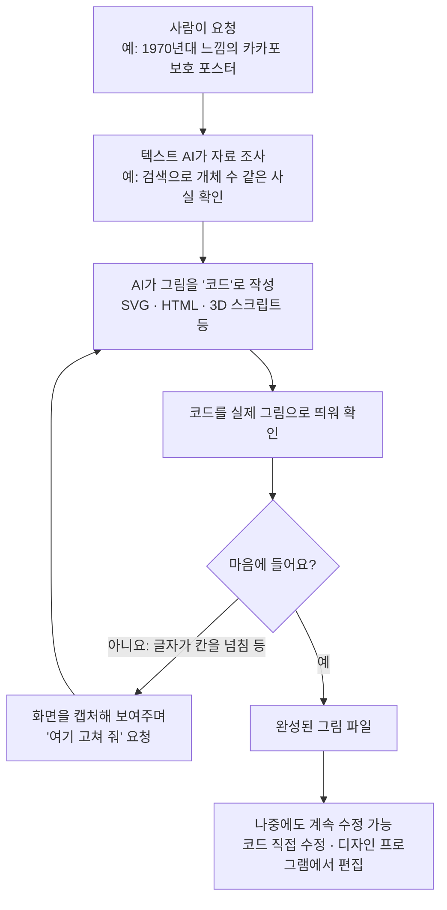

<aside class="ai-knowledge-sidebar">
  
CATEGORIES

  <nav class="ai-cat-tree">

에이전트 오케스트레이션21
<ul><li><a href="https://altjs4510.github.io/ai_news_blog/knowledge/20261121/">2026-11-21Google ADK v2.15.0 — 느린 도구에도 응답성 유지, 다중 실행 신뢰성·부…</a></li><li><a href="https://altjs4510.github.io/ai_news_blog/knowledge/20261118/">2026-11-18Tencent/LoopForge — CodeBuddy·Codex·Claude Code를…</a></li><li><a href="https://altjs4510.github.io/ai_news_blog/knowledge/20261117/">2026-11-17NVIDIA/SkillEvaluator — AI 에이전트 스킬·플러그인을 품질 게이트,…</a></li><li><a href="https://altjs4510.github.io/ai_news_blog/knowledge/20261112/">2026-11-12shadcn/improve — 가장 강한 모델로 코드베이스를 감사해 계획을 쓰고, 더 …</a></li><li><a href="https://altjs4510.github.io/ai_news_blog/knowledge/20261107/">2026-11-07Hermes Agent v0.23.0 — The Hearth Release</a></li><li><a href="https://altjs4510.github.io/ai_news_blog/knowledge/20261029/">2026-10-29How Anthropic ships Claude with Claude: Separati…</a></li><li><a href="https://altjs4510.github.io/ai_news_blog/knowledge/20261027/">2026-10-27nightly-labs/openbot — Codex·Claude·Grok을 상주 팀원처…</a></li><li><a href="https://altjs4510.github.io/ai_news_blog/knowledge/20261015/">2026-10-15How Third Moment Research runs 10,000 agents for…</a></li><li><a href="https://altjs4510.github.io/ai_news_blog/knowledge/20261014/">2026-10-14How Anthropic's Dynamic Workflows Coordinate Cla…</a></li><li><a href="https://altjs4510.github.io/ai_news_blog/knowledge/20260930/">2026-09-30Agents you can coach: how Asana builds human-age…</a></li><li><a href="https://altjs4510.github.io/ai_news_blog/knowledge/20260831-openexecutive-virtual-c-suite/">2026-08-31Open Executive — 8명의 전문 에이전트를 하나의 임원 목소리로</a></li><li><a href="https://altjs4510.github.io/ai_news_blog/knowledge/20260828/">2026-08-28Google ADK for Python v2.8.0 — RemoteA2aAgent 네이…</a></li><li><a href="https://altjs4510.github.io/ai_news_blog/knowledge/20260826/">2026-08-26apache/maka — 도구 호출·권한 결정·종료 이벤트를 append-only 로그…</a></li><li><a href="https://altjs4510.github.io/ai_news_blog/knowledge/20260823/">2026-08-23The Evolution of the Agent Harness — 하네스가 모델 가중치…</a></li><li><a href="https://altjs4510.github.io/ai_news_blog/knowledge/20260821/">2026-08-21volcengine/OpenViking — 에이전트 메모리·Knowledge RAG·스…</a></li><li><a href="https://altjs4510.github.io/ai_news_blog/knowledge/20260805/">2026-08-05TencentCloud/TencentDB-Agent-Memory — 대화·문서·코드를 …</a></li><li><a href="https://altjs4510.github.io/ai_news_blog/knowledge/20260623/">2026-06-23bytedance/deer-flow — 샌드박스·메모리·서브에이전트·메시지 게이트웨이를…</a></li><li><a href="https://altjs4510.github.io/ai_news_blog/knowledge/20260611/">2026-06-11The evolution of agentic surfaces: building with…</a></li><li><a href="https://altjs4510.github.io/ai_news_blog/knowledge/20260602/">2026-06-02revfactory/harness — 도메인별 에이전트 팀과 스킬을 자동 설계하는 메타…</a></li><li><a href="https://altjs4510.github.io/ai_news_blog/knowledge/20260529/">2026-05-29Introducing dynamic workflows in Claude Code</a></li><li><a href="https://altjs4510.github.io/ai_news_blog/knowledge/20260507/">2026-05-07ruvnet/ruflo — Claude 멀티 에이전트 오케스트레이션 플랫폼</a></li></ul>

MCP &amp; 도구 통합18
<ul><li><a href="https://altjs4510.github.io/ai_news_blog/knowledge/20261103/">2026-11-03vercel-labs/agent-desktop — 픽셀 대신 OS 접근성 트리로 앱 U…</a></li><li><a href="https://altjs4510.github.io/ai_news_blog/knowledge/20261007/">2026-10-07morluto/rea — 앱 동작부터 네이티브 바이너리까지 에이전트로 리버스 엔지니어링</a></li><li><a href="https://altjs4510.github.io/ai_news_blog/knowledge/20260829/">2026-08-29cursor/plugins — 플러그인 명세(specification)와 공식 플러그인…</a></li><li><a href="https://altjs4510.github.io/ai_news_blog/knowledge/20260802/">2026-08-02Stateless MCP has recaptured my interest (and in…</a></li><li><a href="https://altjs4510.github.io/ai_news_blog/knowledge/20260731/">2026-07-31different-ai/openwork — Claude Cowork의 오픈소스 대안(o…</a></li><li><a href="https://altjs4510.github.io/ai_news_blog/knowledge/20260729/">2026-07-29Bringing MCP 2026-07-28 to Claude</a></li><li><a href="https://altjs4510.github.io/ai_news_blog/knowledge/20260726/">2026-07-26citrolabs/ego-lite — 로그인된 브라우저 상태를 AI 에이전트와 공유하는…</a></li><li><a href="https://altjs4510.github.io/ai_news_blog/knowledge/20260718/">2026-07-18tirth8205/code-review-graph — MCP·CLI용 로컬 코드 인텔리…</a></li><li><a href="https://altjs4510.github.io/ai_news_blog/knowledge/20260708/">2026-07-08Expanding Managed Agents in Gemini API: backgrou…</a></li><li><a href="https://altjs4510.github.io/ai_news_blog/knowledge/20260618/">2026-06-18DeusData/codebase-memory-mcp — 158개 언어 코드베이스를 밀리…</a></li><li><a href="https://altjs4510.github.io/ai_news_blog/knowledge/20260609/">2026-06-09Building intelligent apps for Apple platforms wi…</a></li><li><a href="https://altjs4510.github.io/ai_news_blog/knowledge/20260604/">2026-06-04chopratejas/headroom — Compress tool outputs bef…</a></li><li><a href="https://altjs4510.github.io/ai_news_blog/knowledge/20260603/">2026-06-03How Bad MCP design cost your Agent 5× more token…</a></li><li><a href="https://altjs4510.github.io/ai_news_blog/knowledge/20260521/">2026-05-21colbymchenry/codegraph — Pre-indexed code knowle…</a></li><li><a href="https://altjs4510.github.io/ai_news_blog/knowledge/20260517/">2026-05-17I gave my LLM 100,000+ tools — Lazy Discovery &a…</a></li><li><a href="https://altjs4510.github.io/ai_news_blog/knowledge/20260512/">2026-05-12agentmemory — Persistent memory for AI coding ag…</a></li><li><a href="https://altjs4510.github.io/ai_news_blog/knowledge/20260509/">2026-05-09How to connect 100 MCP servers without the conte…</a></li><li><a href="https://altjs4510.github.io/ai_news_blog/knowledge/20260506/">2026-05-06mksglu/context-mode — AI 코딩 에이전트용 컨텍스트 윈도우 최적화</a></li></ul>

코딩 에이전트33
<ul><li><a href="https://altjs4510.github.io/ai_news_blog/knowledge/20261127/">2026-11-27Claude-Mem Cloud Sync — 기기를 바꿔도 코딩 에이전트 메모리를 이어 …</a></li><li><a href="https://altjs4510.github.io/ai_news_blog/knowledge/20261126/">2026-11-26Three LLM inflection points in twelve months</a></li><li><a href="https://altjs4510.github.io/ai_news_blog/knowledge/20261125/">2026-11-25Anthropic launches Claude Ship, letting AI agent…</a></li><li><a href="https://altjs4510.github.io/ai_news_blog/knowledge/20261115/">2026-11-15GoogleChrome/modern-web-guidance-src — 코딩 에이전트에 …</a></li><li><a href="https://altjs4510.github.io/ai_news_blog/knowledge/20261106/">2026-11-06Cline desktop-nightly-20261104233655: feat(core)…</a></li><li><a href="https://altjs4510.github.io/ai_news_blog/knowledge/20261022/">2026-10-22Claude Mods: Flipping the Harness Inside Out</a></li><li><a href="https://altjs4510.github.io/ai_news_blog/knowledge/20261018/">2026-10-18Quoting Addy Osmani, Morgan Westlee Lunt, and Qi…</a></li><li><a href="https://altjs4510.github.io/ai_news_blog/knowledge/20261017/">2026-10-17mksglu/context-mode — 코딩 에이전트용 컨텍스트 윈도우 최적화</a></li><li><a href="https://altjs4510.github.io/ai_news_blog/knowledge/20261014-claude-code-advisor/">2026-10-14Claude Code advisor — 가벼운 메인 모델이 일하고, 갈림길에서만 Opu…</a></li><li><a href="https://altjs4510.github.io/ai_news_blog/knowledge/20260920/">2026-09-20Claude Code 2.1.277 — CLAUDE.md가 없으면 AGENTS.md를 …</a></li><li><a href="https://altjs4510.github.io/ai_news_blog/knowledge/20260919/">2026-09-19cloudflare/security-audit-skill — 다단계 보안 감사를 '독립…</a></li><li><a href="https://altjs4510.github.io/ai_news_blog/knowledge/20260912/">2026-09-12Quoting Boris Cherny — 'Claude가 쓴 프로덕션 코드는 사람이 쓴…</a></li><li><a href="https://altjs4510.github.io/ai_news_blog/knowledge/20260910/">2026-09-10vastsa/PI-Desktop — Electron + Rust 호스트 코어 + 에이전…</a></li><li><a href="https://altjs4510.github.io/ai_news_blog/knowledge/20260906/">2026-09-06DietrichGebert/ponytail — 에이전트를 '방에서 가장 게으른 시니어 …</a></li><li><a href="https://altjs4510.github.io/ai_news_blog/knowledge/20260903/">2026-09-03pacifio/atlas — 여러 코딩 에이전트의 변경을 한곳에서 추적·질의하는 '에이…</a></li><li><a href="https://altjs4510.github.io/ai_news_blog/knowledge/20260901/">2026-09-01affaan-m/ECC — 스킬·본능·메모리·보안을 묶은 에이전트 하네스 성능 최적화 …</a></li><li><a href="https://altjs4510.github.io/ai_news_blog/knowledge/20260831-gitnexus-code-knowledge-graph/">2026-08-31GitNexus — 코드베이스를 지식그래프로 바꿔 에이전트에게 쥐어주기</a></li><li><a href="https://altjs4510.github.io/ai_news_blog/knowledge/20260819/">2026-08-19akitaonrails/ai-memory — 코딩 에이전트 CLI 간 장기 기억과 벤더…</a></li><li><a href="https://altjs4510.github.io/ai_news_blog/knowledge/20260814/">2026-08-14cathrynlavery/diagram-design — Claude Code용 에디토리…</a></li><li><a href="https://altjs4510.github.io/ai_news_blog/knowledge/20260810/">2026-08-10Auto mode is now the default in Claude Code for …</a></li><li><a href="https://altjs4510.github.io/ai_news_blog/knowledge/20260808/">2026-08-08PrimeIntellect-ai/prime-agent — 코딩 워크플로우와 장시간 자율…</a></li><li><a href="https://altjs4510.github.io/ai_news_blog/knowledge/20260804/">2026-08-04esengine/DeepSeek-Reasonix — prefix-cache 안정성을 축…</a></li><li><a href="https://altjs4510.github.io/ai_news_blog/knowledge/20260728/">2026-07-28alibaba/open-code-review — 결정론적 파이프라인 + LLM 에이전트…</a></li><li><a href="https://altjs4510.github.io/ai_news_blog/knowledge/20260725/">2026-07-25The new rules of context engineering for Claude …</a></li><li><a href="https://altjs4510.github.io/ai_news_blog/knowledge/20260714/">2026-07-14Graphify-Labs/graphify — 코드베이스를 질의 가능한 지식 그래프로 만…</a></li><li><a href="https://altjs4510.github.io/ai_news_blog/knowledge/20260707/">2026-07-07AI Hero Skills Catalog — 실무 엔지니어를 위한 재사용 가능한 판단 …</a></li><li><a href="https://altjs4510.github.io/ai_news_blog/knowledge/20260705/">2026-07-05openai/codex-plugin-cc — Claude Code에서 Codex를 위임…</a></li><li><a href="https://altjs4510.github.io/ai_news_blog/knowledge/20260701/">2026-07-01Google OKF (Open Knowledge Format) — 벤더 중립 에이전트 …</a></li><li><a href="https://altjs4510.github.io/ai_news_blog/knowledge/20260626/">2026-06-26google-labs-code/design.md — 코딩 에이전트에게 디자인 시스템을 …</a></li><li><a href="https://altjs4510.github.io/ai_news_blog/knowledge/20260619/">2026-06-19Claude Code now supports artifacts</a></li><li><a href="https://altjs4510.github.io/ai_news_blog/knowledge/20260530/">2026-05-30Leonxlnx/taste-skill — AI에게 좋은 취향을 부여해 generic s…</a></li><li><a href="https://altjs4510.github.io/ai_news_blog/knowledge/20260508/">2026-05-08addyosmani/agent-skills — Production-grade engin…</a></li><li><a href="https://altjs4510.github.io/ai_news_blog/knowledge/20260505/">2026-05-05mattpocock/skills — Skills for Real Engineers (.…</a></li></ul>

모델 &amp; 연구17
<ul><li><a href="https://altjs4510.github.io/ai_news_blog/knowledge/20261129/" class="current">2026-11-29Code-driven AI illustrations are more useful tha…</a></li><li><a href="https://altjs4510.github.io/ai_news_blog/knowledge/20261113/">2026-11-13Gemini Decisions API</a></li><li><a href="https://altjs4510.github.io/ai_news_blog/knowledge/20261111/">2026-11-11Quoting Prompting Claude Fable 5.2</a></li><li><a href="https://altjs4510.github.io/ai_news_blog/knowledge/20261105/">2026-11-05NVIDIA/auto-ontology — 데이터 위에 그래프 기반 의미 추론 레이어를 …</a></li><li><a href="https://altjs4510.github.io/ai_news_blog/knowledge/20261104/">2026-11-04Qwen 3.8 27B on my laptop can interpret model we…</a></li><li><a href="https://altjs4510.github.io/ai_news_blog/knowledge/20261009/">2026-10-09Claude Haiku 5.5 (Simon Willison의 출시 노트와 가격 분석)</a></li><li><a href="https://altjs4510.github.io/ai_news_blog/knowledge/20260929/">2026-09-29vectorize-io/hindsight — Hindsight: Agent Memory…</a></li><li><a href="https://altjs4510.github.io/ai_news_blog/knowledge/20260907-voicemem-dual-brain-memory/">2026-09-07VoiceMem — 좌뇌·우뇌로 쪼갠 스트리밍 메모리로 음성 에이전트 지연 없애기</a></li><li><a href="https://altjs4510.github.io/ai_news_blog/knowledge/20260904/">2026-09-04HarnessDev: Can LLMs Create and Evolve Their Own…</a></li><li><a href="https://altjs4510.github.io/ai_news_blog/knowledge/20260717/">2026-07-17After a year building agent memory, 'save everyt…</a></li><li><a href="https://altjs4510.github.io/ai_news_blog/knowledge/20260716-proprag/">2026-07-16PropRAG — 프로포지션 경로 위 beam search로 멀티홉 검색 안내</a></li><li><a href="https://altjs4510.github.io/ai_news_blog/knowledge/20260712/">2026-07-12Do Automated Evals Work?</a></li><li><a href="https://altjs4510.github.io/ai_news_blog/knowledge/20260620/">2026-06-20zai-org/GLM-5 — From Vibe Coding to Agentic Engi…</a></li><li><a href="https://altjs4510.github.io/ai_news_blog/knowledge/20260617/">2026-06-17Predicting model behavior before release by simu…</a></li><li><a href="https://altjs4510.github.io/ai_news_blog/knowledge/20260610/">2026-06-10Fable 5 just made cost-aware model routing manda…</a></li><li><a href="https://altjs4510.github.io/ai_news_blog/knowledge/20260516/">2026-05-16STALE — 에이전트가 자기 기억의 유효성을 인지할 수 있는가</a></li><li><a href="https://altjs4510.github.io/ai_news_blog/knowledge/20260513/">2026-05-13Thinking Machines' Native Interaction Models — T…</a></li></ul>

인프라 &amp; 컴퓨트8
<ul><li><a href="https://altjs4510.github.io/ai_news_blog/knowledge/20261120/">2026-11-20How OpenAI’s Performance Factory keeps ChatGPT f…</a></li><li><a href="https://altjs4510.github.io/ai_news_blog/knowledge/20260909/">2026-09-09Reducing cost and improving performance with Cla…</a></li><li><a href="https://altjs4510.github.io/ai_news_blog/knowledge/20260905/">2026-09-05magnitudedev/magnitude — 하드웨어에 맞는 최적 로컬 모델을 띄워 이…</a></li><li><a href="https://altjs4510.github.io/ai_news_blog/knowledge/20260812/">2026-08-12semantica-agi/semantica — 컨텍스트와 '책임 추적 가능한(accou…</a></li><li><a href="https://altjs4510.github.io/ai_news_blog/knowledge/20260806/">2026-08-06cloudflare/computer — 에이전트에게 컴퓨터를 통째로 주는 엣지 실행 샌…</a></li><li><a href="https://altjs4510.github.io/ai_news_blog/knowledge/20260723/">2026-07-23diegosouzapw/OmniRoute — 268+ 프로바이더를 단일 엔드포인트로 묶…</a></li><li><a href="https://altjs4510.github.io/ai_news_blog/knowledge/20260522/">2026-05-22Giving Agents Computers — Ivan Burazin, Daytona</a></li><li><a href="https://altjs4510.github.io/ai_news_blog/knowledge/20260520/">2026-05-20New in Claude Managed Agents: self-hosted sandbo…</a></li></ul>

보안 &amp; 거버넌스25
<ul><li><a href="https://altjs4510.github.io/ai_news_blog/knowledge/20261119/">2026-11-19External sandboxes for coding agents</a></li><li><a href="https://altjs4510.github.io/ai_news_blog/knowledge/20261031/">2026-10-31CopilotKit/OpenBot — AI 동료마다 전용 컴퓨터를 주고 모든 행동을 실…</a></li><li><a href="https://altjs4510.github.io/ai_news_blog/knowledge/20261030/">2026-10-30How we detect frontier model misalignment</a></li><li><a href="https://altjs4510.github.io/ai_news_blog/knowledge/20261021/">2026-10-21cloudflare/security-audit-skill — 독립 검증된 기계 판독형 …</a></li><li><a href="https://altjs4510.github.io/ai_news_blog/knowledge/20261020/">2026-10-20Satya Nadella — 모델을 내부자 위험으로 보는 원칙에 따라 Project P…</a></li><li><a href="https://altjs4510.github.io/ai_news_blog/knowledge/20261016/">2026-10-16Crossing the Threshold: How OpenAI and Anthropic…</a></li><li><a href="https://altjs4510.github.io/ai_news_blog/knowledge/20261011/">2026-10-11Anthropic can’t reliably control its AI agents. …</a></li><li><a href="https://altjs4510.github.io/ai_news_blog/knowledge/20261004/">2026-10-04Apple says it's tightening macOS 'Full Disk Acce…</a></li><li><a href="https://altjs4510.github.io/ai_news_blog/knowledge/20261001/">2026-10-01NVIDIA/OpenShell</a></li><li><a href="https://altjs4510.github.io/ai_news_blog/knowledge/20260913/">2026-09-13OpenAI agents attacked RubyGems back in May: Ope…</a></li><li><a href="https://altjs4510.github.io/ai_news_blog/knowledge/20260902/">2026-09-02AIR raises $50M to help companies vet the skills…</a></li><li><a href="https://altjs4510.github.io/ai_news_blog/knowledge/20260827/">2026-08-27Claude in Chrome is generally available</a></li><li><a href="https://altjs4510.github.io/ai_news_blog/knowledge/20260819-mind-viruses/">2026-08-19탈옥도, 인젝션도 없이 — 대화로만 퍼지는 에이전트의 '마인드 바이러스'</a></li><li><a href="https://altjs4510.github.io/ai_news_blog/knowledge/20260730/">2026-07-30Anatomy of a Frontier Lab Agent Intrusion: A Tec…</a></li><li><a href="https://altjs4510.github.io/ai_news_blog/knowledge/20260715/">2026-07-15Dicklesworthstone/destructive_command_guard — 에이…</a></li><li><a href="https://altjs4510.github.io/ai_news_blog/knowledge/20260710/">2026-07-1070개 MCP 서버 strace 런타임 감사 — 부팅 시 아웃바운드 호출 서버 적발</a></li><li><a href="https://altjs4510.github.io/ai_news_blog/knowledge/20260704/">2026-07-04Cloudflare is about to block AI agents by defaul…</a></li><li><a href="https://altjs4510.github.io/ai_news_blog/knowledge/20260703/">2026-07-03Giving admins more visibility and control over C…</a></li><li><a href="https://altjs4510.github.io/ai_news_blog/knowledge/20260630/">2026-06-30Introducing the Claude apps gateway for Amazon B…</a></li><li><a href="https://altjs4510.github.io/ai_news_blog/knowledge/20260624/">2026-06-24Agent identity in Claude Tag: a new access model…</a></li><li><a href="https://altjs4510.github.io/ai_news_blog/knowledge/20260613/">2026-06-13Fable 5's guardrails got bypassed in 48 hours — …</a></li><li><a href="https://altjs4510.github.io/ai_news_blog/knowledge/20260612/">2026-06-12NVIDIA/SkillSpector — AI 에이전트 스킬용 보안 스캐너</a></li><li><a href="https://altjs4510.github.io/ai_news_blog/knowledge/20260607/">2026-06-07OpenAI Help: Lockdown Mode</a></li><li><a href="https://altjs4510.github.io/ai_news_blog/knowledge/20260531/">2026-05-31How we contain Claude across products</a></li><li><a href="https://altjs4510.github.io/ai_news_blog/knowledge/20260527/">2026-05-27Microsoft Copilot Cowork Exfiltrates Files</a></li></ul>

응용 사례14
<ul><li><a href="https://altjs4510.github.io/ai_news_blog/knowledge/20261128/">2026-11-28How Clay Builds GTM Agents — Jeff Barg, Head of …</a></li><li><a href="https://altjs4510.github.io/ai_news_blog/knowledge/20261124/">2026-11-24A more tailored Google Search that’s uniquely yo…</a></li><li><a href="https://altjs4510.github.io/ai_news_blog/knowledge/20261114/">2026-11-14Introducing ChatGPT Wallet</a></li><li><a href="https://altjs4510.github.io/ai_news_blog/knowledge/20261110/">2026-11-10meta/astryx — 직접 바꿔 쓸 수 있고 에이전트가 바로 쓸 수 있는(agent…</a></li><li><a href="https://altjs4510.github.io/ai_news_blog/knowledge/20261101/">2026-11-01Agents Prompt People: Using Agents for Long-Hori…</a></li><li><a href="https://altjs4510.github.io/ai_news_blog/knowledge/20261028/">2026-10-28Greptile takes bug detection beyond code review …</a></li><li><a href="https://altjs4510.github.io/ai_news_blog/knowledge/20261023/">2026-10-23Claude Duet app is Anthropic's bet on agents</a></li><li><a href="https://altjs4510.github.io/ai_news_blog/knowledge/20261006/">2026-10-06How Cresta turned CX expertise into an agent bui…</a></li><li><a href="https://altjs4510.github.io/ai_news_blog/knowledge/20260911/">2026-09-11Now everyone can put data to work — ChatGPT Work…</a></li><li><a href="https://altjs4510.github.io/ai_news_blog/knowledge/20260709/">2026-07-09mvanhorn/last30days-skill — Reddit·X·YouTube·HN·…</a></li><li><a href="https://altjs4510.github.io/ai_news_blog/knowledge/20260621/">2026-06-21calesthio/OpenMontage — 12 파이프라인·52 도구·500+ 스킬을 …</a></li><li><a href="https://altjs4510.github.io/ai_news_blog/knowledge/20260528/">2026-05-28Building self-improving tax agents with Codex</a></li><li><a href="https://altjs4510.github.io/ai_news_blog/knowledge/20260515/">2026-05-15Clawdmeter — Claude Code 사용량을 데스크톱 대시보드로</a></li><li><a href="https://altjs4510.github.io/ai_news_blog/knowledge/20260514/">2026-05-14Introducing Claude for Small Business</a></li></ul>

산업 동향8
<ul><li><a href="https://altjs4510.github.io/ai_news_blog/knowledge/20261024/">2026-10-24Donating Agent Skills to the Agentic AI Foundati…</a></li><li><a href="https://altjs4510.github.io/ai_news_blog/knowledge/20260907-humanmade-52week-rhythm/">2026-09-07휴먼 메이드의 '52주 리듬' — 아이디어가 흔해진 시대에 값이 오르는 건 버리는 판단</a></li><li><a href="https://altjs4510.github.io/ai_news_blog/knowledge/20260830/">2026-08-30[AINews] OpenAI shuts off Cursor — 프론티어 모델 공급 차단…</a></li><li><a href="https://altjs4510.github.io/ai_news_blog/knowledge/20260711/">2026-07-11OpenAI says GPT 5.6 is the 'preferred model' for…</a></li><li><a href="https://altjs4510.github.io/ai_news_blog/knowledge/20260702/">2026-07-02How Cursor deploys AI inside the enterprise (For…</a></li><li><a href="https://altjs4510.github.io/ai_news_blog/knowledge/20260616/">2026-06-16Why AI hasn't replaced software engineers, and w…</a></li><li><a href="https://altjs4510.github.io/ai_news_blog/knowledge/20260519/">2026-05-19Anthropic acquires Stainless</a></li><li><a href="https://altjs4510.github.io/ai_news_blog/knowledge/20260504/">2026-05-04Agents for Everything Else: Codex for Knowledge …</a></li></ul>
</nav>
</aside>

<article class="ai-knowledge-article">

<header class="ai-post-hero">
  
<a class="ai-back" href="../">KNOWLEDGE</a> · 2026-11-29 · 오늘의 학습

  <h2 class="ai-post-title">Code-driven AI illustrations are more useful than images from dedicated image models</h2>
</header>

> 원문: [Code-driven AI illustrations are more useful than images from dedicated image models](https://simonwillison.net/2026/Nov/28/code-driven-ai-illustrations/)

## 📌 학습 정리

### 1. 한 줄로 말하면

AI에게 그림을 "그려 달라"고 하는 대신 그림을 만드는 **설계도(코드)를 써 달라**고 하는 방식이에요. 설계도로 만든 그림은 글자 하나, 색 하나까지 나중에 마음대로 고칠 수 있다는 점이 핵심이에요.

### 2. 왜 이게 만들어졌어요?

지금까지 AI로 그림을 만들 때는 그림만 전문으로 만드는 모델을 주로 썼어요. Stable Diffusion, DALL-E, Midjourney가 대표적이고, 최근에는 Google의 Nano Banana나 OpenAI의 ChatGPT Images도 나왔어요. 이 모델들은 결과물이 점(픽셀)으로 꽉 찬 "한 장짜리 그림"이에요. 그래서 확대하면 이상하게 뭉개진 부분이 보이기도 하고, 글자를 진짜 글꼴이 아니라 모양으로 흉내 내서 그리기 때문에 글자가 일정하게 나오지 않을 때가 있어요. 무엇보다 "이 제목만 조금 옮겨 줘"처럼 특정 요소 하나만 직접 잡아서 고칠 수가 없어요. 그런데 2026년 하반기에 나온 최신 텍스트 AI들이 시각적인 판단과 디자인 감각이 눈에 띄게 좋아지면서, 그림을 코드로 써서 만드는 방식이 실제로 쓸 만한 수준이 됐어요.

### 3. 비유로 풀면

이건 마치 **완성된 케이크 사진을 받는 것과 레시피를 받는 것의 차이** 같은 거예요. 사진은 보기엔 그럴듯해도 "설탕만 조금 줄여 줘"라고 하면 처음부터 새로 찍어야 해요. 레시피가 있으면 설탕 줄 한 줄만 고치면 되죠.

조금 더 가까운 비유로는 **사진 한 장과 레이어가 살아 있는 디자인 파일**의 차이도 있어요. 레이어 파일에서는 제목 글자, 배경, 새 일러스트를 따로따로 골라서 움직일 수 있어요.

그래서 결국 코드로 만든 그림은 사람이 직접 고쳐도 되고, AI에게 "이 부분만 고쳐 줘"라고 해도 AI가 코드를 조금 더 쓰기만 하면 돼요. 그림이 갈수록 망가질 걱정도 줄어들어요.

### 4. 어떻게 작동하는지 (그림으로)

사람이 원하는 그림을 말하면 AI는 그림 자체가 아니라 그림을 만드는 코드를 써요. 원문 저자가 쓴 AI Studio에서는 이 코드를 그림으로 띄워 보여주지 않아서, AI가 스스로 실수를 알아채기 어려웠어요. 그래서 저자가 결과 화면을 캡처해 보여주며 몇 번 고쳐 달라고 해야 했어요. 완성본은 코드로 남아 있기 때문에 이후에도 글자를 직접 바꾸거나 Inkscape, Adobe Illustrator, Boxy SVG 같은 디자인 프로그램에서 열어 눈으로 보면서 편집할 수 있어요.

### 5. 처음 보는 용어 풀이

- **코드로 적은 벡터 그림 파일 (SVG)** — 그림을 점이 아니라 "여기에 원, 저기에 글자"처럼 도형과 글자의 위치를 글로 적어 둔 파일 형식이에요. 글로 적혀 있으니 텍스트 AI가 쓰기 쉽고, 사람이 글자를 바로 고치기도 쉬워요.
- **점으로 채운 그림 (bitmap)** — 사진처럼 아주 작은 색 점(픽셀)을 촘촘히 채워 만든 그림이에요. 전용 이미지 모델이 주로 이런 결과물을 내놓는데, 한 장으로 굳어 있어서 요소를 하나씩 떼어 고치기 어려워요.
- **그림 전용 생성 모델 (dedicated image model)** — 글을 넣으면 그림을 바로 뽑아 주도록 만든 AI예요. 원문 저자는 사진처럼 실감 나는 그림에는 여전히 이쪽이 맞다고 봐요.
- **최신 최상위 AI 모델 (frontier LLM)** — 각 회사가 가장 앞서서 내놓은 대형 언어 모델이에요. 원문에서는 Gemini 4 Neon, Claude Opus 5.5, GPT-6 Astra 같은 모델을 예로 들어요.
- **코딩 에이전트 (coding agent)** — AI가 코드를 쓰는 데서 그치지 않고 직접 실행까지 해 볼 수 있는 작업 환경이에요. 이게 연결되면 그림 파일, 웹 화면, 3D 프로그램(Blender)용 스크립트, PDF처럼 파일로 남길 수 있는 것은 무엇이든 만들 수 있어요.
- **분위기로 만드는 게임 개발 (vibe game development)** — 사람이 일일이 코딩하지 않고 AI에게 말로 설명해 가며 게임을 만드는 흐름이에요. AI가 3D 모델, 질감, 캐릭터 그림 같은 게임 재료를 코드로 그럭저럭 쓸 만하게 만들 수 있게 되면서 최근 크게 늘었다고 해요.
- **쓴 교훈 (bitter lesson)** — 특정 문제를 풀려고 전문 도구를 따로 만들기보다, 범용 AI가 계속 똑똑해지다 보면 결국 그 문제까지 풀게 된다는 AI 분야의 오래된 관찰이에요. 저자는 그림 전용 모델 없이도 텍스트 AI가 디자인까지 해내는 상황을 이 교훈의 한 사례로 봐요.

### 6. 한 발 더 들어가고 싶다면

- [카카포 포스터 제작 대화 전체 기록](https://tools.simonwillison.net/markdown-svg-renderer?url=https%3A%2F%2Fgist.github.com%2Fsimonw%2F0ee45eec7763782019cd20f571e4a7be) — 이걸 보면 저자가 AI와 몇 번 주고받으며 포스터를 다듬었는지, 실제로 어떤 말로 요청했는지 알 수 있어요.
- [Vibe game development 관련 글](https://simonwillison.net/2026/Oct/28/vibe-game-development/) — 이걸 보면 AI가 코드로 게임 재료까지 만들면서 생긴 변화를 알 수 있어요.
- [LLM inflection points — 3D 모델링과 게임 개발 부분](https://simonwillison.net/2026/Nov/24/llm-inflection-points/#3d-modeling-and-game-development-in-september-october) — 이걸 보면 2D를 넘어 3D 모델까지 코드로 만드는 흐름을 알 수 있어요.
- [Claude Design](https://claude.com/product/design) — 이걸 보면 Anthropic이 그림 전용 모델 없이 코드로 만드는 그림을 바탕으로 디자인 제품을 어떻게 꾸렸는지 알 수 있어요.
- [Bitter lesson (위키백과)](https://en.wikipedia.org/wiki/Bitter_lesson) — 이걸 보면 저자가 글 마지막에 꺼낸 "쓴 교훈"이 원래 어떤 이야기인지 알 수 있어요.

---

## 📖 원문 전체 번역 (정독용)

> 의역 최소화한 전체 번역입니다. 큰 흐름은 위 정리에서 잡고, 정확한 워딩이 필요할 땐 이 섹션에서 정독하세요.

2026년 11월 28일

2026년 하반기에 출시된 최신 프론티어 LLM들의 흥미로운 추세는 이전 모델보다 시각적 추론과 창의적 "디자인"에 훨씬 뛰어나다는 점이다. 이러한 텍스트 출력 모델에게 2D 이미지(또는 [앞서 이 블로그에서 다룬](https://simonwillison.net/2026/Nov/24/llm-inflection-points/#3d-modeling-and-game-development-in-september-october) 3D 모델)를 만들어 달라고 요청하면 쓸 만한 결과를 얻을 가능성이 매우 높고, 심지어 미적으로 인상적인 결과가 나올 수도 있다. 가장 중요한 점은, 이런 이미지가 _코드로 정의되기_ 때문에 텍스트를 입력받아 이미지를 출력하는 모델로 반복 작업할 때 생기는 이상한 현상 없이 당신(또는 모델)이 이후에도 계속 수정할 수 있다는 것이다.

#### Gemini 4 Neon으로 포스터 디자인하기

Gemini 4 Neon이 2D 디자인 실력으로 화제가 되고 있어서, AI Studio에서 다음 프롬프트로 시도해 보기로 했다.

> `Create an SVG poster promoting the Kakapo recovery project, research details first, make the poster look really cool and give it a 1970s graphic design`

(번역: 카카포 복원 프로젝트를 홍보하는 SVG 포스터를 만들어 줘. 먼저 세부 내용을 조사하고, 포스터가 정말 멋있어 보이게, 1970년대 그래픽 디자인 스타일로.)

AI Studio가 SVG를 렌더링해 주지 않는 탓에 그곳의 모델들은 도움 없이는 시각적 실수를 알아챌 수 없어서, 몇 차례 반복이 필요했다.

> `Make the kakapo a bit more realistic, especially the face (image search for references)`

(번역: 카카포를 좀 더 사실적으로, 특히 얼굴을 (참고용으로 이미지 검색해서).)

그다음:

> [IMAGE] `The text here doesn't fit the pill, fix it`

(번역: 여기 텍스트가 알약 모양 안에 안 들어가. 고쳐 줘.)

그리고:

> [IMAGE 2], [IMAGE 3] `Also these`

(번역: 이것들도.)

[전체 대화 기록은 여기](https://tools.simonwillison.net/markdown-svg-renderer?url=https%3A%2F%2Fgist.github.com%2Fsimonw%2F0ee45eec7763782019cd20f571e4a7be)에 있다. 로그인 없이 볼 수 있게 세션을 공유하는 방법(Google 로그인 불필요)을 찾지 못해서 AI Studio에서 Markdown으로 내보냈다.

최종 결과물은 꽤 탄탄하다.

![이미지 1: 크림, 짙은 청록, 주황, 노랑 색으로 된 레트로 스타일의 보전 홍보 일러스트 포스터. 상단 문구: "★ AOTEAROA NEW ZEALAND • TAONGA CONSERVATION ★", 큰 제목 "KĀKĀPŌ", 배너 "RECOVERY PROGRAMME • PROTECT THE NIGHT PARROT". 중앙: 회색 부리와 수염 난 얼굴을 한 통통한 초록색 카카포가 붉은 리무(rimu) 열매가 달린 나뭇가지에 앉아 있고, 그 뒤로 별이 뜬 밤하늘 아치 위에 동심원 모양의 주황·노랑 링이 있으며, 곡선 문구 "★ STRIGOPS HABROPTILUS • WORLD'S ONLY FLIGHTLESS NOCTURNAL PARROT ★"가 있음. 주황색 스타버스트 배지: "2026 RECORD 325 BIRDS ALIVE UP FROM 51". 아래에 세 가지 통계: "1995 → 2026 51 TO 325 75-YEAR POPULATION HIGH", "2026 RIMU MAST 90 CHICKS SINGLE-SEASON RECORD", "PREDATOR-FREE 3 ISLANDS WHENUA HOU • PUKENUI • TE KĀKAHU". 하단 배너: "ADOPT A KĀKĀPŌ • KEEP SANCTUARIES WILD", "DOC TE PAPA ATAWHAI & NGĀI TAHU • DOC.GOVT.NZ/KAKAPO".](https://static.simonwillison.net/static/2026/kakapo-poster-neon.webp)

AI Studio는 이 수치들을 찾기 위해 Google 검색을 실행했고, 내가 확인해 보니 모두 정확하다. 가지에 붉은 리무 나무 열매를 넣은 점이 마음에 든다. 그 열매는 [번식기에 필수적이기](https://www.theguardian.com/world/2026/jan/13/nz-kakapo-mating-season) 때문이다.

이 포스터가 마음에 들든 아니든, 핵심은 _모든 것이 편집 가능하다_는 점이다. SVG 안의 텍스트를 직접 수정할 수도 있고, Inkscape나 Adobe Illustrator, [Boxy SVG](https://boxy-svg.com/app)에서 열어 시각적으로 편집할 수도 있다.

#### SVG만 되는 게 아니다

나는 SVG 생성에 대한 [잘 알려진 애착](https://simonwillison.net/tags/pelican-riding-a-bicycle/)이 있지만, 가능한 방법이 SVG만 있는 것은 아니다.

코딩 에이전트 환경에 연결된 모델은 코드를 실행해 이미지를 생성할 수 있다. 이는 무궁무진한 가능성을 연다. 생성된 이미지 파일, HTML과 CSS, 2D HTML Canvas 요소, Blender 스크립트, WebGPU 셰이더, PDF 등, 디스크 위의 파일이나 스크립트의 출력으로 표현할 수 있는 이미지 방식이라면 무엇이든 코딩 에이전트를 가진 모델의 대상이 될 수 있다.

최근 [바이브 게임 개발이 폭발적으로 늘어난](https://simonwillison.net/2026/Oct/28/vibe-game-development/) 이유 중 하나는 Claude Opus 5.5, GPT-6 Astra, Gemini 4 Neon 같은 모델이 3D 모델, 텍스처, 스프라이트 등 충분히 좋은 품질의 게임 에셋을 오로지 코드를 작성하는 것만으로 만들어 낼 수 있기 때문이다.

코드로 에셋을 만든다는 것은, 이를 수정하고 재사용하고 리믹스하는 일이 모델이 코드를 더 작성하는 문제가 된다는 뜻이다.

#### 이미지 모델과의 비교

대부분의 AI 이미지 생성 도구는 비트맵 그래픽을 직접 출력하는 모델을 사용한다. Stable Diffusion, DALL-E, Midjourney가 이 분야의 초기 선두 주자였다. 지난 약 15개월 동안에는 Google의 Nano Banana와 OpenAI의 ChatGPT Images처럼 이를 LLM 기반으로 변형한 모델들이 등장했다. 이들은 기존 이미지를 편집하고 세부 요소를 보존하는 데 능숙해졌고, 덕분에 여러 번의 대화 턴에 걸쳐 디자인을 반복 수정해도 엉망이 되지 않는다.

그래도 한계는 여전하다. 세부를 확대해 보면 드러나는 이상한 결함이 생길 수 있다. 텍스트 글자 모양을 모델이 직접 출력하므로, 실제 폰트 기반 타이포그래피 시스템에서 얻는 일관성의 보장이 없다.

또한 본질적으로 _평면적_이다. 원하는 변경을 텍스트로 설명하거나 이미지 위에 주석을 그려서 설명할 수는 있지만, 개별 요소나 레이어를 직접 잡고 조작해 정확히 원하는 결과를 얻을 수는 없다.

코드로 생성한 이미지는 이 모든 문제를 해결한다.

사실적인 사진 같은 이미지를 생성하는 경우라면 전용 이미지 모델이 여전히 자리를 지킨다. 하지만 내가 관심 있는 대부분의 용도, 즉 설명용 다이어그램, 편집 가능한 포스터 디자인, UI 컴포넌트, 시각화, 게임 에셋에는 코드 기반 이미지가 더 나은 선택이라고 느껴진다.

#### Anthropic이 불리하다고 생각했었다

Nano Banana와 ChatGPT Images가 나온 뒤, 나는 Anthropic에게 심각한 제품 공백이 있다고 생각했다.

OpenAI와 Google은 둘 다 제품군의 일부로 훌륭한 이미지 생성 모델을 갖고 있었다. 생성형 비디오 모델까지 있었다. Google은 지금도 Veo와 이제는 [Omni](https://deepmind.google/models/gemini-omni/)로 이어가고 있고, OpenAI는 [Sora를 종료했다](https://help.openai.com/en/articles/20001152-what-to-know-about-the-sora-discontinuation).

비즈니스 세계는 여전히 PowerPoint로 돌아가므로, 엔터프라이즈 계약을 판매할 때 훌륭한 이미지 생성 모델을 갖추는 것은 많은 고객이 기대하는 기능일 것처럼 보였다.

요즘 Claude는 시각적으로 설득력 있는 프레젠테이션과 웹사이트 디자인을 거뜬히 만들어 내고, [Claude Design](https://claude.com/product/design)은 완전한 디자인 시스템 플랫폼을 제공한다. 모두 코드 기반 이미지를 중심으로 만들어졌다!

이는 [쓰라린 교훈(bitter lesson)](https://en.wikipedia.org/wiki/Bitter_lesson)의 또 다른 변주처럼 느껴진다. 나는 디자인 문제를 가진 고객을 응대하려면 전문 이미지 모델이 필요하다고 확신했다. 그러나 결과적으로는 텍스트를 출력하는 LLM이 계속 더 유능해져서, 코드를 작성하는 방식으로 시각 디자인을 처리할 수 있게 된 것이다.

</article>

