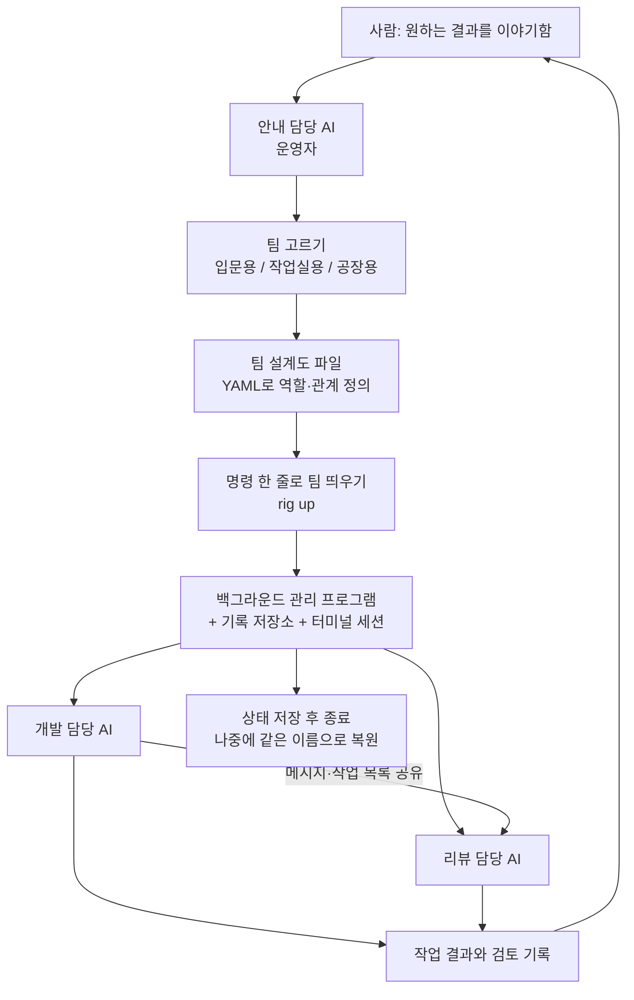

<article class="ai-knowledge-article">

<header class="ai-post-hero">
  <p class="ai-eyebrow"><a class="ai-back" href="../">이번 호</a> · 2026-10-12 · 학습 브리프</p>
  <h2 class="ai-post-title">mvschwarz/openrig — Claude Code·Codex·Pi로 꾸리는 지속형 에이전트 팀 (역할·공유 컨텍스트·작업 소유)</h2>
</header>

> 원문: [mvschwarz/openrig — Claude Code·Codex·Pi로 꾸리는 지속형 에이전트 팀 (역할·공유 컨텍스트·작업 소유)](https://github.com/mvschwarz/openrig)

## 📌 학습 정리

### 1. 한 줄로 말하면

AI 코딩 도우미 여러 명을 각자 이름과 자리, 맡은 역할이 있는 하나의 팀으로 묶어 주는 도구예요. 터미널 창 여러 개에 흩어져 있던 AI들이 컴퓨터를 껐다 켜도 같은 자리에서 일을 이어 갈 수 있게 해 줘요.

### 2. 왜 이게 만들어졌어요?

요즘은 Claude Code나 Codex 같은 AI 코딩 도구를 하나만 쓰지 않고, 여러 개를 동시에 띄워서 한쪽은 코드를 짜고 다른 쪽은 검토하게 하는 일이 많아요. 그런데 이렇게 하면 터미널 창이 계속 늘어나요. 어느 창에서 누가 무슨 일을 하는지, 서로 어떻게 연결돼 있는지 헷갈리기 쉽고, 재부팅이라도 하면 다시 세팅하기도 번거로워요. 원문은 이 상황을 "터미널이 마구 퍼지는 상태(terminal sprawl)"라고 불러요. OpenRig는 AI 하나하나의 성능을 올리는 도구가 아니에요. AI들이 함께 일하면서 생기는 '팀'이라는 구조를 관리하려고 만들어졌어요.

### 3. 비유로 풀면

이건 마치 회사 조직도와 자리 배치표 같은 거예요. "개발 담당 자리", "리뷰 담당 자리"가 먼저 정해져 있고, 그 자리에 앉은 사람이 바뀌어도 자리 이름과 업무 인수인계 문서는 그대로 남아요. OpenRig에서도 `dev-build@starter`처럼 주소가 붙은 '자리'가 있어요. 그 자리에서 오가는 대화는 새로 시작될 수 있지만, 자리의 정체성과 미리 써 둔 맥락은 유지돼요.

연극 무대 감독에 빗대 볼 수도 있어요. 배우(AI)가 직접 연기하는 건 맞지만, 누가 언제 무대에 서는지, 배우끼리 어떻게 신호를 주고받는지, 공연이 끊겼을 때 어디서부터 다시 시작할지는 감독이 챙기잖아요.

그래서 결국 OpenRig는 AI가 할 일을 대신하지 않아요. 여러 AI가 같은 주소에서 같은 맥락을 들고 계속 일하도록 판을 짜고 지켜 주는 역할이에요.

### 4. 어떻게 작동하는지 (그림으로)



사람은 먼저 안내 담당 AI(운영자, operator)에게 무엇을 하고 싶은지 이야기해요. 운영자는 지금 쓸 수 있는 도구에 맞춰 팀을 추천해 줘요. 팀 구성은 설계도 파일에 적혀 있고, `rig up` 한 줄이면 각 AI가 자기 터미널 세션에서 일을 시작해요. AI들은 서로 메시지를 보내고 작업 목록을 함께 보며 일해요. 하루 일을 마칠 때 상태를 저장해 두면 다음에 같은 이름으로 팀을 다시 불러올 수 있어요.

### 5. 처음 보는 용어 풀이

- **팀 설계도 (RigSpec)** — 어떤 AI들이 어떤 묶음으로, 서로 어떤 관계로 일할지 적어 두는 YAML 형식의 설정 파일이에요. 이 파일만 있으면 같은 팀을 몇 번이고 똑같이 띄울 수 있어요.
- **자리 (Seat)** — 팀 안에서 정해진 역할과 주소예요. 예를 들면 `dev-build@starter` 같은 거예요. 그 자리에서 오가는 대화가 바뀌어도 자리 이름과 미리 정해 둔 맥락은 그대로 남아요.
- **묶음 (Pod)** — 서로 관련 있는 자리들을 모은 그룹이에요. 같은 안내 문서와 맥락을 함께 쓰지만, AI마다 기억할 수 있는 대화 범위(컨텍스트 창)는 따로 가지고 있어요.
- **터미널 다중 창 관리 도구 (tmux)** — 터미널 하나 안에서 여러 세션을 띄워 두고, 창을 닫아도 세션이 계속 돌게 해 주는 프로그램이에요. OpenRig에서는 AI 하나가 tmux 세션 하나에서 일하고, 사람이 언제든 그 세션에 들어가 직접 볼 수 있어요.
- **스냅샷과 복원 (Snapshot/Restore)** — `rig down --snapshot`으로 팀 상태를 통째로 저장하고, `rig up <이름>`으로 다시 불러오는 기능이에요. 원래 대화를 이어 갈 수 없으면 "새로 시작할지 정해 달라"고 알려 줘요.
- **이동식 팀 꾸러미 (RigBundle)** — 팀 구성과 AI 설정을 하나로 묶은 압축 파일이에요. 파일이 중간에 바뀌지 않았는지 확인하는 장치(SHA-256)가 들어 있어서 다른 컴퓨터로 안전하게 옮기거나 공유할 수 있어요.
- **팀 문화 문서 (Culture / CULTURE.md)** — 팀이 어떻게 협업할지 규칙을 적어 둔 문서예요. OpenRig가 기본으로 주는 규칙 위에 팀별 규칙을 더하는 방식이에요.

한 가지 짚어 둘 점이 있어요. 원문에 따르면 팀을 띄우면 Claude Code나 Codex의 설정 파일에 작업 폴더를 믿어도 된다는 설정과 자동 실행 스크립트(hook)가 추가돼요. 그래서 처음 써 보기 전에 관련 파일을 백업해 두라고 권하고 있어요. 모든 권한 확인을 건너뛰는 모드(YOLO)는 기본으로 꺼져 있어요.

### 6. 한 발 더 들어가고 싶다면

- [mvschwarz/openrig 저장소](https://github.com/mvschwarz/openrig) — 이걸 보면 설치 방법, 팀 종류, 내 컴퓨터에서 바뀌는 설정 목록을 원문 그대로 확인할 수 있어요.
- [설치 스크립트 (v0.6.8)](https://raw.githubusercontent.com/mvschwarz/openrig/v0.6.8/scripts/install.sh) — 이걸 보면 명령 한 줄 설치가 실제로 무엇을 하는지 미리 읽어 볼 수 있어요. 원문은 `--dry-run`을 붙여 계획만 먼저 출력해 보는 방법도 함께 안내해요.
- [OpenRig 소식 받기](https://openrig.dev/follow) — 이걸 보면 다음 사용법 안내와 업데이트 소식을 받아 볼 수 있어요.
- [OpenRig 유튜브 채널](https://youtube.com/@openrig) — 이걸 보면 팀이 실제로 돌아가는 모습을 영상으로 볼 수 있어요.

---

## 📖 원문 전체 번역 (정독용)

> 의역 최소화한 전체 번역입니다. 큰 흐름은 위 정리에서 잡고, 정확한 워딩이 필요할 땐 이 섹션에서 정독하세요.

# OpenRig

하니스(harness)는 모델을 감쌉니다. 리그(rig)는 여러분의 하니스들을 감쌉니다. 에이전트 팀을 YAML로 정의하고, 명령 하나로 부팅하세요. Claude Code와 Codex가 같은 리그 안에서 하나의 시스템으로 관리됩니다.

OpenRig는 여러분만의 에이전트 네트워크를 구축하고 운영하기 위한 오픈소스 소프트웨어입니다. AI 코딩 에이전트를 터미널 세션 더미에서 지속적이고 체계적인 팀으로 바꿔 줍니다. 원하는 결과를 리드 에이전트에게 이야기하면, 리드가 여러 팀에 걸친 전문가들을 조율하고, 결과와 여러분의 주의가 필요한 결정 사항을 가져옵니다. 저장소 하나와 유용한 변경 하나로 시작한 뒤, 팀의 작업과 컨텍스트를 같은 주소에 계속 유지하세요.

이것은 제 AI 문명 실험의 배후에 있는 오픈소스 시스템입니다.

가이드: [시작하기](#) · 막혔나요? [도움말](#) · 질문: [Q&A](#) · 업데이트와 데모: X의 [@_feralmachine](#)

## 실행 모습 보기

여기서 시작하세요: **안내형 첫 사용 경로**: 설치하고, 커널 오퍼레이터와 대화한 다음, 첫 번째 유용한 변경을 위한 팀을 고르세요.

오늘은 설정하지 않으시나요? 다음 안내 자료와 가끔 올라오는 OpenRig 업데이트를 받아보세요 → https://openrig.dev/follow

## 설치와 첫 실행

macOS 또는 Linux에서 Node.js 22 또는 24와 tmux가 필요합니다. Linux에서는 배포판 자체 Node.js가 더 오래된 버전일 수 있습니다(Ubuntu 24.04는 18). `nvm`(`nvm install 22`)이나 NodeSource로 지원되는 버전을 설치하세요. Apple silicon Mac에서는 Node.js 22를 사용하세요([호환성 이력](#)). Windows에서는 OpenRig가 지원하는 Windows 경로인 WSL2를 사용하세요. 네이티브 Windows는 지원되지 않습니다. OpenRig의 자동화 테스트는 아직 WSL2에서 실행되지 않습니다. [한 사용자의 동작하는 설정](#)을 참고하세요. 리그를 실행하면 프로바이더 훅과 워크스페이스 신뢰 설정이 기록됩니다. 아래 명령을 실행하기 전에 [OpenRig가 여러분의 머신에서 바꾸는 것](#)을 읽고 관련 파일을 백업하세요.

**명령 하나로.** 이 명령은 **v0.6.8** 릴리스의 OpenRig 설치 스크립트를 실행합니다. Node.js와 npm을 확인하고, 최신으로 게시된 `@openrig/cli`를 `npm install -g`로 설치하고, Node.js 및 SQLite 점검을 실행한 뒤, `rig setup --dry-run`과 `rig setup`을 실행합니다. 첫 번째 줄은 그 계획을 출력할 뿐 아무것도 바꾸지 않습니다:

```
curl -fsSL https://raw.githubusercontent.com/mvschwarz/openrig/v0.6.8/scripts/install.sh | sh -s -- --dry-run
curl -fsSL https://raw.githubusercontent.com/mvschwarz/openrig/v0.6.8/scripts/install.sh | sh
```

아직 프로바이더에 로그인하지 않았다면 마지막 단계에서 `FAILED [4/4]`가 보고되고, `rig setup`은 "Some steps need attention" 아래에 로그인 필요 항목을 나열합니다. 남은 실패가 프로바이더 로그인뿐이라면 설치 단계는 끝난 것입니다. 아래 안내대로 선택한 각 프로바이더에 로그인하고 계속 진행하세요.

**또는 단계별로:**

```
npm install -g @openrig/cli
rig setup --dry-run
```

Bun으로 설치하려면 `bun add -g @openrig/cli`를 실행하세요. OpenRig는 여전히 Node.js에서 실행되므로 Node.js 22도 함께 설치하세요. Bun이 이 패키지의 postinstall 스크립트를 차단할 수 있으며, 이 경우 [OpenRig가 여러분의 머신에서 바꾸는 것](#)에 설명된 Node.js 및 SQLite 점검이 설치 시점에 실행되지 않습니다.

npm 11 이상에서는 해당 postinstall 스크립트를 건너뛰고 `@openrig/cli`를 지목하는 `npm warn install-scripts`를 출력할 수 있습니다. 이는 예상된 동작입니다. CLI는 여전히 작동하며, Node.js 및 SQLite 점검만 건너뛰어진 것입니다. 직접 실행하려면 `node "$(npm root -g)/@openrig/cli/scripts/check-abi.mjs"`를 사용하세요. `rig doctor`는 Node.js 버전만 점검합니다.

**이미 가지고 있는 작업 계정을 고르세요: Claude Code, Codex, 또는 둘 다.** 명시적인 선택은 재사용되며, 두 번째 구독은 필요하지 않습니다. `rig setup --dry-run`은 더 넓은 범위의 설정을 미리 보여주고, `rig setup`을 적용하면 두 하니스를 모두 점검해 빠진 쪽을 설치하며, `--no-herdr`로 거부하지 않는 한 Herdr도 설치합니다. 선택한 프로바이더를 `--providers claude` 또는 `--providers codex`로 전달하면, 다른 쪽은 실패가 아니라 선택되지 않음(not selected)으로 표시됩니다. 위의 명령 하나짜리 설치는 선택을 알지 못하므로 둘 다 설치하고 점검합니다. 한 프로바이더만 쓰려면 단계별로 진행하여 `rig setup --providers <choice>`를 실행하세요. macOS에서는 설치를 진행하는 에이전트가 Ghostty를 한 번 제안합니다. 설정은 기존 cmux 설치를 그대로 둡니다. 이는 [선택된 프로바이더 경로](#)에서는 선택 사항입니다.

권한 정책, 좌석별 선택, 또는 (Codex의 경우) 이름 있는 프로필이 없는 팀 좌석은 OpenRig의 [팀 기본값](#)으로 실행됩니다. Claude는 일반 `rig` 명령, 프로젝트 읽기, 흔한 테스트를 묻지 않고 실행하되 `rig up`, `rig down` 같은 라이프사이클 명령은 계속 묻습니다. Codex는 OpenRig 워크스페이스와 해당 포드의 상태 디렉터리도 쓰기 가능 디렉터리로 받습니다. 실행 전에 에이전트는 이 기본값을 유지하도록 권하고, 여러분이 원할 때에 한해, 사용자 전체 세션을 명시적으로 선택하지 않는 한 개인 프로젝트 범위에서, 선택한 OpenRig 명령을 네이티브 설정에 기억해 두자고 제안합니다. 이것은 전역 YOLO도 아니고 작업을 임의로 만들어 내도 된다는 허가도 아닙니다. Yes를 고르면 에이전트가 [네이티브 규칙을 추가하고 검증](#)합니다. No이거나 무응답이면 팀 기본값이 유지되고 설정은 바뀌지 않습니다. 이미 명시적인 선택이 있으면 재사용됩니다. "Undo the OpenRig command allowances added by this setup"이라고 말하면 이 설정이 추가한 것만 제거됩니다.

권한 프롬프트 때문에 속도가 느려진다면 [워크숍 번들](#)을 고려해 보세요. 이 번들은 광범위한 접근 권한**과** [비중단 모드](#)와 함께 제공됩니다. 즉 에이전트가 권한 프롬프트와 지원되는 하니스 경고 대화상자를 우회합니다. 목록 화면과 설치 전 화면에서 선택하기 전에 이 접근 권한을 설명합니다.

`tmux -V`와 선택한 CLI/로그인만 확인하세요: `claude --version`과 `claude auth status`, 또는 `codex --version`과 `codex login status`. 필요하면 `claude auth login` 또는 `codex login`으로 한 번 로그인하세요. 사용하지 않는 프로바이더는 설치하거나 로그인하지 마세요.

## 에이전트가 OpenRig를 열어 줍니다

설치한 뒤에는 에이전트가 OpenRig TUI와 오퍼레이터를 열어 줍니다. 나중에 다시 돌아가려면 에이전트에게 아무 표현으로든 OpenRig나 여러분의 에이전트들을 열어 달라고 요청하세요. 선택한 로그인을 확인한 뒤 에이전트는 다음을 실행합니다:

```
rig daemon start          # 중지된 경우
rig terminal open saved:kernel --window
```

`--window`는 새 터미널 탭이나 창을 직접 열거나, 현재 Herdr 세션 안에 공간을 엽니다. 측정된 열 수가 120 미만이면 첫 페이지를 [오퍼레이터](#)가 채우고, 120 이상이면 대시보드와 오퍼레이터가 페이지를 똑같이 나눠 씁니다. 어드바이저는 별도의 탭 또는 tmux 창을 씁니다.

설치를 진행하는 에이전트는 데몬의 데스크톱에서 자신의 셸로 이 명령을 실행할 수 있으며, 사람이 복사할 것은 없습니다. Herdr가 설치되어 있으면 Herdr를, 아니면 일반 tmux에서 같은 레이아웃을 사용하고, 기존 대화는 보존합니다. `rig tui`는 팀 대시보드입니다. 오퍼레이터와 대화하고 있을 때 설치가 끝난 것이며, 나중에 대화하기로 하면 그 인계는 보류 상태로 남습니다.

설정이 멈추면 지명된 단계를 읽으세요. 누락된 도구와 선택한 프로바이더 로그인에는 각각 해당하는 설정 작업이 필요합니다. 하니스의 권한 규칙, 샌드박스 또는 자동 권한 결정이 설치를 진행하는 에이전트의 명령을 막을 수도 있습니다. 에이전트는 그 명령과 보고된 이유를 말해 주고, 여러분이 선택한 권한 범위 안에서 해당 단계를 해결하도록 도와야 합니다. 권한 거부는 OpenRig의 설치 결과가 아닙니다.

데스크톱에는 Automation 승인이 필요할 수 있고, SSH/헤드리스 세션에는 디스플레이가 없을 수 있습니다. Herdr는 첫 실행 패널을 보여줄 수 있으며, 80×24 창은 화면이 비좁을 수 있습니다. [OpenRig 화면 점검과 다음 단계](#)를 따르세요.

Herdr는 여러분이 볼 수 있는 터미널 안에서만 보입니다. 공유 TUI를 `:terminals`로 바꾼다고 해서 그 터미널이 열리지는 않습니다. 에이전트는 데스크톱 접근 권한이 있으면 보이는 창을 확인하고, 그렇지 않으면 확인하지 못한 것이 무엇인지 말해 줍니다. 헤드리스 SSH에서는 새 터미널 창이나 탭을 열어 달라고 요청하고, 현재 뷰에 대한 정확한 연결 및 부착 명령을 알려 줍니다. 실패 후 수동 부착을 선택한다면, 현재 오퍼레이터 세션을 사용해 설치를 진행하는 에이전트에게 정확한 명령을 요청하고, 그것을 새 터미널 창에서 실행하세요.

커널의 오퍼레이터가 첫 번째 팀을 고르도록 도와줍니다. 무엇을 만들고 싶은지 묻고, 셋 중 하나를 추천하며, 여러분이 가진 프로바이더에 맞춥니다.

| 팀 | 대화 대상 | 에이전트와 목적 |
|---|---|---|
| starter | `dev-build@starter` | 범위가 정해진 하나의 변경을 위한 Claude Code 빌더와 Codex 리뷰어 |
| workshop | `orch-lead@workshop` | 한 저장소에서 진행되는 지속적인 작업을 위한 리드, 빌더, QA, 리뷰어. 오퍼레이터가 고정된 목록에서 설치하는 리그 번들 |
| factory | `orch-lead@factory` | 일곱 명: 지속적인 제품 작업을 위한 리드, 어드바이저, 빌드, QA, 디자인, 독립 리뷰어 둘 |

출고 상태의 `starter`는 Claude Code와 Codex를 모두 사용합니다. 둘 중 하나만 있다면 커널 오퍼레이터에게 맞춰 달라고 요청하세요. 같은 이름으로 여러분의 프로바이더에 맞춘 팀 사본을 작성해 줍니다. [이름 짓기 가이드](#)는 포드와 역할이 어떻게 늘어나는지, 그리고 자신만의 팀 이름을 짓는 법을 설명합니다. `first-project`는 `starter`의 예전 이름이며 여전히 starter를 시작합니다. 단, 이미 `first-project` 또는 `starter`라는 이름의 리그가 있다면 거부하며, 그 리그를 되살리는 `rig up <name> --existing` 명령을 알려 줍니다.

실행하기 전에 선택된 런타임, 구성된 모델, 명령을 보여 주세요. 조용히 폴백하지 말고 계정이 해당 모델을 지원하는지 확인하세요. 커널은 자동으로 시작되며, 이 팀들과 무관하게 사용 가능한 인증된 프로바이더 중에서 선택합니다. 사용하지 않는 프로바이더가 없는 것은 설정 요구 사항이 아닙니다.

오퍼레이터 없이 직접 starter를 실행하려면(수동 경로):

```
cd /path/to/your/repository
rig specs preview starter --kind rig
rig up starter --cwd . --plan
rig up starter --cwd .
```

에이전트를 보려면 `rig terminal open saved:kernel --window`를 사용하세요. 그 창이 열리지 않으면 `rig tui --shared`가 이름이 붙은 대시보드 전용 폴백이며, 오퍼레이터 대화는 보여 주지 않습니다. 설치를 진행하는 에이전트는 창 실패를 해결하거나 설명해야 하며, 여러분에게 입력할 명령을 제안하는 것으로 끝내서는 안 됩니다. 보기용 터미널을 닫는다고 해서 팀을 다시 실행해야 한다는 뜻은 아닙니다.

`rig ps --nodes --rig starter`로 프로젝트 좌석의 준비 상태를 확인하고, 작업을 배정하기 전에 인증, 신뢰 또는 권한 프롬프트를 해결하세요. 시작 컨텍스트가 도착하기 전에 좌석이 그런 프롬프트에서 멈췄다면, `rig ps`는 프롬프트에 응답한 뒤 그것을 전달하는 `rig seat continue <seat>` 명령을 보여 줍니다. 그다음 빌더에게 여러분의 저장소에서 범위가 정해진 결과 하나를 주세요:

```
rig send dev-build@starter '
Implement <one useful change>. Track the task in the queue and return its ID. Keep it local, verify the behavior, ask dev-review in this rig to check the exact candidate, and record the result and how I can try it.
'
rig queue list --destination dev-build@starter --limit 1000
```

메시지를 보낸다고 해서 그것만으로 큐 항목이 만들어지지는 않습니다. 빌더가 작업을 기록합니다. 최종 산출물과, 그 정확한 후보에 대한 리뷰를 읽은 뒤, 다음 변경을 위해 같은 빌더에게 돌아가세요.

[안내형 첫 사용 경로](#)는 준비 상태, 유용한 작업, 리뷰된 결과, Herdr/cmux 터미널, 복구를 다룹니다.

오늘은 설정하지 않으시나요? 다음 안내 자료와 가끔 올라오는 OpenRig 업데이트를 받아보세요 → https://openrig.dev/follow

## 커뮤니티

질문: Discussions › Q&A

버그와 기능 요청: 이슈 열기

기여: CONTRIBUTING.md · 행동 강령 · 보안 정책 · 도움 받기

동영상: youtube.com/@openrig

릴리스: GitHub Releases와 npm `@openrig/cli`

이슈와 풀 리퀘스트는 하루 안에 확인했음을 알리는 것을 목표로 합니다. 리뷰 목표는 CONTRIBUTING.md를 참고하세요.

## OpenRig가 여러분의 머신에서 바꾸는 것

OpenRig는 설정과 운영의 일부로 인스턴스 상태, 프로바이더 통합, 워크스페이스 파일을 기록합니다. 여기에는 **신뢰 설정과 실행 가능한 훅**이 포함됩니다. 아래 요약은 이 소스 리비전을 따릅니다. 게시된 패키지를 사용할 때는 저장소의 안내가 npm보다 앞서 있을 수 있으므로 `rig --version`을 확인하세요.

| 시점 | 무엇이 바뀌고 이유는 무엇인가 |
|---|---|
| npm 설치 | CLI(`rig`와 `openrig-tui`), 번들된 구성 요소, 의존성을 npm prefix 아래에 설치합니다(Bun의 경우 Bun의 전역 디렉터리 아래). OpenRig의 postinstall은 Node.js 버전과 SQLite 모듈 로드 여부를 점검하며, Bun은 이 스크립트를 차단할 수 있습니다. 데몬이나 프로바이더 설정은 실행하지 않습니다. |
| `rig setup` | 빠진 도구를 설치하려 시도하고, 마우스 지원과 스크롤백을 위해 `~/.tmux.conf`에 OpenRig 블록을 기록합니다. `--no-herdr`로 거부하지 않는 한 macOS와 Linux에서 기본으로 herdr를 설치하며, herdr 설치가 불가능하면 경고입니다. macOS에서는 설치를 진행하는 에이전트가 Ghostty를 제안하고, 수락 후 `--ghostty`가 이를 시도합니다. 기존 cmux 설정은 바뀌지 않습니다. `--full`은 워크스테이션 도구를 추가합니다. `--dry-run`은 적용하지 않고 설정의 계획을 보여줍니다. |
| 데몬 시작 | `OPENRIG_HOME`(보통 `~/.openrig`) 아래에 인스턴스 상태를 생성/갱신하며, 여기에는 데이터베이스와 관리되는 플러그인 리소스가 포함됩니다. `openrig-skills` 디스커버리 스킬, `refocusing` 스킬, 사람 대상 `rigs` 스킬을 `~/.claude/skills`와 `~/.agents/skills`에 시드하며, 기존 버전 소유권을 따릅니다. `runtime.codex.hooks_enabled`가 켜져 있으면(기본값) 리그가 실행되기 전에도 아래 설명대로 Codex 훅 구성과 신뢰 레코드를 기록합니다. |
| 리그/좌석 실행 및 부착 | tmux 세션을 만들고, 좌석 신원과 데몬 연결 환경을 제공하며, 선택된 지침, 스킬, 플러그인, 런타임 리소스를 워크스페이스에 투영합니다. 관리되는 시작은 워크스페이스를 사전 신뢰합니다. Claude 컨텍스트 수집도 부착된 세션에 대해 프로비저닝되고 모니터링 중 갱신될 수 있습니다. Git 저장소에서 `.codex/plugins/shared:openrig-core/`(또는 한정자가 없는 `.codex/plugins/openrig-core/`) 아래에 새로 생성된 파일은 저장소의 Git `info/exclude`에 `# BEGIN OpenRig generated files` 블록 안으로 추가됩니다. 새 `AGENTS.md`, `CLAUDE.md`, `CLAUDE.local.md` 파일은 경고와 함께 계속 보입니다. |
| 번들 설치(`rig bundle install`, 또는 `.rigbundle`이나 GitHub 링크와 함께 `rig up`) | 번들의 파일을 설치 대상에 기록합니다. 대상은 `--target`이거나, `rig up`과 GitHub 링크의 경우 현재 디렉터리입니다. 로컬 아카이브를 쓰는 `rig bundle install`은 `--target`이 필요합니다. 선언된 스킬, 플러그인, 컨텍스트 팩을 여러분의 라이브러리로 라우팅합니다. GitHub 링크의 아카이브는 `OPENRIG_HOME/bundle-imports/` 아래에 보관되고, 설치는 `OPENRIG_HOME/bundle-audit.jsonl`에 기록됩니다. 프로젝트를 담은 번들은 그것을 `workspace.projects_root` 아래에 만들고, 리그와의 연관과 함께 워크스페이스 카탈로그에 기록합니다. |
| 명시적 권한 구성 | 기본 제공 부트스트랩은 설정 파일에 `rig` 명령 허용 규칙을 **추가하지 않습니다**. 권한 정책, 좌석별 선택, 또는 (Codex의 경우) 이름 있는 프로필이 없는 팀 좌석은 대신 실행당 [팀 기본값](#)을 받습니다. 에이전트 안내 설정은 이를 유지하도록 권하며, 에이전트가 [선택한 범위에 기억되는 규칙을 추가](#)하기 전에 여러분의 실제 응답을 요구합니다. No/무응답은 팀 기본값을 유지하고 설정을 보존하며, 기존 선택과 더 엄격한 규칙은 계속 유효합니다. 더 넓은 접근 권한은 별개입니다. |

프로바이더 파일은 인스턴스 상태와 별개입니다. 여기서 `~`는 데몬 사용자의 홈을 뜻하며, `OPENRIG_HOME`만 바꿔서는 프로바이더 구성이 격리되지 않습니다.

**Claude Code:** 시작 시 워크스페이스 신뢰와 온보딩 완료를 기록합니다. 명시적인 권한 모드가 있으면 실행 시 선택된 `HOME/.claude.json`을 사용하고, 해당 변수가 설정되어 있으면 `<CLAUDE_CONFIG_DIR>/.claude.json`을 사용합니다. 클래식 시작은 `HOME/.claude.json`을 기록하며, 데몬에 해당 변수가 설정되어 있으면 `<CLAUDE_CONFIG_DIR>/.claude.json`도 기록합니다. 워크스페이스에서 `.claude/settings.local.json`은 컨텍스트 수집기의 `statusLine` 명령과 선택된 활동 훅을 받으며, 수집기 스크립트는 `.openrig/` 아래에, 활동 훅 릴레이는 인스턴스의 `state/claude-activity-hooks/` 아래에 있습니다. 선택된 설정/MCP 리소스도 해당 설정 파일과 `.mcp.json`을 바꿀 수 있습니다. 공유 설정 리소스는 `permissions.defaultMode`를 `acceptEdits`로 설정하고 Exa/Context7 MCP 항목을 활성화하며, 선택된 MCP 리소스는 해당 외부 서비스를 구성합니다. 기본 제공 부트스트랩은 더 이상 `~/.claude/settings.json`에 명령 허용 목록을 기록하거나 이전의 허용 항목을 제거하지 않습니다. `CLAUDE_CONFIG_DIR`은 프로젝트 로컬 쓰기를 옮기지 않습니다.

**Codex:** 데몬의 `CODEX_HOME/config.toml`(보통 `~/.codex/config.toml`)에 기록합니다. 시작 시 훅을 활성화하고, OpenRig 활동 릴레이 명령을 추가하며, 그 명령들에 대한 신뢰 해시를 미리 기록합니다. 좌석 시작은 워크스페이스에 `trust_level = "trusted"`를 추가하며, 선택된 구성 리소스는 MCP 설정을 추가할 수 있습니다. 관리되는 실행은 `-c check_for_update_on_startup=false`를 전달하며 이는 구성을 기록하지 않습니다. 그래도 나타나는 인식된 업데이트 알림은 건너뛸 수 있고, 이 경우 건너뛴 버전이 Codex의 캐시에 기록됩니다. 이것은 업데이트 설치가 아닙니다.

활동 릴레이는 이벤트 유형/하위 유형, 좌석/런타임 신원, 타임스탬프, 네이티브 세션 신원을 구성된 OpenRig 데몬의 `/api/activity/hooks` 엔드포인트로 활동 토큰을 사용해 전송합니다. 이 페이로드에는 프롬프트 텍스트와 도구 인자가 제외됩니다. Claude의 수집기는 컨텍스트/토큰 사용량, 세션/트랜스크립트 경로 메타데이터, 사용 가능한 레이트 리밋 데이터를 인스턴스의 `state/context-usage`와 `state/provider-usage`에 기록합니다. 프로바이더와 선택된 MCP 연결은 각자의 데이터 흐름을 가집니다. 데몬 플러그인 초기화는 GitHub의 OpenRig 플러그인 릴리스 엔드포인트도 확인합니다.

관리되는 실행은 `HOME`, `CODEX_HOME`, `OPENRIG_*` 신원/연결 변수를 제공합니다. Claude는 `--permission-mode acceptEdits`를 사용하며 터미널 스크롤백을 위해 기본적으로 클래식 렌더러를 사용합니다. Codex는 이름 있는 프로필이 샌드박스를 관장하지 않는 한 `-s workspace-write`를 사용하며, 기본값은 승인 정책 플래그를 강제하지 않습니다. 이 일반 실행에서 OpenRig는 먼저 Codex에 자체 구성을 묻고, Codex가 어떤 구성 계층도 네트워크 접근을 설정하지 않았고 어떤 관리 요구 사항도 이를 제한할 수 없다고 답한 경우에만 `-c sandbox_workspace_write.network_access=true`를 추가하여, 좌석이 로컬 데몬에 접근할 수 있게 합니다. Codex에 물을 수 없거나 제때 응답하지 않으면 실행은 변경되지 않습니다.

새로 시작하는 Codex 실행은 `--add-dir`로 워크스페이스의 `.git`과 포드의 공유 큐 상태 디렉터리에 대한 쓰기 접근도 추가합니다. 공유 루트는 `OPENRIG_SHARED_DOCS_ROOT` 또는 `~/.openrig/shared-docs`에서 가져옵니다.

권한 정책, 좌석별 선택, 또는 (Codex의 경우) 이름 있는 프로필이 없는 팀 좌석은 실행당 팀 기본값도 받습니다. Claude는 일반 `rig` 명령, 프로젝트 읽기, 흔한 테스트를 허용하는 `--settings`를 받고, 라이프사이클 명령 전에 묻는 세션 한정 `PreToolUse` 훅이 함께 적용됩니다. Codex는 OpenRig 워크스페이스 루트도 쓰기 가능 디렉터리로 받습니다. 둘 다 권한 파일을 기록하지 않습니다.

`kernel`이라는 이름의 리그의 좌석은, 권한 정책, 좌석별 선택, 또는 (Codex의 경우) 이름 있는 프로필이 적용되지 않는 한 대신 운영용 기본값으로 실행됩니다. Claude는 파일 도구, 웹 가져오기, 운영 명령(홈 폴더 아래 읽기 포함)에 대한 실행당 허용 목록과 함께 `acceptEdits`로, Codex는 `-s danger-full-access -a never`로 실행됩니다. 둘 다 권한 파일을 기록하지 않습니다.

YOLO는 **기본적으로 꺼져 있습니다**. 명시적으로 선택된 전체 우회 정책은 Claude의 `--dangerously-skip-permissions` 또는 Codex의 `-s danger-full-access -a never`를 선택합니다. 정책이 붙지 않은 레거시 환경 변수 전용 경로 `OPENRIG_YOLO=1`은 Claude의 우회 플래그, Pi의 `--approve`, 그리고 `-a never` 없는 Codex의 `-s danger-full-access`를 선택하며, 확인된 정책은 그 환경 설정을 덮어씁니다. `builtin:auto` 정책은 Claude를 `--permission-mode auto`로 실행하고, Codex와 Pi 좌석은 정책이 없을 때처럼 실행됩니다(이름 있는 Codex 프로필은 여전히 샌드박스를 관장하며, Pi는 구성된 리소스 신뢰를 유지합니다). `rig up` 또는 `rig bundle install`의 `--non-interruptive`는 전체 우회 좌석에 실행당 플래그를 추가로 전달하여 Claude의 우회 경고와 Codex의 전체 접근 및 GPT-5.1 마이그레이션 알림이 시작을 멈추지 않게 합니다. 이는 설정 파일에 아무것도 기록하지 않으며 리그에 저장됩니다. [비중단 모드](#)를 참고하세요.

권한 모드는 네이티브 실행 권한을 제어하며, 작업 자세(work posture)는 별도의 프로젝트 지침입니다. 리그 정책 구성에는 `rig policy permissions list|show|current|apply`를 사용하세요(네 가지 `rig policy` 별칭은 계속 호환됩니다). 감사되는 향후 실행 선택에는 `rig seat set-permissions <seat> --mode <mode> --reason <text>`를 사용하세요: `floor`, `full_bypass`, 또는 좌석 오버라이드를 지우는 `inherit`. `auto` 같은 추가 Claude 모드는 좌석의 작업 디렉터리에서 정확한 관리형 Claude 실행 파일의 지원이 필요하며, 선택과 실행이 각각 이를 확인합니다. 지원되지 않거나 바뀐 컨텍스트는 폴백 없이 거부됩니다. 이는 좌석을 재실행하거나 그 현재 네이티브 프로세스, 히스토리, 규칙, 훅을 바꾸지 않습니다. `rig seat status`는 원하는 선택과 마지막 실행 인자를 구분해 보여 주며, 어느 쪽도 네이티브 강제를 증명하지 않습니다. [권한 가이드](#)를 참고하세요.

관리되는 훅 블록은 OpenRig의 항목을 대상으로 하고 무관한 훅은 유지하지만, 신뢰 항목, 선택된 리소스 키, Claude의 기존 상태 표시줄 명령은 교체될 수 있습니다. 일부 기록기는 읽을 수 없는 설정을 빈 객체로 복구합니다. 이것은 완전한 보존이나 롤백 보장이 아닙니다. 처음 사용하기 전에 관련 파일을 백업하세요. 데몬/부트스트랩 쓰기는 자동이며 각각에 대화형 미리보기가 있지는 않습니다. `rig setup --dry-run`은 이후의 모든 시작 효과를 미리 보여주지 않습니다.

## 무엇을 하는가

OpenRig는 멀티 에이전트 하니스입니다. 코딩 에이전트를 함께 실행할 때 그들이 이루는 시스템을 관리합니다. 에이전트 자체가 아니라 그들이 만드는 팀을 다룹니다. 어떤 세션이 실행 중인지, 서로 어떤 관계인지, 재부팅 후 어떻게 복구하는지, 그리고 그것이 터미널 난립으로 번지지 않게 하는 방법입니다.

- **정의(Define)**: 포드, 엣지, 연속성 정책으로 토폴로지를 YAML(RigSpec)로 정의
- **부팅(Boot)**: `rig up`으로 모든 것을 — tmux 세션, 하니스, 시작 파일, 준비 상태 점검
- **확인(See)**: TUI 토폴로지 표와 그래프에서 리그, 포드, 좌석을 보고, 프로젝트, 스펙, 피드, 인스턴스 상태를 점검
- **발견(Discover)**: tmux의 기존 Claude Code 및 Codex 세션을 발견하여 관리되는 리그로 편입
- **스냅샷(Snapshot)**: `rig down --snapshot`으로 토폴로지를 스냅샷하고, `rig up <name>`으로 이름으로 복원
- **통신(Communicate)**: `rig send`, `rig broadcast`, `rig chatroom`으로 에이전트 간 통신
- **보호(Protect)**: 손으로 입력하는 좌석을 보호: `rig seat set-typing-guard <seat> --enabled true --reason <text>`는 자동 메시지와 웨이크를 그 좌석에 입력하는 대신 보류합니다(기본값은 꺼짐. `rig seat set-typing-guard --help` 참고)
- **연결(Connect)**: 여러분의 워크스페이스에서 만든 앱을 통해 Slack을 연결. 실험적인 `rig slack manifest`가 그 앱의 매니페스트를 출력합니다([설정 가이드](#))
- **진화(Evolve)**: `rig grow`, `rig shrink`, `rig launch`, `rig remove`로 실행 중인 토폴로지를 발전

모든 에이전트는 직접 부착하고, 점검하고, 작업할 수 있는 tmux 세션에서 실행됩니다.

## 팀

세 팀이 여러분과 함께 성장하며, 커널 오퍼레이터가 하나를 고르도록 도와줍니다:

- **starter**: 범위가 정해진 하나의 변경을 위한 빌더와 리뷰어.
- **workshop**: 한 저장소의 지속적인 작업을 위한 리드, 빌더, QA, 리뷰어. 리그 번들이며 고정된 목록에서 설치됩니다.
- **factory**: 일곱 에이전트(리드, 어드바이저, 빌드, QA, 디자인, 독립 리뷰어 둘)가 지속적인 제품 작업을 수행합니다. 아이디어는 어드바이저에게 가져가고, 리드가 팀을 운영합니다.

```
rig specs preview factory --kind rig
rig up factory
```

전문 팀: `code-review`(독립 리뷰 둘), `research`(분석가와 종합자), `pm`(프로토타입을 위한 제품 리드, 리서처, 빌더).

기본 제공 항목: `secrets-manager`, 전문 에이전트가 운영하는 HashiCorp Vault 인스턴스.

라이브러리 둘러보기: `rig specs ls`

## 동작 방식

OpenRig는 tmux 위에 구축된 로컬 데몬 + CLI + 터미널 UI + MCP 서버입니다. 이전의 React 웹 UI는 유지보수 모드이며 최선 노력(best-effort) 수준으로 지원됩니다.

```
CLI / TUI / MCP
      |
Hono HTTP daemon
      |
  Domain services
      |
  SQLite + tmux + runtime adapters
```

- **CLI**: 사람과 에이전트 모두를 위해 팀을 실행하고, 상태를 점검하고, 메시지를 보내고, 소유된 작업을 추적하고, 컨텍스트를 관리하는 명령.
- **TUI**: 토폴로지 탐색기, 표와 그래프 뷰, 좌석 상세, Specs, Projects, Terminals, Feed, System. 키보드, 마우스, 명령 바로 탐색합니다.
- **MCP**: 에이전트가 자신의 토폴로지를 관리할 수 있는 도구(`rig_up`, `rig_ps`, `rig_send`, `rig_chatroom_send` 등)
- **런타임**: 네이티브 Claude Code 및 Codex 세션, 터미널 노드, RPC 러너를 통한 Pi 및 Oh My Pi.

## 터미널 UI와 워크스페이스

TUI는 팀의 조율 상태를 보여 주고, herdr와 cmux는 그 옆에 실제 에이전트 터미널을 보여 줍니다. TUI 명령 바 탐색 목록은 `rig tui commands`로 확인하거나 [대화형 TUI 투어](#)를 사용해 보세요.

*가상의 프로젝트 데이터를 사용한 대화형 TUI 데모에서 캡처함.*

herdr가 설치되고 연결되어 있으면 starter의 터미널을 함께 엽니다:

```
rig terminal open starter --provider herdr
```

cmux에는 `--provider cmux`를 사용하세요. TUI에서 리그의 상세 뷰에는 `Open terminals ▸ rig <name>` 링크가 있어, 해당 리그의 실행 중인 좌석의 터미널 뷰를 엽니다(새 창이나 탭, 또는 현재 Herdr 세션에서). herdr가 설치되어 있으면 herdr로, 아니면 일반 tmux로 배치되며, herdr에서는 리그 이름을 딴 워크스페이스에서 탭당 최대 16개 좌석입니다. 부착할 수 없는 좌석은 부재 또는 저하(degraded) 상태로 보고됩니다. 기반 세션은 여전히 tmux로 접근할 수 있습니다. 설정과 기존 뷰로 돌아가는 방법은 [터미널 워크스페이스 가이드](#)를 참고하세요.

## 핵심 개념

- **RigSpec**: YAML로 된 선언적 멀티 에이전트 하니스 정의. 포드, 멤버, 엣지, 연속성 정책, 컬처 파일.
- **AgentSpec**: 스킬, 지침, 훅, 프로필, 시작 계약을 갖춘 재사용 가능한 에이전트 청사진.
- **Seat(좌석)**: `dev-build@starter` 같은, 리그 안의 안정적인 역할과 주소. 그 자리를 차지하는 대화는 바뀔 수 있지만, 신원과 작성된 컨텍스트는 유지됩니다.
- **Pod(포드)**: 공유 지침과 컨텍스트를 가진 관련 좌석들의 그룹. 각 에이전트는 여전히 자신의 컨텍스트 윈도우를 가집니다.
- **Discovery(디스커버리)**: `rig discover`는 기존 tmux 세션의 지문을 확인하고, `rig adopt`는 이를 관리 하에 둡니다.
- **Snapshot/Restore(스냅샷/복원)**: `rig down --snapshot`은 전체 상태를 캡처하고, `rig up <name>`은 최신 스냅샷에서 복원합니다. 복원은 노드별 결과를 보고합니다: resumed, fresh-primed, awaiting-decision(원래 대화를 재개할 수 없음. `--fresh`를 선택), attention_required, failed.
- **RigBundle**: 벤더링된 AgentSpec과 SHA-256 무결성을 갖춘 이식 가능한 아카이브. 머신 간에 토폴로지를 공유합니다. `rig up`, `rig bundle create`, `inspect`, `install`은 GitHub 폴더 링크도 받고, `rig bundle check`는 공유 전에 폴더를 점검하며, `rig bundle inspect`는 설치 전에 번들이 무엇을 하는지 보여 줍니다. [리그 번들 게시](#)를 참고하세요.
- **Culture(컬처)**: 리그의 `CULTURE.md`(그 `culture_file`)는 모든 좌석이 받는 OpenRig의 기본 컬처 위에 그룹의 조율 규범을 설정합니다.

## 에이전트가 관리하는 소프트웨어

리그는 그것을 관리하는 에이전트와 함께 실제 소프트웨어를 패키징할 수 있습니다. 함께 제공되는 예시는 `secrets-manager`로, 전문 에이전트가 운영하는 HashiCorp Vault 인스턴스입니다.

```
rig up secrets-manager
rig env status secrets-manager
rig send vault-specialist@secrets-manager "Check Vault health and report status." --verify
```

서비스 기반 리그에는 Docker가 필요합니다.

## 기존 인스턴스 업그레이드

기존 설치의 경우 [업그레이드 절차](#)와 [0.5.14 릴리스 노트](#)를 따르세요. 이후 릴리스의 노트는 CHANGELOG.md에 있습니다. 업그레이드 중에는 실행 중인 좌석을 보존하세요. `rig down`은 업그레이드 단계가 아닙니다. 0.6.0으로 업그레이드하려면 Node.js 22 또는 24도 필요합니다. [Node 20에서 벗어나기](#)와 [0.6.0 릴리스 노트](#)를 참고하세요.

### Node 20에서 벗어나기

OpenRig 0.6.0은 Node.js 22와 24만 지원합니다. SQLite 바인딩(better-sqlite3 13)은 Node 22 이상을 요구합니다. Node 20은 더 이상 지원되지 않으며, 설치 점검은 설명과 함께 이를 거부합니다.

Node 20에서 OpenRig를 실행 중이라면 먼저 Node를 바꾼 다음, 새 Node 아래에서 CLI를 다시 설치하세요(버전 관리자는 Node마다 별도의 전역 패키지 집합을 유지합니다):

```
nvm install 22          # 또는 24; fnm이나 패키지 관리자도 같은 방식으로 동작
npm install -g @openrig/cli
rig --version
```

기존 OpenRig 데이터는 그대로 남습니다. 데몬은 새 바인딩 아래에서 같은 데이터베이스를 다시 열고 대기 중인 마이그레이션을 제자리에서 적용합니다. 위의 업그레이드 절차에 따라 새 Node 아래에서 데몬을 재시작하세요.

### 0.5.9 레이아웃 경계 넘기

pre-0.5.9 인스턴스에서 업그레이드할 때는 아래 마이그레이션이 여전히 적용됩니다.

0.5.9는 `$OPENRIG_HOME/context`를 주소 지정 가능한 컨텍스트 라이브러리로 만들고, Claude 텔레메트리를 `state/context-usage`에(프로바이더 텔레메트리는 `state/provider-usage`에) 기록하며, 기본 System World를 `context/system/system-world.yaml`에 설치합니다. 기존 인스턴스는 함께 제공되는 `openrig-upgrade` 스킬의 **에이전트 운영 마이그레이션(Agent-Operated Migration)** 으로 이 경계를 넘습니다. 대상 런타임은 canonical 우선, legacy 폴백으로 읽고, 새 쓰기는 canonical 루트를 사용하며, 사용자 지정 컨텍스트 라이브러리 루트는 활성화 중에도 안정적으로 유지됩니다. 이는 이전 수집기가 기록하는 동안 수행할 디렉터리 이름 변경이 아닙니다.

```
# SKILL_DIR is the installed openrig-upgrade skill directory.
node "$SKILL_DIR/scripts/migrate-telemetry-state-0.5.9.mjs" --help
node "$SKILL_DIR/scripts/migrate-telemetry-state-0.5.9.mjs" --home "$OPENRIG_HOME"
node "$SKILL_DIR/scripts/migrate-telemetry-state-0.5.9.mjs" --home "$OPENRIG_HOME" --apply-state --preimage /safe/path/layout-0.5.9-before
# Activate the exact target runtime separately. After every bounded legacy tail is followed by newer paired samples at both new state roots:
node "$SKILL_DIR/scripts/migrate-telemetry-state-0.5.9.mjs" --home "$OPENRIG_HOME" --verify --preimage /safe/path/layout-0.5.9-before > /safe/path/layout-0.5.9-verify.json
# Run the separately invoked non-destructive finalizer only with that exact receipt:
node "$SKILL_DIR/scripts/migrate-telemetry-state-0.5.9.mjs" --home "$OPENRIG_HOME" --apply-library --preimage /safe/path/layout-0.5.9-before --verification /safe/path/layout-0.5.9-verify.json
# Restore only helper-owned preparation/finalizer effects if the observed upgrade must be reversed:
node "$SKILL_DIR/scripts/migrate-telemetry-state-0.5.9.mjs" --home "$OPENRIG_HOME" --rollback /safe/path/layout-0.5.9-before
```

`--help`는 인스턴스를 목록화하지 않고 단계 문법을 출력합니다. 단계 플래그가 없으면 의도적으로 읽기 전용 계획을 실행하며, 알 수 없는 옵션은 계획이나 변경 전에 0이 아닌 코드로 실패합니다.

모든 단계는 JSON을 출력합니다. 어떤 이슈나 불완전한 영수증이 있으면 멈추고 그 `next` 액션을 따르세요. 복사된 레거시 텔레메트리에서 계속 진행하거나 부분 변경을 맹목적으로 재시도하지 마세요. 준비 단계는 레거시 상태와 수집기 설정을 그대로 둡니다. 검증은 같은 좌석이 `state/` 아래에 더 새로운 쌍(paired) 컨텍스트 및 프로바이더 샘플을 가진 경우에만 정확한 꼬리 바이트를 수용합니다. 마무리(finalization)는 수용된 꼬리를 다시 검증하고, 덮어쓰기 없이 라이브러리를 복사하며, 설정은 마지막에 전환합니다. 헬퍼는 레거시 텔레메트리나 라이브러리를 제거하지 않습니다. 폐기는 별도의 안정적인 런타임, 기록기, 리더, 복구 증거를 따릅니다. 데몬, 데이터베이스, 좌석, 플러그인, 릴리스 라이프사이클 작업은 에이전트가 소유합니다.

## 요구 사항

Node.js 22 또는 24(이 릴리스에서 지원되는 버전). Node 20은 더 이상 지원되지 않습니다. Node 26과 그 밖의 버전은 테스트되지 않았습니다. Apple 칩이 탑재된 Mac에서는…

*(원문이 여기서 끊김)*

</article>
