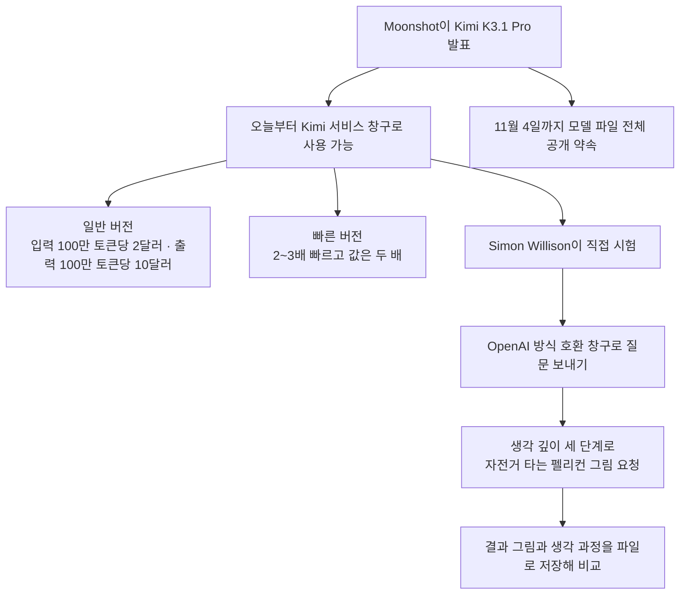

<article class="ai-knowledge-article">

<header class="ai-post-hero">
  <p class="ai-eyebrow"><a class="ai-back" href="../">이번 호</a> · 2026-10-26 · 학습 브리프</p>
  <h2 class="ai-post-title">Introducing Kimi K3.1 Pro (Simon Willison 노트)</h2>
</header>

> 원문: [Introducing Kimi K3.1 Pro (Simon Willison 노트)](https://simonwillison.net/2026/Oct/23/kimi-k31-pro/)

## 📌 학습 정리

### 1. 한 줄로 말하면

중국 회사 Moonshot이 만든 AI 모델 'Kimi K3.1 Pro'가 오늘 나왔어요. 지금 가장 앞서 있는 최상위 모델들과 거의 비슷한 성적을 내는데, 곧 모델 파일까지 누구나 내려받을 수 있게 풀겠다고 약속했어요.

### 2. 왜 이게 만들어졌어요?

지금까지 가장 똑똑한 AI 모델들은 대부분 회사 서버 안에만 있었어요. 쓰려면 그 회사 서비스를 통해 요금을 내고 빌려 써야 했고, 모델 파일 자체는 공개되지 않았죠. 누구나 내려받을 수 있게 공개된 모델도 있었지만, 성능 순위에서는 대개 최상위권보다 한 발 뒤에 있었어요. 원문을 쓴 Simon Willison은 곧 공개될 모델이 최상위권과 겨뤄서 이만큼 높은 점수를 받은 건 이번이 처음이라고 봤어요. 거기에 가격도 최상위 모델의 절반 수준이라, "비싼 모델을 꼭 써야 하나?"를 다시 따져 볼 만한 선택지가 하나 생긴 셈이에요.

### 3. 비유로 풀면

이건 마치 유명 레스토랑과 맛을 거의 비슷하게 낸 새 식당이 생긴 것과 같아요. 처음에는 그 식당에 가서 사 먹어야 하지만, 다음 달 4일에는 레시피를 통째로 공개하겠다고 한 상황이에요. 레시피가 풀리면 누구든 자기 부엌에서 같은 요리를 해 볼 수 있어요.

'빠른 버전(Highspeed)'은 같은 요리를 퀵서비스로 2~3배 빨리 받는 대신 값을 두 배 내는 옵션이라고 보면 돼요. 다만 이미 한 번 주문했던 재료를 다시 쓰는 부분(캐시가 맞은 입력)은 값이 똑같아요.

그래서 결국, 지금은 Moonshot 서비스로 빌려 쓰는 모델이지만 11월 4일 이후에는 모델 파일을 직접 받아서 쓸 수 있게 될 예정이라는 이야기예요.

### 4. 어떻게 작동하는지 (그림으로)



발표와 동시에 Kimi 서비스 창구로는 바로 쓸 수 있고, 모델 파일은 11월 4일까지 공개된다고 해요. Simon은 자기가 만든 명령줄 도구로 이 창구에 접속해서, 늘 하던 "자전거 타는 펠리컨을 SVG 그림으로 그려 줘" 시험을 생각 깊이 세 단계(low, medium, max)로 돌려 봤어요. 이 도구는 결과를 자동으로 기록하지 않아서, 답변과 생각 과정을 따로 파일에 저장했다고 해요.

### 5. 처음 보는 용어 풀이

- **모델 파일 공개 (open weights)**: AI 모델이 학습해서 얻은 숫자 덩어리(가중치)를 누구나 내려받을 수 있게 푸는 걸 말해요. 공개되면 회사 서비스를 거치지 않고도 직접 모델을 돌려 볼 수 있어요.
- **최상위권 모델 (frontier)**: 그 시점에 성능이 가장 앞선 모델들을 묶어 부르는 말이에요. 이 글에서는 Claude Opus 5.5, GPT-6 Astra 같은 모델이 여기에 들어가요.
- **토큰 (token)**: AI가 글을 읽고 쓰는 최소 단위로, 단어 조각쯤으로 생각하면 돼요. 요금이 "100만 토큰당 얼마"로 매겨지기 때문에 비용을 따질 때 기준이 돼요.
- **입력 캐시 적중 (input token cache hit)**: 예전에 보냈던 것과 똑같은 앞부분을 다시 보낼 때, 처음부터 새로 처리하지 않고 저장해 둔 결과를 재사용하는 경우예요. Kimi는 이 부분만큼은 빠른 버전도 일반 버전과 같은 값을 받아요.
- **성능 시험 (benchmark)**: 여러 모델에게 같은 문제를 풀게 해서 실력을 비교하는 시험지예요. 글에는 Moonshot이 직접 잰 결과와 외부 평가 기관인 Artificial Analysis의 점수가 함께 나와요.
- **생각 깊이 설정 (reasoning effort)**: 답하기 전에 모델이 얼마나 오래, 깊이 생각할지 정하는 옵션이에요. Kimi K3.1 Pro는 low, medium, max 세 단계를 지원해요.
- **OpenAI 방식 호환 창구 (OpenAI-compatible endpoint)**: OpenAI 서비스와 같은 형식으로 요청을 받도록 만들어 둔 접속 주소예요. 덕분에 OpenAI용으로 만든 도구를 그대로 다른 회사 모델에 연결해서 쓸 수 있어요.

### 6. 한 발 더 들어가고 싶다면

- [Introducing Kimi K3.1 Pro](https://www.kimi.ai/blog/kimi-k3-1-pro): Moonshot의 공식 발표문이에요. 모델 소개와 회사가 직접 잰 성능 비교를 볼 수 있어요.
- [Kimi 요금 안내](https://platform.kimi.ai/docs/pricing/chat): 일반 버전과 빠른 버전의 정확한 가격, 캐시 적중 시 요금이 어떻게 달라지는지 알 수 있어요.
- [Artificial Analysis의 Kimi K3.1 Pro 평가](https://artificialanalysis.ai/models/kimi-k3-1-pro): 외부 기관이 매긴 55점이 다른 최상위 모델들과 비교해 어디쯤인지 알 수 있어요.
- [llm의 OpenAI 호환 창구 사용법](https://llm.datasette.io/en/stable/other-models.html#openai-endpoint): Simon이 이번 시험에 쓴 명령이 어떻게 다른 회사 모델에 접속하는지 알 수 있어요.
- [Kimi K3.1 Pro 펠리컨 그림 모음](https://tools.simonwillison.net/markdown-svg-renderer?url=https%3A%2F%2Fgist.github.com%2Fsimonw%2F9b7181492209387da1d4f53002f26663): 생각 깊이 세 단계에서 그림이 어떻게 달라지는지 직접 볼 수 있어요. 이전 모델 결과는 [Kimi K3 펠리컨](https://tools.simonwillison.net/markdown-svg-renderer?url=https%3A%2F%2Fgist.github.com%2Fsimonw%2Feba9a4283c9e94cbbb5325902a3921a8)에서 비교해 볼 수 있어요.

---

## 📖 원문 전체 번역 (정독용)

> 의역 최소화한 전체 번역입니다. 큰 흐름은 위 정리에서 잡고, 정확한 워딩이 필요할 땐 이 섹션에서 정독하세요.

2026년 10월 23일 - 링크 블로그

**[Kimi K3.1 Pro 소개](https://www.kimi.ai/blog/kimi-k3-1-pro)** ([via](https://news.ycombinator.com/item?id=50212065 "Hacker News")) Kimi K3.1 Pro가 오늘 Kimi API에 출시되었습니다. 아직 오픈 웨이트는 아니지만, Moonshot은 "전체 모델 웨이트는 2026년 11월 4일까지 공개될 것"이라고 약속했습니다.

또한 2~3배 더 빠른 "Highspeed" 버전도 제공하는데, 가격은 두 배입니다(입력 토큰 캐시 적중분은 가격이 동일합니다).

[미국 달러 가격](https://platform.kimi.ai/docs/pricing/chat)은 입력 100만 토큰당 $2.00, 출력 100만 토큰당 $10로, GPT-6.1 Sol과 같고 Claude Opus 5.5의 절반입니다.

Moonshot 자체 벤치마크에서 Kimi는 Opus 5.5 및 GPT-6 Astra와 대략 같은 수준으로 나타납니다. 몇몇 벤치마크에서는 이들을 앞서고, 다른 벤치마크에서는 근접합니다.

Artificial Analysis는 [Kimi에 55점을 매겼습니다](https://artificialanalysis.ai/models/kimi-k3-1-pro). Claude Fable 5.1, GPT-6 Astra, Gemini 4 Argon(모두 53점)보다 앞서며, Claude Opus 5.5(58점)에만 뒤집니다.

(곧) 오픈 웨이트가 될 모델이 프론티어 모델들과 비교해 이렇게 높은 점수를 받은 것은 이번이 처음입니다.

저는 8월에 [LLM 0.32](https://llm.datasette.io/en/stable/changelog.html#v0-32)에 추가한 [llm openai endpoint](https://llm.datasette.io/en/stable/other-models.html#openai-endpoint) 명령을 사용해 [Moonshot API](https://platform.kimi.ai/docs/get-your-api-key)로 시험해 보았습니다:

```
llm openai endpoint \
  https://api.moonshot.ai/v1 \
  --key kimi \
  -m kimi-k3.1-pro \
  "Generate an SVG of a pelican riding a bicycle" \
  --responses \
  -o reasoning_effort low \
  > kimi-k3.1-pro-pelican-low.stdout.txt \
  2> kimi-k3.1-pro-pelican-low.stderr.txt
```

`llm openai endpoint`는 OpenAI 호환 엔드포인트라면 어디에나 프롬프트를 실행할 수 있지만 결과를 로그에 기록하지는 않습니다. 그래서 stdout과 stderr(추론 추적)를 저장하기 위한 추가 옵션을 붙였습니다.

Kimi K3.1 Pro가 지원하는 세 가지 추론 수준(low, medium, max)에서 얻은 [펠리컨들은 여기](https://tools.simonwillison.net/markdown-svg-renderer?url=https%3A%2F%2Fgist.github.com%2Fsimonw%2F9b7181492209387da1d4f53002f26663)에 있습니다. 다음은 max입니다:


비교를 위해, 같은 세 가지 추론 수준에서 [Kimi K3에 대해서도 새로 펠리컨을 실행했습니다](https://tools.simonwillison.net/markdown-svg-renderer?url=https%3A%2F%2Fgist.github.com%2Fsimonw%2Feba9a4283c9e94cbbb5325902a3921a8).

</article>
