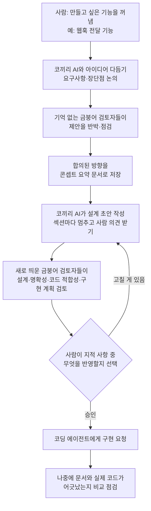

<article class="ai-knowledge-article">

<header class="ai-post-hero">
  <p class="ai-eyebrow"><a class="ai-back" href="../">이번 호</a> · 2026-11-16 · 학습 브리프</p>
  <h2 class="ai-post-title">google/elephant-goldfish-model — 에이전트와 함께 소프트웨어를 설계하고 리뷰하는 오픈소스 플러그인</h2>
</header>

> 원문: [google/elephant-goldfish-model — 에이전트와 함께 소프트웨어를 설계하고 리뷰하는 오픈소스 플러그인](https://github.com/google/elephant-goldfish-model)

## 📌 학습 정리

### 1. 한 줄로 말하면

프로젝트 사정을 다 기억하는 AI가 설계서를 쓰고, 앞선 대화를 하나도 모르는 AI들이 그 설계서를 처음 보는 눈으로 검토합니다. 최종 결정은 사람이 내리도록 짜인 도구예요.

### 2. 왜 이게 만들어졌어요?

요즘은 코딩 에이전트(coding agent), 그러니까 코드를 대신 짜 주는 AI 도우미와 긴 대화를 나누면서 기능을 설계하는 일이 많아요. 그런데 대화가 길어질수록 AI와 사람이 머릿속 전제를 똑같이 공유하게 돼요. 그러면 문서에 적지 않은 가정이 생겨도 둘 다 눈치채지 못하는 일이 생깁니다. 오래 같이 일한 팀원끼리만 아는 얘기가 기획서에서 빠지는 것과 비슷한 문제예요. EGM은 이 문제를 풀려고 역할을 둘로 나눴어요. 설계서를 쓰는 쪽은 맥락을 충분히 알고, 검토하는 쪽은 앞선 대화 없이 문서와 문서가 참조하는 자료만 보게 해서 빠진 가정과 보이지 않던 부분을 드러내자는 거예요. 이 아이디어는 [Dave Rensin’s original essay](https://medium.com/@drensin/elephants-goldfish-and-the-new-golden-age-of-software-engineering-c33641a48874)에서 출발했다고 해요.

### 3. 비유로 풀면

이건 마치 기획서를 쓴 담당자와, 회의에 한 번도 들어오지 않은 다른 팀 동료가 함께 일하는 것과 같아요. 담당자는 배경을 모두 알아서 문서를 빠르게 채울 수 있어요. 하지만 "이건 당연히 알겠지" 하고 넘어간 부분이 생기기 쉽죠. 회의에 없던 동료는 문서에 적힌 것만 읽으니까 "여기 이 경우는 어떻게 되는 거예요?" 하고 바로 짚어 냅니다.

이름도 여기서 왔어요. 기억력이 좋다고 알려진 코끼리(Elephant)는 프로젝트 맥락을 들고 있는 작성자예요. 기억이 짧다고 알려진 금붕어(Goldfish)는 매번 새로 와서 문서를 처음 보는 검토자고요.

그래서 결국 같은 AI라도 무엇을 기억하게 하느냐에 따라 역할을 나누고, 쓰는 일과 검토하는 일을 일부러 떨어뜨려 놓는 방식이에요.

### 4. 어떻게 작동하는지 (그림으로)



흐름은 "아이디어 다듬기 → 설계 초안 → 검토 → 사람의 승인 → 구현" 순서예요. 중요한 건 검토 단계마다 앞선 대화를 모르는 새 AI를 띄운다는 점이고, 원문은 이런 새 검토자를 만들 수 없는 환경이면 EGM이 검토를 아예 멈춘다고 설명해요. 꼭 처음부터 끝까지 순서대로 쓸 필요는 없어요. 이미 있는 설계 문서만 검토하거나, 문서와 코드가 어긋났는지만 확인하는 식으로 필요한 단계만 골라 써도 됩니다.

### 5. 처음 보는 용어 풀이

- **기능 확장 묶음 (plugin)** — 코딩 에이전트에 설치해서 새 기능을 더하는 꾸러미예요. EGM은 Claude Code, Codex, Antigravity 같은 여러 코딩 에이전트에 설치할 수 있고, 검토자용 지시문과 문서 기준까지 함께 쓰려면 플러그인 전체를 설치하라고 안내해요.
- **할 일별 기능 단위 (skill)** — 플러그인 안에 든 개별 기능이에요. EGM에는 아이디어 다듬기(Brainstorm), 초안 작성(Draft), 지적 사항 정리(Resolve), 기존 코드 문서화(Bootstrap), 검토(Review), 검토자 묶음 실행(Review loop), 어긋남 보고(Drift report)가 들어 있어요. Claude Code에서는 `/egm:egm-review`처럼 앞에 `/egm:`를 붙여 불러요.
- **설계 명세서 (specification)** — 코드를 짜기 전에 "무엇을, 어떤 규칙으로 만들지"를 글로 정리한 문서예요. EGM은 주로 이 명세서를 쓰고 검토하는 일을 도와요.
- **하위 에이전트 (subagent)** — 메인 AI가 따로 띄우는 보조 AI예요. 금붕어 검토자는 앞선 대화를 물려받지 않은 새 하위 에이전트로 띄워야 해서, 이 기능이 있는 환경에서만 검토가 돌아가요.
- **맥락 (context)** — AI가 지금 기억하고 참고하는 정보 전체예요. 코끼리는 프로젝트와 앞선 결정이라는 맥락을 가지고, 금붕어는 문서와 문서가 참조하는 자료만 맥락으로 받아요.
- **어긋남 (drift)** — 처음엔 문서와 코드가 맞았는데, 코드가 바뀌면서 점점 달라지는 현상이에요. Drift report는 폴더 안 문서를 지금 코드와 하나씩 비교해 어디가 달라졌는지 알려 주고, 문서를 고칠지 코드를 고칠지는 사람이 정해요.
- **장단점 저울질 (trade-off)** — 하나를 얻으면 다른 하나를 내줘야 하는 선택이에요. 원문은 이런 설계상 판단과 최종 승인을 AI가 아닌 사람의 몫으로 정해 두었어요.

### 6. 한 발 더 들어가고 싶다면

- [Getting started](https://github.com/google/elephant-goldfish-model/blob/main/docs/getting_started.md) — 이걸 보면 전체 작업 흐름과, 승인된 명세서를 `docs/designs/`에 저장하는 방법까지 알 수 있어요.
- [Setup](https://github.com/google/elephant-goldfish-model/blob/main/docs/harnesses.md) — 이걸 보면 내가 쓰는 코딩 에이전트에 설치하는 방법과, 환경별로 알려진 한계를 알 수 있어요.
- [Architecture](https://github.com/google/elephant-goldfish-model/blob/main/docs/designs/architecture.md) — 이걸 보면 스킬과 검토자들이 내부에서 어떻게 맞물려 돌아가는지 알 수 있어요.
- [Testing](https://github.com/google/elephant-goldfish-model/blob/main/TESTING.md) — 이걸 보면 이 도구를 어떻게 점검하는지와, 검토 결과를 어디까지 믿을 수 있는지 알 수 있어요. 원문도 검토가 테스트나 사람의 판단을 대신하지 않는다고 짚어요.
- [Dave Rensin’s original essay](https://medium.com/@drensin/elephants-goldfish-and-the-new-golden-age-of-software-engineering-c33641a48874) — 이걸 보면 "코끼리와 금붕어"라는 아이디어가 처음 어떤 생각에서 나왔는지 알 수 있어요.

---

## 📖 원문 전체 번역 (정독용)

> 의역 최소화한 전체 번역입니다. 큰 흐름은 위 정리에서 잡고, 정확한 워딩이 필요할 땐 이 섹션에서 정독하세요.

[](https://egm.dev/)

코끼리와 함께 설계하고, 금붕어로 리뷰하세요.

[설치](https://github.com/google/elephant-goldfish-model#install) · [퀵스타트](https://github.com/google/elephant-goldfish-model#try-your-first-design) · [문서](https://github.com/google/elephant-goldfish-model/blob/main/docs/getting_started.md) · [웹사이트](https://egm.dev/)

맥락을 가지고 아이디어를 발전시키고, 새로운 눈으로 문서를 리뷰하세요. EGM은 AI 어시스턴트를 위한 오픈소스 플러그인입니다.

**Elephant(코끼리)**는 프로젝트 컨텍스트를 보유하고 명세서 초안을 작성합니다. **Goldfish(금붕어)** 리뷰어는 이전 대화 없이 초안과 참조된 소스 자료만 검토하며, 명시되지 않은 가정과 사각지대를 드러내도록 돕습니다. **당신**은 아키텍처상의 트레이드오프를 결정하고, 구현에 앞서 명세서를 승인합니다.

내장된 초안 작성 및 설계 리뷰 워크플로우는 소프트웨어 명세서를 대상으로 합니다. 다른 문서의 경우 `/egm-review-loop`로 리뷰어와 기준을 선택하세요. 부트스트랩(Bootstrap)과 드리프트(drift) 보고는 소프트웨어 코드베이스에 적용됩니다.

egm-explainer.mp4[비디오 3](https://private-user-images.githubusercontent.com/5912894/698718516-93c799a2-10a3-4266-af02-eb79dd33a9a2.mp4?jwt=eyJ0eXAiOiJKV1QiLCJhbGciOiJIUzI1NiJ9.eyJpc3MiOiJnaXRodWIuY29tIiwiYXVkIjoicmF3LmdpdGh1YnVzZXJjb250ZW50LmNvbSIsImtleSI6ImtleTUiLCJleHAiOjE3OTQ3NjYwNzUsIm5iZiI6MTc5NDc2NTc3NSwicGF0aCI6Ii81OTEyODk0LzY5ODcxODUxNi05M2M3OTlhMi0xMGEzLTQyNjYtYWYwMi1lYjc5ZGQzM2E5YTIubXA0P1gtQW16LUFsZ29yaXRobT1BV1M0LUhNQUMtU0hBMjU2JlgtQW16LUNyZWRlbnRpYWw9QUtJQVZDT0RZTFNBNTNQUUs0WkElMkYyMDI2MTExNSUyRnVzLWVhc3QtMSUyRnMzJTJGYXdzNF9yZXF1ZXN0JlgtQW16LURhdGU9MjAyNjExMTVUMTgwMjU1WiZYLUFtei1FeHBpcmVzPTMwMCZYLUFtei1TaWduYXR1cmU9YWYxNWVkMjI5YzZiZWUxOWM4NzAyMTdjMTgxODFkNzc3NjI3NWIxZmY4ZDIwMjQ0YmQzOGI5MGU4MjEzOTVhNiZYLUFtei1TaWduZWRIZWFkZXJzPWhvc3QmcmVzcG9uc2UtY29udGVudC10eXBlPXZpZGVvJTJGbXA0In0.hTxP2rGAsJ5kh2Iqj9a2bbkvB1eS8FzyyHnB_iSSuyM)

## 설치

[](https://github.com/google/elephant-goldfish-model#install)
사용하는 코딩 에이전트를 선택하세요. 스킬이 리뷰어 프롬프트와 문서 표준을 읽을 수 있도록 플러그인 전체를 설치하세요.

### ChatGPT 및 Codex 데스크톱

[](https://github.com/google/elephant-goldfish-model#chatgpt-and-codex-desktop)
데스크톱 앱에서 [공개된 EGM 플러그인](https://chatgpt.com/plugins/plugins_6aeb90f47ec88191a3c107e01d3eb357)을 열어 설치하세요. 이 목록은 데스크톱 전용입니다. Codex CLI는 아래 명령어를 사용하세요.

### Antigravity CLI

[](https://github.com/google/elephant-goldfish-model#antigravity-cli)

agy plugin install https://github.com/google/elephant-goldfish-model

**Antigravity App** 및 **Antigravity for IDEs**(Visual Studio Code 확장)의 경우 `/plugin`을 실행하거나 [설치 안내](https://github.com/google/elephant-goldfish-model/blob/main/docs/harnesses.md#antigravity-app-and-antigravity-for-ides)를 참고하세요.

### Claude Code

[](https://github.com/google/elephant-goldfish-model#claude-code)

claude plugin marketplace add google/elephant-goldfish-model
claude plugin install egm@egm

### Codex CLI

[](https://github.com/google/elephant-goldfish-model#codex-cli)

codex plugin marketplace add google/elephant-goldfish-model
codex plugin add egm@egm

설치 후 새 세션을 시작하세요. **Claude Cowork**와 **ChatGPT Work**는 [설정 가이드](https://github.com/google/elephant-goldfish-model/blob/main/docs/harnesses.md)를 참고하세요.

## 기존 코드에 대한 60초 리뷰 체험

[](https://github.com/google/elephant-goldfish-model#try-a-60-second-review-on-existing-code)
기존 설계 문서, README, 또는 PR 계획을 실제 코드와 대조하여 리뷰하세요. 새 명세서를 작성할 필요는 없습니다. 아래 명령어는 Antigravity(agy CLI)와 Claude Code 기준으로 `/egm:` 접두사를 사용합니다. Codex에서는 스킬 선택기에서 해당 EGM 스킬을 선택하세요.

[](https://github.com/google/elephant-goldfish-model/blob/main/skills/egm-review/assets/icon.svg)**기존 문서 리뷰하기**

```
/egm:egm-review docs/designs/webhooks.md
```

설계 문서 경로, 또는 Markdown으로 저장한 PR 계획의 경로를 사용하세요. 새로운 리뷰어들이 설계, 명확성, 코드와의 적합성, 구현 계획을 점검합니다.

[](https://github.com/google/elephant-goldfish-model/blob/main/skills/egm-drift-report/assets/icon.svg)**드리프트 확인하기**

```
/egm:egm-drift-report docs/designs/
```

에이전트가 폴더 안의 각 문서를 현재 소스 코드와 비교하여 어디가 어긋났는지 보고합니다. 문서를 고칠지 코드를 고칠지는 당신이 결정합니다.

## 첫 번째 설계 체험

[](https://github.com/google/elephant-goldfish-model#try-your-first-design)
코딩 에이전트에서 프로젝트를 열고, 설계상의 결정이 필요한 기능을 하나 고르세요. 이 예시는 웹훅(webhook) 전달 기능을 추가합니다. 전달이 실패하거나 같은 이벤트가 두 번 도착하면 어떻게 해야 할까요?

아래 명령어는 접두사 없이 표시되어 있습니다. Antigravity(agy CLI)와 Claude Code에서는 `/egm:` 접두사를 붙이세요. 예: `/egm:egm-brainstorm`. agy CLI 1.4.10에서는 접두사 없는 이름이 접두사가 붙은 명령어로 자동 완성되지만([#220](https://github.com/google/elephant-goldfish-model/issues/220)), 1.4.8에서는 그렇지 않으므로([#196](https://github.com/google/elephant-goldfish-model/issues/196)) 접두사를 유지하세요. Codex에서는 스킬 선택기에서 해당 EGM 스킬을 선택하세요. 브레인스토밍과 리뷰에는 새로운 서브에이전트를 생성할 수 있는 세션이 필요합니다.

[](https://github.com/google/elephant-goldfish-model/blob/main/skills/egm-brainstorm/assets/icon.svg)**아이디어 탐색하기**

```
/egm-brainstorm Add webhook delivery to this project.
```

에이전트와 요구사항 및 트레이드오프를 논의하세요. 새로운 리뷰어들이 제안을 비판적으로 검토하고, 에이전트는 합의된 방향을 `concepts_brief.md`에 저장합니다.

[](https://github.com/google/elephant-goldfish-model/blob/main/skills/egm-draft/assets/icon.svg)**명세서 초안 작성하기**

```
/egm-draft
```

에이전트가 브리프를 `design_draft.md`로 만들며, 각 섹션이 끝날 때마다 멈추고 채팅으로 당신의 피드백을 받습니다.

[](https://github.com/google/elephant-goldfish-model/blob/main/skills/egm-review/assets/icon.svg)**초안 리뷰하기**

```
/egm-review design_draft.md
```

에이전트가 알려준 초안 경로를 사용하세요.

새로운 리뷰어들이 설계, 명확성, 코드와의 적합성, 구현 계획을 점검합니다. 어떤 발견 사항을 반영할지는 당신이 고릅니다. 설계를 승인하면 코딩 에이전트에게 구현을 요청하세요.

승인된 명세서를 `docs/designs/` 아래에 저장하는 방법을 포함한 전체 과정은 [워크플로우 가이드](https://github.com/google/elephant-goldfish-model/blob/main/docs/getting_started.md)를 참고하세요.

## 작동 방식

[](https://github.com/google/elephant-goldfish-model#how-it-works)
| 역할 | 컨텍스트 | 책임 |
| --- | --- | --- |
| **Elephant** | 당신의 프로젝트, 요구사항, 이전 결정 사항 | 문제를 탐색하고 명세서 초안을 작성합니다. |
| **Goldfish** | 문서와 그 참조 소스 자료(이전 대화는 없음) | 빠진 가정, 불명확한 요구사항, 구현 리스크를 찾아냅니다. |
| **당신** | 중요한 목표와 제약 조건 | 트레이드오프를 해결하고, 설계를 승인하며, 무엇을 만들지 결정합니다. |

Goldfish 리뷰에는 새로운 서브에이전트 컨텍스트가 필요합니다. 에이전트가 이를 생성할 수 없으면 EGM은 리뷰를 중단합니다. 리뷰가 테스트나 사람의 판단을 대체하지는 않습니다. [지원 환경과 검증 한계](https://github.com/google/elephant-goldfish-model/blob/main/docs/harnesses.md#support-status--contributing-other-harnesses)를 참고하세요.

## 스킬 선택

[](https://github.com/google/elephant-goldfish-model#choose-a-skill)
각 스킬은 필요할 때 따로 사용할 수 있습니다. 전체 순서를 따를 필요는 없습니다.

| 스킬 | 용도 |
| --- | --- |
| [](https://github.com/google/elephant-goldfish-model/blob/main/skills/egm-brainstorm/assets/icon.svg)[Brainstorm](https://github.com/google/elephant-goldfish-model/blob/main/skills/egm-brainstorm/SKILL.md) | 아이디어를 검증하고 컨셉 브리프를 작성합니다. |
| [](https://github.com/google/elephant-goldfish-model/blob/main/skills/egm-draft/assets/icon.svg)[Draft](https://github.com/google/elephant-goldfish-model/blob/main/skills/egm-draft/SKILL.md) | 브리프나 기존 노트를 설계 문서로 만듭니다. |
| [](https://github.com/google/elephant-goldfish-model/blob/main/skills/egm-resolve/assets/icon.svg)[Resolve](https://github.com/google/elephant-goldfish-model/blob/main/skills/egm-resolve/SKILL.md) | 리뷰 발견 사항을 처리하고 변경 사항에 합의합니다. |
| [](https://github.com/google/elephant-goldfish-model/blob/main/skills/egm-bootstrap/assets/icon.svg)[Bootstrap](https://github.com/google/elephant-goldfish-model/blob/main/skills/egm-bootstrap/SKILL.md) | 기존 코드베이스의 문서를 생성하거나 갱신합니다. |
| [](https://github.com/google/elephant-goldfish-model/blob/main/skills/egm-review/assets/icon.svg)[Review](https://github.com/google/elephant-goldfish-model/blob/main/skills/egm-review/SKILL.md) | 새로운 에이전트들이 5단계에 걸쳐 설계를 리뷰합니다. |
| [](https://github.com/google/elephant-goldfish-model/blob/main/skills/egm-review-loop/assets/icon.svg)[Review loop](https://github.com/google/elephant-goldfish-model/blob/main/skills/egm-review-loop/SKILL.md) | 특정 리뷰 작업을 위해 구성된 리뷰어 그룹을 실행합니다. |
| [](https://github.com/google/elephant-goldfish-model/blob/main/skills/egm-drift-report/assets/icon.svg)[Drift report](https://github.com/google/elephant-goldfish-model/blob/main/skills/egm-drift-report/SKILL.md) | 체크인된 문서를 현재 소스 코드와 비교합니다. |

## 더 알아보기

[](https://github.com/google/elephant-goldfish-model#learn-more)
*   [시작하기](https://github.com/google/elephant-goldfish-model/blob/main/docs/getting_started.md): 워크플로우와 프로젝트 구조.
*   [설정](https://github.com/google/elephant-goldfish-model/blob/main/docs/harnesses.md): 설치, 에이전트 기능, 알려진 한계.
*   [아키텍처](https://github.com/google/elephant-goldfish-model/blob/main/docs/designs/architecture.md): 스킬과 리뷰어가 어떻게 맞물리는지.
*   [테스트](https://github.com/google/elephant-goldfish-model/blob/main/TESTING.md): 점검, 실행 기록, 검증 한계.
*   [Dave Rensin의 원본 에세이](https://medium.com/@drensin/elephants-goldfish-and-the-new-golden-age-of-software-engineering-c33641a48874): EGM의 배경이 된 아이디어.

## 기여하기

[](https://github.com/google/elephant-goldfish-model#contribute)
접근성 목표, 알려진 한계, 장벽 신고 방법은 [접근성 성명](https://github.com/google/elephant-goldfish-model/blob/main/ACCESSIBILITY.md)을 참고하세요.

PR은 [기여 가이드](https://github.com/google/elephant-goldfish-model/blob/main/CONTRIBUTING.md)를, 버그는 [이슈](https://github.com/google/elephant-goldfish-model/issues)를, 질문은 [토론](https://github.com/google/elephant-goldfish-model/discussions)을 이용하세요.

## 라이선스

[](https://github.com/google/elephant-goldfish-model#license)
[Apache 2.0](https://github.com/google/elephant-goldfish-model/blob/main/LICENSE). 이것은 Google이 공식적으로 지원하는 제품이 아닙니다.

</article>
